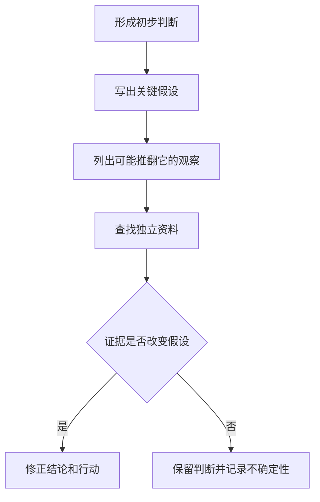

# 《清醒思考的艺术》读书笔记

> 作者：罗尔夫·多贝里（Rolf Dobelli）。本稿以中文“52 种思维错误”版的公开目录为主题索引；参考书目为中信出版社、朱刘华译、ISBN 9787521783896。英语 The Art of Thinking Clearly 的编排与内容数量不同，不把两个版本的章节编号混用。  
> 依据：公开书目、目录和作者说明，以及相关原始研究和机构资料。未取得指定中文版全文，属于主要框架与研究补充导读，不声称核验全部原书轶事。  
> 范围：将 52 项主题按机制归并成 33 个知识点，重点展开对投资、消费和判断有用的部分。  
> 更新日期：2026-11-12

## 先看这里

这本书适合当作“容易在哪一步想错”的检查表。它的优势是把常见错误说得容易识别，局限是短篇形式容易让人把有条件的研究结论记成绝对定律。

读它时不要忙着给别人贴“确认偏误”“从众”标签。更有用的是为自己设计动作：在选基金之前补齐失败者，在决定加码之前重算未来，在讨论之前独立写判断，在看到好故事时先找分母。

本笔记以[中文书目及 52 项目录](https://www.yuntaigo.com/book.action?recordid=b2hobHpiZmM5Nzg3NTIxNzgzODk2)为范围，概念分组和实际操作为重新组织。重点读 1、5、7、14、18、22、31。

## 主题怎么串起来

| 判断阶段 | 容易忽略的东西 | 对应位置 |
| --- | --- | --- |
| 取得信息 | 失败者、选择过程、基础比例 | 1—4、10、23 |
| 解释信息 | 反证、共同原因、利益结构 | 7—8、11—17、29 |
| 比较方案 | 沉没成本、锚点、所有权、概率 | 5—6、9、18—21、24—28 |
| 作出行动 | 群体压力、措辞、行动冲动与拖延 | 22、30—31 |
| 事后学习 | 运气、选择性记忆、自我辩护 | 3、12、17、32—33 |

每个偏差的名字只应提醒你检查一种可能。现实中的同一行为，可能有合理解释，也可能受到多个机制影响。没有行为和情境证据，不能诊断一个人。

## 核心知识点

### 1. 幸存者与自我选择：先问没进入画面的人在哪里

只看成功者，容易把他们共有的特征误认为成功原因。失败者可能也勤奋、自信、读同样的书，只是没有进入访谈和榜单。自我选择则进一步提醒我们：愿意参与某项活动的人，本来就可能不同。

**真实数据实践：CRSP 基金数据库。** 该数据库保留活跃及已退出基金的历史，正是为了支持避免幸存者偏差的研究；它没有把不再销售的基金从过往世界删除。[CRSP 官方说明](https://www.crsp.org/research__trashed/crsp-survivor-bias-free-us-mutual-funds/)

设想你现在研究“长期持有某类基金是否容易成功”，正确起点应是研究开始时可选择的集合。先看今天名单，再回溯谁过去表现好，等于提前知道谁活下来了。这不是计算技术问题，而是研究对象选错。

真实数据库的存在说明，专业分析会主动保留失败与退出。但它不保证使用者的每个研究都无偏：还需要处理费率、合并、历史风格和可投资性。不要因为看见“无幸存偏差”标签，就省略其他检查。

**练习：** 只调查“仍在某投资群的人”，得到高满意度，最应补查什么？退出者、未响应者及入群规则；扩大现有成员样本不能替代这些人。

### 2. 选择结果与训练效果不能混为一谈

原书借“游泳选手身材”的说法提示反向选择：某些特征可能帮助人进入一个群体，而不是加入群体以后才被它造成。

培训机构学员收入高，可能有教学作用，也可能因入学者本来能力强、家庭资源多、筛选标准高。要评价增量价值，须寻找合理对照和入学前差异，而不是只把毕业照与普通人比较。

### 3. 过度自信与新手运气：信心要跟证据一起增长

刚开始连续成功，可能是能力，也可能是碰上有利环境。样本短时，二者很难分开。把短期回报直接当作稳定优势，容易在下一阶段放大风险。

记录事前判断、投入风险和失败条件；成功后也检查是否依赖未预见的好运。可以提高熟练度，但不应让一段上涨行情自动扩大自己声称懂得的领域。

### 4. 从众提供线索，不能替代事实核验

他人的选择有时包含信息，但也可能只是互相模仿。若所有人都参考同一个消息源，一百次重复并不等于一百份独立证据。

研究热门股票时，先寻找原始公告及不同的信息渠道。你可以把热度作为“市场在关注什么”的材料，却不能把热度本身当作价值依据；价格还可能已经反映这份共识。

### 5. 沉没成本：过去付出不能单独决定下一笔投入

已经无法收回的支出，会影响情绪，却不应单独成为继续投入的理由。真正要比较的是从现在开始，不同选择各自产生的未来现金、风险和义务。

**真实企业决策：伯克希尔退出纺织业务。** 巴菲特在 1985 年股东信中解释，设备投资虽可能改善单家公司的效率，同行普遍跟进后，收益仍可能经竞争转移给客户。过去投入与保留业务的感情，并没有改变未来资本回报的问题。[1985 年原信纺织业务段](https://www.berkshirehathaway.com/letters/1985.html)

这不是一句“亏损就立刻退出”。真实退出还有员工安排、合同义务、设备处置和未来现金成本。沉没成本分析不要求忽略这些未来后果；它只要求把无法改变的历史支出与仍可改变的后果分开。

用于投资时，应问：若今天手里只有现金，是否愿意按当前条件持有相同权益？这不是唯一决策标准，因为税费和转换成本仍需算；但它能帮助发现“只因不愿承认过去判断错误而继续”的情况。

**自测：** 已经研究一家公司很久，所以必须买入才不浪费，哪里不对？研究时间已付出；新的买入仍要单独满足证据、价格和风险要求。学习本身可以保留价值，不必再投入本金证明它。

### 6. 互惠：礼物产生的感谢，不等于交易条件变好

接受帮助后想回报，是合作中常见的动力。但提供服务、赠品或免费研究的人，未必因此提供了更适合你的产品。

将人情与产品评价分开：感谢可以表达，费用、风险和替代方案仍应独立比较。不能因一次善意就推定对方恶意操控，也不必为一份自愿赠送的材料承担未约定的购买义务。

### 7. 确认偏误：主动寻找会让自己改变看法的材料

确认偏误不仅表现为挑喜欢的文章，也可能表现为不断修改定义，让模型永远支持想要的答案。

**真实监管复盘：硅谷银行。** 美联储在 2023 年复盘中指出，该机构曾用改变存款久期的模型假设处理风险限额突破，而没有相应管理实际风险。[美联储原始总结](https://www.federalreserve.gov/publications/2023-april-svb-executive-summary.htm)

这里不能从公开报告诊断每位管理者的心理，更不能说所有模型调整都不正当。它提供一个具体检查点：当现实让原结论难以维持时，你是在修改风险安排，还是只修改衡量风险的尺子？

对股票研究，可以在建模前写明哪些变量由外部数据决定，哪些是自己的假设。若价格下跌后只提高长期增长率，或只改变折现率以保持“仍然便宜”，需要解释新依据来自哪里。

主动反证并不是必须否定自己。它是列出最可能推翻观点的条件，寻找有能力证明它们存在或不存在的资料。找到反对文章但只挑最弱论据反驳，并不算完成反证。

图中关键不是“必须改变”，而是事先允许证据改变结论。没有这个出口，研究容易变成辩护。

### 8. 权威与“司机式知识”：表达流利不等于理解机制

一个人可以复述专业用语，却无法解释适用条件、反例和推导。身份与履历能帮助筛选信息源，但不能替代具体论证。

请对方解释：这个结论依赖什么，什么情况下会错，有哪些独立证据。真正的专业通常也包括知道边界；把所有问题都回答得极其确定，并不自动更可信。

### 9. 对比与锚定：比较基准会改变你对同一对象的感受

先出现的报价、历史高点和目标价，可能成为后续判断的起点。一个折扣很大，也可能只是原价没有合理依据。

给基准寻找独立证据：可比产品、企业现金流、替代机会和自己的需求。不要因为价格低于某个曾经出现的数字，就把差额叫作安全边际。

### 10. 容易想到，不等于发生得更频繁

生动、最近、反复出现的信息更容易被回忆。它可以提示调查方向，却不能直接充当总体频率。

在研究行业风险时，找包含正常年份和失败案例的完整记录。看到一次爆雷后需要检查共同机制，但不能仅凭记忆强度就认为所有相似公司已经具有相同风险。

### 11. “先变坏后变好”必须有可检验条件

有些改革确实需要付出前期成本；问题在于这句话也容易成为无限延期的借口。如果任何坏结果都被解释成成功的必要前奏，主张就失去了失败条件。

要求明确阶段目标、观察期限、成本上限和退出条件。企业转型可先亏损，但要能解释客户、产能或现金回收哪一步正在改善，而不是只让投资者继续等待。

### 12. 故事与事后诸葛：结果会让过去显得更有秩序

人容易把零散事实串成一条顺畅因果链，也容易在结果出现后觉得当时早已注定。流畅叙述能帮助理解，却可能删掉岔路、偶然和当时不知道的信息。

保留事前记录，把“我当时相信什么”与“后来发生什么”分开。复盘不只是寻找能够解释结果的故事，还要问相同规则在其他可能结果下是否仍然合理。

### 13. 控制错觉：分清可以决定与只能观察的变量

你可以选择研究流程、成本、仓位和是否交易；不能控制别人报价，也不能决定市场何时承认某个估值。

频繁看盘可能增加参与感，却不自动增加控制力。把行动与可检验机制连接起来：一次操作改变了什么风险或证据条件？若只改变了焦虑程度，应承认它是情绪管理，而不是新的投资优势。

### 14. 激励会改变行为，指标也可能被“做出来”

**真实案例：富国银行未授权开户。** CFPB 2016 年公告记载，销售目标和奖励与员工未经客户授权开户的问题有关，并对银行作出处罚。[监管原始材料](https://www.consumerfinance.gov/archive/newsroom/consumer-financial-protection-bureau-fines-wells-fargo-100-million-widespread-illegal-practice-secretly-opening-unauthorized-accounts/)

如果只看账户数量增长，可能把被激励出来的数字当成客户真实需求。问题发生在“目标是什么、奖励什么、如何核实”这一整套关系中，而不只是末端报表的算术。

理解激励不等于认为人人都会作弊。应该检查指标是否容易替代真实目的，质量是否能被独立观察，以及短期奖励是否把长期代价留给别人。

投资者读管理层薪酬方案时，可以比较增长、利润、现金、回报率和风险约束的组合。仅奖励规模，可能鼓励低回报扩张；仅奖励短期利润，也可能牺牲维护和研发。具体效果仍需用经营证据验证。

### 15. 均值回归不是“涨多必跌”的交易口诀

当极端表现同时包含稳定能力和偶然因素时，下一次表现往往不会重复相同的好运或坏运。这里谈的是条件性统计现象，不是某只股票必须回到过去价格。

若公司发生永久变化，参照分布也可能变化。研究优秀基金或异常差的季度时，要分开可持续机制、一次冲击和测量噪声，不能仅凭偏离平均就断言下一步方向。

### 16. 公地与社会闲散：个体合理行为未必产生良好整体

共同资源的消耗若由所有人分担，使用者可能缺少节制动力；团队产出难以归责时，也可能削弱个人投入。这些是制度和信息问题，不宜简单归为人品问题。

设计分工时，明确贡献、责任和反馈，并避免奖励个人数字却损害共同目标。对企业，应看内部业务是否把风险和费用推给集团其他部分，不能把局部利润直接当作整体增值。

### 17. 结果偏误与替代路径：一次赚钱不能证明过程优良

同一决定可能产生不同结果。对过程的评价应考虑当时可用信息、概率、代价和可承受性；只看实际结局，会奖励冒险的好运，也会惩罚合理决策中的坏运。

替代路径不是编一个无限糟糕的未来吓自己，而是检查与机制相容的其他结果。若其中一次就会使资金链断裂，平时的小额盈利不能自动证明策略合适。

### 18. 选择过多有时妨碍决策，但“越少越好”也不是定律

**真实研究：果酱与选择。** Iyengar 和 Lepper 的 2000 年研究在商店及实验情境比较有限与更多选项，发现某些条件下较少选择更有利于购买或投入。[研究者所在机构的原论文信息](https://business.columbia.edu/faculty/research/when-choice-demotivating-can-one-desire-too-much-good-thing)

研究提醒我们，增加选项会同时增加比较成本、预期后悔和筛选负担。但它不能证明任何产品列表都应缩到同一个数量。

**真实后续证据：** Scheibehenne 等人在 2010 年汇总 50 项已发表与未发表实验、63 个条件，发现总体平均效应接近零，同时研究间差异较大。[原始元分析](https://scheibehenne.de/ScheibehenneGreifenederTodd2010.pdf)

这不是简单宣布前一个实验“被推翻”，而是缩小可推广的范围：是否已有清楚偏好、选项难度、比较方式与任务目标，都值得进一步研究。一个生动实验不能替代整体证据。

用于投资，可以先确定费用、风险、范围和可理解性的筛选条件，再在剩余产品中比较。减少无关选项是降低负担，不是拒绝对替代方案进行必要调查。

### 19. 讨喜、光环与联想：一个优点不会自动传递到所有维度

喜欢产品外观，不能直接推出公司财务稳健；欣赏创始人讲话，也不能推出证券价格合理。人容易让一个鲜明印象覆盖多个本应独立验证的问题。

将评价拆栏：产品体验、客户需求、管理质量、现金与债务、价格。每栏只写对应证据。美好的品牌联想可以是需要研究的资产，但不应替所有财务假设担保。

### 20. 禀赋与损失厌恶：拥有以后，标准可能悄悄变化

已经持有的东西更容易被赋予特殊价值；相同金额的损失与获得，也可能带来不同感受。这会影响卖出、换仓和对新证据的接受。

把“我付了多少钱”与“从今天开始的价值和风险”分开。买入成本涉及税费和个人结果，但不能自动决定公司的未来价值。纠正偏差不等于机械卖出所有亏损资产。

### 21. 罕见事件与归纳：没有遇到，不等于没有可能

有限观察只能支持有限范围的判断。一个过程长期平稳，可能是机制稳定，也可能是尚未触及脆弱条件。

对不可承受的后果，应先研究结构暴露和约束，不把“过去从没发生”作为唯一安全证据。反过来，知道某件事可能发生，也不意味着可以精确给出时间或从中盈利。

### 22. 群体一致不等于信息完整

**真实调查：挑战者号事故。** 1986 年调查报告指出，沟通失败、工程资料与管理判断冲突，以及信息绕过关键管理者，是发射决策中的问题。[NASA 保存的原始报告第五章](https://www.nasa.gov/history/rogersrep/v1ch5.htm)

这份材料不能被缩成“聪明人开会就会犯群体思维”，也不应替每位参与者猜动机。它说明团队最终作出一个决定，不意味着相关事实已经完整到达决策位置。

改进方法是让异议有明确路径：先独立写判断，再共享依据；把不确定性和不同意见保留在结论里；明确谁能暂停决定，以及需要什么资料才可继续。仅要求大家勇敢发言，而不改变信息流和权限，可能不够。

投资讨论同样如此。人数再多，若只有一个数据源、同一种利益和相同截止压力，也未必比一个认真查证的人知道得更多。

### 23. 概率、基础比例与合取：故事完整不代表更可能

判断一家公司成功，既要看它的独特信息，也要看相似公司通常怎样。生动描述不能自动抹去基础比例；多个条件同时成立的概率，也不会高于其中任何单一条件成立的概率。

先把条件写成集合，再检查依赖关系。若多个风险来自同一个因素，不能假装独立相乘；若缺少可信频率，就说明范围与不确定性，不用一个漂亮百分数遮盖未知。

### 24. 零风险标签容易分散对更大风险的注意力

把某一个小风险完全消除，可能让人感觉比减少更大的总风险更舒服。但预算、时间和流动性有限，必须比较全部后果。

金融产品说“某环节有保障”，不等于所有风险归零。要问保障对象、资金来源、条款与仍由自己承担的损失。安全应按完整结构检查，而不是按一个词判断。

### 25. 稀缺会增强吸引力，却不增加使用价值的证据

限量、限时和排队能改变主观关注，但供给少不必然意味着东西好。投资标的再稀少，也需要有经济权利、现金来源和合适价格。

遇到稀缺叙事，分别核查“是否真的稀缺”和“稀缺为什么对我有价值”。前者即使成立，也不能替代后者。

### 26. 赌徒谬误：独立随机过程不会替你补偿过去

若每次试验独立，连续出现某结果，并不会迫使下一次向反方向补偿。这里是概率条件，不是说所有现实价格序列都独立。

因此，“连续跌了很多天，所以明天该涨”需要另外的供需或估值机制；“连续涨了，所以永远有效”同样缺少证据。先说明过程是否独立或存在反馈，不能随意借用硬币类比。

### 27. 指数增长：百分比重复作用于变化后的基数

复利的机制来自收益留在基数里继续参与变化。早期绝对增量小，后期增量大，人容易在不同阶段分别低估与高估它。

数学上，固定增长率 r 持续 n 期后的倍数为 `(1+r)^n`；现实中最难证明的恰好是“固定且可以持续”。公司增长会受到竞争、需求和资本约束，不能把指数公式当成商业证据。

### 28. 赢家诅咒：竞争获胜可能意味着估值最乐观

在真实价值不确定、参与者估计有噪声的竞价中，最高报价可能来自最乐观的估计。赢得资产并不自动意味着获得了好的价格。

更激烈的竞争应使你重新检查信息优势、误差和退出条件，而不是只把“必须拿下”当目标。并购、土地、收藏品和热门证券都需要问：我的出价为什么比其他人高，依据是什么？

### 29. 归因与虚假因果：不要用一个人的性格替代全部环境

观察到成败后，人容易夸大个性因素，忽略制度、资源和运气。两个现象一起出现，也可能受到第三因素驱动。

分析管理层时，应同时看可控行动和外部条件。不能把行业景气全部算成能力，也不能把不可控冲击全部算成失职；最终仍要追查当时可作出的具体选择。

### 30. 预测与框架：记录事件定义，也记录呈现方式

模糊预测很容易事后解释成正确。先规定对象、期限、衡量指标和结果来源，才有资格评价准确度。

同一结果用收益或损失描述，会改变感受。把两种表达转换到共同金额和共同概率，再比较行动。框架的影响提醒你复核表达，不意味着任何情绪都必须排除。

### 31. 行动与不作为：哪种更舒服，取决于情境规范

**真实研究：足球守门员扑点球。** Bar-Eli 等人的 2007 年论文分析 286 次点球，并通过守门员调查讨论为什么“跳出去”更符合行动规范。[原论文](https://r.jordan.im/download/investing/bar-eli2007.pdf)

作者根据观察到的射门与扑救分布讨论留在中间的价值，而实际守门员大多选择向一侧跳。这提醒我们，有时“看起来尽力了”会成为额外目标。

不过，这不是随机分配守门策略的实验，也不能教所有守门员以后永远站中间。对手会适应，样本和当时的信息也有限；更不能直接从体育结果推导出股票永远不交易最好。

可迁移的问题是：我这次操作是否有证据和净收益理由，还是只为了不显得被动？同样，不作为也可能来自怕承担责任。要比较行动与等待各自的后果，不能给其中一个永久贴上理性标签。

### 32. 自利解释与认知失调：复盘要允许自己曾经想错

成功归功自己、失败归咎环境，会阻碍学习。已经公开表达或投入资金后，人也可能通过改变叙事来缓和内心冲突。

复盘时先恢复原始记录，再讨论原因。把“信息错误”“推理错误”“执行偏离”“已知风险实现”分开；承认一处错误，不等于否定自己整个人，也不要求把所有损失都归咎个人。

### 33. 享乐适应与时间偏好：长期目标需要落实到今天的环境

得到新东西带来的满足可能逐渐减弱，人却容易不断提高消费标准。与此同时，立即可得的奖励往往比遥远回报更有吸引力。

改善方法不是只要求自己更自律，而是降低有益行动的摩擦：提前确定储蓄流程、将必要支出分开、减少冲动购买入口。具体安排要符合现金流，不把某个固定比例当作所有人的答案。

## 覆盖说明与使用方法

中文 52 项主题按以下方式归并：幸存与自我选择、信心与新手运气、两项确认、权威与司机式知识、对比与锚定、故事与事后解释、公地与社会闲散、结果与替代路径、讨喜与光环及联想、禀赋与损失、罕见事件与归纳、概率与基数及合取、归因与因果、预测与框架、行动与不作为、自利与认知失调、适应与时间偏好。其余主题单独解释。没有把英语版额外条目混称为本版章节。

图解的重点是把偏差名称变成检查动作。只在亏钱后说“原来是损失厌恶”，并没有改变下一次决策的条件。

## 三个练习

1. **继续一个亏损项目，是不是一定犯沉没成本错误？** 不是。若未来增量收益仍合理，继续可能有依据；需要排除的是“因为过去付出很多，所以无需再算未来”。
2. **果酱实验是不是证明选项越少越好？** 不是。原研究和元分析的范围不同，说明效果依赖条件；先确定任务与偏好，再设计筛选。
3. **全体成员同意买入，是否说明风险已充分讨论？** 不能。检查他们的信息来源是否独立、异议是否被保留、有没有人承担反证角色。

## 来源与阅读边界

书目与目录见开头链接；真实材料在相关知识点附 CRSP、伯克希尔、美联储、CFPB、NASA 与原始论文。没有将机构事件直接诊断为某个人具有特定心理偏差；它们用于说明需要检查的机制。

这本书的短篇标签不等于一套完整的心理学证据等级。实验可能受人群、年代和场景影响，现实决策也常由多个机制共同作用。应用时应保留边界，把“我认识这个偏差”进一步变成“我知道怎样检验自己是否正在犯错”。
