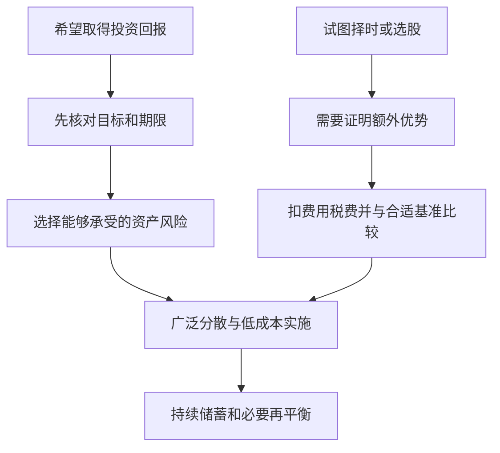
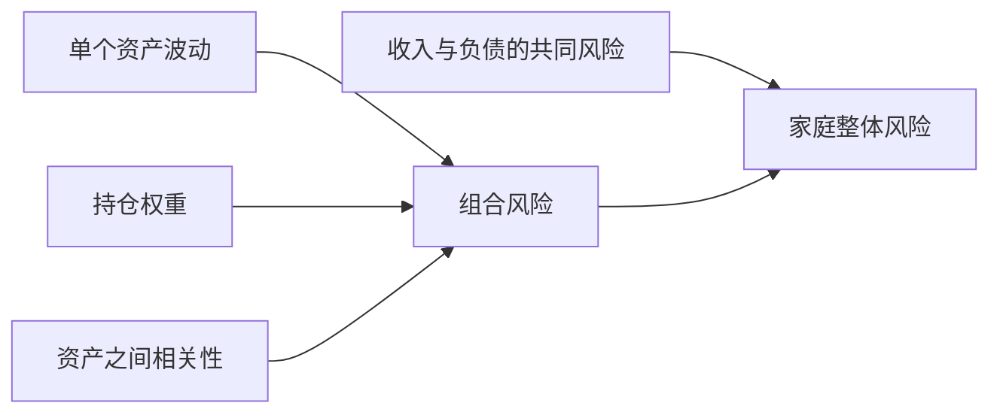

# 《漫步华尔街》读书笔记

> 作者：伯顿·马尔基尔（Burton G. Malkiel）；英文名：A Random Walk Down Wall Street。  
> 版本：初版于 1973 年问世；出版社现有第十三版五十周年版资料，本次核对的英国平装书页出版日期为 2024-01-30。用户中文译本未确认。  
> 资料范围：基于出版社介绍、美国国会图书馆所列旧版目录、作者论文及一手历史资料整理。未取得全书；以历版共通框架为主体，现代因子、ETF 等补充注明边界，不声称精读第十三版每一新增章节。  
> 覆盖：28 个知识点，涵盖估值与泡沫、分析方法、市场效率、组合理论、行为偏差、投资工具及生命周期规划。  
> 更新日期：2026-11-12。

版本见[第十三版出版社书页](https://wwnorton.co.uk/books/9781324035435-a-random-walk-down-wall-street-04e7966c-6f5e-469f-a62e-69352a44ab82)，结构参照[国会图书馆的出版社供稿目录](https://catdir.loc.gov/catdir/toc/ecip072/2006033183.html)；旧版目录不能当作新版逐章索引。

## 本书的主张是什么

**普通投资者不必先证明自己能预测市场，才有资格参与长期投资。** 马尔基尔把股票历史、资产定价、专业投资者表现和个人财务规划放在一起，主张认真储蓄、广泛分散、控制成本，并优先考虑简单的指数化方案。

“随机漫步”最容易被误读。它不是说企业毫无价值，也不是说明天涨跌必须各有一半概率；它强调根据已经公开的信息，稳定、低成本地预测下一步价格通常很困难。价格可以有错，人也可以不理性，但发现并可靠利用错误，并没有因此变得容易。

本书同时提供一套检查复杂投资故事的工具：收益从哪里来，是否已经被价格反映，有没有比较合适的基准，扣完成本以后还剩什么。它的实用目标是形成可执行的投资安排，而不是在学术争论中选一个永远正确的阵营。

## 全书主线

| 主要部分 | 论证任务 | 本笔记覆盖 |
| --- | --- | --- |
| 股票及其价值、投机历史 | 区分价值依据与接盘预期 | 1—5 |
| 专业人士怎样分析市场 | 检查预测、图形、研究和基金记录 | 6—11 |
| 新投资理论 | 分散、系统风险、行为与因子 | 12—18 |
| 个人投资实践 | 资金基础、工具、回报、生命周期与执行 | 19—28 |

图意：主动研究不是被禁止，而是需要承担更高的证据责任；账户增长不能自动证明研究创造了超额收益。

## 核心知识点

### 1. 投资先关心未来购买力，而非账户是否每天上涨

储蓄、投资与投机有不同作用。短期必需资金要重视可用性，长期资金需要面对通胀和增长问题；不能只因某类资产过去上涨，就把所有资金都放进去。

比较回报时须说明是否包含分红、是否扣费、是否扣通胀。看价格走势图与看长期总回报不是同一件事。最终目标是资金能否支持未来生活，而不是在任何一年都赢过身边的人。

### 2. 坚实基础与空中楼阁，是两种不同的付价理由

坚实基础方法试图根据未来现金、增长和风险估计价值；空中楼阁方法则重视别人将愿意支付什么价格。市场中两种力量都可能存在，问题在于投资者是否知道自己主要依赖哪一种。

分析价值也不意味着拥有精确答案。增长期越长，估值对远期假设越敏感；一个模型能解释当前价格，不等于它的假设合理。只预测别人更乐观的交易，则需要承认退出和流动性风险。

### 3. 增长率、分配能力和要求回报共同影响价值

数学演示：在永久稳定增长、下一期股息为 D、要求回报率 k 大于增长率 g 的严格假设下，股息折现模型为 `价值＝D÷(k－g)`。若 D＝3 元、k＝8%、g＝3%，价值为 60 元；若 g 改为 5%，模型值变为 100 元。

没有新增一元实际现金，估值就因假设明显改变。这说明模型应展示情景和敏感性，不能把小数点很多当作准确。高增长不可能不加限制地永久外推，且股息未必等于企业全部可分配现金。

### 4. 泡沫常把真实进步与不合理价格结合起来

一种技术、行业或商业模式确实改变世界，并不代表所有相关股票在所有价格上都合算。市场会把部分真实增长，进一步扩张成人人都能获得超高利润的故事。

读本书的投机历史，重点不是背出每次泡沫的最高点，而是辨认反复出现的机制：估值纪律变松，难验证的新指标代替现金，竞争与资本需求被忽略，价格上涨又被当成原叙事正确的证据。历史中的“新”有不同内容，推理错误却可能相似。

### 5. 大跌提醒你风险会集中爆发，不提供下次危机的日期

**真实历史：1987 年 10 月 19 日。** 美联储历史资料记载，道琼斯工业平均指数在一个交易日下跌 22.6%。该事件涉及跨市场联系、交易与流动性压力，不能只用一个新闻标题解释。[美联储历史回顾](https://www.federalreservehistory.org/essays/stock-market-crash-of-1987)

这个数字不应仅用于制造恐惧。它首先提醒人们，正常时期估计的波动和成交条件可能不足以覆盖压力情景。即使持有许多股票，市场共同冲击仍会发生；卖出指令也不保证在原先设想的价格执行。

但从一次暴跌反推“可以提前识别所有暴跌”，是另一种错误。知道市场历史上可能发生极端波动，与能确定下一次时间，是不同能力。个人需要的准备是资金期限、持仓集中度和流动性，而不是把某个历史日期变成神秘周期。

### 6. 技术分析的图形，需要经过样本外和成本检验

技术分析利用价格、成交量和相关模式推断后续变化。马尔基尔质疑许多图形规则能否形成可靠净优势，尤其警惕事后看到形状、事前却没有清晰交易规则的做法。

验证一个规则，应先固定信号、执行时间、失败条件，再用未参与调整的数据检验，并计入费用、价差、滑点和退市证券。不断改参数直到历史赚钱，可能只是在拟合噪声。

这不等于所有趋势研究都没有内容。统计上的相关性、经济原因和可交易净收益是三个台阶，必须分别证明。不能把某篇发现动量的研究，直接等同于自己看图就能获利。

### 7. 基本面分析有价值，但市场可能已经知道你的发现

研究产品、利润、竞争和估值，可以帮助避免不理解的风险；是否能跑赢市场则是另一个问题。公开信息会被许多专业人士同时分析，简单的“增长很好”未必是尚未进入价格的秘密。

作者在论文中讨论了可预测性与市场效率的争论，结论倾向于认为市场比许多批评者描述的更有效，但没有把争论缩减成企业分析无意义。[马尔基尔原论文](https://pubs.aeaweb.org/doi/10.1257/089533003321164958)

因此需要问：我的结论和市场隐含预期有什么差异，差异依据是否可靠，别人为何没有纠正价格？若回答只是“这家公司很有名”，还没有建立超额收益理由。

### 8. 分析师的专业能力与商业激励，要分开检查

**真实事件：2003 年全球研究分析师和解。** SEC 记录法院批准约 14 亿美元的整体和解，涉及十家投资机构及两名个人，核心指控之一是投行业务对证券研究的不当影响。和解包含结构改革、罚没及研究教育安排；不能把全部金额统称罚款。[SEC 法院批准公告](https://www.sec.gov/enforcement-litigation/litigation-releases/lr-18438)

这个事件解释了为什么“专家知道得多”仍不足以保证建议客观。若研究机构同时希望获得被研究企业的承销业务，写出不利结论可能与商业目标冲突。信息丰富与激励一致不是同一件事。

读研报可以分三层：数据是否可追溯，预测怎样由数据推出来，提供者从何处获得收入。不能因为存在利益冲突，就宣布所有研究都虚假；也不能因为披露了一页免责文字，就不再核查预测。

尤其要区别事实、模型假设和目标价格。事实可以交叉核对，假设应做敏感性分析，目标价格则依赖前两者和估值方法。这样读报告，比单记“买入评级”更接近研究。

### 9. 市场有效，不等于价格永远正确

市场效率是关于信息怎样进入价格、怎样取得风险调整后收益的问题，不是一张“价格绝不出错”的证书。弱式、半强式与强式讨论的信息范围不同：历史价格、公开资料、乃至非公开信息，不能混为一谈。

马尔基尔自己的论文承认并讨论行为金融、回报可预测性和异常现象，再判断这些是否足以形成可靠的可交易优势。这与“任何偏差都不存在”的口号不同。[作者论文及全文入口](https://pubs.aeaweb.org/doi/10.1257/089533003321164958)

为什么错误难利用？你可能判断估值过高，却不知道何时修正；卖空有借券、融资和损失上限问题；价格也可能先变得更极端。即使方向最后正确，资金安排仍可能先失败。

**练习：** 某市场后来大跌，能否证明事前任何人都容易从中获利？参考答案：不能。还需证明事前可识别、时间可承受、工具可执行，且扣除成本后的结果可靠。

### 10. 专业基金的表现，要看完整样本与合适基准

**书外真实比较：SPIVA 美国 2024 年报告。** 当年 65% 的主动大型股基金落后于标普 500；但美国小型股类别当年只有约 30% 落后相应基准。报告同时指出，截至 2024 年底的十五年区间，没有一个所报告类别出现多数主动管理者跑赢其基准。[S&P Dow Jones Indices 原报告说明](https://www.spglobal.com/spdji/en/spiva/article/spiva-us-year-end-2024/)

把这三个事实放在一起，比只拿 65% 做口号更有用。不同市场和年份结果会变，不能说每一年、每个类别所有主动基金都输；但拉长区间之后，持续选出赢家仍是困难任务。

基准也必须相称。小盘基金不能因为输给大盘指数就立刻判定经理无能，也不能因一个年份风格占优就认定有选股能力。至少需要比较市场、规模、风格、风险和费用，并注意样本中消失的基金。

指数提供商本身有商业利益，报告值得阅读，也应看分类和方法说明，而不是把品牌当作结论。这里引用的是明确期间的历史证据，不是对未来获胜比例的预测。

### 11. 找到过去赢家，与事前找到未来赢家不同

即使市场里始终有表现优秀的经理，也不表示投资者可以事前低成本地辨认他们。能力、运气、风格和规模变化会同时影响结果。

**书外真实研究：** S&P 的 2024 年持续性报告指出，在其报告的美国主动股票类别中，2020 年末位于前四分之一的基金，没有一只在接下来的四年中每年都保持前四分之一。[原始持续性报告](https://www.spglobal.com/spdji/en/spiva/article/us-persistence-scorecard-year-end-2024/)

这是严格的逐年连续排名条件，不等于这些基金后来全部亏损，也不等于没有基金在整个五年累计表现很好。真正的启发是不要把一年冠军当作稳定身份；研究流程、成本和风险比追逐名次更重要。

### 12. 分散的关键是共同变化程度，不只是资产数量

组合风险不仅取决于每个资产波动多大，还取决于它们是否一起变化。相关性较低的资产有时能互相缓冲；一堆同方向风险则可能只是把同一押注拆成许多名称。

**真实历史对照：** 芝加哥联储在 1987 年崩盘后的研究记录，美国债券市场在当周上涨，表现与股票冲击不同。这说明不同资产在某些压力时期确实可能分化，但不是永久负相关承诺。[芝加哥联储当时研究](https://www.chicagofed.org/publications/chicago-fed-letter/1987/december-04)

为了理解机制，补充两资产公式：`组合方差＝w₁²σ₁²＋w₂²σ₂²＋2w₁w₂ρσ₁σ₂`。w 是权重，σ 是波动率，ρ 是相关系数；权重合计为 1。

数学演示：两资产波动率都为 20%，各持一半。若相关系数为 1，组合波动仍为 20%；若为 0，约为 14.14%。这不是收益增加的保证，只说明共同波动减少时，组合波动可以下降。

图意：投资账户之外还有工资、房产和债务。持有雇主股票时，失业风险与资产风险可能叠加，不能只数账户里有多少只证券。

### 13. 分散能减少特有风险，不能消灭市场风险

个别企业产品失败、管理失误等风险，可以通过跨企业持有降低；利率、衰退或系统性冲击则可能影响很多企业。把两类风险分开，才明白为什么组合仍会下跌。

广泛分散也不等于没有集中度。按市值配置的指数，可能在某段时间集中于少数大公司或行业；需要知道自己买入的是哪些经济风险，而不只是“很多公司”。

### 14. 贝塔与 CAPM 提供一种视角，不是全部风险的地图

贝塔衡量资产回报与市场共同变化的敏感程度。CAPM 用无风险利率加上贝塔乘市场风险溢价，描述一种均衡预期回报关系。

贝塔低不保证本金安全，贝塔高也不保证未来多赚钱。估计依赖市场代理、观察区间和模型假设；债务、流动性、估值以及永久损失都不能只靠一个贝塔表示。书中对理论的介绍，应作为理解风险报酬的起点。

### 15. 因子是可检验的系统特征，不是免费加收益按钮

规模、价值、动量、质量等特征可能与回报差异有关。原因可能包括风险补偿、行为偏差和数据选择；发现历史差异之后，还要看费用、拥挤、换手及长期落后阶段。

第十二版出版社明确介绍了因子投资与风险平价新增讨论，本笔记只解释通用机制，不冒充第十三版的完整评价。[第十二版出版社说明](https://wwnorton.co.uk/books/9780393356939-a-random-walk-down-wall-street-5f7d4caf-9689-46d8-8588-fd16d650fcb3)

风险平价也不是资金平均分配：它试图平衡风险贡献，可能涉及杠杆与相关性估计。名称听起来稳健，不代表危机中一定稳健。

### 16. 行为金融说明人会犯错，但不会自动给你超额收益

过度自信、损失厌恶和从众能解释部分行为。认识别人不理性，不意味着自己站在偏差之外；甚至可能因觉得“我懂行为金融”而更自信。

更容易落实的收获是减少自己的不必要交易，明确退出和复核规则，不把短期账面亏损变成人格评价。理论解释与可盈利策略之间，需要新的证据，不能靠一个偏差名称跨过去。

### 17. 市场异常需要防止数据挖掘

如果同时检验足够多的日期、指标和分组，总能找到看起来特殊的规律。后来才选出最漂亮的一项，会低估碰巧发现它的概率。

检查异常时问：是否先提出经济机制，是否公布失败检验，换时期和市场是否成立，公开之后是否仍有优势，是否扣除了实施成本。某种季节性在旧样本成立，不等于今天有稳定的日历赚钱法。

### 18. 波动率只是风险的一种度量

标准差适合描述回报分散程度，却不直接告诉你何时需要钱、是否借贷、企业会不会永久失去价值。看似低波动的资产，也可能只是很少成交或没有及时更新估值。

风险评价应同时说明损失幅度、流动性、期限、相关性和永久损失机制。1987 年的真实冲击已经说明，只靠正常时期的平均体验容易低估压力状态。

### 19. 投资之前先安排现金、保险和高成本负债

这是本书个人实践部分容易被选股话题盖住的内容。应急流动性和必要保障让长期资金有机会真正长期存在；高成本借款则会持续消耗现金。

本书部分账户、保险与税务安排立足美国制度，不能照搬到中国。可以迁移的是顺序：先认清必须支付的义务和无法承受的损失，再决定剩余资金承担什么市场风险。

### 20. 债券的利息相对明确，价格并不因此固定

债券风险包括利率变化、发行人信用、期限和提前偿还。市场要求收益率上升时，旧债固定现金流的现值通常下降；期限和久期越长，价格敏感性通常越高。

**真实基金数据：** Vanguard Total Bond Market Index Fund 的 Investor Shares 在 2022 年总回报为 **−13.25%**，对应指数为 **−13.07%**。数据包含分配再投资、基金回报扣除费用；这是具体份额与年度，不能与另一份额费率混用。[Vanguard 官方资料，第 2—3 页](https://workplace.vanguard.com/assets/corp/fund_communications/pdf_publish/us-products/investment-profiles/0084.pdf)

这纠正“债券基金就是存款”的误解。基金不断持有和调整一篮子债券，份额净值会反映市场价格；不存在因为投资者持有足够久就自动按某一张债券面值赎回的统一日期。

补充近似：价格变动比例约为 `−修正久期×收益率变动`。久期 6、收益率上升 1 个百分点时，价格影响约负 6%，尚未计凸性、利息收入、信用利差和组合变化。它是小变化下的估计，不是复原该基金 2022 年损失的完整模型。

实务上要看债券基金用来解决什么问题：近期支付、长期分散还是获取信用收益。不同用途对久期和信用的要求不同，不能只选择历史收益最高的产品。

### 21. 股票长期回报应拆成经营与估值两部分

一个简化思路是观察分配收益、每股经营增长，以及估值倍数变化。短期价格可能主要受估值影响，长期结果仍需要企业可持续盈利支持。

这里不能把分红率、增长率和市盈率变化不加条件地当成精确恒等式；税费、回购、稀释和再投资都会影响结果。最重要的检查是：未来回报预期是否过度依赖别人愿意支付更高倍数。

### 22. 黄金、房产和其他实物资产，要看其不同功能

房产可以提供居住与租金，但有维护、税费、位置集中和流动性成本；黄金本身不产生企业利润，其价格依赖供需与风险偏好。不同资产不能只按过去某段涨幅排序。

自住房还混合了消费与投资目的。书中旧版关于住房的表达有时代背景，不能据此断言任何城市、任何价格买房都比租房好。比较应包括使用需求、融资条件与总成本。

### 23. 国际分散是在承认未知，不是预测下一国冠军

不同国家的产业结构、估值、制度和汇率不同。只持有本国资产可能让投资与工资、房产受到同一经济冲击；国际持有有机会分散一部分风险。

也要注意交易、税务、汇率和投资工具限制。外国资产以本币上涨，不等于换回你的支出货币后也有同样回报。国际分散不保证每年更优，更不要求按最近赢家调整全部资金。

### 24. 生命周期配置要同时看年龄、收入与未来支出

年轻并不自动意味着可以承担全部股票风险。如果即将支付大额确定开支、收入不稳定或负债较重，可等待时间可能很短。退休也不代表所有资金同一天需要使用。

把资金按用途和期限分层，比仅用年龄代入一个比例更清楚。目标日期基金能提供预设调整路径，但同一年份产品的风险和费用可能不同，仍需读其说明。固定规则是起点，不替代家庭现金流分析。

### 25. 定期投入主要解决执行与时点集中问题

对持续获得工资的人，到账后按计划投入可以减少拖延。对已经持有的大笔资金，分批投入则是在市场风险与现金等待之间作取舍，不能说它在所有行情下必然胜过一次投入。

定投降低平均买入价的效果取决于价格路径，资产永久下跌时仍会损失。它应建立在资产选择和资金期限合理的前提上，不能代替这两项研究。

### 26. 再平衡的首要任务，是恢复原定风险

当某类资产大涨，组合可能比原来更集中。再平衡将比例拉回既定范围，作用是控制风险漂移，不是宣称知道接下来谁涨谁跌。

数学演示：股票与债券原为 60 与 40；股票涨至 90、债券仍为 40，股票占比为 90/130≈69.23%。若目标仍为 60%，股票目标金额为 78，应调整 12。现实可先用新增资金调整，减少费用与税务摩擦。

如果目标本身已经改变，先重审目标，而不是为了守住旧比例机械交易。再平衡也不保证每一时期都增加收益。

### 27. 指数基金的简单，不等于可以不看产品

需要核对指数范围、加权方式、行业集中度、费率、跟踪差异和交易条件。ETF 还涉及买卖价差、溢折价及交易时段；基金名称里出现“指数”，不能证明它广泛分散。

本书支持的核心是低成本、广泛分散的参与方式。窄行业、杠杆或反向产品虽然也可能跟踪某个指数，但风险结构与长期持有广泛市场不同，不能借“被动”二字省略分析。

### 28. 如果坚持选股，应给额外研究明确边界

自选与委托管理都需要解释优势来源、成本和失败条件。不要把长期投资名义用来掩盖原本没有研究的押注，也不要把少数成功交易代表全部账户表现。

可以保留一个与用途匹配的基准，记录完整交易和费用，定期判断额外投入是否值得。若无法持续完成研究，选择简单方案是对约束的认识，而不是能力或人格上的失败。

## 难点归纳与练习

| 说法 | 更准确的理解 |
| --- | --- |
| 有泡沫，所以市场很好预测 | 偏离价值、发现偏离、及时盈利是不同问题 |
| 分散能保证不亏 | 分散主要降低特有风险，仍有共同冲击 |
| 指数平均，所以只能得到平庸结果 | 费用和选择错误较少，可能提高相对净结果 |
| 主动基金某年获胜，长期证据就无效 | 需区分类别、年份、连续性与事前可选择性 |
| 债券基金稳定派息，就没有价格风险 | 价格会受利率、信用与久期影响 |

**练习一：** 一只小盘基金涨 12%，标普 500 涨 20%，经理一定缺乏能力吗？参考答案：不能，仅凭不匹配基准不足以判断；还要比较小盘基准、风险、费用与长期记录。

**练习二：** 能否从 Vanguard 债券基金 2022 年亏损推断债券永远不适合分散？参考答案：不能。需要看期限、利率环境和组合用途；某年的共同下跌既不消灭全部分散价值，也不能被长期平均掩盖。

**练习三：** 找一个准备研究的真实基金，不作买卖决定，只记录资产范围、费用、基准、份额、流动性和资金用途。参考答案标准：每项有来源，比较口径一致，未知内容明确保留，不用历史排名填补缺失信息。

## 来源与未覆盖内容

本书框架依据出版社及图书馆目录，市场效率论证另用作者论文校准。1987 年事件、2003 年研究冲突和解、SPIVA 与 Vanguard 数据均直接引用负责机构资料，并放在知识点原位；它们属于补充教学，不全部声称出自某一版原书。

未逐页核实原书所有泡沫细节、各版图表、美国退休账户规则及新版全部数字资产讨论。所有历史收益只说明对应样本，计算演示不预测未来，个人配置仍需实际期限和财务背景。

---

[返回书籍索引](../README.md) · [财商学习与实践路线](../财商进阶合订本.md)
