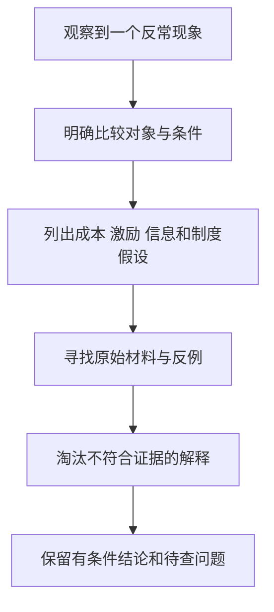

# 《牛奶可乐经济学》：从生活疑问练习成本、激励和比较

> 作者：Robert H. Frank，罗伯特·弗兰克；原作 *The Economic Naturalist*，2007 年。本文讨论第一部，不混入同名系列后续书。中文译本与页码未确认。  
> 依据：出版社书介、作者教学方法与相关一手现实资料。未取得全书，是公开资料系统导读；重组 28 个主要方法与应用知识点，不声称核对了原书每则轶事。更新：2026-11-12。

## 这本书最值得学什么

为什么相近产品采用不同包装？为什么企业愿意提供免费服务？为什么相同座位或相同商品会卖不同价格？作者用生活问题训练一种习惯：先识别参与者的目标、成本与约束，再提出可以检查的解释。

最需要防止的误解，是把“我能编出一个经济解释”当作“已经证明事实如此”。书里的许多问题适合训练假设；真实结论还要查生产流程、价格、合同、历史资料和替代解释。本文会明确区分经济机制与已核验事实。

| 阅读线索 | 重点问题 | 本文位置 |
| --- | --- | --- |
| 经济学家的观察法 | 怎样从反常现象提出问题 | 1—5 |
| 成本、供求与定价 | 价格为什么不等于材料成本 | 6—14 |
| 信息、激励与竞争 | 谁掌握信息，谁承担后果 | 15—21 |
| 合作、消费与决策 | 个体与集体目标为何不同 | 22—28 |

框架核对见[出版社书页](https://www.hachettebookgroup.com/titles/robert-h-frank/the-economic-naturalist/9780465003570/)。本笔记把方法转成财商练习，而非逐题复述原书答案。

## 核心知识点

### 1. 好问题要具体到能够比较

“为什么东西这么贵”太宽，改成“同一商圈相似容量饮料，在不同地点售价为何不同”，才开始接近可研究问题。明确对象、时间、品质、交易条件和比较基准，可以减少无效争论。

投资研究也一样。把“这家公司有护城河”改成“客户为何愿意在可替代产品存在时继续购买，而且企业还能维持资本回报”，问题才会指向具体资料。一个能被反驳的问题，比一个永远正确的赞美有用。

### 2. 解释从参与者和约束开始

消费者、企业、雇员、供应商与监管者可能有不同目标。观察到的安排，往往是多个目标在约束下的折中，而不是设计者没有想到显然更好的办法。

先问谁作决定、谁付钱、谁承担风险、谁能改变安排。这样能避免把企业产品设计全部归因于“贪婪”，也避免把现存安排全部美化为“最优”。制度、历史惯性与技术条件同样可能起作用。

### 3. 成本收益原则要求把相关影响列全

一项改变值得做，取决于增量收益是否超过增量成本。成本包括钱、时间、麻烦、风险与失去其他选择；收益也不只限于当期现金。

对消费者，便宜但难以退换的商品可能有更高总成本；对企业，提高一点生产成本若显著减少售后，也可能合理。比较时要用一致期间和范围，不能把一方的全部成本与另一方的一项优点对照。

### 4. 机会成本随情境变化

同样十分钟，在闲暇时与赶飞机时的价值不同。经济解释因此经常关注时间约束，而不是只比较物品本身的材料价值。

个人财商中的应用，是给研究时间也记一笔账。花很多时间追逐微小价格差，未必比改善职业技能或减少一项高费用更有效；但不能随便用最高时薪给所有闲暇定价，因为替代用途必须真实可行。

### 5. 边际变化比平均印象更适合决策

问“多提供一项服务增加多少成本与收益”，通常比问“整个项目平均赚多少”更接近当前选择。固定投入已经发生时，新增服务的经济性可能与新建整套服务完全不同。

但边际思维不能被误读为固定成本永远不重要。长期维持、替换和扩张仍需要覆盖全部成本。短期促销能增加现金贡献，不保证可以永远用这个价格经营。

### 6. 包装是生产、运输、展示与使用共同作用的结果

书名中的牛奶与可乐问题，提示读者考虑货架、冷藏、材料、握持与运输，而不只比较容积。它适合训练“同一设计满足多个目标”的思路。

这里不把流传的包装答案当成已经独立核验的制造史。若要确认某个品牌为何选方盒或圆罐，需要找企业设计说明、包装线约束和实际成本。不同国家、容量和包装技术也可能产生不同结果。

对投资者，产品外观只是入口。包装改变可能影响破损、物流、货架占用、保鲜与品牌，最终应追踪到销量、成本和资本需求，而不是看到一种形状就判断企业高效。

### 7. 价格包含稀缺资源，不只包含原材料

便利地点、短时间交付、可靠性和可用库存都可能具有价值。两杯饮品材料相近，售价不同不一定意味着成本核算错误。

但位置优势的收益由谁得到，要看合同与替代。若房东能重新议价，部分优势可能进入租金；若经营品牌稀缺，租户也可能保留更多收益。投资分析应追踪价值在产业链里怎样分配，不只看到终端售价高。

### 8. 弹性解释不同客户对同一价格的反应

客户可替代选择越多、调整时间越长、支出越重要，对价格可能越敏感。弹性是一种有条件的行为关系，不是客户身上永久不变的标签。

企业提价以后销量没有立即下降，可能因为合同、库存或消费习惯尚未调整。只看一周结果容易高估长期定价权。消费者比较产品也应考虑切换成本，而不只看眼前挂牌价格。

### 9. 两部收费把进入资格与使用价格分开

**真实案例：Costco 会员费。** 公司官方说明记录了美国、加拿大会员费用在 2024 年 9 月 1 日发生调整。会员资格与购买商品是不同层次的收费；不能只看某件商品便宜，就断言整个消费安排适合每个家庭。[公司会员费说明](https://customerservice.costco.com/app/answers/answer_view/a_id/1013504/~/membership-fee-increase)

经济机制是固定入场费与后续商品条件共同影响客户选择。高频、大量采购者可能更容易摊薄会员费，低频顾客则未必。这里解释的是收费结构，不声称会员费等于公司全部利润，也不以没有披露的数据估算每位会员收益。

**应用：**计算自己实际会购买的篮子，在一致品质和数量下比较年度总成本，再加入交通、储存和浪费。为了“把会员费赚回来”购买并不需要的东西，会把沉没成本变成新增支出。

计算时还要区分入会前与入会后的问题。入会前，比较“加入后的全部可预见成本”与“不加入的替代”；会费已经不可退时，下一次购物应比较本次新增成本，不能为了回收会费购买负价值商品。续费时又回到完整年度比较，因为新一年的会费尚未发生。这是机会成本和沉没成本在同一个真实收费结构中的不同位置。

若全年节省主要来自大量囤货，还要检查保质期与库存占用。账单上的折扣是购买当时的价格差，真正收益需要等到商品被有效使用才成立；扔掉的商品不会因为折扣很大而变成节约。

### 10. 拆分收费既能增加选择，也能增加比较难度

**真实事实：航空附加费。** 美国运输统计局单独公布航空公司的行李费收入，说明机票外收费是一项真实、可观察的商业组成，而不是只存在于广告话术中的概念。[BTS 2023 年行李费表](https://www.bts.gov/topics/airlines-and-airports/baggage-fees-airline-2023)

从机制看，不托运行李的人可能不愿为别人的行李付费；拆分也可能让基础票价显得更低，把注意从最终总价移开。两种机制可以同时存在，不能仅凭收费单列就认定一定有利或一定欺骗。

比较时把同样的出行需求装进购物篮：行李、座位、改签、支付和时间条件都一致，再看总价。投资分析则要研究附加收入是否伴随客户流失、监管与服务成本，而不是把它当成无成本利润。

### 11. 产品版本让客户按需求自行选择

基础版、专业版、可退票与不可退票，可能帮助企业区分支付意愿，也可能确实提供不同服务。版本限制是否有真实成本理由，需要具体判断。

理解自我筛选后，消费者会少问“为什么别人更便宜”，多问“我获得的权利是否真的不同”。投资者则要关注不同版本之间的替代、升级率与维护成本，不能把套餐数量多直接看成增长能力强。

### 12. 免费产品也可能有清楚的商业目的

**真实历史：米其林指南。** 米其林官方历史说明，1900 年推出的指南为驾车者提供旅行、维修、住宿和餐饮信息，早期免费分发。指南与轮胎业务之间具有互补关系：让驾车旅行更容易，可能支持汽车使用和相关需求。[米其林历史说明](https://www.michelin.co.uk/blog/articles/history-of-the-michelin-guide)

这是公司公开历史与本文的机制解释。它不证明每一次指南发放带来了多少轮胎销售，也不能把今天指南的商业模式与 1900 年完全等同。

财商应用是寻找付款链：免费服务由广告、订阅、交易佣金、其他产品，还是投资者资金支持？免费不等于没有成本；有明确商业目的也不自动意味着服务没有价值。关键是理解双方交换了什么。

### 13. 互补品与替代品决定局部提价的整体效果

互补品的使用相互促进，替代品则竞争同一种需求。一项产品的利润，可以通过其他产品的销量变化被加强或抵消。

分析公司不能只把每项业务利润独立相加，而要研究交叉作用；但“生态”二字不等于已经证明协同。需要客户使用、留存、交叉购买或成本变化等证据。若协同只存在于管理层演示稿，估值时就不应把它当成确定现金。

### 14. “没有免费的午餐”不是“市场永远正确”

明显、可执行的利润机会可能吸引竞争，使优势被削弱。但机会看似存在而没有被利用，也可能因为风险、资金、法规、交易成本和信息限制。

不能把高收益报价当作已经发现漏掉的钱。先问为什么别人没有拿走，自己看不见的成本在哪里；也不能反过来认为任何报价都已经包含全部信息，因而无需研究。市场竞争是检验假设的一部分。

### 15. 同价定律依赖可比商品和套利条件

如果商品完全可比、转售容易、运输与交易成本很低，明显价差会吸引套利。但地点、保修、税费、币种、品质和交付日期不同，都可能使表面同物实际上不同。

财经比较尤其容易漏掉这些条件。境内外价格、不同基金份额或不同证券类别，不应只按一个汇率换算就宣布套利。应先核对法律权利、交易限制与结算时间。

### 16. 信息不对称可能使好产品也难以成交

阿克洛夫的“柠檬市场”模型说明，当买方无法辨别质量，只愿支付平均品质价格时，好产品卖方可能退出，进一步拉低市场质量。这是理论模型，不是统计上证明所有二手车都差。[作者本人对研究的说明](https://www.nobelprize.org/prizes/economic-sciences/2001/akerlof/biographical/)

保修、检验、认证与声誉可能改善问题，但要判断谁为担保负责、违约能否追索、认证是否有利益冲突。对投资者，信息透明不仅是道德标签，也影响融资成本与交易机会。

### 17. 信号有效，需要难以被低质量者轻易模仿

花钱做广告、提供保证、持有自家股份，都可能传递信息，却不一定是真实质量的充分证据。要研究高低质量者发出同样信号的成本是否不同，以及行为者可能从误导中获得什么。

昂贵并不自动等于可信。有些信号可以用他人的钱购买，有些承诺在危机时难以兑现。财商检查应把“看起来很认真”转换成可核对的责任、成本与履约记录。

判断保修尤其可以分三步：承诺覆盖什么故障，提供承诺的主体是否有能力履行，消费者申请是否方便。若条款排除了最常见问题，表面上很长的年限可能价值有限。若高质量生产者本来故障更少，同样的保修对其预期成本更低，承诺才可能具有区分质量的作用。这里解释信号成立的条件，不是认定任何长保修品牌一定优质。

### 18. 代理人知道更多，不代表利益完全一致

**真实研究：房地产经纪人的自有住房交易。** Levitt 与 Syverson 比较经纪人替客户卖房和出售自有住房，发现交易价格与出售时间存在差异，符合信息和激励不一致的解释。它是特定样本中的观察研究，不是判定每位经纪人都不诚实。[原始研究](https://www.nber.org/papers/w11053)

房主获得售价改善的大部分，而经纪人只获得佣金中的一部分；延长销售时间的收益成本因此不同。这种机制即使在双方都努力工作时，也可能影响建议。

应用到金融服务，应看收费是按交易量、资产规模还是其他指标，服务者承担什么后果。披露利益冲突不会自动消除冲突，但能帮助你理解建议的独立性，并安排额外核验。

### 19. 可靠承诺可以扩大合作范围

交易双方如果担心对方事后改变条件，可能放弃本来互利的合作。抵押、合同、声誉、分阶段付款和第三方执行，可以提高可信度。

这些机制都有成本，不能因为存在合同就假设风险为零。条款是否清楚、司法或仲裁能否执行、对方是否有偿付资产，同样重要。对于预付款、长期订阅或复杂理财，应把退出与违约条件放在价格旁边比较。

### 20. 规模经济与范围经济不是同一个概念

规模经济是同一业务扩大后单位成本可能下降；范围经济是多种业务共同经营时，成本可能低于分别经营。它们都可能来自共享投入，但也可能被协调成本抵消。

公司宣布扩张，不等于规模经济已经兑现。要观察单位成本、产能利用、管理费用与新增资本回报。总利润增加而每单位资本收益下降，仍可能使股东价值受损。

### 21. 竞争会把一部分效率改善传给客户

技术使成本下降，并不保证企业保留全部收益；竞争可能推动降价，员工和供应商也可能获得一部分。这是为什么“行业很有前景”与“企业值得高估值”之间仍有距离。

研究长期价值，要问谁拥有难以替代的资源、谁能进入、谁能议价。一个行业对社会很有用，投资回报却可能一般；这两件事并不矛盾。

### 22. 个体合理选择可能导致集体不理想结果

每个人为自己的目标努力，不总能自动实现最佳整体结果，尤其当成本由他人承担或收益无法排他时。公共资源、拥堵与地位竞争都可能出现这种结构。

**现实制度：伦敦拥堵收费。** TfL 的早期监测报告记录，2003 年实施后，收费区拥堵指标相对实施前下降；其 2004 年监测仍报告约 30% 的平均拥堵下降。这里是拥堵指标，不是所有车辆数量下降 30%，也不代表此后永久维持同一效果。[TfL 第三次监测报告](https://content.tfl.gov.uk/central-london-congestion-charging-impacts-monitoring-third-annual-report.pdf)

收费试图让出行者面对部分对他人造成的延误成本。判断政策还需看公共交通、收入使用、分配、边界转移和时间变化，不能从一项平均结果推出所有人都受益。

### 23. 位置性消费会让比较本身消耗资源

有些消费价值来自相对地位，而不是绝对功能。当别人提高标准，自己也需要更多支出才能维持相同相对位置，整体上却未必人人更满意。

本文的财商应用是把消费需求拆成使用价值、审美、社交与比较压力。并非所有高价消费都不理性，个人可以重视不同价值；问题是不要在没有意识到目标时，持续提高一条永远无法完成的比较线。

### 24. 社会规范也能协调行为，但会与价格机制互动

礼貌、互惠、职业规范和声誉降低了交易成本，不能把一切合作简化为现金交换。有时明确收费提高透明度，有时反而改变关系中的义务理解。

**真实研究：日托迟到罚款。** Gneezy 与 Rustichini 对以色列日托中心的研究发现，实施迟到罚款后迟到增加，取消后也没有立即恢复到原先状态。研究者讨论了家长把原先的责任关系重新理解成可购买延时服务的可能机制。[原始论文](https://www.journals.uchicago.edu/doi/pdf/10.1086/468061)

这个事实支持“价格可能改变规范理解”的问题意识，却不能证明所有罚款都无效。额度是否足够高、规则是否可执行、迟到造成什么后果，都会改变行为。若把一次观察变成反对任何收费的通则，恰好违背本书应训练的条件分析。

应用到金融服务，缴纳费用不等于取消所有责任；付过培训费也不保证学习发生。应检查价格之外还存在什么义务与结果。规范重要，不意味着不能评估成本；可以标价，也不意味着其他动机消失。

### 25. 风险要比较概率与后果，不只比较显眼程度

容易想象的风险未必最常见，金额小但反复发生的成本也可能值得重视。经济分析要求用适当分母比较，并区分平均结果与个人承受能力。

购买保险、选择工作、安排债务时，预期成本只是第一步。严重损失是否会破坏生活、风险是否相关、合同赔付条件是什么，都影响选择。不能只凭“平均赔的钱少于保费”就认定保险没有价值。

### 26. 一套解释必须允许替代原因进入

对同一现象，成本差异、质量差异、市场力量、税费、信息问题和历史惯性都可能起作用。好的解释应说明什么证据会支持自己，什么证据会削弱自己。

以包装为例，如果声称设计主要为节约货架，需要查哪些产品确实受该约束，以及类似产品为何采用其他形式。若任何结果都能事后解释，理论就没有提供真正的鉴别力。

图解强调提出假设之后还要核验，故事顺畅不是终点。

### 27. 把生活观察转成公司研究时，要补上财务连接

观察到排队、涨价、好评或会员增长，先问它对应企业哪个收入部分，再问利润、回款和投入。单个热门产品可能只占集团很小份额，满座也可能来自低价促销。

这是投资应用流程，不是原书自动选股公式。每个箭头都需要新增证据，不能靠重复最初观察完成。

### 28. 最好的成果是一张能复核的问题卡

记录现象、时间、对象、候选解释、最重要的未知信息、查到的来源与目前结论。选择一个身边问题，持续完善，比一次收集几十则有趣答案更能训练能力。

问题卡还应写清无法外推之处。例如美国航空收费数据可以说明拆分收费确实存在，却不能直接说明中国某家航空公司的收入结构；米其林历史也不能证明今天任何免费内容都有相同商业价值。

## 练习与参考答案

**练习一：一家商店商品平均更便宜，会员费就值得付吗？** 不一定。应比较自己真实采购篮子的年度节约，扣会员费、交通和浪费，不能用别人的大额采购替自己计算。

**练习二：专家的建议对他也有利益，因此一定错误吗？** 不能这样推断。利益冲突提高独立核验的必要性；内容是否正确仍取决于证据。

**练习三：发现同一商品价差就能套利吗？** 先对齐品质、权利、税费、币种、交易限制和交付时间，再计算全部成本与风险。表面价差不等于可实现利润。

## 使用边界与继续阅读

这本书适合建立观察和解释习惯，不能替代系统的微观经济学与因果识别训练。原书日常轶事没有逐一独立核验，本文明确把它们作为问题线索，真实教学案例另附一手来源。

可接着读《经济学原理》补全模型条件，读《统计陷阱》检查数据与因果，读《彼得·林奇的成功投资》学习怎样从生活线索进入企业研究。不要把“有一个经济学答案”误当成“已经完成投资分析”。
