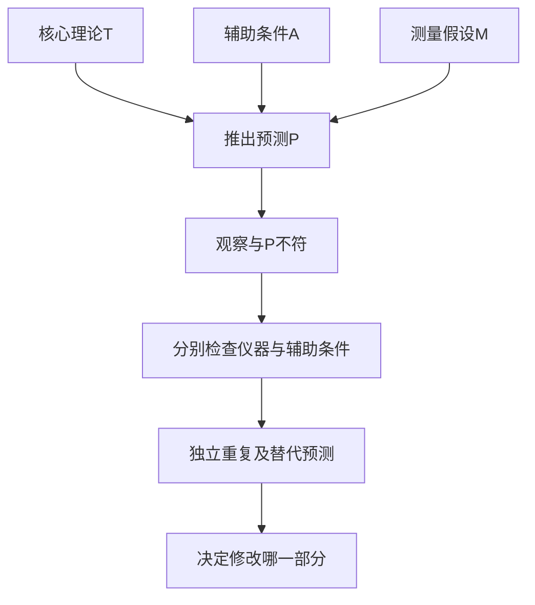

# 《猜想与反驳》读书笔记

作者：卡尔·波普尔（Karl Popper）。英文原作 *Conjectures and Refutations: The Growth of Scientific Knowledge*，1963年。本文依据出版方目录、公开的核心章节节选、作者思想资料与原始科学文献整理，未取得完整中文原书；不声称逐篇精读其全部论文，未核定中文译本页码。对归纳、划界、批评、真理、传统和社会科学作重点导读，哲学史专论作框架概括。核验日期：2026-11-12。

本书最重要的启发是：**知识可以在没有终极保证的情况下改进；关键是提出有内容的解释，并认真寻找它可能出错的地方。**“我找到很多支持材料”与“我的解释经受过有力检验”不是一回事。

用于财商时，它能帮你把“看好一家公司”改写成可以被检查的经营假说，保留错误记录，防止任何结果都被解释成自己正确。它不是一本量化交易说明书，也不能把“可证伪”直接等同于“值得投资”。本篇投资迁移、公式说明与练习均为补充教学。

## 一、全书不只是“黑天鹅推翻白天鹅”

公开目录分导论、“猜想”和“反驳”两大部分，内容还包括哲学问题与科学的关系、知识观、传统、前苏格拉底哲学、康德、形而上学、逻辑、真理、心身问题、辩证法、社会预测、公共意见、人道主义与理性。它是一组相互关联的论述，不能当作一套按步骤执行就必然成功的算法。

| 主线 | 要解决的问题 | 对读者的要求 |
|---|---|---|
| 知识来源与归纳 | 有没有绝对可靠的起点 | 承认所有来源都可能出错 |
| 猜想与检验 | 什么说法承担了失败风险 | 写清它排除了哪些结果 |
| 进步与真理 | 没有证明为何仍能比较理论 | 比较解释与检验表现 |
| 传统与哲学 | 如何继承又不盲从 | 将传统作为可批评的起点 |
| 社会与政治 | 怎样在有限知识下行动 | 关注反馈、后果与可纠错性 |

## 二、从“知识来自哪里”转向“怎样查出错误”

### 1. 任何来源都不能自动免于批评

经验、书本、权威、直觉和推理都可能提供有用想法，也都可能出错。波普尔反对仅靠来源身份给知识提供最终保证。

研究一份报告时，可以重视作者专业经验，却仍核对样本和推导；也可以听取普通人的观察，但不能因为其“没有利益关系”就省略验证。来源影响初始信任，不替代具体证据。

### 2. 可错论不是“一切意见一样好”

承认自己可能错，不意味着停止判断。不同解释在内部一致性、处理证据的能力、预测内容和检验结果上，可以存在明显差别。

可错论要求把结论写成可以修正的认识。相对主义式的“你有你的事实，我有我的事实”则可能取消公共检验；两者不能混淆。

### 3. 归纳问题：有限观察不能逻辑保证无限结论

看到很多同类现象，并不能演绎出未来和所有未观察对象都必然如此。重复经验很有用，但“过去一直如此，所以以后绝不改变”超出了逻辑保证。

经典白天鹅例子属于逻辑演示：有限只白天鹅不能证明所有天鹅都白；一个身份和颜色都确认的非白天鹅，却与严格全称命题冲突。现实问题往往有测量和定义条件，因此不能机械套用。

### 4. 猜想可以来自任何地方，评价需要另外进行

一个想法可能来自经验、类比、偶然联想或传统。产生过程不必像形式证明一样规范，但接受它需要理由。

不要因为“灵感来得突然”就贬低一个假说，也不要因为“我研究了十年”就免除它的检验责任。发现的心理过程与论证的有效性是两个问题。

### 5. 问题推动新猜想，而观察总带着某种期待

你注意到一个现象，常因为它与原来的期待不同。因此研究不必从完全无理论的资料堆开始，而可以从一个明确问题出发。

财报阅读可以先问“利润增长是否转化为经营现金”，再追索相关数据；但必须允许资料推翻原先期待。带着问题读取，与只挑支持答案的资料，差别就在这里。

## 三、可证伪：一个理论究竟允许哪些结果

### 6. 可证伪指存在可能冲突的观察，不是已经被证明错误

一个理论越明确说明在何种条件下应出现什么，就越容易接受检验。科学理论可以是可证伪而尚未被证伪的；已经被可靠反驳的理论，也不会因为“很科学”就继续被当作正确。

三种状态要分清：可检验、经受过检验、未通过某次检验。它们分别讨论资格、历史和结果。

### 7. 有内容的解释会排除某些可能

“市场明天可能涨也可能跌”几乎没有排除任何结果。它可能诚实表达无知，却不能作为预测能力的证据。“在明确条件下，某机制应造成某方向变化”则有更多可检验内容。

但是说得具体并不自动说得对。胡乱给一个极精确数字，也很容易被反驳；高内容需要与机制和证据配合。

### 8. 支持材料只有在有区分力时才更有价值

如果一个结果在你的理论成立和不成立时都很常见，它对区分理论帮助不大。到处找到“符合”的现象，可能只是因为说法过于灵活。

检查时写两个问题：如果我的解释正确，应更可能看到什么？如果竞争解释正确，又更可能看到什么？这里的概率化表述是现代教学补充，不等同于波普尔整套认识论。

### 9. 风险预测：检验必须可能让理论难堪

**真实历史：**1919年日食观测用于比较太阳附近星光偏折与理论预期。1920年Dyson、Eddington和Davidson发表观测报告。重要之处不只在于观察到现象，而在于测量能比较不同偏折预期。[原始报告](https://doi.org/10.1098/rsta.1920.0009)

不能简写成“牛顿预言完全不弯、爱因斯坦预言会弯”，因为在特定经典光模型下也可推出较小偏折。更不能把一次观测写成对整个相对论的最终证明：仪器、底片与误差处理都有讨论空间，后续检验仍重要。

波普尔将这段经历用于说明检验的风险。这里区分他的哲学解释与观测本身，不把简化的英雄故事当成全部科学史。

### 10. 暂时得到确证，不等于概率已变成100%

一个假说通过严厉检验，意味着它目前表现不错，而不是已经消除了所有失败可能。波普尔常用“确证度”讨论检验表现，不能简单当成贝叶斯后验概率的同义词。

对于经营假说，“过去三个季度与预期一致”可以增强理由，但仍需说明检验够不够有力、是否只在有利环境中观察、其他解释是否同样预测了结果。

### 11. 可证伪性是划界主张，不是所有价值的统一标准

数学证明、伦理判断、艺术体验与形而上问题，并不都通过同一种经验检验获得意义。波普尔也没有把“非科学”直接等同于“无意义”。

财商讨论应区分“这项策略收益如何”的经验问题与“我是否愿意用这种方式赚钱”的价值问题。后者需要伦理论证，不能只靠回测裁决。

### 12. 作者对心理学与历史理论的批评要放回语境

核心章节中，波普尔比较了相对论与他所接触的某些精神分析、个体心理学及历史解释。他担忧的是支持者能把相反行为都解释成理论的胜利。

这属于作者的概括与回忆，有争议；不能据此判定今天所有心理治疗或社会科学不可检验，更不能把其构造的行为例子误写成独立临床研究。使用他的检查问题，比照抄其全部学科判决更稳妥。[核心章节公开节选](https://tildesites.bowdoin.edu/~j.knockel/falsification/)

## 四、真实检验为什么比逻辑演示复杂

### 13. 被检验的通常是理论、辅助条件和测量的组合

设T为核心理论，A为辅助条件，M为测量假设，组合后推出预测P。若观察到非P，严格说是`T且A且M`这个组合出了问题，不自动知道一定是T错。

这并未使检验失去作用，而是要求继续设计检查，定位哪个部分失败。不能从“测量也可能错”跳到永远拒绝任何反证。

图意：逻辑冲突让组合需要修正；实验设计帮助确定修正位置。没有这一步，容易过早抛弃好理论，也容易让坏理论永远逃避检查。

### 14. OPERA案例：惊人的反常也应先接受共同核查

**真实案例，书外补充：**OPERA在2011年公布中微子飞行时间异常并邀请检查。CERN后续说明，2012年四个相关实验测得的飞行时间与光速相容，最初异常与计时系统光纤部件问题有关。[CERN事件与更新记录](https://home.cern/opera-experiment-reports-anomaly-in-flight-time-of-neutrinos-from-cern-to-gran-sasso/)

新的OPERA测量论文同时列出统计与系统误差，说明“一个异常数字”需要放进完整测量链考察。[2012年数据论文记录](https://cds.cern.ch/record/1498324)

案例的启示并非“理论永远正确，仪器永远有错”，而是：不要压下异常，也不要在定位测量问题之前宣布整个基础被推翻。可检验的公开过程，才允许错误被发现。

### 15. 合理修正与临时补丁的差别

合理辅助假说有独立依据，通常能产生新的检验。临时补丁则主要用于事后挽救原结论，并尽量避免任何进一步失败风险。

公司研究中，管理层把现金回收变慢解释为付款时间差，应能在后续回款、合同与账龄中核查。若每期都更换理由，却不允许追踪过去承诺，解释的可信度应下降。

### 16. 观察报告本身可以被质疑，但质疑也有责任

反证不是一句未经核验的传闻。样本身份、测量方法、复核过程和数据处理都应可靠。与此同时，不能只对不利材料要求不可能达到的完美证明。

预先统一标准很重要：同样的来源、同样的误差和同样的样本规模，在支持和反对自己时，应获得相近的权重。

### 17. 概率理论不能被任意一个低概率结果简单推翻

如果模型允许某事件以1%概率发生，那么该事件发生并没有形成严格逻辑矛盾。评估需要检查许多预测的分布、校准和事先规定的统计检验。

这里暴露了把日常“证伪”口号用于概率模型的局限。统计拒绝也有错误概率，不是把复杂假说直接转成非黑即白的判决。波普尔与现代统计推断之间存在需要进一步讨论的问题。

### 18. 反驳A不能自动证明B

一个解释失败后，可能还有C、D，或者目前没有足够好的解释。把“某机构说错了”直接变成“我的预测正确”，遗漏了独立证据。

这对识别财经内容特别重要：善于拆穿骗局的人，不因此自动具有选股、估值或择时能力。批评能力与替代方案的有效性应分别评价。

## 五、知识进步、真理与哲学传统

### 19. 真理是追求目标，不等于人拥有最终标准

我们可以主张有独立于个人喜好的事实，并同时承认自己没有一套永不出错的识别方法。波普尔的实在论方向试图保留这种区别。

“我无法绝对保证估计正确”不等于“价值完全随便说”。更恰当的表达是：估计受未来事实约束，目前有这些证据与这些未知。

### 20. 新理论应增加解释和检验内容

改进不仅是避免昨天的错误，还应解释为何旧理论曾在某些条件下有用，并提出可以进一步检查的内容。仅仅变得更模糊，不是知识增长。

投资模型升级后，应记录它新增了什么变量、解释了哪个旧问题、提出了什么新预测，以及增加了多少复杂性。复杂度本身不等于进步。

### 21. “更接近真理”的形式化尝试也会出错

波普尔尝试用真后果与假后果比较理论的逼真性，但其早期形式定义受到重要反驳。1974年Tichý与Miller分别指出相关定义在比较假理论时存在技术问题。[Tichý原论文](https://doi.org/10.1093/bjps/25.2.155)、[Miller原论文](https://doi.org/10.1093/bjps/25.2.166)

这不是说“追求更好解释”失去意义，而是不能把那套原始形式化定义当成已经完备的打分公式。连倡导反驳的方法论也必须容许反驳，正好展示了本书思想对自身的要求。

### 22. 传统是可批评的起点，不必全盘崇拜或彻底抛弃

人依靠已有语言、问题和制度开始学习。假装可以完全摆脱传统，可能只是没有看见自己使用的传统。

可取的方式是问：这条规则原来解决什么问题？今天条件是否仍在？有何替代安排？例如投资中的分散原则与某个具体比例，应分别讨论，不把历史参数与一般问题绑死。

### 23. 哲学问题经常与具体科学困难相连

本书讨论古希腊思想、贝克莱、康德和科学观念，提醒人哲学并非只有词语争论，也会试图处理世界、知识与解释的实质问题。

这些篇章的思想史细节需要原文支持，本篇不做未经核实的逐人判定。可迁移的阅读方法是：先找作者正在回应哪个问题，再评价其答案，而不是只摘一句名言。

### 24. 逻辑一致性重要，但一致性不保证现实正确

一套说法不能一边把某结果视为支持，一边把相反结果也以同一理由视为支持，而拒绝说明差异。内部矛盾会破坏推断能力。

然而，一个内部完全一致的虚构系统仍可能不符合现实。检查顺序应同时包含概念一致、经验检验与适用条件，任何一项都不能代替全部。

## 六、社会科学与公共决策

### 25. 有条件的预测不同于历史必然预言

“如果这些条件成立，可能出现这些后果”与“历史注定朝唯一方向发展”承担的论证责任不同。未来知识、制度变化和人的反应，可能改变预测条件。

经济分析应尽量写明机制和条件，而不是用宏大历史叙事推出某个日期必然上涨或崩溃。看懂一段危机史，不等于掌握下一次危机的精确时间表。

### 26. 人们知道预测后，可能改变被预测的事情

天气通常不会因为读到天气预报而改变策略，交易者和政策制定者会。预测、警告与行动进入同一个社会过程，可能加强或削弱原先预期。

因此社会预测失败有时与干预有关，但这也不能成为万能借口。应当事先写明哪些反应可能发生、如何观察、预计方向是什么。

### 27. 制度评价需要看意外后果

参与者各自出于可理解的目标行动，合在一起仍可能产生无人想要的后果。政策和组织方案应比较实际机制，而不只比较发起者的善意。

财商应用包括：奖励收入增长可能鼓励过度授信，强调季度利润可能压缩长期投入。这些是待检验的机制假说，不能仅凭“激励必然扭曲”就断言某公司已经发生问题。

### 28. 可纠错的改革比无法退出的宏大承诺更容易学习

本书社会政治论述反对用不可质疑的终极蓝图压倒现实反馈，强调批评与理性讨论的价值。这与波普尔更广泛的开放社会思想相连，但不把其其他著作的所有论证都冒充本书内容。[LSE作者与思想介绍](https://www.lse.ac.uk/philosophy/research/sir-karl-popper)

用于个人计划，可以先设计可观察的小步骤，检查成本、效果和副作用，再决定是否扩大。不可逆重大事项则需要事前更充分的比较，不能把“小步试错”当成无条件适用。

## 七、把反驳精神落实到投资记录

### 29. 给每个经营假说建立证据卡

一张卡写六项：具体主张、时间范围、机制、支持证据、竞争解释、降低信心的条件。再补上数据出处和检查日期。

**研究格式示例，非真实公司结论：**若认为毛利改善来自持续定价能力，就分别核对售价、成本、产品组合和产能利用率；如果改善主要由短期原材料降价造成，应修改对持续性的判断。不能直接把毛利上升写成护城河得到证明。

图意：判断假说与决定交易是不同步骤。即使企业假说仍成立，价格、流动性和个人约束也可能改变行动。

### 30. 止损规则和经营证伪不能混成一件事

价格触及某个位置，可以按事先规则触发风险管理；但价格下跌本身不必然证明经营假说错误。反过来，经营事实已经严重恶化，也不能只因价格尚未跌破阈值就当作没有变化。

要分别记录：经营判断为什么变、估值空间怎样变、风险约束是否触发。这样既避免把情绪包装成逻辑，也避免用“我尚未被证伪”拒绝管理实际损失。

## 八、练习与参考答案

**练习一：**“这家公司有潜力，迟早会涨；没涨说明市场还没发现。”怎样改成可检查的主张？

参考答案：先把经营与价格分开，写明潜力来自什么机制、什么期间可观察到何种结果，以及哪些事实会降低信心。价格判断还需要买入价格与估值假设。“迟早”不设边界，无法提供有效预测记录。

**练习二：**一条有70%成功概率的规则失败一次，是否被证伪？

参考答案：没有严格逻辑矛盾。应检查足够多、可比较且记录完整的预测，评价校准与基准差异；不能只挑成功，也不能把任何失败都宣布无关。

**练习三：**新数据不符合模型，为什么既不能立即删模型，也不能立即删数据？

参考答案：首先核验测量、定义、辅助条件和独立重复。核心理论与这些条件共同产生预测，需要证据定位错误；任何一方都不能凭偏好获得豁免。

## 九、边界与继续阅读

可证伪性是有影响力且存在争论的科学哲学主张，不是今天所有学科唯一认可的划界标准。科学发现、统计推断、伦理决策各有额外问题。与《科学革命的结构》对照，可以避免把实际研究简化为一个反例立即终结理论；与《理性》《信号与噪声》结合，可以补上概率预测和持续校准。

版本与范围依据：[Routledge书目及完整目录](https://www.routledge.com/link/link/p/book/9780415285940)、[核心章节公开节选](https://tildesites.bowdoin.edu/~j.knockel/falsification/)。科学案例与方法论争议的一手出处已在相应知识点说明。没有核对的篇章只作问题地图，不编造其细节或原书引文。
