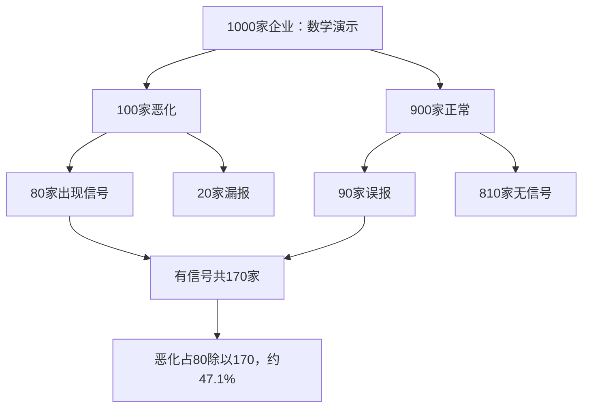

# 《理性》读书笔记

作者：史蒂芬·平克（Steven Pinker）。英文原作 *Rationality: What It Is, Why It Seems Scarce, Why It Matters*，2021年。本文依据作者书目介绍、课程资料、公开目录与下列原始研究整理，未取得完整中文原书，属于覆盖主要主题的公开资料导读，不是逐章精读或逐页复述。中文译本页码未核定。资料核验：2026-11-12。

这本书最有价值的地方，是把“讲道理”拆成可以检查的能力：结论是否跟随前提，概率有没有算反，收益是否值得风险，别人会如何回应，以及什么制度能让人愿意承认错误。它不要求人没有感情；它要求目的、信念、证据和行动彼此说得通。

**阅读收获：**读完本篇，应当能把一段投资观点改写成有条件的论证，算清一次信息更新，区分判断错误和行动错误，并给自己的研究过程安排纠错机制。数学、检查表和财商迁移是本笔记补充教学；所列现实研究不自动等同于原书案例。

## 一、先把全书的地图看清

公开目录中的11个主题从人的理性能力出发，依次涉及理性与非理性、逻辑、概率、贝叶斯推断、理性选择、信号检测、博弈论、相关与因果、人为什么犯错，以及理性的社会价值。这里将其整理成五条线。

| 需要解决的问题 | 用到的工具 | 学会后避免什么 |
|---|---|---|
| 这个说法成立吗 | 逻辑、定义、反例 | 把有感染力当成有证明力 |
| 我该相信到什么程度 | 概率、基准率、贝叶斯 | 把可能性说成确定性 |
| 我应该采取什么行动 | 效用、损失、阈值 | 认为判断概率一样就必须行动一样 |
| 别人也会行动怎么办 | 博弈、合作、激励 | 只从自己的愿望推演市场 |
| 怎样持续减少错误 | 反馈、制度、公开批评 | 依靠一次顿悟维持终身清醒 |

图意：理性是一条反复运行的工作流程。只有判断没有行动，或只有结果没有事先记录，都不容易识别自己到底在哪一步出了错。

## 二、理性首先是论证纪律

### 1. 理性是用知识实现目标，而不是永远计算

有的人善于辩论，却长期做出违背自身目标的决定；有的人不懂概率符号，却会比较价格、留出应急现金并及时修改错误判断。理性讨论的是信念和手段是否适当，不能直接等同于学历、智商或口才。

“实现目标”也不能代替对目标本身的伦理讨论。高效率地欺骗他人可以具有局部的工具性，却不能因此获得道德正当性。阅读时要把“怎样做更有效”和“这个目标是否应当追求”分开。

### 2. 理性需要情感提供目标，但不允许情感代替证据

关心家人、追求安稳、希望事业有意义，都是合理目标的来源。问题出在从“我希望某公司成功”跳到“它一定会成功”。前一句描述愿望，后一句描述世界，所需证据完全不同。

实用做法是把研究纸分成两栏：左栏写自己希望发生什么，右栏写目前材料支持什么。如果两栏完全相同，尤其值得找一份相反意见检查。

### 3. 有效论证和真实前提是两道关

演绎有效指：如果所有前提成立，结论就不能为假。它并不负责保证前提是真的。投资报告中的数字看似精密，若把一次性收益当成可持续收益，后续估值即使算得完全正确也会失去意义。

因此检查顺序是：先核对名词与事实口径，再看推理是否有效，最后才看结论是否值得行动。修正计算器不能修正错误的起点。

### 4. 必要条件、充分条件和反推错误

“若企业拥有持续定价能力，则利润可能受到保护”本身还需要条件；即使简化成严格的“P则Q”，也不能由Q倒推P。利润上升还可能来自成本下降、出售资产或周期复苏。

**逻辑演示：**“若下雨，地面可能变湿”不意味着“地面湿，所以一定下雨”。这不是现实取证案例，而是展示推理形式。财报分析对应的动作，是为同一个结果列出几个竞争解释，而不是只寻找自己喜欢的那个原因。

### 5. 量词和定义决定一个主张究竟承诺了什么

“所有主动基金都跑输”与“某一期间、某一口径下多数主动基金跑输”不是同一个命题。“长期”“优质”“低估”若没有定义，往往会在争论中悄悄换意思。

先写对象、期间、比较基准和排除规则。这样做看起来慢，却能阻止用一个反例攻击原本只是概率判断的命题，也能阻止用模糊词掩护无法检验的承诺。

### 6. 论证责任不由身份和动机替代

某人有利益冲突，是检查其取材和激励的理由；这并不自动证明其所有数据为假。反过来，作者出于善意、拥有头衔，也不能让因果结论自动成立。

合理的批评要落到具体层面：资料有遗漏吗？样本经过筛选吗？比较组合理吗？结论超出证据了吗？这些问题比“他是什么人”更容易让判断得到改进。

## 三、概率：把不确定性表达清楚

### 7. 概率表达知识状态，不能拿一次结果代替评价

预测某事有70%的可能，仍允许它不发生。一次预测落空不能独自证明模型无能；如果很多被标为70%的事件只发生30%，才说明概率可能严重失准。

另一边也不能滥用这一点保护模型：如果失败后永远说“我本来就留了概率”，却从不汇总长期记录，概率语言也会变成逃避检验的工具。

### 8. 随机序列会出现连串，独立性必须另外证明

连续出现几个同方向结果，并不自动意味着下一次必然反转，也不自动意味着机制已改变。赌徒谬误和热手式过度外推，方向相反，却都可能把少量序列看得过于有意义。

股票收益通常不能简单假设为独立公平抛硬币，因此也不能拿硬币规则直接判断行情。先研究数据是否独立、是否有持续的共同原因，再讨论连串的含义。

### 9. 条件概率不能交换方向

“经营恶化的企业中，有多少出现预警信号”与“出现信号的企业中，有多少真的恶化”，分母不同。常见错误是把识别能力直接当成预测成功率。

设H代表经营恶化，E代表信号出现。P(E|H)是恶化企业出现信号的概率，P(H|E)才是你看到信号后关心的概率。后者还依赖恶化原本有多常见，以及正常企业多容易被误报。

### 10. 基准率：先看这类事情通常怎样

基准率是同类事件的背景频率。个案再生动，也不应让人从零开始判断。难点在于参考类别的选择：把一家成熟公用事业公司与所有创业公司混在一起，所得频率未必适用。

可以同时试两个有根据的参考组，观察判断对分组是否敏感。若换一种合理分组，结论就完全反转，应当把这部分不确定性明确保留下来。

### 11. 自然频数：把公式变成可以数出来的人或企业

**真实研究：**Gigerenzer与Hoffrage在1995年的实验中比较不同信息呈现方式，发现自然频数能简化贝叶斯计算，改善部分参与者的推断表现。研究支持“表示方法会影响推理”，不支持“换一种表述就能消除所有偏差”。[原始论文](https://pages.ucsd.edu/~scoulson/203/GG_How_1995.pdf)

**数学演示，非真实公司数据：**有1000家企业，其中100家会恶化。信号能识别80家恶化企业，同时把900家正常企业中的90家误报。收到信号的共170家，真正恶化的只有80家，所以看到信号后的恶化概率是80÷170≈47.1%，而不是识别率80%。

文字复核：只在“有信号”的170家中重新数恶化企业。这一步让分母的变化变得可见，也说明低基准率下误报为什么容易占据很大比例。

### 12. 贝叶斯更新：证据是修正起点，不是创造确定性

一般公式是：

`P(H|E) = P(E|H)P(H) ÷ [P(E|H)P(H) + P(E|非H)P(非H)]`

H是待判断假说，E是新证据。公式的作用是让假说原先的可能性、证据的识别力和误报率同时进入判断。现实中这些输入常常只能估计，因此结果也应保留范围。

如果同一份消息被十家媒体转述，它仍可能只有一个来源。把高度相关的消息当成十份独立证据，会让更新过头；先画信息来源关系，比盲目多读几篇文章更有用。

### 13. 回归均值不等于反转规律

一次极端表现可能由稳定能力和暂时运气共同造成。下一次运气没有同样极端时，表现就会向常态靠近。这不要求能力下降，也不意味着所有高利润公司都必然衰落。

检查企业时，应把可重复的订单、单位经济性与一次性价格冲击分开。这里的任务是估计持续部分，不是简单把最高值和最低值取平均。

## 四、从相信什么，到决定做什么

### 14. 期望值是概率加权，不是最可能的结果

**数学演示：**一个项目80%赚10、20%亏30，金额单位一致时，期望损益为0.8×10－0.2×30＝2。最常见结果是赚10，平均意义上的净收益却是2。

期望值还没有回答能否承受亏30、能否重复参与、资金是否被锁住等问题。它是必要的计算工具，不是一次性大额决策的完整结论。

### 15. 期望效用解释为什么同样概率对应不同选择

效用可以理解为结果对人的实际价值。同样损失10万元，对现金充足的人和即将支付医疗、住房费用的人，影响可能完全不同。因此合理选择要考虑总财富、负债、现金需求和目标。

“我不愿接受这个风险”不必然是不理性。关键在于这种偏好是否稳定、是否理解代价，以及有没有被同一个结果的不同说法反复操纵。

### 16. 小概率大损失，要看能否生存下来

正期望不等于可以无限加杠杆。路径中一次无法承受的损失，就可能使人失去参与后续机会的资格。损失上限、流动性和操作风险必须作为约束进入决策。

**真实案例，书外补充：**SEC对Knight Capital的行政处理文件记载，2012年8月1日，自动路由故障在约45分钟内造成逾400万次成交，最终非预期头寸损失超过4.6亿美元。这里的“成交”不能误写成客户原始委托数量。案件揭示的是部署、监控和限制失效，不是证明所有算法交易有负期望。[SEC处理文件](https://www.sec.gov/litigation/admin/2013/34-70694.pdf)

将此迁移到个人投资：判断资产有价值，与确保账户不会因错误订单、借款到期或过度集中而失控，是两项独立工作。

### 17. 信号检测：命中、漏报、误报、正确排除

判断系统有四种结果。只看命中率，可能掩盖大量误报；只看没有犯错，可能是因为根本不愿做任何判断。

| 实际情况 | 发出警报 | 不发出警报 |
|---|---|---|
| 风险存在 | 命中 | 漏报 |
| 风险不存在 | 误报 | 正确排除 |

把阈值调低，通常更容易捕捉风险，也更容易误报。这是同一信号系统上的取舍，不一定意味着识别能力变强。识别力和决策阈值应当分别评价。

### 18. 行动阈值取决于损失结构

**数学演示：**若风险发生会损失L，提前防护固定花费C，且防护完全消除损失，则当风险概率p满足`pL>C`时，防护的期望成本较低。现实防护若只减少部分损失，应使用可避免的那部分L。

这个推导解释了：同样20%的风险，对可以廉价补救的场景和可能导致破产的场景，合理行动不同。不能把“发生概率不大”直接翻译成“无需处理”。

### 19. 沉没成本不影响未来最优选择，但历史信息仍可能有用

已经不可收回的支出不应被当成继续投入的收益。不过历史支出可能透露设备质量、团队能力或错误来源，所以不能把“忽略沉没成本”误解为“忽略所有过去”。

正确问题是：从今天开始，每一个可选方案各需投入多少，还会带来什么？卖出、继续持有、缩小投入和保留试验，可能都是候选方案。

### 20. 信息有价值，也有成本

只有可能改变行动的信息，才可能产生直接决策价值。已经决定长期定投且没有条件调整策略时，反复刷新分钟行情，可能增加情绪成本而不是增加有效知识。

一个实用筛选是：看到资料前先写“若它支持A，我将如何改变；若支持B，我又如何改变”。如果两个答案完全一样，优先级往往不高。探索性学习另有长期价值，不必全部用即时交易来衡量。

## 五、个人理性为什么可能形成集体困境

### 21. 博弈论要求把他人的反应放进模型

你的最优选择取决于别人怎样行动，而别人的行动又取决于其对你的预期。企业降价、基金拥挤买入、银行集中收缩授信，都不能只用一个人的成本收益表解释。

理性分析不等于假设大家完美理性；它先要求明确参与者、可选行动、信息与收益，再检查有限注意力、规则和协调问题会怎样改变结果。

### 22. 个体激励可能破坏共同利益

每个人都想多占一点公共资源，结果可能使资源迅速耗尽。这个结构说明“人人都在认真追求利益”不足以保证好结果。产权安排、监督、重复互动和社会规范，会改变合作条件。

不能从公共困境直接跳到唯一制度答案。不同资源的排他性、可监测性和执行成本不同，具体机制需要另外比较。

### 23. 惩罚可以促进合作，也会消耗资源

**真实研究：**Fehr与Gächter在2000年的公共品实验中发现，允许参与者付出成本惩罚低贡献者，会改变贡献行为。它给“合作依赖激励结构”提供了实验支持，也显示人不总只追求当轮金钱最大化。[AER原始论文](https://pubs.aeaweb.org/doi/10.1257/aer.90.4.980)

但实验不意味着惩罚越重越好。施罚成本、误判、报复以及真实环境中的权力关系都可能改变净效果。把研究用于团队管理，应比较透明规则和奖励合作，而非直接照搬处罚。

### 24. 承诺工具要约束冲动，不能阻止必要纠错

自动储蓄、预先设置风险上限，能减少临时诱惑对长期目标的破坏。但“我永远不改观点”同样是承诺，却可能把错误锁死。

较好的承诺对象是程序：何时检查、需要什么证据、谁可以质疑；不必把某个具体结论永久固定。纪律与固执的区别，在于是否预先允许合理修正。

## 六、因果、认知偏差与社会纠错

### 25. 相关关系至少需要检查三条解释

观察到A与B同行，可能是A导致B，也可能B导致A，还可能共同原因C同时影响二者。选择样本、测量误差和时间趋势也能制造相关。

财商应用中，先画一张简单因果图，再决定该比较哪些群体、控制什么变量。不要看到利润与广告投入同涨，就直接估计多花一元广告能创造多少利润。

### 26. 因果主张需要能区分竞争解释的设计

随机试验、自然实验、时间先后与机制证据，各自能排除部分解释，也各有条件。实验室结果是否能迁移到真实市场，是另一个需要证据的问题。

与其问“有没有一篇研究支持”，不如问“这份研究排除了什么，还没有排除什么”。后一句能把阅读论文变成评估证据，而不是搜集支持自己的标题。

### 27. 动机性推理常常从选择材料开始

人不一定有意造假，也可能更容易记住支持自己的消息，对反对意见要求更高的证明标准。拥有更多知识，有时只是让人为既定立场找到更多理由。

可操作的约束是对称标准：事先写下支持和反对证据分别需要达到什么程度；对喜欢的公司，也要求同样完整的现金流、关联交易和负债说明。

### 28. 表达信念有时也是在表达归属

一些公开观点不仅传递事实判断，也表示“我属于哪一群人”。如果承认错误会被群体视为背叛，仅靠增加资料可能不足以改变看法。

这解释一种障碍，不是给任何群体贴上不理性的标签。建立允许修正的讨论环境，把更改判断视为对证据负责，往往比要求别人当众认输更有帮助。

### 29. 训练、合作和记录能改善预测，但不能保证任何领域都有效

**真实研究：**Mellers等2014年的地缘政治预测竞赛研究，讨论了概率训练、团队协作及表现跟踪怎样改善预测。这里的优势来自具体任务和组织安排，不应简单宣传成“看一本书就能预测股价”。[原始论文及公开全文入口](https://escholarship.org/uc/item/4rg4n9vr)

个人可迁移的是流程：明确事件、截止日和判断标准，记录初始概率，获得新信息后保留修改理由，最后统一计分。股票收益还受估值、竞争和交易成本影响，需要另外评价。

### 30. 共同理性需要制度，而不只需要聪明人

公开数据、允许反驳、可重复的方法、独立复核和对错误的及时更正，使一个群体有机会超过成员的个人能力。相反，只奖励正确姿态或短期好消息，会把能人也引向选择性报告。

这也是本书与投资阅读最深的连接：研究能力不只是你知道多少，还包括你是否给自己安排了一个能发现错误、承认错误、改变行动的环境。

## 七、把知识变成一份可检查的判断

选一份你正在阅读的公司公告，依次写：研究问题、事实口径、至少两个解释、原先概率、新证据、行动阈值、最坏损失、重新评估日期。使用[已有三季报案例](<../实战案例/2026三季报图解.md>)时，先保持其累计期间和合并口径，不把收入变化直接当成竞争优势变化。

**练习一：**某信号识别率很高，为什么看到它后仍不能确定企业有问题？

参考答案：还缺基准率和误报率。必须在全部发出信号的对象中计算真正有问题的比例，并核查信号的估计样本与当前对象是否一致。

**练习二：**两个人都认为项目有10%的重大损失概率，一个拒绝、一个接受，谁不理性？

参考答案：信息不足。还要比较损失规模、收益、财富约束、替代机会和效用。概率判断一致，不代表最优行动一致。

**练习三：**连续三次预测落空，应立即抛弃模型吗？

参考答案：先检查原预测概率、事件是否独立、基准模型表现和机制是否改变。三次失误值得调查，但既不能自动宣判，也不能用“概率事件”无限搪塞。

## 八、阅读边界与延伸

本书把多种规范性工具连在一起，但“什么才算合理目标”、社会利益如何分配，并非单凭概率公式就能裁定。认知偏差研究也有任务、样本和重复验证条件，不能把一份实验无限推广。可与《学会提问》练论证、《为什么》练因果、《超级预测》练记录、《金钱心理学》理解个人约束配合阅读。

主要依据：[作者书目与主题介绍](https://stevenpinker.com/publications/rationality-what-it-why-it-seems-scarce-why-it-matters)、[作者课程大纲](https://stevenpinker.com/files/pinker/files/rationality_syllabus_2020.pdf)、[公开目录](https://openlibrary.org/books/OL32357478M/Rationality)。案例原始出处已在对应知识点列出。未确认的中文章节译名不作为引文使用，本文公式、流程与练习均为独立教学整理。
