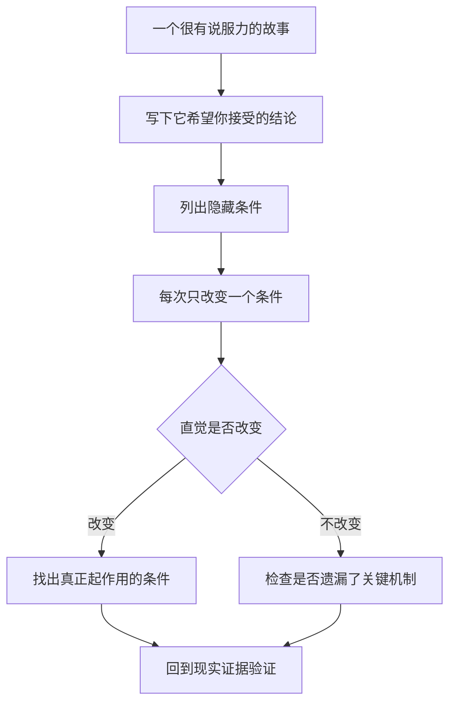

# 《直觉泵和其他思考工具》读书笔记

作者：丹尼尔·丹尼特（Daniel C. Dennett）。英文原作 *Intuition Pumps and Other Tools for Thinking*，W. W. Norton，2013年；中文可核书目为浙江教育出版社2018年版，ISBN 9787553674599。本文根据公开目录、授权试读、作者公开论述与相关原始研究整理，没有取得完整原书，不声称逐项复述全书77个工具。重点覆盖通用思考、意义、计算、进化、意识与自由意志六组主题。核验日期：2026-11-12。

本书讨论一个容易被忽略的问题：**我们用来帮助思考的故事、比喻和直觉，本身会不会把答案偷偷塞进问题？**丹尼特既教人使用思想实验，也教人拆解思想实验。读它的价值不在记住哲学结论，而在于学会追问：这个说法究竟解释了什么，哪些关键条件被省略了，换一种设置后我的判断还站得住吗？

本篇的商业、财商迁移与练习是补充教学。思想实验会明确标示为构造情境，不冒充真实故事；有关心灵、意识与自由意志的主张属于作者哲学立场，不代表科学界已经取得一致结论。

## 一、全书怎样从日常工具走向哲学难题

| 主题 | 主要问题 | 对思考能力的贡献 |
|---|---|---|
| 通用工具 | 怎样批评、查错、识别话术 | 不把反应快当成想得对 |
| 意义与意向性 | 一个符号怎样指向世界 | 分清命名、解释和预测 |
| 计算与算法 | 简单步骤如何组成复杂能力 | 拆解“只有天才能做到”的神秘感 |
| 进化 | 复杂设计怎样形成 | 不把结果倒写成预先目的 |
| 意识 | 主观经验应怎样研究 | 检查日常直觉藏着的假设 |
| 自由意志 | 有因果原因是否就没有责任 | 区分控制能力、随机性和宿命论 |

## 二、工具首先要能反过来检查自己

### 1. 直觉泵：用一个情境，把抽象问题变得可想

思想实验暂时设置一个情境，让我们判断在其中什么应该成立。“如果完全复制一个人的记忆，会不会复制这个人？”就把身份问题变得具体。但情境容易唤起直觉，并不等于它已经证明结论。

最重要的检查是：故事在帮助看见一个区别，还是利用省略的信息制造一种感觉？如果结论来自“想象它当然可以做到”，却没有说明关键步骤为什么可能，论证可能只是在借用想象力。

### 2. 拧动旋钮：逐个改变条件，找出直觉真正依赖什么

面对一个打动你的例子，依次改变规模、时间、信息、参与者能力和失败代价。若某个条件一变，结论就反转，那个条件就是论证的重要组成部分，不能留在背景里。

**财商迁移：**“好公司长期拿着即可”是一种压缩说法。把买入价格、竞争变化、融资结构和个人现金需求逐个改变，就会发现它省略了若干必要条件。这不是反对长期投资，而是把口号改写成可检查的判断。

图意：思想实验的价值是暴露假设。它不能替代现实中的测量、取证与成本核算。

### 3. 犯“好错误”：让错误留下可学习的结构

一次有价值的错误应当能说明：当时依据什么、哪一步失败、怎样修改。隐去错误过程，只保存正确答案，会使人失去学习机会。

投资笔记可以保留旧判断并添加更正，而不是改写成自己早就知道。这样做不会让错误消失，却能避免同一种推理在不同公司上重复发生。

### 4. 归谬法：检查接受一个说法会带来什么

归谬法先暂时接受一个命题，再看它是否推出矛盾或与已接受条件冲突。必须真的存在推导关系，不能把“我讨厌这个结果”当成矛盾。

例如，一个估值方法若声称完全不受任何未来现金流影响，却又声称测量的是未来现金流价值，概念之间就需要澄清。这里是在检查定义一致性，不是在用荒诞比喻否定一切新方法。

### 5. 拉波波特法则：先复述对方最有力的版本

批评前先准确说明对方观点，再指出共同点和自己确实学到的内容，最后提出异议。这能防止把容易攻击的简化版误认为真正的对手。

应用到价值投资与指数投资的争论：先承认对方实际讨论的是何种投资者、成本和信息条件，再比较证据。若一方讨论少数专业团队，另一方讨论全部个人账户，双方可能根本没有回答同一个问题。

### 6. 史特金法则是注意力提醒，不是统计定律

这个工具提醒人不要把全部精力放在某个领域最差的作品上，再据此宣布整个领域没有价值。它包含的夸张比例应当理解为修辞，不是跨行业验证过的精确数字。

因此研究主动管理，应比较完整样本与有代表性的机制，不能只挑最离谱的荐股节目；批评被动投资，也不能只挑一次极端市场表现。

### 7. 奥卡姆剃刀：减少无必要假设，不是保证简单解释总正确

两个解释都能处理现有证据时，额外假设越多，越需要说明它们增加了什么解释能力。简单性有助于防止随意编故事，但不能压过可靠的新证据。

现实复杂性可能要求复杂模型。好的简化是删掉对问题不重要的细节；坏的简化是删掉杠杆、反馈、异质性等恰好决定结果的因素。

### 8. 奥卡姆扫把：把不利事实扫走，制造“简单清晰”

一份漂亮叙述可能只保留成功样本、成功期间和成功指标。它看似遵循简洁原则，实际上通过删减证据逃避解释责任。

检查方式很具体：研究对象是怎么选出来的？失败案例还在表里吗？有没有把净利润好看的年份与现金流好看的另一年份拼在一起？先还原样本，再讨论理论是否简洁。

### 9. “当然”和反问句有时在绕过证明

“当然，真正优秀的企业不会受宏观影响”“难道聪明人会错吗”都容易迫使听者直接接受前提。把它们改成普通陈述句，就可以逐一检查。

这不是说所有反问都是诡辩。关键在于它是否把尚待讨论的条件包装成无需解释的常识。

### 10. “深马”：在平凡真话和宏大假话之间滑动

丹尼特用deepity指一种貌似深刻的表达：按普通含义理解，它虽然正确却没说多少；按震撼含义理解，它又缺少支持。词义的滑动把两者连接起来。

**自拟语义练习：**“一切价值都在人心中。”如果意思是价值判断需要主体参与，这是一般说明；如果进一步声称任何资产都可以无视资源、契约和现金流任意定价，就额外跨出很远。前一句的合理性不能替后一句担保。

### 11. 跳出系统：先问你是否选错了问题

在既定规则里不断优化，可能始终解决不了规则外的问题。买入哪个高费率产品之前，先比较是否需要这类产品；怎样说服同事之前，先检查自己是否理解其约束。

跳出去也不是无限怀疑。找到更合适的问题后，还要回到可操作的事实和选择，否则只是从一个抽象词换到另一个抽象词。

## 三、意义、能力与计算：避免用一个词包办解释

### 12. 意向性：心智状态“关于某件事”的性质

相信明天会下雨、希望企业盈利，都有指向的对象。这里的“意向性”不同于日常说的“故意做某事”。理解这个术语，才能明白作者为什么从符号、语言讨论到机器。

困难是：纸上的字、计算机中的标记和人的想法，怎样获得指向世界的意义？给它们贴上“理解”或“不理解”标签，只是开始，不是解释的终点。

### 13. 意向立场：把对象当作有信念和目标，以便预测

我们说棋手“想控制中心”，也会说程序“在寻找最短路径”。这种说法可能有效压缩复杂过程，但使用它不必然意味着对象具有与人相同的主观体验。

**真实案例：**IBM记录，深蓝在1997年以3.5比2.5赢得与卡斯帕罗夫的六局比赛。把它的某步棋描述为“威胁对方”，能帮助读懂棋局；这个预测性描述本身，不能证明它具有恐惧、野心或意识。[IBM项目史](https://www.ibm.com/history/deep-blue)

这里应当分别问：行为是否表现出能力？用什么机制实现？是否有主观体验？把三个问题合成一句“它真的会想吗”，常会让争论停在词语上。

### 14. 物理、设计与意向三种说明层次可以并存

物理层解释材料和因果过程；设计层解释部件的功能安排；意向层通过目标与信息预测行为。同一个对象可以根据任务使用不同层次。

研究企业也类似：产品的物理成本、组织的流程设计、管理者的激励目标都可能必要。只用管理者性格解释全部业绩，往往遗漏设备、制度和行业结构。

### 15. 小人谬误：把难题交给脑中另一个完整的人

如果解释视觉只是说“脑中有个小人观看图像”，问题没有被解决，因为还要解释这个小人怎样看。层层再放一个小人，会形成无穷后退。

有效分解应把整体能力交给更简单的子过程，直到每一部分无需具备原来那种完整能力。商业分析中的对应错误，是用“企业有灵魂”“市场有意志”替代对具体机制的说明。

### 16. 不理解整体，也可能完成局部功能

系统的部件不必各自拥有系统的全部能力。一个计算步骤并不知道整个模型的用途，但很多受约束的步骤可以共同完成复杂任务。

这不意味着任意堆积都能产生能力。组件之间的连接、反馈和训练方式必须说明清楚。把“整体大于部分之和”当作结束语，容易再次用一句话遮住待解释的机制。

### 17. 图灵的处理方法：把含糊问题换成可讨论的任务

**真实文献：**图灵1950年在《Mind》发表论文，提出模仿游戏，用具体交互任务推动“机器能否思考”的讨论。它的重要性在于把争论连接到可观察表现，而非宣布一个测试解决了所有心灵哲学问题。[图灵原始论文](https://doi.org/10.1093/mind/LIX.236.433)

财商迁移是先操作化一个词。声称公司“执行力强”时，问它对应什么：交付周期、研发转化、预算偏差还是现金回收？测量指标本身也有局限，但至少让争论有了落点。

### 18. 算法是步骤规则，虚拟机是组织层次

算法把任务分解为明确操作；虚拟机说明一种执行环境可以由另一种底层机制实现。二者帮助读者理解：宏观功能不必与某一种材料一一绑定。

但是“可计算”不等于计算成本可接受，也不等于所用数据正确。一个程序可以严格执行错误模型。财务表格自动化之后，口径核验仍然不可省略。

### 19. 语法处理与语义理解的关系是问题，不能靠贴标签解决

按规则操作符号，与理解符号指什么，看起来有所不同。丹尼特倾向要求说明：系统在真实环境中有哪些可检验能力，以及这些能力怎样组成，而不满足于预设一个永远无法检验的“额外理解”。

这是哲学争议的一方。读者可以不接受其全部结论，但仍能使用他的检查方法：有没有把结论放进“真正”“仅仅”等限定词里，而没有给出进一步论证？

### 20. 极端思想实验要检查可想象性是否被高估

书中讨论的机器、语义与身份情境，会故意拉开日常经验的边界。设想一个系统“拥有所有信息”，不等于我们真的考虑到了全部记忆、学习、环境互动和计算要求。

使用时把设定分成三类：逻辑上必须成立的条件、物理上是否可能的条件、为了方便暂时省略的条件。不能用第三类的省略，直接决定第一类的结论。

## 四、进化：怎样解释没有预先计划的复杂结果

### 21. 选择过程可以累积设计，但没有预先规划终点

遗传变异、差异性繁殖和累积选择，能够产生对环境有适应作用的结构。结果看起来适合某种用途，不意味着形成过程预先知道最终目标。

商业成功也容易被写成从创办第一天就确定的路线。不过生物进化和企业竞争并不相同：企业可以有意设计、融资和并购。借用进化视角是帮助识别选择与存活机制，不能把市场胜者自动宣布为社会最优。

### 22. 起重机与天钩：解释复杂性时，是否交代了支撑过程

“起重机”代表依靠已经存在的机制逐步形成复杂能力；“天钩”代表把关键能力从解释之外直接吊进来。这是一组思考比喻，不是分类自然界实体的物理术语。

判断商业模式时，可以把“强大网络效应”拆成参与者为什么加入、增加一方怎样帮助另一方、成本由谁承担、收益能否被平台保留。说出一个宏大名词不能代替这条机制链。

### 23. 历史路径会限制下一步有哪些可能

**真实研究：**Blount、Borland与Lenski在2008年报告长期大肠杆菌实验：12个起初相同的种群中，一个种群约在31500代时演化出在有氧条件下利用柠檬酸的能力。对历史样本重新开展实验表明，先前的变化影响了这一新能力后来出现的可能性。[PNAS原始研究](https://doi.org/10.1073/pnas.0803151105)

这个案例说明“能出现什么创新”与此前路径有关；它不能证明所有创新都不可预测，更不能把细菌实验直接当成企业估值定律。迁移到公司时，要另外寻找技术积累、组织接口与客户基础的证据。

### 24. 适应性故事需要竞争解释

看到一个特征有用途，不等于它当初就是因为该用途形成。它可能是副产物、历史遗留，或先为另一功能出现。一个听起来合理的起源故事，仍然需要资料检验。

同样，企业今天成功，不能倒推所有现存制度都有贡献。应比较改革前后、同类企业和失败尝试，避免把偶然共存解释成必要原因。

### 25. 设计空间帮助扩展选项，也提醒现实约束

可以把所有可能方案想成一个空间，而技术和历史决定了目前能到达哪些位置。局部改进未必能到达全局最好方案，中间可能存在成本高、回报差的过渡阶段。

这是本篇的辅助解释。用于研究行业时，既要看技术上能否做到，也要看支付意愿、资本开支、监管和组织能否支持迁移。所谓“未来必然如此”，通常漏掉了抵达未来的路径成本。

## 五、意识与自由意志：最容易被日常直觉牵着走的部分

### 26. 笛卡尔剧场：大脑里真的需要一个最后观看者吗

丹尼特批评把意识想象成一块内部屏幕，所有信息汇到那里，再由真正的“我”观看。这个图景很直观，却可能重复小人谬误：屏幕后那个观看者仍待解释。

作者倾向从分布式处理、报告、记忆和行为能力研究意识，而不是先假设唯一的中央舞台。读者应把这当成理论方案，不能写成已经直接观察到“意识完全不存在”。

### 27. 第一人称体验是研究对象，但报告也需要解释

“我确实感觉如此”描述了重要现象，却不能自动裁定其神经机制。回忆、注意、语言报告和当时体验之间可能存在差异。

这也不等于可以随意否定他人的痛苦或经验。科学解释关注报告怎样形成，伦理对待则关注人的福祉与权利；不能用一套哲学术语取消后一层责任。

### 28. 自由意志不等同于毫无原因的随机动作

如果一个动作完全随机，它未必更属于“我”。丹尼特的相容论路线关注的是：人能否理解理由、预见后果、控制冲动、接受反馈，并在约束下修正行动。

**作者公开论述，非独立实验结论：**2019年Amherst演讲将自由意志讨论为一种强大但脆弱的自我控制能力。这有助于核对其立场的延续，但不能拿作者自己的演讲作为该立场已获证实的证据。[作者演讲](https://amherstlecture.org/dennett2019/index.html)

财商应用中，自动储蓄和风险规则可能增加实际控制力；它们限制某一时刻的冲动，却帮助人执行更长期的选择。

### 29. 决定论与宿命论不能混为一谈

决定论讨论事件是否由先前条件和规律决定；宿命式说法则常认为“无论怎么行动结果都一样”。二者不同：即使行动有原因，行动本身仍可能是改变结果的原因之一。

因此“市场有规律，所以研究无用”“行为受环境影响，所以训练无用”，都不是自动成立的推论。要讨论的是研究和训练能否进入有效因果链，而非仅讨论人是否拥有绝对独立于因果的意志。

### 30. 工具的最终检验，是它有没有让问题更清楚

使用直觉泵之后，应该更清楚哪些是事实、哪些是设定、争论到底在哪一步，而不是仅仅学会一套嘲讽别人的术语。工具可以帮助你反对丹尼特，也可以帮助你修正自己的投资偏好。

图意：从故事返回证据，是本书工具用于现实问题时不可缺少的最后一步。没有这一步，批判性语言同样可能成为新的话术。

## 六、三项练习与参考答案

**练习一：**“一家企业最后成为龙头，说明创始人早年每次选择都是正确的。”指出至少两个问题。

参考答案：从最终存活倒推所有决策正确，忽略失败路径、外部条件与错误之间的抵消；同时没有比较如果采取其他决策会怎样。应分别研究关键选择，寻找当时可得信息与竞争解释。

**练习二：**“电脑没有感情，所以它不可能在棋类比赛中超过人。”这个论证在哪里跳步？

参考答案：把感情预设成高水平下棋的必要条件。深蓝的比赛结果提供了行为能力证据，但并没有因此回答电脑是否有意识。能力、机制与体验须分别讨论。

**练习三：**给“高ROE代表好生意”拧动三个旋钮。

参考答案：改变杠杆、净资产规模及一次性损益，看高ROE是否仍来自持续经营优势；再检验资本化政策、周期位置与现金回收。工具负责暴露假设，最终判断仍需财报证据。

## 七、与其他书怎样搭配

《学会提问》帮助检查一篇论证，《理性》补概率与决策，《为什么》补因果识别，本书更擅长发现“问题本身已经把人带偏”。自由意志和意识部分不必急着选边；先学会区分作者主张、思想实验的设定与实际研究能支持的内容。

主要书目依据：[英文图书馆目录](https://opac.lu.ac.ae/cgi-bin/koha/opac-detail.pl?biblionumber=20346)、[中文书目、目录与试读](https://www.sanmin.com.tw/product/index/006976395)。公开资料不足以支持对77个工具逐条完整评价；本篇以主要问题和可迁移的方法组织，未编造原书页码。真实案例来源均置于所解释的知识点附近。
