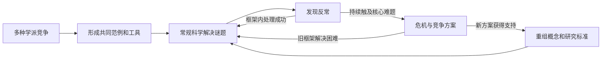
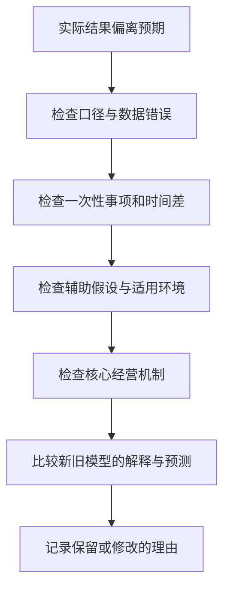

# 《科学革命的结构》读书笔记

作者：托马斯·库恩（Thomas S. Kuhn）。原作 *The Structure of Scientific Revolutions* 初版1962年，1970年第二版包含“1969年后记”；芝加哥大学出版社2012年50周年版增加伊恩·哈金导论。本文依据出版社目录、公开书目与科学史资料整理主要框架，没有完整通读用户所持译本，中文版本和页码未核定，不把后记与后来的解释混同于初版正文。核验日期：2026-11-12。

这本书要回答：科学知识只是越积越多，还是有时连“什么值得研究、怎样解释、怎样判断答案好坏”都会改变？库恩提出，成熟科学常在共同框架内解决问题，也会经历框架受到严重挑战、被新框架重组的时期。

对财商的价值不是教人喊“时代变了”，而是帮助检查自己正在用什么框架看公司和市场：哪些事实被当成重要，哪些异常被忽略，什么时候值得修改模型，什么时候只是为错误找借口。

## 一、全书的问题结构

| 书中主题群 | 核心问题 | 阅读时应保留的区别 |
|---|---|---|
| 历史的作用、常规科学的形成 | 共同研究传统怎样建立 | 当时合理与今天正确不同 |
| 常规科学、解谜、范式优先 | 科学家每天实际做什么 | 在框架内改进与改变框架不同 |
| 反常、危机与新理论 | 哪些困难会触动基础 | 任何异常都不等于革命 |
| 革命、世界观变化与不可见性 | 改变了什么、为何教材难以显示 | 新知识可能重组旧知识 |
| 革命的解决与进步、后记 | 如何比较框架和理解共同体 | 没有机械算法不等于随意选择 |

图意：这是一幅整理作者思路的示意图，不是每门科学都必须按时经过的历史周期。反常既可能推动革命，也可能在原有框架内被解决。

## 二、范式不是一个时髦观点

### 1. 历史要恢复当时的问题，而不只寻找现代答案的先驱

如果只问古人哪里接近今天，就容易把科学史写成少数天才不断预见现代知识的故事。库恩要求先理解当时研究者掌握的概念、仪器、资料和问题。

对应到投资复盘，应使用决策当时可得的信息。事后知道一家企业破产，不代表当时所有风险都已经清楚；也不代表当时所有乐观判断都有合理依据。评价需要恢复信息条件，而不是删除不确定性。

### 2. 前范式状态：争论甚至涉及研究什么

在缺少共同框架时，不同学派可能对基本对象、测量方法和解释目标都有分歧。因此一份观察对某学派很重要，对另一学派却可能毫无说服力。

这不意味着所有新领域都必然不科学，也不意味着一旦意见一致就是真理。它描述的是协调研究活动的难度，而不是给学科排高低等级。

### 3. 范式包括被共同接受的成功研究范例

范式既与一套共享理论、方法和价值有关，也与具体的解题范例有关。学生不只是背规则，还通过训练学会什么样的问题像以前的问题、什么样的答案算合格。

所以“我有一个新观点”并不足以叫作范式转移。要问：它是否改变了共同体反复使用的问题、方法、例题和判断方式？如果只是更换一句宣传语，结构可能没有变化。

### 4. 学科基质：后记对“范式”作了更细区分

1969年后记用“学科基质”帮助区分共同体共享的组成部分，包括符号概括、模型或形而上承诺、价值，以及范例。这样能避免把“范式”当成包办一切的词。

**补充应用：**分析一个投资流派时，也可以分别列出公式、对市场的假设、评价标准和典型案例。这个拆分是类比工具，不表示投资流派与自然科学共同体完全等同。

### 5. 共同体通过训练形成默会判断

许多技能无法只靠完整口头规则传递。反复做题、使用仪器和讨论实例，会让研究者形成识别好问题和可信结果的能力。

这解释为什么熟悉术语不等于掌握研究。读公司财报时，真正的训练包括核对口径、识别异常、追溯附注和处理不一致，而不只是背ROE、现金流和护城河的定义。

### 6. 共享框架同时带来效率与盲区

如果每一步都重新讨论基本原则，研究会很难积累；共享前提能让人集中精力攻克细节。但同一套前提也可能使人低估不符合预期的现象。

成熟的做法不是永远怀疑一切，而是将日常工作与定期基础审查分开。大多数时候按明确标准研究，同时为异常保留可追溯记录。

## 三、常规科学：在共同框架内深挖

### 7. 解谜不是贬义，它要求高水平的精细工作

库恩所说的常规科学，常围绕已有框架处理测量、理论应用和工具改进。研究者通常相信问题可以解决，困难首先被当作技术或理解尚未到位。

这与“没有创造力地重复”不同。提高仪器精度、扩展适用条件、发现新的效应，都需要创造性，只是基本规则尚未改变。

### 8. 范式影响什么事实值得精确测量

可观察的东西无限多，研究资源有限。理论帮助人决定测哪里、测多准、与哪个预测比较。数据并不是自动从世界里排好队走进知识库。

在财报中也一样：经营现金流、库存周转、用户增长或研发产出何者重要，取决于你认为企业怎样创造价值。选择指标应当有理由，同时保留能挑战模型的材料。

### 9. 仪器和概念共同参与观察

观察需要测量程序，也需要解释程序。看到一条异常曲线，必须判断它来自对象、仪器、校准、数据处理还是理论。并非所有解释都一样好，但事实与框架之间确实存在连接。

这不等于现实可以任意编造。它说明必须公开方法，使别人能够检查结果究竟是怎么获得的。

### 10. 一次异常为什么不会立即终结整套理论

任何成熟理论通常都伴随未解问题。若每次预测偏差就立即废弃全部知识，很多可修正的测量问题会被误认为基础革命。

合理保留理论需要条件：异常应被认真记录，修正具有独立依据，模型继续接受检验。如果每次失败都追加一个无法检验的理由，保留就可能变成免疫化保护。

## 四、反常怎样变成危机

### 11. 反常是相对于预期而言的

同一个现象可能一直存在，却直到理论给出明确预期后才显得异常。发现不只是“第一次看见”，还包括理解看见的东西为什么构成问题。

投资迁移：毛利率下降本身是一条事实。只有先写清竞争优势应如何抵御价格压力、哪些情况下仍会下降，才能判断它是正常波动还是挑战原来的经营假说。

### 12. 危机往往与核心困难和替代解释有关

异常是否严重，取决于它触及框架多深、持续多久、是否影响关键任务，以及有没有更有力的替代方案。异常数量本身不是机械触发器。

不要设想“累计三次失败就一定换范式”。一个核心预测失败可能很重要，十个边缘误差也可能只是测量条件需要改进。需要说明困难的结构。

### 13. 危机中的研究会重新打开基础问题

原本不必争论的定义、方法和假设，可能重新进入讨论。不同方案开始竞争，研究者对什么算合适解释的看法也可能分化。

这种状态增加机会，也增加噪声。对投资者而言，“大家意见分歧”本身既不证明存在便宜资产，也不证明应该立即退出；还要比较方案的证据与价格。

### 14. 拉瓦锡的化学革命：改变的不只是一条结论

**历史案例：**美国化学会的化学史纪念资料介绍，拉瓦锡以定量实验推进对燃烧和水的组成的解释，氧参与反应的新框架挑战了燃素说。水不再被理解为不可分的元素，这同时涉及概念分类与实验解释。[美国化学会历史资料](https://www.acs.org/education/whatischemistry/landmarks/lavoisier.html)

这里的启发是：新理论不仅把一个数值改对，还可能改变“哪些东西属于同一类、哪些过程需要怎样记账”。但不能把复杂的化学革命简化成某一天一次称重使所有人立刻认输，也不能抹掉其他研究者的贡献。

### 15. 新框架需要承担解释任务，而不只是指出旧框架的错误

否定现有说法比较容易，提出能处理旧成绩和新困难的替代方案更难。候选理论若仅解释一个异常，却丢失大量可靠现象，就需要说明取舍为何合理。

投资中，指出PE不适合某公司以后，还要说明替代估值如何连接经济利益、如何处理再投资和风险。批评一种工具不能自动证明另一种工具正确。

### 16. 板块构造：多类证据共同改变解释框架

**书外科学史案例：**USGS总结板块构造理论形成时，列出海底地形和年龄、地磁反转、海底扩张，以及地震火山活动分布等证据。海岭两侧磁性条带与扩张机制之间的联系，使分散观察能够在共同框架中解释。[USGS理论形成史](https://pubs.usgs.gov/gip/dynamic/developing.html)

这比“某位先知独自正确，所有专家都愚蠢”的叙事更有帮助。一个想法被忽视，并不能证明它正确；一个后来成立的想法，通常还需要新的测量、机制和可比较的解释力。

这里用后来资料说明框架重组，不宣称该历史完全服从库恩的每个阶段。

## 五、革命改变了什么

### 17. 概念的意义可能在理论改变后发生移动

同一个词在不同理论中，可能与其他概念构成不同关系。因此把新理论中的词直接替换进旧理论，不一定能保持原意。

商业讨论中也要防止类似混淆：“资产”在会计确认、个人理财和商业优势中可能指不同东西。先写明使用哪种定义，才能比较说法，而不把词相同误当成对象相同。

### 18. 不可通约不是绝对无法交流

不可通约提醒我们，两个框架之间可能没有一把完全中立、所有人都认同的统一尺子。它不必意味着没有任何共同事实，也不意味着不能学习对方的语言或比较预测表现。

最常见的误读是：既然标准不同，就没有真假与优劣。这会把一个关于比较困难的论点，夸大为任意观点都一样合理。库恩的后记与后续澄清，应和早期强烈表述一起阅读。

### 19. “世界改变”首先要区分观察世界与客观世界

作者用强烈语言描述理论转换后的研究经验：原先看见的图案、分类和问题会显得不同。谨慎理解应区分世界的物理变化，与研究者能够看见和组织的结构变化。

认识发生变化，不代表过去的数据可以任意重写。记录、样本和测量仍然构成约束；新的解释必须回到这些约束上接受比较。

### 20. 教材会把曲折历史整理成平滑路线

教学需要效率，往往把失败分支、概念争议和不确定性压缩掉。学生因此容易以为知识总沿着今天的方向前进。

投资成功传记也有类似风险：事后叙述把关键节点连成清楚路径，掩盖当时的替代选项。读传记时保留一栏“当时还有哪些可能”，能抵消这种线性错觉。

### 21. 幽门螺杆菌案例：改变解释需要一组证据

**书外历史案例：**2005年诺贝尔医学奖说明回顾，Marshall和Warren在1982年前后对幽门螺杆菌及其与胃炎、消化性溃疡关系的研究，挑战了当时以压力和生活方式为主的解释。[诺贝尔奖官方说明](https://www.nobelprize.org/prizes/medicine/2005/press-release/)

认识改变涉及观察、培养、病因研究和后续临床证据，不能把它缩成“勇敢的人做了一次自我实验，所以一切得到证明”。此处只讨论科学史，不据此推导个人诊断或治疗方案；也不能把全部溃疡归结为单一原因。

这个案例帮助理解：主导解释会影响研究方向，但反对主导解释的人仍负有证据责任。

## 六、理论选择与科学进步

### 22. 共享评价价值，并不保证每个人权重相同

研究者可能都重视预测准确、解释一致和解决新问题的能力，却对这些价值的权重及具体应用有分歧。这解释为什么理论选择不总像计算一道唯一答案的题。

准确性、一致性、范围、简洁性和研究潜力常用于概括库恩的理论选择观；其中系统化的五项表述也见其后来的理论选择论述，不能全部当作本书初版逐字清单。相关概念与历史争论可参阅[斯坦福哲学百科对库恩的专题](https://plato.stanford.edu/entries/thomas-kuhn/)。

### 23. 没有机械算法，不等于没有理性理由

如果不能用一张表自动算出胜者，比较仍然可以依据证据、预测、问题解决能力和解释代价。实际判断会包含训练形成的专业判断与对未来研究潜力的评估。

投资研究也是如此：没有一个指标自动决定企业价值，但这不是随意定价的许可证。判断越依赖专业裁量，越应公开关键假设和敏感性。

### 24. 共同体接受是历史事实，不是单独的真理证明

一个理论获得广泛接受，能说明知识生产与传播发生了变化，但不能仅凭人数证明它正确。反过来，少数地位也不能成为正确性的证明。

因此同时记录两类内容：共同体为什么接受，以及有哪些可以独立检查的证据。把两者混在一起，容易陷入权威崇拜或自动反权威。

### 25. 科学进步可以增加解题能力，却未必保留一切旧问题

新框架通常解决重要困难，也可能重新定义某些旧问题，使它们不再作为同一种问题出现。进步并不总表现为旧知识清单上简单增加条目。

这不意味着新旧解释在任何方面都没有联系。许多旧理论在限定条件下仍然有用，研究者需要说明保留的是近似、工具还是基础解释。

### 26. 库恩与波普尔关注的层次不同

波普尔强调理论应接受怎样的批评和检验；库恩特别重视科学共同体在历史中实际怎样研究、保留与改变框架。二者有冲突，但不能压缩成“一个相信理性，一个反对理性”。

实用组合是：用波普尔提醒自己写出可能失败的条件，用库恩提醒自己一次反常可能来自测量、辅助假设与理论网络。进一步处理如何选择研究纲领，还需要其他科学哲学讨论。

## 七、怎样迁移到公司与市场研究

### 27. 先写“模型卡”，再记录反常

模型卡写明：研究对象、核心机制、适用条件、关键指标、预计出现的事实、可能使判断失效的事实。没有原先承诺，就很难知道新消息究竟挑战了什么。

例如评估竞争优势，不只写“品牌强”，还要写品牌如何影响价格、留存或获客成本，以及哪些渠道变化会削弱它。具体事实应回到公告与行业资料核验。

### 28. 按层次排查异常，不能一上来换故事

文字说明：这是本篇为财商设计的排查程序，不是库恩原书给出的投资规则。顺序的作用是防止把会计口径变化误判为商业革命，也防止永远用一次性因素掩饰持续恶化。

### 29. “新范式”不能豁免现金流和契约约束

商业模式确实会变，但工资、债务到期、股权稀释和现金消耗仍需要解释。新指标可以帮助理解经济活动，却必须说明它最终如何关联到可分配利益或其他明确目标。

如果一个说法只在价格上涨时解释成功，价格下跌时又宣布旧标准全部失效，应检查它是否留下任何可反驳条件。库恩的框架不为这种做法提供保护。

### 30. 实际能学到的是双重耐心

一方面，不因一次异常立即推翻全部知识；另一方面，不因已有知识长期有用，就拒绝积累中的严重反证。这两种耐心需要共同存在。

最终输出不必强行二选一。可以写“旧模型在A范围继续可用，B范围存在未解决异常，新模型尚缺C证据”。这种分层结论通常比“彻底颠覆”更能指导后续研究。

## 八、练习与参考答案

**练习一：**企业连续两个季度毛利率下降，是否说明竞争优势范式已经崩溃？

参考答案：信息不足。先核对期间、产品结构、原材料、售价、产能利用率和一次性项目；再比较原经营假说承诺了什么。若定价能力、客户关系和单位经济性持续违背预期，才形成更深层挑战。股价变化本身不能替代这条分析。

**练习二：**“过去专家也错过，所以现在被专家反对的说法更可能正确。”错在哪里？

参考答案：只挑出后来成功的异端，忽略大量失败异端，同时把专家可能出错误当成某个具体主张正确的证据。应独立评价该主张的测量、预测与竞争解释。

**练习三：**怎样区分模型修正与随意找借口？

参考答案：合理修正说明新证据、独立机制、适用范围和新预测；找借口通常只在事后追加条件，拒绝保留旧记录，并使任何结果都与理论相容。

## 九、资料范围与重要边界

本篇覆盖本书主要问题链及后记概念，未进行所有历史案例、哲学论争和不同译本的逐页核对。科学共同体的历史与金融市场不同，后者有反身性、制度变化和策略互动，把“范式”迁移到投资只能作为检查框架，不能直接作为择时信号。

书目与版本依据：[芝加哥大学出版社50周年版](https://press.uchicago.edu/ucp/books/book/chicago/S/bo13179781.html)、[第二版目录书目](https://opac.library.bsu.ac.ug/bib/9140)。科学史与解释性补充已在对应段落列明。可与《猜想与反驳》《理性》《模型思维》对照阅读，分别训练批评标准、概率更新和多模型比较。
