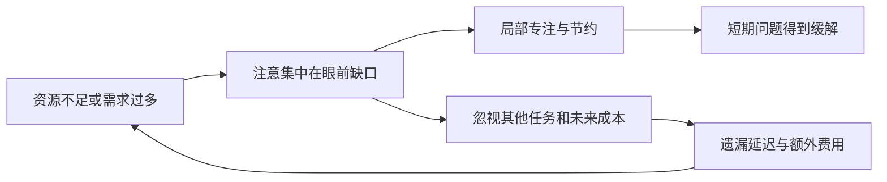
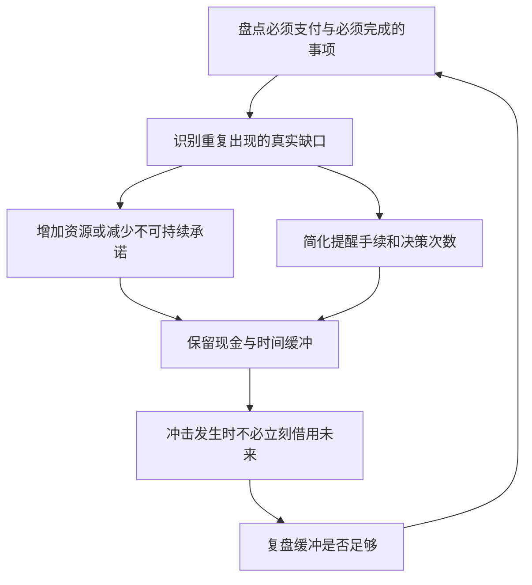

# 《稀缺》读书笔记

> 作者：塞德希尔·穆来纳森（Sendhil Mullainathan）、埃尔德·沙菲尔（Eldar Shafir）。原作 *Scarcity: Why Having Too Little Means So Much*，Times Books，2013 年。中文书目核对《稀缺（经典版）：我们是如何陷入贫穷与忙碌的》，浙江人民出版社，2018 年，魏薇、龙志勇译，ISBN 9787213087929；不同英文版本副标题可能不同。
>
> **资料范围：基于公开资料的系统导读。** 使用出版社授权引言、正版电子书目录、作者原始研究和后续重复研究；未取得中文版全书。按专注与管窥、带宽、权衡与余闲、借用、稀缺陷阱、组织和个人应对等主要主题整理 30 点。2016、2019、2025 年研究属于后续证据，不伪装成 2013 年原书内容。财商练习为补充教学。

本书试图解释：当钱、时间或其他资源不足时，人为什么会把注意力高度集中在眼前缺口，却忽视未来问题？核心价值是把某些看似“缺乏自律”的行为放回资源环境中理解。**它不是证明贫穷源于心态，也没有证明所有资源短缺都会按同一幅度降低智力。** 阅读时要把有启发的机制、具体研究结果与夸张宣传分开。

## 一、稀缺怎样改变注意力

### 1. 稀缺不只是拥有得少，而是需要与可用资源之间有缺口

作者讨论的是资源不足对人的注意和选择产生的影响。绝对收入、收入波动、必须承担的开支、可获得的支持不同，都会改变缺口。看起来同样的余额，在不同家庭中可能代表完全不同的处境。

这并不意味着贫困纯属主观感觉。住房、食物、医疗和照护存在真实需求，制度与收入会直接限制选择。“调整感受”不能替代填补真实资源缺口。[原作出版社及授权引言](https://us.macmillan.com/books/9781429943451/scarcity/)

### 2. 注意力被紧迫事项吸引，有时先带来收益

资源紧张会让人更仔细地使用剩下的部分：时间少时聚焦截止任务，预算少时注意价格。这种局部效率改善是书中“专注红利”的意思。

但效率必须说明分母和范围。某一小时完成更多眼前工作，不代表一周整体安排更好；某次购买省下一点钱，也不代表为此花掉的时间没有更重要的用途。局部专注可以与全局损失同时发生。

### 3. 管窥：进入视野的事项变清楚，其他事项更容易被忽略

管窥是像通过窄管看东西，只能看见眼前突出的部分。重点不是人完全不知道未来，而是未来事项没有在当前决策中得到足够权重。

这解释了为什么“再提醒一次要长远考虑”可能不足。若到期账单持续占据注意力，提醒也可能成为额外噪声。应同时改变事项出现的位置、完成难度和实际资源约束，让长期事项有机会进入执行流程。

### 4. 真实研究：资源有限的游戏怎样检验专注与借用

Shah、Mullainathan 与 Shafir 2012 年发表的实验，让参与者在游戏中拥有不同数量的资源，并观察注意分配与借用。有些设置允许从未来轮次借资源、付出额外代价；原始结果支持资源较少时更专注，却可能借用过多。[原始论文信息](https://doi.org/10.1126/science.1222426)

这是实际开展的实验，但“资源贫穷”是实验中的游戏条件，不能写成研究者随机让现实家庭陷入贫困。游戏可以控制条件、测试机制，却未包含真实生活里的住房风险、家庭责任和信用约束。

应用方式是检查：自己的方案是否为了优化当前一轮，把未来轮次的必要资源提前耗掉。至于机制能否解释某个真实债务问题，还须调查借款人的可行选择，不能由实验直接判定其行为不理性。

### 5. 专注不等于对所有任务都更有能力

注意力集中在价格，可能提高比价准确度，却留下更少精力处理保险续期、工作学习或家庭沟通。因此，不宜把某领域表现好坏当成整体能力标签。

分析一个判断错误时，可以先问“他当时必须处理什么”，再问“他缺少什么知识”。两种问题对应不同改进：缺知识需要解释，缺资源或任务过载则可能需要简化、延期或帮助。

### 6. 时间稀缺与金钱稀缺有相似机制，但不是同一种生活

作者用忙碌和贫困之间的类比打开思路。类比有效的部分是紧迫任务、未来借用和反复救火；无效的延伸是把主动选择的忙碌与没有基本保障的贫困视为同等严重。

高收入者通常更容易购买服务、取得信用或拒绝某些任务。低收入者可能没有这些出口。保留机制相似性，同时承认权力和资源差异，才能避免把贫困变成一个时间管理笑话。

图示是一种可能机制，不是每个人必然经历的定律。短期获益与长期负担可以同时存在；打断循环需要降低缺口、减轻处理负担或建立缓冲。

## 二、带宽：有启发的概念需要和证据强弱一起读

### 7. 带宽指可以用于当前任务的心理处理资源

书中带宽涉及工作记忆、注意控制、推理和执行等能力。可以把它理解为眼下能够调动多少精力处理事情，而非一个人的固定智力上限。

“大脑带宽”是帮助理解的比喻，不是像网络速度一样存在统一单位的指标。研究采用的任务测量不同侧面，不能把不同测试分数全部换算为一个精确的脑力余额。

### 8. 认知负担与智商标签必须分开

临时任务表现变差，不代表人格退化或先天能力低。面对不断出现的开支，人的注意力会被反复打断；这与不理解利率、不会算术、长期认知变化，属于不同问题。

因此，不能把科普中某个效果量与 IQ 分数的类比，写成“贫穷永久降低固定多少智商”。更不能据此认定某类群体不适合自主决定。研究应促使我们改善环境，而不是赋予污名一个科学外观。

### 9. 真实研究：商场里的财务题设，不是真实收取修车费

Mani 等人 2013 年的研究包含商场实验：参与者思考不同难度的假想财务问题，再完成认知任务。研究报告，较难财务情境下，较低收入参与者表现受到影响。[作者公开原论文](https://zhaolab.psych.ubc.ca/pdfs/Zhao_2013_Science.pdf)

这里必须分清：实验和测试是真实进行的，财务问题是研究设置的假想情境；没有据此实际向参与者收取大额费用。实验支持特定财务提醒可能影响测试表现，不能直接等同现实长期贫困造成的全部结果。

收入分组本身也不是随机分配的。研究对题设处理的因果识别，与“低收入和高收入的人为什么不同”的识别能力，应分别评估。把它写成“科学证明穷人不聪明”，恰恰颠倒了研究试图理解情境影响的方向。

### 10. 真实研究：甘蔗农收获前后的比较有什么优势和限制

同一篇 2013 年论文还追踪印度甘蔗农，比较收获前后财务状况与认知任务表现。作者发现，同一个人在资源较紧张时表现较差，并讨论营养、工作量、时间及压力等替代解释。[论文作者版本](https://shafir.scholar.princeton.edu/sites/g/files/toruqf4226/files/povertyimpedescognitivefunction.pdf)

同一个人作前后比较，能够减少固定能力、成长经历等差异的干扰。但收获不是随机发放的实验收入，季节、预期及其他随时间变化的因素仍需审查。作者的控制分析增加可信度，并不使所有未测因素自动消失。

可学到的是：不要只横向比较不同财富人群，再把差异归结为性格。研究同一人在不同约束下的变化，可能更接近要回答的问题；仍然需要谨慎确认变化由什么造成。

### 11. 后续证据：发薪日前后，没有稳定复现同样的认知差异

Carvalho、Meier 与 Wang 2016 年研究，把美国低收入家庭随机安排在发薪日前或后接受在线调查。资源和支出确有变化，但研究没有发现风险选择、认知任务等方面一致的前后差异；金钱跨期选择有所不同，非金钱努力任务则没有相同变化。[正式论文](https://www.aeaweb.org/articles?id=10.1257/aer.20140481)

这说明“短期现金少必然降低认知表现”过于宽泛。也不能据此断定长期匮乏没有影响：样本有可预期收入、调查设计与甘蔗农研究不同。合理结论是，资源短缺的持续时间、预期和测量方式可能重要，理论需要明确边界。

### 12. 后续证据：作者自己的重复研究保留了哪些结果

2019 年，原实验作者发表了对 2012 年各项实验的更大样本、预注册重复研究。结果对部分专注和过度借用发现提供支持，但未支持“一个稀缺任务造成后续任务认知疲劳”的结果；关于专注如何导致注意忽略的证据也更弱。[作者公开重复论文](https://shafir.scholar.princeton.edu/sites/g/files/toruqf4226/files/exercise_in_self_replication.pdf)

因此，不能把整本书处理为“全部被证实”或“全部被推翻”。一个理论包含多条箭头，每条证据可能不同。愿意拆开、重复并修正，是科学推理的能力，也是投资研究避免固守故事的方法。

### 13. 2025 年综述提示：财务资源与认知的总体关系仍有不确定性

2025 年《Collabra: Psychology》的系统综述与元分析，聚焦真实财务资源变化和认知表现。其总体结论仍不确定；如果存在正向效应，可能较小，并受研究设计与分析选择影响，不能照搬最早研究中的大效果。[系统综述](https://online.ucpress.edu/collabra/article/11/1/147236/214996/The-Impact-of-Financial-Resources-on-Cognitive)

这条补充的重要性在于更新信心程度，而非否认减少贫困的价值。物质援助可以改善消费、安全和自主性，即使某项认知测验没有明显上升，也不代表援助无效。不要让一个心理机制承担全部政策理由。

## 三、权衡、余闲与借用：资源管理的真正难点

### 14. 预算紧的人更常看见机会成本

机会成本是使用一份资源后放弃的其他用途。预算充足时，一笔小支出未必触发明显取舍；预算紧时，同一支出可能直接挤掉交通或必要用品。

所以，有些谨慎比价行为并非不懂“时间更值钱”，而是当前确实不能用未来收入支付今天的账单。理解机会成本要从真实约束出发，不能套用旁观者自己的工资和信用条件。

### 15. 权衡本身也有成本

比较每一项小开支，既可能省钱，也会占用时间和注意力。若每个选择都需要重新计算，决策负担会不断增加。

补充方法是把高频、金额稳定的决定制定为可调整规则，把精力留给大额、不可逆或复杂事项。但当资源极少时，人可能没有空间简化；不能要求他“别纠结小钱”，却不提供替代资源。

### 16. 余闲是缓冲，不是没有责任的闲置

书中的余闲指资源安排里保留的腾挪空间。它可以是未用完的预算、行程之间的空档，或一个允许小失误的制度。缓冲的功能，是让意外发生时不必立刻破坏其他重要安排。

这解释了为什么把所有资源用满不一定最有效。一个账面利用率极高的计划，可能一遇到延误就产生连锁失败。评估缓冲应看它减少的中断与被迫行动，不只看它有没有立即带来收益。

### 17. 装箱问题：同一项新增任务，在不同饱和程度下代价不同

空箱放入新物品很容易；已经装满的箱子，需要重新排列甚至丢掉其他物品。这是作者帮助解释资源余量的比喻，不是关于所有资源分配的精确数学定律。

在工作和家庭预算中，真正应问的是“加入后要挤掉什么”。如果回答总是“我再努力一点”，往往意味着被挤出的睡眠、检查或关系维护没有被记录。看不见的取舍仍然发生，只是以后才显露成本。

### 18. 数学演示：满负荷计划为什么容易被小冲击打破

假设某周可安排时间为 40 小时，已承诺工作分别为 38 小时和 30 小时，剩余缓冲为 2 小时和 10 小时。若出现 6 小时必须处理的意外，前一方案需延误、加班或删去至少 4 小时工作；后一方案仍有 4 小时余量。

这里没有随机模型，也没有声称 25% 缓冲是最佳标准。演示只说明：同样的冲击，相对于剩余空间而非总时间产生影响。财务上同理，净资产很多但马上可用现金少，仍可能无法承担近期支付。

### 19. 借用可以缓解稀缺，也可能把稀缺推向未来

借钱、延后任务、削减睡眠，都能暂时扩大当前资源，但未来要还本金、利息或恢复成本。重点是借用后未来偿还能力是否增加。

如果一次借用避免更严重损失，或者支持高质量且可承担风险的投资，可能合理。若只是不断用新增义务填补已有缺口，就需要检查是否形成滚动循环。不能把“借贷”本身一概当作短视，也不能只看本期支付变小。

### 20. 最低还款额容易进入视野，总成本需要被主动呈现

补充数学演示：仅假设借款本金 10,000 元，月利率 1%，一年不还本且每月利息并入本金，不计其他费用，则一年后金额为 `10000 × (1.01)^12 ≈ 11268.25 元`，有效年增长约 12.68%。实际贷款可能采用不同计息和还款规则，不能直接套算。

这个演示用来区分“每月看起来不多”与长期累积负担。比较真实产品时，需要实际到账金额、每期支付、全部费用和期限，而非只看宣传月费率。若还款结构不同，应使用现金流口径计算，不能把本例当万能利率换算器。

### 21. 稀缺陷阱不只是一连串坏决定，也可能是低容错环境

同样一次遗忘，有缓冲者可能只付出小额成本，没缓冲者却可能连带失去服务、工作机会或信用。后者不仅更常面对复杂决策，错误后果也更重。

所以，比较“谁做错得多”之前，要比较犯错机会、任务数量和处罚强度。改进并不总要先改变人格；改变账单日期、减少手续或增加短期救助，也可能减少连锁后果。

这张图把资源支持与流程简化放在一起。只优化提醒而没有钱付账，或者只给一次资源却保留繁复障碍，都可能不足以解决问题。

## 四、从个人技巧走向更合理的制度

### 22. 真实研究：减少债务账户与减轻心理负担

Ong、Theseira 与 Ng 2019 年研究新加坡债务减免受助者，观察到减债后心理功能与部分决策指标改善，并报告债务账户减少与改善相关。[原始论文](https://pmc.ncbi.nlm.nih.gov/articles/PMC6462060/)

这是利用实际减债项目开展的准实验，不是把每个人随机分配为欠债或无债。减免安排存在社工介入，因果解释需要结合研究设计，不能只凭前后差异宣称所有作用都来自“带宽释放”。

它提示债务管理不只是总金额：多账户、多日期、多种费用可能增加处理负担。但不能因此建议为了少一个账户而接受更高总成本的合并贷款。应同时比较利息、期限、违约风险和管理难度。

### 23. 让长期事项进入当前流程，减少依赖临时记忆

有效提醒应靠近可以行动的时间，包含明确下一步，并降低完成难度。一个笼统的“注意理财”提示，很难胜过一张显示日期、金额和付款方式的到期清单。

自动化可以减少遗忘，但必须考虑余额不足、重复扣费和错误延续。流程省下注意力的前提，是有可见记录、可修改规则和定期检查。把复杂事情完全藏起来，也可能制造新的管窥。

### 24. 制度可以降低手续负担，也可以制造新的稀缺

申请救助、报销或学习机会若要求大量材料、多次往返和不确定等待，会消耗最需要帮助者的时间。评估服务不能只看名义资格，还要看实际完成申请的难度。

这不是主张取消所有审核，而是逐项追问每道手续保护了什么、能否用更低成本实现同一目的。流程改善也需防止错误和不公平，最终衡量实际获得支持的人，而非只看系统是否上线。

### 25. 组织不要把每个人的日程都排满，再期待它有抗冲击能力

组织层面的缓冲可以包括备用人员、处理异常的时间和明确优先级。若每个岗位都接近满负荷，任何缺勤或返工都可能传播到其他岗位。

实际运用需要衡量需求波动、任务依赖和备用成本，不能从本书直接推导一个通用的最佳利用率。真正的改进是把等待、返工和救火也计入效率，而不是只统计看起来忙碌的时间。

### 26. 现金流管理比财富标签更贴近近期压力

补充财商应用：把每月收入到账日和必要支出日放在同一张表里，再记录可靠的应急来源。资产净值为正，不保证某一天现金够用；月度收入大于支出，也不保证月中没有支付缺口。

调整日期或建立缓冲能够降低反复救火，但不改变长期收支缺口。如果全年必需支出持续超过可靠收入，仍需处理收入、保障或支出结构，不能只用更细的记账掩盖问题。

### 27. 投资系统也应考虑注意力预算

持有更多产品、频繁查看行情、不断切换策略，会增加跟踪义务。复杂不一定带来更好回报，却可能让真正重要的费用、流动性和风险暴露被忽略。

这里不是主张某种资产组合普遍最佳，而是要求把管理成本写进选择。若一种策略必须每日准确判断，而实际没有稳定时间和能力，就不能只看回测曲线决定采用。

### 28. 决策前先检查资源状态，但不把它当唯一解释

对于大额、复杂、难以撤销的决定，可安排充分时间，先收集必要事实，再检查是否被单一紧迫事项推动。这样做主要是减少流程错误，不是保证提高智力或投资收益。

同时，不能把所有不同意自己的决定都解释为对方“处在稀缺心态”。他可能有不同目标、信息、责任和可行选择。资源情境是一条需要核实的解释，而不是压过当事人说明的标签。

### 29. 把“增加资源”和“改善使用”放在同一张方案里

| 主要困难 | 优先调查 | 可能方向 |
|---|---|---|
| 总资源不足 | 收入、保障、必要成本 | 增加支持或调整承诺 |
| 时间与支付错配 | 到账、到期与任务顺序 | 调整日期并保留缓冲 |
| 流程过于复杂 | 材料、账户、重复决策 | 简化和合并可合并环节 |
| 知识缺口 | 哪项概念尚不理解 | 针对性解释与练习 |

这些困难可以并存。把所有问题归为不会理财，会漏掉物质约束；把所有问题归为缺钱，也可能漏掉能够低成本改善的流程。诊断应决定方法，而非先有工具再寻找适用对象。

### 30. 本书最有用的改变，是减少责备并提高可检验性

面对一次失误，先还原当时资源、任务、可行选择和代价，再提出能被观察检验的改进。改变一项提醒或缓冲后，观察遗漏、成本和压力是否改善，而不是只感到自己“更自律”。

阅读后的合理收获，是理解稀缺可能怎样塑造注意与行为，并更善于设计低负担的决策环境。保留理论边界与后续证据，才能同时做到有同理心和有判断力。

## 练习与参考答案

**练习一：** 借钱应付本月必要开支，是否一定说明借款人短视？

参考答案：不一定。需要比较不借钱的损失、借款成本和未来偿还能力。如果没有更好可行选择，借款可能是约束下的合理应对。研究过度借用机制，不能代替调查真实替代方案。

**练习二：** “一个人收获后测试表现提高，所以发钱一定让所有人智力永久提高。”跳过了什么？

参考答案：把特定前后比较扩展为所有人，把任务表现扩展为固定智力，把短期变化扩展为永久变化，还忽视非随机收获和后续不同证据。

**练习三：** 每周可安排 40 小时、承诺 35 小时，意外占 8 小时，若不加班，至少要调整多少已承诺工作？

参考答案：缓冲只有 5 小时，因此至少调整 3 小时。这是确定性数学演示，尚未决定应调整哪项任务；还需比较紧迫性、依赖关系和延迟代价。

**练习四：** 挑一项反复遗忘的财务事项，制定一个可检查的改进。

参考答案结构：记录实际到期时间与错失原因；把提醒放在可操作时点；确认现金与资料准备；一个月后检查遗漏次数和额外费用。若原因是资金不足，就应加入资源方案，不能只增加提醒。

## 资料范围与延伸阅读

本笔记覆盖公开目录的主要主题，但不声称逐章核读全书。书目与目录见[正版中文电子书页面](https://read.douban.com/ebook/54910463/?type=publish)。页面中的绝对化宣传语不作为研究结论；原始论文、重复研究与 2025 年综述在对应知识点直接列出。

可结合[《贫穷的本质》](../贫穷的本质%20-%20阿比吉特·班纳吉、埃斯特·迪弗洛/读书笔记.md)理解真实制度与干预；结合[《学会提问》](../学会提问%20-%20尼尔·布朗、斯图尔特·基利/读书笔记.md)检查因果与证据；再用[《财务自由之路》](../财务自由之路%20-%20博多·舍费尔/读书笔记.md)整理个人现金流，同时保留本书对资源约束的提醒。
