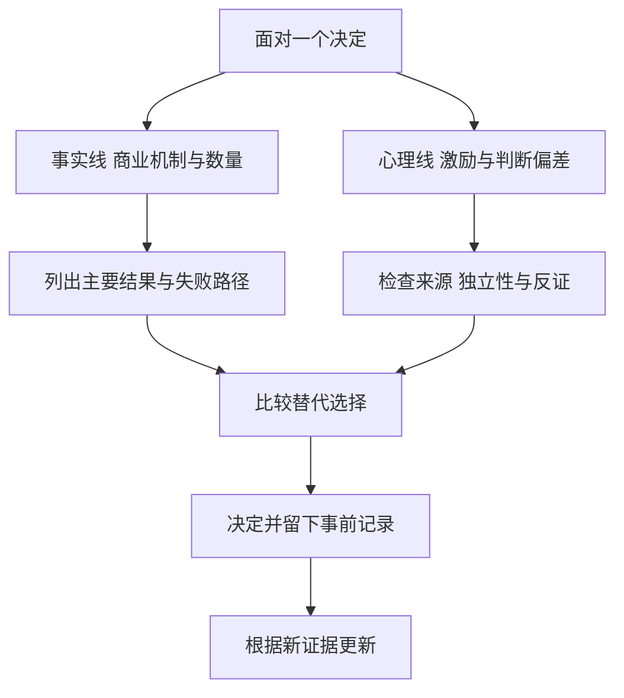
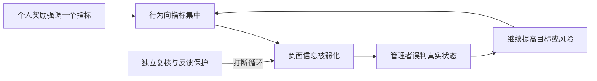

# 《穷查理宝典》读书笔记

> 核心人物与主要演讲者：查理·芒格（Charles T. Munger）；编者：彼得·D.考夫曼（Peter D. Kaufman）。本书是传记、他人回忆、编辑整理和芒格演讲的汇编，不是芒格独自写成的连续教科书。  
> 英文书名：Poor Charlie's Almanack。原书有扩充版本；2023 年 Stripe Press 版为重新编排的节编版，官方免费电子文本保留十一讲等主要内容。中文具体版本未指定，不将各版配图、旁注与全部材料视为完全相同。  
> 资料范围：官方书目、Stripe Press 免费版的目录与重点段落、伯克希尔原始股东信及独立研究和监管材料。属于公开资料系统导读，未逐页核对某一中文全本。  
> 覆盖范围：多学科思维、投资判断、心理误判、组织与人生方法，共 30 点；另附 25 项心理倾向的分组地图。  
> 更新日期：2026-11-12

## 先看这里：这本书讲什么

**让判断更可靠的方法，是理解问题的真实结构，识别自己的心理干扰，再把两者放进一套能反复使用的决策程序。**

本书有名的不只是投资观点，而是芒格如何把数学、经济、心理、工程和历史知识放在一起思考。它强调少犯严重错误、知道能力边界、比较机会成本、理解激励，并耐心等待少数自己能判断的机会。

这些想法不能被简化成“多背模型就能成功”。模型需要事实支持；心理标签不能替代因果研究；商业成功也不能使作者对所有学科的评论自动正确。最好的阅读结果，是获得更清楚的问题，而不是获得一个新的权威。

## 资料结构与主题地图

| 书中部分 | 重点 | 本笔记位置 |
| --- | --- | --- |
| 人物、家人回忆与方法概述 | 学习习惯、独立性、长期取向 | 01—09、25—26 |
| 普世智慧及实践思考演讲 | 多学科、逆向、概率与商业机制 | 01—10、24 |
| 基金会、会计和经济学讨论 | 代理成本、制度和分析局限 | 27—29 |
| 第十一讲：人类误判心理学 | 25 项倾向及共同作用 | 10—23、分组地图 |
| 后续评论与编辑材料 | 不同人的观察与补充 | 全文按来源注明 |

官方说明与免费文本见[原出版方入口](https://www.poorcharliesalmanack.com/)和[Stripe Press 电子书](https://www.stripe.press/poor-charlies-almanack/book)。十一讲中的第十讲包含 2007 年南加州大学法学院毕业演讲；第十一讲是芒格在 2005 年修订整合的心理学讨论，不能当作现代心理学教材的完整共识。

## 核心知识点

### 01. 多学科模型要回答问题，不是装饰结论

心智模型，就是对一类因果关系的简化理解。复利解释时间积累，机会成本解释取舍，激励解释行为，竞争解释利润为何可能被侵蚀。一个模型只照亮问题的一部分。

实际使用时先问“什么因素真的决定结果”，再选择相关模型。看到企业降成本，不能只用工程效率判断，还要考虑竞争者是否也降成本、消费者会不会要求降价，以及新增资本由谁承担。

**伯克希尔 1985 年股东信对纺织业务的回顾是一个真实案例。** 单家公司的设备投资看起来可以节省成本，但竞争者也采用类似设备，行业价格随后反映更低成本，投入增加却未带来相应资本回报。[伯克希尔 1985 年股东信](https://www.berkshirehathaway.com/letters/1985.html)

工程视角会问机器是否更有效率；经济视角会问节省被谁获得；博弈视角会问竞争者怎样反应；资本配置视角则问钱是否有更好的去处。把这些问题连起来，才比单看一张投资回报表更有用。

这是管理层对经营历史的公开回顾，不是证明所有制造业投资都会失败。**自测：** 降低单位成本必然提高行业利润吗？不必然，价格竞争可能把收益转给客户；仍需研究壁垒、需求和行业结构。

### 02. 逆向思考：先识别什么会把事情做坏

逆向不是凡事唱反调，而是在追求目标之外，明确失败路径。研究投资时，不只问上涨空间，也问永久损失、流动性中断、欺诈和被迫出售如何发生。

这种方法最适合识别不可承受的后果。若一个方案只有在融资永远可得、价格不会跳跌、管理层从不犯错时才安全，那么它的成功概率即使看起来不错，也可能不适合承担。

逆向清单要具体到条件与行动：什么会失效，出现什么信号，是否有缓冲与退出能力。只写“不要亏钱”没有操作价值；列出十个恐怖情景却不比较可能性，也可能变成无休止的恐惧。

### 03. 能力圈是知道边界，而不是宣布自己擅长什么

理解业务要能解释需求、竞争、现金与风险，也能识别哪些变化自己判断不了。圈内不等于永远正确，圈外也不等于永远不能学习。

判断能力边界时，可以尝试解释一个强有力的反方观点。如果只能重复公司宣传，或不能说出主要利润来自哪里，就不应因熟悉品牌而宣称自己理解。扩大能力圈需要证据和练习，不能由投入资金替代。

### 04. 基础数学能够拆穿许多漂亮故事

数量级、复利、概率和基准比较，往往比复杂公式更重要。先对齐单位、时间和分母，再讨论精确结果。收入、利润、现金与估值不是可互换数字。

**数学演示：** 每年增长 10%，十年约变为 2.59 倍，不是简单增加到两倍。若中途损失一半，恢复原值需要随后上涨 100%。复利的重点不只是追求高收益，也包括避免让本金遭受不可恢复的打击。

这些算式只解释数量关系，不提供未来收益率。把假设写得精确，并不代表假设可靠。

### 05. 二阶效应：别人会对你的行动作出反应

第一阶效果是直接结果，第二阶效果是相关人的调整。降价可能增加销量，也可能引发同行更深降价；高利润可能吸引资本，最终削弱利润。

前面纺织业务的案例正说明，不能把竞争者冻结在模型外。对一项政策、收购或技术投入，应追问客户、员工、供应商和竞争者下一步怎么做。并非所有反馈都能预见，但忽略反馈会使简单外推特别脆弱。

### 06. 机会成本：好机会还要与其他可行选择比较

机会成本是选择一件事时，放弃的最好可行替代，不只是账面支出。时间用于研究不理解的公司，就不能同时研究更熟悉的领域；资金用于低回报项目，也会失去其他用途。

比较必须同时考虑风险、流动性、研究把握和执行条件。不能把现实投资与事后已经知道的大赢家比较；那是用未来信息惩罚过去。合理替代应是当时实际可选择、自己能理解的方案。

### 07. 好生意的价值，在于不必不断投入同等规模的资本

**伯克希尔披露，1972 年收购喜诗糖果的价格为 2500 万美元，当时经营所需资本约 800 万美元；2007 年股东信回顾其后多年盈利与有限的新增经营资本需求。**[伯克希尔 2007 年股东信](https://www.berkshirehathaway.com/letters/2007ltr.pdf)

这个案例的教学重点不是“糖果行业都好”，而是客户关系、品牌、回款和资本需要如何共同作用。一家公司的利润增长，如果大部分都必须重新投入设备和营运资金，股东可用于其他事情的现金就会不同。

应把三个数字分开：买下企业付出的价格、企业日常经营需要的资本、企业实际产生的收益。将经营资本回报率直接当成买入者收益率，会混淆分母。喜诗经营效率优秀，也不意味着任何收购价格都合理。

巴菲特在 2014 年回顾中还说明了芒格对其重视优质企业的影响，这是当事人的历史叙述，不应扩展为芒格一人创造全部价值的故事。[伯克希尔 2014 年股东信](https://www.berkshirehathaway.com/letters/2014ltr.pdf)

**练习：** 若企业每年赚很多，却需要把全部利润投入才能维持竞争，它与喜诗的关键差别是什么？是现金可以离开原业务的程度，而非单看利润增长速度。

### 08. 资本配置要跨越“钱从哪里赚，就投回哪里”的惯性

成熟业务可能是现金来源，新业务可能是更好的用途；也可能应回购、分红或保持流动性。不能仅为扩大公司规模而投入。

每一项用途都需要比较增量回报与风险。管理层若把收购规模当成成就，可能与股东利益分离；若总不愿投资，又可能让竞争能力衰退。资本配置不是一条固定偏好，而是一连串具体取舍。

### 09. 耐心和果断互相依赖

耐心提供不被迫参与的空间，研究提供识别条件的能力，果断则使准备在合适时转成行动。只有等待没有判断，可能只是拖延；只有行动没有准备，可能只是冲动。

芒格的集中与低频风格带有个人能力、资金和制度背景。不能把别人很少交易推导为自己可以把全部资金押在一个想法上。需要先决定错误会怎样影响生活和后续选择。

### 10. 两条分析线：事情如何运作，自己为何这样想

一条线研究商业事实，另一条线研究判断过程中的激励、情绪和偏见。两者同时做，才能避免把聪明分析用来保护自己已经喜欢的结论。

**1985 年 New Coke 是实际发生的企业事件。** 可口可乐官方回顾称，新配方在大量口味测试中受到偏好，但这些测试没有充分反映顾客对原产品的情感联系，改配方后出现强烈反对。[可口可乐官方历史](https://www.coca-colacompany.com/about-us/history/new-coke-the-most-memorable-marketing-blunder-ever)

口味测试回答的是某种实验场景中的选择，替换长期购买的产品则同时涉及习惯、身份与失去原选择的感受。把前一个问题的结果直接当成后一个问题的答案，就出现了推理跨越。

本书也讨论这件事，但本笔记用公司历史材料核对事件，不把作者的心理解释视为独立证明。公司事后回顾同样可能简化原因；不能据此量化究竟哪个心理机制贡献多少。

**自测：** 该案例说明市场调查没有用吗？不能。它说明研究问题与真实决策情境必须匹配，样本数量不能弥补问错问题。

### 11. 激励不仅改变行为，也会改变看见的事实

奖金、晋升、声望和避免惩罚，都可能影响人愿意注意和汇报什么。人不一定先决定撒谎再行动，也可能逐渐把符合自己利益的解释当成真实。

**富国银行未经授权账户事件中，CFPB 调查把销售目标、奖金与不当开户联系起来。** 真实客户需求被账户数量指标部分替代，形式上的销售增加并不等同客户价值增加。[CFPB 2016 年执法公告](https://www.consumerfinance.gov/archive/newsroom/consumer-financial-protection-bureau-fines-wells-fargo-100-million-widespread-illegal-practice-secretly-opening-unauthorized-accounts/)

用这个案例检查激励，应问谁因指标改善获益、谁承担后果、谁核实指标、坏消息会不会影响报告者职业。只要求员工“更有道德”，可能没有改变让错误不断发生的结构。

同时，不能从激励存在就认定某个人说谎。激励是需要额外核查的理由，不是对事实真假的直接判决。实际改进包括让指标靠近真实价值、保留负面反馈渠道，并使审核具备独立性。

### 12. 喜欢、厌恶和联想，会污染对证据的评价

喜欢一位企业家，可能更容易解释其失误；厌恶一个行业，可能忽略其中真实的改善。品牌、身份和熟悉感也会把无关情绪带进判断。

可用的修正是将人、主张和证据分开：如果同一份数据来自自己不喜欢的人，是否会作同样评价？反过来也一样。但不用把所有好感都当错误，它可能提供线索，只是不能代替核查。

### 13. 避免怀疑与保持一致，会使人过早锁定立场

不确定令人不舒服，因此人可能急于获得解释。一旦公开表达、投入资金或向他人推荐，改变看法又会威胁自我形象。

决策记录应允许分级结论：已确认、较可能、尚缺资料。预先写下改判条件，可以降低承认错误的心理成本。独立判断不是永不改口，而是让更新依据事实，不让面子成为隐形负债。

### 14. 心理否认与过度自信，需要外部记录制约

坏消息会引起痛苦，人可能低估它；成功经验又会抬高对自己预测能力的评价。仅提醒自己理性，通常没有可检验效果。

把事前预测、时间和结果留下来，才可能发现系统性偏差。研究失误时分开判断信息、推理、执行与运气，不要把亏损全部归咎于暂时波动，也不要把盈利全部归功于能力。

### 15. 社会认同有用，但多数意见不是事实证明

模仿他人可以节省学习成本；在不确定或高压力场景中，这种依赖也可能把错误扩散。

**阿希在 1955 年介绍的线段判断实验，通过安排群体成员给出错误答案，观察被试面对群体压力时的回答变化。** 研究发现，群体一致意见可以影响部分人的公开判断；并不是所有人都会跟从。[Asch 原始论文，MIT 存档](https://web.mit.edu/curhan/www/docs/Articles/15341_Readings/Influence_Compliance/required_readings/1Asch_1955_Opinions_and_social_pressure.pdf)

把它用于财商训练，应当检查消息来源是否独立：多个群聊都看好一家公司，可能只是在传播同一个故事。人多、转发多和证据多不是同一回事。

这是真实实验，但其线段任务、被试和实验环境不等于证券市场，不能把实验中的从众比例直接变成股市概率。可迁移的是警惕群体压力，并先形成自己的初步判断再看他人的答案。

### 16. 权威应帮助分工，不能免除关键核查

专业知识不足时依赖专家是合理的。问题是专家是否在其专业范围、是否有利益冲突、能否解释证据，以及不同专家为何分歧。

可靠流程不是要求每个人重做全部专业工作，而是把关键假设、反证和审批职责明确下来。头衔、声望或过去成功，不能证明某个具体结论必然正确。

### 17. 对比会改变感觉，却不一定改变价值

商品先标一个高价再打折，会使人把折扣当成便宜；股票从高点跌下来，也容易让历史价格成为比较锚点。但真正相关的是替代选择与当前经济价值。

比较时应主动更换参照：相对同类产品、可获得现金流、必要成本与风险，而不只相对广告或历史最高价。对比感受是真实心理体验，不能直接转成估值事实。

### 18. 失去已有或接近得到的东西，容易引起过强反应

不愿承认账面亏损、为了抢回错过的上涨而追价，可能让个人成本和遗憾控制决策。市场并不知道你以什么价格买入。

应把损失感与下一步选择分开。过去的错误不能通过增加未经验证的风险自动修复；继续投入是否合理，要用现在的事实重新证明。避免损失重要，但不应让避免承认损失替代风险管理。

### 19. 互惠、公平和嫉妒，会影响利益交换

接受好处后更难拒绝请求，看到他人获利后更想参与，认为待遇不公平时更容易牺牲自身利益。这些倾向并不总是坏事，合作与公平也依赖它们。

实际应用不是消除情绪，而是识别何时交易条款因人情或攀比发生变化。重要决定可设置冷静间隔，明确报酬与职责；别把别人展示的收益当成自己的机会成本。

### 20. 易想起的事实，会被误认为最重要

鲜明故事、最近新闻和个人经历更容易浮现，但它们未必代表总体。研究应主动寻找不显眼的基础数据、失败样本和长期分布。

可得性也会影响风险：刚发生的灾难会让人过度集中于一种威胁，长期未发生的事故则容易被忽略。用事前清单保留主要损失路径，可以减少注意力随新闻摆动。

### 21. 有理由的形式，不等于理由充分

一段解释语句可以让行动显得合理，即使它没有提供相关证据。投资叙事尤其容易把“因为”用作逻辑连接，而没有证明因果。

拆解论证时检查前提是否真实、前提是否支持结论、是否遗漏替代解释。能给出一个故事，只证明这个故事可以被讲出来；预测能力还需要事前记录和结果比较。

### 22. 压力与身心状态会影响执行可靠性

疲劳、紧迫期限和强烈情绪，可能使人更依赖熟悉反应。书中还谈到物质影响、衰老与技能退化；这些是作者的经验归纳，不应当作个人医学诊断。

在重要决策中设置复核、保留足够时间、减少信息过载，可以改善流程。不要以“我已经认识偏差”为由认定自己不会受到影响。

### 23. 多种因素同时作用，可能产生非线性后果

芒格用 Lollapalooza 描述多种力量同向叠加后出现的巨大效应。实用问题是：单独看不严重的条件，放在一起会不会改变系统性质。

**挑战者号事故调查不仅确认硬件失效，也指出信息沟通、工程数据与管理判断之间的冲突，以及安全问题未被关键管理者充分掌握。**[总统调查委员会报告，NASA 档案](https://ntrs.nasa.gov/archive/nasa/casi.ntrs.nasa.gov/19860015255.pdf)

这个真实案例不能被简化成“大家从众，所以事故发生”。工程设计、温度等物理条件和组织决策都有具体证据，必须分别分析。报告关于进度压力的讨论，也不能被改写成没有证据的外部政治命令。[报告第七章](https://www.nasa.gov/history/rogersrep/v1ch7.htm)、[第八章](https://www.nasa.gov/history/rogersrep/v1ch8.htm)

应用到投资流程，可以检查杠杆、流动性、群体认同和奖金目标是否同时朝一个方向放大风险。这里是机制类比，不声称两个领域具有相同概率。真正的改进往往需要改变信息流和权限，而不只是要求个人勇敢。

### 24. 检查清单要嵌入流程，不能只在最后打钩

好的清单针对容易遗漏、后果严重的事项，并规定谁核查、何时停止、怎样记录异常。清单的长度不代表质量。

可以分为事实检查与心理检查：前者核对单位、来源、债务和现金；后者核对激励、反方证据、是否为了回本或证明自己。检查完仍可能出错，但能减少重复而可避免的错误。

### 25. 可靠、诚实与责任感，是合作的长期资产

书中的人生建议强调可信赖、承担责任与选择合适的合作对象。它们不仅是品格评价，也影响交易成本：合作方若不需要反复防范欺骗，很多事情更容易推进。

但“信任”不能等于没有记录和控制。职责透明、事实可追溯与合理监督，可以保护双方，也让偶然失误不必演变成关系危机。

### 26. 学习要形成反馈，不能只增加收藏量

阅读可以扩展模型，练习才能暴露自己是否理解。尝试用自己的话解释、与不同观点比较，并在实际材料中检查，才可能把知识转成判断。

反复阅读同一立场会增加熟悉感，却不一定增加正确性。应让新知识有机会推翻旧解释，并定期更新已经过时的事实。终身学习不是承诺每天都比昨天聪明，而是保留纠错能力。

### 27. 投资管理的成本与代理问题，值得单独检查

基金会与投资管理相关演讲关注：委托人、顾问和经理的目标可能不同，多层费用也会减少最终可用收益。专业服务可以创造价值，但费用结构不能代替价值证明。

要比较服务提供了什么、如何评估、承担何种风险、利益如何一致。不能因本书批评过某些做法，就推论所有主动管理无效或任何低费率产品都合适。

### 28. 会计表达会影响人对经济成本的感受

表面盈利可能受确认时点、估计与分类影响。股权激励虽然不立即支付现金，仍可能稀释现有股东；现金未流出，不等于没有经济代价。

本书相关演讲属于当时会计制度争论的背景。今天分析企业应核对适用准则和具体披露，不把历史批评当作现行规则说明。实用原则是从谁获得权益、谁承担成本出发，再理解会计数字。

### 29. 概率判断需要留出不确定性，不是假装能计算一切

可以计算的数量要认真算；难以精确估计的概率，应使用区间、情景和敏感性分析。模型越复杂，越要检查关键输入从哪里来。

合理决策可以遇到坏结果，冒险行为也可以暂时获利。比较过程时，应问当时信息是否充分、风险是否可承受，而不是只用结果给自己或别人贴聪明与愚蠢的标签。

### 30. 对芒格本人也应用同样的证据标准

演讲中有个人回忆、历史故事、学科评论与价值判断，不应赋予相同证据等级。25 项心理倾向是作者的组织方式，彼此可能重叠，也不是现代心理学唯一分类。

本书尤其适合启发提问和建立清单；它不能代替专业研究、完整估值、现代制度核验或对自己策略的检验。保持独立，也包括不因喜欢这位作者而免除核查。

## 25 项心理倾向的覆盖地图

以下用白话压缩第十一讲的分类，按用途重新分组，不是逐字译名。涉及事实判断时，应继续寻找对应研究，不能把名称当因果证明。

| 分组 | 书中倾向的中文概念 | 读者可以怎样检查 |
| --- | --- | --- |
| 奖惩与社会关系 | 奖惩反应、喜爱、厌恶、公平、嫉妒、互惠、联想 | 我因什么受益，是否因此偏向某种解释 |
| 维护现有看法 | 避免怀疑、避免不一致、痛苦否认、过高自评、过度乐观、被剥夺时过激反应 | 哪条证据会使我改判 |
| 群体与信息呈现 | 社会认同、对比误判、易得性、权威影响、无意义表达、尊重理由 | 来源是否独立，理由是否真的支持结论 |
| 学习与能力状态 | 好奇、压力影响、不用则退、化学物质影响、衰老影响 | 当前状态和训练是否支持判断 |
| 组合效应 | 多种倾向共同作用的极端结果 | 哪些因素正在同向放大风险 |

25 项均在地图中出现，但不是每项都拥有同等实证强度，也不能据此诊断某个人。主要定义可在[官方第十一讲](https://www.stripe.press/poor-charlies-almanack/book)核对。

## 图解：两条分析线如何汇合

图强调事实与心理都要分析。知道自己有偏见，不会自动解决商业问题；财务模型正确，也不保证输入没有被心理选择。

## 图解：从局部合理到系统性失败

这是根据书中思想作的机制示意，不是富国银行或 NASA 全部因果的重建。真实事件还须核对各自具体证据。

## 一份可以反复使用的练习

挑一个自己近期考虑的财务决定，写四段：经济机制、主要失败路径、自己受到的心理影响、可行替代。再请持不同意见的人只检查最关键的两项假设。

| 练习 | 参考答案 |
| --- | --- |
| 节省成本的项目为什么未必增加长期利润？ | 竞争者行动和价格调整可能吸收节省 |
| 喜诗经营资本回报高，是否等于任何买价都划算？ | 不等于，经营资本与收购价格是不同分母 |
| 多人转发同一消息，是否构成独立证据？ | 不构成，要追溯最初来源 |
| New Coke 说明大样本调查无用吗？ | 不是，关键是调查问题是否匹配真实决策 |
| 给自己列出偏见名称，是否已经解决问题？ | 没有，还要改变信息、复核和行动流程 |

## 来源与资料边界

- [原出版方 PCA](https://www.poorcharliesalmanack.com/)、[Stripe Press 官方免费版](https://www.stripe.press/poor-charlies-almanack/book)、[2023 年版出版说明](https://stripepress.substack.com/p/poor-charlies-almanack-is-out-now)：作者、编者、版本及重点演讲核查。
- [伯克希尔 1985 年信](https://www.berkshirehathaway.com/letters/1985.html)、[2007 年信](https://www.berkshirehathaway.com/letters/2007ltr.pdf)、[2014 年信](https://www.berkshirehathaway.com/letters/2014ltr.pdf)：纺织、喜诗和投资思想演变的当事人材料。
- [CFPB 富国银行公告](https://www.consumerfinance.gov/archive/newsroom/consumer-financial-protection-bureau-fines-wells-fargo-100-million-widespread-illegal-practice-secretly-opening-unauthorized-accounts/)、[NASA 挑战者号报告](https://ntrs.nasa.gov/archive/nasa/casi.ntrs.nasa.gov/19860015255.pdf)：独立于书中格言的组织事件。
- [可口可乐 New Coke 官方历史](https://www.coca-colacompany.com/about-us/history/new-coke-the-most-memorable-marketing-blunder-ever)、[Asch 1955 原始论文](https://web.mit.edu/curhan/www/docs/Articles/15341_Readings/Influence_Compliance/required_readings/1Asch_1955_Opinions_and_social_pressure.pdf)：问题设定与社会影响的案例。

本笔记没有逐一重现全书旁注、所有人物故事和每个心理实验，也没有把作者对医学、教育或经济政策的个人评论当成专业结论。案例的机制解释与练习为分析者补充，不是作者当年的预测或实际策略成绩。

---

[返回书籍索引](../README.md) · [财商学习与实践路线](../财商进阶合订本.md)
