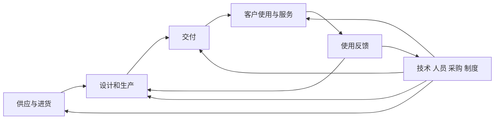
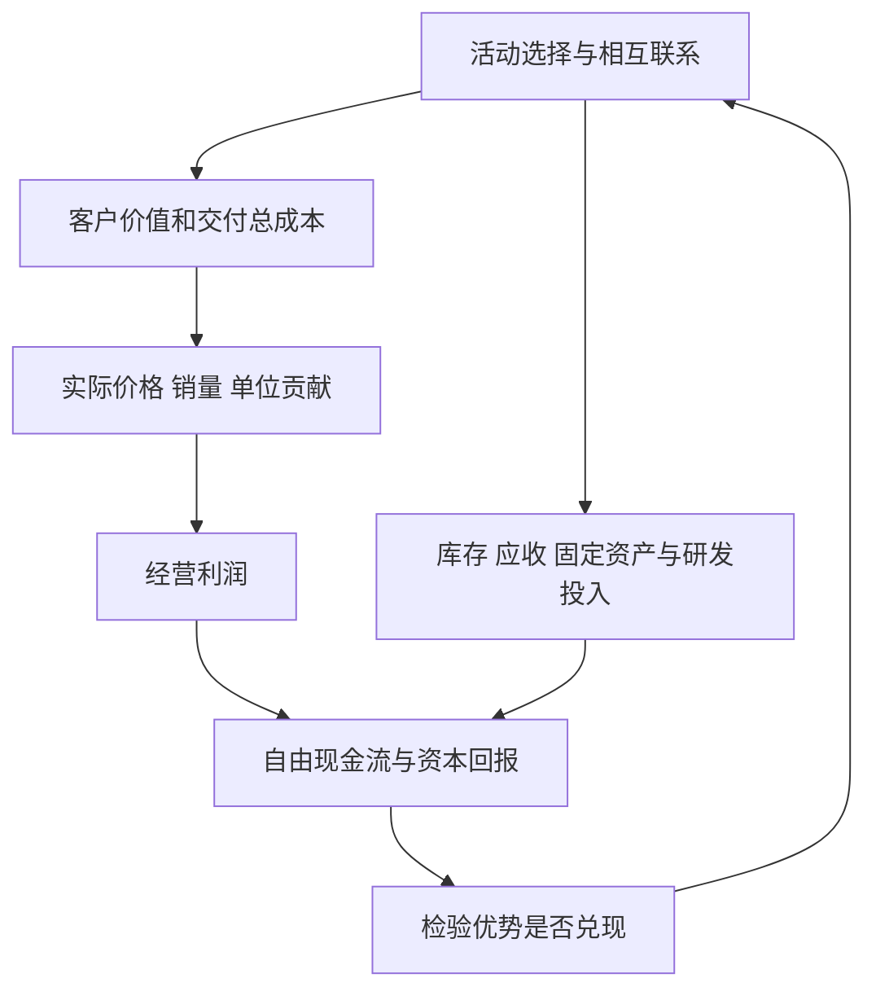

# 《竞争优势》读书笔记

> 作者：迈克尔·波特（Michael E. Porter）。原作 *Competitive Advantage: Creating and Sustaining Superior Performance*，1985 年；核对 Free Press 1998 年再版，中文具体译本未确认。实际资料为出版社公开节选、哈佛商学院相关框架与公司公开文件，未取得完整原书；本文是覆盖主要工具的公开资料系统导读，编号为自拟学习主题。案例和股票研究应用属于补充，不冒充原书案例。事实核验：2026-11-12。

《竞争战略》主要问一个行业为什么赚钱、企业站在哪里；这本书继续问：企业每天究竟做了哪些事情，让它能够卖得更贵、成本更低，并把优势维持下去？关键单位不是“这是一家好公司”，而是采购、设计、生产、交付、营销、服务等活动及其相互关系。

读完最有用的能力，是把抽象的品牌、技术、规模拆成能够查证的经营机制，再区分客户得到的价值、企业得到的收入和股东最终得到的现金。[出版社书目及节选](https://www.simonandschuster.com/books/Competitive-Advantage/Michael-E-Porter/9780684841465)

## 一、从公司标签走向经营活动

### 1. 竞争优势必须相对于具体对手和客户

“研发强”“服务好”没有比较对象时意义有限。要说清客户需要什么、现有替代方案是什么、企业在什么指标上更好，以及这种差异值不值得客户付费。

相对优势也有边界。一家公司可能在标准化、大批量订单上成本领先，却不适合小批定制。把某一细分市场的优势推广到所有客户，会高估企业可扩张空间。投资研究应先明确优势发生在哪个业务单元，而不是先给整个集团颁发“护城河”标签。

### 2. 价值链是活动地图，不是组织架构图

部门可以同时承担多种活动，一种活动也可能横跨多个部门。价值链按照企业为客户完成什么工作拆分，目的在于定位成本和差异化来源，而非重新绘制行政汇报关系。

销售与研发可能共同完成客户需求识别；信息系统可能同时影响补货、售后和营运资金。如果只把“财务部、技术部、市场部”排成横线，容易漏掉真正重要的接口。拆分深度应服务判断：把成本占比大、与同行做法不同、或者影响客户体验的活动单独拿出来。[HBS 价值链说明](https://www.isc.hbs.edu/strategy/business-strategy/Pages/the-value-chain.aspx)

### 3. 基本活动与辅助活动怎样配合

经典分类把进货物流、生产经营、出货物流、营销销售和服务作为基本活动；采购、技术开发、人力资源和企业基础设施提供支持。这里“辅助”不表示不重要，关键技术和组织制度完全可能决定优势。

服务业需要调整表达。软件交付不必对应货车运输，医院服务也不等于流水线生产。保留“客户如何得到价值”的逻辑，比强行保留每个制造业名称更有用。价值链是一种分析语言，不是所有企业必须照着执行的组织模板。

这是简化示意：活动彼此相连，客户反馈还会反向影响设计与制度。分析不能只为每个方框找“最便宜方案”，还要看连接后是否能可靠完成客户任务。

### 4. 价值系统把供应商与客户也纳入研究

企业内部降低成本，可能只是把成本转移给供应商、经销商或客户。例如要求客户自己完成某些工作，只有客户愿意承担且获得足够补偿，整个方案才有竞争力。

因此应同时画出上游、企业、渠道与买方的活动。一个供应商报价较高，若能减少客户停机、库存或返工，仍可能降低整体成本；报价较低却交付不稳，可能把成本藏到另一个环节。股票研究中常见的“采购降价等于优势增强”，需要通过这个总成本视角检验。

### 5. 客户价值、收入、利润不能混为一谈

客户得到价值，是使用产品后改善的结果；企业收入，是双方交易实际支付的金额；利润还要扣除创造和交付价值的成本。公司创造很多社会价值，未必有足够能力保留利润。

一种实用思路是依次检查支付意愿、成交价格、单位总成本和维持业务所需资本。支付意愿不是直接可观察的财务科目，只能通过客户行为和调查推断；利润也不等于现金，因为应收、存货与资本支出会占用资金。分析时应明确自己讨论的是哪一层。

## 二、成本优势从哪里来

### 6. 成本动因比费用总额更重要

成本动因是让某项活动成本变化的因素，可能包括规模、经验、产能利用、活动间联系、区位、制度环境与经营选择。知道某项费用大，不等于知道它为什么大、是否能够降低。

首先把成本分配到相关活动，再识别驱动因素，最后比较同行差异。一个公司物流费占比高，可能因为产品更重、运输更远，也可能因为网络低效；只有第三种解释成立时，简单改进物流才是主要机会。不能先看费用率高就宣布“有降本空间”。

### 7. 会计分摊不等于经济因果

总部费用按营收分配，可能使快速增长业务看起来承担更多成本，但并不表示它实际引起了全部增量支出。同样，共用仓库成本按件数分摊，可能忽略不同产品的体积、处理次数与退货复杂度。

分析活动时要区分可避免成本、增量成本和共同成本。关闭某业务是否节省一笔费用，取决于相关资源能否释放，而不是分部报表曾分给它多少金额。对外部投资者，内部成本数据不完整时应保留不确定性，避免用粗略分摊制造精确结论。

### 8. 规模、学习和利用率分别是什么

规模经济强调在适当范围内扩大活动规模能降低单位成本；学习强调随着累计经验改进工艺和组织；利用率强调既有能力被使用了多少。三者可能同时变化，却不应当互相替代。

企业新工厂满产带来的成本下降，未必是永久技术优势；行业需求下降时利用率可能反转。学习也不会自动发生，需要记录错误、改进流程并保留知识。对研发和精密制造而言，累计生产数量只是经验的代理变量，不能保证所有公司沿相同曲线进步。

### 9. 降低总成本可能需要增加局部支出：丰田案例

丰田对其生产方式的官方说明，把异常发现与停止、防止缺陷流出，以及按需要组织生产作为核心做法。它并不是要求所有工序永远不停，也不是任何库存都必须为零。[丰田生产方式说明](https://global.toyota/en/company/vision-and-philosophy/production-system/)

为什么主动停线可能有利于成本？如果缺陷继续沿流程流动，后续加工、装配、检测和交付都可能在无效产品上投入资源；把问题暴露在早期，短期产量受影响，却可能减少总返工与售后支出。这是活动间联系：前端质量管理影响后端成本。

应用时应比较缺陷率、返修、交期与总库存，而不只评价某工序单位时间产量。这个机制解释了质量与成本可以同时改善，并不证明丰田任何时期的利润都由它单独造成。供应中断、极端需求和产品复杂性还要求合理缓冲，不能从精益生产推出“备份能力都是浪费”。

### 10. 重构价值链比单点压价更深刻：宜家案例

宜家博物馆明确说明，平板包装把客户自行组装纳入商业模式，而且产品开发从设计阶段就考虑怎样装进平板包装和托盘。宜家并非凭空发明所有平板家具技术，重要的是将这些做法组织成可规模运作的体系。[宜家官方历史：平板包装](https://ikeamuseum.com/en/explore/the-story-of-ikea/flatpacks/)

这不是简单把“安装费用”从公司账上删掉。设计必须便于运输和组装，配件需要标准化，说明书与包装必须可靠，客户还要认可自己承担时间劳动与获得价格便利之间的交换。若缺少任一环节，省下的安装费可能被损坏、退货与客服成本抵消。

投资应用是寻找一组相互支持的活动，而不是一个容易模仿的表面动作。别人可以买相似纸箱，却未必立即拥有相同设计、供应和交付协调能力。边界也明显：对高度定制、安装专业性强或客户时间成本很高的用途，同样安排可能不合适；案例不证明所有家具企业应采用同一模式。

### 11. 成本优势需要区分结构性与暂时性

原料低价、汇率变化或补贴可能改善本期成本，但不一定是企业独有能力。结构性优势应与某种可持续活动差异相关，并经不同环境检验。

一个可用步骤是把成本变化分为外部价格、产品结构、利用率和内部效率四类，再问同行受到同样外部冲击时表现如何。数据不足不能证明没有优势，却应降低结论强度。尤其不要把管理层口中的“精益运营”直接当作已经完成的归因分析。

### 12. 宁德时代：毛利率上升也要检查分母

宁德时代 2025 年 5 月 H 股招股书披露，2024 年动力电池销售毛利率为 23.9%，2023 年为 18.1%；公司同时解释，产品平均售价随锂盐等原料价格下降而降低，单位经济效益保持稳定，使毛利率提高。这里引用的是该招股书历史财务信息与管理层解释，不与 A 股报表的其他利润科目拼接，也不把解释当成独立验证的全部因果。[招股书“Financial Information”，印刷页 264](https://www.catl.com/en/uploads/1/file/public/202505/20250512071033_9of2dqw816.pdf#page=274)

**数学演示，非宁德时代实际单价：** 一单位产品售价 100、成本 80，毛利 20，毛利率 20%；若原料成本下降后成本变为 60，售价同步降到 80，单位毛利仍为 20，毛利率却升为 25%。因此毛利率提高不必等于单位毛利、品牌溢价或议价权按同样幅度提高。

价值链视角进一步问：材料价格怎样传导到销售合同，技术和制造是否维持了单位附加价值，库存采购与报价调整之间有没有时间差？这些机制比一句“毛利率上升，护城河加宽”更可检验。外部读者仍须结合销量、产品结构和成本资料，不能从综合毛利率反推出某一型号的精确单位利润。

### 13. 成本领先不能靠长期透支必要活动

削减维护、人员培养或系统投入可能立即减少费用，却增加未来故障、人员流失与客户损失。真实成本优势应在一定质量和风险要求下比较，而不是通过隐去后果获得好看数字。

可把支出分成当前服务、维持能力和扩张能力，考察减少支出究竟来自效率、需求减少，还是延后必要更新。外部投资者无法完整测算每项延迟成本，但可以检查故障频率、投诉、员工稳定性和资产年龄是否与费用率同步恶化。

## 三、差异化为什么能够挣钱

### 14. 差异化起点是客户的价值链

一家企业的产品可能帮助客户降低采购、安装、使用、维护、停机或处置成本，也可能提高客户最终产品的价格与销量。差异化的价值因此不限于产品参数。

对企业客户，应找到实际受益的流程与负责采购的人；对个人客户，则要考虑使用便利、情感和信任等价值。重要的是客户是否识别并愿意为差异付费，而不是供应商内部为研发花了多少钱。成本高不自动证明产品价值高。

### 15. 使用价值与价值信号要区分

真正的使用效果可能难在购买前观察，客户需要认证、品牌、试用、渠道声誉或既有经验作为线索。这些信号降低判断成本，但也可能被包装和营销夸大。

分析品牌时，应同时看产品兑现与客户认知。只有认知、没有兑现，可能形成暂时溢价并积累声誉风险；只有兑现、无法证明，也可能卖不出合理价格。评价营销支出应问它是在传递可验证价值，还是反复购买缺少留存的流量。

### 16. 溢价必须覆盖创造差异的成本

差异化不是无限增加功能。多出的产品复杂性会增加设计、采购、库存、培训与服务成本，甚至削弱一致性。企业必须识别客户真正看重且愿意付费的差异。

**数学演示**：基准方案每件卖 100、总增量成本 70；升级方案多收 15，却增加 20 成本，单位贡献反而从 30 降为 25。即使用户满意度更高，也未证明商业价值更好。真实判断还要计入复购、销量、固定投入和产品之间的替代，不能只看一次交易。

### 17. Costco：低商品加价与会员价值要合起来看

Costco 2024 财年确认会员费收入 48.28 亿美元，年末美国与加拿大续费率 92.9%、全球 90.5%。这里是截至 2024 年 9 月 1 日的财年数据与该公司续费口径，不是自然年，也不代表每个新会员的长期留存概率。[2024 年报](https://s201.q4cdn.com/287523651/files/doc_financials/2024/ar/COST-2024-Annual-Report.pdf)

这个案例的重点不是“会员费等于全部利润”，而是活动怎样相互支持。客户愿意缴费，需要购物组合提供足够价值；企业要维护这一承诺，就必须在选品、采购、运营和服务之间保持配合。会员收入既是商业模式的组成部分，也依赖商品业务持续兑现价值。

研究时不能把会员费收入直接当成没有成本的净利润，也不能因为商品毛利低就认定商品业务没有经济意义。应该检查续费、会员增长、客流、商品毛利与经营费用的联动。续费率高支持客户愿意继续交易这一事实，却不能独立证明估值便宜，也不能保证其他地域复制同样结果。

### 18. 差异化会被模仿，也会变得不再重要

竞争者模仿、行业标准提升、客户预算变化或新替代方案出现，都可能缩小差异价值。企业甚至可能把产品改进到超过客户真正需要的程度。

应持续问两个问题：差异还存在吗？客户还愿意为它付多少钱？只跟踪研发进度可能漏掉第二个问题；只看售价也可能把产品结构变化误当作溢价能力。可将售后质量、客户选择理由和相近产品的相对价格放在一起观察。

## 四、活动之间的配合与选择

### 19. 活动联系是优势也是脆弱性来源

一种活动的改变可能增强另一种活动，也可能制造矛盾。统一产品可以简化采购与服务，但客户需求扩展时可能限制市场；快速交付可以增加客户价值，却可能要求更多库存与冗余能力。

联系越多，孤立模仿越难，但系统性失效也可能更复杂。研究不能仅凭“活动彼此强化”就宣布无敌，还要识别哪个接口最容易在压力下失灵，以及企业有没有发现问题和恢复运行的能力。

### 20. 西南航空的运营失序提醒我们检查压力条件

美国交通部在 2023 年公布的记录中，描述西南航空 2022 年圣诞假期至新年期间取消约 16,900 班航班，影响超过 200 万名旅客，并指出客服、航班通知和退款方面的问题。[DOT 历史执法说明](https://www.transportation.gov/briefing-room/dot-penalizes-southwest-airlines-140-million-2022-holiday-meltdown)

价值链分析由此提出：正常时期有效率的网络，一旦运行中断，机组重新安排、客户沟通、系统处理和赔偿会如何衔接？把单一活动做快、做便宜，不保证整个恢复流程能承受高强度冲击。服务承诺也需要相匹配的后台能力。

该记录不能证明“低成本战略导致一切故障”，也不能把航空公司的全部历史表现归因于某一个系统。它支持的较窄结论是：优势评估必须加入异常条件，考察跨活动接口和恢复成本。成功历史值得研究，失败事件同样可以用来查找先前分析漏掉的条件。

### 21. 经营范围决定哪些活动可以共享

产品、客户、地域、渠道与纵向整合范围会改变共享机会。一套研发平台可能支持多种产品，同一配送网络也可能服务更多客户，但共享并非没有成本。

如果不同产品需要完全不同的服务标准或销售激励，强行共用可能降低效果。判断范围扩张时应比较节省的重复投入、协调费用和失去的灵活性。收入更大只是范围变化的结果之一，不能替代对净协同的判断。

### 22. 细分市场必须有不同的经济需求

按年龄或企业规模分组很方便，但只有这些分类对应不同使用场景、支付意愿、服务成本或竞争方式时，才对战略有意义。分类越细也不一定越好，过度定制会增加复杂性。

一张有用的细分表应同时列出客户需要、满足方式、单位经济和竞争者。若两个群体虽然名称不同，却使用相同产品、接受相同价格且服务成本近似，分开经营的价值可能很小。

### 23. 技术应按影响活动的方式评价

技术可以降低成本、提高可靠性、改变产品功能或重组交易流程。高科技并不天然带来高回报，低调的流程改进也可能改变竞争位置。

投资者可以要求每个技术故事对应一条财务路径：客户为什么多付钱，哪个成本下降，需要多大额外资本，以及收益会被谁保留。若同行都能同样获取技术，改善可能成为新的行业基线，而不是某家公司的独占优势。

### 24. 外包与自制比较的是整个系统

外包可能利用供应商规模与专业能力，自制可能改善知识保护、质量和协同。单看采购报价与车间变动成本，会漏掉管理、库存、验证、失败及转换成本。

还要区分今天可节省多少与长期失去什么能力。若某项知识关系未来产品方向，即使短期外购更便宜，完全放弃内部能力也可能限制选择；反过来，保持所有活动内部化会占用资金并增加复杂度。没有适用于所有企业的固定外包比例。

### 25. 多业务协同要扣除协调成本

共用品牌、技术、渠道或采购可以产生收益；总部需要证明这种收益超过管理层级、协调会议、激励冲突和资源争夺带来的成本。两个业务有相同客户名称，不代表它们有相同购买流程。

外部研究最好要求具体化：协同体现为少建了哪项资产、缩短了什么周期、提高了怎样的转化，何时进入现金流？“生态”“平台”“一站式”可以描述愿望，但不是已经实现协同的证据。

### 26. 可持续性来自难复制、难替代与持续改进

优势可能依赖累计经验、独特联系、专门资产、客户关系或制度知识。竞争者复制一项动作较容易，同时复制相互配合的活动和人员习惯可能更困难。

不过历史形成不等于永久有效。新技术可以绕开旧活动，客户需求也会改变原来联系的价值。研究持续性要同时检查模仿路径和替代路径；只分析“竞争者多久能做出同款产品”，会低估不同商业模式绕行的可能性。

## 五、用价值链读财报与做判断

### 27. 从活动推导报表，再从报表回查活动

设计标准化可能减少零件、库存与返工；交付网络密集可能降低单位物流成本；可靠性提高可能减少售后；客户愿意付溢价可能改善单位贡献。每个推断应对应可检查指标，而不是所有好结果都归于品牌。

图中利润和投入资本有两条路径。利润上升同时新增大量库存和设备时，现金与资本回报未必改善；价值链分析必须把两条线一起看。

### 28. 外部投资者怎样避免“读懂了公司”的错觉

公开资料通常不能展示全部内部活动和成本。可以把结论分为已披露事实、合理机制推断和未取得证据三个层次。资料不足时，建立可验证假设比补写故事更诚实。

例如看到研发支出增加，只能确定投入变化；要证明成果，需要产品、客户、毛利或效率证据；要证明投资价值，还要考虑资本成本和买入价格。不同结论需要不同证据，不能用同一条新闻贯穿整个推理链。

### 29. 复盘表应保留反证

选一家公司，画出五到八项关键活动，在每项后面写优势来源、公开证据、成本代价与失效条件。接着选一个同行，用相同口径比较。最后只保留最能解释财务差异的三项机制。

每次更新时检查旧判断是否被削弱，例如高续费是否伴随促销加重、低费用率是否伴随投诉上升、较高毛利率是否只是原料价格下降造成分母变化。复盘的目标是修正因果模型，而不只是把新数据填回旧结论。

### 30. 练习与参考答案

**练习一：** 公司将客服外包，客服费用减少，是否已创造价值？

参考答案：还要检查服务质量、客户流失、处理时间、赔偿、外包管理与合同成本。局部费用下降不等于价值链总成本下降。

**练习二：** 某产品单位毛利不变、售价下降，毛利率为什么可能提高？

参考答案：毛利率＝单位毛利÷售价；分子不变而分母下降，比率提高。宁德时代招股书案例提示检查原料传导与单位经济，但演示数字不是公司实际单价。

**练习三：** 宜家竞争优势是否就是让客户自己组装？

参考答案：这只是一个环节。设计、包装、供应、说明与客户价值需要配合；孤立转移组装任务可能增加退货与服务成本，并不一定适合所有客户。

**练习四：** 会员费收入是否可以全额加到股东净利润里？

参考答案：不可以。收入须与维护会员价值的完整业务成本配合，净利润还受其他费用、税等影响；现金回收与收入确认也可能不同。会费占比或续费率不能独立决定估值。

## 学习收获与资料导航

本书最有价值的训练，是把“好公司”拆成可观察的活动、联系、客户价值与成本，再检验这些机制是否持续产生现金。本文重点覆盖价值链、成本与差异化、范围和联系、技术、共享及持续性；没有完整展开原书所有进攻防御战略和不确定性章节，不把公开导读当作原书替代品。

| 来源 | 用途 |
| --- | --- |
| [原作出版社](https://www.simonandschuster.com/books/Competitive-Advantage/Michael-E-Porter/9780684841465) | 原作版本、核心主题 |
| [HBS 价值链](https://www.isc.hbs.edu/strategy/business-strategy/Pages/the-value-chain.aspx) | 活动与价值系统 |
| [丰田生产方式](https://global.toyota/en/company/vision-and-philosophy/production-system/) | 质量与流程联系 |
| [宜家平板包装历史](https://ikeamuseum.com/en/explore/the-story-of-ikea/flatpacks/) | 价值链重构 |
| [宁德时代 2025 年 H 股招股书](https://www.catl.com/en/uploads/1/file/public/202505/20250512071033_9of2dqw816.pdf) | 2023—2024 动力电池毛利率及公司解释 |
| [Costco 2024 年报](https://s201.q4cdn.com/287523651/files/doc_financials/2024/ar/COST-2024-Annual-Report.pdf) | 会员费与续费口径 |
| [DOT 历史记录](https://www.transportation.gov/briefing-room/dot-penalizes-southwest-airlines-140-million-2022-holiday-meltdown) | 运营压力与活动接口 |

延伸：[《竞争战略》](<../竞争战略 - 迈克尔·波特/读书笔记.md>)、[《一本书读懂财报》](<../一本书读懂财报 - 肖星/读书笔记.md>)、[《股市真规则》](<../股市真规则 - 帕特·多尔西/读书笔记.md>)。
