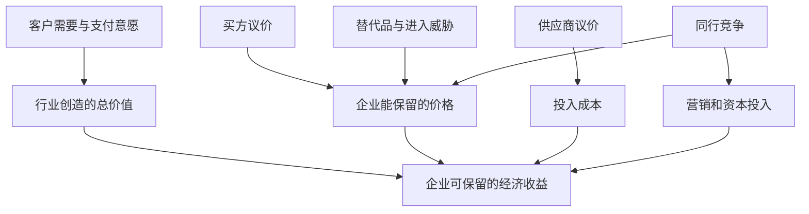
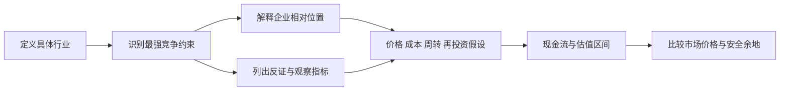

# 《竞争战略》读书笔记

> 作者：迈克尔·波特（Michael E. Porter）。原作 *Competitive Strategy: Techniques for Analyzing Industries and Competitors*，1980 年；已核对 Free Press 1998 年再版书目，中文具体译本未确认。资料范围：出版社公开节选、哈佛商学院战略与竞争研究所的框架说明，以及本笔记逐节列出的公开记录；未取得全书，属于主要主题的系统导读，不是逐章全文精读。下列 32 点是学习顺序，不是原书章节编号。现代企业案例与股票研究方法属于补充教学。核验日期：2026-11-12。

这本书解决的问题是：同样努力经营，为什么有些行业长期难赚钱，有些公司又能在艰难行业里表现较好？答案不能只从管理者能力或产品受欢迎程度寻找，还要研究客户、供应商、潜在进入者、替代品和同行怎样分配商业价值。对于股票投资者，它帮助你把“赛道前景很好”改写为“谁能够把前景转化为持续的资本回报”。

最值得掌握的是五力、三类基本竞争战略、竞争对手分析、战略群组，以及行业演变对经营选择的影响。本书偏重行业和竞争位置；企业内部活动怎样形成优势，可接着读《竞争优势》。[出版社书目与节选](https://www.simonandschuster.com/books/Competitive-Strategy/Michael-E-Porter/9780684841489)

## 一、先把研究对象画对

### 1. 行业吸引力与公司竞争力是两个问题

行业吸引力问的是：这一类生意正常经营时，投入的资本能获得怎样的长期回报？公司竞争力问的是：同样面对行业约束，某家公司为什么能得到更高价格、更低成本或更好的资产周转？两者不能互相替代。

一家企业可以是行业冠军，却仍面临行业整体回报下降。反过来，较好的行业也容得下经营很差的公司。研究顺序应当是先解释行业利润怎样形成，再解释企业相对同行的差异，最后检查买入价格。把三步合并成“龙头值得长期持有”，会丢失两个关键条件。

### 2. 行业边界要根据竞争机制确定

“新能源”“消费”“人工智能”常是主题标签，未必是合适的行业边界。电池材料、电池制造、整车和充电运营面对不同客户、成本和竞争者，不能共用一张五力表。地域也可能改变竞争：产品全球运输很便宜，生产却受到认证、关税和本地服务网络约束。

判断边界时，依次问：客户购买的是哪个具体用途？主要供货者是否可以迅速转向彼此的产品？价格变化会使客户转向哪些选择？地域差异会不会显著改变这些答案？先画窄范围，再检查外围替代和潜在进入，比把所有相关企业装进一个框更有解释力。财务分部是便利起点，但并不自动等于经济意义上的行业。

### 3. 五力研究的是利润分配，不是五个好坏评分

五种力量分别是现有企业间竞争、潜在进入者、替代品、买方议价能力和供应商议价能力。它们通过售价、采购成本、服务投入、获客支出和维持竞争所需资本影响利润。

不要把每项打分后求平均，宣布“综合 7 分所以可以买”。某一种力量就可能成为决定性约束：即使同行不多，关键供应商也可能拿走利润；即使用户喜欢产品，进入门槛过低也会吸引新增供给。需要写的是因果路径和证据，而非整齐的雷达图。[哈佛商学院五力说明](https://www.isc.hbs.edu/strategy/business-strategy/Pages/the-five-forces.aspx)

图中没有把“需求旺盛”直接连成“高利润”。价值从产生到被股东保留，中间还要经过价格、成本和资本投入三道关口。这是概念示意，不是可以相加的统计模型。

### 4. 用资本回报检查分析结果

毛利率回答产品售价与直接成本的关系；资本回报还考虑为了产生利润占用了多少资金。重资产企业可能毛利不错，却需要持续投入巨大产能；轻资产企业毛利一般，却可以高周转经营。

补充财商表达：经济利润近似为“投入资本 ×（投入资本回报率－资本成本）”。这不是本书要求读者机械套用的估值公式，而是检验竞争分析的桥梁。必须保持税后利润、资本口径与观察期间一致，并处理周期、租赁和研发资本化等可比性问题。一个季度的高回报不等于可持续优势。

## 二、逐项理解五种力量

### 5. 同行竞争的强弱取决于结构

竞争者数量、力量是否相近、行业增速、固定成本、产品差异和退出障碍，会改变企业争夺订单的动机。价格透明、产品相似、产能难闲置时，一家公司降价就容易迫使其他公司跟随。

不能只数上市公司家数。私人企业、进口供给、客户自制和即将投产项目都可能参与竞争；同样，企业数量多但客户地域分散、服务具有差异，也未必一直发生全国价格战。有效分析要看客户实际能在谁之间选择。

### 6. 需求增长不能抵消一切新增供给：光伏案例

IEA 在《Renewables 2024》中指出，自 2023 年初以来组件价格大幅下降，并预计 2024 年底全球光伏制造能力超过 1,100 GW，超过当时预计需求的两倍。这里的产能与需求关系是报告发布时的估计与预测，不能冒充此后每年的实现值。[IEA 2024 执行摘要](https://www.iea.org/reports/renewables-2024/executive-summary)

这个事实如何帮助理解五力？第一，终端安装增长提供收入机会。第二，新增工厂增加争取相同客户的供给。第三，设备折旧、人员与偿债支出使厂家在价格下降时仍可能选择继续生产，以覆盖部分固定支出。于是增长行业也可能出现激烈价格竞争。

投资应用不能停在“行业过剩所以全部回避”。还应区分产能是否可用、产品代际是否一致、企业成本差距、地区认证与贸易限制，以及落后产能退出速度。报告描述行业压力，不证明任何指定公司的财务变化全由同一原因造成。真正需要追踪的是新建产能、利用率、现金成本和关停，而不只有装机增速。

### 7. 固定成本高为什么容易出现降价冲动

当一笔订单的售价高于增量成本，即使低于包含折旧分摊的平均总成本，接单仍可能减少当期亏损。这是短期经营判断，不代表这种价格能支持长期投资。

**数学演示**：某项目每期固定支出 100，单位变动成本 6。销量 20、价格 12 时利润为 20×6－100＝20；价格降至 9，卖出 20 件仍亏 40，但停产若固定支出无法避免，就亏 100。因此企业可能接受低价。这解释了降价动机，不预测真实企业一定这样行动；停产成本、现金约束、合同与声誉还会改变决策。

### 8. 退出障碍使弱者不一定及时离场

专用设备没有其他用途、关闭设施需要支出、长期合同尚未履行、企业承担地方就业角色，都可能延缓退出。如果退出慢，行业低回报状态可能持续比投资者预想更久。

不要把账面亏损直接翻译成“供给马上出清”。至少检查现金是否仍足够、债权人是否展期、设备能否转卖以及谁承担关闭成本。对周期股而言，理解退出条件往往比猜底部月份更有用。

### 9. 进入威胁可以在进入之前压低利润

现有企业知道外部公司能轻易进入，就可能不敢把价格提高到当前供需允许的极限，还需要提前加强渠道、产能或服务。因而“过去几年没有新玩家”不能单独证明壁垒高，也可能是现有价格已经抑制了进入收益。

进入壁垒包括规模、经验、渠道、品牌、转换成本、资本要求和制度约束。它们不是清单越长越好，而要回答具体进入者需要花多少钱、多久以及承受什么失败概率。已有客户、技术或供应链的跨界公司，与从零创业的进入者受到的约束可能完全不同。

### 10. 规模经济与资本要求不是同一回事

资本要求高表示需要先筹集很多钱；规模经济表示在一定范围内，规模扩大能降低单位成本。资本市场愿意提供资金时，前者可能被跨越；如果新进入者无法迅速获得足够需求来分摊固定支出，后者仍可能构成障碍。

此外，规模可能只在工厂、城市或渠道层面起作用，不必等同于全国营收规模。研究企业“越大越强”时，要明确强在哪里、成本曲线在哪个范围下降，以及超过什么规模会出现管理复杂度上升。

### 11. 供应商强势：西南航空的效率与依赖

西南航空 2024 年末机队为 803 架 Boeing 737。单一飞机系列有利于围绕机组培训、维修和备件安排共同流程，但也集中暴露于一个制造商及相关机型体系的交付风险。公司年报可以核对机队和风险披露；“共同流程带来效率”是机制分析，不能据此自行计算节省金额。[西南航空 2024 年 10-K](https://investors.southwest.com/sec-filings/all-sec-filings/content/0000092380-25-000024/luv-20241231.htm)

2024 年 1 月 FAA 宣布暂停批准 Boeing MAX 生产扩张，说明供应链约束也可能来自质量监管。注意：这不意味着西南航空运营了当时停飞的 MAX 9；不能把生产扩张限制与特定机型停飞混成同一事件。[FAA 当时公告](https://www.faa.gov/newsroom/faa-halts-boeing-max-production-expansion-improve-quality-control-also-lays-out-extensive)

从五力看，转换供应商不仅是下一个订单换品牌，还涉及人员、维护、备件、运营标准和交付排期。转换代价越大，现有供应关系对议价与经营弹性的影响越大。但这不证明单一机型战略必然错误：分散供应商也会增加复杂性。分析应比较正常时期的效率收益与压力时期的调整代价，而不是见到风险便否定所有专业化。

### 12. 买方议价能力不等于客户数量

客户购买量大、采购标准化、能轻易更换供应商或自行生产，通常更容易施压。客户自己利润薄且采购占成本很高，也可能对价格尤其敏感。

消费者人数很多，不代表企业一定有议价权：平台和渠道可能把分散需求集中采购；大型客户数量少，也不意味着它对所有供应商都强势，因为认证、可靠性与停产风险会限制选择。应区分最终使用者、付款者、采购决定者和渠道，不能把它们笼统写成“客户”。

### 13. 替代品是另一种解决同一问题的方法

直接竞争者通常提供类似产品；替代品提供不同手段满足相同用途。区分的目的不是分类游戏，而是找出客户何时会离开整个行业。客户评价的通常是总成本、时间、便利和风险，未必只是标价。

研究替代威胁应看性能改善与使用习惯是否跨过门槛。今天表现不如主流产品，并不代表永远无威胁；但技术演示成功也不等于客户会立即转换。安装、兼容、监管和学习成本可能延缓替代。对长期估值而言，替代风险往往首先影响优势能维持多少年。

### 14. 政府和互补品应放回具体作用路径

监管可以改变进入许可、竞争范围、供应限制或客户成本；互补产品可以提高某产品的使用价值。分析时先说清它们改变了哪一种经济关系，不必为了凑框架把每个因素都命名为新的“力”。

真实例子是英国 CMA 对微软收购动视暴雪的审查。2023 年先前方案受到云游戏竞争担忧阻碍，后来经重组、调整相关云游戏权利安排的方案获批。它说明“整个游戏行业很大”无法替代对特定服务与权利结构的分析。[最初决定](https://www.gov.uk/government/news/microsoft-activision-deal-prevented-to-protect-innovation-and-choice-in-cloud-gaming)、[2023 年重组方案获批](https://www.gov.uk/government/news/microsoft-concession-a-gamechanger-that-will-promote-competition)

对投资者的启示是检查交易如何改变实际竞争条件，而不是只把审批当作日期事件。这是特定司法辖区的历史个案，不能推广成当前所有国家的法律规则，也不能单凭获批就认定交易创造股东价值。

## 三、企业选择怎样的竞争位置

### 15. 成本领先是成本结构领先

成本领先不等于价格最低，更不等于削减所有支出。企业可以用较低成本保持正常价格，获得更高利润；也可以把部分优势让给客户，扩大需求。关键是领先来源是否可重复，而非这一季少做了多少广告。

需要区分真实效率、采购周期红利和必要投入被延后。减维修、减服务或降低质量可能暂时改善报表，同时积累未来成本。最有解释力的指标是单位总成本及其成因，并与相近产品、相近服务标准的同行比较。

### 16. 差异化必须有人愿意付钱

差异化可以来自性能、可靠性、渠道、服务或品牌，但企业自称“高端”不是证据。客户愿意增加的支付，或因差异减少的获客和服务成本，应大于创造差异所增加的费用。

市场调研中的喜欢与实际付款有距离。投资研究应观察相近条件下的价格、留存、复购以及面对竞争降价时的销量稳定性。还要排除渠道压货、促销和高额信用补贴。真正的差异化不是所有参数最好，而是特定客户重视的组合有可兑现价值。

### 17. 集中战略是主动限定服务范围

企业可以专注特定地区、客户或使用场景，在该范围内实现成本优势或差异化。小范围不自动产生优势；只有特殊需求使大范围竞争者难以用统一方案有效服务时，集中才可能有价值。

集中也有脆弱性：细分需求可能萎缩，大企业可能建立专门业务单元，客户也可能逐渐接受标准化产品。因此研究小而美公司既要看领域内份额，也要检查这个领域是否足够稳定、可盈利，以及依赖是否过度集中。

### 18. “夹在中间”不能简化成禁止同时改善质量和成本

管理改进可以同时减少错误和浪费，提高质量并降低成本。问题在于企业是否缺少可持续的相对位置，或者试图满足互相矛盾的要求，却没有足够收益支付复杂性。

例如不同客户要求的服务承诺可能导致库存、渠道、培训和系统成本上升。判断时不要只看宣传同时写了“便宜”“优质”，而应检查背后活动能否相互支持。基本战略是识别选择与冲突的工具，不是把企业永久装进三个互斥标签。

### 19. 战略风险来自优势条件改变

成本领先可能受技术重置、投入涨价和模仿影响；差异化可能受客户需求变化或溢价过高影响；集中可能受细分市场消失或其他企业进入影响。

因此每个优势论点都应配一个失效条件。例如，“客户转换困难”对应的反证可能是新标准降低迁移成本；“地区配送密度高”对应的反证可能是新渠道改变采购习惯。没有失效条件的护城河描述，容易退化成无法证伪的赞美。

## 四、分析竞争者及行业演变

### 20. 竞争对手分析要同时看目标、假设、现状与能力

知道竞争者目前卖什么还不够。它追求现金回收、规模扩张还是技术验证，会影响行为；它相信市场将增长还是衰退，会影响投资；它具备的现金、人员、渠道与技术决定行动能力。

不要把自己的盈利目标投射给所有竞争者。多业务集团可以容忍某项业务短期亏损；资金紧张的企业也可能因急需现金采取激进定价。应区分可观察事实与动机推断，把后者写成待验证假设。

### 21. 竞争反应要用情景，不要用读心术

假设自己降价、扩产或进入新区域，竞争者有无动机和能力反击？如果不行动，可能是资源有限，也可能是对方认为市场不值得争夺。一个行动通常存在多个解释。

可做“行动—可能反应—后果”的情景表，并明确证据来源。该工具用于合法的独立经营分析，不是建议企业协调价格、交换敏感信息或排除竞争。投资者尤其应避免把公告中的强硬措辞直接当成未来利润承诺。

### 22. 战略群组与移动壁垒

同一行业中，企业可能在渠道、产品档次、整合程度和服务范围上形成不同群组。行业整体不错，不表示每个群组回报相同；一家企业属于较弱群组，也不代表能轻易迁移到更赚钱的位置。

移动壁垒指改变位置要跨越的障碍。已有客户预期、组织能力、品牌认知和供应体系都可能造成转换成本。画群组图时，坐标应选择真正影响客户与成本的变量；不能只用营收和市值把“大公司”画成天然优胜者。

### 23. 行业生命周期是提示，不是命运时间表

新兴行业常有标准和客户需求不确定；成熟行业可能增长减慢、竞争转向效率；衰退行业可能面对需求长期减少。但不同产品、地域和用途可以处于不同阶段，技术或制度变化也会改变路径。

不要为了套曲线，先宣布行业成熟，再把所有数据解释成成熟。应从渗透率、客户新增、替换周期、供给变化和产品创新分别取得证据。行业年龄不是结论，客户和竞争关系的变化才是。

### 24. 分散行业为什么未必会自然出现巨头

本地服务、客户个性化、运输成本、进入门槛低或规模不经济，都可能让行业长期分散。如果扩张没有产生足够共同采购、品牌或系统收益，集中反而增加管理成本。

研究所谓“整合机会”时，要问过去为何分散，计划改变了其中哪项约束。只靠收购把收入加总，不等于建立了有价值的规模经济。收购价格、整合费用与总部成本都要进入判断。

### 25. 衰退行业仍可能有不同策略

需求下降并不意味着所有参与者必须立即退出。企业可以寻找稳定细分领域、控制再投资并回收现金，或在退出条件合适时离开。关键是剩余需求、退出速度和相对位置。

“收割现金”应减少不再创造回报的投入，而不能破坏仍然需要履行的维护、产品与客户义务。对投资者，低市盈率可能反映现金逐年减少和终值有限；必须检验未来回款是否足以覆盖买入成本，而不是机械寻找历史最低估值。

### 26. 全球竞争与本地竞争要分开

研发或制造可以全球共享，销售、认证、维护和客户关系却可能高度本地化。企业的全球份额优势未必自动转化为每个地区的优势。

把收入按地域拆开后，还应看资产在哪里、成本用什么货币支付、产品需要什么认证、当地客户能选择谁。汇率、运输和制度改变会重新塑造相对成本。国际化本身是经营范围变化，不是盈利质量的替代指标。

## 五、把战略变成资本配置判断

### 27. 纵向一体化既可能解决问题，也可能制造问题

向上游或下游延伸，可以降低协调摩擦、保障关键投入或提高服务一致性；同时也会新增固定成本、技术风险和管理任务。企业买下供应商，并不意味着原有经济成本消失，只是从采购价格变成内部资产和费用。

应先明确交易市场哪里失灵，再比较长期合同、合作、双供应商和自建等方案。如果仅因当前上游利润高就进入，新增资本可能恰好赶上周期逆转。一体化效果应以整体现金流和风险衡量，不能只看内部转移后的某个分部利润。

### 28. 扩产决策必须考虑其他人的扩产

单个项目在当前售价下回报很高，不表示所有企业同时复制后仍高。供给增加会改变原先支持项目回报的价格条件，这就是把静态测算变成竞争分析的关键。

真实补充案例：巴菲特在 1985 年股东信讨论纺织业务时，解释了节约成本的设备投资如何在竞争中被同行普遍采用，最终使客户受益，却不必为投资者留下优厚回报。它是企业经营者的回顾，不是对所有制造业的统计证明。[伯克希尔 1985 年股东信](https://www.berkshirehathaway.com/letters/1985.html)

应用时为项目设置价格下降和同行同步扩张的情景，再考虑取消投资的选择价值。不能把“不扩产会失去竞争力”当作“扩产一定创造价值”：有时它只说明企业为了留在原地需要继续花钱，这种行业的股东回报可能因此承压。

### 29. 市场进入要比较购买、建设与不进入

进入新行业不仅要估计市场空间，还要考虑自身可迁移的能力、进入成本、竞争回应与等待价值。收购可以节省时间，但交易溢价可能提前支付大部分未来收益；自建可能便宜，却面临客户获取和爬坡的不确定性。

投资者阅读多元化公告时，可以把“协同”拆成客户共享、成本共享和资本节省三类，分别要求证据。没有定价和整合成本的协同描述，只说明可能的好处，并没有证明净价值为正。

### 30. 五力如何进入股票估值

五力不会直接给出目标价。它帮助约束收入增速、利润率、再投资需求与优势持续时间：进入容易时，长期超额利润应受到压力；客户转换成本下降时，续费和定价假设需要更谨慎。

图中由行业走到估值必须经过财务假设。它避免从“有壁垒”直接跳到“任何价格都可以买”，也提示反证应当改变具体参数，而不是只降低一句主观信心评级。

### 31. 一页竞争研究表怎样写

建议使用五列：结论、机制、证据、反证、财务影响。每种力量只选最关键的两三项。比如供应集中是事实；难以替换是机制判断；认证周期和历史更换记录是证据；新标准或替代来源是反证；交付受限和采购成本是财务影响。

再把短期冲击与结构变化分开。短期缺货可能提升供应商价格，但永久进入壁垒未必提高；一次新产品发布也未必改变客户转换成本。观察频率要匹配变量：产销可以按季，认证网络和行业结构则需要更长时间验证。

### 32. 练习与参考答案

**练习一：** 一个行业销量增长 20%，新增有效产能增长更快，为什么龙头利润仍可能下降？

参考答案：销量只是需求一侧；供给扩张、固定成本和产品同质化可能推动降价，收入与利润取决于价格和成本。还需要检查产能可用性、产品结构和退出，不能只用增长率断言必然过剩。

**练习二：** 单一供应商能降低管理成本，因此是好战略吗？

参考答案：缺少压力情景。应比较正常效率收益、转换成本、交付与质量依赖，以及多供应商带来的额外复杂性。西南航空的机队结构可以帮助提出问题，不能单凭结构就确定最优选择。

**练习三：** 某企业毛利率高于同行，是否已经证明差异化？

参考答案：没有。它可能成本更低，也可能产品结构、会计分类和区域不同。需要控制可比条件，核查价格、客户留存和创造差异的费用，再看资本回报。

**练习四：** 怎样评价“公司未来五年进入三个高增长领域”？

参考答案：补充各领域的行业边界、最强竞争约束、企业可迁移能力、进入成本和资金来源，并比较不进入的机会成本。增长领域本身不能代替竞争优势与价格判断。

## 读完应具备的能力与资料导航

你应能解释行业增长为何不等于股东盈利，区分公司强大与行业赚钱，找到最可能拿走利润的参与者，并把这些判断转化为财务假设和可观察反证。本笔记没有覆盖原书所有细分行业讨论、全部历史案例与推导；进一步阅读可沿“产业结构分析—基本竞争战略—竞争者分析—行业演变—战略决策”查原书对应主题。

| 资料 | 本文用途 |
| --- | --- |
| [Free Press 书目与节选](https://www.simonandschuster.com/books/Competitive-Strategy/Michael-E-Porter/9780684841489) | 原作、版本和主题范围 |
| [HBS 五力](https://www.isc.hbs.edu/strategy/business-strategy/Pages/the-five-forces.aspx) | 框架及经济作用 |
| [IEA Renewables 2024](https://www.iea.org/reports/renewables-2024/executive-summary) | 光伏供需与当时预测口径 |
| [西南航空 2024 年报](https://investors.southwest.com/sec-filings/all-sec-filings/content/0000092380-25-000024/luv-20241231.htm) | 机队与供应依赖 |
| [FAA 2024 年公告](https://www.faa.gov/newsroom/faa-halts-boeing-max-production-expansion-improve-quality-control-also-lays-out-extensive) | 生产约束历史事件 |
| [CMA 重组方案决定](https://www.gov.uk/government/news/microsoft-concession-a-gamechanger-that-will-promote-competition) | 具体市场边界与权利安排 |
| [伯克希尔 1985 年股东信](https://www.berkshirehathaway.com/letters/1985.html) | 竞争中的资本开支 |

延伸：[《竞争优势》](<../竞争优势 - 迈克尔·波特/读书笔记.md>)、[《资本回报》](<../资本回报 - 爱德华·钱塞勒/读书笔记.md>)、[《巴菲特的护城河》](<../巴菲特的护城河 - 帕特·多尔西/读书笔记.md>)。
