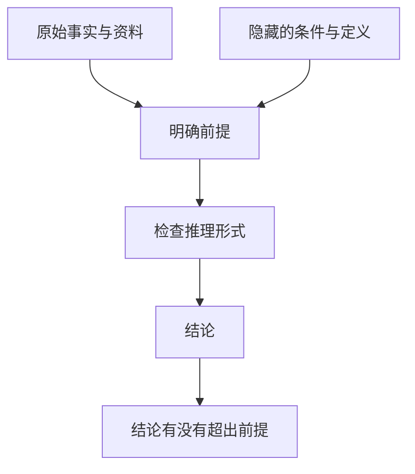

# 《简单的逻辑学》：把一句有道理的话，拆成能够检查的论证

> 作者：D. Q. McInerny，D.Q.麦克伦尼。原作 *Being Logical: A Guide to Good Thinking*，2004 年初版。中文书目核对浙江科学技术出版社 2023 年版，赵明燕译，ISBN 9787573905949；不混用其他译本页码。  
> 资料范围：基于出版资料、公开目录与逻辑学基本方法整理的系统导读，未取得用户所持原书全文。覆盖五部分主要框架，将准备、原理、论证、思维障碍与谬误重组为 30 点；投资检查、真实公司案例和符号推导属于补充教学。  
> 更新：2026-11-12。案例按当时文件说明，不以旧公告描述最新案件状态。

## 这本书最值得学什么

逻辑关注的不是说话是否强势、故事是否生动，而是：前提是什么，结论是什么，结论能否从前提推出。一个观点可以碰巧正确，但支持它的推理仍然有错；一个论证形式可以正确，但前提若是假的，也不能保证现实结论可靠。

对财商而言，最常见的错误不是不会计算，而是跨过了没有证据的台阶：从产品受欢迎跳到公司值得买，从利润增长跳到主营改善，从股价下跌跳到股票便宜。本书帮助你把这些台阶显露出来。

读后应能独立标出一段投资观点的前提、结论、隐含条件与反例；能区分条件关系、概率关系和因果关系；发现谬误后，还能说明缺了哪一步证据，而不只是给对方贴标签。

## 五部分怎样连接

| 原书部分 | 主要任务 | 本篇位置 |
| --- | --- | --- |
| 思想准备 | 关注事实，明确对象与语言 | 1—6 |
| 基本原理 | 保持同一性，理解命题、原因和定义 | 7—11 |
| 论证的语言 | 检查演绎、归纳、条件与比较 | 12—20 |
| 非逻辑思维的根源 | 理性对待怀疑、情绪、真诚和常识 | 21—23 |
| 非逻辑思维的主要形式 | 识别并修复错误推理 | 24—30 |

本篇按理解顺序归并，原书细目见[中文书目与目录](https://yuntaigo.com/book.action?recordid=bmxmZnpsaGM5Nzg3NTczOTA1OTQ5)，原作信息见[英文出版社](https://www.penguinrandomhouse.com/books/111762/being-logical-by-d-q-mcinerny/)。

## 核心知识点

### 1. 注意力是推理的入口，资料没看清就可能答错问题

如果把同比当作环比，把母公司数据当作合并数据，后续计算即使完全正确，也在回答另一道题。逻辑训练的第一步不是立即反驳，而是确认对方实际说了什么。

阅读时先保留原句、上下文与时间，再用自己的话复述。不要把“部分业务改善”压缩成“公司全面改善”，也不要把“预计”变成“已经实现”。忠实理解材料本身就是推理质量的一部分。

### 2. 事实、观察与解释要分开记录

“报告列示经营现金流下降”是可核对的披露事实；“客户付款变慢”是可能解释；“公司不再有竞争力”则是更远的判断。三句话需要不同的证据。

一个实用方法是把笔记分成三栏：文件说什么，我据此推断什么，还需核对什么。这样不是把事实当作绝对无误，而是保留它的来源与可纠正路径。公告可能更正，统计可能修订，事实核对也包含版本检查。

### 3. 观念要接回对象，不能只在词语之间打转

“优质”“创新”“安全”是概念，必须说明它们指向什么可观察特征。否则两个使用相同词语的人，可能从头到尾讨论不同对象。

企业研究中，可以把“质量好”拆成客户重复购买、现金转化、资本回报和资产负债承受力。这些指标也不是质量的完整定义，却让原本模糊的主张开始接受检查。定义应服务于问题，不能为了证明结论而临时修改。

### 4. 明确术语，特别是同一品牌下的不同权利

**真实案例：旧 GM 股票与新 GM 企业。** SEC 与 FINRA 在 2009 年联合提示，旧 General Motors Corporation 后更名为 Motors Liquidation Company，与新的 General Motors Company 是不同公司；旧公司的证券不能被当成新公司的股份。[当时的投资者提示](https://www.sec.gov/investor/alerts/bankruptcygmalert.htm)

从“通用汽车继续生产”到“我手里的旧股票会恢复价值”，中间悄悄把品牌、经营资产、法律主体和证券权利当成了同一件事。品牌可以延续，资产可以转移，旧债权与旧股权却有各自的处理顺序。

这个例子最适合说明**同一性检查**：讨论从头到尾是不是同一个对象？研究重组企业时，先核对发行主体、证券类别、交易代码及重组安排，再讨论经营前景。企业被救活与旧股东获得价值之间，需要额外证据，不能靠名称相似完成推导。

### 5. 模糊与多义是两类问题

模糊是边界不清，例如“价格不贵”没有比较标准；多义是同一个词有不同含义，例如“收益”可能指营业收入、投资回报或净利润。

解决模糊需要补充范围、指标或比较对象；解决多义需要明确本次采用哪种含义。不是所有日常语言都要精确到小数点，但决定是否成立依赖的关键词必须足够清楚。若“风险低”只是说历史波动小，就不能自动扩展成没有违约或流动性风险。

### 6. 真诚不能代替证据，表达好也不能代替准确

一个人可以真心相信错误信息，也可以用十分流畅的方式解释尚未核实的事。评价主张需要检查内容与推导，而不是只评估说话者看起来是否诚恳。

在熟人推荐中，尤其要把“他没有恶意”和“信息可靠”分开。两者都可能重要，但逻辑上不是同一判断。核查合同、费用、权利和原始披露，不必以怀疑对方品格为前提。

### 7. 同一律：推理过程里不要偷换对象和定义

同一律要求在同一个论证语境中保持概念一致。它不意味着现实对象永远不变，而是当对象或时间改变时，应明确说明。

“去年盈利稳定，所以明年股价稳定”既换了指标，也换了期间。若要建立两者联系，需要说明利润持续性、市场定价、估值变化等条件。指出概念切换不是咬文嚼字，而是在找推理中真正缺失的桥梁。

### 8. 矛盾与不同角度不能混淆

在同一时间、同一方面和同一含义下，互相否定的命题不能同时成立。但“利润上升、现金下降”不是逻辑矛盾，因为利润与现金采用不同确认方式。

因此看见两个数字方向不同，先检查口径，不要立即判定有人作假。同样，“企业不错、股票太贵”也可以同时成立，因为前者评价经营，后者评价价格与未来回报的关系。准确区分评价对象，有助于避免无谓争论。

### 9. 排中律不等于现实只有两个可选方案

在经典二值逻辑中，一个确定命题 P 与其否定非 P 构成穷尽划分。但“买这只股票或者错过财富自由”并不是 P 与非 P，而是人为选择了两个极端。

一个重要区别是：命题真假与我们是否知道真假并不相同。现实信息不足时，可以暂缓判断；行动也可以有继续调查、减少规模、比较其他方案等选项。不能拿逻辑原则为虚假的二选一背书。

### 10. 原因、条件和背景并不相同

一种结果可能需要多个条件共同成立，一个因素也可能只是增加发生概率。知道某个因素参与其中，不代表已经找到充分解释。

企业增长时，产品、渠道、价格、行业需求和并购都可能有关。推理需要说明哪个因素怎样产生影响，以及其他解释有没有被排除。本书提供因果追问的入门意识；严谨的因果识别还要使用实验或明确假设，可接着读《为什么》。

### 11. 定义要避免循环，也不能偷装结论

用“优秀的管理层就是能给股东创造价值的管理层”，再用“这家公司管理层优秀，所以一定创造价值”，可能只是在把同一句话换个顺序说。

有用的定义应帮助观察与区分，例如资本配置记录、激励安排、股东沟通和错误纠正。它们需要证据，不是定义后就自动成立。定义也要明确是否是日常描述、会计术语或自拟操作标准，避免同名不同义。

### 12. 一个论证至少包含前提与结论

前提提供理由，结论表达希望你接受的判断。许多宣传只有结论和情绪，没有真正支持它的前提。



图中每个环节都能出问题：事实可能不准，条件可能遗漏，形式可能无效，结论可能过强。审查时分层处理，比笼统地说“我觉得不对”更有帮助。

### 13. 有效与健全：推理正确还要前提真实

演绎论证的“有效”指：如果前提都真，结论就不可能为假。“健全”还要求这些前提实际为真。有效性本身不负责替你验证世界。

**真实案例：Theranos 的投资者信息。** SEC 2018 年起诉材料指称，公司在技术能力、商业使用和财务表现方面作出虚假或夸大的陈述，包括使投资者误以为自有设备能完成广泛血液检测，而多数检测实际上使用其他商业设备。公司与 Holmes 当时同意和解部分指控。[SEC 原公告及诉状入口](https://www.sec.gov/newsroom/press-releases/2018-41)

即使投资者的模型是“技术有效、需求存在、成本可控，则可能产生价值”，它也不能补救“技术有效”这个前提未经验证。逻辑模型不能把营销陈述转化为真实能力。该材料属于执法事实与指控的历史记录，本节不据此重述其后刑事案件的全部结论。

实际使用时，对决定结果最敏感的前提，要求比普通背景信息更强的证据。尤其是关键技术、客户签约和收入确认，不应只由同一个宣传来源自我证明。专业验证也需核对具体测试范围，而不只是看到某机构名字。

### 14. 肯定前件是有效形式，前提本身仍需检查

用 P 表示条件、Q 表示结果，下面形式有效：

```text
如果 P，那么 Q。
P 成立。
因此 Q 成立。
```

这是符号教学，不是真实公司的经营断言。现实中最容易出错的是把“P 通常提高 Q 的概率”写成“只要 P 就必然 Q”。例如行业增长可以增加机会，却不能自动保证每家公司的股东回报。形式再工整，也要先确认关系是否真的足够强。

### 15. 否定后件有效，否定前件却可能无效

如果“P 必然导致 Q”为真，观察到非 Q，可以推出非 P。这叫否定后件。但观察到非 P，不能自动推出非 Q，因为 Q 可能由其他条件产生。

```text
有效：P → Q；非 Q；所以非 P。
无效：P → Q；非 P；所以非 Q。
```

这种差别对应很多研究错误：没有采用一种增长方式，不等于不能增长；缺少一种竞争优势，不等于没有任何竞争优势。要否定全部可能性，需要覆盖其他有效路径，而不是只排除自己最熟悉的一条。

### 16. 肯定后件：看到结果，不能反推唯一原因

“如果研究能力强，就可能取得好回报；这个人取得好回报，所以研究能力强。”这里不仅把概率关系加强了，还忽略了市场上涨、杠杆、集中风险与运气等其他解释。

判断能力需要更完整样本、合适基准、风险暴露和事前记录。一次结果可以提供线索，不能承担唯一归因。这也是逻辑书与《随机漫步的傻瓜》衔接的地方：错误形式常常被成功故事掩盖。

### 17. 必要条件与充分条件要分清

“只有 P 才 Q”把 P 放在 Q 的必要条件位置；“只要 P 就 Q”把 P 放在充分条件位置。自然语言很容易把两者互换。

研究投资方案时，可以先列必要检查：主体明确、资料可核验、资金期限合适。通过这些检查通常还不足以证明值得投资，因为价格、替代选择和未来结果仍需判断。必要条件像门槛，跨过门槛不等于已经完成全程。

### 18. 全称与特称：几个成功例子不能证明全部成立

“所有”比“有些”强得多。有限样本中的几个赢家，不足以推出所有同类策略都有效；一个有效反例，却可以推翻没有例外的全称主张。

也要注意存在性：在现代形式逻辑中，仅有“所有 A 都是 B”，通常不能保证现实存在 A。实际财务论证若需要存在某类客户、交易或资产，应另行提供存在证据，不能只靠分类关系。这里补充了入门传统三段论容易省略的技术条件。

### 19. 三段论的中间概念必须真正连接两端

“这些企业有品牌；某成功企业也有品牌；所以这些企业将复制它的回报”，只找到共同属性，没有建立足够的逻辑联系。一个特征可能广泛存在于成功者和失败者之中。

判断类比时应比较决定结果的关键结构，而不是只看表面相似。品牌是否能支持定价、是否需要持续高投入、客户是否容易替换，才与经济结果相关。中间概念越空泛，越容易制造虚假的连接感。

### 20. 归纳提供不同强度的支持，不是把概率变成必然

从已观察案例推断更广泛情况，需要关注样本选择、范围、时间与反例。归纳结论应保留与证据匹配的力度。

**真实案例：大众排放测试。** EPA 2015 年通知指出，部分柴油车型的软件会区分测试与通常驾驶状态，在测试条件下满足标准，正常使用时氮氧化物排放却可达到标准的数十倍。这里的车型和污染物范围必须保留，不能扩展成所有大众汽车或所有排放。[EPA 原始通知](https://www.epa.gov/sites/default/files/2015-10/documents/vw-nov-caa-09-18-15.pdf)

逻辑问题是：从特定条件下的观察，能否推广到其他条件？如果测试机制可以改变对象行为，测试通过与实际使用表现之间就需要额外验证。财经资料也一样，样板项目的收益不能自动代表所有项目，选择出来的成功交易不能代表完整策略。

改进不是永远拒绝测试，而是明确样本与使用场景的差异，寻找跨条件验证和独立检查。这个案例用于说明外推边界，不是在推测读者应买卖哪只股票。

### 21. 怀疑要有方向，不能把“都可能错”当作答案

合理怀疑会提出可验证的问题，说明何种证据能够消除或降低疑问。若任何证据都被预先否定，怀疑就失去了纠错功能。

对于财报，可以检查审计意见、会计政策、附注和现金勾稽；不能因为存在造假案例，就断言一切报表没有价值。相反，信任也应可调整。合理状态是按证据强弱形成暂时判断，而不是绝对相信或绝对否定。

### 22. 情绪和利益能解释选择，却不能单独证明事实

害怕错过、希望公司成功、担心承认损失，这些感受是真实的，但不说明某项估值正确。情绪提供“这对我很重要”的信息，不能替代“外部世界是什么样”的证据。

同时，价值选择并非都能由事实自动决定。两个人同样理解风险，却因家庭责任与目标不同而选择不同方案，不必有一方逻辑错误。先分清事实争议与价值差异，讨论才有共同对象。

### 23. 论证的目标是求清楚，争吵的目标常是赢

当讨论变成维护身份，人们会挑容易攻击的句子，忽略对方最有分量的理由。你可以先用对方认可的方式复述其观点，再表达真正的分歧。

在投资讨论中，一个实用约定是：所有人都必须说出什么证据会让自己改变看法。若答案是任何情况都不会改变，讨论的可能已经不是研究问题。求清楚也不要求永远达成一致，明确不同假设就是有价值的结果。

### 24. 偷换概念、循环论证与假设问题

偷换概念是在推理中改变词义；循环论证把结论藏进前提；假设问题则把尚未证明的情况写成必须接受的背景。三者都可能让结论看似自然，其实没有得到独立支持。

检查时把每个关键句翻成朴素的话，寻找“这个前提是不是正在用同一结论证明自己”。例如“这是一家必将胜出的公司，所以竞争风险可以忽略”，并未提供竞争证据，只是重复了期待。

### 25. 稻草人、对人不对事与来源谬误

稻草人把对方观点改成更容易攻击的版本；人身攻击用人格评价代替论证；来源谬误仅凭出处决定内容真假。

来源当然影响证据可信度，利益关系也需要检查。错误在于从“对方有动机”直接跳到“主张必假”，或从“对方有名”跳到“主张必真”。正确处理是调整核验要求，再继续检查事实与推理。

### 26. 多数、传统与专家都不是自动通行证

多数意见能反映人们的选择，传统可能积累经验，专家可能掌握更强方法。它们都有信息价值，但要说明与当前问题的相关性。

专家的领域是否匹配，意见有没有分歧，结论依赖哪些假设，都会影响证据强度。逻辑训练不是让自己凌驾于专家之上，而是理解为什么在某个问题上值得采纳某种专业判断。

### 27. 没有反证，不等于已有充分证明

**真实材料：挑战者号调查中的可靠性分析。** 费曼在事故调查报告附录中批评了根据过去没有发生灾难，逐步把已有异常视作可接受的做法，并强调工程风险判断应与物理证据相联系。[NASA 保存的附录 F](https://www.nasa.gov/history/rogersrep/v2appf.htm)

没有发生失败，可能是系统安全，也可能是风险尚未触发。要区分两者，需要知道机制、暴露条件与样本覆盖。连续几年赚钱，也可能没有经历足以暴露策略弱点的环境。

因此研究中同时记录已观察到的结果和未被测试的条件。风险清单不应因为一段幸运历史就自动清空；但存在未测试条件，也不等于一定会发生最坏结果。证据支持到哪里，判断就写到哪里。

### 28. 先后关系、虚假两难与过度简化

某政策后市场上涨，并不能仅凭先后顺序证明上涨完全由政策造成；“不全仓就是不看好”则排除了资金约束与其他选择。过度简化往往把多因素问题压成一个方便表达的原因。

发现这些问题后，应提出更完整的选择和竞争解释，而不是只说“复杂”。复杂不是停止研究的借口。可以把大问题拆成若干可核对环节，明确目前哪些关系已知、哪些还不确定。

### 29. 结论的强度不得超过证据

资料只表明相关，就写相关；只覆盖一个期间，就保留期间；只说明必要条件，就不写充分保证。限定条件不是软弱，而是让结论保持可检验。


这张图用于检查一条具体论证。若每次都只能得到“还要研究”，需要进一步排序：哪一项未知最可能改变决定？优先解决它，才能让逻辑检查推动行动。

### 30. 一张论证卡，比背三十个谬误名称更实用

```text
原句、来源与日期：
希望我接受的结论：
已经确认的前提：
没有说出来的假设：
术语与对象是否始终一致：
这是演绎、归纳、类比还是因果主张：
最强反例或竞争解释：
目前能够支持的结论强度：
最值得补充的一项证据：
```

先分析真实新闻或公司材料，再做符号练习。逻辑卡不负责给出投资收益，它负责使判断透明：为什么相信，哪里可能错，如何改进。

## 练习与参考答案

**练习一：**“优质企业通常有较高毛利率；这家公司毛利率很高；所以它一定是优质企业。”哪里出了问题？前提是概率关系，结论却变成必然；还犯了从结果反推唯一原因的问题。应检查业务结构、成本分类、竞争与现金实现，并保留其他解释。

**练习二：**“新公司经营恢复，所以旧公司股票有价值。”应首先核对什么？法律主体和证券权利。GM 的真实案例说明名称、品牌和资产经营持续，并不足以证明旧普通股的剩余价值。

**练习三：**“该策略过去十年未亏，因此以后不会亏。”怎样改写？历史结果可以作为特定样本的观察，需说明完整样本、成本、风险暴露和未经历的环境；不能推出无条件保证。

## 范围与继续阅读

本书是入门论证训练，不是完整的现代形式逻辑、统计学或因果推断教材。原书对哲学原则与世界观的论述，也应与可机械检验的演绎形式区分。本文对存在性、概率条件和财务案例作了补充说明。

接着读[《学会提问》](<../学会提问 - 尼尔·布朗、斯图尔特·基利/读书笔记.md>)练习批判性阅读，再读[《为什么》](<../为什么 - 朱迪亚·珀尔、达纳·麦肯齐/读书笔记.md>)学习因果假设怎样与数据连接。出版范围和真实案例来源已在对应小节列明。
