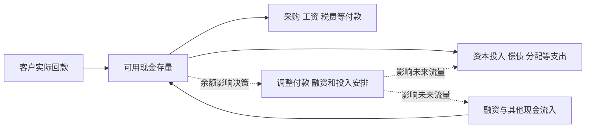
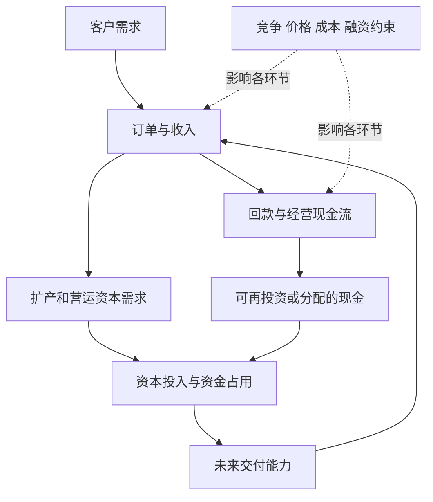

# 《系统之美》：从孤立事件走向反馈、积累与长期后果

> 作者：Donella H. Meadows，德内拉·梅多斯；Diana Wright 编辑。英文原名 *Thinking in Systems: A Primer*，2008 年出版；不同中文版本的译者、章名略有差异。  
> 资料范围：基于出版资料、作者项目公开的系统思维材料、杠杆点与系统实践文章，以及 MIT、美联储、监管机构和科学评估的一手案例整理。未取得用户所持版本全文，不声称逐页核对。覆盖存量与流量、反馈、系统行为、韧性、八类常见陷阱、十二类杠杆点和实践态度，共 30 个知识点。  
> 本文的个人财务、企业研究与投资应用是综合教学，不是原书给出的证券策略。更新日期：2026-11-12。

## 这本书在讲什么

一家公司销售增长，却越来越缺现金；供应链每个环节都想避免缺货，最后却一起积压；一个团队不断提高指标，服务质量反而下降。这些现象不能只用某个人聪明或愚蠢解释，还要看人们在什么结构中行动。

系统思维关注三件事：**有什么会积累，什么连接会传递影响，什么反馈会使变化加强或减弱。** 它让你从“今天发生什么”进一步问“为什么这种事情一再发生”。

这本书对财商的价值，不是提供一个能预测所有危机的模型，而是让你检查：财富、债务、库存和能力如何积累；增长需要哪些条件；短期的成功是否正在消耗长期的恢复能力；一个看似局部有效的动作，会不会把问题推向别处。[出版资料](https://www.penguinrandomhouse.com/books/801035/thinking-in-systems-by-donella-meadows/)、[作者项目书籍说明](https://donellameadows.org/systems-thinking-book-sale/)

## 主线与知识地图

| 主题 | 核心问题 | 对应知识点 |
| --- | --- | --- |
| 系统的基本语言 | 什么在积累，怎样改变 | 1—4 |
| 动态行为 | 为什么增长、稳定、波动或失控 | 5—10 |
| 系统的工作方式 | 为什么不能只追求局部最优 | 11—14 |
| 常见陷阱 | 哪些结构使好意产生坏结果 | 15—22 |
| 改变系统 | 改哪里，怎样保留学习能力 | 23—28 |
| 财商应用 | 如何把概念变成可核验的研究 | 29—30 |

## 核心知识点

### 1. 系统由要素、连接与功能或目标组成

一组零件放在一起不一定构成有效系统。关键是它们之间有什么关系，以及这些关系会持续产生什么行为。分析企业，既看员工、设备和资金，也看订单怎样流转、信息如何上报、奖励如何分配。

这里的“目标”不一定是每个成员有意识追求的同一件事。组织宣称服务客户，实际考核却可能只奖励短期销量；观察长期行为与激励，往往比只读口号更能看清系统在推动什么。

### 2. 存量是某个时点的积累，流量是改变它的速度

现金余额、库存数量、未偿债务、客户群体，都可作为存量分析。销售回款、采购付款、借款增加和本金偿还则是特定期间的流量。两者单位不同：元与元／月、件与件／周，不能直接替代。

```text
期末存量 = 期初存量 + 期间流入 − 期间流出
```

这是存量流量关系的简化表示，实际建模还可能有重分类、估值变化等调整。用于现金时要把全部现金流分类列全；用于股票市值时不能把价格重估当成投资者实际收到的现金。最先做单位检查，常能发现模型里的基本错误。[作者项目的存量流量资料入口](https://donellameadows.org/systems-thinking-resources/)

### 3. 流入减少，不代表存量立刻下降

只要流入仍大于流出，存量就继续增加。如果流出保持不变，流入减少会使积累变慢；如果流出下降得更多，净流入反而可能扩大。因此要比较净流入，不能只看其中一项。收入增速下降不等于收入下降；每月仍在净借款时，即使净借款速度放缓，总债务仍会上升。

同样，改善流量后，存量修复也需要时间。偿还一部分债务会降低未偿本金，却不会抹去其余债务；减少排放与清除已经积累的污染不是同一项任务。读新闻或财报时，先判断报道说的是水平、变化量，还是变化速度。

### 4. 存量把过去带进今天，也缓冲流入流出的差异

库存使生产和销售不必在每一刻完全同步，现金储备使收入和付款不必在同一天发生。缓冲有成本，却提供调整时间。

因此“闲置”不能只按短期收益判断。真正的问题是缓冲是否与不确定性、补充速度和中断代价匹配。过多库存可能过时，过少库存可能断供；无论追求最高还是最低，都需要说明适用条件。



这是通用教学图，不是某家企业的完整现金流表。箭头中的付款会减少现金，流入会增加现金；虚线描述管理反馈。利润需要另行解释，不能直接代替客户回款。

### 5. 增强回路会放大变化，“正反馈”不等于好事

某个变化如果经一系列作用又加强最初变化，就形成增强回路。它既可能推动成长，也可能放大衰退。“正”描述作用方向，不能直接理解为有益。

**真实案例：硅谷银行挤兑。** 美联储 2023 年金融稳定报告记载，硅谷银行在 3 月 9 日一天遭遇约 420 亿美元存款流出。未保险存款集中、资产与资金结构的脆弱性，使快速提款对流动性产生巨大冲击。[美联储报告](https://www.federalreserve.gov/publications/2023-may-financial-stability-report-leverage.htm)

用系统语言理解：对资金安全的担忧推动提款，提款加大筹资和变现压力，这种压力又可能引发更多担忧。这是对已披露事实的机制解释，不是说所有挤兑都只有一个原因，也不是仅凭新闻转发量就能预测准确流出金额。

### 6. 调节回路努力缩小偏差，但不保证回到理想状态

调节回路会比较实际状态与某个目标，再采取抵消偏差的行动。现金低于管理底线后减少非必要支出，就是一种调节逻辑。

能否有效取决于目标、信息、行动能力与速度。知道缺钱，却没有可出售资产、可用授信或可延后支出，反馈就无法充分工作。系统图中画一条“采取措施”的箭头，不等于现实里已经具备措施。

### 7. 延迟会使正确方向的行动也产生过度调整

发现问题、作出决定、执行行动、观察结果，通常各有时间差。只看眼前结果，可能在旧行动还未生效时不断加码。

**真实教学研究：MIT 啤酒游戏。** 参与者分别扮演零售商、批发商、分销商和工厂，在订单与发货存在延迟的供应链中决策。研究和教学记录显示，系统常出现库存与订单振荡，并向上游放大。它是真实实施的管理模拟，不能冒充某家啤酒公司的实际经营史。[MIT 对实验与行为的说明](https://web.mit.edu/jsterman/www/SDG/beergame.html)

关键机制是：缺货时补大量订单，但忽略已下单、仍在途的货物；货物陆续到达后又变成积压；随后过度削减订单，开启新一轮波动。这里不需要每个人恶意决策，局部信息与反应方式就可能制造问题。

应用于企业研究，应同时看库存、在手订单、在途采购、交付周期和终端需求。只看本季度库存增加，无法判断它来自主动备货还是需求误判；忽略交付时差，也容易把临时信号当成长趋势。

### 8. 非线性意味着冲击翻倍，后果不一定只翻倍

一些系统存在容量、门槛和约束。现金充足时多一笔支出可能容易处理，逼近支付底线时同样支出却可能触发违约、折价出售或融资中断。

分析时不要只把正常年份的比例外推。需要问：哪个变量接近临界区域？约束一旦触发，行为规则会怎样改变？但不能因为存在门槛，就假装已经知道它的精确位置。很多关键参数只能估计，应给出范围和待核验依据。

### 9. 增长总要依赖某些支撑条件

增强反馈可以推动自我强化的增长，但并非所有增长都来自反馈：恒定的外部净流入，也能使存量线性增加。无论哪种增长，土地、资本、客户需求、人才、监管或管理能力都可能构成限制。一个约束被解除，另一个约束可能变得关键。

投资研究中，“市场空间很大”只描述部分条件。公司能否及时交付、客户是否愿意付费、扩张是否消耗过多资本，都决定增长能否转成股东获得的现金。限制因素分析不是悲观，而是把增长主张补成完整因果链。

### 10. 一次事件、长期模式与底层结构需要分层看

本月现金下降是一件事；现金连续多个季度恶化是一种模式；付款早于回款、扩张依赖外部融资，是可能的结构。三层不能互相替代。

先画时间序列，再提出结构假设，最后用合同、政策、业务和财务资料检验。不要看到一次坏结果就宣布找到了系统性缺陷，也不要因为某次偶然恢复，就断定结构已修复。模型要解释多段行为，而不只解释最引人注意的一个点。

### 11. 系统边界是研究选择，重要影响可能在边界外

只研究上市公司的会计利润，可能漏掉客户融资、供应商承压、行业库存和个人资金需求；边界无限扩大又会使分析无法完成。

合理做法是先写研究问题，再列直接相关的外部变量。若一个外部变量足以改变结论，就纳入情景分析。不同问题允许不同边界：研究产品毛利和研究股东长期回报，所需范围就不完全相同。

### 12. 有限理性：局部合理未必带来整体合理

参与者只能依据自己看到的信息、所受奖励与可执行动作作决定。因此，一个部门优化本部门指标，可能把成本转移到其他部门或未来。

分析管理问题时，除了问“谁犯错”，还要问“他当时看到了什么、被奖励什么、能改变什么”。理解结构并不免除个人责任，而是帮助区分惩戒、培训、信息改进和激励修改分别能解决什么。

### 13. 韧性是受冲击后仍能恢复和调整的能力

平时波动小，不一定韧性强；把备用能力全部削掉，短期利润可能更好，极端情境下却缺乏恢复手段。韧性常来自多条可用反馈、适度冗余、不同来源和调整空间。

硅谷银行案例可作为具体检查入口：美联储回顾指出银行管理与监管存在多项失误，银行未充分处理利率与流动性风险，管理层对存款久期假设的调整也没有真正消除风险。[美联储事件回顾](https://www.federalreserve.gov/publications/2023-april-svb-executive-summary.htm)

因此，研究韧性应检查实际可动用的资源，而不是只看模型里的稳定数字。现金是否受限、融资在压力下是否仍可得、客户是否高度同质，是不同问题。不能由此推出“现金越多越好”，因为缓冲也有机会成本，需要与失败代价一起比较。

### 14. 自组织与层级：让局部有调整能力，让整体有协调

自组织意味着系统能够形成新的结构、关系和行为，而不是所有变化都由一个中心预先设计。层级则使复杂协作能够分层进行。

健康的安排让局部处理贴近现场的信息，同时由更大层级约束外部影响。过度集中可能压低适应速度，完全无协调也可能使局部互相损害。对企业研究而言，要观察坏消息能否上达、基层能否纠错、不同部门是否共享关键事实。

### 15. 陷阱一：政策阻力，各方把系统拉回各自目标

一个干预改变现状后，其他参与者会作出反应。若各方目标冲突，最终可能抵消原先措施，甚至加重问题。

应用时要画出响应者：客户如何反应、竞争者如何反应、融资方如何反应。降低价格可能提高销量，也可能引发竞争性降价；压缩库存可能释放现金，也可能降低交付稳定性。这里是机制检查，不是在没有证据时给某家企业预判结果。

### 16. 陷阱二：公地悲剧，个人收益与共同成本分离

共享资源可能被过度使用，因为一个人获得的即时收益集中于自己，而损失由更多人和未来共同承担。要改变结果，必须让使用、规则、监督与责任发生连接。

**真实研究边界。** 奥斯特罗姆关于公共资源治理的研究表明，使用者组织在一定制度条件下能够成功管理共享资源，不能把共有简单等同于必然失控，也不能只保留“全面私有化或中央管制”两种选择。[瑞典皇家科学院 2009 年说明](https://www.kva.se/en/news/ekonomipriset-2009-2/)

财商应用可以关注共同成本有没有被忽略：业务利润是否部分依赖把环境、售后或信用损失推给他人？但要用可核验的成本与制度事实判断，不能仅凭行业标签断言。

### 17. 陷阱三：标准侵蚀，表现变差后连目标也降低

短期受挫时调整目标有时合理；问题在于，每次偏离都用更低标准适应，系统便失去纠正方向。最终“没有违规”可能只是规则已经被一再放宽。

个人投资中可检查：原先的研究要求、集中度约束和资料标准，是否在不利结果后不断退让？修改规则必须有新证据与理由，不能只因为遵守旧规则令人不舒服。也要避免另一极端：条件永久改变后仍拒绝更新不适用的标准。

### 18. 陷阱四：竞争升级，回应对方会强化对方的回应

双方把对方的动作视为加码理由，就可能进入互相放大的回路。评价目标如果是“必须超过对方”，即使双方代价同时上升，也难以自然停下。

研究公司时，应把相对份额和经济收益分开。份额增加却需要持续补贴，未必等于商业模式改善。破解这类问题，往往需要改变比较标准、约束升级或建立可信规则；单方面简单克制也可能存在代价，需要结合竞争结构判断。

### 19. 陷阱五：富者愈富，优势获得更多产生优势的资源

已有优势可以带来更好的融资、人才、分销与注意，进一步强化优势。这能解释持续差异，但不是所有领先者都会永久领先。

要分析的是优势通过什么连接自我维持，以及连接会被什么打断。网络效应、规模经济、品牌和监管保护不是同一个机制。若只是把“它现在第一”重复一遍，尚未解释护城河，更没有证明当前股价值得支付。

### 20. 陷阱六：转移负担，短期缓解削弱根本修复能力

某种办法迅速缓解症状，可能降低解决根源的动力或能力；之后更依赖同一办法。并非所有应急措施都错，关键是它是否与根本修复一起进行。

用在个人财务时，延后付款能暂时缓解现金压力，却不能独立解决长期支出超过收入；用在企业研究时，融资能支持转型，但不能自动证明经营已恢复。应分别记录“争取了多少时间”和“底层收支发生了什么变化”。

### 21. 陷阱七：规避规则，指标改善而真实目标受损

**真实案例：富国银行销售激励。** 美国 CFPB 2016 年执法公告指出，销售目标和薪酬激励与员工开设未经客户授权的账户相关，并宣布对银行处以 1 亿美元罚款。这个金额是该次 CFPB 处罚，不代表整个事件历年全部罚款。[CFPB 原公告](https://www.consumerfinance.gov/archive/newsroom/consumer-financial-protection-bureau-fines-wells-fargo-100-million-widespread-illegal-practice-secretly-opening-unauthorized-accounts/)

系统视角看到的是指标与目的分离：账户数量可以上升，但客户是否主动需要、账户是否被实际使用、投诉是否被处理，可能恶化。错误行为仍须承担责任；只处罚个人，却保留同样的信息屏障和奖励结构，未必能消除重复发生的条件。

对上市公司，可把管理层考核指标与股东利益并看。奖励收入规模，是否忽略回款和资本成本？奖励每股收益，是否需要同时检查回购价格与负债？指标本身并不天然坏，关键是它引导了什么行为。

### 22. 陷阱八：目标错位，把替代指标当作最终目标

上一节强调行为者利用规则缝隙，本节更进一步：即使人人诚实执行，目标本身也可能不合适。只追求交易次数、读书数量或季度排名，都可能偏离真实需要。

目标要先表达你在意的结果，再寻找可观察的指标。财商学习可以把“读完二十本”作为过程记录，但最终还应检查能否解释财报、识别错误推论、比较成本和管理现金。指标应提供反馈，而不是接管目的。

### 23. 十二类杠杆点：改变数字之外，还能改变结构

梅多斯把介入位置概括为下列层次。下表沿用其从较浅到较深的排列，但作者也提醒它不是适用于所有场景的僵硬排序。[作者原文：Leverage Points](https://donellameadows.org/archives/leverage-points-places-to-intervene-in-a-system/)

| 编号 | 改变的位置 | 理解提示 |
| ---: | --- | --- |
| 12 | 参数与数字 | 税率、阈值、标准等 |
| 11 | 缓冲 | 存量相对流量的大小 |
| 10 | 存量流量结构 | 实物连接和布局 |
| 9 | 延迟 | 响应与变化之间的时差 |
| 8 | 调节反馈 | 纠偏是否有效 |
| 7 | 增强反馈 | 放大机制如何运行 |
| 6 | 信息流 | 谁能看见什么 |
| 5 | 规则 | 奖励、约束、权利与责任 |
| 4 | 自组织 | 能否创造与调整结构 |
| 3 | 目标 | 系统努力达到什么 |
| 2 | 范式 | 什么被视作理所当然 |
| 1 | 超越范式 | 不把一种世界观当成全部现实 |

知道层次以后，不应轻视必要的数字修正。对具体支付危机，及时现金支持可能极其关键；长期治理则还要检查为何反复缺钱。紧急行动与结构改进可以分别安排。

### 24. 改变信息流，有时比要求每个人更努力有效

信息是否及时、是否完整、是否传给有权行动的人，都会改变行为。啤酒游戏里的在途订单信息如果被忽略，继续催促参与者“更认真”不能自动解决问题。

个人投资的对应动作是让关键信息可见：总费用、共同风险、资金使用期限、原始论点和反证。若只把上涨收益放在首页，而把融资成本和下跌情景藏在附页，决策者的注意结构已经受到影响。展示方式本身就是系统的一部分。

### 25. 修改规则，要同时考虑规避方式和副作用

新增一个考核阈值以后，要问参与者怎样最容易达标，达标是否真改善目标，以及他们会把成本推向哪里。规则也需要反馈，不能公布后就停止观察。

本文建议在研究卡里增加两列：“这项激励鼓励什么”与“可能漏掉什么”。再用实际数据验证，而不是凭想象给管理层定罪。规则设计不可能完全没有取舍，比较时应同时评价效果、成本与可执行性。

### 26. 改变目标与范式，会改变你愿意优化什么

如果目标是“每次都证明自己正确”，你会倾向于隐藏反证；如果目标是“在有限认知下保留调整能力”，你会更重视承压情景和认错成本。

这不是靠换一句口号就完成的。需要让记录、讨论与评价方式跟着改变。例如复盘时允许“当时证据不足，但后来结果很好”与“当时程序合理，但结果不利”两类结论存在，才可能真的减少只按结果奖励的倾向。

### 27. 长期修复需要观察延迟，不能把未立刻见效当作失败

**真实案例：臭氧层保护。** 2022 年臭氧消耗科学评估指出，在现行政策继续执行的条件下，臭氧恢复到 1980 年水平的时间在不同地区不同：近全球范围约 2040 年、北极约 2045 年、南极约 2066 年。这些是有条件的预测，不是已经完成的恢复，也不是每年平滑改善。[科学评估原文](https://csl.noaa.gov/assessments/ozone/2022/executivesummary/)

它说明政策、受控物质变化与环境存量之间存在长时差。不能因为行动后仍有臭氧空洞，就断言政策没有作用；也不能因为预期方向改善，就取消监测。自然变化、排放和政策执行仍影响路径。

把这一逻辑用于企业转型时，应事先确定合理的中间指标和时间范围：投入、交付、客户采用、现金回收分别何时可观察。若连中间机制都未发生，就不能永远用“长期需要耐心”为所有失败开脱。

### 28. 与系统共同学习：模型要公开，也要允许修改

梅多斯强调观察历史行为、暴露自己的假设、保护信息并保持学习态度。理解系统不能让人获得绝对控制；过度相信模型本身，也可能成为新的问题。[作者文章：Dancing With Systems](https://donellameadows.org/archives/dancing-with-systems/)

实践中先写可检验的机制，再寻找会推翻它的事实；采取动作时记录预期路径和副作用；观察结果后修改结构解释。若什么结果都能被同一个故事解释，那通常还没有得到有用模型。

### 29. 把一条企业投资判断画成有条件的因果链

以下是研究模板，不是已经成立的行业规律：



逐条问：箭头有什么证据？是否有延迟？方向在不同范围会不会改变？扩产需要多少资本？收入能否及时回款？图中还没有估值，不能从“增长回路存在”直接推出“股票值得买”。

最好让图中的每个关键变量都能连接到一项公告、经营数据或明确的待查问题。画图的价值在于暴露缺口，不在于让一份尚未证实的故事看起来更科学。

### 30. 用系统检查卡把学习落地

```text
我要解释的问题和期间：
观察到的一次事件与长期模式：
关键存量、流入、流出及单位：
主要增强回路与调节回路：
信息、执行和结果分别有多长延迟：
参与者各自的目标与激励：
约束、阈值和不可逆后果：
哪些关键变量尚在分析边界之外：
可干预的位置及可能副作用：
什么证据会推翻目前的结构解释：
下一次观察什么，何时观察：
```

先用自己的现金流完成一页，再用一家公司的公开资料完成一页。不要为了画出复杂回路而添加没有依据的箭头。一个能够核对的简单模型，比无法证伪的宏大故事更适合财商训练。

## 两个练习及参考答案

**练习一：企业把采购订单削减了，为什么库存还在上升？** 可能因为此前在途货物仍在到达，销售出库下降得更快，或统计边界包含了不同存货项目。先查期初存量、入库、出库与时间延迟，再判断；不能单靠订单下降推出库存应立即下降。

**练习二：一个投资者每次亏损就调整规则，为什么反而可能越来越差？** 单次结果有噪声，原规则需要怎样的观察期尚未确定；频繁修改可能追逐最近结果，使反馈变成过度反应。也可能原规则确实有缺陷，所以正确做法是预先区分正常波动、执行偏差和证据表明的失效条件，而不是永久不改或每次都改。

## 读这本书时最容易犯的错误

- **把相关箭头当因果。** 图解只表达假设，证据仍要另外提供。
- **把解释过去当准确预测。** 能理解挤兑反馈，不等于知道下一次何时发生。
- **把所有问题都归咎于结构。** 结构分析与个人责任可以同时成立。
- **把缓冲越多当越好。** 冗余有成本，应与冲击、修复速度和失败代价匹配。
- **把系统思维变成永远不行动。** 有界的小规模尝试和及时反馈，也是学习系统的方法。

## 来源与继续阅读

作者项目公开的[书籍资料](https://donellameadows.org/systems-thinking-book-sale/)、[基础资源](https://donellameadows.org/systems-thinking-resources/)、[杠杆点文章](https://donellameadows.org/archives/leverage-points-places-to-intervene-in-a-system/)与[实践文章](https://donellameadows.org/archives/dancing-with-systems/)用于核对主要框架；真实案例的一手来源已在相关知识点内列出。本文采用自己的解释和财商应用，没有复制原书图表或虚构页码。

可与[《反脆弱》](<../反脆弱 - 纳西姆·尼古拉斯·塔勒布/读书笔记.md>)比较韧性和从波动中受益的区别，与[《周期》](<../周期 - 霍华德·马克斯/读书笔记.md>)一起理解信用、情绪与投资行为如何相互影响。
