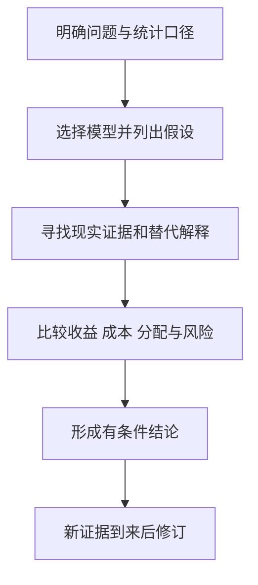

# 《经济学原理》：从价格、企业到通胀与增长

> 作者：N. Gregory Mankiw，N.格里高利·曼昆。核对 Cengage 英文第十版（Copyright 2024）的书目与目录；中文通常分微观、宏观两册，用户译本未确认。本文作为一部作品整理，不把两册计成两本。  
> 依据：出版社目录、官方教学资料、中央银行、统计机构及原始研究。未取得全书，属于公开资料系统导读；覆盖主要模型，不能替代教材习题、全部图形推导与章节细节。  
> 2026-11-12 更新。以下 36 点按学习顺序重组，现实案例及个人财商应用为补充教学。

## 先理解全书的用处

这本书把许多财经问题接回几个基本问题：资源有什么替代用途？参与者会怎样回应价格与规则？谁获得收益，谁承担成本？个体选择汇总后，会发生什么？

它不会直接告诉你买哪只股票，却能防止常见跳跃：行业需求增加不一定使每家企业利润增加；降息不保证股价上涨；GDP 增长不等于居民收入同比例增长；政府支出增加也不意味着所有项目都有正回报。

| 内容板块 | 本文重点 | 要形成的能力 |
| --- | --- | --- |
| 选择与贸易 | 1—5 | 识别机会成本、边际和比较优势 |
| 市场与公共部门 | 6—15 | 分析价格、福利与市场失灵 |
| 企业与要素市场 | 16—23 | 理解成本、竞争和收入差异 |
| 宏观测量与长期 | 24—29 | 分清产出、物价、就业和增长 |
| 货币与短期波动 | 30—36 | 理解政策传导、开放经济与边界 |

核对框架见[出版社第十版书页](https://www.cengage.com/c/principles-of-economics-10e-mankiw/9780357722718)。以下以自己的话解释共同核心，不把旧版章节号套给新版。

## 核心知识点

### 1. 稀缺意味着选择，不等于所有东西都短缺

时间、注意、土地、资本和技能都有其他用途，因此使用它们就放弃某些机会。即使现金预算充足，管理层仍可能缺少能同时负责多个项目的人才。

财商中的第一步，是识别约束。研究一家企业时，不只问市场有多大，还要问最稀缺的投入是什么。一个项目看起来能赚钱，并不代表它比企业拥有的其他可行机会更值得投入。

### 2. 机会成本包括没有付出去的钱

机会成本是选择某方案所放弃的最佳可行替代，而不是把所有想象中的收益相加。自有房屋用于经营，没有向自己支付租金，也不意味着场地没有经济成本；自有资金投入项目，同样放弃了其他用途。

这解释了会计利润与经济利润为何不同。财报能帮助核对收入费用，但投资还要问资本能否获得与风险相称的回报。不能把一个事后暴涨的资产当成所有人的事前可行替代，然后宣布任何其他选择都错了。

### 3. 边际分析比较“再做一点”的收益与成本

平均成本回答每单位过去分摊多少，边际成本回答新增一单位要增加多少资源。决策通常发生在后一个问题上。已建工厂是否继续接单，与今天是否值得新建工厂，不是同一个决定。

沉没成本是已发生且不能收回的成本，不能因为不甘心而独立支持继续投入；但退出费用、合同义务和可以出售的资产价值，都属于当前仍相关的信息。不要把所有历史形成的约束一概删掉。

### 4. 激励改变行为，也可能改变人对规则的理解

奖励什么，通常会让参与者更努力获得什么。但行为可能转向指标，而不是最终目标；罚款也可能让原来的道德义务变成可购买的服务。

**真实研究。** Gneezy 与 Rustichini 在以色列日托中心研究中发现，引入接孩子迟到的罚款后，迟到增加；取消罚款后并未立即恢复原状。研究支持一种可能机制：罚款改变了家长对迟到的理解，但不能推出所有罚款都会失效，额度、执行与文化都重要。[原始论文](https://www.journals.uchicago.edu/doi/pdf/10.1086/468061)

读企业激励时，应该问奖励的变量是否覆盖长期成本。只按收入奖励，可能忽略回款；只按产量奖励，可能忽略质量。判断激励好坏，需要看到参与者真正可以调整什么。

### 5. 比较优势看机会成本，不只看谁更能干

绝对优势比较生产效率，比较优势比较为了生产一种东西而放弃另一种东西的数量。一个人即使两项工作都更快，也可能因相对优势不同而从分工获益。

模型说明合作可能扩大总产出，却不保证每个人自动公平分享收益。转岗、搜寻、培训和地区调整有成本，贸易收益与分配政策要分别讨论。对投资者而言，成本低不能单独说明企业有持续优势，还要看竞争者、运输、质量与制度约束。

### 6. 需求曲线描述价格与需求量，不描述一切变化

在其他条件不变时，价格变化对应沿需求曲线移动；收入、偏好、替代品和预期变化则可能移动整条曲线。看到销量增长，应先问是降价促销还是需求增强。

这一区分对财报很重要：同样的收入增长，可以来自提价、销量、产品结构或并购。如果只看到营业收入，不能反推出消费者愿付价格提高，也不能独立证明品牌增强。

### 7. 供给取决于成本、能力与进入条件

价格上涨可能吸引更多生产，但扩产通常需要时间，资源和技术也未必可得。短期供给与长期供给弹性不同，所以高利润有时暂时持续，有时很快引来竞争。

研究周期行业，要把当前产能、在建产能、审批、交付和退出成本列出来。不能假定价格上涨马上增加供给，也不能把某年的短缺当作永久结构。

### 8. 市场均衡不是道德评价，也不是永远静止

均衡是模型中供给量与需求量相容的状态。它不意味着分配公平、所有人满意，也不意味着现实总能迅速达到这个点。搜寻成本、信息不对称与制度会影响调整。

供求图最有用的用途是整理方向：什么变了，影响哪一边，哪些条件暂时固定。若供给和需求同时变化，仅凭价格涨跌无法确定数量，更不能凭一个价格变化判定唯一原因。

### 9. 弹性解释为什么提价有时增加收入，有时减少

需求价格弹性衡量需求量对价格变化的敏感程度，通常比较百分比变化的绝对值。若数量下降比例大于价格上升比例，收入可能下降；反之则可能上升。但利润还要扣除成本变化。

**数学演示：**价格从 100 到 110，销量从 100 到 95，收入从 10000 到 10450；如果销量降到 80，收入则为 8800。这不是现实公司预测，只说明收入由价格与数量共同决定。

实际估计弹性需要控制其他变化。季节、促销、竞争者退出和收入变化同时发生时，简单用两期价格销量比值，不能当成稳定的因果弹性。

### 10. 价格上限要同时看受保护者与后续供给

**真实研究：旧金山租金管制扩围。** Diamond、McQuade 与 Qian 利用政策适用差异研究租户和房东行为，发现受保护租户更可能留在原址，同时受管制房东减少了租赁住房供给。摘要中的约 15% 指受政策影响房东的供给变化，不是整个城市住房存量下降 15%。[原始研究](https://www.nber.org/papers/w24181)

这说明政策可以帮助现有群体，同时改变未来供给与进入者处境。政策评估不能只看其中一边。研究是特定制度和城市中的结果，不能无条件套到所有租赁政策。

对企业投资的启发是：价格约束会影响利润，也会改变供给、质量、维护和退出选择。需要研究完整规则与响应，而不是用“限价利空”四个字结束分析。

### 11. 税收归宿取决于反应能力，不只看谁缴税

法律上由卖方缴纳的税，可能部分通过价格转给买方；由买方缴纳的税，也可能部分压低卖方所得。实际负担与供求弹性有关，较难调整的一方通常承担更多。

税率提高多少，不等于公司净利润减少同样比例。要考察定价权、替代品、合同、税基和成本抵扣。税收政策有具体地区和时间条件，不能把教材图形当成某条现行税法的完整解释。

### 12. 剩余帮助讨论效率，但不能代替公平判断

消费者剩余是愿付价格高于实际支付的部分，生产者剩余则与获得价格及相应供给成本有关。它们帮助比较交易创造的利益，不等于财报净利润，也不直接衡量每个人的生活满意度。

总剩余增加可以与某些群体受损同时发生。政策讨论应先问资源使用是否有效，再问利益如何分配、补偿能否实施，不能以总量改善自动宣布所有人都更好。

### 13. 无谓损失来自本可实现的互利交易消失

税、垄断或其他楔子可能减少原本收益大于成本的交易。但观察到交易量下降，并不能立即断言社会更差：若交易存在污染等外部成本，减少它可能提高福利。

正确比较必须把原模型遗漏的成本加回来。教材中某个三角形的大小取决于曲线、行为反应与反事实，不是现实政策的现成估计值。

### 14. 外部性意味着决策者没有承担全部影响

污染者的私人成本与社会成本不同，研发的私人收益也可能小于社会收益。解决方式包括权利安排、税费、补贴、标准和许可交易，各有信息与执行条件。

**真实制度：美国酸雨计划。** EPA 的二氧化硫制度设置排放总量约束并允许额度交易，使减排成本较低的企业有动力多减排。EPA 记录了显著排放和沉降下降，但长期改善同时受到其他法规、技术和能源结构变化影响，不能把全部下降归因于单一交易机制。[制度说明](https://www.epa.gov/acidrain/acid-rain-program)、[监测结果](https://www.epa.gov/acidrain/acid-rain-program-results)

关键并非“市场或政府二选一”，而是规则界定了什么可以交易、如何监测和违规承担什么。投资研究要关注环保成本如何进入产品价格及资本支出，而不是只把它看成报表外的口号。

### 15. 公共物品与共有资源要分开

公共物品强调非排他性与非竞争性；共有资源往往难以排他，却会因使用而减少别人可用的部分。免费享用的动机与过度使用的问题，因此需要不同治理。

“由政府提供”不是公共物品的充分定义，“免费”也不等于没有资源成本。研究公共服务、收费设施或特许经营公司，先说明谁能使用、是否拥挤、收费权如何形成，再谈现金流稳定性。

### 16. 企业成本曲线连接产量与资源投入

固定成本在相关短期内不随产量变化，可变成本随产量调整；平均总成本等于总成本除以产量。固定与可变取决于时间范围，长期看更多成本可以改变。

经营杠杆来自成本结构：固定成本较高时，销量变化可能放大利润变化。但不同公司的租赁、外包、折旧和闲置产能会改变这种关系，不能只用一个毛利率描述。

### 17. 短期继续生产与长期进入退出条件不同

在简单竞争模型中，短期停产需考虑是否能覆盖可避免的生产成本；长期则要覆盖全部经济成本。会计亏损不一定立刻停产，短期现金贡献为正也不代表值得永久维持。

财商应用是区分续营、扩产与新建三类决策。相同产品价格下，既有工厂可能应继续接单，潜在进入者却不该新建。忽视这点，容易误判行业供给何时退出。

### 18. 完全竞争是一种基准模型

大量企业、同质产品、自由进入与价格接受等条件，使单个企业很难长期维持超额经济利润。它帮助解释利润为何会吸引竞争，不是宣称现实所有行业都符合条件。

研究护城河时，可以逐项寻找偏离：规模、转换成本、网络效应、专利、渠道或监管限制。发现偏离还需证明其持续性与资本回报，而不是把品牌知名度直接当成壁垒。

### 19. 垄断定价仍受需求约束

拥有市场力量的企业可以影响价格，却不能随意提高价格而销量不变。利润最大化要考虑边际收入与边际成本；消费者替代、潜在进入和政策也会约束它。

垄断产生的分配与效率问题，不等于该股票任何价格都值得买。投资者还要面对监管、技术替代、管理层资本配置和买入估值。

### 20. 价格歧视不只是一句“看人下菜”

不同消费者支付不同价格，可能基于购买时间、数量、服务限制或可识别的支付意愿。实施通常需要市场力量、分组能力和防止转售等条件。

判断打折是否有利，需要比较新增客户与原价客户被转移的收入。产品版本差异也可能是真实成本差异，不能看到差价就宣布存在歧视定价。消费者应比较自己实际需要的权利，而不只看折扣比例。

### 21. 寡头竞争要求考虑对手如何回应

一家企业降价后的结果，取决于竞争者是否跟随。博弈论把策略互相影响放进分析；纳什均衡意味着各方在别人策略给定时没有单方面改进，不意味着结果对整体最好。

重复互动、信息与进入条件会改变结果。不能仅凭市场参与者少，就认定会长期维持高利润；也不能把模型中的合谋结果当作现实中合法可行的经营安排。

### 22. 劳动报酬与收入差异有多种来源

生产率、技能供求、工作条件、制度、议价能力与歧视都可能影响工资。观察到群体收入差异，不足以识别每个因素的贡献；反过来，控制一些变量也未必排除了此前机会差异。

个人财商不能只研究投资收益，也要理解人力资本：培训的费用、机会成本、技能可迁移性和收入风险。行业高工资不保证每个进入者都获得同样结果。

### 23. 信息不对称会改变市场能否正常交易

逆向选择发生在交易前不同类型难以区分，道德风险发生在交易后行为难以观察。担保、认证、抵押、免赔额和声誉可能改善问题，也各有成本。

研究金融产品时，应问谁知道更多、谁承担损失、谁可以事后改变行为。高承诺收益不替代借款者资产与现金流证据；第三方评级也不能完全消除利益冲突和模型误差。

### 24. GDP 测生产，不能直接当作财富或幸福

GDP 是一定期间境内最终生产的价值，避免重复计算中间投入；购买既有资产与生产新产品的统计含义不同。支出法常写为消费、投资、政府购买与净出口之和。

统计中的投资主要指资本形成等，不等于个人买股票。进口被减去，是为了剔除已包含在消费等项目中的境外生产，并非定义上认为进口有害。[澳大利亚统计局核算说明](https://www.abs.gov.au/statistics/detailed-methodology-information/concepts-sources-methods/australian-system-national-accounts-concepts-sources-and-methods/edition-8/chapter-8-gross-domestic-product/measures-gdp)

金融分析应同时看居民收入、企业利润、分配和资产价格，不能用一个 GDP 增速替代全部市场判断。

### 25. 名义与实际，区别在于有没有剔除价格影响

名义增长可能来自数量与价格，实际增长尝试剔除价格变化。CPI 关注消费篮子，GDP 平减指数覆盖境内生产，两者范围不同。

投资的实际回报可用 `(1+名义回报)/(1+通胀率)−1` 计算。不同人的消费结构不同，官方平均通胀并不等于每个人生活成本变化。比较收益要说明币种、期间和价格口径。

### 26. 失业率不是所有没有工作的人占人口的比例

劳动力口径通常区分就业、失业和不在劳动力中，具体统计标准需查各地定义。退出求职的人可能改变参与率，使失业率和就业状况呈现不同信号。

因此解释劳动力市场不能只看一个数字。企业招聘、工时、工资、参与率和职位空缺提供不同信息，短期波动也可能来自调查误差与季节因素。

### 27. 长期生活水平与生产率密切相关

资本、技术、人力资本、制度和资源配置影响每单位劳动能生产多少有价值的产出。增加投入可以推动增长，但边际回报、资源限制与创新能力决定能否持续。

国家生产率增长不自动转成所有股票的高回报。上市公司可能付出高资本成本，收益可能归消费者或员工，买价也可能提前反映改善。宏观增长与股东回报之间仍需企业分析。

### 28. 储蓄与投资通过金融体系连接

金融体系把愿意推迟消费的资金与需要融资的项目连接，也进行风险分担、期限转换与信息处理。储蓄率高不保证投资效率高，关键是项目能否产生足够未来收益。

债券和股票分配权利的方式不同，融资成本、抵押、稀释和治理也不同。对家庭而言，储蓄创造资金余地；对社会而言，是否转化成有用资本，还取决于融资和生产机制。

### 29. 现值把不同时间的现金放到同一基准比较

未来现金的现值可写为 `PV=FV/(1+r)^t`，其中 r 是与风险、币种和通胀口径相匹配的折现率，t 是期间数。折现不是把远期价值随意打折，而是承认时间与替代机会。

长期项目对折现率更敏感，但不能为了得到喜欢的价格随意降低 r。风险现金流的情景、违约与概率也应另外研究，不能认为一个折现率能自动处理全部不确定性。

### 30. 银行创造存款，但不是没有约束地创造财富

**真实制度说明。** 英格兰银行 2014 年文章明确解释：商业银行发放贷款时通常同时创造存款，现实过程不能简单描述为先收储蓄、再机械乘数放贷。资本、盈利、借款需求、支付清算、监管及货币政策都会构成约束。[央行原文](https://www.bankofengland.co.uk/quarterly-bulletin/2014/q1/money-creation-in-the-modern-economy)

贷款创造金融资产与负债，不自动创造同额真实商品，也不保证贷款项目成功。偿还贷款本金又会影响相关存款与资产规模。研究银行要同时观察资产质量、负债稳定性和资本，不能只看信贷扩张速度。

### 31. 货币、通胀与实际产出之间需要时间和条件

长期货币分析与短期价格黏性模型回答不同问题。货币数量恒等式中的流通速度和实际产出并非永久不变，不能见到货币量增加就推出下个月 CPI 同比例上涨。

还要分清中央银行准备金、公众持有货币与信用。金融市场价格、消费价格和工资的变化速度不同。精确预测需要实际传导证据，不能从一个恒等式直接获得因果弹性。

### 32. 开放经济把储蓄、投资与跨境资本接起来

在简化国民账户框架下，储蓄与投资的差额联系净资本流出和贸易余额，但核算恒等式本身不能说明谁导致谁。汇率、收入、融资偏好与政策会共同调整。

贸易逆差不等于一个家庭每天亏钱，顺差也不等于所有居民更富。需要研究跨境资金对应股权还是债务、投入何处、收益和偿付能力如何。

### 33. 总需求与总供给帮助区分冲击来源

需求变化与供给受限都可能改变产出，价格方向却可能不同。简单总供求图是组织解释的工具，实际经济中多个冲击可能同时发生。

投资研究应先问企业暴露在哪条链：需求减少、原料短缺、工资上升还是融资变紧。不能把所有利润下降都归结为同一种宏观周期。

图是机制地图，不是已经估计的预测模型；箭头方向和强度需要情境证据。

### 34. 财政与货币政策会传导，也会产生时滞和取舍

政府购买、税收、利率与资产购买影响需求和融资条件，但效果取决于资源闲置、预期、银行传导、开放程度与债务结构。宣布政策和资金到达实体之间有距离。

同一政策可能改善某些群体、损害另一些群体。财政乘数不是任何时候都固定的常数，降息也不能保证所有信用风险都消失。研究政策时应写清目标、渠道、约束与可能副作用。

### 35. 通胀与失业的关系不能当成永久菜单

**真实历史：美国大通胀与沃尔克时期。** 美联储历史资料把 1960 年代中期至 1980 年代初的高通胀，放在政策、预期、供给冲击和当时统计认识的背景下解释；后来的反通胀伴随明显经济与就业代价。[美联储历史](https://www.federalreservehistory.org/essays/great-inflation)

它提醒我们：预期会调整，长期不能无限通过意外通胀换取更低失业。历史也不能压缩成“加息必然多久后见效”的固定公式。判断债券和股票时，要同时看政策路径与市场原先预期，而不是只看行动方向。

### 36. 模型的价值是清楚说明假设，而不是消除不确定性

应用一项结论前，写出模型假设、可观察变量、替代机制和无法覆盖的部分。实证事实与价值选择也要分开：一项政策提高总产出，不自动回答社会应怎样分配收益。

## 练习与参考答案

**练习一：产品提价后收入上升，能否认定需求缺乏弹性？** 不能立即认定。需要区分其他需求变化、产品结构和数量，也要明确比较期间；即使收入改善，利润仍受成本影响。

**练习二：政府增加支出，GDP 会增加同样金额吗？** 核算中的政府购买与转移支付不同，新增购买的直接计入也不等于最终总量变化固定；私人消费、投资、进口与资源约束都会响应。

**练习三：银行贷款创造了存款，是否说明贷款不需要资金管理？** 不是。资产负债扩张之后仍面临清算、提款、资本、风险与盈利约束，贷款项目也可能损失。

## 能学到什么，以及资料边界

这份导读帮助建立“选择—市场—企业—宏观”的共同语言。真正掌握需要再做图形、弹性、税收、现值与国民账户习题。教材中的消费者选择、一般均衡、博弈和宏观争论在此仅覆盖主要概念，未声称穷尽证明。

出版范围见开头出版社链接，案例原始来源在相应知识点。可以与本库《一本书读懂财报》《系统之美》《统计陷阱》联读，把经济机制、会计记录和证据检查接起来。
