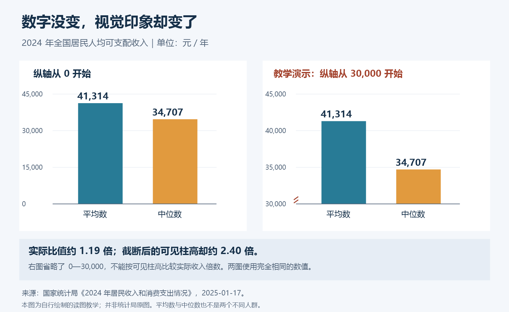
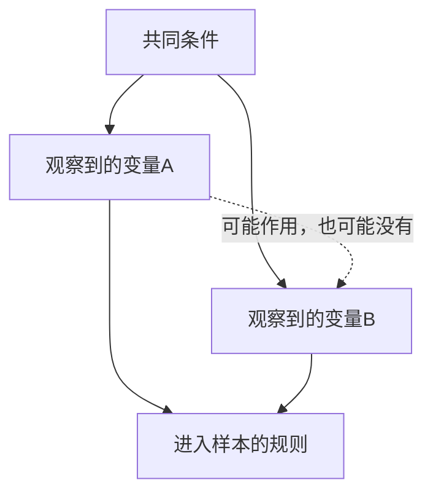

# 《统计陷阱》读书笔记

> 作者：达莱尔·哈夫（Darrell Huff），插图 Irving Geis。原作 How to Lie with Statistics，1954 年。中文也以《统计数字会撒谎》等书名出版；本目录用《统计陷阱》，不将不同译本页码混用。  
> 依据：出版社及馆藏目录、原始统计发布和研究论文。未取得用户版本全文，属于主要知识框架导读；现代显著性讨论、投资口径与新增案例为延伸教学。  
> 范围：原书十章的主要问题归纳为 28 个知识点，覆盖抽样、平均数、误差、图表、相关与因果、偷换指标和统计质疑。  
> 更新日期：2026-11-12

## 这本书最值得学什么

统计结果可能在计算上完全正确，却在表达上使人误解。防范的方法不是拒绝数字，而是还原数字从哪里来、测量什么、怎样汇总、如何呈现，以及它究竟支持多大的结论。

财商方面，它能帮助你拆解“历史年化”“平均回报”“胜率”“市场第一”“客户满意率”和各种财报标题。它不是完整的统计教材，也不应让你因为每种方法都有局限，就认为所有证据价值相同。

重要章节建议连着读第 2、6、12、18—19、24 点；这些位置直接结合调查研究、居民收入、真实招生数据和拆股公告，把常见跳步拆开。

## 原书主线与本笔记安排

| 原书主题 | 实际要解决的问题 | 对应知识点 |
| --- | --- | --- |
| 样本的偏差 | 谁进入了数据，谁没有进入 | 1—5 |
| 平均数的选择 | 一个汇总数隐藏了什么分布 | 6—7 |
| 缺失数字与微小差别 | 精确度、误差、差异大小 | 8—11 |
| 夸张图形与图像比例 | 视觉是否保持数值关系 | 12—14 |
| 不相干的统计量 | 偷换了分母、对象或问题吗 | 15—17、20—24 |
| 相关被包装成因果 | 数据结构与解释是否相符 | 18—19 |
| 综合误导与反问 | 如何验证一项宣传 | 25—28 |

原书章目可查[史密森学会馆藏](https://www.si.edu/object/how-lie-statistics-darrell-huff-pictures-irving-geis%3Asiris_sil_1173503)；书目见[Norton 出版社](https://wwnorton.com/books/9780393310726)。表中是归纳，不是章节逐字摘录。

## 核心知识点

### 1. 样本不是总体，先说明想代表谁

总体是你要认识的全部对象，样本是实际观察到的部分。调查“使用某平台的人”与调查“所有居民”，即使问题完全相同，也可能得到不同结果。

看到一个调查，应先写出三行：想回答哪群人的问题、能够接触到哪群人、最后谁参加了。三者的差距越大，结论越需要说明适用范围。样本不是越多越好，而是需要与目标问题匹配。

### 2. 大样本能降低部分随机波动，不能自动修复选择偏差

**真实研究：Pew 对六组在线调查样本的比较。** 研究在 2021 年实施，2023 年发表；三组来自概率抽样招募的面板，三组来自自愿加入渠道，共 29,937 名美国成年人，每组约五千人。研究用同一问卷和加权方式，对照 28 项基准变量。[Pew 原始研究及方法](https://www.pewresearch.org/methods/2023/09/07/comparing-two-types-of-online-survey-samples/)

按该研究的汇总定义，自愿加入样本的平均绝对误差为 **5.8 个百分点**，概率面板为 **2.6 个百分点**。这不是每一道题的误差，也不是“5.8% 的答案造假”；它衡量多个估计与基准差距的平均大小。

为什么相近样本量仍有差别？抽样波动是一种问题，进入样本的机制是另一种问题。如果某类人持续更容易参加，重复收集更多同类人，可能只会让你更精确地描述一个不合适的人群。

但也不能由此认定一切自愿调查都没用。调查产品用户体验时，用户样本可能正是目标；要推断全体成年人时，才需要额外处理代表性。原研究也说明，概率面板仍受未响应、招募与加权等因素影响，基准并非绝对无误。

**投资应用：** 一个论坛里几万人都盈利，不能证明全体投资者多数盈利。先问退出者是否还发帖、亏损者是否愿意报告、收入定义是否一致。扩大投票人数不会自动补回这些人。

### 3. 未响应者的缺席，也是一种信息

愿不愿参加调查，可能与被调查的结果有关。对服务极满意或极不满意的人更想留言，其他人可能直接离开。仅看回复者，会误估整体体验。

改进需要研究招募和未响应，而不只是把收到的答卷整理得更漂亮。报告应披露接触数量、有效样本、调查时间、筛选规则和加权方式。低响应率不是结论必错的充分条件，却值得查是否存在系统差异。

### 4. 幸存者偏差：消失的对象不能从历史分母里删除

只拿今天仍在运作的基金回看过去，可能排除了已经清盘或合并的产品；只采访成功创业者，也没有观察相同起点的失败者。数据可能都真实，选择它们的规则却已经知道了结果。

评估一种方法，应尽量从当时可选的完整集合出发，保留退出、违约、合并和停止报告的对象。无法补齐时，要缩小结论，不能把“幸存者平均表现”改称“普通参与者可以取得的表现”。

### 5. 加权是让样本接近目标结构，不是万能修复

不同人群在总体中比例不同，直接把样本等权平均，可能扭曲结果。加权可以纠正已知结构差异，但不能凭空观察遗漏人群，更不能保证未测量特征也得到平衡。

第 2 点研究在各样本使用相同加权流程后仍观察到误差差异，提醒我们招募机制与权重都重要。判断一份问卷时，应同时问“谁被抽到”和“数据怎样调整”，不能只检查其中之一。

### 6. 平均数、中位数与众数，回答不同的问题

**真实数据：国家统计局 2024 年收入发布。** 全国居民人均可支配收入平均数 **41,314 元**，中位数 **34,707 元**。[原始数据及定义](https://www.stats.gov.cn/sj/zxfb/202501/t20250117_1958325.html)

平均数适合连接总量与人数，容易受到极端值影响；中位数反映排序的中间位置；众数是最常出现的数值或类别。没有一种能在所有问题里代替其他两种。

先算出差额 `41,314−34,707＝6,607 元`。再解释它：两种汇总方式给出不同的集中位置，说明只用一个“平均”词会遗漏重要信息。但仅凭这两项，不能重建完整收入分布，也不能知道具体多少人低于平均数。

更重要的是指标范围。这里不是“就业者工资”，而是居民可支配收入；将它除以 12，只改变时间单位。统计定义没有变，不能顺手写成普通职员月薪。

对投资业绩，也要问平均的是每只产品、每位投资者还是每一元资金。一个小基金的大涨对等权平均影响很大，却未必代表多数资金的体验。选择汇总方式前，先明确你想知道哪一种经历。

### 7. 集中位置之外，还要看分散程度

相同平均回报可以对应完全不同的波动、尾部损失和资金需求。单一平均数不能告诉你过程中是否会破产，或者收益是否集中在少数对象。

至少继续看范围、分位数、极端观察与样本量；如果有长期过程，还要看连续亏损和回撤。标准差适合描述某些波动特征，但不能独自覆盖所有尾部和流动性风险。

### 8. 小数位多不等于证据精确

软件可以输出很多位数字，样本设计和测量误差却未必支持这种精度。销量预测写成小数点后四位，并不会消除客户流失和定价变化的未知。

报告精度应与信息质量相称。可以用区间、情景及关键假设表达不确定性；这比给一个极精确的点估计，再在页脚写“仅供参考”更诚实。

### 9. 误差范围有前提，不能给任何网络投票套公式

在独立简单随机抽样、样本足够大且比例不接近极端等条件下，比例的常见近似标准误为 `√[p̂(1−p̂)/n]`。其中 p̂ 是样本比例，n 是样本数量。[宾州州立大学统计课程](https://online.stat.psu.edu/stat500/Lesson05)

**数学演示：** n＝1000、p̂＝0.5 时，近似标准误约 1.58 个百分点；乘以 1.96，得到约正负 3.10 个百分点的常见 95% 近似区间半宽。这里没有声称真实进行过这次调查。

关键不是背下“千人调查误差三点”，而是检查假设。复杂抽样、加权、同一人重复参与和非随机招募，都可能改变甚至破坏这个计算的意义。该区间也没有把所有测量、覆盖和未响应偏差自动装进去。

### 10. 置信区间描述方法的长期覆盖性质

频率学派的 95% 置信区间，涉及在假定抽样模型下反复应用方法时，所构造区间覆盖固定总体参数的比例。不要直接把它解释成“已得到的这个区间内有 95% 的人”。

区间越宽，通常说明当前信息不足以精细定位；缩窄区间需要更多有效信息或更强假设。不能只靠隐藏误差条来获得更确定的结论。[NIST 置信区间解释](https://www.itl.nist.gov/div898/handbook/eda/section3/eda352.htm)

### 11. 显著性不等于重要性，未显著也不等于完全没有差异

这是针对现代研究的延伸。美国统计学会 2016 年的正式声明强调，p 值不是假设为真的概率，也不能测量效果大小或实际重要性。[ASA 原始声明](https://doi.org/10.1080/00031305.2016.1154108)

样本很大时，微小差异也可能达到某个阈值；样本很小时，重要差异又可能估计得很不精确。阅读“显著提升”时，应同时找原始效果量、区间、成本和研究设计。投资策略即使出现统计信号，扣掉费用、滑点和限制后，仍可能没有实际价值。

### 12. 截断纵轴会放大视觉差距

使用第 6 点的真实收入数据，可以制作两幅都标注正确数值的柱图：一幅纵轴从零开始，另一幅从 30,000 元开始。读者看到的柱高对比会非常不同。

左图展示相对完整的量级关系；右图是**有意制作的截断坐标教学示意**，不是国家统计局的原图。右图的可见柱高分别约为 11,314 与 4,707，看起来相差超过一倍；真实金额之比却只有 `41,314÷34,707≈1.19`。

误导不必通过修改原始数值发生。只改变视觉基线，也可能让读者把局部差距误读成总体比例。柱长用于表达大小时尤其应注意零点；折线图为了观察细微变化使用局部尺度并不一定错误，但必须清楚标轴，不能把局部尺度伪装成绝对量级。

**检查方法：** 遮住标题，先读坐标范围和单位，再自己算比例。如果图给你的直觉与比例不符，就查编码方式，而不是立刻接受标题。

### 13. 用面积表达数量，就不能只按边长放大

一幅图把收入增长一倍画成边长增加一倍的正方形，面积实际变为四倍。球体和立方体会产生更强的视觉放大。

图像应该让对应的视觉量按数据变化：若面积代表数量，边长应按数量的平方根变化。这里是几何关系，不需要虚构一个公司案例。看气泡图、立体柱图和钱袋图标时，先问作者到底把长度、面积还是体积当成数量。

### 14. 时间窗口能改变故事，不能只看最方便的起点

从低谷开始画，恢复性增长可能非常漂亮；从高峰开始画，同一过程又可能显得持续失败。一个真实窗口并不自动代表完整过程。

判断变化至少检查更长时期、同类对象和当时环境。不能要求所有图都无限延伸，但应解释选定窗口为什么适合问题。策略评价的起点、终点、退出产品和现金流规则尤其需要固定。

### 15. 百分比与百分点必须分开

百分点描述两个百分数的差；百分比变化还要选分母。比例从 20% 到 30%，增加 10 个百分点，相对增幅为 50%。这是定义演示，不是某家公司发生的事实。

同样，跌 50% 后涨 50% 不会回本，因为第二次的分母已经变小。阅读利润率、市场份额、风险降低和折扣时，先将分子分母写出来，通常就能发现语言有没有偷换。

### 16. 名义变化与实际变化不能混用

国家统计局的同一份 2024 年收入发布，给出人均可支配收入名义增长 **5.3%**，扣除价格因素后实际增长 **5.1%**。[数据来源](https://www.stats.gov.cn/sj/zxfb/202501/t20250117_1958325.html)

名义金额说明货币计价如何变化，实际量试图剔除相应价格影响。不能把两者之差随手叫某个个人家庭的通胀率，也不能保证每个家庭购买篮子与总体价格指数相同。

投资回报也要说明费用、税、通胀和币种。跨国资产本币上涨，不代表换回支出货币后获得相同购买力增长。

### 17. 测了容易测的东西，不等于回答了真正的问题

点击量不是信任，下载量不是留存，课程好评不是能力提升，股价上涨也不是某个管理行动有效的完整证据。这些量可能相关，但它们不是同义词。

比较宣传中的结论与实际测量对象。如果想证明“帮助用户长期盈利”，却只提供“参加人数”或“讲师粉丝数”，问题并不在数字大小，而在证据没有连接到主张。

### 18. 相关关系需要进一步解释，不能直接升级为原因

两件事一起变化，可能存在直接作用、反向作用、共同原因，也可能仅来自时间趋势或样本选择。数学相关系数不会自动替你挑出哪一种解释。

这是一幅关系示意，不对应某项已完成实验。它提醒我们，比较 A 与 B 之前，还要调查共同条件和选择过程。能排除哪些解释，决定了因果结论能写多强。

### 19. 分组结构可以改变总体比较：伯克利招生案例

**真实研究：Bickel、Hammel 和 O'Connell 对 1973 年秋季研究生申请的分析。** 原论文包含 12,763 份可作决定的申请；男性申请 8,442 份、录取 3,738 份，女性申请 4,321 份、录取 1,494 份。[1975 年原论文，表 1 及分析](https://faculty.ucmerced.edu/jvevea/classes/Spark/readings/Bickel-Berkeley.pdf)

按总体计算，男性录取率约 **44.28%**，女性约 **34.58%**。这是值得进一步调查的差异，但还没有把申请系别考虑进去。不同系录取难度不同，两组申请者的系别分布也不同。

总体录取率实际上是“每个系的录取率 × 该系申请占比”的加权汇总。权重不同时，即使逐系比较没有显示同样方向的普遍差异，汇总后也可能出现明显差别。论文正是通过逐步检查这些结构，说明不能直接从粗汇总跳到责任归因。

这个案例也不能简化成“分组后证明不存在任何歧视”。申请选择的形成、此前教育机会、个别系的差异和分析假设，都不是一个总体比例能解决的。分组提供更精确的问题，不会自动结束社会或因果判断。

**迁移到财报：** 集团毛利率下降，可能来自各产品毛利率下降，也可能是低毛利业务占比上升。要分开经营变化与业务结构变化，不能只凭总毛利率推断所有产品竞争力同步变差。

**自测：** 总体人均收入增长率能否高于城乡两组各自的人均收入增长率？在两组人口权重变化时可能，例如更多人口转向人均收入较高的一组，会额外抬升总体均值。这是平均指标的结构效应，不能泛化到所有增长率。固定、完整分组且各组基期金额为正时，可加总总量的增长率是各组增长率按基期金额占比计算的加权平均，不能超出各组增速的区间。先分清总量与均值，再检查权重。

### 20. 百分比的分母可能悄悄更换

“满意用户占购买者的比例”与“满意用户占全部被触达者的比例”不同；“命中股票比例”与“资金加权收益”也不同。分母变化会让两句都正确的话，看起来却像同一项能力。

应要求从原始对象到最终比例的完整链：谁符合条件、谁被排除、分子包含哪些结果。如果只有百分数、没有人数或规则，先不要替发布者补全含义。

### 21. 季度累计、单季度和全年，是不同时间对象

前三季度累计增长不能直接叫第三季度增长。差分计算还要求前后报表单位、合并范围和会计政策一致，必要时处理重述。

同样，不宜将九个月数据直接乘以四分之三的倒数当成全年事实。季节性、交付节奏和一次事项会改变最后三个月。明确标为情景测算仍可用于研究，但它不能冒充公司已经实现的结果。

### 22. 季节性、基数与价格，需要分别调查

同期比较有助于控制季节模式，却不能自动消除异常基数。前一年停产、并购范围改变或商品价格极端波动，都可能让同比看起来异常。

“低基数”也不应成为拒绝所有增长的万能解释。把两期实际金额、业务数量和主要变化摆出来，再讨论基数到底贡献多少；没有拆解，就不应宣称已找到完整原因。

### 23. 年化是在作假设，不是把短期变成长历史

把短期回报年化，等于假设相应收益过程能够延续。期限越短，偶然波动越可能被指数放大。产品披露中的不同年化口径，还可能采用不同现金流和收益分配规则。

先查实际观察天数、是否扣费、是否复利、是否可持续投入及本金波动。一个高年化数字，没有自动给出一年真实赚了多少，更没有给出明年会怎样。

### 24. 拆股改变计量单位，不会凭空创造持有价值

**真实公司行动：苹果 2020 年四拆一。** 苹果 2020 年 7 月公告说明，每持有一股可获额外三股，按拆股调整后的交易于 8 月 31 日开始。[苹果原公告](https://www.apple.com/uk/newsroom/2020/07/apple-reports-third-quarter-results/)

这个行动把相同权益分成更多份。若只比较拆股前后的原始每股报价，就可能把单位调整误读为暴跌；只看股数增加，又可能误以为财富增加。正确比较需要同时考虑股数和调整后的价格。

**只作单位演示：** 原来 1 份权益，变成 4 份，每份对应原来的四分之一。忽略市场其他变化，总权益不因切分本身增加。这不是在声称苹果拆股前后实际成交价精确满足某个固定数值，市场仍在交易。

实际回报计算还要处理现金分红、配股、并股、税费和资金进出。不同平台的前复权、后复权和价格指数有不同用途；拿未经调整的历史价格直接比大小，可能连同一单位都没有保持。

**自测：** “股票股数翻四倍，因此赚了三倍”缺了什么？缺了每股对应权益和价格调整。只看分子增长，忽略单位缩小，是同一种统计错误。

### 25. 价格回报、总回报与投资者回报不相同

价格回报主要看报价变化，总回报通常还考虑分红再投资；个人实际回报还受买卖时点、费用、税和资金进出影响。产品表现与持有者体验因此可能不同。

评价基金或策略，应写清基准、币种、时间、股息处理和费用。把基金扣费后的结果与不适合的指数相比，或把实际账户与无约束模拟相比，都会改变结论的含义。

### 26. 比较对象必须事先有理由，不能事后挑最容易赢的

行业、风险、地域与投资限制不同，适合的基准也不同。击败一个不相关的弱基准，不足以证明投资能力；承担更高风险取得更高回报，也不能自动解释为更高效率。

记录研究开始时为什么选择基准，并在条件改变时说明调整。不断换基准直到显得优秀，属于选择性展示，即使每张图的数据都没有伪造。

### 27. 用五个问题，把数字重新接回证据

原书结尾的质疑方法可以概括为：谁在说、怎样得知、遗漏什么、是否换了问题、结论是否与事实相容。它们是调查入口，不能仅凭发布者有利益就宣布数据必假。

把问题落到具体字段：原表在哪里、人数多少、时间范围、平均方式、剔除标准、误差、费用、基准。能回答这些问题的材料，比只有醒目标题的数字更值得继续分析。

### 28. 可复核的分析要保留原表、口径和计算过程

至少保留原始链接、发布日期、数据期间、单位、分子分母和计算式。发现改版或修订时保存说明，避免以后把不同版本混成一条时间序列。

复核应能由另一个人完成，而不是只有作者记得自己怎样处理。面对不能取得原始数据的结论，要明确证据缺口；不必凭空补出一张“合理”的表格。

## 练习与参考思路

1. **Pew 样本都约五千人，为何结果仍有差距？** 样本量只涉及部分随机误差，招募、覆盖和未响应机制仍可能系统不同；研究中的加权也不能修复所有未观测差异。
2. **收入柱图中右边看起来高出一倍多，是真实收入比例吗？** 不是。右图截断了纵轴；真实金额之比约 1.19，视觉可见高度使用的是另一分母。
3. **伯克利总体录取差异可以直接证明每个系同方向区别对待吗？** 不可以，要检查系别难度、申请分布与其他条件，也不能把分组分析反过来当作一切公平问题已解决。
4. **苹果四拆一以后原始股价变小，能否直接认定出现投资亏损？** 不能，先调整单位与股数，再计入真实市场变化和现金流。

可把第 27 点做成读公告前的固定清单。一次只挑一张图或一项收益宣传，完整复算它，比同时记住几十个偏差名字更有效。

## 边界与资料范围

本书年代较早，现代统计推断、抽样、因果分析和金融收益计量远比入门书详细。这里的置信区间、ASA 声明、拆股与财报应用明确属于补充，不倒推为 1954 年原书已有案例。

书目与十章范围已核对；没有取得用户指定译本，未核对全部原书插图。各重点案例在原位给出一手来源；图中的坐标变体为依据国家统计局数据原创绘制。统计学的正确结论经常带条件，这并不削弱其价值，反而说明它在清楚界定自己知道什么。
