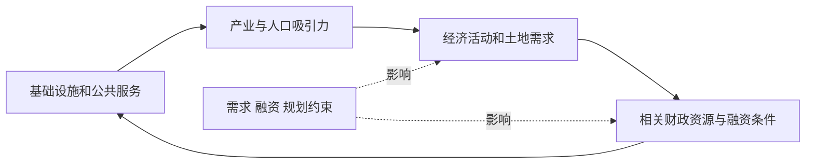
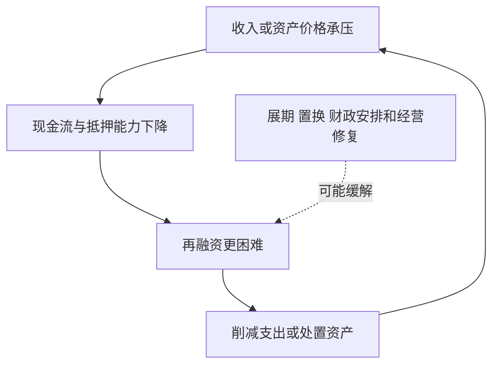

# 《置身事内》：把地方政府、企业、土地与金融连起来

> 兰小欢著，上海人民出版社·世纪文景，2021 年 8 月，ISBN 9787208171336。原书分微观机制与宏观现象两篇、八章。  
> 基于作者所在机构书介、公开目录、财政部与统计局等一手资料整理，未取得完整原书，属于系统导读。30 点覆盖主要机制；2024 年以后发布的资料属于书外检验，历史政策不当作现行法律咨询。更新：2026-11-12。

## 先抓住主线

理解中国经济，不能只看企业之间的价格竞争，也要看政府怎样组织基础设施、土地、财政与融资。地方政府面对发展任务、预算约束、区域竞争和信息难题，其行为又会影响企业、房地产、就业与债务。

本书提供的是一种解释框架，不是“政府一出手就成功”的保证，也不是把所有问题归于某个主体。读者应学习在具体约束下理解行为，再检验成本、收益和副作用。

| 原书主题 | 对财商的帮助 | 本文位置 |
| --- | --- | --- |
| 地方权力与事务 | 知道政策怎样落地 | 1—6 |
| 财税与政府行为 | 分清财政收入、支出和激励 | 7—11 |
| 投融资与工业化 | 看项目、融资和产业政策 | 12—19 |
| 城市化与不平衡 | 理解人口、住房与地区差异 | 20—23 |
| 债务与内外失衡 | 识别风险传播和转型取舍 | 24—30 |

版本与主线见[复旦大学介绍](https://cces.fudan.edu.cn/info/1096/3988.htm)，完整章目核对见[馆藏书目](https://www.yuntaigo.com/book.action?recordid=emtmYmZhZmM5Nzg3MjA4MTcxMzM2)。

## 核心知识点

### 1. 政府不是一个没有内部差异的单一行动者

中央、地方、不同部门与不同层级承担的任务、掌握的信息和可用资源并不完全一样。全国性目标需要经过预算、协调、执行和反馈才能影响具体企业。

看到一项政策，应先问主管部门是谁、执行层级是谁、资金从哪里来、谁承担后果。仅凭“国家支持”四个字，无法判断一家上市公司实际得到多少收益，更无法直接推出股东回报。

### 2. 事权和财力需要一起理解

事权涉及谁负责做什么，支出责任涉及谁付钱，财力涉及实际能调动什么资源。一个地区承担较多服务与建设任务，却没有相称的稳定收入，会面临不同融资与支出压力。

研究地方经济时，不能只看财政收入规模，还应看人口、公共服务、存量设施维护和债务到期。收入高不必然宽裕，收入增长也可能追不上新增责任。

### 3. 外部性与规模经济影响事务适合在哪一级处理

一项事务的影响越容易跨行政边界，越需要协调；某些服务规模越大单位成本越低，但离现场太远又可能失去信息。管理层级选择因此存在取舍。

这解释了为何“全部下放”或“全部集中”都不是通用答案。环境、交通、教育等事务的外溢与信息条件不同，应分别分析。企业的审批与建设速度也可能受这种协调结构影响。

### 4. 信息复杂性使形式规则与实际执行之间存在距离

地方了解现场情况，中央掌握更广的目标与约束；不同信息优势可以互补，也可能产生报告偏差与执行困难。越难量化的工作，越不能只靠一个指标评价。

对投资者，政策文本是起点，不是全部事实。应继续查实施细则、预算安排、项目名单、公司公告和实际回款。只读宣传标题，容易把意向当成已经兑现的收入。

### 5. 激励相容意味着让执行者愿意做有益的事

如果任务与奖励、资源和责任不匹配，执行者可能优先处理容易考核的部分。增长、税收、就业、环保和风险控制之间也可能存在短期冲突。

理解激励不是断言所有人只为考核行动，而是增加一个可检验解释。研究地方招商或企业投资时，应问成果如何评价、成本何时出现、谁承担失败后果。

### 6. 招商引资是一个涉及多方承诺的协调问题

企业不仅需要低税费，也需要土地、能源、物流、人才、配套供应商和可预期规则。政府可能帮助协调单个企业难以独立完成的条件。

但承诺与收益不能混为一谈。产业落地后能否盈利，取决于市场需求、技术、成本和竞争；政府能协助解决协调问题，不能消除商业不确定性。投资者应核对承诺条件、履行进度与资金来源。

### 7. 分税制改革改变了财政关系，但不能用一个比例概括全部

**真实制度。** 国发〔1993〕85 号决定从 1994 年实行分税制，重新划分税种与中央地方收入，并规定税收返还等安排。当时增值税中央与地方分享关系，必须连同返还与其他税种一起理解。[原始文件](https://yss.mof.gov.cn/zhuantilanmu/cztzgg/zcgz/200806/t20080627_54328.htm)

不能把某个分享比例直接理解为地方可用财力缩减相同比例。地方还可能得到转移支付、返还和其他收入，同时承担不同支出责任。制度分析需要同时看收入端与支出端。

这个案例对财商的重要性是：税收在哪里产生、由谁取得、怎样再分配，会影响地方招商与服务的动力，但这些动力不等于地方行为的唯一原因。

### 8. 历史制度必须更新，不能把 1994 年数字用到今天

2016 年全面营改增后的方案调整增值税中央地方分享，2019 年文件继续保持“五五分享”安排。这里引用的是相应历史文件，不宣称已经穷尽 2026 年所有税制细节。[2016 年文件](https://fgk.chinatax.gov.cn/zcfgk/c102440/c5207020/content.html)、[2019 年文件](https://www.mof.gov.cn/zhengwuxinxi/caizhengxinwen/201910/t20191010_3398434.htm)

读书时要把制度形成史与当前规则分开。若要评价一家公司当前税负，必须进一步查其适用税种、税基、优惠、地区和最新法规；不能用中央地方分享比例代替企业税率。

### 9. 一般公共预算和政府性基金预算不是同一个账户

财政资料中不同预算各有收入来源和用途规则，不能看见“财政收入”就随意相加。土地使用权出让收入主要出现在政府性基金预算中，与一般公共预算税收不同。

分析时先抄指标全名、期间、预算类型和单位，再比较。预算数、执行数、决算数也不同；全国总额、地方本级与某个城市，更不能直接混为同一口径。

### 10. 土地出让收入不是地方政府的净利润

**真实数据。** 财政部公布，2024 年国有土地使用权出让收入为 48699 亿元，同比下降 16%。这是全国相关收入口径，不是某个城市，也不是扣除征拆、开发与相关支出后的可自由支配净额。[财政部 2024 年收支](https://bgt.mof.gov.cn/zhuantilanmu/rdwyh/ysbgjyszx/202501/t20250124_3955083.htm)

为什么重要？若把全部土地收入当作净收益，就会高估资金空间；若只看收入下降，又可能忽略支出调整、存量资源和其他财政安排。分析土地依赖需要看多年的收支与债务，而不只一个同比数。

对房地产和基建企业，这类变化可能通过项目安排、付款节奏与融资影响经营，但具体影响需看合同和回款。全国数据不能直接证明一家公司的应收款一定无法收回。

实际核查可以分三步：先确认公司主要客户属于哪个地区与哪个预算安排，再看应收账款账龄、合同约定和回款记录，最后观察当地预算执行与项目资金来源。即使地区相同，收费运营项目、一般公共预算安排项目和依赖土地开发回款项目，也可能具有不同的偿付路径。用一个全国同比数字替代合同分析，会丢失最重要的中间信息。

### 11. 土地、基础设施与产业发展之间可能形成反馈

基础设施改善可提高土地使用价值，土地开发又可能提供建设资金；产业和人口进入进一步改变需求。反馈能支持发展，也可能在需求减弱时逆转。



这是机制示意，不保证每个项目都形成良性循环。土地价格上升可能与市场预期和供给限制有关，不能全部归因于某项基础设施。

### 12. 融资平台是法律主体，不能与政府债券直接画等号

城投公司通常是企业法人，可能承担建设、运营或其他业务。其资产、收入、债务和政府关系需要分别查证；地方政府债券则有不同法律与预算安排。

**历史规范。** 2014 年国发〔2014〕43 号提出规范地方政府举债融资机制；财政部 2016 年答问进一步区分地方国有企业债务与政府偿还责任。[2014 年文件](https://gs.mof.gov.cn/xxgk/zhengcefagui/201410/t20141008_1146600.htm)、[2016 年答问](https://jrs.mof.gov.cn/zhuanti2019/ppp/zcjdppp/201612/t20161205_2472592.htm)

这些历史材料说明制度在处理主体与责任边界，不能据此把某一具体债务的认定自动完成。投资者应查发行文件、合同、担保、预算与实际现金流，不把“国有”当作无条件保本条款。

### 13. 资产多与现金足是两个问题

土地、道路、园区和公共设施可能具有经济或社会价值，但不一定能在债务到期前形成现金。资产估值高，也不等于可以迅速按该价出售。

偿债分析要列时间表：回款何时发生、债务何时到期、利息如何支付、哪些资产受限。仅用资产总额除以债务，可能漏掉期限错配与变现折价。

### 14. 政府投资的社会回报与项目财务回报可以不同

道路可能提高周边企业效率，却无法通过收费收回全部投资。公共项目不应只按一家企业的利润评价，但融资又需要明确谁支付成本。

因此要把社会收益、经营现金和财政补助分开。不能因项目有社会价值就忽略偿债，也不能因项目自身收费不足就断言社会上没有价值。关键是成本与收益是否由清楚、可持续的安排连接。

### 15. 债务融资把未来资源提前使用

借款支持长期建设可以合理匹配受益期间，但也会把未来收入的一部分用于偿还。项目收益、融资成本与期限需要相容，不能仅凭“未来会发展”推定可持续。

本金展期可以缓解当前支付压力，若底层现金不足却没有变化，风险并未自动消失。评估融资安排应区分流动性缓解与经济偿付能力改善。

### 16. 产业政策既有协调问题，也有信息与退出问题

新产业可能需要配套、人才和长期资本，多方互相等待时，公共协调具有潜在作用。与此同时，政府也可能无法提前识别最佳技术路线，地方竞争可能重复建设。

阅读作者关于工业化的讨论，应同时问成功机制与失败条件。政策支持不是公司的充分竞争优势；补贴能否转为效率、客户价值和独立现金流，才影响长期企业价值。

### 17. 京东方、光伏等原书案例应放回产业阶段

原书以京东方投资、光伏补贴和产业引导基金讨论政府角色。它们涉及资本强度、学习曲线、供应链与市场竞争，并不构成一条“政府投什么就买什么”的规则。

本文没有取得各项目完整原始合同，不复述未核验的投资金额和收益。学习这些案例时应保留三个问题：当时私人资本为何不足，公共投入解决了什么约束，最终收益与风险怎样分配。具体上市公司还要查同期年报，而不能仅凭后来成功倒推所有早期决策正确。

还要防止只看最终留下来的企业。若一轮产业投入中既有成功又有失败，应研究整个组合的资金成本与回报，不能用一家成功企业的市值覆盖其他项目的未知损失。产业学习、供应链形成与直接财务收益也应分别估计；社会收益可能很大，但必须说明证据，而不能把无法测量的好处一律当成确定收益。

### 18. 产业引导基金需要分清政府目标与基金回报

政策目标可能包含产业落地、就业、创新和供应链，基金出资人则还关心财务收益。不同目标可以兼容，也可能互相约束。

分析结构时应问出资比例、管理人激励、投资限制、退出机制和亏损承担。基金名中包含“政府引导”，不自动意味着全部底层项目都有财政兜底，也不意味着每位出资人权利相同。

### 19. 补贴应区分一次性帮助与长期依赖

补贴可以缓解研发和早期建设成本，但若企业缺少市场竞争力，持续补助可能掩盖低效率。财报中应同时看补助分类、业务毛利、现金流和资本投入。

这不是说剔除所有补贴就得到“真实利润”。若补贴与长期制度和公共服务合同相连，经济性质需要具体分析。重点是可持续性、条件、回款和政策变化风险，而不是机械贴标签。

### 20. 城市化是人口与生产组织变化，不只增加房子

人口集聚可能提高匹配效率、专业化和知识交流，也会增加交通、住房和公共服务压力。城市规模、密度与生活成本共同影响吸引力。

**真实统计。** 国家统计局公布，2024 年末常住人口城镇化率为 67.00%，较上年提高 0.84 个百分点。这是常住人口口径，不等于户籍人口城镇化率，也不等于全国住房需求每年按同一比例增长。[统计公报](https://www.stats.gov.cn/sj/zxfb/202502/t20250228_1958817.html)

投资者应继续研究人口年龄、收入、迁移方向、家庭形成与存量住房。宏观城镇化仍推进，不代表每座城市、每类房地产都会受益。

还应区分百分点和百分比。67.00% 比上年高 0.84 个百分点，描述的是人口占比的差，不应改写成城镇人口增长 0.84%；后者还取决于全国人口总量变化。类似地，常住人口口径描述人实际居住在哪里，不能自动推断其户籍权益、教育安排或购房资格。把统计定义读准，才能继续讨论公共服务与消费，而不是在第一步就把不同人群混在一起。

### 21. 房价同时连接居住、资产与信用

住房既提供服务，也可能被视为资产和抵押品。价格变化会影响家庭资产负债表、开发商融资、地方收入和银行风险，影响路径并不相同。

分析房地产应拆开人口需求、租金、供给、信贷和预期。仅用某个国家的平均房价收入比，也不能判断具体城市的价格，因为统计范围、家庭收入和住房品质可能不同。

### 22. 地区差异要看流动机会与公共服务

企业和人口跨地区流动，可以改善资源配置，但住房、教育、社保与家庭关系都会影响实际流动。地区平均收入差异也不完全等于个人迁移后的收益差异。

财商应用是做职业或居住选择时同时看收入、生活成本、机会、保障与风险。高薪城市不自动带来更高储蓄，小城市低支出也不自动抵消机会差异。

### 23. 纵向与横向不平衡对应不同财政问题

纵向涉及不同政府层级之间的收入与责任匹配，横向涉及不同地区之间的财力差距。转移支付、事权调整和公共服务安排，是处理这些问题的不同工具。

不能把一个地区得到较多转移支付，简单等同于没有经济价值；也不能把税收贡献高理解为其全部收入都可自由保留。分析需要尊重制度分工和全国范围的外溢收益。

### 24. 债务风险通过多个主体相互传递

企业回款放慢可能影响偿债，融资收紧又可能减少投资与就业，地方财政和金融机构也可能受到影响。总量债务数字有用，却无法代替主体、币种、期限和资产质量分析。



图中的措施效果取决于实际设计，不是画一条政策箭头就能保证风险消失。

### 25. 2024 年债务置换：调整结构不等于债务凭空消失

**真实政策。** 财政部公布的 2024 年 11 月政策说明，增加 6 万亿元地方政府债务限额用于置换存量隐性债务，按 2024—2026 年每年 2 万亿元安排。[政策发布实录](https://www.mof.gov.cn/zhengwuxinxi/caizhengxinwen/202411/t20241109_3947230.htm)

置换可能通过期限、利率与预算管理方式缓解偿付压力，但原有经济义务并不是因为名字改变就自动归零。它与新增项目投资、银行贷款、实际发行完成量也不是同一个指标。

理解这点后，读新闻应分四层：批准限额、实际发行、资金用途、对原债务的处理。企业是否受益还要看付款链和合同，不能把总限额均摊到所有城投或基建股票。

**数学演示：**同样 100 的本金，若旧债每年利息 6、置换后利息 3，在其他条件相同下年度利息压力减少 3，本金仍是 100；若还款期限拉长，也会减少近期集中到期压力。这里不是对真实政策平均利率的估算，只说明结构变化怎样释放现金流。释放的空间用于清偿欠款、必要服务还是新增支出，会继续影响经济结果，必须沿用途核验。

### 26. “降低杠杆”可以通过不同路径实现

债务减少、收入增长、资产出售、重组与通胀，都可能改变债务比率，但分配后果和长期效果不同。只盯比率下降，可能漏掉同时发生的资产流失或偿债能力恶化。

具体分析应同时列出分子与分母、现金期限和权利变化。债务占 GDP 的比例不能直接当作企业债务占收入；国家、地方、企业和家庭融资能力也不能机械类比。

### 27. 低消费与高投资要研究收入分配和保障条件

居民消费受到收入、预期、家庭责任、资产负债和公共保障影响。投资规模大也不自动意味着需求不足或浪费，关键是回报与资源配置。

本书讨论结构失衡时提供了一组机制，读者仍要查具体时期数据。不能把消费意愿简单归为文化性格，也不能认为提高一项补贴就能解决所有长期约束。

### 28. 国际失衡与贸易冲突有国内结构基础

储蓄、投资、生产能力与消费结构，会影响贸易和跨境资本；外部规则与技术限制又会反过来影响国内企业。一个贸易余额不能独立证明谁占便宜、谁受损。

研究出口公司要拆分终端需求、进口投入、结算币种、客户集中和替代市场。宏观关系紧张与个别公司实际利润之间，需要一条可核验传导链。

### 29. 从生产型服务转向更广的公共服务，会改变评价标准

发展阶段变化以后，公共服务、环境、社会保障和风险控制的重要性可能提高，不能用某个阶段有效的考核方式永久评价所有地区。

对财商，长期需求也会随人口和生活水平变化。研究养老、医疗、教育或城市更新，要理解真实需求、支付来源和制度，而不是只因其方向重要就给予无限估值。

### 30. 用一张关系表阅读政策与企业

```text
政策名称、发布机构、日期与实施期间：
解决什么问题，适用哪些主体：
资金从哪里来，如何到达项目或企业：
取得资金需要满足什么条件：
收入、成本、现金与负债分别怎样变化：
谁承担商业失败与偿付责任：
哪些结论已经有公告，哪些只是推断：
下一步核对哪份预算、报告或合同：
```

这张表的目的，是让政策研究进入可检查的经营事实。最危险的跳跃是把政策支持、项目开工、确认收入、收到现金和股东赚钱当作同一件事。

把每一次跳跃需要的证据另列一行，会很快看出材料缺口。没有正式预算、合同或回款信息时，先记录为可能影响，保留等待核验的空间。

## 练习与参考答案

**题一：全国土地出让收入下降 16%，某城市可用财力也下降 16%吗？** 不能推出。需要当地收入结构、成本支出、转移支付与其他资金安排，且收入不等于净财力。

**题二：一家城投是国有企业，其债券就是地方政府债券吗？** 不是。必须区分法律主体、责任与合同，具体债务认定和支持安排需要正式材料。

**题三：政府支持某产业，是否可以省略企业估值？** 不可以。政策解决某些约束，仍需客户需求、竞争、资本回报、权利与价格分析。

## 资料边界

本文重点是解释机制，不提供具体债券、房地产或税务操作建议。历史制度与 2024 年数据均标明时间，不能默认覆盖最新实施细则。原书京东方、光伏等叙述未取得全部原始合同，不编造金额与收益；可在获得指定版本和公司公告后继续深化。

可与《经济学原理》《债务危机》《一本书读懂财报》联读，分别补一般机制、信用周期与企业账户。
