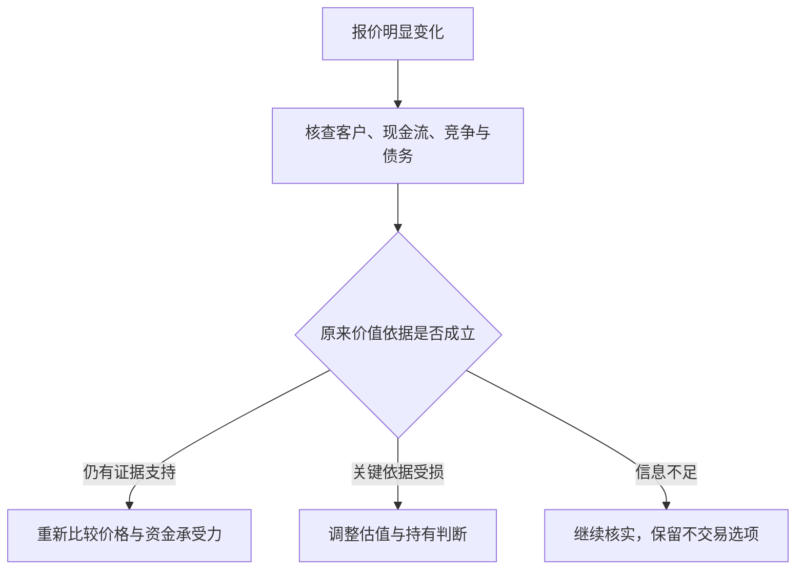
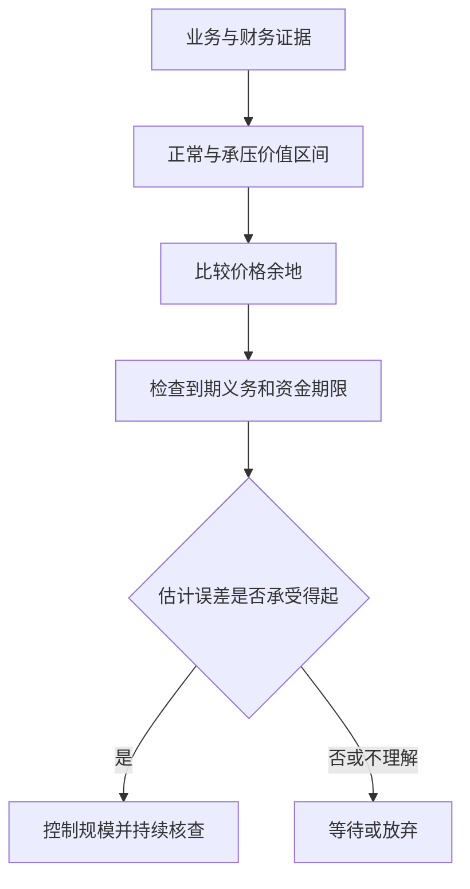
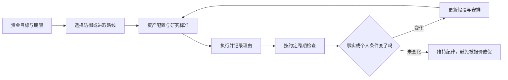

# 《聪明的投资者》读书笔记

> 作者：本杰明·格雷厄姆（Benjamin Graham）；英文名：The Intelligent Investor。  
> 版本说明：初版发表于 1949 年；常见评注版保留格雷厄姆后期修订文本，另加入 Jason Zweig 的评注。Zweig 又有更新版本，不能把新增评论、现代产品和案例都算作格雷厄姆原著内容。用户所持中文译本未确认。  
> 分析依据：公开目录、Zweig 本人介绍与访谈、监管机构投资者教育资料，以及对经典概念的原创教学解释；书外案例另核对伯克希尔原信、美国财政部证词、Vanguard 官方基金资料表与美的集团公告。未取得用户版本全文。  
> 覆盖范围：原书二十章的主要主题，归并为 32 个知识点；不逐个复述历史公司案例，不承诺覆盖所有脚注与版本差异。  
> 更新日期：2026-11-11

版本与评注的区别参见 [Zweig 官方书页](https://jasonzweig.com/books/the-intelligent-investor/)；章目参照 [O'Reilly 的授权电子书目录](https://www.oreilly.com/library/view/the-intelligent-investor/9780061745171/)。以下章节号按常见修订版正文二十章；中文小标题为概括，不冒充某个译本原文。标明“书外真实案例”的事件据一手资料核验，不冒充原著案例；计算演示与应用流程为本笔记编写。

## 先看这里：它究竟教你什么

**一句话概括：把股票当作企业权益，以合理价格和风险安排购买，建立能让自己长期坚持的判断与纪律。**

“聪明”主要指独立判断、耐心、自我约束和愿意承认不知道，不是预测每一次涨跌的天才。你可以研究得很深，也可以承认自己不愿长期研究，采用更简明的防御路线；危险在于既没有研究，又期待持续获得专业选股的结果。

七个最值得记住的结论：

1. **投资与投机要分清。** 没有分析支撑、只期待下个人出更高价的交易，不能因持有时间变长就自动升级为投资。
2. **市场报价不是你的老师。** 它提供交易条件，你有权暂时不交易。
3. **买得便宜，要相对于价值。** 股价跌过、单价低、历史涨得少，都不等于便宜。
4. **给错误留余地。** 安全边际承认预测会错，并且要防止误判导致无法承受的损失。
5. **优先选择你能执行的方案。** 高难度策略与高自信不是同一回事。
6. **费用、过度交易和情绪是可控制的损耗。** 未来市场回报无法保证，这些损耗却会真实发生。
7. **数字标准有时代背景，原则更长久。** 原书的利率、公司规模和筛选阈值，不能直接变成今天任何市场的买入指令。

它对提高财商最直接的帮助，是把“我觉得会涨”改成四个问题：**我买的是什么？依据是什么？价格给了多少容错？我承担得起什么结果？**

## 全书主线与知识覆盖

| 正文位置 | 主要问题 | 本笔记覆盖 |
| --- | --- | --- |
| 第 1—3 章 | 投资边界、通胀、市场历史 | 1—5 |
| 第 4—5 章 | 防御型投资者的组合与股票选择 | 6—10 |
| 第 6—7 章 | 进取型投资者应避开什么、研究什么 | 21—24 |
| 第 8 章 | 怎样面对市场波动 | 11—13 |
| 第 9—10 章 | 基金与投资顾问 | 25—27 |
| 第 11—12 章 | 基本分析与每股收益 | 15—18 |
| 第 13—15 章 | 企业比较、不同类型选股 | 9、17、21—22、29 |
| 第 16 章 | 可转换证券与认股权证 | 28 |
| 第 17—19 章 | 历史案例、股东与管理层、分红 | 19—20、29 |
| 第 20 章 | 安全边际 | 14、30 |

正文负责建立判断框架；Zweig 的评注帮助解释现代市场中的应用和行为问题。下面将两者能确认的共同原则与补充教学分开，不把互联网时代的基金产品当成 1949 年已存在的原著建议。

## 核心知识点

### 1. 投资，是分析、保护本金与合理回报共同组成的过程

原书第 1 章的投资概念包含充分分析、对本金安全的重视及适当回报。它不是任何资产绝不下跌的担保，也不是“好公司永远都能买”。

**财商收获：** 每笔资金先标清目的。没有证据支撑的部分就承认是押注，不用“长期投资”掩盖缺少判断依据。

### 2. 投机可以存在，最危险的是自己没有意识到在投机

原书并非宣称所有投机都不合法或不道德，而是要求你知道自己在做什么。区分的关键不是持有几天，也不是证券有没有名气，而是回报理由：你能否依据资产、盈利、价格和风险作出有保护的判断，还是主要押注接下来会有更高报价。相同证券可以被不同的人以不同方式使用，持有多年也不能自动补出缺失的分析。

判断一笔交易，先写下收益依据、价格保护和失效条件。若主要依据只是别人愿意更高价接手，就应承认其中投机成分；一次赚钱不能倒推方法可靠，一次亏损也不能单独证明分析毫无价值。

最常见的失控从“改名”开始：原先打算短线交易，下跌后临时改口“价值投资要有耐心”，但没有新增任何企业证据。问题不是没有立即卖出，而是原来的退出依据被情绪悄悄删除。后来再跌，他可能继续用更多钱摊低成本，使一笔有界的尝试变成整个家庭的风险。

因此，边界应落实在资金用途和书面规则上。先把必要生活支出、确定要用的钱和长期投资计划分清，再讨论是否保留试验性资金。不同账户能帮助记录，却不能隔离经济后果：如果不断从核心资金补钱，名义上的“小账户”仍会吞掉大账户。杠杆尤其会使账户跌幅之外再出现利息和强平约束。

**原创风险算例：** 假设总投资资金 100 万，其中 5 万是你明确接受可能全部损失的试验，其余 95 万先假设不变。试验亏掉 80%，总额变成 96 万，总体损失 4%；若亏损后再从其余资金转入 15 万继续押注，原来的风险安排就已经失效。这里的 5% 只是展示边界的假设，不是建议所有人配置这一比例，也不是允许不研究的理由。

检查一笔交易，可以暂时遮住买入成本，写下“从今天开始，还愿意以这个规模承担它吗？依据是什么？何种事实会改变决定？”买入价会影响税费和实际损益，却不会因为你想回本，就成为企业价值的支撑。

**自查题：** 一笔交易最初有研究依据，后来债务违约风险大增，但你只因不愿亏损而继续持有，原来的“投资”标签能否保证安全？**参考答案：** 不能。判断需要随证据更新；承认风险变化、减小规模或退出，都可能比维护标签更重要。Zweig 对行为约束的说明可参见[其 CFA 讲稿](https://jasonzweig.com/wp-content/uploads/2016/10/CFA-Graham.pdf)，本节资金边界的计算为补充教学。

### 3. 防御型与进取型，区分的是投入方式和能力要求

防御型希望降低严重错误与管理负担，进取型愿意持续承担额外研究、判断和执行工作。主要区别在投入方式和能力要求，不能按“敢重仓所以进取”划分。防御路线也要检查期限、分散和费用；进取路线则必须能说明额外工作怎样改善判断。

**书外真实案例：2008—2017 年，巴菲特与 Protégé 的十年比较。** 巴菲特选用跟踪标普 500 的低成本指数基金，对方选择五只基金中的基金，间接持有两百多只对冲基金。2017 年信披露，指数基金十年累计增长 **125.8%**；四只完成十年观察的组合分别为 **21.7%、42.3%、87.7%、27.0%**，另一只于 2017 年清算，不能假装其观察期完全相同。[2017 年股东信，PDF 第 10—11 页](https://www.berkshirehathaway.com/letters/2017ltr.pdf)

这个真实比较让“更多专家、更复杂流程”与“最终投资结果”分开了。对方并非没有研究，而是额外研究、调整与多层费用没有在这次比较中转化为更好的净结果。学习本书时，应把进取理解为愿意付出并验证额外努力，而不是默认复杂方案天然优于简单方案。

但它也不是所有主动管理必败的实验。五只组合并非随机抽样，风险暴露与指数不同，十年环境也不是所有未来环境。正确收获是提出检验标准：多承担了什么风险、付出了什么费用、选择了什么可比较基准，最后是否获得了补偿；不能仅看名气或工作量。

如果你选择进取路线，应能持续产出经营分析、估值区间、反证条件和事后复核。若大部分时间只是读重复的评论，额外投入可能没有形成优势。若选择防御路线，则要接受它同样会经历市场波动，而不是在最困难时临时改成预测涨跌。

**计算演示：** 20 万资金若真能在相同风险、扣除成本后多取得 2 个百分点回报，一年增加 4000 元；如果投入 200 小时，相当于每小时 20 元的假设增量。这里并未证明那 2 个百分点存在，只提示时间和机会成本也应计入决策。

**练习：** 能否因十年比较中的指数胜出，就认定任何指数产品都适合自己？**参考答案：** 不能。还要检查所跟踪市场、集中度、费用、汇率、资金期限和风险承受力。此例是书外实践，不应误称为格雷厄姆原著中的指数基金案例。

### 4. 通胀会侵蚀购买力，名义本金不变也可能变穷

名义回报是账户金额的变化，实际回报还要扣除物价影响。简化计算为：

```text
实际收益率＝（1＋名义收益率）÷（1＋通胀率）－1
```

**补充例子：** 一年名义赚 4%，物价涨 6%，实际购买力变化约为 1.04÷1.06－1＝负 1.89%。账户余额增加并不等于消费能力增加。

第 2 章因此提醒读者不能只看固定金额收益。但股票也不是任意期限必然跑赢通胀：企业可能无法涨价，利润率可能受挤压，买入估值也影响结果。抗通胀要看具体经济机制，不靠资产标签许愿。

### 5. 学历史，是认识循环与估值，不是找到精确时钟

第 3 章用长时期市场背景讨论估值和预期。历史有助于看见繁荣时普遍乐观、低迷时普遍悲观，也提醒你当前价格已包含多少期待。

不要把书中某年市盈率和利率看成永远有效的红绿灯。值得继承的是比较价格与经营基础，警惕“这次任何价格都合理”。

### 6. 资产配置先解决承受能力，再讨论选哪只股票

第 4 章讨论股票与高等级债券的组合。原书的股票区间与均衡配置建议属于历史框架，不能不问期限、币种和未来支出就机械套用。心理上愿意忍受下跌，与经济上能等恢复，是不同条件。

**书外真实案例：Vanguard LifeStrategy 60/40 Fund 的 2022 年。** 该基金的官方资料说明其策略约为 60% 股票、40% 债券；截至 2026 年 9 月的资料表列示，2022 年基金回报为 **−16.00%**，2023 年为 **＋15.49%**。数据包含分红和资本收益分配再投资、扣除基金费用，是该基金的历史回报，不代表所有 60/40 组合。[Vanguard 官方资料表第 1 页](https://workplace.vanguard.com/assets/corp/fund_communications/pdf_publish/us-products/fact-sheet/F0914.pdf)

这个结果首先纠正“分散之后不会亏”的想法。股票和债券各有风险，债券也会因利率、信用和期限变化跌价；把它们组合起来，并不承诺每次相互抵销。其次，投资者的钱是否可以等待，比自己是否喜欢这个比例更先需要回答：若必须在亏损年份支付确定支出，实际选择与能够长期持有的人不同。

用上述已发生的两年回报作标准化计算，不另编行情：期初设为 100，2022 年末为 84，2023 年末为 84×1.1549＝**97.0116**。第二年涨幅看起来接近第一年跌幅，仍未回到原点。这里暂不考虑个人税费、申赎和币种兑换；不能把这个单位值当作实际基金净值。

这也不能反过来证明 60/40 永久失效，更不能根据这两年就替所有人确定配置。应先将短期必要支出、应急资金和长期目标区分，再检查候选组合在不利情景下的金额损失、流动性和币种是否合适。工作收入与投资若同时暴露于同一行业，家庭整体风险还可能高于投资账户显示的程度。

选定安排后，复核应由资金用途、收入稳定性和负债等变化驱动，不能仅因某类资产最近上涨，就宣称自己的承受能力也提高了。现代期限与风险原则可参照 [Investor.gov 配置说明](https://www.investor.gov/introduction-investing/getting-started/asset-allocation)。

**练习：** 看到上述基金 2023 年上涨，能否认定 2022 年底必须用的钱也适合事先投入这种组合？**参考答案：** 不能。后来反弹不会改变当时的付款期限，也不保证未来反弹何时出现。这一案例用于理解风险与期限，不推荐该产品。

### 7. 再平衡，是恢复原定风险，不是知道明天谁会涨

某类资产上涨后会在组合里占更大比重。再平衡把组合带回预先设定的范围，也可以利用新增资金完成，减少不必要的卖出。

**补充例子：** 原有股票 60 万、债券 40 万，股票涨到 90 万、债券仍为 40 万。股票占比约 69.23%；若目标仍为 60%，总资产 130 万对应股票 78 万，可将 12 万股票换成债券。这个计算没有预测股票接下来一定跌。

要事先规定按时间还是按偏离幅度检查，并考虑交易成本和税收；目标本身不合适时，应重新制定计划，而不是盲目恢复旧比例。[Investor.gov 再平衡说明](https://www.investor.gov/additional-resources/spotlight/formerdirectorlorischock-directors-take/it-time-rebalance-your-investment-portfolio)

### 8. 债券的“固定收益”，不等于价格固定或没有风险

债券要分别看信用风险、利率风险、通胀风险、流动性和赎回条款。固定票息债券通常在市场利率上升时跌价；期限越长等因素可能使敏感度更高。

**补充例子：** 旧债每年付 3 元，市场新债同等风险可付 5 元，旧债往往需要降低价格才有吸引力。持有到期的思路仍依赖发行人能履约，并且你确实不需要提前出售。

高收益债的高利率通常包含更高违约风险，不能把收益率提升理解成免费午餐。[SEC 利率风险说明](https://www.investor.gov/introduction-investing/general-resources/news-alerts/alerts-bulletins/investor-bulletins-86)、[SEC 高收益债说明](https://www.investor.gov/sites/default/files/ib_high-yield.pdf)

### 9. 防御型股票筛选，是把风险挡在买入之前

第 5、14 章重视企业规模、财务稳健、盈利稳定、分红记录、适度增长及不过高的购买价格。这些要求共同构成防御，不是拿某一个指标就结束研究。

原书具体规模门槛、市盈率、市净率及历史年限有其时代背景。今天分析轻资产企业和新会计口径时，要理解筛选目的，不能把数字组合当成自动盈利机器。

### 10. 分散化，是承认自己可能看错

分散要覆盖不同企业风险，必要时也考虑行业、市场、币种和资产类型。买很多名称，不代表风险来源分散；十只依赖同一个商品价格的股票仍可能同时受损。

分散不能消灭市场整体下跌，也不能使明显过高的价格变合理。它的作用是减少单一错误对整体的破坏。[澳大利亚 Moneysmart 分散化说明](https://moneysmart.gov.au/how-to-invest/investment-diversification)

### 11. 市场先生：把报价当作选项，不把情绪当作命令

原书第 8 章把市场想成不断提供买卖价格的交易伙伴。你可以接受合适报价，也可以不成交。寓言要解决的是：价格变化会诱导你用涨跌评价企业与自己的判断，然而报价与生意价值不是同一个量。

**书外真实案例：1973 年的《华盛顿邮报》公司。** 巴菲特在 1993 年信中回顾，买入时该公司股价已经大幅下跌；他将这次投资直接联系到格雷厄姆的“市场先生”。信中还说明，1973 年投入约 1000 万美元，到 1993 年持仓价值超过 4 亿美元、当年取得股息约 700 万美元。[1993 年股东信，市场风险讨论及 Katharine Graham 段](https://www.berkshirehathaway.com/letters/1993.html)

这些后来的成果能说明该项投资最终成功，却不能反过来证明“当时只要敢买下跌股就行”。真正应学习的是当时决策要依据什么：业务能否持续赚钱、管理层是否善待股东、买入价格是否留下余地。多年后收益漂亮，是结果验证；它不是事前可以跳过研究的理由。

报价提供的是一个选项。如果生意证据没有同幅恶化，较低报价可能改善未来回报条件；若客户、竞争或偿债能力已经永久受损，价格下跌也可能是在传递重要信息。“市场先生情绪化”不能成为拒绝坏消息的借口。该报业公司的历史经验，也不能保证今天所有媒体仍具有当时的经营条件。

实际操作时，将一次大跌拆成三栏：报价发生什么变化，经营事实发生什么变化，原估值中哪条假设需要调整。只有第一栏变了，不必立刻交易；第二栏有长期影响，就要重估。无法核实的地方写“未知”，而不是把坚持持有自动叫作独立思考。



**图解：** 下跌只是入口，不能直接跳到“便宜了”或“坏了”。**练习：** 华盛顿邮报的成功是否证明跌得越多越安全？**参考答案：** 不证明。安全取决于下跌后支付的价格与可靠价值依据，以及资金能否承受等待；历史成功不是普遍规律。

### 12. 价格是交易条件，价值是有依据但不确定的估计

价格容易看见，价值需要判断盈利能力、资产、竞争、债务和未来现金流。价值不是自己最喜欢的目标价，也不是买入成本。

一个实用习惯是先研究合理价值区间，再对照报价；如果先迷恋涨幅或目标价，随后搜集理由，分析容易变成自我辩护。

### 13. 波动不是全部风险，永久损失和被迫出售更关键

格雷厄姆关注本金受损，而不只是报价起伏。资产价值、融资安排、期限和生活需要共同决定损失能否承受；没有卖出，不等于经济价值没有受损。

**书外真实案例：LTCM 在 1998 年濒临崩溃。** 美国财政部 1999 年国会证词披露，1997 年末长期资本管理基金资产接近 **1300 亿美元**，资本约 **47 亿美元**，总资产与资本之比约 **28 倍**。这是表内粗略杠杆，不能当作包括全部衍生风险的完整尺度。[美国财政部 1999 年证词](https://home.treasury.gov/news/press-releases/rr2991)

这个资金结构把一个重要问题摆到估值之前：即使认为价差最终会回归，资本能否承受它先向不利方向扩大？损失侵蚀权益后，相同资产规模对应的杠杆会更高，追加抵押品和融资收缩又可能迫使卖出。预测最终方向，与有能力等到兑现，是不同能力。

LTCM 是复杂机构事件，不能按一个杠杆比率概括所有原因，也不能据此断言所有套利都会失败。对个人可迁移的检查是：债何时到期、何时必须用钱、市场恶化时是否还要补现金。风险管理要让研究判断有机会接受长期事实检验，而不是让一次资金断裂提前终止。

**练习：** “我愿意长期持有”能否解决短期借款到期？**参考答案：** 不能。心理上的耐心不会改变合同现金需求。

### 14. 安全边际，是为估值错误与坏情况预留缓冲

第 20 章把安全边际作为核心概念。余地可以来自价格低于保守价值、偿债覆盖充分、资产负债表稳健等；其前提是估值与风险判断本身有证据。如果每个预测都必须实现才能赚到合理回报，就没有为误差留出多少空间。

**书外真实反例：2016 年收购 PCC，2020 年承认付价过高。** 伯克希尔 2020 年信说明，当年约 **110 亿美元的减记几乎全部对应巴菲特在 2016 年收购 Precision Castparts 时的错误**：他对正常盈利潜力过于乐观。信中仍认可企业与管理者，却承认对未来平均利润和购买价格判断错误。[2020 年股东信，PDF 第 2—3 页](https://www.berkshirehathaway.com/letters/2020ltr.pdf)

这说明“买的是好公司”并不能替代安全边际。先把企业称为行业优秀者，再把优秀推导成很高的正常利润，最后为这个利润付高价，可能在不知不觉中把多个乐观假设叠加。外部冲击发生时，被暴露的既有当期经营压力，也有原先付价的脆弱性。

同样不能把减记直接等同于当年现金流出 110 亿美元：收购付款发生在更早时期，减记反映账面价值调整。这个数字也不是一份完整的最终投资回报计算。它真正提醒投资者，估值中的“正常盈利”需要承压验证，保守措辞不等于保守假设。

**如何将教训变成做法？** 先写出销量、利润率、维护支出和资本结构的证据，再对最敏感的变量做不利情景。不要先选一个想买的价格，再调增长率让模型显示便宜。即使承压价值高于价格，仍要查债务到期和被迫出售风险，因为账面价值等待实现需要资金条件配合。

**仅作分母演示：** 假定保守价值为 80 元、价格 56 元，折价为 (80−56)/80＝30%；由价格上涨到该价值的空间是 (80−56)/56≈42.86%，二者不是同一百分比。若后续证据使保守价值降到 50 元，原来的“三成安全边际”就已不成立。这是假设演算，不是 PCC 的估值复原。



**练习：** 已买入的企业后来公布减值，能否说“非现金，所以安全边际没变”？**参考答案：** 不能。要研究减值是否意味着原来的盈利或资产价值假设失效；非现金计量仍可能承认过去真实的资本损失。

### 15. 估值应当有区间，不要被小数点迷惑

第 11 章讨论证券分析对普通投资者的意义。你不必得到唯一精确价格，但应理解结论依赖哪些前提。增长率、利润率、资本投入和折现要求稍变，估值可能相差很大。

**补充例子：** 一个简化永续模型中，稳定现金流 10 元，要求回报 10%，零增长估值为 100 元；若要求回报提高到 12%，估值降至约 83.33 元。该模型极度简化，只用于显示敏感性，不能直接给真实公司估价。

看懂模型的条件比背公式更重要。越远期、越不稳定的收益，越不适合假装预测精准。

### 16. 企业成长和股东高回报之间，还隔着价格与资本投入

好行业、好产品不必然带来好投资。预期增长可能已被计入高价格，增长本身也可能需要大量新资本、借债或增发。

因此要问：增长最终归现有股东多少？要投入多少？价格已经预付了多少？低增长并不自动好，高增长也不自动坏，关键在于事实和价钱是否匹配。

### 17. 市盈率、市净率是检查工具，不是价值本身

```text
市盈率 PE＝每股价格÷每股收益
市净率 PB＝每股价格÷每股净资产
```

低 PE 可能因利润正处周期高点，也可能因为市场预见利润下降；低 PB 可能因资产价值被低估，也可能因为资产无法产生足够收益。净资产为负、盈利为负时，常规比率的含义会明显改变。

**补充例子：** 某企业今年 EPS 为 10 元、股价 50 元，看似只有 5 倍 PE；若正常年份 EPS 只有 2 元，实际常态盈利对应 25 倍。第 14 章的筛选纪律应该这样理解，而不是机械寻找最小比率。

### 18. 每股收益要读质量、周期和稀释，不只读表面增长

第 12 章提醒读者研究每股数字的形成过程。市盈率的价格容易看到，盈利分母却需要检查：是否经常、处于什么周期、使用多少资本、被多少股数分享。单年高利润可能恰在景气高点，历史平均也可能掩盖结构性衰退。

**书外真实案例：美的 2026 年三季报怎样被误读为“全年正常利润”。** 原表披露前三季度归母净利润 **413.93371 亿元**、增长 **9.27%**；第三季度单季归母利润为 **149.47334 亿元**、增长 **25.93%**。同一份报告的累计扣非归母利润却下降 **22.49%**。这是不同期间和定义的真实数字，不能选增长最快的一项替代全部盈利能力。[三季报第 2 页](https://static.cninfo.com.cn/finalpage/2026-10-30/1225645132.PDF)

第一步是对齐期间。把前三季度利润机械乘 4/3，得到约 **551.91 亿元**，只是隐含“第四季恰等于前三季的季度均值”；它没有处理季节性，更不是已实现全年业绩。若用这个数字计算市盈率，必须标为自己的情景假设，不能装成报告披露。

第二步是拆损益。公司解释扣非差异涉及外币项目与相关衍生工具的分类；报告还列有其他投资和公允价值变动项目。不能把归母增长直接称为主营盈利增长，也不能无条件把扣非当作唯一的正常利润。应逐项判断哪些与持续经营相关、哪些可能反复发生、哪些只是某一期间的计量结果。[三季报第 2—4、8 页](https://static.cninfo.com.cn/finalpage/2026-10-30/1225645132.PDF)

第三步才是每股分析。前三季度基本每股收益 **5.54 元**、同比增加 **11.24%**，增长率并不等于归母利润的 9.27%。每股指标还涉及普通股股东收益及加权平均股数等口径，应查回购、增发和潜在稀释，而不是假设股数始终不变。这里没有取得足够信息来将差额全部归因于某一次回购。

周期企业还要进一步按正常销量、售价、单位成本和固定费用重建盈利。**简化计算演示：** 卖 100 万件、单价 100 元、单位变动成本 60 元、固定费用 2000 万，忽略税息时利润为 2000 万；售价降至 90 元、其他不变，利润便降至 1000 万。收入只跌 10%，利润却跌 50%，因此不能把景气高点的低 PE 自动当便宜。这不是美的成本结构测算。

**练习：** 为什么即使真实公告没有错误，投资者仍会算出误导性的市盈率？**参考答案：** 可能混用单季与累计、机械年化、错误正常化盈利，或忽略股数变化。先把分母研究清楚，才谈价格是否留有余地。

### 19. 分红是资本配置的一种方式，不是凭空增加财富

第 19 章讨论股东、管理层和分红政策。留存利润应当有合理用途，管理层需要证明留在公司里能带来足够收益；但高分红本身也不是优秀的全部证据。

比较分红、留存、回购时，应看再投资机会、财务状况、价格和税收。股票拆分只是把同一权益拆成更多份额，不会自动创造经营价值。

### 20. 股东应评价管理层，不把所有解释照单全收

管理层替股东运用资本，应根据长期每股经营结果、资本回报、报酬安排和对外沟通来评价。规模扩张和高管名气不等于股东利益增长。

这是第 19 章主题的实践延伸。普通股东的信息和影响力有限，不能以“我会监督”替代事前选择；重要的是识别激励是否匹配、解释能否核验，以及自己是否愿意继续承担这种治理结构。

### 21. 进取型投资，需要可识别的优势和完整研究

第 6—7、15 章涉及更主动的投资方法。它要求识别为什么某些证券被忽略、为什么报价可能偏离价值，以及自己有哪些证据；并不保证多花时间就一定赚得更多。

真正的进取路线常常意味着更谨慎的研究和更耐心的等待。若研究能力无法覆盖复杂情形，保持简单也符合本书精神。

### 22. 便宜资产与价值陷阱，只差几个关键前提

低于账面净资产买入，只有在资产具有可回收价值、义务可控，而且价值能归属股东时，才可能提供保护。账面便宜若伴随持续亏损、资产难卖和资金消耗，折价可能只是问题的一部分。

**书外真实案例：伯克希尔纺织设备的清算。** 1985 年退出纺织业后，伯克希尔在 1986 年初拍卖相关设备。原信所列出售金额还包含拍卖前数月的部分处置；这批设备原价约 **1300 万美元**、账面净值 **86.6 万美元**，出售总收入仅 **163,122 美元**，计入必要处置费用后净收益低于零。[1985 年股东信，设备拍卖段](https://www.berkshirehathaway.com/letters/1985.html)

这不是说会计一定错了，而是说明“仍可使用”“账上还有价值”和“有人愿意以该价格买走”不同。若整个行业都缺少有利可图的用途，专用设备的转售价值会很低，拆除和搬运还可能增加成本。因此，研究低 PB 或净资产折价，必须逐类问谁会买、以什么用途买、费用和债务如何扣除。

同一历史也不能推出所有工业资产都无价值。资产所在位置、通用程度、需求和处置方式不同，回收结果会不同。**练习：** 能用设备新购置价作为清算价值下限吗？**参考答案：** 不能；重置成本回答重新买入要花多少，清算价值取决于当前买方及处置代价。

### 23. 特殊机会，必须把失败情景也放进计算

并购、清算、重组等事件可能形成不同于普通经营估值的机会，但它们依赖事件完成、时间、融资、监管等条件。历史书中的机会描述不能替代今天的具体交易分析。

**补充例子：** 以 90 元买入，成功后得 100 元，失败后可能只值 60 元。如果成功概率为 80%，粗略期望终值是 92 元；看似正的 2 元差额还未扣时间和成本，概率估计又可能错。

事件套利并不是“有公告就稳赚”。对多数普通读者，理解为什么有价差即可，不必把它变成自己必须掌握的操作技能。

### 24. 新发行与热门证券，报价可能对卖方更有利

第 6 章强调避免在发行热潮中放松标准。企业和承销方了解自身情况，也可能选择市场情绪良好的时期融资；买方不能因为“新”“抢手”“明星机构参与”而免除分析。

这不是说所有新股都差，而是提醒你考虑交易双方的动机、历史数据是否完整、锁定期及潜在供给，以及价格给了多少保护。

### 25. 投资顾问应帮助你作出合适决定，不只是给出热点名单

第 10 章讨论投资者与顾问的关系。需要了解顾问的资质、报酬来源、利益冲突、研究依据与服务边界；复杂术语和坚定语气不能替代这些信息。

自己不必重复所有专业工作，但应能复述投资在赚什么钱、会在什么情况下亏损。无法解释的推荐，不应因“专家说了”就被视为充分分析。

### 26. 基金解决部分管理负担，却不能消除底层风险

第 9 章讨论基金；现代低成本广泛分散基金的具体应用也常见于 Zweig 的评注和投资者教育资料。持有基金意味着间接持有其资产，必须理解投资范围、集中度、费用和约束。

指数基金也会下跌，主动基金也可能有合理用途。比较时先统一风险与基准，再看成本和长期可验证结果。[Investor.gov 基金说明](https://www.investor.gov/introduction-investing/investing-basics/investment-products/mutual-funds-and-exchange-traded-funds-etfs/mutual-funds)

### 27. 成本会复利，行为损耗可能更大

管理费、交易价差、佣金、税收和频繁换手都会侵蚀结果。Zweig 的现代解释特别适合用来理解这一点；本文算例只是数学演示，不是收益预测。

**书外真实观察：** 第 3 点的十年基金比较中，巴菲特特别指出多层固定收费的持续负担；但不能把整个表现差距都归因为费用，因为策略和风险也不同。[2017 年股东信，PDF 第 10—11 页](https://www.berkshirehathaway.com/letters/2017ltr.pdf)

**只演示费用复利：** 本金 10 万，假设每年毛回报固定 7%、将年费简化为直接减去 0.2% 或 1.5%，30 年后约为 72.0 万或 49.8 万。这个计算隔离费率影响，不是上述真实基金的收益复原。

费用率也未必包含所有交易成本；“零佣金”不能等同于零成本。账户因为恐慌追涨杀跌造成的损耗，还可能超过显性费用。[SEC 费用影响说明](https://www.sec.gov/oiea/investor-alerts-bulletins/investoralertsib_fees_expensespdf)

### 28. 可转换证券、优先股和认股权证，要拆开权利与代价

第 16 章着重可转换证券与认股权证；优先股在其他章节亦有讨论。可转债将债权与转股选择结合，但票息、转股条件、赎回条款和发行人信用共同决定价值；优先股也不等同于存款。

“上涨有股性、下跌有债性”不能当成保本承诺。必须查具体条款和清偿顺序。[新西兰 FMA 的债券类型与风险说明](https://www.fma.govt.nz/consumer/investing/types-of-investments/bonds)

### 29. 企业对比与历史案例，训练的是识别模式

第 13、17、18 章安排公司比较与案例。读它们的价值是练习区分经营事实、财务结构、市场预期与价格，而不是记住几十年前哪家公司后来涨跌。

阅读案例可以固定问四件事：当时能知道什么？人们忽略了什么？价格包含什么？结论是否被后见之明美化？本笔记没有原样重演书中全部历史公司数据。

### 30. 安全边际与分散化要一起用，不能只做其中一半

你可能判断某只股票便宜，但估值仍会错；你也可以充分分散，却把整个组合买得很贵。前者需要限制单个判断的破坏力，后者需要在组合层面注意价格与预期。

格雷厄姆的思路不是找一个完美数字，而是让研究、价格、分散、财务安排和行为纪律共同工作。暂时没有适合机会时，不交易也是一种决定。

### 31. 定期投入可以降低择时负担，但不保证收益

本点为防御路线的补充应用。把稳定结余按计划投入，有助于减少反复猜测入场点的负担；价格低时同样金额能买更多份额，价格高时买得较少。

**补充例子：** 两次各投 1000 元，价格分别 10 元和 5 元，买到 100 份和 200 份，平均成本约 6.67 元。但若资产价值不断下降，买得更多也可能扩大损失。

应区分“工资逐步到手后投资”与“已持有大笔现金却刻意分期投入”，两者机会成本不同。纪律必须建立在适合的资产、期限和现金安排上。

### 32. 用书面规则约束自己，比发誓保持理性更可靠

本点是全书原则的实践重组。投资前记录目标、资金期限、选择依据、主要风险、持有规模及何时重新评估。这样才能区分后来到底是企业变化，还是自己情绪变化。



图示强调“有变化就更新，无变化也不必强行交易”。纪律不是顽固，承认错误是纪律的一部分。

## 三个难点，用小算例再看一遍

### 难点一：便宜和安全边际到底差在哪里

**原创例子：** 公司未来正常情况下可能值 100 元，乐观情况下值 150 元，悲观情况下值 55 元。

| 报价 | 相对乐观价值看 | 相对保守情景看 | 应有的认识 |
| --- | --- | --- | --- |
| 120 元 | 似乎还能涨 25% | 容错很少 | 不能只选择最乐观故事 |
| 80 元 | 看上去折价更多 | 仍高于悲观价值 | 需要认真判断坏情景及承受能力 |
| 50 元 | 折价很大 | 低于当前悲观估计 | 继续检查估计、债务和治理是否漏项 |

价格低于保守估值只是证据之一。如果公司的债务条款使普通股在坏情景下归零，不能只用一个简单估值区间遮住这个风险。

### 难点二：亏损为什么这么需要避免

```text
恢复原本金所需收益率＝亏损比例÷（1－亏损比例）
```

| 先亏损 | 回到原点需要上涨 |
| ---: | ---: |
| 10% | 约 11.11% |
| 25% | 约 33.33% |
| 50% | 100% |
| 75% | 300% |

这是纯算术，不说明所有下跌都该立刻卖出；它解释为什么本金保护、避免过度杠杆和控制单个错误很重要。长期复利需要你还有资本，并且有时间留在场内。

### 难点三：好公司为什么也会让人亏钱

**原创例子：** 公司每股收益现在为 2 元，买入价格 100 元，即 50 倍 PE。五年后 EPS 增至 3 元，但市场只给 25 倍 PE，股价为 75 元；忽略分红税费，价格回报为负 25%。企业确实增长了，投资者仍然亏损。

这里没有预测“高 PE 一定跌”。它说明投资结果包含两部分：企业创造了什么，以及买入时已经为未来支付了多少。分析不能只有第一部分。

## 你能实际学到什么

| 能力 | 原来容易怎样想 | 学完后怎样问 |
| --- | --- | --- |
| 辨别投资理由 | 大家都看好，所以可以买 | 支持价值的证据是什么？ |
| 管理价格情绪 | 涨说明对，跌说明错 | 企业事实改变了吗，价格提供什么条件？ |
| 区分适合与刺激 | 越复杂越专业 | 我有能力长期执行吗？ |
| 识别风险 | 不波动就安全 | 是否存在永久损失、通胀或资金错配？ |
| 评价专业服务 | 历史冠军最可靠 | 承担了什么风险、收费多少、利益如何一致？ |
| 制订计划 | 等市场稳定再说 | 我可以先写下哪些无需预测的规则？ |

建议先做一页“个人投资原则草稿”，内容包括：资金用途和期限、需要保留的流动资金、研究投入程度、允许的资产范围、分散原则、费用检查、再平衡方式、复盘周期。这里不替你填写固定比例；那些需要结合真实情况决定。

然后挑一项已经了解的资产，只写一页研究：业务或资产是什么；收益从哪里来；最可能亏损的三种原因；价格是否合理；什么证据会改变判断。如果无法写清，先继续学习，比急于找到交易动作更有价值。

## 原书、评注与今天的应用，哪些不能混为一谈

- **格雷厄姆的长期原则：** 企业所有权视角、投资与投机区分、价格纪律、风险保护、适当分散及情绪管理。
- **格雷厄姆的历史工具：** 当时的股票债券比例、利率对比、具体筛选阈值、净流动资产机会和历史证券案例，需要放在当时市场结构中理解。
- **Zweig 的评注：** 用较新的市场经验、基金和行为解释帮助应用原则；不是格雷厄姆亲自评论互联网泡沫或后来的金融产品。
- **本笔记的补充：** 家庭资金用途、数学例子、图解、书面规则、对现代产品的风险说明，不冒充书中逐字结论。

本书不是短线择时教材，也没有承诺便宜资产一定迅速被市场发现。有些企业价值确实会持续下滑；耐心必须配合事实更新。重视安全不等于拒绝一切风险，而是知道风险为什么值得承担、怎样避免承担不起的结果。

## 自测与参考答案

1. **持有五年就一定算投资吗？** 不一定。应看买入依据、分析和风险安排，时间本身不提供充分分析。
2. **市场先生报价下降，应该立即买入吗？** 不一定。先检查价值是否也下降，以及价格是否真正有吸引力。
3. **安全边际能保证不亏吗？** 不能。它是对判断错误和坏情景的缓冲，前提与估值也可能错。
4. **为什么高收益债不能替代低风险储蓄？** 高收益通常补偿更高信用风险，还可能有价格和流动性风险。
5. **进取型投资者是否应该提高杠杆？** 不能这样推导。进取强调研究和判断投入，并非冒险程度。
6. **再平衡为何不需要预测？** 因为它是恢复适合目标的风险分布，依据是规则与偏离，不是猜测下一次行情。
7. **一家公司 EPS 增长，股东为什么仍可能亏钱？** 买入价格过高、估值倍数下降或其他条件变化，都能抵消经营增长。
8. **本书最适合普通人带走的东西是什么？** 一套能执行的原则：看懂、看价、留余地、适当分散、控制成本、保持独立并允许修正。

## 来源与仍需补充的内容

| 已核对资料 | 在本笔记中的用途 |
| --- | --- |
| [Zweig 官方书页](https://jasonzweig.com/books/the-intelligent-investor/) | 版本与新增评注性质 |
| [O'Reilly 授权目录](https://www.oreilly.com/library/view/the-intelligent-investor/9780061745171/) | 正文二十章主题对应 |
| [Zweig 的 CFA 讲稿](https://jasonzweig.com/wp-content/uploads/2016/10/CFA-Graham.pdf) | 行为、投资与投机、安全边际的概念核对 |
| [Zweig 本人关于新版的访谈](https://www.morningstar.com/podcasts/the-long-view/jason-zweig-revisiting-intelligent-investor) | 作者原著与后续现代解释的区别 |
| [Investor.gov 资产配置](https://www.investor.gov/introduction-investing/getting-started/asset-allocation) | 期限、风险承受与配置的补充 |
| [Investor.gov 再平衡](https://www.investor.gov/additional-resources/spotlight/formerdirectorlorischock-directors-take/it-time-rebalance-your-investment-portfolio) | 再平衡原理与费用考虑 |
| [Moneysmart 分散化](https://moneysmart.gov.au/how-to-invest/investment-diversification) | 分散的作用与边界 |
| [SEC 债券利率风险](https://www.investor.gov/introduction-investing/general-resources/news-alerts/alerts-bulletins/investor-bulletins-86) | 固定票息债券与利率关系 |
| [SEC 高收益债](https://www.investor.gov/sites/default/files/ib_high-yield.pdf) | 信用风险补充 |
| [Investor.gov 共同基金](https://www.investor.gov/introduction-investing/investing-basics/investment-products/mutual-funds-and-exchange-traded-funds-etfs/mutual-funds) | 基金风险、历史业绩与费用 |
| [SEC 费用影响](https://www.sec.gov/oiea/investor-alerts-bulletins/investoralertsib_fees_expensespdf) | 长期费用机制 |
| [FMA 债券类型](https://www.fma.govt.nz/consumer/investing/types-of-investments/bonds) | 混合证券与条款风险 |
| [伯克希尔 1985 年信](https://www.berkshirehathaway.com/letters/1985.html)、[1993 年信](https://www.berkshirehathaway.com/letters/1993.html) | 书外的资产清算与华盛顿邮报案例 |
| [伯克希尔 2017 年信](https://www.berkshirehathaway.com/letters/2017ltr.pdf)、[2020 年信](https://www.berkshirehathaway.com/letters/2020ltr.pdf) | 书外的十年基金比较、正常盈利与付价错误 |
| [美国财政部 1999 年证词](https://home.treasury.gov/news/press-releases/rr2991) | LTCM 杠杆事件的一手记录 |
| [Vanguard 官方基金资料表](https://workplace.vanguard.com/assets/corp/fund_communications/pdf_publish/us-products/fact-sheet/F0914.pdf) | 2026 年 9 月资料表所载 2022、2023 年历史回报 |
| [美的集团 2026 年三季报](https://static.cninfo.com.cn/finalpage/2026-10-30/1225645132.PDF) | 实际期间、利润口径与每股指标练习 |

尚未逐页核对中文译本、各版 Zweig 评注差异、历史公司案例和附录。这里不把书中旧数值变成当代荐股标准，也不把原创算例当作未来收益预测。若补充原书，下一步可以逐章核对具体阈值、案例背景及作者当时的限制条件。

---

[返回书籍索引](../README.md) · [财商学习与实践路线](../财商进阶合订本.md)
