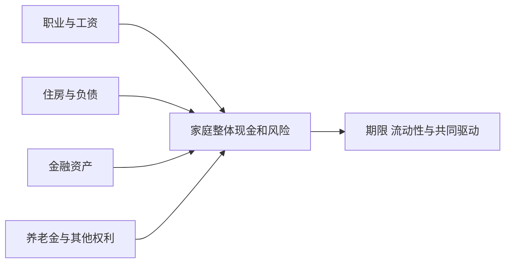
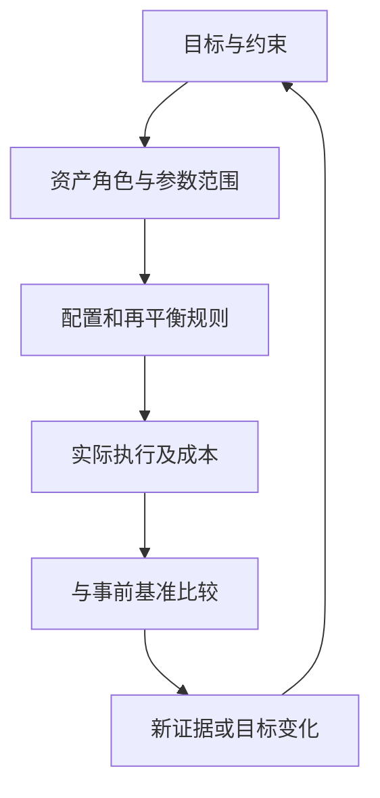

# 《聪明的资产配置》：从单个资产好不好，转向整体组合怎样工作

> 作者：William J. Bernstein，威廉·伯恩斯坦；英文原名 *The Intelligent Asset Allocator*，2000 年初版。中文具体译本未确认。  
> 范围：核对[作者公开目录](https://www.efficientfrontier.com/BOOK/toc.htm)、公开第一、二章及相关原始研究；不是全书逐页精读。正文整理 30 个知识点，覆盖收益与风险、相关性、组合、有效前沿、资产类别、市场效率和实施。后来的案例是补充教学。  
> 更新：2026-11-12。历史样本与当前预期分开，公式均注明变量和限制，不给用户直接指定仓位。

## 本书最重要的变化

单独看，一项资产可能波动很大；放到某个组合里，它却可能减少整体对另一种风险的依赖。反过来，单项看起来都很安全的资产，如果共同依赖同一条件，组合也可能脆弱。

资产配置要求同时看三件事：每项资产的可能回报、各自风险、彼此怎样一起变化。数学可以帮助明确这些关系，但参数并不是永远已知，所以合理配置还需要历史、成本、执行和个人资金约束。

## 主题地图

| 原书主题 | 本文重点 |
| --- | --- |
| 基础与单项资产行为 | 复合收益、波动、长期历史与风险口径 |
| 理论及现实组合 | 协方差、相关性、分散与再平衡 |
| 最优配置 | 有效前沿、估计误差与稳健选择 |
| 市场效率及补充议题 | 主动管理、价值与规模、行为和择时 |
| 执行与资源 | 工具、成本、资金流、复查和研究资料 |

## 核心知识点

### 1. 开始配置前，先定义失败是什么

对近期付款，失败可能是需要时没有现金；对退休目标，可能是长期购买力不足；对借款投资，可能是被迫平仓。不同目标对应不同风险。

只有明确失败条件，才能判断波动、流动性、信用和通胀各自的重要性。一个统一的风险分数，很难替代这种具体分析。

### 2. 收益要说明价格、分配、费用与币种

价格回报只反映报价变化，总回报还包括分红或利息；投资者实际回报进一步受资金流和成本影响。跨国资产又涉及汇率。

先统一口径，再比较历史。不能把一项含分红的指数与另一项只看价格的指数直接排名，也不能把美元回报当成其他币种投资者的实际体验。

### 3. 复合收益需要相乘，而非相加

一年回报 r₁，下一年 r₂，初始资金的两年终值乘数是 `(1+r₁)(1+r₂)`。年化复合收益是这个乘积的平方根减一。

**数学演示：**先涨 30% 再跌 10%，累计涨幅为 17%，复合年化约 8.17%，并非算术平均 10%。这个例子与作者公开第一章讨论的机制相同，但不是证券历史数据。[公开第一章](https://www.efficientfrontier.com/BOOK/chapter1.htm)

有持续存入或取出时，路径还会影响最终财富。理解平均数之前先理解资金怎样变化，可以避免把高平均回报与可得到的终值混淆。

### 4. 标准差描述波动，不能独自描述损失后果

波动率通常由一组期间回报计算。相同标准差可能对应不同偏斜、尾部与流动性；低报价波动也可能来自资产不常交易。

要同时看最大历史回撤、极端情景和个人支付责任。历史回撤只是观察到的最坏结果，不是未来损失上限。标准差是工具，不是风险的完整定义。

### 5. 长期历史应保留国家与样本边界

作者公开第二章展示美国股票和国债的历史表现，适合学习如何比较资产，但其中 1926—1998 年样本不是今天的收益预测。[作者公开第二章](https://www.efficientfrontier.com/BOOK/chapter2.htm)

年代、市场制度、估值、税费和指数构成都会影响结果。研究其他市场时应重新找可比数据，不把美国成功历史当成所有国家必然路径。

### 6. 相关性衡量共同变化，不证明因果

相关系数介于 −1 与 1，描述给定样本中两组回报线性关系。接近零不代表完全没有依赖，更不排除共同极端损失。

两项资产可能因同一利率或经济冲击同时变化。分析时应把统计关系与经济机制结合：谁依赖增长、谁依赖融资、谁在通胀上升时承压。仅凭矩阵颜色无法完成风险判断。

### 7. 组合方差为什么需要交叉项

两资产组合的回报是 `R=wR₁+(1−w)R₂`。求其方差后得到：

```text
σp² = w²σ₁² + (1−w)²σ₂² + 2w(1−w)ρσ₁σ₂
```

前两项是各自波动的贡献，第三项表示它们一起变化时的影响。如果只把单项波动按权重平均，就漏掉组合最重要的关系。

**数学演示：**两资产波动均为 20%，等权重。ρ 为 1 时，组合波动 20%；ρ 为 0 时约 14.14%；ρ 为 −1 且参数完全对称时，数学模型中的组合波动为零。最后一种只是理想条件，不代表现实能轻易找到无风险高收益搭配。

直观地理解交叉项，可以先想两项资产偏离平均回报的方向：常常同向，组合的偏离就容易叠加；经常反向，一部分偏离可能抵消。计算协方差，正是衡量这种共同偏离的平均关系。它不是把亏损消除，而是改变整体波动的分布。

参数口径必须一致：月度波动配月度相关，年度波动配相应估计，不能混用。用平方根时间法把月度波动换成年化时，还隐含对回报序列关系的假设。对于自相关、跳跃和非频繁估值数据，简单换算可能失真。保留原始频率与估计窗口，比只给出“组合风险百分之几”更透明。

### 8. 分散的理论来源，是整体而非单项最优

**真实研究基础：**Markowitz 1952 年《Portfolio Selection》把组合收益与风险的联合选择系统化。重要改变是评价资产对整体组合的贡献，而非只挑单项预期回报最高者。[原始论文](https://doi.org/10.1111/j.1540-6261.1952.tb01525.x)

这项理论不宣称未来参数已知，也不要求所有人都有相同目标。实际配置需要估计、约束与实施。

对于初学者，可以先比较“加入某项资产后，组合依赖什么条件”，再讨论是否增加。某项资产过去回报一般，并不自动意味着它没有组合价值；但低相关也不能让一项预期经济价值差、费用极高的资产变得必买。

### 9. 权重决定风险参与程度，但资金占比不等于风险占比

一项高波动资产占资金 20%，可能贡献远超过 20% 的组合波动；债券若久期很长，也可能承担显著利率风险。

不要只看饼图是否平均。需要结合波动、相关性、杠杆和底层暴露。风险贡献估计同样依赖模型，不能因为算得精细就忽略参数误差。

### 10. 再平衡后的组合，与买入不动的组合不同

不交易时，表现较好的资产占比会提高；定期恢复原权重时，会卖出相对强者、买入相对弱者。两种路径承担不同风险，也可能得到不同回报。

比较历史必须明确是否再平衡、何时执行、费用和税怎样处理。没有这些规则，“同样股债比例”可能指完全不同的策略。

### 11. 再平衡可能带来收益效应，但不是免费保证

**作者研究材料：**伯恩斯坦的公开再平衡文章分析了波动、相关性与复合收益的关系，并讨论再平衡增益的近似条件。[作者文章](https://www.efficientfrontier.com/ef/996/rebal.htm)

要区分“相对于各资产复合收益加权值的分散效应”与“必然超过买入持有策略”。持续单边趋势中，固定权重策略可能落后；交易成本也会吞噬优势。

因此首先把再平衡当作维护目标风险的方法，再分析可能的回报影响。不能把过去波动较大解释为未来一定存在可赚的再平衡利润。

### 12. 用一个两期算例看清路径差异

**数学演示：**A、B 各投入 50。第一年 A 涨 20%、B 跌 20%，资产变成 60 和 40。若再平衡到各 50，第二年 A 跌 20%、B 涨 20%，结束为 40 和 60，合计 100；若不再平衡，结束为 48 和 48，合计 96。均未计费用。

这里交替涨跌让再平衡有利。若 A 连续上涨而 B 连续下跌，买入持有可能更好。一个算例展示机制，不证明普遍结果。真实数据还需考虑资产能否交易、价格与执行时点。

为了检查结论的边界，再看相反路径：第一年同样从 50、50 变为 60、40，第二年仍然 A 上涨 20%、B 下跌 20%。买入不动的期末为 72、32，合计 104；恢复等权重的期末为 60、40，合计 100。两组演示只改变第二年的方向，就改变了哪种方法领先。

因此，不能把再平衡解释成“每卖一次高点就赚一次差价”。当时不知道哪个价格是高点，交易只是将权重拉回政策。值得研究的是风险是否受控、规则是否可执行，以及成本后长期结果，而不是在一段有利路径中找到看似免费的利润。

### 13. 有效前沿不是一张未来财富地图

给定一组预期回报、协方差和约束，可以找到在相同模型风险下预期回报较高的组合，或相同回报下风险较低的组合，这些点构成有效前沿。

它是输入假设的输出，不是市场承诺。改变少量预期回报，最优权重就可能大幅变化。应该观察参数敏感性，而不是把软件输出的小数权重当作真理。

### 14. 历史最优组合往往难以事前选中

用完整历史挑最佳组合，等于已经知道哪项资产后来表现好。投资者当时并不知道未来，因此事后最优不是可直接执行的策略。

更严格的研究要保留当时可用信息、事先规则和样本外检验。即使样本外表现好，也仍有机制变化与数据选择风险。回测是证据的一层，不是最终证明。

### 15. 参数估计误差应影响配置的复杂程度

资产越多，协方差与预期回报参数越多，数据要求越高。复杂模型可能更容易追随噪声，产生看似精确、实际不稳的权重。

可以使用合理约束、宽范围、较少类别和情景分析，降低对单一估计的依赖。简单不是因为世界简单，而是承认自己对复杂世界的了解有限。

增加资产类别时，需估计的关系增长得很快：两项资产只有一对相关关系，十项资产已有四十五对。每项参数若都来自有限历史，模型可能同时吸收很多估计误差；看似更精细的分类，也可能只是把相似风险换成更多名称。

一个可操作的检验是给预期回报与相关性设置合理变化范围，观察权重是否大幅翻转。若结论对小幅变化极其敏感，就不应按输出的小数精确执行。可以减少类别、限制集中度、采用较宽的目标区间，并明确自己选择稳定性所付出的可能机会成本。

### 16. 风险承受能力包含能力、意愿和需要

心理敢不敢、经济能不能、目标是否需要承担风险，是不同问题。愿意冒险但近期必须用钱，不能仅凭胆量配置；目标无需高风险，也不必追求理论最高回报。

三者冲突时应先调整目标或资金安排。资产配置不能通过提高预期收益假设解决所有矛盾。

### 17. 国内与海外分散需要同时处理汇率

国际资产增加经济和制度来源，但本币回报受汇率影响。海外市场上涨，本币升值仍可能抵消部分收益。

**数学演示：**外币资产上涨 10%，外币相对本币贬值 8%，本币回报为 `1.10×0.92−1=1.2%`，不是简单的 2%。对冲可以改变风险，也有成本和不完全性；不能只按过去汇率方向判断。

### 18. 规模与价值因子不是稳赚标签

研究中，小市值、价值等组合曾呈现不同历史回报，但它们可能反映风险补偿、行为偏差、数据条件或多种机制。不能把一个标签当作永久溢价保证。

**真实数据入口：**Kenneth French 数据库公开因子和组合收益，并说明构建方法与历史修订。学术因子往往涉及多空组合、重构规则和研究口径，不等于一个可无成本买入的基金。[原始数据与方法](https://mba.tuck.dartmouth.edu/pages/faculty/ken.french/data_library.html)

应用时核对产品是否真正表达该暴露、费用多少、是否能承受长期落后，以及回测是否使用了当时可取得的信息。

对于学术因子，还要把“研究解释变量”与“投资组合”分开。研究中的价值因子可能同时买入一组股票、卖出另一组股票，报告的是两边收益差；现实中的价值基金可能只持有多头股票，还承担市场整体涨跌。二者数值不能直接互换。

若某产品号称复制因子，应检查选样标准、权重、调整频率、规模容量和费用，观察它实际承担的暴露。因子历史溢价是研究起点，未来是否存在、能否被低成本捕捉、能否坚持到兑现，都需要独立判断。

### 19. 房地产与实物资产也有股票、利率和流动性风险

上市房地产证券有公开市场价格，可能在危机时与股票一起下跌；直接房产报价平稳，也可能只是交易不频繁。两者不能只按历史波动率粗略比较。

还要看租户、融资、维护、集中与变现成本。实物资产并不天然抗所有通胀，具体现金流调整机制很重要。

### 20. 2022 年说明相关性会随经济冲击改变

**真实研究材料：**欧洲央行 2022 年金融稳定评估讨论了较高通胀环境下股债相关关系与分散挑战。共同的通胀、利率变化可以使股票和债券同时承压。[ECB 分析](https://www.ecb.europa.eu/press/financial-stability-publications/fsr/focus/2022/html/ecb.fsrbox202211_02~7abb48e333.pl.html)

这不表示过去的负相关都是错误数据，而是说明关系依赖环境。估计模型时，最好比较不同期间，并加入共同冲击的情景。

不要等相关性上升以后才宣布分散无效，也不要在平静时期把最近相关矩阵当成长期常数。机制理解与统计估计需要互相检查。

### 21. 杠杆和流动性会使资产配置变成现金危机

**真实案例：2022 年英国 LDI。** 英格兰银行报告说明，国债收益率快速上升引发保证金与抵押品压力，部分负债驱动投资安排被迫出售国债，进一步加剧市场失灵，央行随后临时干预。[官方金融稳定报告](https://www.bankofengland.co.uk/financial-stability-report/2022/december-2022)

LDI 原本为管理养老金负债风险，不等于漫无目的投机；但对冲长期负债并不能消除短期筹措现金的问题。正确方向的长期模型也需要可执行的资金路径。

个人学习应检查资产和负债的期限、追加保证金条件及赎回限制。不能因为底层是国债，就忽略杠杆结构带来的风险。

这个案例还说明，“经济上对冲了某项负债”与“短期现金足够”可能出现分离。养老金未来负债的估值可以随利率改变，但这种账面改善并不会自动在今天转成可以交付的抵押品。需要的是现金或符合合同的资产，不能拿未来估值改善直接支付保证金。

分析自己的配置时，也应把三个日期分开：投资价值预计实现的时间，债务或担保要求付款的时间，资产实际能出售并到账的时间。只要三者错位，就可能需要缓冲。这个检查适用于多种结构，不意味着个人应复制机构的 LDI 工具或对冲比例。

### 22. 主动管理的平均结果受到成本算术约束

Sharpe 的主动管理算术指出，在同一市场和合适定义下，主动与被动资金整体在成本前持有同一个市场；成本差异会影响成本后平均结果。[作者原文](https://web.stanford.edu/~wfsharpe/art/active/active.htm)

这不是证明没有优秀管理人，而是提醒筛选者承担证明责任：费用后优势能否持续、能否事前识别、是否来自额外风险？不能只展示几个赢家。

### 23. 指数化降低某些问题，不消除资产风险

指数可以降低选股与部分费用负担，但指数自身可能集中于某些行业、国家或大市值公司。跟踪方法、交易、税和产品结构也不同。

先选择所需暴露，再比较工具。不能因为产品名包含指数，就假设它适合所有资金期限或天然足够分散。

### 24. 战略配置与战术偏离要有不同证据标准

战略配置围绕长期目标和约束，战术偏离试图利用阶段性判断。后者通常需要额外预测和执行优势，也容易增加成本与行为错误。

如果没有明确可验证依据，频繁改变权重可能只是把新闻情绪写进账户。任何偏离都应记录理由、规模限制与退出条件，不能事后改称原计划。

### 25. 再平衡频率要比较交易成本和漂移风险

按固定时间或按偏离阈值再平衡，各有优缺点。过于频繁可能增加费用，过于宽松可能让风险远离目标。

新增资金有时可以调整偏离而减少卖出。实施前还应考虑税务和账户限制；监管教育资料同样强调交易费用与税后果。[Investor.gov 配置与再平衡说明](https://www.investor.gov/additional-resources/general-resources/publications-research/info-sheets/beginners-guide-asset)

实施前还要把“目标比例”翻译成可操作的金额。账户存在不同费用、最低交易单位或限制时，数学上需要的小额调整未必值得执行。若用新资金再平衡，应先确认该笔资金确实是可以投资的结余，而非尚未支付的税费或近期生活费用。

最后区分计划误差与市场变化：因报价波动产生一点偏离通常可预期；因为买错份额、重复持仓或误解到账规则形成的偏离，则属于执行问题，需要修正流程。复盘时只有把这两类问题分开，才不会用增加交易频率去解决本来属于资料核对的错误。

### 26. 家庭整体资产比证券账户更完整

工资、住房、私人企业与养老金可能共享同一地区或行业风险。只把股票基金分散，而忽略收入和住房集中，会低估家庭脆弱性。



该图帮助确定分析边界，不要求把所有未来收入机械折现成精确资产价值。

### 27. 配置方案必须能用简单语言解释

每项资产为什么存在、可能怎样损失、何时要用钱、如何复查，都应说得清。如果只能依靠软件的“最优”标签维持信心，实际执行可能很脆弱。

复杂度应与研究能力、时间和资金规模匹配。增加一个类别之前，先确认它带来的独立价值是否超过费用、管理与理解成本。

### 28. 保存政策与事前数据，才能认真复盘



复盘应区分市场结果、执行偏差和策略假设。没有事前记录，容易把所有好结果归为能力，把所有坏结果归为意外。

事前基准也要保留规则，例如使用哪些资产、如何加权、是否定期调整以及费用怎样处理。若每次复盘都换成事后表现最好的基准，任何合理组合都可能显得失败；若刻意换成最弱基准，又会掩盖问题。比较对象应服务于原先任务，而非服务于解释成绩。

### 29. 不知道未来最优组合，也能避免明显坏安排

无法精确预测不意味着无事可做。高费用、重复暴露、资金期限不匹配、难以理解的杠杆和无法执行的规则，都是可以调查的问题。

先减少可辨认的错误，再讨论复杂优化。对学习者而言，这通常比追求个位数小数的目标权重更可靠。

### 30. 把本书转成一份配置研究卡

记录目标和期限、资产范围、数据来源与样本、回报口径、风险与相关性估计、压力情景、费用、再平衡规则及复查条件。所有未知项明确写出，不以软件默认值冒充自己的判断。

研究卡可以用于纸面学习，无须立刻购买产品。真正学到的能力，是解释组合为何工作、可能何时失效，以及个人是否承受得起。

## 练习与参考答案

**题一：两资产相关系数为零，能否保证危机中不同时下跌？** 不能。零线性相关不等于没有尾部依赖，参数也可能改变。

**题二：历史最优权重非常精确，是否应直接照抄？** 不应。它依赖事后参数、样本和约束，需要检查估计误差与个人条件。

**题三：再平衡算例有利，是否证明越频繁越赚钱？** 不证明。路径、费用、税和趋势都会改变结果，主要目标应先明确为风险维护。

## 来源与继续阅读

本文实际核对作者公开目录及前两章，未冒充取得其他章节全文；组合数学用独立推导解释，真实研究与案例附在原节。可与[《投资四大支柱》](<../投资四大支柱 - 威廉·伯恩斯坦/读书笔记.md>)、[《机构投资的创新之路》](<../机构投资的创新之路 - 大卫·斯文森/读书笔记.md>)比较个人与机构配置的条件。
