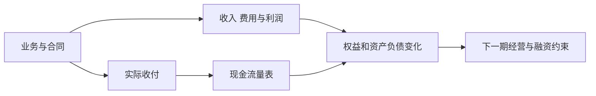
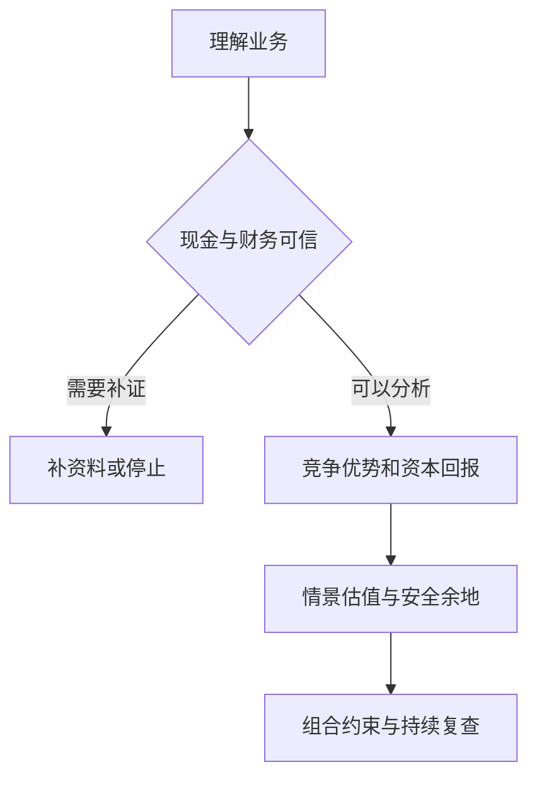

# 《股市真规则》：从报表、竞争优势到估值的企业研究框架

> 作者：Pat Dorsey，帕特·多尔西；Joe Mansueto 为英文版作序，不是正文共同作者。原名 The Five Rules for Successful Stock Investing，Wiley，2004 年；本次核对 ISBN 9780471686170 的出版社资料和公开目录。用户中文印次未确认。  
> 资料范围：公开资料系统导读，未取得用户版本全文。覆盖五条原则、财务分析、估值、管理与主要行业差异；行业历史、法规和书中全部公司不作逐一复述。现实补充案例与数学演示分别说明。更新：2026-11-12。

## 这本书为什么值得读

它把几项经常被割裂的能力接起来：理解一家企业，判断它是否能持续创造超过资金成本的回报，再决定什么价格才值得研究。会看走势图不能替代这套过程，会算财务比率也只完成其中一部分。

最重要的五条规则可以概括为：自己完成研究，寻找竞争优势，给价格留下安全余地，用与商业过程匹配的时间持有，以及知道哪些事实意味着应重新选择。它们是一组相互约束的原则，不能只挑“长期持有”忽略质量和价格。[出版社书目](https://www.wiley.com/en-us/-p-9780471686170)

## 主题地图

| 主题 | 核心问题 | 位置 |
| --- | --- | --- |
| 投资原则 | 为什么研究、怎样处理错误 | 1—5 |
| 商业与财务分析 | 钱如何赚到、收回和再投入 | 6—15 |
| 质量与估值 | 优势是否持续，价格包含什么 | 16—22 |
| 行业与执行 | 同一指标为什么不能到处套 | 23—30 |

## 核心知识点

### 1. 研究责任不能交给股票代码或名人

市场中每一笔交易都有对手方。别人愿意推荐，不代表他与你拥有相同资金期限、成本、利益和退出条件。研究首先是说明自己购买什么权利，依据哪些事实。

一份可用的研究应能让第三个人看懂：企业如何赚钱，哪些环节尚不确定，当前价格要求什么表现。若理由只是某机构也持有，它没有解释该机构何时、以什么价格、在什么组合里持有。

### 2. 竞争优势要解释高回报为何不会很快被复制

盈利会吸引竞争者。只有某些结构阻止竞争消除超额回报，优秀表现才有较强的延续理由。优势可以来自客户关系、网络、成本、品牌与制度条件，但每一项都要落到具体机制。

利润率高是结果，护城河是可能的原因。一次需求爆发、暂时缺货或会计处理也能形成高利润，不能看到一个结果就反推长期优势已经成立。

### 3. 安全边际同时来自价格和判断质量

估计价值本身会错，因此价格需要容纳误差。但若价值模型把衰退利润永久化，低价并不会自动形成安全。

应当先找模型最脆弱的假设：销售是否能维持、利润是否可收现、负债是否可续、竞争是否会加剧。然后比较不同情景的价值与市场价，而不是先决定股票便宜，再挑一个足够高的估值。

### 4. 长期持有的对象是仍成立的商业逻辑

复利需要时间，频繁交易也会增加成本，但时间不会把所有业务问题治好。长期应当是研究结论支持的持有期限，不是拒绝更新的借口。

定期复查企业产生现金和保护回报的机制是否仍存在。报价下跌本身不能证明逻辑失效；企业关键资产、客户、权利或竞争条件永久改变，却不能用“暂时浮亏”一笔带过。

### 5. 卖出条件应在情绪最弱时先写清

原书把知道何时出售列为原则，是因为买入之后容易维护已有立场。应预先区分论点被反驳、估值过高、组合约束变化和个人资金需求变化。

这些条件不必都是一个精确价位。它们的作用是触发重新比较。用买入价当唯一参照，会让“赚了”或“亏了”代替对未来机会的判断。

### 6. 商业模式先回答客户为何愿意付款

收入不是凭空产生的。客户付钱解决什么问题，谁还有替代方案，决定企业能否提高价格、保留客户并获得合理利润。

不要把收入增长来源混在一起：原客户购买更多、新客户加入、提价、并购和汇率变化，对持续性的含义不同。把总量拆开，才能知道增长究竟在强化哪一部分生意。

### 7. 三张报表是同一门生意的不同观察角度

利润表记录期间确认的收益与费用，资产负债表记录时点的资源和义务，现金流量表解释现金变动。收入确认和收款时间不同，所以利润与现金不一致并不自动意味着问题。

正确做法是建立勾稽：应收款增加是否解释部分差额？库存和预付款是否占用现金？是否有非现金费用、资产出售和融资流入？从报表回到交易实质，才能区分合理时差与质量恶化。

图中没有把利润直接等同现金，正是为了提醒读者寻找时差和调整项。

### 8. 收入质量要与会计模式一起理解

**真实补充：Adobe 2013 财年向订阅模式转型，其 Digital Media 收入较前一年下降 4.76 亿美元；公司解释这与 Creative Cloud 和企业期限许可采用有关。** 同时，付费 Creative Cloud 订阅用户年末达到约 140 万，上一年约 30 万。[Adobe 2013 年报](https://www.sec.gov/Archives/edgar/data/796343/000079634314000004/adbe10kfy13.htm)

这个案例说明，从一次性许可转向分期服务，收入确认节奏会改变。单看当期收入下滑，可能无法区分客户需求下降与计费模式切换；只看订阅用户上升，也可能漏掉获取成本、流失和单客价值。

研究应该同时看订阅规模、价格、续约、合同负债、回款和服务成本。新指标有帮助，但必须解释定义；年度经常性收入指标并不等于当年按会计准则确认的收入，更不等于净利润。

### 9. 毛利率应拆价格、成本、结构和分类

毛利率通常是毛利除以收入。变化可能来自提价、原料、产品组合、促销、物流分类或并购，不能自动当作竞争力变化的单一证据。

零售商低毛利未必差，若周转快、资本效率高，仍可能有竞争力。软件毛利高也不意味着全部成为股东现金，因为研发、销售和客户支持可能很重。比较时应同时检查收入模式和成本位置。

### 10. 经营杠杆放大利润，也放大预测误差

固定成本较高时，收入超过某个水平后新增销售可以带来较多利润；反过来，需求下降时成本未及时下降，会使利润跌得更快。

不能把景气改善阶段的利润增速一直外推。应分清哪些成本随收入变化、哪些存在调整延迟、哪些不能削减。模型应包括承压情况，而不只把历史高利润率固定到未来。

### 11. 库存与应收款是利润质量的检查入口

**Target 2022 年第二季度的真实披露**显示，客流和销售仍增长，但削减库存的措施压低利润，营业利润同比下降 87%。[公司公告](https://corporate.target.com/press/release/2022/08/target-corporation-reports-second-quarter-earnings)

这提醒我们，收入最终可能是通过折扣实现的，而库存过时会进一步影响现金与毛利。对制造和零售公司，要看库存结构和周转，而非仅看余额。

应收款同样需要解释：增长可能来自销售扩张和付款期限，也可能来自客户质量下降。最好把多个期间、同类企业与附注放在一起，避免仅凭一年比例判定造假。异常指标的作用是缩小调查范围，不是替代调查。

### 12. 自由现金流需要先定义再使用

常见简化口径是经营现金流减资本开支，但实际分析还要处理租赁、收购、营运资本异常和不同业务结构。公司给出的调整后自由现金流可能使用不同排除项。

最重要的是区分为维持现有竞争力必须投入的资金和用于扩张的资金。两者通常不能仅从现金流量表直接精确读出，需要业务判断。若把所有增长支出当可自由取消，可能夸大可分配现金。

### 13. ROE 需要分解，杠杆不能冒充优秀经营

**补充推导**：在口径一致时，净资产收益率可分解为净利率、总资产周转率与权益乘数的乘积。前两项分别描述一元销售留下多少利润、一元资产带来多少销售；权益乘数描述资产相对股东权益的规模。比较时要使用可比平均余额，并留意亏损或回购导致的极小净资产。

若一家公司只是多借钱、减少权益，ROE 可能提高，经营利润率却没有改善；利息与再融资风险还会增加。因此要先解释 ROE 从哪一项上升，再判断是否有经营优势。反过来，暂时持有大量现金的企业可能 ROE 较低，但不意味着核心业务效率差，应把经营资产与多余资金分开。

简化关系为 `ROE = 净利率 × 总资产周转率 × 权益乘数`，各项必须保持期间与平均余额口径一致。高 ROE 可能由强利润、快周转或较高负债推动。

若权益因回购、累计亏损等变得很小，比率可能异常大甚至失去正常意义。不要把一个高百分比直接翻译成高质量，应检查资本结构、现金与经营回报是否支持它。

### 14. ROIC 与资金成本的差额解释创造价值的方向

投入资本回报率常以税后经营利润除以平均投入资本。定义需要说明现金、商誉、租赁和其他调整。只有同口径比较，才适合观察历史与同业差异。

**数学演示：**新增资本 100，长期税后经营收益 8，若对应资本成本为 10%，这项新增投资并不因利润为正就创造价值。它产生 8，但资金的机会成本为 10。关键是新增回报，而不是只看过去资产的平均高回报。

### 15. 负债分析要加入到期时间

总债务比率相同，分散到期与集中到期的压力不同；固定利率与浮动利率也不同。资产看似充足，若不能及时变现，仍可能出现支付问题。

研究表至少列现金是否受限、经营现金的稳定性、利息、未来偿还安排与可用融资。杠杆可能提高表面 ROE，同时也增加股东风险；不能把较低债务利率误认为股权资本成本随杠杆下降。

### 16. 低毛利、高周转也可能构成优秀生意

**Costco 2024 财年披露会员费收入 48.28 亿美元，美国及加拿大会员续费率 92.9%，全球 90.5%。** 数据属于该公司披露口径，地区续费率不能互换。[Costco 年报](https://www.sec.gov/Archives/edgar/data/909832/000090983224000071/cost2024annualreport.pdf)

会员制把持续关系与购物体验连接起来，低商品加价、规模和周转可以与会员收入共同构成模式。研究时不要只因商品毛利低就否定，也不能把会员费全部视作没有成本的净利润：服务、人员、系统和门店共同支持续费。

进一步检查应问续费是否受价格调整、会员结构与计算方式影响，新增仓库是否创造合理资本回报。高续费是证据之一，不能单独证明任何市盈率都合理。

### 17. 管理层应以资本配置和股东待遇评价

好的管理包括把钱放到回报合理的地方，并在没有合适机会时避免为了规模而扩张。应观察研发、收购、回购、派息与偿债的历史结果。

激励是否奖励规模、短期利润或真正的长期回报，会影响行为。管理层能力不是护城河的替代品；优秀管理在恶劣行业里也受结构限制，糟糕资本配置则可能侵蚀原本不错的业务。

### 18. 护城河不是一个永久标签

技术替代、客户习惯和制度改变，都可能削弱旧优势。评估竞争优势需要说明持续机制和威胁，而不是只写“龙头”。

**ASML 2024 年披露研发费用约 43 亿欧元，并持续推进 EUV 和 High NA 技术。**[公司年度报告](https://www.asml.com/investors/annual-report/2024)这个事实说明领先能力需要投入维护，不证明所有研发都会成功，也不能推出其股价不存在风险。

应用上，应看研发转成什么产品和客户价值、供应链是否配合、客户资本开支如何影响订单。高技术壁垒与周期性可以同时存在，不能因为壁垒高就把需求周期从模型里删除。

### 19. 折现估值把故事转换为可以质疑的假设

未来现金需要折算到今天，因为取得时间和风险不同。估值模型应说明现金归谁、预测多久、用什么折现率，以及最终稳定阶段如何形成。

不要认为表格行数越多越准确。若价值主要来自十多年以后，一个精确到分的目标价只是显示格式，不是知识精度。模型最有价值的地方是揭示：收入、利润、再投资和风险中，哪些假设支配结论。

### 20. 企业价值和股权价值不能混用

对所有资本提供者的现金流，应使用相应整体资本成本，得到经营资产或企业价值，再按定义处理债务、现金和其他权利。对普通股股东的现金流则应使用股权回报要求。

若以已经扣除利息的股权现金流折现，再扣一次债务，便可能重复计算。同行倍数同样要匹配：企业价值常与经营收益匹配，股权价格与归属股东收益匹配，不能任意组合。

**数学演示**：经营资产价值 500，另有真正多余现金 80，有息债务 150，假设没有其他优先权利，则普通股权益为 430。若另有价值 30 的少数股东权益，而经营估值包含了该子公司的全部现金流，普通股权益还应相应调整至 400。若估值一开始只包含母公司实际享有的份额，就不能再扣同一项。

实际报表还存在受限现金、养老金、租赁和股票期权。处理方式可以不同，前提是现金流、折现率和权益转换保持一致；把某个标准企业价值公式机械套在所有公司上，可能产生重复或遗漏。

### 21. 倍数是压缩后的模型，不是脱离假设的捷径

市盈率包含增长、风险、资本需求和分配政策的预期。市净率依赖资产账面口径及其赚钱能力。市销率省略利润，尤其容易使亏损业务看起来可比。

选择同行时，应解释为何商业模式、盈利能力、增长与风险相近。行业名字相同不等于可比。若整个行业价格都偏高，取行业平均也不能证明合理。

### 22. 估值区间要来自不同经济情景

例如，较低销售增长通常还可能伴随较低产能利用率和不同营运资本需求。应把这些变量按经济关系一起调整，而不是每项独立取最有利数值。敏感性表适合显示某参数变化有多大影响，情景分析则要求整个故事内部一致；二者作用不同。

只把一个倍数随意上下调，不能说明风险。更有用的是改变可解释的经营条件：销量、价格、利润率、营运资本、融资与成熟时间。

每个情景都应内部一致。销售高速增长却不需要新增资本，竞争加剧却利润率不变，可能是模型在迎合预期。不要把情景概率编得很精确来掩盖基础资料不足。

### 23. 银行业：资本与信用质量比通用自由现金流更重要

银行的负债常是经营原料，贷款和存款现金流也与普通工业公司不同。分析应关注资产质量、资本充足、拨备、利率敏感性和资金稳定性。

市净率低可能是市场预期资产减值，并不天然代表资产打折。账面权益能否可信、盈利能否维持，必须在比较倍数之前判断。书中历史银行规则也应与现行监管要求分开。

### 24. 保险业：先看承保纪律，再谈投资收益

保险现金流的困难在于，保费可能先收，而最终赔付多年以后才确定。当前现金很多，不意味着都是股东的闲置资金。未决赔款准备金是否充足，会影响当期利润和未来现金支出，不能因为本期赔付较少就断言保单质量优秀。

对财产险，综合成本率能帮助观察赔付与费用相对保费的关系，但要核对分母口径、再保险处理及往年准备金释放。对寿险，久期、保证利率与资产负债匹配可能更关键。不能用一个行业指标跨险种排序，更不能把投资收益掩盖的承保亏损忽略掉。

保费先收、赔款后付，会形成可投资的浮存资金，但它对应未来赔付义务，不是免费永久资本。低估准备金会暂时美化利润，后来又补提损失。

分析时应把承保结果、准备金变化、灾害与投资组合分开。短期没有大赔付不证明风险消失，高投资收益也可能掩盖不良承保。寿险与财险的期限及业务结构还需进一步区分。

### 25. 医药和科技：创新价值与失败概率必须同时出现

专利、知识积累和客户嵌入可能形成优势，但产品生命周期、监管、技术替代和竞争都会改变价值。研发投入不是自动产生回报的资产。

研究需要把项目阶段、成功条件、商业化成本和现金期限连起来。对高度不确定的业务，情景与概率的边界比一个近期市盈率更重要。不能把整个行业增长当成每家公司的收入保证。

### 26. 零售、消费和工业：分别看周转、品牌和资本需求

零售重视周转、租赁与库存；消费品重视重复购买、定价和渠道；工业企业还需看固定资产、订单周期、服务收入和产能利用。相同比率在不同模式里可能表示不同问题。

先判断赚钱的关键机制，再挑指标，而不是把一张几十项的表平铺所有公司。分析的深度来自因果解释，不来自指标数量。

### 27. 能源、公用事业与房地产：资产多，也可能持续需要资本

资源储量要与开采成本、商品价格、税费和资本开支一起评价；公用事业要理解定价机制与监管；房地产要处理租赁、开发、融资和资产估值。

折旧不等于可忽略的成本，历史资本开支也不必然等于未来维持投入。重资产企业尤其需要区分利润、现金与资产更新。账面资产大不自动意味着股东可自由取得的钱多。

### 28. 给研究建立明确的淘汰条件

超出理解范围、关键资料不可信、权利结构不清、需要过强假设才能合理估值，都可以使研究停止。排除并不是错失所有机会，而是承认时间和知识有限。

把停止理由记录下来，以后有新资料再复查。不要因为已经花了几天研究，就认为必须投资；已经花掉的精力不是未来回报的一部分。

图中每个环节都有可能得出“不够清楚”，这是合理输出。

### 29. 研究结论要分事实、解释和决定

事实是公告披露了什么；解释是为什么可能这样；决定是这些证据和自身约束下如何行动。它们相互连接但不等同。

一家公司收入下降是事实，订阅转型是可能解释，股票值得购买则还需价格与风险判断。三者分栏以后，更容易发现某个数字被直接跳接到买入结论的地方。

### 30. 最终成果是一套可更新的研究习惯

每次研究保留原始来源、计算口径、主要假设、最强反证和复查条件。结果揭晓后，检查是信息错、推理错、执行错，还是不利情景发生。

能解释错误比记住更多口诀更有价值。知识框架帮助你持续提问，并不能让市场为你的努力支付确定回报。

## 练习与参考答案

**高 ROE 是否一定比低 ROE 好？** 不一定。需检查杠杆、权益基数、一次性利润与资本回报；高负债或过薄权益可能放大指标。

**Adobe 订阅人数增加、收入下降是否矛盾？** 不必然。确认模式和时间可改变当期收入，但仍需检验续费、单客收入、获客成本与现金，不能只用用户数宣布转型成功。

**Costco 会员费是否可直接当作净利润？** 不能。会员收入与零售服务共享成本和资产，缺少分摊与经济解释就把整行收入当净利润，会高估回报。

## 范围与继续阅读

本书行业章节十分丰富，本笔记提供主要行业的分析入口，不声称替代每一行业的专业研究。会计规则、监管要求和估值参数都应按实际期间核实。书中历史筛选标准不能机械用于当前市场。

来源在相关知识点原位附上。可继续读[《巴菲特的护城河》](<../巴菲特的护城河 - 帕特·多尔西/读书笔记.md>)专门训练竞争优势判断，再读[《投资估价》](<../投资估价 - 阿斯沃斯·达摩达兰/读书笔记.md>)学习现金流和估值口径。
