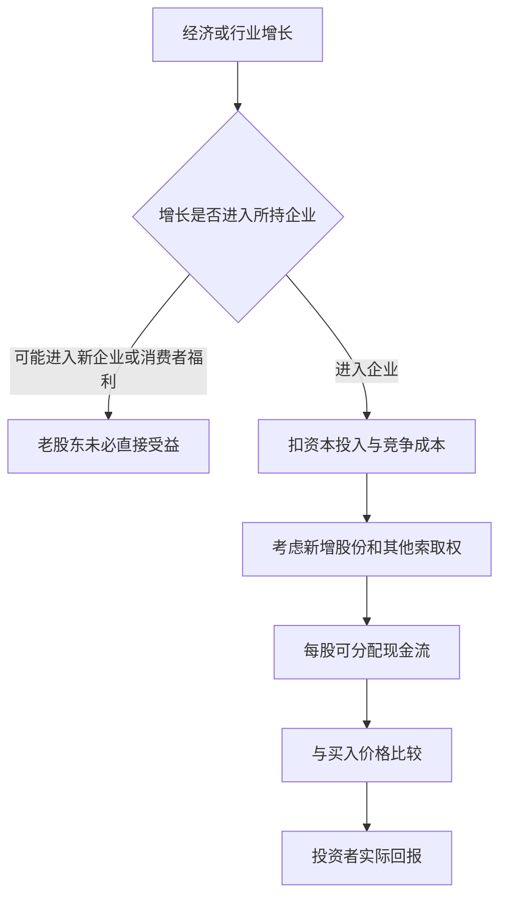
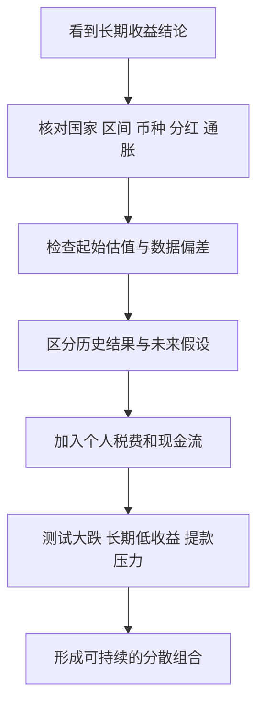

# 《股市长线法宝》读书笔记

> 作者：杰里米·西格尔（Jeremy J. Siegel）；英文名：Stocks for the Long Run。  
> 版本：本次核对第六版英文出版信息，发行日期为 2022-09-27；精装 ISBN 9781264269808。用户具体中文译本未确认。  
> 实际资料：出版社介绍与公开目录资料、作者公开文章、一手金融数据和相关学术研究。未取得完整原书，属于**基于公开资料的系统导读**，不声称逐章精读第六版。出版社早期预告目录与正式预览的编排存在差异，因此下面按主题组织，不硬配未经确认的新版章节号。  
> 覆盖：30 个知识点，涵盖长期收益、风险与期限、估值、分红、价值和成长、国际投资、宏观环境、交易工具、行为与组合。2024—2026 年资料是书外更新与交叉检验，不冒充书中证据。  
> 更新日期：2026-11-12。

出版信息见 [McGraw Hill 2022 年秋季目录，第 13 页](https://info.mheducation.com/rs/128-SJW-347/images/CA%20Fall%202022%20catalog.pdf)，新版主题见[出版社书页](https://www.mheducation.com/highered/mhp/product/stocks-long-run-definitive-guide-financial-market-returns-long-term-investment-strategies-sixth-edition.html)与[授权图书预览](https://books.google.com/books/about/Stocks_for_the_Long_Run_The_Definitive_G.html?id=l46JEAAAQBAJ)。

## 这本书最重要的观点

**股票代表对企业未来收益的索取权，不能只用短期涨跌判断其长期价值。** 西格尔通过长期金融史，讨论股票与债券、现金、黄金的收益和风险，强调分红、再投资、估值及持有纪律的重要性。

但标题容易让人产生过强的推论：只要持有足够久，股票就会变成高息存款。理解本书时，应同时保留两个判断：股票在许多长期历史样本中表现出显著优势；具体投资者的未来回报仍受国家、买入价格、持仓、费用、税务和资金使用时点影响。

这份笔记最希望帮你学会的是：看到一张“股票长期向上”的图，能先核对口径，再解释收益来自哪里，最后判断自己是否有能力承担中间的困难。

## 主题覆盖地图

| 主题 | 需要回答的问题 | 对应知识点 |
|---|---|---|
| 长期历史与收益计量 | 长期优势是否存在，平均回报怎样计算 | 1—4 |
| 期限与风险 | 为什么时间有帮助，又为什么不能保证安全 | 5—8 |
| 价值与股东回报 | 企业增长怎样变成投资者收益 | 9—16 |
| 全球与宏观环境 | 国家、汇率、通胀、利率怎样影响资产 | 17—22 |
| 市场冲击与交易方式 | 大跌、衍生品、趋势与行为有什么边界 | 23—27 |
| 新版与实际规划 | ESG、税费与长期组合怎样处理 | 28—30 |

新版增加或更新价值投资、ESG、利率与未来收益等议题；本文区分已经核验的作者论点和为帮助理解而加入的研究，不把相关论文自动归给作者。

## 核心知识点

### 1. 股票风险溢价：预期补偿不是合同利息

股票持有人承担盈利波动、破产、价格下跌和经济危机的风险，因此通常要求高于短期安全资产的预期回报。这个差额叫股票风险溢价。预期回报是事前估计，已实现回报是事后结果，两者不一样。

如果经济突然恶化，风险更大时股票价格可能先大跌；正因为价格下来了，后来的预期回报才可能上升。不能因此说“风险越大一定赚得越多”，也不能把一家濒临破产的公司的高风险，直接理解为高额回报机会。

本书的长期视角，帮助人们看到承担企业风险为何可能得到补偿；投资者仍需判断这种风险能否分散、是否有合理价格，以及自己能否坚持到收益实现。

### 2. 长期数据的第一课，是读清楚图表口径

用书外资料交叉检验：Dimson、Marsh 和 Staunton 编制的《全球投资回报年鉴》2026 年公开摘要，列出 1900—2025 年美国资产的长期年化回报：股票名义约 9.8%、实际约 6.6%；长期债券名义约 4.6%、实际约 1.6%；短期国库券名义约 3.4%、实际约 0.5%。这是研究数据库的历史结果，不是某只基金的承诺。[UBS 年鉴摘要，第 7 页](https://www.ubs.com/content/dam/assets/wm/static/cio/documents/giry2026-summary-public.pdf)

| 同一历史样本 | 名义年化回报 | 扣通胀后的实际年化回报 |
|---|---:|---:|
| 美国股票 | 9.8% | 6.6% |
| 美国长期债券 | 4.6% | 1.6% |
| 美国短期国库券 | 3.4% | 0.5% |

读这张表，首先要注意它跨越 126 年。没有一个今天的投资者可以原样重走这段路径，也不能根据这个平均值判断未来十年。其次，实际收益去掉的是研究采用的通胀指标；一个中国家庭以人民币支付的生活开支，还涉及汇率与自身消费结构。

第三，要问资产是否含分红和利息再投资，是否扣个人税、管理费与交易费用。历史资产序列与真实账户之间还有一层执行成本。第四，长期均值不会告诉你最差时跌了多少、多久才恢复、退休时恰好遇上哪一段行情。

应用时，不要只抄“股票约赚多少”。应把数字写成完整句子：在哪个国家、哪段时间、哪类资产、什么币种、什么回报口径。只有这样，历史证据才不会在转述中变成承诺。

### 3. 算术平均和复合年化，回答不同问题

算术平均是把各年回报相加再除以年数；复合年化是让本金增长到实际终值所对应的固定年增长率。计算长期财富时，后者更直接。

**计算演示：**第一年上涨 50%，第二年下跌 50%，算术平均是 0%，但 100 元变成 150 元，再变成 75 元。两年复合年化为 `√(1.5×0.5)－1≈－13.40%`。涨跌百分比的分母变化，是这个差异的来源。

一般公式为 `复合年化＝(期末价值/期初价值)^(1/年数)－1`，适用于期间没有外部投入取出的简单情形。有持续投入或提款，应采用能够处理现金流时点的方法，不能硬套终值公式。

### 4. 价格指数与总回报指数不能混着比较

价格指数主要记录股票价格变化；总回报指数把分红再投资纳入。一个市场股价多年没有明显变化，期间仍可能支付大量现金；另一个市场股价涨得快，但分红很少。只比点位会漏掉不同的收益来源。

第 6 节的日经指数创新高事件是价格指数案例；第 19 节引用的标普 500 年度序列则明确包含股息。它们分别回答不同问题，不能把前者的“回到原点时间”直接与后者的长期复利曲线相对照。

此外，除息会影响价格，因此分红不能凭空制造财富。正确做法是把剩余股份价值与收到的现金合起来看，再考虑税和后续再投资。否则很容易既把现金分红计一次，又把未调整价格变化误算一次。

### 5. 时间可能改善结果分布，但不会消除风险

长期持有能减少短期情绪对最终结果的影响，也给企业盈利与再投资更多发挥作用的时间。某些历史样本中，持有期越长，年化回报的波动越小。这是本书重要论证方向，但需要分清“年化波动下降”与“绝对损失风险归零”。

以下是**教学模型**：若每年的对数回报相互独立、分布不变，年波动率为 `σ`，则 T 年平均对数回报的标准差是 `σ/√T`；但 T 年累计对数回报的标准差是 `σ√T`。平均每年的不确定性缩小，并不表示最终财富的不确定性也缩小。真实市场还可能存在相关性、制度变化和极端事件，因此这个模型只是帮助辨别口径。

更现实的问题是，我们连未来平均收益是多少也不知道。Pástor 与 Stambaugh 的研究指出，考虑预期收益参数等不确定性后，投资者面对的长期风险可以比传统观点更大；它不是简单否认均值回归，而是提醒均值回归可能被其他不确定性抵销。[作者研究，2009 年工作论文、2011 年修订](https://www.nber.org/system/files/working_papers/w14757/w14757.pdf)

实际应用要同时做两类压力测试：账面能否承受中途大跌；如果二十年结果明显低于预期，人生目标是否仍能实现。只测“我敢不敢看账户”，忽略“钱是否够用”，会漏掉更重要的长期风险。

### 6. 日经用了三十多年重回旧高：读懂案例的边界

日经官方 2024 年 3 月月报记录：2024 年 2 月 22 日，日经 225 达到 39,098.68 点，超过 1989 年 12 月 29 日的 38,915.87 点历史高位。两次收盘高点之间超过 34 年。[日经官方月报，第 1 页](https://indexes.nikkei.co.jp/nkave/archives/file/nikkei_indexes_newsletter_vol51.pdf)

这个案例特别适合纠正“长期就是三五年”的直觉。如果买入时估值已经包含极乐观的期待，后续经济、盈利与估值调整可以共同造成很长的等待。对一个准备退休的人来说，三十多年不是图上可以一笔划过的横轴。

但必须守住口径：这不是说所有日本股票投资者 34 年都没有收益。期间收到分红、持续投入、不同买入日、持有其他指数或用其他币种，结果都会改变。价格指数重新创新高，也不等于某位投资者扣通胀、费用和税后刚好回本。

正确启示有两层。第一，单一国家和高起始估值值得认真对待，历史美国经验不能无条件迁移。第二，使用反例时也不能夸大：日本的价格指数事实，既不能证明全球股票长期必输，也不能单凭它算出含分红组合的实际收益。

### 7. 退休提款把收益顺序变得非常重要

没有外部现金流时，先跌后涨与先涨后跌，在相同的一组收益率下终值一样。但退休者要持续提款，钱在下跌时被取走，后来的上涨就作用于更少的本金。这个现象叫收益顺序风险，属于理解长期投资必须补充的现金流视角。

**计算演示：**初始 100 万元，两年每年年末取 5 万元，不考虑通胀税费。A 路径先跌 30%，再涨 30%：第一年余额 `100×0.7－5＝65`，第二年 `65×1.3－5＝79.5` 万元。B 路径顺序相反：`100×1.3－5＝125`，再 `125×0.7－5＝82.5` 万元。两者年收益集合相同，最终却差 3 万元。

这不是预测未来，而是在揭示机制：当持续提款叠加早期亏损，恢复所依靠的资产已经减少。所以不能只拿历史平均回报减去计划提款率，就说养老金一定够用。

实际规划需要结合支出弹性、可靠收入、现金或债券安排与再平衡纪律。某一个固定提款比例是否可行，要看国家、估值、期限和支出规则；本书的股票长期论证不能替代这些条件。

图解释的是持续提款的路径效应；对持续积累、没有提款的人，现金流机制不同。

### 8. 长历史也会有样本偏差

两个世纪的数据很珍贵，但早期证券记录不完整，市场范围和债券种类也可能不同。若用后来幸存的企业或成功国家代表所有选择，长期收益会显得过于容易。

McQuarrie 在补充历史证券数据后，强调股票与债券的相对优势随时代和市场变化；他明确指出，自己的研究不是否认股票可以是良好投资，而是反对把长期持有解释成保证获利。[研究者本人说明，2024 年](https://rpc.cfainstitute.org/blogs/enterprising-investor/2024/stocks-for-the-long-run-setting-the-record-straight)

因此应把作者的长期主张与这些争议放在一起读。新的历史证据改变结论范围，并不意味着必须在“股票永远正确”和“股票完全无用”之间二选一。

### 9. 估值是把未来股东所得折回今天

股票价格最终需要由股东可能获得的现金流支持。股息折现模型把未来分红按要求回报率折现，再相加；现金流越迟、不确定性越大，同样的未来金额今天通常越不值钱。

永久稳定增长的简化模型为 `P＝D₁/(r－g)`：P 是今天价值，D₁ 是下一期每股分红，r 是股东要求回报率，g 是长期分红增长率，且必须 `r＞g`。增长还必须有经营和再投资支持，不能把一个高速增长阶段无限延长。

**计算演示：**明年分红 3 元，长期增长 3%，要求回报 8%，模型价值为 `3/(8%－3%)＝60` 元；如果要求回报升至 10%，其他条件不变，价值变为约 42.86 元。现金流并没有恶化，估值却下降约 28.57%。这说明市场下跌不总是因为公司当年利润下降。

模型的意义不是给股票算出一个精确到分的真值，而是暴露判断依赖什么。若稍微改动增长或折现率，估值就翻倍，你应该降低信心、使用区间，而不是增加计算位数。

面对真实公司，还要问盈利能否变成可分配现金、维持经营需要多少资本、债务和股权激励会分走多少价值。收入高增长只是输入之一。把未来增长解释清楚，才可能判断高价格是否合理。

### 10. 市盈率与 CAPE 都是估值工具，不是倒计时器

市盈率是价格除以每股盈利。盈利处在周期高峰时，低市盈率可能只表示分母暂时很高；盈利遭遇一次性损失时，高市盈率也未必意味着经营价值突然恶化。

CAPE 使用多年经通胀调整的平均盈利，试图平滑周期。它有助于比较长期估值，却仍受会计规则、行业结构、利润率与利率环境影响。历史均值不是法律，偏离均值也没有规定的回归日期。

应用时同时看正常化盈利、利润质量和股东所得，不要根据单一倍数确定短期涨跌。估值更适合调整长期回报预期和风险预算，而不是准确预测下个月的顶部。

### 11. “漂亮五十”：增长值得付钱，但价格仍有上限

西格尔 1998 年的文章重新研究了 1970 年代初的美国“漂亮五十”成长股组合，涉及可口可乐、IBM 等公司。他报告，该组 1972 年末平均市盈率约 41.9 倍，标普 500 约 18.9 倍；随后的长期组合表现比“高价买入必然永久惨败”这个简单叙事更复杂，同时组内较低估值股票的后续表现更好。[西格尔本人发表于 AAII 的文章](https://www.aaii.com/journal/article/valuing-growth-stocks-revisiting-the-nifty-fifty)

为什么两个看似冲突的结论可以同时成立？因为高价格能否合理，取决于未来现金流真正持续了多久。一家公司如果拥有几十年的可靠增长，今天多付一些钱可能仍有回报；但如果市场已经把更快、更久的增长计入价格，真实经营即使不错，也可能低于预期。

更难的一步是事前识别。今天回看可口可乐的结果，很容易说它当年“值得贵一点”；当时的投资者却同时面对很多最终没有兑现的优秀故事。事后计算某公司能承受的价格，不能直接变成今天筛选赢家的办法。

这段讨论也不支持“优质公司可以任何价格买”。应同时估算增长持续性、资本需求、竞争与价格所隐含的期待，并保持分散。原研究有指定名单、起止日期和组合假设，不能把一个历史组合结果替换成任何时代的“热门龙头”结果。

### 12. GDP 增长不等于老股东每股财富增长

Jay Ritter 研究 16 个国家 1900—2002 年的数据，发现实际股票复合回报与实际人均 GDP 增长的跨国相关系数约为 −0.37。这是历史相关性，不能解释成经济增长会因果性地伤害股东，也不是用于预测某国下一年的公式。[研究原文，第 489—490 页](https://site.warrington.ufl.edu/ritter/files/2015/04/Economic-growth-and-equity-returns-2005.pdf)

这个结果之所以有用，是因为它迫使我们补齐中间环节。一个国家可以因新增劳动力、新工厂、新企业而增长；但你持有的是今天某些上市公司的股份。新增长如果发生在尚未上市的新公司，或依赖大量新增资本，不会自动全部归给原有股东。

竞争也能把技术进步带来的利益交给消费者：商品更便宜、服务更好，社会变富了，企业利润率却未必更高。即使公司利润上升，如果新发行股份稀释严重，每股所得也可能改善有限。最后，投资者还要看买入价格；人人知道的高增长，可能早就很贵。

所以从“看好某国或某行业”到“这只股票有吸引力”，至少要经过四道检验：上市公司能否取得增长、是否创造超过资本成本的收益、现有股东能保留多少、价格是否已经透支。这个推理比用宏观增长率直接排序国家基金更有用。

图是原创教学推导。经济增长只是起点，不能跳过中间环节直接得到股票收益。

### 13. 价值与成长不是企业好坏的二分法

价值类股票通常意味着相对于某些基本面指标价格较低，成长类股票通常意味着市场给予较高增长预期。两种标签都不是质量认证：便宜可能反映衰退，昂贵也可能反映真实优势。

本书重视价值与成长的历史差异。真正要学的是价格和预期，而不是永远站队某种风格。判断低估，需要说明市场忽略了什么；判断高估，需要说明预期为何难以兑现。简单地把市盈率从低到高排序，无法完成企业分析。

### 14. 小盘和其他因子回报，需要解释代价

因子是反复用于解释回报差异的持仓特征，例如规模、价值、盈利能力或动量。历史上出现过的因子溢价，可能与风险补偿、行为偏差、交易限制或研究方法有关，不能只凭回测曲线确认来源。

小盘策略尤其要检查成交量、交易冲击与退市数据。买入一篮子极小公司，纸面价格与真实大额成交价格可能不同；若回测遗漏失败公司，结果更会失真。因子可能长期落后，采用之前要能说明为什么仍愿意持有。

### 15. 分红与再投资，是连接企业盈利和复利的桥

分红让一部分企业成果回到股东手里。再投资则用收到的现金购买更多股份，后续分红再作用于更多份额。但这仍依赖企业经营、分红可持续性和再投资价格，不是只要股息率高就能稳定复利。

股息率突然上升，可能是股价因经营危机下跌；用不可持续的举债支付分红，也不会永久增加价值。应检查自由现金流、债务与资本需求，并区分股息率、派息率和总股东回报。

回购则通过减少股数影响每股权益，其价值取决于价格与实际净减少股数。总回购金额很大，如果同时大量发股，老股东持有比例未必提高。

### 16. 长期持有市场，不等于永远持有原来那批公司

指数会调整成分，企业会并购、分拆、退市和增发。市场长期表现反映了一套持续更新的证券体系，不能简单解释为今天挑中的几十家公司永远存在。

反过来，研究历史时也不能拿今天的指数成分倒推过去收益，这相当于事后提前知道谁能留下。看历史回测，要问是否纳入当时实际可投资的公司、退市回报和公司行动。忽略这些细节，可能把指数长期增长误读为个股没有永久风险。

### 17. 全球分散还要处理汇率

一个本国投资者的海外回报，等于海外资产回报与汇率变化共同作用。简化公式是 `1＋本币回报＝(1＋当地资产回报)×(1＋外币相对本币升值率)`，未计费用税收。

**计算演示：**当地资产上涨 10%，外币相对本币贬值 10%，本币回报为 `1.1×0.9－1＝－1%`，不是零。对冲能改变汇率暴露，但存在成本、期限与执行安排，也可能降低某些有益分散。

第 6 节的日本价格高点提醒我们，国家与买入时点都重要。全球分散降低对单一成功故事的依赖，但不能确保每年比最强国家收益高；它恰恰要求接受组合中总有一部分显得落后。

### 18. 股票长期抗通胀，不等于短期遇通胀就上涨

企业有机会随着物价提高售价，因此股票比固定名义现金流更可能在长期适应通胀。但“能提价”与“利润率不受损”仍是两回事。工资、原材料、营运资金和设备重置成本也会上升，如果提价慢于成本，实际利润会受压。

估值端还会出现第二重影响：通胀可能推动利率和要求回报上升，较远期盈利的现值下降。即使名义利润变高，股价也可能下跌。第 9 节折现算例说明了其中的数学关系。

因此判断真实企业，应看其定价能力、成本传导速度、资产更新需求与债务结构。仅仅看到“产品涨价”就得出股东受益的结论，会漏掉生产这些产品要付出的更多资金。

2022 年股债同时下跌，提供了下一节的具体反例。这个历史事件不能证明股票永远无法抗通胀，它只是证明短期回报还受到估值、政策和多种经营因素共同影响。

### 19. 2022 年股债同跌：分散不是一种固定保护承诺

达摩达兰在纽约大学公布的美国历史序列记录，2022 年标普 500 含分红回报约为 −18.04%，10 年期美国国债总回报约为 −17.83%。国债列包含利息与价格变动，不能误读为到期票息为负，也不是现金存款。[纽约大学数据表](https://pages.stern.nyu.edu/~adamodar/New_Home_Page/datafile/histretSP.html)

用这两个公开数值做**组合演示**：年初 60% 股票、40% 该国债序列，年内不再平衡、不追加提款、不计费用，则当年回报约为 `0.6×(－18.04%)＋0.4×(－17.83%)＝－17.956%`，四舍五入为 −17.96%。这不是某只实际 60/40 基金的业绩。

为什么债券没有抵销股票跌幅？债券价格也会因利率上升而下跌，而股票估值同样可能受更高折现率压制。两类资产具有不同现金流结构，却可能暴露于同一个宏观冲击。仅凭这两项年度数字无法精确分解每个原因的贡献，因此这里只说明机制，不把相关性当成完整因果识别。

实际应用是把“债券”继续拆细：期限多久、信用如何、是否对冲币种、是否匹配负债期限。长期国债可能在某些衰退中提供保护，却不适合被描述成任何环境下都上涨的安全垫。分散仍有价值，但需要理解它在不同冲击中的局限。

### 20. 现金和黄金也有职责，但收益来源不同

现金与短期高流动性资产便于支付近期义务，代价是再投资收益不确定及长期通胀侵蚀。黄金通常不产生经营现金流，其价格更多受持有需求、供给、实际利率和避险偏好影响。

评价它们时不能只问“谁长期回报最高”。一种资产可能承担支付、分散或特殊情景保护的职责。反过来，也不能把“避险”解释为遇到所有危机都立即上涨；资产价格与实际可交易性都应放进判断。

### 21. 经济周期可以解释行情，却很难稳定指导进出

股价关注未来，而经济数据多反映刚刚发生的活动。等衰退被正式确认时，市场可能已经下跌；等经济明显恢复时，价格也可能提前反映改善。

周期择时要求连续做对多个判断：经济方向、市场此前预期、价格已反映多少，以及何时重新入场。看对宏观方向但进出时点错误，仍可能落后。长期投资者可以利用周期理解盈利正常水平，而不必把全部资产变成对下一次数据公布的押注。

### 22. 好消息也能导致下跌，因为价格比较的是预期

利润增长 20% 听起来很好，但若市场此前按增长 40% 定价，公布后仍可能下跌。相反，坏消息小于此前担忧，也可能带来上涨。

这不是市场“毫无逻辑”，而是新闻水平与新闻相对预期的变化属于两个变量。还应看新闻如何同时影响现金流和折现率：强劲经济可能支持利润，也可能提高利率预期。用新闻标题直接映射买卖方向，通常忽略了至少一半问题。

### 23. 黑天鹅的启示，是留出承受空间

严重危机、疫情和市场流动性中断，提醒投资者：历史常见波动并不构成未来最大损失的上限。新版讨论这些事件，本文不把每场危机的复杂原因压缩成一个确定答案。

实际准备比猜日期更可行：减少被迫平仓的安排、保留必要流动性、理解交易限制、避免把所有收入与资产押在同一冲击上。风险模型能整理已知信息，但不能保证已经包含所有制度变化与突发事件。

### 24. 衍生品可以管理风险，也可以让长期计划提前结束

期货以保证金控制较大名义敞口；期权把收益形态、期限和权利义务重新组合。它们并非天然比股票好或坏，关键在用途和合同细节。

长期看好一个指数，不等于能够承受高杠杆持有它。价格中途下跌可能触发追加保证金或强平，之后的回升与你无关。买入期权即使最终方向判断正确，也可能因发生时间太晚而到期失效；卖出期权则可能承担不对称的大损失。

所以不能用股票百年均值来为短期杠杆工具背书。应先掌握结算、最大损失、到期和现金需求，再讨论工具能否帮助具体目标。

### 25. 趋势和日历效应，需要经受样本外检验

本书讨论技术趋势、动量和季节现象。这些是可以检验的问题，不应预先当成万能秘诀。发现某条均线或某个月份在过去有效，要继续检查是否反复试过许多规则、是否遗漏交易成本，以及换一个时期后是否仍成立。

越容易调参数得到漂亮回测，越要警惕过拟合。真正有价值的是事前固定规则、保留样本外数据、计算换手与税费，并接受可能失效。长期历史书里出现的某种现象，不等于作者保证今天仍可无风险套利。

### 26. 行为偏差会让可行策略变得不可执行

过度自信让人低估错误概率，损失厌恶让人难以接受必要调整，近期经验则让人把刚发生的行情当成永久规律。长期组合在上涨时容易显得太保守，在下跌时又容易显得太激进。

改进方法是把决策理由与触发条件预先写下：什么变化说明资产逻辑受损，什么变化只是正常波动。这样复查时比较的是证据，而不是当下心情。坚持与固执的差别，在于是否愿意根据相关事实修正判断。

### 27. 定投解决现金流与行为问题，不消灭投资风险

工资逐月到账，按计划持续投入，可以减少临时判断和拖延；价格较低时同样金额买到更多份额。但如果标的长期衰退，买得更多并不能使它变好。

还要区分“每月新收入到账即投入”与“已经拥有一大笔钱，刻意分批投入”。后者包含暂时持有现金的选择，结果取决于未来路径，不能仅凭定投平均成本效果宣布一定更优。选择节奏时，要把心理可执行性与机会成本同时考虑。

### 28. ESG 的社会目标与投资回报要分别评价

第六版新增 ESG 议题。ESG 指环境、社会与治理因素，它既可能影响企业风险和现金流，也可能表达投资者的价值偏好。两种目的需要说清楚。

作为书外理论补充，Pástor、Stambaugh 与 Taylor 的模型讨论：如果投资者愿意为绿色资产支付更高价格，其预期回报可能较低；当偏好或需求发生未预期的绿色转向时，绿色资产又可能在当期表现更好。这是有条件的理论机制，不是任何 ESG 基金的收益保证。[研究原文说明](https://www.nber.org/papers/w26549)

所以“过去涨得好”“未来预期回报高”“符合个人价值观”是三个命题。选产品时应核对筛选标准、实际持仓、费用与目标，不能只凭一个标签同时相信三个结论。

### 29. 税费决定有多少历史回报可以留在账户里

历史指数通常不等于个人扣税后的净财富。基金费用、买卖价差、账户收费、分红税和资本利得税可能改变实际结果，而且各国、账户与时期不同。

应先比较相同风险暴露下的可实施方案，再看净回报与税务处理。不要根据原书美国旧税制章节直接操作其他市场，也不要为了避免一笔税，长期保留已经不适合目标的巨大风险。税费是决策的重要输入，而不是唯一目标。

### 30. 把长期乐观变成有条件的组合计划

可执行的长期计划需要四个层面：近期支出有安排，长期资产足够分散，估值和风险预期合理，执行成本可控。股票可以是核心增长资产，却不能自动承担所有期限的义务。

再平衡的主要目的，是恢复原本愿意承担的风险；它不保证跑赢一直持有最近赢家。复查时关注目标、收入、负债、资产结构与产品变化，而不是只看排名。

真正的长期信念应允许说出失败情景：未来回报更低、通胀更高、退休更早、市场恢复更慢。能为这些情景保留余地，比坚定地背诵一个历史平均数更接近成熟的财商。

## 用一张图检查你的长期判断

这是一条判断流程，不是选股公式。任何一步缺失，都可能把正确的历史统计用在错误的个人决策上。

## 练习与参考答案

**练习一：一张图显示股票 100 年后远高于现金，可以据此把两年后买房的钱全部买股票吗？**  
参考答案：不能。100 年统计没有回答两年期限的结果，且个人支出时间确定。还要核对分红、通胀、币种与税费，不能把长期均值代替短期负债匹配。

**练习二：指数重新超过旧高，就证明所有当年买入的人都回本了吗？**  
参考答案：不能。价格指数不包括完整分红再投资，个人投入时点、费用、税收、汇率和通胀各异。日经案例能证明两次价格高点相隔很久，不能独立计算每个账户的真实回报。

**练习三：第 7 节两条路径的算术平均都是零，为什么期末余额不同？**  
参考答案：没有提款时，两者都是 `100×0.7×1.3＝91` 万。每年年末取 5 万后，早期亏损路径的后续投资本金更少，因此分别为 79.5 万和 82.5 万。现金流让收益顺序影响终值。

**练习四：一个行业未来需求确定增长，可以跳过估值直接买入吗？**  
参考答案：不能。还要确定增长归谁、竞争是否侵蚀利润、是否需要大量资本、老股东是否被稀释，以及当前价格是否已经反映更高期待。“漂亮五十”与 GDP 研究分别从企业和国家层面提示了这个问题。

**练习五：第 19 节国债回报为负，是否说明美国政府当年收回了本应付给持有人的利息？**  
参考答案：不是。该序列的总回报包含债券市场价格变化，价格损失可以超过收到的利息。它不等于票息，也不等于持有一张固定债券到期的现金流结果。

## 来源范围与没有覆盖到的部分

本篇把作者主张、其“漂亮五十”历史研究，与后来的全球年鉴、日经官方记录、纽约大学数据和学术争论分开。重要数据均已在原位置链接；公式和组合小算例为原创教学演示。

没有取得完整第六版，因此未逐一复述新版每张历史收益表、详细衍生品策略、完整日历效应检验和美国税法沿革。不同版本对市场数据、估值与未来回报的判断可能变化，不能把旧版的特定数字当成最新版结论。若后续补入原书，可进一步按实际章节校对论证和更新差异；目前的目标是先建立能独立判断长期投资证据的框架。

---

[返回书籍索引](../README.md) · [财商学习与实践路线](../财商进阶合订本.md)
