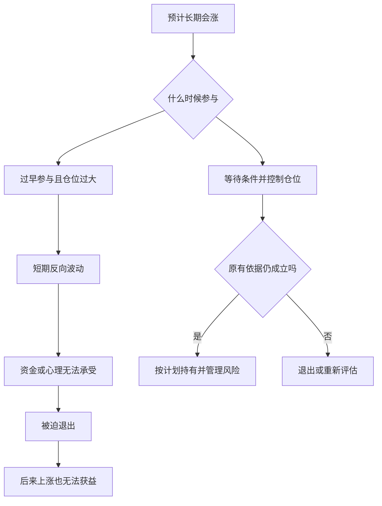
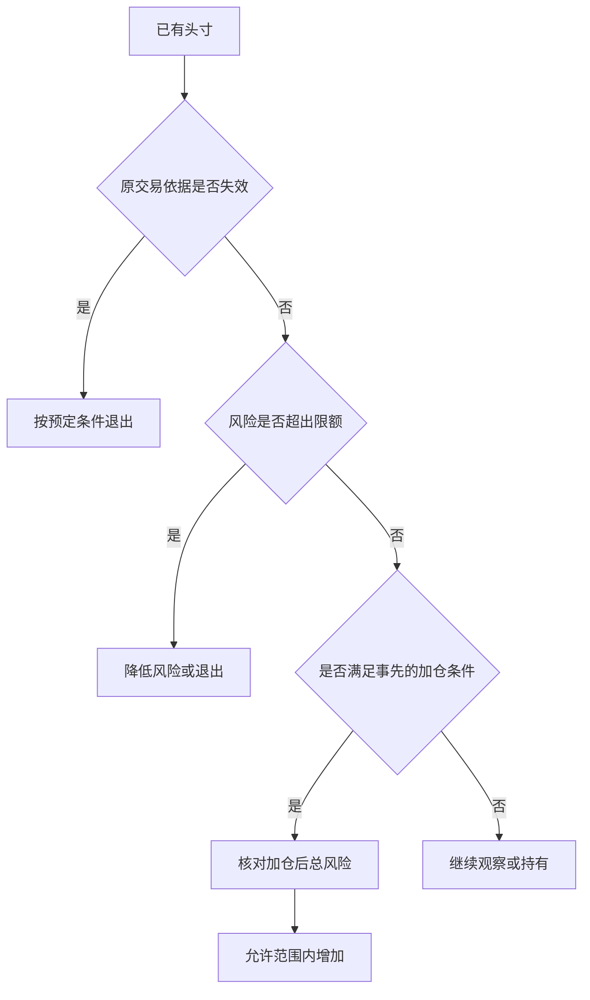

# 《股票大作手回忆录》读书笔记

> 作者：埃德温·勒菲弗（Edwin Lefèvre）  
> 英文原名：Reminiscences of a Stock Operator，初版 1923 年  
> 版本：未指定中文译本；章节定位采用英文原作的 I—XXIV 章，不套用某个中文版本的页码。  
> 分析依据：公开英文原文的主题检索与重点段落核对、出版社书目信息，以及美联储、监管机构和央行的历史资料。没有用户提供的中文原书。书内文学化叙述与独立可核验的书外事件分别标明；数字推导仅作为数学演示。  
> 覆盖范围：全书主要主题与 28 个核心知识点，重点覆盖交易心理、市场判断、持仓与风险、失败教训及后半部的信息与市场操纵主题；不是逐段翻译或每个故事的复述。  
> 更新日期：2026-11-11

## 先看这里：这本书讲什么

**一句话概括：一个擅长观察价格的人，如何在反复赚钱、亏损和重新开始中，理解交易真正考验的是判断、时机、持仓、风险和自我控制。**

先把人物关系讲清：本书由勒菲弗创作，以虚构人物拉里·利文斯顿（Larry Livingston，也写 Lawrence Livingston）的第一人称讲述，主要原型是杰西·利弗莫尔（Jesse Livermore）。它带有传记素材，但经过文学加工，不能把主人公的每段叙述都当作利弗莫尔本人逐字口述的历史档案。出版社也把它描述为经过小说化处理的故事。[出处：出版社书目](https://www.panmacmillan.com/authors/edwin-lefevre/reminiscences-of-a-stock-operator/9780857190567)

最值得带走的六个认识：

1. **方向正确不等于能赚钱。** 入场太早、仓位太大、资金撑不到趋势出现，都可能使正确判断变成实际亏损。
2. **大行情中的持仓，比猜中许多小波动更重要。** 但“拿得住”有前提：原先依据仍在，风险仍可承受。
3. **价格表现是需要尊重的事实。** 对行情的解释再漂亮，也不能替账户承担损失。
4. **希望和恐惧容易用反地方。** 人常对亏损抱希望，对盈利却急于兑现。
5. **仓位、流动性和执行会改变策略。** 小资金能做的事，大资金不一定做得到；纸面盈利也不等于随时能兑现的现金。
6. **市场经验应当变成规则和记录。** 只记得大赚的故事，记不住为何亏损，不能形成可重复的能力。

读完可以学会识别交易中的自我欺骗、区分“好判断”和“好交易”，并把模糊的经验整理成可以复核的决策过程。它没有提供一个经过现代统计检验、读完就能直接执行的完整机械交易系统。

## 主要内容与全书思路

本书的原始章节多用罗马数字命名。下面是便于理解的**主题归组**，不是伪造的中文章节标题；某些主题会跨章重复出现。[原文与完整目录](https://www.gutenberg.org/files/60979/60979-h/60979-h.htm)

| 原作范围 | 主要内容 | 这一部分解决什么问题 |
| --- | --- | --- |
| I—IV | 报价板、观察价格、对赌行经历，转向实际交易后的挫折 | 为什么同一套方法换个市场环境就可能失效 |
| V | 老交易者的启发，从小波动转向大势与持续持仓 | 为什么“判断对了却赚不到” |
| VI—IX | 时机、联太股票经历、市场总体环境及大规模操作 | 方向、入场与仓位如何相互影响 |
| X—XII | 商品交易、棉花操作、他人的观点对独立判断的干扰 | 为什么丰富的信息和权威意见也可能让人犯错 |
| XIII—XIV | 债务、心理压力、等待机会与恢复交易能力 | 为什么急着翻本会破坏原本的能力 |
| XV | 咖啡交易及意外外部干预 | 为什么供需判断正确仍可能输给制度与时机 |
| XVI—XVIII | 小道消息、内部人、人的行为与交易经验 | 如何分辨事实、利益动机和诱人的说法 |
| XIX—XXIV | 历史上的市场操纵、股票销售、公众情绪及信息传播 | 为什么不能把热闹的价格、报道和推荐直接当成价值 |

整体线索是：**观察价格 → 在真实市场受挫 → 学会判断大势和时机 → 管住仓位和心理 → 识别市场参与者的动机。**

## 核心知识点：市场和判断

### 01. 先观察，再形成解释

主人公早期通过记录价格及随后走势来检验自己的观察。这种方法的价值，不是证明每种图形都有效，而是把“我觉得”变成“我事先记录过，后来是否发生”。[原文 I 章](https://www.gutenberg.org/files/60979/60979-h/60979-h.htm)

观察价格后，先写下预计发生什么、多久内发生、什么现象算判断错误。定期检查原始记录，比事后说“我早就看出来了”更有信息量。边界是：少量成功案例不能证明稳定规律，还要看全部样本和失败案例。

### 02. 价格可能先变化，解释随后才出现

交易者面对的是已经发生的成交，而完整原因往往晚到。书中反复提醒，不应因为暂时找不到新闻解释，就否认异常价格行为。

这不意味着“价格永远正确”或“基本面没用”。价格也会含噪声、误判和人为影响。更准确的理解是：**价格是当前需要处理的事实，解释是仍需检验的假设。** 对已经触发的风险，不应只靠一个尚未证实的解释拖延处理。

### 03. 先判断市场环境，再判断单个标的

在整体上涨、整体下跌和横盘环境中，相同的个股信号可能有不同含义。主人公逐渐从抓每一笔小波动，转向研究总体条件及市场主方向。[原文 V、VIII 章](https://www.gutenberg.org/files/60979/60979-h/60979-h.htm)

在多数股票上涨时，一家公司上涨未必说明你的选股能力很强。要区分来自市场的推动与来自个股的额外表现。边界是：总体方向的判断同样可能出错，不能用“大势一定向上”取消退出条件。

### 04. 最小阻力方向：问市场更容易往哪里走

书中的“最小阻力方向”，可以理解为在当时供需和市场情绪下，价格较容易继续运动的方向。它不是神秘指标，也不是保证未来路线不变的定律。

利好出现后价格很难继续上行，反而卖压很重，可能说明先前的强势需要重新评估；利空出现后跌不动，也可能提供另一种信息。这里观察的是“消息与反应之间的关系”，不能只凭一次反应下结论。

### 05. 价格高低不等于贵贱，也不自动决定方向

涨过很多不代表马上要跌，跌过很多也不代表马上要涨。书中关注的是后续运动是否支持自己的交易方向，而不是执着于过去见过的价格。[原文 VII 章](https://www.gutenberg.org/files/60979/60979-h/60979-h.htm)

上涨后的资产可能继续上涨，也可能已透支预期；下跌后的资产可能出现机会，也可能继续恶化。单看价位无法回答估值问题，需要另做价值分析，不能把趋势交易原则冒充估值结论。

### 06. 不要把自己的持仓变成观点的理由

正确顺序是“根据证据形成观点，再决定持仓”；常见错误是“因为已经买了，所以持续寻找看多理由”。主人公强调，不能让已经拥有的头寸替自己思考。[原文 VIII 章](https://www.gutenberg.org/files/60979/60979-h/60979-h.htm)

持仓偏见常表现为对同一条经营数据改变评价：买入前重视危险，买入后却急于解释成暂时问题。可以自问：“如果现在空仓，我还会以同样理由买入吗？”这只是识别偏见的辅助问题，不能替代完整决策。

## 核心知识点：时机和持仓

### 07. 方向与时机是两道不同的问题

“以后会跌”不等于“现在适合做空”。原作第 VIII 章有一个具体教训：叙述者在 1907 年大跌前已经看空总体环境，却多次因为过早建立空头而亏损。后来，他注意到大型铁路公司的融资安排，以及争取有限资金的迹象，才把原先的方向判断与当时的资金紧张联系起来。**这是原书的文学化交易叙述，不是本笔记独立核验的历史成交记录。**[原作 VIII 章](https://www.gutenberg.org/files/60979/60979-h/60979-h.htm)

重点不是铁路融资公告构成永远有效的卖出信号，而是“有一个看空理由”和“价格开始按这个理由运行”之间可能有很长距离。资金紧张的判断可以比下跌提前很久；持仓却每天承受价格变化、融资和心理压力。后来市场下跌，也不会退还先前为过早参与支付的损失。

**可独立核对的历史背景**是，1907 年 10 月 Knickerbocker Trust 停业，恐慌波及其他机构，股票抵押借款的资金条件急剧紧张。美联储历史资料记录，10 月 22 日相关拆借利率年化报价骤升，随后进一步攀升。[美联储：1907 年恐慌](https://www.federalreservehistory.org/essays/panic-of-1907) 这能支持“融资条件是实际约束”，却不能替小说中的个人判断时间和成交作证。价格方向之外，资金可得性与持有成本本身就会决定谁还能继续等待。

把它分为三层就容易理解。方向判断讨论未来较可能发生什么；时机判断讨论现在有哪些证据值得开始承担；仓位判断讨论在证据兑现之前，自己还能承受什么。任何一层不成立，都可能使最终方向正确的想法变成失败交易。叙述者后来更看重总体条件，不能据此抹去此前的失败路径。

**算术演示，非历史数据：** 100000 元权益承担 500000 元的线性空头敞口，标的价格先逆向上涨 10%，会亏掉 50000 元，尚未计算成本。即使后来跌回预想位置，已经被迫退出的人也无法获得后续结果。这个算式只展示规模如何放大路径风险，不是对书中头寸的复算。

现实应用是分别记录方向依据、参与条件与降低承担的条件。不能为了等待宏观判断正确，无限延长一笔已无法承受的交易。**自测：**“后来果然跌了”能证明最初仓位合理吗？不能，它只涉及终点方向，没有验证途中风险和执行能力。

还要警惕叙述者自己的确定语气。书中把事后回看的条件说得十分清楚，真实决策时的信息缺口却不能因此消失。本节提炼的是决策结构，不是替历史经验提供统计有效性证明。

### 08. 等待信号也是决策

市场没有义务每天提供机会。书中的等待既包括入场前等待条件成熟，也包括已经建立合理头寸后等待行情展开。无事可做时频繁交易，可能只是用操作缓解焦虑。

没有符合条件的机会时，记录“无符合条件的交易”比降低条件硬做一笔更有纪律性。前提是原先条件经过思考；无限期等待一个模糊的“完美时刻”也可能只是回避决策。

### 09. 看对以后，还要拿得住

第 V 章写到，老交易者 Partridge 收到建议：卖掉已上涨的 Climax Motors，等回调再买回。他拒绝的重点，是卖出后可能失去原有头寸。叙述者也回顾自己多次先获利离场，却等不到预想回调，眼看价格继续上行。**人物与对话属于小说化原作的叙述证据，不是经过审计的真实交易样本。**[原作 V 章](https://www.gutenberg.org/files/60979/60979-h/60979-h.htm)

这个场景解释了“看对却赚得少”的具体机制。原本只需完成方向判断和持有决策，现在主动增加两项任务：能否在回调前卖出，以及能否在回调后及时买回。第二项还有心理障碍：卖出后若继续上涨，人容易因为不愿买得比刚才贵而一直等待。所谓降低成本，可能换来长期空仓。

所以，持仓能力不是被动忍耐，而是避免让每次短期变化都重新启动整套决策。原先依据没有失效、风险仍可承受，就没有必要仅因“已赚了一点”而改变计划。书中强调的是让主要行情发挥作用，不是从每个局部波动都挤出额外收益。

但 Partridge 的回答不能推广成永不退出。同一章也讨论总体条件逆转后离场，以及不必追求最高、最低的最后一点价格。继续持有处理正常波动，退出处理依据失效或风险越界。真正有问题的是盈利时按短期情绪卖，亏损时临时搬出长期信念。

原文没有给出机械区分正常回调与趋势结束的唯一指标，所以读者仍需在自己的方法中明确定义。不能把后来上涨倒写成“当时显然应持有”，也不能把一次卖出后下跌当成反复操作更好的证明。

**自测与参考答案：** 如果故事中的卖出建议后来恰好成功，持仓思想是否被推翻？没有。单次结果不足以比较两种方法，还需连同成本、错过的行情、失败的重入和全部样本评估。这个故事首先教我们识别：为了多赚一点，究竟新增了哪些判断任务。

### 10. 放弃吃到最低点和最高点的执念

极端价位通常只有事后才知道。想吃尽整段行情，可能导致入场过早、离场过晚，或在已经赚到可观利润后仍拒绝退出。

不必吃到完整波段，一段行情中合理取得的部分收益也可能符合原计划。卖出后又涨了，不自动说明原决定错误；要看卖出时掌握的信息与规则。以事后最优结果审判每一次行为，会使任何真实决策看起来都失败。

### 11. 试探仓位：先让市场给反馈

书中描述先建立一部分头寸，观察后续表现，再决定是否扩大。这体现的是在信息不完整时逐步承担风险，而不是第一次就把全部判断押上。[原文 VII 章](https://www.gutenberg.org/files/60979/60979-h/60979-h.htm)

试探仓位的作用是让初始损失保持可控，并让后续增加取决于事先设定的确认条件。边界是：试探本身也有成本；反复试探很多相同风险的资产，合起来仍可能是大仓位。

### 12. 顺势加仓与亏损摊平不是一回事

原作第 VII 章强调，初次头寸得到有利反馈后才考虑第二次投入，同时明确提醒，这不是对无止境金字塔加仓的推荐。第 XIV 章又叙述了具体过程：先对不再领涨的股票建立空头，等市场整体转弱、既有头寸普遍出现浮盈后，再扩大承担。**这是文学化原作记录的做法，不是当代收益验证。**[原作 VII、XIV 章](https://www.gutenberg.org/files/60979/60979-h/60979-h.htm)

两处结合，才能看清加仓理由：不是投入得还不够多，而是先前假设获得进一步反馈。相反，棉花失误中继续买入以抗拒下跌，依据的是维护自己的立场。两种操作都增加数量，证据方向却不同。

价格有利也不等于新增头寸免费。**以下只是风险算术，非书中成交：** 账户 100000 元，50 买 500 股，保护位 47，计划风险 1500 元。价格到 54 再买 500 股而保护仍在 47，总计划损失变成 `500×3+500×7=5000 元`。市场给了正反馈，操作却将风险从 1.5% 提高到 5%。

若市场结构确实允许将两批保护位提高到 51，从入场成本计算，最终净损失为 1000 元；从当前 54 算，1000 股回落到 51 会令权益减少 3000 元。前一个数字讨论累计操作的本金损失，后一个讨论此刻权益回吐。两者都没有包含跳空、费用和成交不确定性。

不能为了把算式变漂亮而随意提高保护位。如果位置处于正常噪声里，频繁退出可能破坏方法。合理顺序是先判断失效位置，再核对全部批次风险，最后决定是否增加以及增加多少，而非先加仓再寻找安慰自己的数字。

书中经验提供判断框架，却没有统一适合所有品种的加仓比例。长期定投、价值配置或再平衡有不同依据，不能只因第二次买价更低就归为错误摊平。关键是新增承担有无新证据支持，整体损失是否仍可承受。

## 核心知识点：风险和执行

### 13. 先处理已知错误，不等市场替你解围

当事实证明原判断不成立，承认小错误可以阻止它变成大损失。书中讨论的核心是及时接受错误，不是要求所有资产都使用同一个固定百分比止损。

当可核查的买入依据已经被明确否定，继续持有若只剩“不想承认亏损”，那么“等回本”便已替代原交易理由。应检查的是失效条件，而不只是账户颜色。

### 14. 头寸大小会决定你能否冷静思考

同样一段波动，在小仓位下只是可观察的信息，在过大仓位下却可能触发恐慌和被动平仓。杠杆把资金约束带进决策，使你无法无限等待。

为什么规模会改变判断？因为人在承受不起损失时，容易把每一条新消息都理解成威胁，反复盯盘，或者不愿面对账户。此时所谓“心理问题”未必能靠更强意志解决：如果一次正常波动就影响房租、还款或睡眠，结构本身已经要求人持续对抗无法承受的压力。降低规模，可能比反复责备自己更直接。

**可独立核对的案例是 1998 年 LTCM 危机。** 官方历史资料记载，该基金具有很大规模与杠杆，危机中多类价差向不利方向运动，私人金融机构随后安排注资以避免仓促清算。[美联储历史资料](https://www.federalreservehistory.org/essays/ltcm-near-failure) 这个案例说明，即使拥有专业人员和模型，也不能凭“最终会恢复”的判断无限持有；融资、资本和退出市场的容量可以先形成硬约束。

但不能从这份机构资料推断某个交易者当时恐惧或失去自控。资金约束是可以核对的事实，心理反应则需要另外证据。把两者分开，恰好能避免将所有失败都解释成个人不够坚强：有些结构即使由非常冷静的人执行，也无法承受。

现代风险管理常把数量写成“允许承担的金额÷每单位到退出位置的损失”，并再核对最小交易单位、资金、保证金、流动性与成本。例如允许计划损失 1000 元，每股风险 5 元，忽略费用可以得到 200 股。这个式子只负责把已确定的条件换成数量，不负责证明方向正确，也不负责寻找保护位。若保护距离只有随意拍出的 1 元，算出来的 1000 股就可能是一种精确的错误。[补充资料：CME 头寸规模教育](https://www.cmegroup.com/education/courses/trade-and-risk-management/proper-position-size)

还要检查合计风险。五笔各自可接受的头寸，如果都依赖同一市场方向，压力来时可能一起恶化。生活用途也是约束：一个准备长期承担波动的人，若下月必须把钱取走，实际承受范围与口头计划并不一致。所谓“资金管理”，不仅是一个百分比，而是让价格路径、退出安排、现金需求与自己的能力彼此兼容。

这里不提供适用于所有人的固定风险比例。可学到的能力是：当自己总无法执行时，除了研究心理，也回头检查规模；当某项交易无论怎样缩小都不适合账户时，接受不参与。放弃一项无法承受的机会，也是完整决策。

### 15. 流动性决定纸面盈利能否兑现

价格屏幕显示的最后一笔成交，不代表全部持仓都能以该价兑现。原作讨论大头寸需要等待市场有足够承接时退出，说明数量本身会改变交易难度。[原作 VII、XIV 章](https://www.gutenberg.org/files/60979/60979-h/60979-h.htm)

**书外真实事件：2010 年 5 月 6 日闪崩。** CFTC 与 SEC 联合工作人员报告记载，当日市场已经剧烈波动、流动性趋薄；一个卖出程序计划卖出 75000 份 E-mini 合约。冲击中，一些流动性提供者暂停或退出，期货与股票市场之间的联系又传递了压力。[联合调查报告](https://www.sec.gov/news/studies/2010/marketevents-report.pdf)

这不是“成交很多，所以总能卖出去”。成交量记录已经交换了多少，流动性则关心此刻还剩多少愿意接近当前价承接的订单。同一批头寸快速往返可以制造较大成交量，但不保证市场能吸收新的单向卖盘。想退出的人同时增加、愿意接盘的人减少，执行价可能迅速偏离此前报价。

对应本书，纸面盈利只按某个可见价格估值，兑现还需要对手、数量和时间。如果策略只有“价格到这里就退出”，却未检查可成交数量和订单方式，它缺少一部分实际条件。规模越大，这个缺口越重要。

报告解释的是一次特定事件的市场机制，并不证明某个订单单独造成全部闪崩，也不证明书中方法能在当时获利。它使原书的提醒更具体：风险不仅是最终方向错误，也包括需要行动时，市场没有提供预期的成交条件。

### 16. 不同交易场所不能照搬同一套方法

主人公早期在对赌行中利用报价规律获利，进入真实市场后遭遇报价滞后、成交和成本等差异。对赌行的客户通常押的是价格变化，并非每笔都对应真实证券买卖。[原文 I—IV 章](https://www.gutenberg.org/files/60979/60979-h/60979-h.htm)

可迁移的认识是：一套方法必须考虑撮合方式、手续费、延迟、保证金和流动性。模拟账户没有明显问题，不意味着真实订单也能以同样价格完成。更换品种或交易制度时，需要重新验证。

### 17. 意外事件可能从价格以外改变结果

书中咖啡交易说明，供需分析之外还存在制度、外部干预和持有成本等风险。主角自认分析正确，也不能据此消除实际损失。[原文 XV 章](https://www.gutenberg.org/files/60979/60979-h/60979-h.htm)

应区分“没想到的事件”和“根本没有管理不确定性”。不可能预测所有冲击，但可以不让单一判断占满全部生存空间。书中的具体事件属于历史叙事，不宜直接类比为某个当代政策会怎样出台。

**真实制度变化：2015 年 1 月 15 日，瑞士国家银行宣布取消每欧元 1.20 瑞郎的最低汇率政策。** 这一决定和此前政策的存在均可从央行当日公告及后续官方说明核对。[瑞士央行当日公告](https://www.snb.ch/en/publications/communication/press-releases/2015/pre_20150115)、[央行对取消政策的说明](https://www.snb.ch/en/publications/communication/speeches/2015/ref_20150424_tjn)

它直接改变了把政策边界视为交易前提的分析。即使某段历史里汇率受到政策约束，也不能把该边界当成自然定律，更不能据此无限增加规模。过去观察到的价格范围，部分可能来自一项会调整的制度，而不是市场永远不会越过那里。

本节没有重建某个账户当时的报价、止损成交或损失，也不借政策调整声称能够事前预测。它说明需要写清自己的判断依赖哪些制度条件，以及条件改变后怎样重新评估。书中咖啡故事提供叙事启发，央行公告则提供可独立核验的现实事件；二者的证据层级不同。

### 18. 生活安全与交易资金要有边界

主人公在恢复财务状况后，讨论了将部分资金放到不易被自己再次用于投机的安排中。这提醒读者，赚钱能力不等于保住钱的能力。[原文 XIV 章](https://www.gutenberg.org/files/60979/60979-h/60979-h.htm)

将日常开支、应急储备与高波动试验资金分开，避免一次冲动把本来可以退出的交易变成不得不坚持。这里提炼的是用途隔离思想，不是建议照抄书中历史性的具体金融安排。

## 核心知识点：心理与学习

### 19. 希望和恐惧常被用反

人在亏损时容易希望价格回来，在盈利时却害怕利润消失，因此倾向于留住亏损、迅速卖掉盈利。问题不是必须消除情绪，而是不能让情绪替换原有条件。

对亏损单问“如果继续恶化，我何时退出”；对盈利单问“支持持有的条件是否仍在”。这比简单喊“克服恐惧”更可操作。盈利交易也可能应该退出，关键是证据和计划，而非一律反着情绪做。

### 20. 想回本，会把市场变成私人债务人

第 XIII—XIV 章把债务压力与判断失常放在同一条叙事线上。叙述者说，债权人的催逼使他难以专心；处理债务负担、重新取得只能支持有限头寸的帮助后，他刻意约六周不去容易诱使自己下单的经纪行，等待认为合适的机会。**这些细节来自文学化原作，不能据此认定破产或借款是可复制的翻身方法。**[原作 XIII—XIV 章](https://www.gutenberg.org/files/60979/60979-h/60979-h.htm)

值得学的不是后来赚了多少钱，而是他识别到两种压力。客观资金约束意味着有限资本无法承受太多试错；行为约束意味着知道自己随时能交易，就可能为缓解急迫感而勉强寻找机会。他改变所处环境，减少把“我必须恢复”错误翻译成“现在有机会”的可能。

“回本”把标准从市场条件移到过去成本。原本该问是否符合参与条件，债务却把问题改成这次够不够补缺口。机会没有变化，人可能扩大数量、推迟退出、降低门槛。过去的损失因而通过行为进入下一次损失。

**仅作恢复幅度计算：** 100000 元降到 90000 元后，回到原值需要约 11.11%，不是 10%；再损失 5000 元，只剩 85000 元，需要约 17.65%。这些并非原书记录，用于说明急于翻本可能让目标越来越远。

恢复时应分别审查正常方法损失、执行偏离和适用环境，而非用“心态不好”包办一切。暂停也应有具体目的，例如整理记录、恢复规模约束和核实研究依据；它不等于休息后保证盈利。

**自测与参考答案：** 原作后来出现财务恢复，是否证明此前承担过大的做法合理？不能。一个幸存者能够讲述恢复，不代表所有处境相似的人都恢复了。这个故事说明压力怎样改变行为，却不能替代完整失败样本与策略检验。

### 21. 独立判断不等于拒绝新信息

第 XII 章的 Percy Thomas 不只是随口给消息的人。叙述者把他描写成棉花知识丰富、分析有系统、表达极有感染力的专家；正因如此，自己逐渐用对方的解释替换了原有观察，继续买入棉花，后来承认遭受重大损失。**这是有出处的叙事案例，不是独立审计的交易档案。**[原作 XII 章](https://www.gutenberg.org/files/60979/60979-h/60979-h.htm)

问题不是专业知识没价值，而是三件事被混在一起：对方了解行业，对方的解释很有说服力，因此自己当前头寸就合理。前两项即使成立，也不能直接推出第三项。懂供需的人仍可能判断错时机，同一观点也可能不适合另一人的资金和仓位。

值得停下来看的变化，是叙述者从“市场怎样表现”转向“我要继续买，阻止它下跌”。交易不再只是表达分析，而是在维护原分析与自尊。继续投入不再需要新证据，反对证据则不断被解释掉。

可以把外部建议拆成两栏：新增了哪些可核对事实，提出了哪些仍需检验的推断。独立判断不是拒绝专家，也不是永不改口；它要求知道自己为何改变，并对新承担负责。把观点借来容易，把依据和退出责任一并想清楚，才是真正学习。

### 22. 自信与固执的区别在于能否被事实纠正

自信让人能在正常波动中执行；固执让人在依据已经消失后继续维护面子。二者表面上都像“不动摇”，实际判断标准完全不同。

事先写下哪些证据会让自己改变看法；出现后真的改变，比临时高喊“坚持信念”可靠。自信应来自对过程和风险的理解，不能只来自一次大赚。

### 23. 把亏损分为正常成本与执行错误

一次亏损可能来自不可避免的不确定性，也可能来自违反自己的方法。只以盈亏评价交易，会把侥幸赚钱的错误行为奖励出来。

**补充解释：** 建两列记录：“是否按照事先计划行动”和“最后赚亏多少”。四种组合都可能出现。这个二维复盘表是本笔记的教学工具，书中没有给出同款表格；它用于把书中的自我审查思想变成可检查动作。

### 24. 经验必须落成可复核的记录

记住自己的错误，必须具体到“在哪种条件下，做了什么，后果是什么”。只说“下次要更冷静”，无法指导下一次操作。[原文 I、V 章](https://www.gutenberg.org/files/60979/60979-h/60979-h.htm)

记录应从“我总是卖飞”这样的情绪评价，转向可核查问题：实际退出依据是否与计划一致、偏离反复发生在哪里。这样才能形成改进方案。记录也要包括没有交易的决定，避免只保留能讲出故事的样本。

## 核心知识点：消息、利益与公众行为

### 25. 小道消息常在提供方向感，而非可靠知识

原作第 VI 章提供了一个比“消息都骗人”更细致的案例。叙述者观察联太股票后做多，经纪人 Ed Harding 出于自认可靠的消息和善意劝他退出；他不仅卖掉多头，还反手做空。随后公司宣布提高股息，价格走强，他回补时又遇到明显的成交价偏离。**这是文学化叙述，动机与成交细节均按书中说法呈现，不冒充独立历史结论。**[原作 VI 章](https://www.gutenberg.org/files/60979/60979-h/60979-h.htm)

这个故事不能教“永远相信自己，别听别人”。叙述者也可能观察错；问题是没有获得足以自己核查的新证据，却因信任对方的聪明、关系与善意，改变了整个方向。而“原先多头可能不合适”，并不自动等于“立即做空一定合适”，他把一次提醒扩展成了另一项判断。

消息应分层处理：对方提供什么事实，事实来自哪里，它如何影响原假设，是否足以支持具体行动。诚实的人也可能传递错误消息；有利益的人也可能提供真实事实。动机影响怎样检查信息，却不能独自决定真假。

消息越确定，越容易让人忽略仓位与成交条件。书中回补价格偏离说明，即使意识到错误，也未必能按刚看到的报价撤销。判断失误与执行损失可以叠加，不能只把学费归结为听错消息。

把一条推荐写成三栏：已证实事实、未证实推断、使结论失效的证据。这样不会保证正确，却能发现在哪一步交出了判断权。**自测：**“他是好朋友，没有害我”为何不足以支持交易？因为动机可靠不等于信息完整，更不等于信息足以决定方向、数量与时机。

### 26. 内部人了解企业，不等于了解整个市场

某个人即使了解公司经营，也可能不了解整体资金环境、其他参与者行为和短期价格。书中对内部意见的反思，不是鼓励寻找更隐秘的信息，而是提醒不同知识有不同适用范围。

“今年销售很好”无法单独回答“这一事实是否已经计入价格”“当前估值是否合理”。企业事实、估值和交易时机应当分别分析。

### 27. 市场中的叙事可能带有销售目的

后半部大量讨论股票推销、市场活跃度制造和公众信心。对普通读者最有价值的，是理解信息如何与持仓利益结合，不能只看一条推荐有没有专业词汇。[原文 XIX—XXIV 章](https://www.gutenberg.org/files/60979/60979-h/60979-h.htm)

书中人物有时把操纵视作行业技巧，这是当时叙述的视角，不是本笔记对这些做法的认可。今天阅读这些章节，重点应放在识别利益冲突和虚假热度，而不是照着设计交易行为。

### 28. 人性会重复，但历史价形不会精确复制

贪婪、恐惧、从众和不愿认错，有跨时代的相似性；市场制度、参与者和信息速度却持续变化。因此，可以借鉴行为机制，不能据一段百年前的行情推断今天同样走势必然再现。

一个成功者的故事也缺少完整对照组：做过类似事情但失败的人，未必留下同样著名的回忆录。读本书最稳妥的方式，是提取待检验的原则，而不是把传奇当成收益证据。

## 难点图解一：为什么看对方向仍会亏钱

以下是原创教学示意，不是历史收益图。

这张图说明，预测只是第一步。真正结果还经过时机、仓位、执行和持有能力。即使选择右边路径，仍然可能亏损；图示只解释过程，不承诺结果。

**补充数值例子：** 用 10 万元资金承担价值 50 万元的价格敞口，忽略利息和成本，标的下跌 10% 会产生约 5 万元损失，即资金的 50%。标的后来恢复，并不能帮助已经被迫退出的人。这里仅演示线性杠杆损益，真实产品的保证金和强平条件可能不同。

## 难点图解二：持有、止损和加仓如何不互相矛盾

“拿得住”解决的是不要因为噪声随便离场；“止损”解决的是依据失效或风险失控；“加仓”解决的是怎样在反馈有利时扩大参与。它们针对不同条件，不是互相否定的口号。图示是对书中思想的教学整理，原书没有这份机械规则。

## 读完能怎么用

先把本书用于训练判断质量，而不是立刻扩大实际交易。可以选一段已经结束的历史行情，遮住后面的部分，做以下练习：

| 要记录的问题 | 有信息量的写法 | 没有信息量的写法 |
| --- | --- | --- |
| 为什么考虑参与 | 指出可观察条件及可能反证 | 感觉要涨 |
| 何时承认错误 | 依据失效条件、价格条件或时间条件 | 看情况 |
| 能承担多少损失 | 金额、仓位与风险敞口一起写 | 应该问题不大 |
| 为什么继续持有 | 原条件仍在，风险符合计划 | 不舍得卖 |
| 为什么退出 | 条件变化或达到预定退出规则 | 忽然害怕 |
| 怎样复盘 | 分开评估过程、结果和运气 | 赚钱就是对 |

观察一次价格后，先写下决定，再揭开后面的行情。这个顺序能减少事后合理化。练习的成果是一份可检查记录，不是对未来获利能力的证明。

## 哪些地方要保留判断

- **它是叙事作品。** 没有连续、完整、可审计的交易样本，不能据此估算策略的胜率、最大回撤或未来收益。
- **有些经验靠主观判断。** “大势”“行为正常”“时机成熟”都需要进一步定义，无法仅凭几句格言直接回测。
- **作者描写不等于科学验证。** 直觉成功故事不能证明直觉可靠；破产后的复起也不能证明高杠杆值得复制。
- **市场结构存在时代差异。** 历史中的对赌行、交易撮合、融资环境与今天不同，应用时需要重新核实具体制度。
- **叙事中对错误的解释可能不完整。** 不应把所有亏损归因于“不够自律”；方法本身也可能没有优势，或者适用环境已经变化。
- **与价值投资不冲突，也不等同。** 本书主要讨论投机交易者怎样面对价格和头寸，不足以代替公司估值、长期资产配置或财报分析。

## 回顾自测

1. **为什么最后看对也可能亏钱？** 因为中途波动、时间、杠杆、成本或退出时机会让资金先耗尽。
2. **持有和死扛怎么区分？** 看原依据、风险限额及退出条件是否仍然成立，而不只看持有时间。
3. **盈利后能不能无限加仓？** 不能，需计算加仓后的总风险、退出距离及流动性。
4. **听取专家意见怎样保持独立？** 提取可核查事实和论证，自己确定它是否改变原判断。
5. **一笔赚钱交易一定做对了吗？** 不一定，违规冒险也可能暂时得到好结果。
6. **本书最不该照抄的是什么？** 传奇人物的规模、杠杆和历史操纵行为，以及未经检验的确定性判断。

## 来源与范围说明

1. [Project Gutenberg 英文原文](https://www.gutenberg.org/files/60979/60979-h/60979-h.htm)：用于核对主要故事、概念和罗马数字章节。该站将原作标为美国公有领域；本笔记使用自己的中文概述，不转录现代中文译文。
2. [Project Gutenberg 书目信息](https://www.gutenberg.org/ebooks/60979)：作者、语言、作品信息及公开版本入口。
3. [Pan Macmillan 出版社书目](https://www.panmacmillan.com/authors/edwin-lefevre/reminiscences-of-a-stock-operator/9780857190567)：核对文学加工性质及主人公的现实原型关系。
4. [CME：Proper Position Size](https://www.cmegroup.com/education/courses/trade-and-risk-management/proper-position-size)：仅用于现代头寸规模的教学补充，不作为原书内容的来源。

5. 美联储历史资料：[1907 年恐慌](https://www.federalreservehistory.org/essays/panic-of-1907)与[LTCM 濒临倒闭](https://www.federalreservehistory.org/essays/ltcm-near-failure)：融资、仓位与市场环境的书外事实，不用于反向证明书中个人成交。
6. [SEC/CFTC：2010 年 5 月 6 日市场事件报告](https://www.sec.gov/news/studies/2010/marketevents-report.pdf)：市场深度与流动性变化。
7. [瑞士央行 2015 年 1 月 15 日公告](https://www.snb.ch/en/publications/communication/press-releases/2015/pre_20150115)：取消欧元兑瑞郎最低汇率安排的事实。

尚未覆盖的是某个指定中文译本的译者差异、译注及全部历史案例细节。图表为本笔记编排；书内故事属于文学化叙述，书外历史事件有独立来源，明确标出的数学演示是假设计算，三者不互相替代。

---

[返回书籍索引](../README.md) · [财商学习与实践路线](../财商进阶合订本.md)
