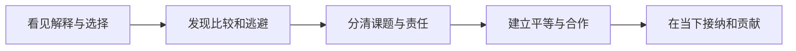
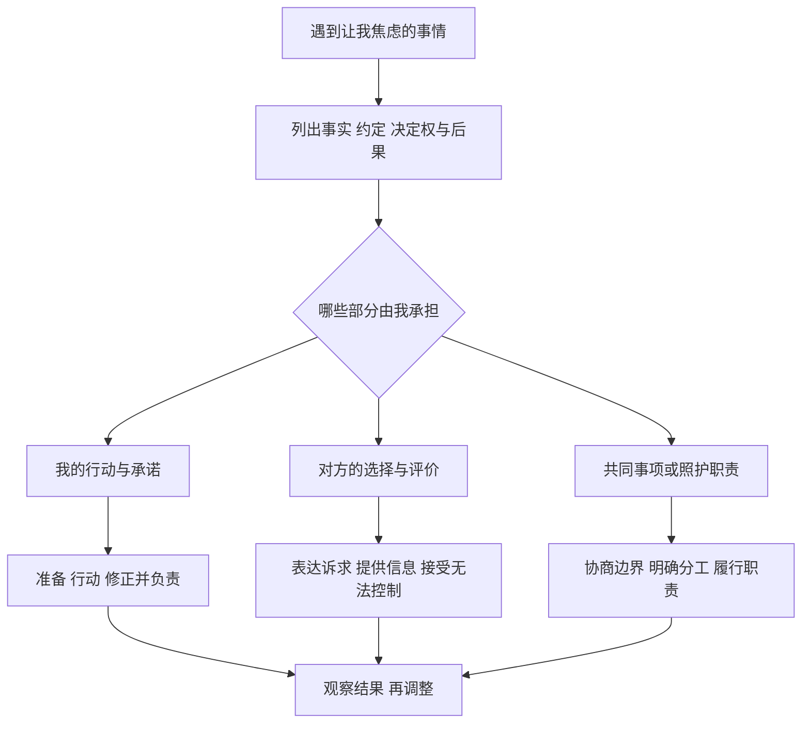
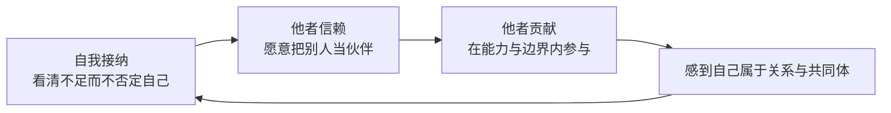

# 《被讨厌的勇气》读书笔记

> 作者：岸见一郎、古贺史健  
> 简体版参考：渠海霞译，机械工业出版社，2015 年，ISBN 9787111495482。书目信息已与[广西大学图书馆馆藏](https://opac.gxu.edu.cn/bookInfo_01h0501087.html)核对。  
> 分析依据：公开目录、出版社介绍及阅读指南，结合核心概念的原创解释。当前没有用户提供的原书，属于**公开资料与知识框架整理**，不声称逐页精读或核对全部论证。  
> 覆盖范围：五夜对话主线、28 个主要知识点、难点图解、原位真实案例、应用练习与争议边界；不复述全部对话和案例。
> 案例性质：下文现实案例均为本笔记补充，依据当事人公开叙述、机构原始资料或研究介绍；与本书概念的联系属于分析者的解释，不冒充书中案例，也不把个案当作阿德勒理论已获证实。  
> 更新日期：2026-11-11

## 先看这里：这本书最值得学什么

**一句话概括：把生活的决定权从过去的标签和别人的评价中拿回来，在与人合作、承担责任的过程中，建立自己的价值感。**

它采用青年与哲人的对话，介绍作者理解的阿德勒思想，是一部哲学式的生活讨论。五夜结构可在[英文出版社的阅读指南](https://www.simonandschuster.com/books/The-Courage-to-Be-Disliked/Ichiro-Kishimi/9781501197277)中核对。它并非阿德勒亲笔著作，也不宜把书中每个强烈措辞都视作已经得到验证的心理学定律。

最值得带走的六件事：

1. **过去有影响，眼前仍可能有选择。** 理解来路之后，还要寻找下一步能改变什么。
2. **事实、评价和行动要分开。** “这次没通过”和“我这个人没有价值”不是同一回事。
3. **不必把所有人的认可当成行动许可证。** 认真做自己的事，同时接受评价无法完全控制。
4. **课题分离之后仍需合作。** 明确谁负责什么，是为了减少控制和纠缠。
5. **自我接纳、他者信赖、他者贡献相互支持。** 既能承认不足，也能与人建立关系。
6. **今天的生活本身有价值。** 可以有远期目标，但不要把现在全部变成等待成功的候场时间。

读完这份笔记，应该能更清楚地区分：我想做的事与我怕被评价的事、我的责任与别人的选择、真实能力差距与对整个人的否定。它最有用的场景包括讨好、比较、边界不清和迟迟不敢行动。

## 五夜对话怎样连成一条线

下表使用主题概括，方便理解，各版本的章节译名可能不同。主要结构与[日文原出版社目录](https://www.diamond.co.jp/book/9784478025819.html)、[掌阅简体版目录](https://se.zhangyue.com/book/detail?appId=e4de9a67&bookId=11873464&bookType=1)交叉核对。

| 主题位置 | 这一夜主要回答什么 | 本笔记对应知识点 | 与下一步的关系 |
| --- | --- | --- | --- |
| 第一夜：人能否改变 | 我是不是只能由过去决定？ | 1—5：解释、目的、生活方式、过去、情绪 | 先找回行动空间 |
| 第二夜：人际关系与自卑 | 为什么比较、冲突和逃避会束缚人？ | 6—13：人际视角、自卑、竞争、权力斗争、人生课题 | 看清自己如何进入关系 |
| 第三夜：课题分离与自由 | 我究竟应该对什么负责？ | 14—18：认可、边界、协作、自由、主动改变 | 减少把他人的评价当成命令 |
| 第四夜：共同体与平等 | 不讨好以后，怎样与人相处？ | 19—23：整体论、归属、横向关系、鼓励、存在价值 | 自由并不以孤立为终点 |
| 第五夜：接纳、贡献与当下 | 幸福感如何进入日常生活？ | 24—28：接纳、信赖、贡献、平凡、当下 | 把认识落在日常选择里 |

**怎么看这张图：** 前半本帮助人从“我必须如此”中松动出来，后半本回答松动之后怎样生活。只读到课题分离，就容易把全书理解成“谁也别管谁”；继续读到共同体和贡献，才看得见作者想建立的关系。

## 第一夜：从“我只能这样”到“我还能怎么做”

### 1. 我们体验到的世界，包含自己赋予的解释

人面对的并不只是外部事件，还包括对事件的理解。同一件事可以被读成否定、提醒、机会或风险，随后引出不同的情绪和行动。这是全书讨论主观意义的入口。

**边界：** 解释能够调整，不代表现实伤害可以靠换个想法消失。低薪、歧视和违约等问题还需要实际资源、制度或行动来处理。

### 2. 目的论：观察行为正在帮助自己达成什么

原因视角问“什么经历使我这样”，目的视角问“我现在这样做，正在回避或获得什么”。作者强调后者，因为如果只把行为归给不可改变的过去，行动就可能被搁置。但这是一种理解行为的哲学视角，不能直接推导成“每个症状都由本人为了某个目的而制造”。

这里的转换，是把解释问题继续推进为行动问题。理解行为的来路之后，再考察它的眼前收益和长期代价：当下是否减少了不舒服？是否保住了熟悉的状态？是否同时阻断了反馈？这些都应是需要核查的问题，不能预先当成答案。

**真实材料：Tim Urban 对自己拖延的叙述。** 他在 2013 年的文章中回忆，大学毕业论文直到截止前 72 小时才开始写；他还描述自己写文章时不断转去浏览无关内容。这是本人回忆和自我解释，不是研究者对其进行的临床评估。[来源：Urban 本人《Why Procrastinators Procrastinate》](https://waitbutwhy.com/2013/10/why-procrastinators-procrastinate.html)。

用目的视角分析，首先不问他“究竟是不是一个懒人”，而看这种做法暂时完成了什么：按他的叙述，无关浏览提供了眼前的轻松，写作被后移；这与他希望完成作品的长远目标并不一致。**一个行为可以在眼前有用、在长期有害。** 因此，指出它的功能并不是赞同它，也不是断言他自由选择了所有后果。

再往下一步，改变就不能只靠责骂人格。可以检查任务是否清楚、启动成本是否过高、反馈是否来得太迟，以及眼前的放松是否只能通过拖延得到。将任务缩小、把休息与工作明确安排，是可尝试的行动设计；这是本笔记的应用建议，不是 Urban 这一经历已经验证有效的治疗方案。

**最容易错的推理：** 既然拖延可能让人暂时轻松，那么所有迟迟不行动的人都在逃避。这个结论不成立。资源不足、任务不明确、照护负担和健康状况也可能影响行动；必须先了解事实。目的也未必是清醒策划的阴谋，不能把观察行为功能偷换成责备当事人故意痛苦。

**练习：** 这份材料能证明“拖延者都想失败”吗？**参考答案：不能。** 它至多提供一个人如何描述自己行为的材料；眼前追求轻松与长远希望完成工作可以同时存在。对自己实际的拖延记录，可以分别写下当时避开了什么、付出了什么代价，再试一个可承受的调整，而不是给自己下人格判决。

### 3. 生活方式：反复使用的解释和应对习惯

这里的“生活方式”不只是作息或消费习惯，而是较稳定的看法：我是什么样的人、别人是什么样的人、我怎样才能得到安全和价值。比如“必须表现完美才配被接纳”，就会影响学习、工作和亲密关系。

维持旧方式常有熟悉、可预测的好处，改变则要承担不确定。书中所谓勇气，包含愿意承受这部分不舒服；它不意味着只要下决心，所有困难都会迅速消失。

### 4. 过去不能重写，但它不必成为对未来的唯一判决

作者将关注点放在“怎样使用已经发生的经历”。承认曾经受伤，与寻找当下的支持和选择，可以同时进行。这里最重要的区分是：**对未来承担一些行动责任，不等于对过去遭受的伤害承担过错责任。**

必须保留医学边界。书中对创伤的激烈表述不能按字面理解成创伤不存在。美国国立精神卫生研究所说明，创伤后应激障碍可能伴随持续症状并影响日常生活，并非所有经历创伤的人都会发展成这种障碍；这些反应也不能简单视作主动选择痛苦。[来源：NIMH 的创伤后应激障碍说明](https://www.nimh.nih.gov/health/publications/post-traumatic-stress-disorder-ptsd)。这项知识用于纠正误读，不是替任何具体人物作诊断。

**真实材料：乔布斯怎样回述离开苹果。** 在 2005 年斯坦福毕业演讲中，他回忆离开苹果后曾感到迷茫，后来开展新的事业，并在苹果收购 NeXT 后回归。这是当事人多年后的回顾，包含他对经历的意义解释。[来源：斯坦福发布的演讲原稿](https://news.stanford.edu/stories/2005/06/youve-got-find-love-jobs-says)。

这个材料能帮助理解的是：已经发生的职业挫折，与此后仍可能出现的行动空间，并不矛盾。它不能证明所有失业都会带来更好的结果，也不能让人倒推“当时的伤害是必要的”。这是在已知后来结果的条件下形成的叙事，不能当作当时就能预见未来的证明；只看成功者，还会漏掉遭遇类似挫折却未获得同样机会的人。

应用时可以把问题拆成三层。**事件层**确认发生过什么、谁承担什么责任，不因当事人后来恢复就改写事实。**影响层**承认经历留下的情绪、身体反应、资源损失与关系变化，不把持续困难视为道德失败。**行动层**才讨论目前有哪些支持、选择和可承受的小步。第三层的存在，不会使前两层变成假的。

这种拆法也能防止两种相反的误读。一种是把过去视作决定一切的命运，因而不再寻找机会；另一种是要求当事人只要换个想法就立即恢复，因而忽略环境和实际损失。本书较有帮助的部分，是在不抹去事实的前提下寻找可以行动的位置，而不是保证任何人都能复制某位成功者的结局。

**练习：** 乔布斯后来回归苹果，能否证明“挫折本身对每个人都有益”？**参考答案：不能。** 后续结果不能单独识别挫折的因果作用，也不能反映所有经历相似事件的人。用于自己的真实经历时，应列出现有资源与下一步选择，而不是强迫自己把所有痛苦解释成礼物。

### 5. 情绪有时会承担沟通或控制的功能

书中用愤怒讨论目的：有些争执中，人把提高音量当作让对方服从的方式。这个提醒的实用之处，在于把“我现在很生气”与“所以我可以伤害别人”分开。

**边界：** 愤怒并非总是有意识制造的，也可能是自动出现的反应。较合理的用法是学习识别情绪后的行为选择，而不是要求自己不得生气，或拿这个概念揣测别人的真实动机。

## 第二夜：看懂自卑、比较和关系中的拉扯

### 6. 人际关系视角：很多痛苦带有“别人如何看我”的成分

作者用人际关系解释许多烦恼：羞耻、嫉妒、孤独、地位焦虑等，经常离不开与他人的联系。把这种成分找出来，有助于从抽象的“我很差”转向具体的问题。

“一切烦恼都来自人际关系”应当理解为书中的强烈理论视角，不宜当成排除疾病、环境、资源不足等原因的普遍结论。

### 7. 自卑感：意识到自己与理想之间有差距

感到不足并不自动构成问题。若差距能被具体描述，它可能提供学习方向：我暂时不会做什么，还需要练习什么。关键是别把一项能力的不足扩展成整个人没有价值。

比较有时提供信息，但要留意比较对象和条件是否相似。别人的起点、资源和经验可能与你不同，把这些差异全部归结为个人价值，会误判问题。

### 8. 自卑情结：把差距变成永远不行动的理由

书中区分自卑感与自卑情结：前者是感到不足，后者则把不足固定成“所以我做不到”的结论。当理由不再接受具体检验，它就可能保护我们免于承担尝试的风险。

**边界：** 经济、身体和制度上的限制可能真实存在。不能只凭别人尚未行动，就指责对方在找借口。先确认限制，再谈可选择的部分。

### 9. 优越情结：夸大地位也可能是在保护脆弱的自我评价

书中认为，一些炫耀、借权威抬高自己或贬低他人的行为，可能是在补偿自卑。表面上非常自信，实际上仍把价值寄托于“我必须比别人高”。

这不是一套远程诊断他人的方法。展示成果、表达自信不等于优越情结；分析行为的功能，比给人贴标签更有帮助。

### 10. 人生不是一场决定人格高低的排名赛

追求进步与追求压过别人不同。前者可以以自己的目标和状态为参照，后者让价值感永远依赖相对排名；即使短暂领先，也很容易害怕被超越。

现实中考试、招聘和商业都有竞争。这里可借鉴的是：承认竞争机制，同时不把竞争结果升级为“赢家值得尊重、输家没有价值”的人格等级。

### 11. 权力斗争：争论可能从解决问题变成迫使对方认输

当对话的目标从“事情怎么处理”变成“你必须承认我更强”，双方更容易升级冲突。此时继续寻找更有杀伤力的话，通常不能解决原问题。

退出权力争夺也不意味着放弃权利。必要时结束争执、留存事实、寻求协调，都与平等沟通相容。被持续侵犯时，没有义务无限耐心地陪对方辩论。

### 12. 人生三大课题：工作、交友、爱

作者把人与社会的联系归为三类：工作中的协作，朋友之间的信任，以及更亲密的爱与家庭关系。这些课题要求人在不同距离上与他人建立连接，不能靠彻底回避关系全部解决。

工作关系首先需要清楚的协作和履责，不要求彼此都亲密；友谊涉及自愿交往与相互信赖；亲密关系则需要更深入地协商生活安排。区分这几类关系，是为了理解不同责任，不是把人机械地装进三个格子。

爱的课题强调尊重独立的人格。亲近不赋予监控、占有或替对方决定一切的权力。关系不合适时，讨论改变或结束关系，也可以是认真面对课题。

### 13. 人生谎言与使用视角：识别自己怎样回避重要课题

“人生谎言”描述一种可能：先想回避某件事，再找到一个让回避显得无可奈何的解释。相应地，使用视角把注意力从“我缺少什么条件”转向“已有条件怎样使用”。

但设备、资金或照护负担确实可能构成门槛。这个概念适合自我提问，不适合替别人宣布“你的困难都是假的”。更好的问题是：还有什么条件能补上，或者哪一步可以缩小？

## 第三夜：课题分离与被讨厌的勇气

### 14. 认可可以令人开心，但不宜成为活着的唯一凭证

如果行动总以得到赞许为前提，目标会不断随着他人的期待改变。别人不表态时，你就难以判断自己做得是否合适。这使自主性逐渐让位于对评价的监测。不过，摆脱对认可的依赖，并不等于摆脱反馈。

两者的差别，体现在评价怎样进入决策。依赖认可时，路径容易变成“别人不赞同 → 我不够好 → 必须改到别人高兴”；较自主的路径是“别人不赞同 → 他具体指出了什么 → 理由是否成立 → 决定保留或修改哪一部分”。后者仍重视别人的信息，只是不把对方的态度直接当作裁决。

**真实材料：Pixar 的 Braintrust 评议。** Ed Catmull 在本人著作的公开节选中介绍，Pixar 定期组织创作人员评议制作中的电影，要求坦诚指出问题；他也承认，担心显得愚蠢、冒犯别人或遭到报复，会阻碍这种坦诚。[来源：Catmull 本人《Inside the Pixar Braintrust》](https://www.fastcompany.com/3027135/inside-the-pixar-braintrust?partner=rss)。

这个做法把“受到批评”放回改进作品的过程：讨论的价值，是增加对作品问题的认识，不是让参会者都感到自己已经完美。联系本书来看，既不必为了被接受而隐藏问题，也不能把自主理解为拒绝听到问题。这里借用的是一种反馈安排，不是宣称 Pixar 采用了阿德勒心理学。

如何在反馈中保留自主判断？先分清反馈的对象：是事实有误、推理有缺口、承诺未完成，还是表达偏好不同？前几项可以核查，偏好也可以讨论，但都不宜直接扩展为整个人是否值得尊重。然后为修改写出理由：要修正的是哪个问题，有什么依据，是否会引入新的代价。这样才把“听取意见”变成学习，而非讨好。

当然，反馈制度也受到权力关系影响。面对掌握评价权的人，沉默不必然说明个人没有勇气；组织同样需要减少羞辱和报复的风险。不能把一家公司的管理者自述当成受控实验，更不能据其成绩断言某种制度单独造成了成功。

**练习：** Braintrust 的存在是否说明“别人提出什么都照做”才算开放？**参考答案：不说明。** 从材料可确认的是坦诚交流的重要性，不能推出每条意见都正确。更好的做法是查清批评指向的事实与理由；对成立的问题负责，同时允许有依据的分歧存在。

### 15. 课题分离：谁主要承担选择的后果，谁就应拥有相应决定权

课题可以理解为需要某个人面对的选择和责任。书中的分离方法，帮助我们辨认哪些事能由自己承担，哪些事只能邀请对方参与，不能替对方完成。“谁承担后果”是重要线索，但现实中一个决定的后果常由多人共同承受，不能只靠这一个问题就分清所有责任。

特别容易误用的一步，是把“我控制不了结果”误认为“我不需要为过程负责”。自主权、能力限制、承诺与共同安排是不同维度。自己的行动应认真负责；他人的评价无法保证；共同事项需要协商。课题分离处理的是这些边界，不能删掉所有令人不舒服的义务。

**真实材料：Simone Biles 在东京奥运会的退出与团队协作。** 美国体操协会 2021 年报记载，她退出团体比赛后续项目后，仍在场边为队友加油，其他队员接续完成比赛。报告将健康与安全列为这次退出的重要背景。[来源：USA Gymnastics 2021 年报，第 8 页](https://static.usagym.org/PDFs/About%20USA%20Gymnastics/2021annualreport.pdf)。

这个事件适合用来分辨“边界”与“脱离关系”。停止某一项参与，并不必然等于停止一切支持；与此同时，团队存在需要，也不能使一个人的健康和安全失去分量。这里讨论的是公开可见的行动，不推测她的隐秘动机，也不以本书概念解释她的医学状态。

以下是**本笔记的职责分析**，不是对当时内部决策过程的复原。第一层是本人可以报告的实际状态，以及需要专业人员参与判断的安全条件；外界的期望不能替代这些信息。第二层是团队需要处理的比赛安排，退出造成的调整确实存在，不能只用“别人的课题”加以忽略。第三层是公众评价，它可以存在，但不能代替前两层的事实与职责判断。

因此，两个极端都不充分。只说“团队需要你，所以必须继续”，会忽略能力和安全边界；只说“这是个人选择，所以不必沟通任何影响”，又会忽略共同事务。较完整的做法是说明实际限制、确认可承担的部分、配合必要的调整，同时承认自己无法保证所有人满意。边界与合作是在同一件事里完成的。

从这个案例也不能推出普通合作中的任何临时退出都合理。具体还要看约定、紧急情况、他人权益及可行的替代安排；更不能仅凭最终奖牌结果，倒推当时继续或退出哪条路径必定最好。

**练习：** 她退出后仍支持队友，能说明什么？**参考答案：** 至少说明退出某项行动与维持合作并非逻辑上的矛盾；不能据此证明每个退出决定都正确，也不能推出必须用额外付出来换取保护自身安全的资格。判断仍应回到当时的事实和责任。

### 16. 分离课题之后，可以支持、协商和合作

不接管对方的人生，并不妨碍关心对方。区别在于：你是提供帮助，让对方保留行动能力；还是把自己的意志包装成帮助，要求对方照办。

对未成年人、病患或受托事务，职责不能随意撤销。较合理的做法是按能力与约定逐步增加自主性，同时履行必要照护。这是把书中思想用于现实情境时需要补上的区分。

### 17. 被讨厌的勇气：容许合理选择带来不一致的评价

人无法同时满足所有人的期待。如果每次行动都要求无人不满，很多合理边界就无法表达。书名所说的勇气，可以理解为愿意承担一部分不被认可的可能，而不是刻意制造反感。

**真实材料：Malala 对继续发声的公开说明。** 她在 2014 年诺贝尔和平奖演讲中回顾，女孩受教育受到阻碍时，自己选择公开发声；同一演讲中，她感谢父母和教师给予的支持。[来源：Malala Fund 发布的本人演讲](https://malala.org/news-and-voices/malala-nobel-speech)。

这个材料把“行动的理由”与“能否得到所有人许可”分开：她在演讲中给出的理由，是儿童受教育与平等的诉求，而非让每一个反对者先满意。联系本书，可以学习的是先说清自己坚持的价值与责任，再判断如何行动；并不需要以被讨厌的程度衡量勇气。

这里尤其不能把遭受暴力压迫与普通的人际分歧混为一谈。反对有时只是不同偏好，有时却意味着真实危险；保护安全、寻找支持与改变制度，都比一句“不要在乎别人”更具体。也不能拿一个公开人物的选择要求所有处于风险中的人同样行动，或者认为求助、暂退就缺乏勇气。

**被讨厌本身不是正确性的证明。** 别人指出事实错误、失信或伤害时，应认真处理；别人不喜欢自己的合理选择，则不必自动放弃。Malala 的公开叙述帮助看清这种区别，却不是验证阿德勒理论普遍有效的实验，也不能据此推断她每个阶段的心理状态。

### 18. 关系的改变可以由自己开始，但不能保证对方配合

“等对方先改变，我才改变”容易形成相互等待。自己可以先调整表达、兑现承诺、退出辱骂或提出清楚的协作条件。这种主动性不依赖对方先授予许可。

主动改变只保证自己的选择有所不同，不保证关系修复。对方拒绝协作时，还要依据事实决定是否继续、调整距离或寻找其他支持。自主性也包括承认自己无法单方面维持一段关系。

### 难点图解一：分清责任，同时留下协作空间

**文字版：** 先核对事实和约定，再分出自己的行动、对方的选择和需要协商的共同事项。自己的部分认真承担，对方的部分表达请求，共同部分明确分工。这张图是本笔记的应用整理，加入了现实中的共同责任，避免把所有关系硬切成互不相干的两半。

## 第四夜：自由之后，如何与人连接

### 19. 个体心理学的“个体”，强调人是不可分割的整体

这里的个体不是鼓励孤立自利，而是提醒读者把思想、情绪、身体反应和行为放在一起理解。不能一方面坚持行为属于自己，另一方面又把所有行为后果都推给某个脱离自己的部分。

整体理解不等于否认自动反应或身体因素，也不要求人能够随意控制全部心理过程。实用重点是增加理解和责任感，而非增加自责。

### 20. 共同体感觉：我属于这里，也能为这里做一点事

课题分离的终点不是不再需要任何人，而是形成有边界的连接。共同体感觉包含对他人的关心、归属感，以及把他人视为可以合作的伙伴。

共同体可以大于某一个班级、公司或朋友圈。某个小圈子的评价，不代表整个世界的判决。不过，寻找更大的归属不能成为要求个人无限服从集体的理由；人仍然保有边界和退出不适合环境的空间。

### 21. 横向关系：承认差异，但不把人格排成高低

纵向关系把人分为有资格评判的一方和接受评判的一方；横向关系强调人格平等。经验、职责和权限可以不同，人格尊严不必因此分级。主管能够决定工作安排，不意味着其人格比员工更高；员工提出疑问，也不等于否定主管所有职责。

**真实研究材料：Google 对团队效能的内部研究。** Project Aristotle 的公开介绍将心理安全列为重要相关因素，同时列出可靠履责、结构与清晰度等因素；“心理安全”在这里指成员可以提出问题、承认不足，而不因这些人际风险受到羞辱。[来源：Google re:Work 原始研究介绍](https://rework.withgoogle.com/intl/en/guides/understand-team-effectiveness)。

它帮助说明，允许发问与要求履责可以同时存在。若把平等理解为不能指出错误，就难以改进；若把负责理解为可以羞辱人，也会损害真实信息的交流。横向关系关心的是以怎样的方式讨论差异，而不是宣布所有人有相同权限或相同专业判断力。

研究边界同样重要：这是组织内部的观察和分析，不能只凭相关性认定某一个因素造成全部绩效差异，也不是对本书“横向关系”概念的直接检验。Google 的结果不能无条件推广到所有团队。用于实践时，应同时检查成员能否说出问题，以及交付标准、分工和后果是否清楚。

### 22. 鼓励：帮助对方看见能力与贡献，减少用评价控制人

书中对表扬和惩罚的批评，针对的是用“我认可你，你才有价值”的方式塑造依赖。鼓励更侧重事实、感谢与支持，让对方形成自己的判断。

这不意味着日常赞美一概有害，也不意味着教育中不能给反馈。更有用的判断是：这句话在帮助理解和成长，还是只在交换服从？

### 23. 存在价值：人的价值不能只用即时产出来计量

如果“有用”被理解成持续赚钱、获奖或解决问题，就容易把老人、病人、儿童以及暂时需要帮助的人排除在外。书中讨论存在本身的意义，提醒人们不要只按行为结果衡量价值。

可以肯定人的价值，同时评价某个行为是否合适。接纳一个人，不等于支持其所有行为；要求改正行为，也不必否定整个人。

## 第五夜：把接纳、信赖和贡献放进今天

### 24. 自我接纳：承认现状，然后决定可以怎样改善

自我接纳不是强行宣称自己很优秀。它允许一个人准确承认目前的能力与局限，同时不把这些事实推导成“我没有价值”。能力评价回答能否完成某项任务；人格尊重回答怎样对待一个人，两者不能互相替代。

接纳之所以能带来改进，是因为行动需要一个真实起点。只肯接受优秀的自己，就可能回避反馈；只肯接受失败者的标签，又会把改进空间提前封死。接纳要求更精确地描述问题：具体不会什么、哪个步骤出错、哪些条件尚未具备，而不是用一个总评价覆盖全部生活。

**真实材料：资深外科医生主动邀请观察。** 阿图·葛文德在 2011 年亲述，自己邀请退休外科医生 Robert Osteen 观察手术，对方指出了他未留意的操作与配合细节。这是本人记录的改进经历，不能据此断言教练适合所有人或必然改善医疗结果。[来源：Gawande 本人《Personal Best》](https://www.newyorker.com/magazine/2011/10/03/personal-best)。

这件事与本节的联系，在于“已经具备专业能力”和“仍有必要接受反馈”可以同时为真。接受观察不需要先把整个自己判定为不合格。我们也不必据此替当事人判断是否已达到某种心理状态；能够直接学习的是把问题暴露出来以供检查的行动方式。

这一概念怎样连接到信赖？如果把每次提问都看成暴露低人一等，关系就容易变成资格考试；如果把暂时的不足看作可以讨论的信息，就有机会向他人提出明确请求。信赖意味着给这种交流留出空间，但对方是否有能力帮助、反馈是否合理，仍需判断。自我接纳不是放弃选择帮助者。

再往前一步，接纳还能为贡献留下位置。一个人不需要在所有事情上都优秀，才有资格参与共同任务；同时，不会的部分也不能假装会，以免把风险转给他人。承认边界、选择能负责的工作、遇到困难及时说明，比用表面自信维持形象更可靠。

**练习：** “有不足”能否推出“应把所有决定交给比自己强的人”？**参考答案：不能。** 接纳使我们更愿意利用可靠帮助，但不会取消自己的判断与责任。对自己的真实任务，可以写下一个已确认的短板、一个能提供具体反馈的人，以及自己负责完成的修正动作。

最后，不要把贡献重新变成接纳条件。暂时无法工作、处于恢复期或需要照护的人，同样值得尊重。人的存在价值不应等到产出达标才被承认；这与第 23 点相连，也是避免把本书读成效率训练手册的关键。

### 25. 他者信赖：愿意建立关系，不以控制对方来消灭全部不确定

书中区分基于条件、担保的信用与关系中的信赖。信赖强调愿意以伙伴的态度与人相处，而不是先把所有人视为敌手，要求他们不断证明绝不会伤害自己。

这属于人际姿态，不是取消风险管理。借款、合作和涉及安全的事情仍需核实、约定与保护。书中的信赖也不要求你留在欺骗或伤害持续发生的关系里。

### 26. 他者贡献：把注意力放到自己能提供的价值

当价值感只来自“别人觉得我怎么样”，注意力容易陷入反复审视自己。关注贡献，则转向“这件事对谁有帮助，我能承担哪一部分”。劳动、照护、分享与合作都可能成为贡献；衡量的重点是实际需要，而不是自己是否成为最显眼的人。

**真实材料：CERN 开放 Web 软件。** CERN 的历史说明记载，1993 年 4 月 30 日，机构将三项 Web 软件组件置于公有领域，允许外部使用、复制、修改和传播；后来发布新版本时又调整了开放方式。[来源：CERN《Licensing the Web》](https://home.cern/science/computing/the-birth-of-the-web/licensing-web/)。

这个事件呈现了一种可见的贡献：让已有成果能够被他人接续使用，而非要求每位使用者先与提供者建立私人交换关系。它可以帮助理解贡献如何超出直接熟人圈。不过，这是机构的具体历史决策，不能用来推断每个参与者的心理动机，更不能推出个人应无条件放弃报酬或权益。

把第 24—26 点连起来，三者处理的是不同障碍。**自我接纳**回答“我有不足，是否仍能进入关系”；**他者信赖**回答“关系中有不确定，是否仍愿意给合作留下空间”；**他者贡献**回答“进入关系后，我怎样参与实际事务，而不只监测自己的评价”。它们相互支持，不是先完成一项才准许进入下一项的资格考试。

三者缺一时，容易出现不同偏差。缺少接纳，贡献可能变成不停证明自己配得上关系；缺少信赖，帮助可能伴随对他人每一步的控制；缺少对真实需要的关注，接纳和信赖又可能停留在自我感受，没有转化为负责任的参与。这里说的是检视自己行为的方向，不是根据他人某个举动就给其人格下结论。

判断贡献是否走偏，可以核对三个问题：对方或共同事务实际需要什么？我愿意并有能力承担到哪里？结果不被采用或没有得到称赞时，我是否仍允许对方保留选择？这些问题将帮助与控制分开，也让贡献有机会长期持续。

还需要区分贡献感与贡献效果。主观觉得自己有用，能够提供意义感；但涉及他人的工作时，仍要核查帮助是否实际发生，不能以出发点良好免除纠错。边界、报酬、休息和必要的资源保护，也可以是持续贡献的条件，并非贡献的反面。

**练习：** CERN 的开放决定能否证明“只有不收钱的工作才算贡献”？**参考答案：不能。** 一个案例展示了一种分享方式，无法排除其他方式。是否提供了有价值的帮助、是否尊重相关人的选择和权益，与是否获得合理报酬是不同的问题。

### 27. 接受平凡：不靠特别成功或特别失败来获得位置

当人相信“普通就等于没有价值”，可能走向两端：只有夺冠才算活着，或者干脆以失败、反抗和破坏来证明自己特殊。两种方式都可能被“必须与众不同”牵引。

接受平凡不等于拒绝抱负。可以追求很高的目标，同时承认今天尚未出色的自己，也值得得到基本尊重。目标是方向，不必成为存在资格考试。

### 28. 活在当下：过程本身构成人生，意义在参与中形成

如果把人生看成只为到达终点而走的路，现在便容易被视为必须忍耐的空白。书中强调认真经历当下：今天的工作、交流、练习和贡献，本身就是正在发生的人生。

作者把贡献看作方向感的重要来源。这可以帮助人寻找意义，却不代表存在唯一适合所有人的生活目标。享受、好奇、休息和关系，也不需要全部折算成生产效率。

### 难点图解二：接纳、信赖、贡献怎样相互支持

**文字版：** 能承认自己的不完美，就不必把全部精力用来防止别人看见不足；愿意与人合作，就有机会参与有意义的事情；参与又能让人体验归属。这是一种帮助理解的关系图，不是必然有效的心理治疗流程，几个方面也可以同时发展。

## 四组最容易混淆的概念

| 容易混淆 | 真正需要分开的地方 | 可以问自己的问题 |
| --- | --- | --- |
| 接纳自己／放弃改善 | 接纳现状提供起点；放弃改善则不再寻找可行步骤 | 我承认事实之后，是否还有一个可做的小动作？ |
| 课题分离／推卸责任 | 分离是说清决定权和职责；推卸是甩掉已经承担的义务 | 我是否履行了承诺和共同事项中的分工？ |
| 被讨厌的勇气／随意伤害人 | 前者接受评价差异；后者忽视行为后果 | 对方是在表达偏好，还是指出我的实际伤害？ |
| 贡献／讨好 | 贡献关心实际帮助；讨好把回报和认可当作隐含条件 | 如果没有称赞，我还认为这件事值得做吗？ |

## 把原理用到自己的真实决定：一份完整复盘

前文已经把现实材料放进相关知识点。实际运用时，不必给自己编一个励志故事，也不要急着套用名人的结局。选择最近一个确实发生、仍有记录可核对的决定，按下面六步复盘。这是本笔记的应用方法，不是原书的正式量表。

1. **先还原事实。** 写下发生时间、当时已知的信息、相关约定和自己的实际行动。把别人实际说过的话与自己的推测分开；不知道的部分保留为空。
2. **区分影响与功能。** 记录自己真实感受到的压力，以及做法当时带来的眼前好处、随后产生的代价。只提出可检验的解释，不因某种解释听起来深刻就认定它是真的。
3. **分清三类责任。** 哪些行动由自己决定，哪些评价由别人作出，哪些后果涉及共同安排？共同事务还要写明需要谁参与，避免用课题分离绕过协商。
4. **筛选反馈。** 把具体事实错误、推理问题、承诺问题与偏好差异分开。前几项需要核查，后一项可以协商；任何一项都不自动成为整个人的价值判决。
5. **确定一个可负责的修正。** 写清做什么、何时做、需要什么支持。这里评价的是行动的可行性，不是要求一次改变所有习惯。
6. **检查合作与边界。** 修正是否回应真实需要，是否侵占他人的决定权，是否超过自己的能力和资源？根据后续信息再调整，而非只检查是否得到称赞。

复盘材料留在自己可接受的范围内即可。不愿公开敏感经历，并不代表不够勇敢；反思的价值在于更准确地判断和行动。

## 我能学到什么，以及怎样练习

### 练习一：区分材料能支持什么

重读第 2、4、21 节，分别给材料标记“本人回忆”“本人事后解释”“组织观察研究”。每项写出一个不能推出的结论。

**参考答案：** Urban 的自述不能代表所有拖延者；乔布斯的成功结局不能证明挫折普遍有益；Google 的观察结果不能单独证明某种关系方式造成所有绩效差异。这样既能从真实材料学习，也不把案例当作口号的证明工具。

### 练习二：给真实烦恼画责任边界

选择自己一件真实烦恼，写三栏：我能决定的、对方决定的、需要共同协商的。每栏只写一个下一步；同时查是否存在承诺、共同权益或必要照护职责。

**自查标准：** “我控制不了结果”后面，是否仍保留了自己能够认真履行的行动？“这是共同事项”后面，是否写明需要沟通的内容？若只有要求对方改变，没有自己的动作或协商安排，边界还没有真正落地。

### 练习三：用真实反馈练习自我接纳

拿一份自己已完成的作品或工作记录，请合适的人指出一个具体可改善之处。只记录对方确实观察到的问题；如果反馈笼统，继续澄清它指向的事实。随后选一项自己愿意负责的修正。

**自查标准：** 是否既没有因为不舒服就拒绝反馈，也没有把任何批评都照单全收？能说清采纳或不采纳的理由，比证明自己毫无缺点更有用。涉及专业风险的任务，应由相应专业人员提供判断。

### 练习四：验证一次贡献是否有用

找一件自己实际准备提供的帮助，先确认对方是否需要，再确认投入范围。完成后检查帮助是否发生、是否有需要修正的信息，以及自己是否暗中要求对方以服从或持续称赞回报。

**自查标准：** 合理的帮助允许接受者表达真实需要和不同意见；贡献者也保有时间、资源与退出边界。没有获得称赞不必然说明帮助无效，获得称赞也不能替代效果核查。

## 哪些地方要保留判断

### 用于财商时：保持自主，也保持可纠正

以下是本笔记的教学延伸。面对亲友推荐、群体情绪或社交媒体上的财富比较，可以把本书用在三个地方：

- **不靠跟随购买认可。** 别人赚钱，不意味着你必须买同样的东西。先说明自己的目标、资金期限和能理解的风险。
- **不靠坚持错误证明独立。** 自主判断需要证据；发现原判断错误时修正，与为了面子扛下去完全不同。被多数人反对，本身也不是你正确的证据。
- **不把一次盈亏变成人格评价。** 获利不能自动证明高明，亏损也不能证明整个人没有价值。复盘的是资料、推理、风险与执行。

课题分离不能替代财务知识，也不意味着推荐者可以不对自己的陈述负责。你能做的是查证信息、理解约束并记录理由；他人如何评价你，不应成为资金决策的主要依据。

### 对书中论述的必要保留

**第一，书中的强断言需要降到合适的使用范围。** 目的论、人际关系视角和课题分离可以启发思考，却不能单独解释所有精神痛苦、社会困境和复杂责任。特别是创伤相关内容，要区分作者的哲学表达与现有医学认识。

**第二，对话形式有启发性，但并不等于完成了证据检验。** 哲人的论证适合拿来反思；读者仍可追问有没有反例、哪些条件下不适用、有哪些现实成本。一个观点让人有力量，不自动证明它对所有人都成立。

**第三，个人选择与社会条件同时存在。** 资源不足、权力不对等和照护负担会限制选择。强调行动空间有价值，但不应把“还有哪些办法”偷换成“你的困境全怪你自己”。

**第四，边界不能代替沟通，贡献不能代替自我照顾。** 很多事情需要谈清职责、提供支持、调整环境。只在脑中宣布课题分离，现实问题并不会自行解决。

**第五，它更适合作为反思和练习的入口。** 如果读完只是获得一套批判别人的术语，例如给人贴上自卑情结、人生谎言、寻求认可的标签，通常偏离了这本书最有用的部分。

## 回顾：八个自测问题

1. **目的论与原因视角有什么不同？** 前者关注当前行为在达成或回避什么，后者关注它如何形成；实践中可以结合使用。
2. **自卑感与自卑情结如何区别？** 差距可以成为改进方向；若差距被固定成永远不能行动的理由，就需要重新审视。
3. **判断课题归属时看什么？** 决定权、后果、承诺和共同职责，而非单凭自己想不想承担。
4. **不追求所有人的认可，是否还能听取批评？** 能。反馈是否有事实依据，与说话者是否喜欢自己，是两个问题。
5. **为什么课题分离后还需要共同体感觉？** 分清边界帮助建立可持续的合作，自由并不以孤立为终点。
6. **横向关系是否取消岗位层级？** 不取消；它要求在职责不同的情况下仍尊重人格平等。
7. **贡献与讨好怎么区分？** 看实际帮助、边界与隐含交换，而非只看行为表面是否在帮助人。
8. **活在当下是否意味着不做计划？** 不意味着。可以有计划，同时承认今天的行动与体验本身有价值。

## 来源与核验说明

以下资料用于核对书目、五夜结构、公开可见主题、现实案例与重要边界。现实材料均在对应知识点原位说明并引用；白话拆解、概念联系、关系图和练习为本笔记的原创分析，不作为原书引文。本人叙述、机构记录和观察研究具有不同证据性质，不将其混写成理论验证。涉及原书主题以五夜定位，未编造页码。

| 来源 | 本次用于核验的内容 |
| --- | --- |
| [Diamond：日文原版官方页面](https://www.diamond.co.jp/book/9784478025819.html) | 作者、原版出版信息、公开目录中的主要概念 |
| [Simon & Schuster：英文版官方页面与阅读指南](https://www.simonandschuster.com/books/The-Courage-to-Be-Disliked/Ichiro-Kishimi/9781501197277) | 对话形式、五夜结构、读者讨论方向 |
| [Atlantic Books：英文版官方介绍](https://atlantic-books.co.uk/book/the-courage-to-be-disliked/) | 自主、边界及摆脱过度讨好的总体主题 |
| [广西大学图书馆：简体版馆藏记录](https://opac.gxu.edu.cn/bookInfo_01h0501087.html) | 简体版作者、译者、出版社、年份与 ISBN |
| [掌阅图书馆：简体版公开目录](https://se.zhangyue.com/book/detail?appId=e4de9a67&bookId=11873464&bookType=1) | 简体版公开可见的章节与小节主题 |
| [NIMH：创伤后应激障碍](https://www.nimh.nih.gov/health/publications/post-traumatic-stress-disorder-ptsd) | 对“创伤不存在”作必要的医学边界校正，不用于替代本书内容 |

| [Tim Urban：本人关于拖延的文章](https://waitbutwhy.com/2013/10/why-procrastinators-procrastinate.html) | 第 2 节：公开自述的行为及眼前收益，避免替他人诊断动机 |
| [斯坦福：乔布斯 2005 年毕业演讲](https://news.stanford.edu/stories/2005/06/youve-got-find-love-jobs-says) | 第 4 节：当事人回顾挫折与后续行动；不将成功者叙事当作普遍因果证据 |
| [Ed Catmull：Pixar Braintrust 著作节选](https://www.fastcompany.com/3027135/inside-the-pixar-braintrust?partner=rss) | 第 14 节：创作反馈与坦诚讨论，区分认可和改进信息 |
| [USA Gymnastics：2021 年报，第 8 页](https://static.usagym.org/PDFs/About%20USA%20Gymnastics/2021annualreport.pdf) | 第 15 节：Biles 退出比赛后续项目及继续支持队友的机构记录 |
| [Malala Fund：2014 年诺贝尔和平奖演讲](https://malala.org/news-and-voices/malala-nobel-speech) | 第 17 节：本人说明发声理由，同时讨论支持与实际风险 |
| [Google re:Work：团队效能研究介绍](https://rework.withgoogle.com/intl/en/guides/understand-team-effectiveness) | 第 21 节：心理安全与履责并存；保留观察研究的因果和推广边界 |
| [Atul Gawande：本人文章《Personal Best》](https://www.newyorker.com/magazine/2011/10/03/personal-best) | 第 24 节：专业人士主动接受观察，不据个案宣称干预必然有效 |
| [CERN：Web 软件开放历史](https://home.cern/science/computing/the-birth-of-the-web/licensing-web/) | 第 26 节：开放已有成果供他人使用，贡献不等于无条件放弃权益 |

**仍未完成的部分：** 未获得用户持有版本，未核对全部对话、例证和译文差异。此稿力求覆盖主要知识框架，不能据此声称覆盖了原书每一个细节；有原书后可进一步按章节补充证据、语境和准确定位。

---

[返回书籍索引](../README.md) · [财商学习与实践路线](../财商进阶合订本.md)
