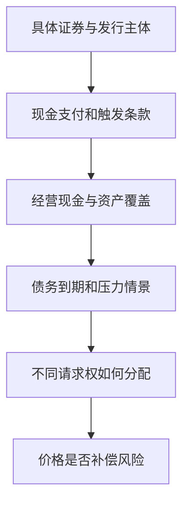

# 《证券分析》：先分析权利、偿付能力与盈利，再讨论报价

> 原作者：Benjamin Graham、David L. Dodd，本杰明·格雷厄姆、戴维·多德；1934 年初版。第七版于 2023 年出版，加入塞思·卡拉曼等人的编辑与评论，不能把新增评论当成两位原作者当年的文字。用户中文版本未确认。  
> 资料范围：以历版核心主题、出版目录和公开投资者教育资料为线索的系统导读，未取得完整原书，不声称逐页精读。涵盖投资与投机、固定收益、优先证券、普通股、利润表、资产负债表和价格价值关系，共 34 点。后来的真实案例是补充教学。更新：2026-11-12。

## 先理解本书的立场

证券是一份经济与法律请求权。它值多少钱，不能只看名称、票面利率或最近上涨；需要看发行人创造现金的能力、资产与负债，以及你在不同情景下究竟能取得什么。

本书最有价值的训练是保守地组织证据：把承诺与偿付能力分开，把当期利润与可持续盈利分开，把账面资产与可实现价值分开。分析可以减少错误，不能消除未来不确定性。

版本说明见[McGraw Hill 第七版书页](https://www.mheducation.com/highered/mhp/product/security-analysis-seventh-edition-principles-techniques.html?viewOption=student)。本篇不机械采用大萧条时期的利率、行业标准、会计准则和筛选数字。

## 内容地图

| 核心主题 | 要回答的问题 | 位置 |
| --- | --- | --- |
| 分析范围与价值 | 怎样判断证据足够 | 1—6 |
| 固定收益与契约 | 钱能否收回，权利如何排序 | 7—15 |
| 普通股与盈利 | 盈利能否持续，股东怎样获益 | 16—24 |
| 资产与特殊情况 | 账面价值如何兑现 | 25—30 |
| 组合与实践 | 怎样保护判断错误后的生存能力 | 31—34 |

## 核心知识点

### 1. 投资与投机的区别在证据、价格和安排

不是所有持有很久的行为都是投资，也不是所有短期持有都完全没有分析。重要的是能否通过充分研究，对本金安全与合理回报形成有依据的判断。

这不是要求知道未来每件事，而是识别未知是否大到使价值判断失去基础。如果收益主要取决于后来有人更高价接手，应坦率承认这种依赖，不能只因为买的是股票就称为企业投资。

### 2. 安全应由实际条件支持，不能靠证券名称

“债券”“优先”“担保”“国企”等名称各自表达特定信息，不能替代债务人的现金、抵押物、合同和适用规则。最安全的证券也可能因价格过高或资金期限不匹配而不适合某个投资者。

分析应先确认发行主体、义务承担者、偿付来源和触发条件，再看收益率。高票息可能是对较高风险的补偿，不是风险已经被消除的证明。

### 3. 内在价值可以是区间，不必假装精确

企业未来有多种合理情景，估值应与资料可靠程度相称。判断一项证券明显缺乏安全余地，可能比算出一个精确目标价更容易。

区间也不能随意宽到容纳所有结果。要说明上下界来自哪些经营、资产和风险假设，并识别最能改变结论的资料。模型是整理判断的方式，不是把未知变成已知的仪器。

### 4. 定量与定性互相检验

财务数字提供规模和历史表现，商业、管理与行业结构解释这些表现为何可能持续。只有故事没有数字容易夸大；只有数字没有业务，可能把暂时现象永久化。

研究记录可分事实、解释和推断：事实可回原表，解释能与业务证据对照，推断保留条件。把三者混成一句“公司很好”，会失去可复查性。

### 5. 历史记录是证据，不是未来合同

多年盈利和偿息记录有价值，但行业、负债和资产结构改变时，过去关系可能失效。平均值不能自动消除结构变化。

尤其要避免只选繁荣时期，或只看今天仍存活的企业。历史分析需要保留衰退、融资紧张和失败情形，再问哪些条件与当前可比。

### 6. 安全边际不是最多亏损比例

价格低于保守估计价值，可以容纳一定误差；若价值本身快速恶化，折价也会消失。安全边际同时依赖价格和资产、现金流的可靠性。

**数学演示：**估计价值 100、价格 70，折价 30%；若实际价值后来只有 40，价格相对买入成本仍可能大幅损失。因此“折价三成”不等于“最多亏三成”，更不代表任何情况下都有保护。

### 7. 债券分析首先关注本金和利息的覆盖

债券持有人通常不分享企业无限上行，收益有契约上限，却可能承担严重下行。因此应先评估正常和压力情景下能否偿付，而不是仅看企业增长故事。

利息覆盖、现金、到期债务、资本开支和再融资条件应一起看。只要企业还有账面利润，不代表到期时一定有足够现金；利润与偿付时间之间的错配可能决定结果。

### 8. 利息覆盖倍数要用可靠的盈利口径

**补充检查方法**：先把利润恢复到付息之前，再用同一期间的利息负担比较；若使用 EBITDA，要记得它尚未扣除资产消耗。资本密集企业即使 EBITDA 看起来很高，也可能需要大量现金维持设备，不能全用于偿债。

还要区分利息偿付与本金到期。每年支付得起利息，却在两年后需要偿还巨额本金，而没有再融资渠道，仍可能违约。把未来各年的本金、利息、经营现金与可用现金逐项排开，比一个平均覆盖倍数更接近真实生存问题。

经营利润除以利息只是常见入口，需要确认一次性收益、周期高点和非现金项目。账面费用还可能因资本化而低估实际负担。

分析应看多个期间及压力下的覆盖，并理解租赁、担保和其他固定支付。一个统一的倍数阈值不能适用于所有行业、期限和信用结构。

### 9. 抵押物的价值取决于需要出售时的状态

抵押可以提高债权保护，但资产估值可能与债务人经营一起恶化。设备、库存、房地产或股票的正常价格，不等于危机中能及时实现的现金。

还要确认抵押权顺位、登记、其他债权、执行费用与管辖规则。没有这些资料，仅知道“有抵押”并不足以估计回收率。

### 10. 长债存在利率风险，不只存在违约风险

即使现金支付确定，市场要求收益率上升也会压低既有固定票息债券的价格。期限、久期和现金分布影响敏感度。

持有到期可以避免把某些中途报价变动实现为损失，但仍取决于不需要提前卖出、发行人履约及购买价格。通胀还会影响实际购买力，不能把名义本金收回等同实际财富完全保全。

### 11. 通胀保护也要阅读具体条款

**真实产品机制：美国 TIPS 的本金随规定的通胀指数调整，到期偿还调整后本金与原始本金中较高者，利息按调整后的本金计算。**[美国财政部说明](https://www.treasurydirect.gov/marketable-securities/tips/)

这个机制并不保证你在二级市场支付的溢价都受保护，也不保证提前出售不会亏损。个人实际消费篮子与指数、税收、汇率和购买时点，仍影响最终结果。

它说明安全必须具体表达：保护哪项风险、按什么指数、到什么时点、以哪种货币。把产品名字中的“保护”直接理解成一切情景都不亏，会省略关键契约条件。

### 12. 优先权是相对于特定权利的排序

优先股可能在分配或清算中优于普通股，但通常仍在债权之后，且股息是否累积、可否延期、是否可转换，都要看具体条款。

累积未付股息不等于能够按期收到现金。即使法律上优先，如果可分配资产不足，经济上仍可能没有回收。研究者必须把权利顺序和资产数量一起分析。

### 13. 可转换证券是债权与股权选择的组合

转换权提供参与上行的可能，债务或优先条件提供某种基础请求权，但这种组合不是无成本的完美保护。票息、赎回、强制转换和稀释安排都影响价值。

公司状况恶化时，债权基础也可能受损；公司状况改善时，发行人的赎回权又可能限制持有人的收益。先画出不同价格与事件下的现金和权利，再谈收益率。

### 14. 契约细节可能改变常识中的损失顺序

**真实补充：FINMA 在 2023 年 3 月说明，对瑞信 AT1 资本工具实施减记的依据包括合同中的存续事件条款及当时紧急安排。**[FINMA 当时说明](https://www.finma.ch/en/~/media/finma/dokumente/dokumentencenter/8news/medienmitteilungen/2023/03/20230323-mm-at1-kapitalinstrumente.pdf)

这是一项特定司法辖区、产品和历史事件，不能直接推断所有国家、所有债券都适用同一处置顺序；后续争议与诉讼也不能由这份公告替代。

对投资者的启发是，银行资本工具并非普通存款或普通高级债。名称里有“债”，不代表本金不会因契约触发而减记。看票息之前，要理解损失吸收、延期、转换和监管触发条件。

### 15. 担保与集团关系要落实到法律主体

母公司名气大，不等于子公司债务必由其承担；有支持意愿，也不同于无条件法律保证。担保范围、上限、期限和执行条件都可能有限。

研究需区分发行人、资产持有人、担保人和现金流来源。若集团内部存在多层债务，还要注意经营资产现金先满足哪一层请求权。



图强调先理解权利和偿付，再比较收益率，不以名称替代条款。

### 16. 普通股代表剩余权益

在满足优先请求权后，普通股参与剩余收益。这提供上行空间，也意味着债务、经营和重组风险可能集中传给股东。

股价很低不说明企业很便宜；若债务庞大，普通股只是很薄的一层权益。估值时要同时看企业整体价值和权利结构，不能只比较每股报价。

### 17. 每股盈利比总盈利更接近股东份额

公司利润增长可能伴随新增股份，使原股东每份权益并未同比增长。回购则可能减少股数，但要看支付价格和融资来源。

应统一基本与稀释股数，注意可转换工具、员工期权和发行安排。每股收益改善也可能来自财务工程，仍需回到总现金和资本成本。

### 18. 盈利能力需要跨周期和异常项目调整

单年利润受资产出售、税率、准备金、汇兑和周期影响。分析可持续盈利，应识别哪些部分能在正常经营中重复。

调整要有理由和对称性。不能每年都把亏损叫一次性，把偶然收益却保留在正常利润里。频繁发生的重组费用可能就是商业模式的实际成本。

### 19. 费用资本化会同时改变利润和资产

**数学演示**：一项本应当期确认的经营支出 100，若被错误列为五年摊销资产，在暂不考虑税且按全年直线摊销的假设下，当期只确认 20 费用，利润多出 80，期末资产也多出 80。公司支付的现金并没有因此减少。

所以会计研究不能仅看利润增长：要查资本化依据、资产用途、摊销期限和现金流分类。合理资本化与造假不靠“有没有资本化”区分，而靠支出是否满足相关确认条件、估计是否可靠，以及披露是否一致。WorldCom 案例中的问题在于不当处理真实经营成本，不能推广成所有长期投资都必须立即费用化。

**真实案例：WorldCom 特别调查报告记载，公司最初发现并披露，2001 年及 2002 年第一季度约 38.52 亿美元线路费用被不当转入资产科目。**[提交 SEC 的调查报告](https://www.sec.gov/Archives/edgar/data/723527/000093176303001862/dex991.htm)

把本应当期计入损益的费用资本化，会暂时提高利润并增加资产，以后再通过折旧或减值影响报表。投资者若同时相信利润高和资产多，就可能对同一个错误重复乐观。

这不表示所有资本化都错误。真实长期投资本来可能按准则形成资产；需要看经济收益、会计政策、现金支付与异常变化。案例中的不当会计有调查证据，不能仅凭某家公司资本开支上升就类推为欺诈。

### 20. 折旧是经济消耗的近似，不是可以随意忽略的费用

会计折旧受历史成本与寿命假设影响，可能不同于今天维持资产所需成本。但“非现金”只说明当期没有同额付款，不意味着资产永远不用更新。

重资产企业尤其需要把折旧、维护资本开支、设备年龄和产能联系起来。只用 EBITDA 判断可分配现金，可能漏掉业务持续运行所必需的支出。

### 21. 存货和应收款应以回收能力评价

库存可能过时、损坏或需折价，应收款可能延期、争议或坏账。账面金额并不保证按时转成现金。

分析包括账龄、客户集中、跌价准备、退货、销售政策与周转。如果公司在行业低迷时异常扩大信用销售，利润与现金的差异就更值得追查。仍要保留正常扩张等替代解释。

### 22. 股息政策不能代替盈利分析

稳定派息需要稳定资金来源。短期高派息可能来自资产出售、借款或释放储备，不能自动永久化。

同时，暂不派息也未必不好，如果留存资金能以合理回报再投入。股东应比较留存收益的实际用途与机会成本，避免把所有现金分配都看成好、所有再投资都看成坏。

### 23. 增长判断必须面对竞争与资本需求

未来盈利可能增长，但估值应区分增长需要的新增资本与增长带来的收益。对很远未来的精确预测，证据通常较弱。

保守不等于假设所有公司不会成长，而是避免为尚未证明的成长支付过多价格。成长的质量和持续性，应由业务、财务和竞争资料共同支持。

### 24. 管理层的能力与利益安排都重要

诚信、能力和股东待遇是不同问题。管理者可能诚实但判断差，也可能业务能力强却偏好扩大个人控制和报酬。

观察关联交易、薪酬、收购、回购、信息披露和错误处理，比仅评价沟通风格更接近投资问题。优秀管理也不能使差行业和过高价格自动合理。

### 25. 账面价值不是变现底价

账面资产按会计规则记录，清算价值取决于买方、资产用途、处置速度和成本。尤其是专用设备，在整个行业衰退时可能很难找到愿意支付重置成本的买家。

**真实案例：巴菲特在 1985 年股东信中讨论关闭纺织业务及随后设备处置，指出账面、重置成本与拍卖实现值之间的巨大差异。**[当年股东信](https://www.berkshirehathaway.com/letters/1985.html)

对“资产打折”的判断应先问这些资产还能产生什么收益，或者谁愿意购买。经济用途消失时，历史投入再多也不能保护今天价值。清算也有员工、税务、环境、租赁和其他义务，不能只计算资产一边。

### 26. 净流动资产法需要历史语境与现实核验

格雷厄姆式分析曾重视以流动资产减全部负债后仍显著超过市值的机会。这种思路强调可实现资产与价格余地，不是一个永远适用的自动策略。

今天需要检查应收与库存质量、隐藏义务、烧钱速度、控制人行为、退市和交易成本。低于某项账面净值，仍可能是价值持续流失的陷阱。

### 27. 持续经营价值与清算价值不可随意相加

同一资产如果已用于产生持续经营现金，不能再把它作为额外资产全部加一次。只有不影响经营且未计入现金流的多余资产，才可能另行处理。

估值时写清情景：继续经营、部分处置还是整体清算。不同情景的现金和费用不同，不能把每种情景中最有利的部分拼成一个不存在的公司。

### 28. 重组要先看旧股东的权利能否延续

**GM 官方说明确认，旧公司股票在重组后改为 Motors Liquidation Company 股票，并于 2011 年 3 月 31 日注销。**[GM 股东说明](https://investors.gm.com/shareholders/stock-information)

汽车、品牌和工厂继续存在，并不意味着旧普通股自动得到新公司的权益。资产可能在重组中转移，债权人和新出资人获得新的请求权。

所以“政府不会让它倒”“产品还在卖”都不能替代股东分配分析。要读具体重组计划、债权等级、融资和稀释条款，再判断价格意味着什么。

### 29. 清算和特殊事件有时间与执行风险

清算分析还应把公司层面的所得与普通股层面的所得分开：资产卖出价先支付处置费用和相关税负，再依权利顺序分配，未决诉讼或其他责任可能要求留存准备金。控制股东能够决定出售，并不代表全部现金必然立即派给公众股东。

这解释了为什么研究报告不能只写“资产售价超过市值”。完整论证需要提供交易是否可行、资金是否可分配、谁有权阻止，以及预计等待期。没有这些条件，纸面差额仍可能无法成为股东回报。

资产出售、分拆、合并或清算可能缩小价格与价值差距，但结果受审批、诉讼、税费、融资和管理执行影响。价格差并非免费的收益。

预计回报要考虑完成时间和失败情景。把半年可能完成的交易与可能拖延三年的程序简单按相同收益率比较，会低估资金占用和不确定性。

### 30. 市场价格既是机会，也是需要解释的信息

价格偏离分析价值可能产生机会，但也可能意味着别人知道你遗漏的东西。独立判断不是拒绝市场信息，而是检查它是否有证据。

低价应触发更认真调查，而不是更强烈自信。若你无法解释其他投资者为何愿意低价出售，至少要把这当作研究问题保留下来。

### 31. 分散保护分析无法消除的错误

每项研究都可能遗漏重要事实。分散应看共同风险，而非只数证券；同一行业、同一融资来源和同一抵押物的持仓可能一起受损。

分散也不能修复全部证券都买贵或都依赖脆弱融资。它是与研究、安全边际和资金安排共同使用的一层保护，不是替代品。

### 32. 不使用杠杆与有安全边际是不同问题

价格便宜仍可能短期下跌；杠杆又带来利息、抵押补充和强制处置，使投资者无法等到分析兑现。资产价值和融资期限应分开评估。

历史上长期资本管理公司使用高杠杆，在 1998 年危机中遭受严重压力，说明价差判断与资金存续条件不同。[美联储历史记录](https://www.federalreservehistory.org/essays/ltcm-near-failure)这不是把所有策略归为同一种错误，而是强调融资会改变可承受路径。

### 33. 把分析写成能被反驳的论证

```text
证券和法律主体：
本金、利息、分红或其他权益条款：
现金和资产依据：
正常与承压情景：
请求权顺序与潜在稀释：
价格、估计价值和误差来源：
最强的反对证据：
实现路径、时间与复查条件：
```

若最强反证不存在，通常不是因为机会完美，而是研究尚未充分。反证应该有能力改变结论，不能只是写一句“市场有风险”。

### 34. 先判断分析边界，再决定投入多少研究

某些证券条款复杂、资料不足或损失结构难以估计，选择不参与可以是有依据的结果。能力圈的边界应由事实决定，而不是由想获得的收益决定。


这条流程不会消除损失，但能避免把未理解的风险直接包装成便宜机会。

## 练习与参考答案

**有抵押是否意味着本金安全？** 不一定。需检查抵押权顺位、资产在压力下的价值、执行与费用。

**把费用转成资产为何可能同时美化两张表？** 当期费用减少提高利润，资产余额增加；WorldCom 的调查材料提供了真实的不当会计案例。但正常资本化仍需按准则和经济实质判断。

**旧 GM 的品牌继续经营为何不能证明旧股票有价值？** 因为资产经营与原普通股请求权的延续不同，重组改变法律实体和分配关系。

## 边界与后续阅读

这是一部体系庞大的专业著作，本篇覆盖重要问题而非全部历史案例和公式。合同、破产、监管与税务结论必须按市场和当期文件判断；历史案例只用于解释机制，不直接迁移法律结果。

可与[《聪明的投资者》](<../聪明的投资者 - 本杰明·格雷厄姆/读书笔记.md>)比较：后者更重个人投资政策，本书更深入证券的经济与契约分析。进一步的现金流模型见[《投资估价》](<../投资估价 - 阿斯沃斯·达摩达兰/读书笔记.md>)。
