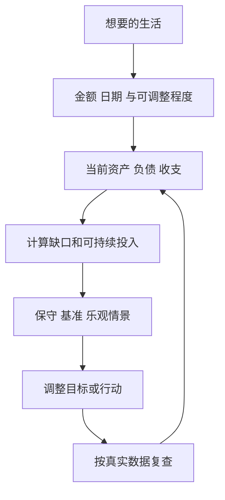
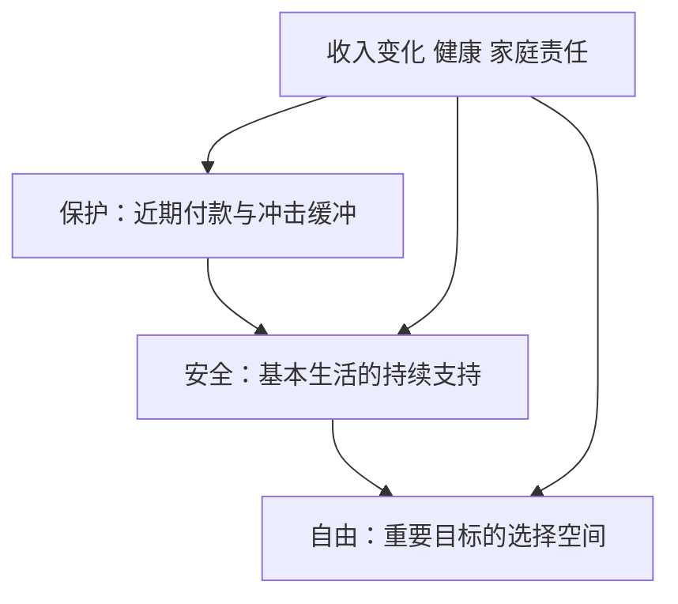

# 《财务自由之路》：把赚钱愿望变成可以核查的财务计划

> 作者：博多·舍费尔（Bodo Schäfer）。规范中文书名为 **《财务自由之路》**，与李笑来的《财富自由之路》不是同一本书。原作为 *Der Weg zur finanziellen Freiheit*。本笔记核对德国 dtv 2003 年修订版书目与德国国家图书馆目录，以及 2025 年人民文学出版社中文发行资料；不同版次的金额单位、标题与编排不可混用。中文常见副标题“7年内赚到你的第一个1000万”是书名中的目标表述，**不是适合每个人的收益保证**。未取得全书，以下属于基于公开资料的系统导读；研究、计算及现代投资校正是补充教学。

本书把财务改善分成两部分：先明确目标、责任与金钱观，再处理债务、收入、储蓄、复利、投资、保障和支持网络。它擅长推动读者开始行动，但个人成功叙事、读者来信和课程宣传不能单独证明方法对所有人有效。阅读时应保留行动动力，同时把强承诺变成可检验的条件。

## 主题地图与版本依据

| 原作主题 | 本文学习任务 |
|---|---|
| 想要什么、责任、财富与金钱观 | 将愿望变成真实目标，区分可控与不可控 |
| 债务、收入、储蓄 | 理顺现金流，提高可持续结余 |
| 复利、投资原则 | 理解计算并审查风险与成本 |
| 财务保护、安全、自由 | 按不同任务安排资金，而非只追求一个金额 |
| 教练、专业网络、给予 | 选择支持与反馈，保留独立判断 |

结构据[德国国家图书馆目录](https://d-nb.info/965951804/04)核对。[dtv 书目与版本](https://www.dtv.de/buch/der-weg-zur-finanziellen-freiheit)，[2025 年中文正版发行资料](https://item.xhsd.com/items/110000104679398)。下面 30 点为主题重组，并非原书有 30 章。

## 一、先把愿望和现实放在同一张纸上

### 1. 财富目标需要金额、日期和生活用途

“我想有钱”很难指导选择。目标应说明钱解决什么问题、什么时候需要、哪些部分可以调整。提前退休、改善住房和建立收入缓冲，需要不同的资金安排。

目标金额也要说明是净资产、可投资资产还是可用现金。把不能轻易变现的住房计入总资产，再用同一个总数证明生活费已经有保障，会把财富存量和付款能力混淆。

### 2. 金钱观会影响行为，但不会取消资源约束

认为钱一定肮脏，可能妨碍合理议价；认为有钱才值得被尊重，也可能驱动过度比较。这些信念值得检视，但改变信念不等于改变工资、房租、健康和制度条件。

可以把一句金钱信念写成可检验问题。例如“我永远存不下钱”，需要检查收支、责任和重复消费；如果基本支出确实超过收入，答案应包括收入与现实支持，而不是只要求更积极。

### 3. 责任是寻找可行动部分，不是承认所有困难都是自己的错

作者强调主动承担责任，可以理解为把注意力放在下一步能够改善什么。它不应变成对贫困、失业、疾病或照护责任的道德指责。

把事项分成能够直接决定、能够影响、暂时无法控制三类。前两类需要行动，第三类需要缓冲、求助或接受不确定性。把不可控风险误认为态度问题，可能使人拒绝必要帮助并承担更大损失。

### 4. 自信应建立在可追踪的能力证据上

记录已完成的工作、解决的问题、真实客户反馈和学到的技能，可以帮助发现能力增长。它比单纯反复告诉自己“必定成功”更有用。

同时记录失败与修正，不要让成功日记变成选择性证据。如果某次收益来自市场普涨，应该承认；若某项技能尚未产生实际需求，也要保留未知。健康自信容许更新，不能要求事实迁就信念。

### 5. 梦想、价值观和策略需要彼此兼容

如果最重视家庭时间，策略却要求长期无限加班，就存在冲突；如果最重视安全，却靠高杠杆追赶金额目标，也需要重新讨论。

冲突不是靠更用力就能消除。应明确当前优先级、可接受代价和阶段性调整，避免把所有好东西同时写进目标，却不承认资源有限。财务计划需要取舍，而非只增加愿望清单。

### 6. “七年目标”应做反算，不能直接相信

**数学演示。** 若没有新增投入，资本七年翻倍，需要年复合回报约 `2^(1/7)−1=10.41%`；七年变成十倍，则需要约 38.95%。二者都不是无风险利率，后者尤其不能作为普通预算的稳定假设。

如果目标还包含持续收入和储蓄，应该分别估计这些来源，而不是把全部增长归于投资技巧。先问初始本金是多少、每年能投入多少、税费如何计算、失败时会发生什么。副标题能激发动机，不能替代这些条件。

图为目标检验示意。若计划只在很高收益下成立，应调整目标、期限或收入安排，而非把高收益写成必然。

## 二、债务：先减少脆弱性，再讨论财富加速

### 7. 先建立完整债务清单

清单应包含本金、实际年化成本、费用、付款日期、担保、提前还款和违约条款。名义利率低，不一定实际成本低；付款金额稳定，也不代表本金下降很快。

按时间列现金需求比只看总余额更有用。未来某月有大额到期本金，即使当下每月可以支付利息，也可能面临压力。应同时看资产和义务，避免用高净值掩盖短期付款困难。

### 8. 借款用途与偿付来源需要分别说明

用于经营的借款不自动是好债，用于消费的借款也不能只用道德标签判断。关键是实际成本、未来收入、用途价值、期限和不利情景。

若经营项目失败，是否仍需以工资或住房承担义务？若收入下降，还款怎样安排？把这些问题写清楚，比简单区分“富人会借钱、穷人怕借钱”更符合完整财商。

### 9. 多笔债务还会占用注意力

**真实研究补充。** Ong、Theseira、Ng 对新加坡一项债务减免计划的 196 名受助者进行前后比较，研究发现清除债务账户数量与认知、焦虑和决策变化有关。论文将识别设计描述为准实验，并明确不能完全排除选择问题，不应因数据库标签而称它是随机对照试验。[原始论文](https://pmc.ncbi.nlm.nih.gov/articles/PMC6462060/)。

它说明债务可能不仅消耗利息，还消耗记账、担忧与应对能力。但这不证明任意债务合并产品都有益，也不确定单个人的最佳还款顺序。降低账户数量如果同时提高总费用或延长期限，仍需重新比较。

应用上，可统一记录、设置可靠提醒，并区分财务成本与心理管理成本。降低复杂度应当以不增加更大负担为条件。

### 10. 还债顺序需要同时看成本和执行

优先处理高成本债务，在其他条件相同时可以减少利息；先消除较小账户，有时可能改善执行体验。两者并非在所有情况下等价，不能只靠口号选边。

先确保基本生活和合同义务，再比较实际成本、罚费、保障与可持续付款。若需要协商，应依据真实合同和当地规则，不能以读书中的比例代替法律义务。困难已经出现时，及早核对比回避更有帮助。

### 11. 留现金与还债之间存在真实取舍

把所有现金用于还债，会减少利息，却可能在下一笔必要支出出现时重新借款；保留过多现金，也可能持续支付昂贵利息。合理安排取决于收入稳定性、近期责任、保障和借款成本。

没有用户实际背景，不能给统一比例。可以先把已知付款与可能冲击列出来，再比较不同方案。目标是减少整体脆弱性，而不是让某个账户余额看起来最漂亮。

## 三、收入和储蓄：比追求神奇收益更能直接行动

### 12. 增加收入先研究你创造的可支付价值

努力和收入并非一一对应。收入还受需求、稀缺技能、组织、议价和制度影响。提升收入可以研究如何解决更有价值的问题、提高交付质量、展示成果和改善合作。

应保留现实边界：不是所有岗位都有相同议价空间，照护、健康和地域也可能限制选择。把所有收入差异归因于个人贡献大小，会忽略这些条件。

### 13. 专业优势要经过真实反馈

决定学习一项技能前，先核查谁需要、用什么标准判断、能否通过真实任务展示。取得证书、完成课程和客户愿意付费是不同阶段。

可以先做可逆的小投入，再根据反馈扩大。不要为证明决心而承担无法恢复的大额培训债务。若资料只有少数学员成功故事，还缺总体结果、失败者和筛选条件。

### 14. 提高收入要看税后净额和额外时间

收入增加可能伴随通勤、餐饮、照护、设备和恢复精力的成本。兼职或创业还可能影响主业、健康和家庭责任。

比较方案时，记录新增现金、额外时间、风险和可迁移能力。并不是收入更低的方案一定更好，也不是工资单更高就必然提高自主权。多个目标需要明确权衡。

### 15. 储蓄是把未来目标放进当前预算

书中的“先支付自己”强调预留积累，不等于优先于基本生活、税费和到期义务。可持续金额来自真实现金流，而非证明意志的固定比例。

把储蓄与支出日期放在一起核对。总收入足够，也可能因到账晚于扣款而发生短缺；自动转账应按可用余额安排。储蓄增加但高成本债务增加更多，不能视为整体进步。

### 16. 自动化改变执行难度，也能固化错误

**真实研究。** Madrian 与 Shea 研究企业退休计划的默认加入变化，发现默认方式显著影响参与，同时默认缴费率与资产选项有黏性。[原始论文](https://www.nber.org/papers/w7682)。

对本书的启发是：把合理计划变得容易执行，比每次都依赖强烈决心更可持续。但自动化必须放在选择之后，不能让高费用、不适合期限的方案自动持续。

核对金额、日期、工具、费用和暂停条件。收入或责任变化后应复查，让自动化承担重复动作，把判断留给明确的检查节点。

### 17. 未来收入增长可以提前分配

**真实实施补充。** Thaler 与 Benartzi 的 Save More Tomorrow 方案，让参与者提前同意把未来加薪的一部分用于退休储蓄。早期企业实施发现储蓄率提高，但参加存在选择性，不是人人随机分组后获得同样效果。[2004 年原始论文](https://www.journals.uchicago.edu/doi/full/10.1086/380085)。

机制是预承诺减少拖延，并降低眼前收入被削减的感觉。它提高的是投入，不是投资回报。如果加薪赶不上必要支出变化，规则还需要调整；不能用尚未发生的加薪为今天过度借款背书。

## 四、复利与投资：把鼓励行动和收益保证分开

### 18. 复利取决于本金、净回报与时间

一次性投入的简化公式是 `终值＝本金×(1+净年回报率)^年数`。持续追加资金则需分别计算每笔投入参与增长的时间，不能假定最后一年的储蓄从第一年就开始增值。

复利是计算关系，不是一种保证正收益的产品。亏损、费用、税和取款都改变路径；负债利息也可能累积。理解公式后，下一步应检验回报从哪里来，而不是只欣赏终值曲线。

### 19. 高收益假设会把不现实的目标伪装得可实现

**数学演示。** 10 万元以固定 6% 年回报积累 20 年约为 32.07 万；若把假设改成 12%，终值约为 96.46 万。差异巨大，但把计算器里的数字改高，不会提高资产实际创造现金的能力。

因此应同时展示较低回报情景、费用和中断投入的情况。若只有乐观情景才达到目标，就应把缺口写出来。历史某段高收益、作者个人经历和读者成功信，都不能为稳定高回报提供充分保证。

### 20. 分散要看共同风险，而不是产品数量

多只基金可能重仓相同公司，多处房产可能依赖同一地区，副业和工资也可能受同一行业冲击。名称不同不等于经济驱动不同。

先追踪底层现金流、杠杆、币种和退出条件，再决定是否有新增分散价值。分散减少部分风险，却不能保证危机中完全不亏。把资金期限与风险共同考虑，比盲目增加品种更重要。

### 21. 投资和投机需要说清证据与退出逻辑

研究长期经营价值，关心现金流、价格和判断失效条件；利用短期价格变化，则还需要执行、交易成本和路径风险管理。两者不应在亏损后随意切换解释。

如果买入理由只是“别人将更贵地买走”，就应承认对交易需求的依赖。若原本靠经营价值判断，则需要持续核验业务，而非用每天涨跌证明公司好坏。明确策略身份，才能设计相应复盘。

### 22. 成本是可以检查的变量，不应藏在回报之外

管理、销售、顾问、交易、税务和融资成本可能同时存在。有些已经从净值扣除，有些由账户另付，核算时既不能遗漏也不能重复。

比较产品应先统一暴露和服务，再看总成本。高费需要解释提供什么额外价值，低费也不能掩盖不理解的风险。书中对银行和理财行业的历史评论，不应直接替代今天具体合同的核查。

### 23. 市场下跌后不保证迅速反弹到你的成本

某个广泛市场过去恢复过，不代表每家公司、每种产品和每个国家都恢复；即使最终恢复，持有者也可能在此前需要用钱。长期等待能力来自资金安排，而非信念强度。

应区分暂时估值波动、经营价值下降和永久性损失。对缺乏可核验价值、存在欺诈或已改变经济条件的资产，不能把“坚持”当作万能答案。作者的鼓励性表述需要经过这些风险校正。

## 五、财务保护、安全与自由不是同一个阶段

### 24. 财务保护先确保生活不会被小冲击打断

保护层关注近期现金、必要付款和基本保障。它的任务是让失业、维修或其他冲击不立即迫使你高成本借款或折价卖出。

资金是否需要随时可用，要根据责任而定；不能只因锁定产品利率更高就放进去。保险、现金和投资各解决不同问题，也不能用其中一个工具代替全部安排。

### 25. 财务安全关注可持续支持基本生活

当稳定资源能够较可靠地支持必要支出，选择空间可能扩大。但“稳定”需要检查来源、期限、购买力、费用和资本消耗，而不是只看今年分配金额。

若领取的资金包含返还本金，应明确资本计划消耗多久；若依赖出售资产，则要研究不同回报顺序。不能把某年高收益直接当作永久工资，安全层需要压力测试而非单点预测。

### 26. 财务自由要由自己的目标定义

自由可能是减少工时、换职业、承担照护、学习或不被某个雇主约束，不必与作者的人生选择一致。它既涉及钱，也涉及健康、关系和时间。

把自由写成可观察的变化，再估计需要什么资源。支出需求和家庭责任会变化，因此目标允许更新。没有一个统一财富金额能使所有人获得同样自主权。

图表示任务层次，不是保证按时间单向升级。新的责任可能要求重新加强保护层，不能因为达到过某一阶段就永不复查。

## 六、学习、支持与给予怎样保持清醒

### 27. 财务教育有平均效果，不等于每门课程值得购买

**真实研究。** Kaiser、Lusardi、Menkhoff、Urban 对 76 项随机实验、超过 16 万名参与者进行汇总，发现财务教育平均改善知识与部分后续行为。2020 年工作论文后来发表于 2022 年《Journal of Financial Economics》。[工作论文与方法](https://www.nber.org/papers/w27057)，[正式发表信息](https://www.gsb.stanford.edu/faculty-research/publications/financial-education-affects-financial-knowledge-downstream-behavior)。

平均效果不能证明某个具体导师、培训价格或“几年致富”承诺成立。还需看教学内容、反馈、成本、学员选择和真实结果。学习应落到识别费用、理解合同、计算和决策，而不只产生短暂兴奋。

### 28. 教练和专业网络要提供纠错，不是只强化信心

有价值的支持能指出遗漏、帮助理解资料、推动完成可核验任务。若一个圈子只允许成功叙事、把质疑等同于消极，就可能削弱判断。

检查建议者的具体能力、收费和利益关系。法律、税务、保险与投资管理属于不同领域，有钱或擅长演讲不代表全部专业。重大决定仍需保留独立证据和适当的第二意见。

### 29. 给予应出于价值和承受能力，不是交易式许愿

原作包含给予与“播种金钱”的主题。可以理解为资源与社会关系的责任，但不能推成“捐出多少就必然获得更多财富”的因果规律。

捐赠、帮助亲友和公益投入应核对用途、透明度和家庭责任。善意与偿付义务不同，情感承诺也不能取消预算。保留可持续性，才能让支持长期发挥作用，而非一次激动后陷入新的压力。

### 30. 用一份季度行动记录结束阅读

记录目标与缺口、债务和现金日期、一个收入能力项目、一项可持续储蓄安排、一个需要核验的投资问题及复查日期。每项行动写清完成标准，避免只记“更加积极”。

复查时分开市场收益、自己投入和外部帮助；失败则分析信息、执行和现实约束。你最终要得到的是可持续的判断与安排，而不是用是否达到副标题金额评价人生。

## 练习与参考答案

**一：七年十倍需要怎样的条件？** 若没有新增投入，数学上约需年复合 38.95%；这不是稳定可得收益。若主要靠收入和储蓄，应把各来源拆开计算。

**二：把六笔债务合成一笔，是否一定更好？** 不是。需比较利息、费用、期限、担保和管理负担，心理简化不能抵消任何程度的经济成本。

**三：自动储蓄后出现透支，是不是坚持还不够？** 首先应检查预算、金额与时点，自动化不能使不合理安排变合理。

**四：有人读书后致富，是否证明书对所有人有效？** 不能。还缺失败样本、起点、其他资源、市场条件和可识别的因果证据。

## 范围与关联阅读

没有原书全文，本文不复述无法核验的个人经历，也不将历史投资规则包装成现行建议。书名已据正式书目校正。可与[《小狗钱钱》](<../小狗钱钱 - 博多·舍费尔/读书笔记.md>)比较习惯启蒙，与[《金钱与生活》](<../金钱与生活 - 维姬·鲁宾、乔·多明格斯/读书笔记.md>)讨论目标和时间，与[《赢得输家的游戏》](<../赢得输家的游戏 - 查尔斯·埃利斯/读书笔记.md>)校正投资竞争与成本认识。
