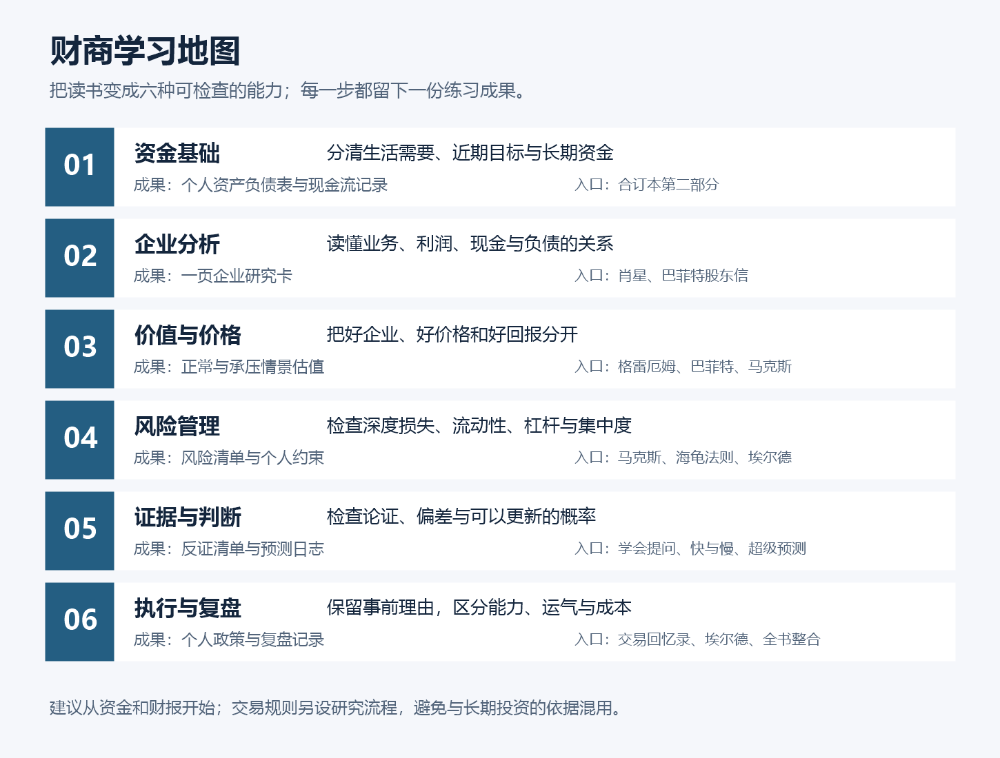
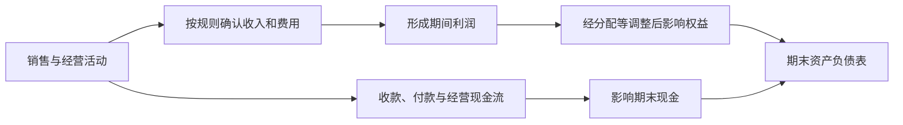
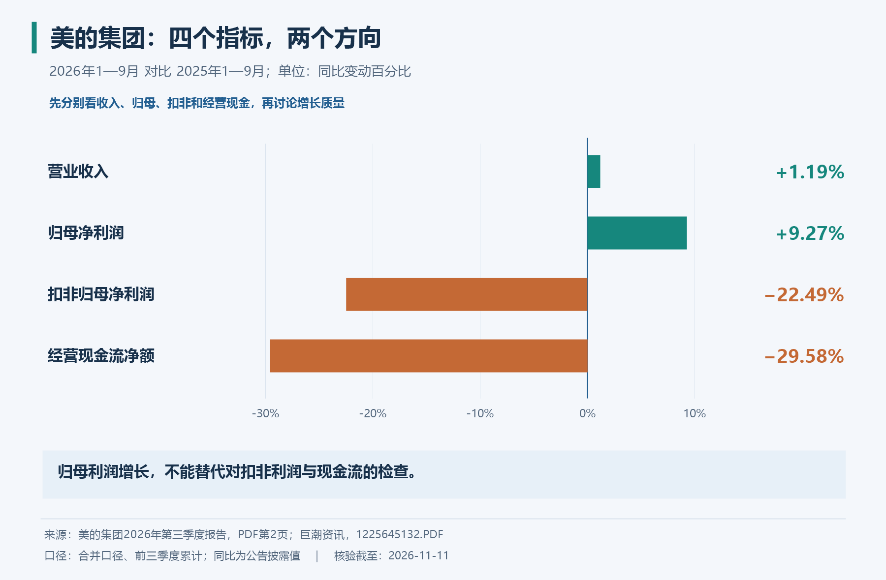
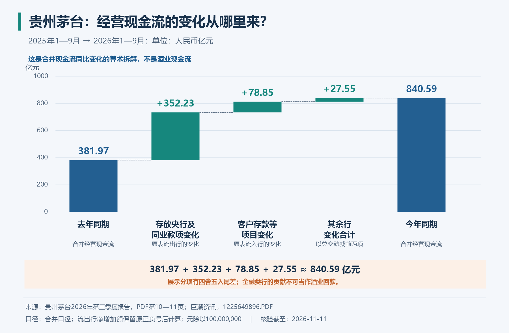
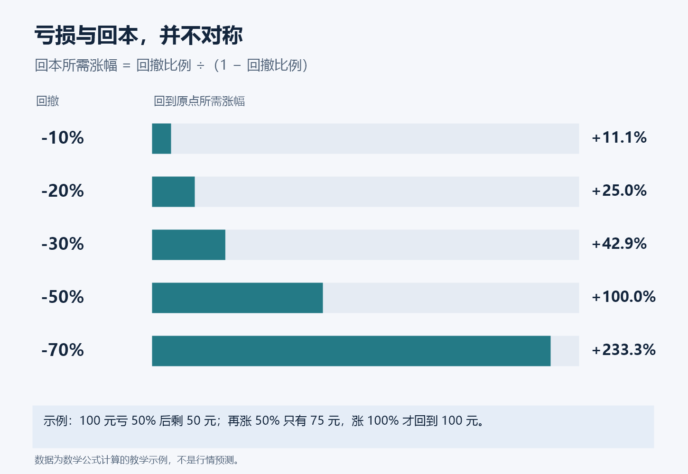

# 财商进阶合订本：从读懂股票，到建立自己的决策流程

> 目的：把这 71 部书籍／书信资料转成一套能练习的财商方法，帮助你管理资金、理解企业、判断价格、识别风险和复盘决策。  
> 形式：按能力重组的主题合订本，附各书独立笔记链接、学习顺序、练习和可复制模板；不重复拼接全部书摘。  
> 资料范围：各书笔记已分别注明版本、原文核对范围与公开来源；本篇中的流程、虚构算例和学习安排是综合教学设计，不归为某位作者的原话。真实财报案例另标公司、期间、来源及推理边界。  
> 更新日期：2026-11-12。前批 20 本的学习安排见第十二部分；本轮新增 40 本的能力路线与练习见第十五至十七部分。方法之间的条件区别贯穿各部分。

## 先读这一页：你要建立的六种能力

提高财商，最实际的标准是：**同样面对一笔钱、一个机会和一段宣传，你能比以前更清楚地判断它是什么、值多少、可能错在哪里，以及自己是否承受得起。**

这套资料围绕六种能力展开：

1. **管好自己的现金流。** 分清生活需要、短期目标和能够长期承受波动的钱。
2. **读懂企业赚钱的过程。** 看到收入、利润，还能继续追问现金、资产、负债和投入产出。
3. **把企业质量与购买价格分开。** 好企业也可能买贵，低价格也可能对应真实的衰退。
4. **理解风险与不确定性。** 既考虑可能赚多少，也考虑判断失误、流动性与无法翻身的损失。
5. **识别自己和别人的思维漏洞。** 用证据检验理由，不被权威、故事、价格锚点和情绪带走。
6. **建立能复盘的流程。** 在行动前写清依据、约束和改变想法的条件，事后区分能力与运气。



**怎么看这张图：** 前三步回答钱从哪里来、企业怎样赚钱、当前价格是否合理；后三步检查判断能否站得住，以及出错后是否仍有调整空间。它是一条学习路线，也是一条重复使用的检查流程。

如果你暂时不知道从哪里开始，先做三件事：写出个人资产负债表；读《一本书读懂财报》的三表部分；选择一家业务容易理解的公司，用本文的研究卡做一次纸面分析。暂时不用为了练习而买股票。

**具体概念请直接读对应书籍笔记：需要例子的知识点，已在原小节结合真实公司、历史事件或原始研究展开；不需要例子的概念正常总结。** 本篇负责串起学习与应用流程。[美的与贵州茅台三季报图解](实战案例/2026三季报图解.md)另存共用原表、四张数据图和详细计算，方便复核，不作为理解每本书的先修篇。

## 一、这些书各自负责解决什么

| 资料 | 对财商最重要的贡献 | 阅读时要防止的误解 | 独立笔记 |
| --- | --- | --- | --- |
| 《一本书读懂财报》 | 识别企业的资产、利润、现金流与经营方式 | 会算比率就等于看懂企业 | [阅读笔记](<一本书读懂财报 - 肖星/读书笔记.md>) |
| 《聪明的投资者》 | 所有者视角、市场先生、安全边际与投资纪律 | 把历史筛选数字当成今天的自动买入公式 | [阅读笔记](<聪明的投资者 - 本杰明·格雷厄姆/读书笔记.md>) |
| 巴菲特股东信 | 企业质量、资本配置、长期复利和股东关系 | 照抄持仓，忽略价格、结构与自身条件 | [阅读笔记](<巴菲特股东信 - 沃伦·巴菲特/读书笔记.md>) |
| 《投资最重要的事》 | 价格与价值、风险、周期、第二层思维 | 逆向等于永远反对大众，判断周期等于精确择时 | [阅读笔记](<投资最重要的事 - 霍华德·马克斯/读书笔记.md>) |
| 《思考，快与慢》 | 认识直觉、偏差、损失厌恶与过度自信 | 认识偏差之后就不会再犯 | [阅读笔记](<思考，快与慢 - 丹尼尔·卡尼曼/读书笔记.md>) |
| 《学会提问》 | 检查论点、证据、假设、统计与遗漏 | 抬杠或找到一个瑕疵，就算否定全部结论 | [阅读笔记](<学会提问 - 尼尔·布朗、斯图尔特·基利/读书笔记.md>) |
| 《超级预测》 | 给判断明确期限、概率、更新与评分 | 预测准就一定赚得到钱 | [阅读笔记](<超级预测 - 菲利普·泰特洛克、丹·加德纳/读书笔记.md>) |
| 《股票大作手回忆录》 | 理解大势、耐心、持仓与人性中的交易错误 | 把精彩经历当作经过检验的完整策略 | [阅读笔记](<股票大作手回忆录 - 埃德温·勒菲弗/读书笔记.md>) |
| 《海龟交易法则》 | 规则系统、仓位尺度、趋势跟随与回测问题 | 记住突破参数就能复制历史收益 | [阅读笔记](<海龟交易法则 - 柯蒂斯·费思/读书笔记.md>) |
| 《以交易为生》 | 心理、方法、资金管理及交易日志 | 指标越多、交易越频繁，越专业 | [阅读笔记](<以交易为生 - 亚历山大·埃尔德/读书笔记.md>) |
| 《被讨厌的勇气》 | 从他人的评价中保持判断自主与责任边界 | 不听意见、不承认错误就是独立 | [阅读笔记](<被讨厌的勇气 - 岸见一郎、古贺史健/读书笔记.md>) |

其中，财报、格雷厄姆、巴菲特与马克斯构成企业投资主线；逻辑、认知和预测类书籍负责检查判断；三本交易书帮助你理解另一类决策方式；《被讨厌的勇气》提供的是与评价、比较和责任相处的辅助视角。

## 二、先管理自己，再研究股票

### 1. 先写出你真正的财务位置

```text
净资产 = 资产总额 − 负债总额
期间净现金结余 = 期间实际现金收入 − 期间实际现金支出
```

净资产描述某个时点，现金结余描述一段期间。房屋估值上涨可能增加账面净资产，却未增加日常可用现金；借钱到账增加现金，也同时增加负债。把这两张表分开，能避免“账面很富有，却随时缺钱”。[Investor.gov：梳理个人财务](https://www.investor.gov/introduction-investing/investing-basics/save-and-invest/figure-out-your-finances)

先记录，不必追求一个看起来漂亮的答案：

| 项目 | 你要填什么 | 需要特别说明 |
| --- | --- | --- |
| 可用现金与存款 | 目前可支配的金额 | 受限、提前支取成本、币种 |
| 投资资产 | 当前可合理估计的价值 | 波动、变现时间、集中程度 |
| 其他资产 | 与实际财务目标有关的资产 | 不把难变现资产当应急现金 |
| 债务 | 本金、利率、到期与还款安排 | 浮动利率、担保、提前还款条件 |
| 每月必要支出 | 维持基本生活和责任的费用 | 不把可延期消费都算成必要支出 |
| 收入可靠程度 | 稳定来源与波动来源 | 与投资市场是否同涨同跌 |

### 2. 按资金用途和时间分组

某笔钱一年后必须使用，它和十多年后才使用的钱，约束不同。决定风险时，除了问“我心理上敢不敢”，还要问“跌了以后，我是否被迫卖出”。资产安排需要结合目标期限与承受能力。[Investor.gov：资产配置与分散](https://www.investor.gov/introduction-investing/getting-started/asset-allocation)

可以分为日常周转、应对意外、已有时间表的目标、长期积累。具体金额由收入稳定性、家庭责任、保障情况和资金可得性决定，不套用一张对所有人相同的比例表。

### 3. 比较投资之前，先看固定成本和确定负担

贷款利息、逾期成本与投资的预期收益并不对称：负债成本往往需要实际支付，市场回报则不确定。先理解负债条款，再考虑承担新的市场风险。

同样，收入能力、储蓄习惯与避免不必要费用，会影响你真正能投入和保留的资金。不要让研究股票替代对个人现金流的管理。

### 4. 不把阅读完成当作必须行动的理由

学习的产出可以是判断“目前不理解”“证据不够”“价格没有余地”。这是有效结果。没有研究优势时，可以先学习透明、分散、低成本的投资方式，再决定是否值得花时间主动选股；具体产品还要检查所投资市场、费用、集中度与适用条件。

## 三、把股票还原为一门生意

### 1. 在打开估值模型前，回答七个经营问题

1. 谁为产品或服务付钱，付钱解决什么需求？
2. 客户为什么选择它，而不是竞争对手或不购买？
3. 收入增长来自销量、价格、新市场，还是收购？
4. 扩张需要多少新增设备、库存、应收款和人员？
5. 利润最终能否变成可供分配或再投资的现金？
6. 行业低谷、竞争加剧或成本上升时会怎样？
7. 管理层如何使用留存收益，股东能否公平分享成果？

如果你只能回答“这是热门行业”，还没有进入企业分析。行业增长不保证每家公司赚钱，更不保证任何买入价格都有好回报。

### 2. 三张报表分别回答三个不同问题

| 报表 | 要解决的问题 | 看错时容易产生的误判 |
| --- | --- | --- |
| 资产负债表 | 某一时点拥有什么、欠什么、剩余权益多少 | 把账面资产直接当作可变现价值 |
| 利润表 | 一段期间内按会计规则确认了多少收入、成本与利润 | 把已确认利润当作已收现金 |
| 现金流量表 | 一段期间现金怎样从经营、投资和筹资活动流入流出 | 把借款或卖资产带来的现金当经营改善 |

还有权益变动表和附注等信息。看“三张表”是入门框架，实际阅读完整报告时不能省略审计意见、会计政策、分部、关联方和重大事项。[SEC：财务报表入门](https://www.sec.gov/investor/pubs/begfinstmtguide.htm)



**怎么看：**同一笔生意可以同时影响利润、现金和资产负债，但确认时间不同。图中省略了大量具体会计分录，仅用来区分“赚了”和“收到了”。完整算例见《一本书读懂财报》独立笔记。

### 3. 用问题带动比率，而不是记一堆阈值

| 指标或关系 | 入门算法 | 真正应该追问什么 |
| --- | --- | --- |
| 毛利率 | 毛利 ÷ 营业收入 | 产品结构、定价、成本和会计分类是否改变 |
| 净利率 | 同一口径净利润 ÷ 营业收入 | 高利润是否来自一次性收益或低税率 |
| ROE | 对应股东净利润 ÷ 平均对应股东权益 | 是经营强，还是杠杆高、权益很薄 |
| 总资产周转率 | 营业收入 ÷ 平均总资产 | 投入的资产是否产生足够销售 |
| ROIC | 税后经营利润 ÷ 平均投入资本 | 定义是否一致，新增投资能否获得足够回报 |
| 经营现金与利润的对照 | 多年经营现金流与净利润并看 | 应收款、存货、预收款等是否解释差异 |
| 债务偿付能力 | 现金、经营现金、利息与到期债务综合判断 | 钱什么时候回来，债什么时候必须还 |

同一个指标在银行、零售、软件、制造企业中不能机械比较。比率异常是调查入口，不是判决书；例如现金流短期偏低可能与扩张有关，也可能源于回款恶化，需要用附注和业务证据区分。

### 4. 财报分析优先看趋势、同业和解释

先用若干年数据看变化，再选业务结构相近的同行比较，最后追踪差异来源。只截取最好的一年，会隐藏周期；只看一个公司，会失去行业背景。

把观察分成三栏：报告披露的事实、管理层给出的解释、你尚未验证的推断。这样更容易发现“解释听起来合理，但证据还没有跟上”的地方。

**真实例子：美的 2026 年前三季度。** 归母净利润同比增长 9.27%，扣非归母净利润下降 22.49%，经营现金流下降 29.58%。如果“利润好坏”只用一个词描述，至少漏了两层信息。[美的三季报，第 2 页](https://static.cninfo.com.cn/finalpage/2026-10-30/1225645132.PDF)



第一步，把利润分化和现金流下降拆成两个问题。归母减扣非的 126.05 亿元，是非经常性损益净额，要查调整表及其经济实质；经营现金流下降，要另查收款、付款和营运资本，不能把利润分类的解释直接搬过来。

第二步，先做不会依赖故事的勾稽。这份报表的经营现金流，从去年同期 570.66 亿元降到 401.87 亿元，是经营流入增加约 89.74 亿元，而流出增加约 258.53 亿元的结果。随后才问：增加的付款来自采购规模、价格、库存、还旧账，还是结算安排？算出差额容易，识别机制需要附注与业务证据。[美的三季报，第 10 页](https://static.cninfo.com.cn/finalpage/2026-10-30/1225645132.PDF)

第三步，把研究结论限制在证据范围内。公司对扣非变化提到汇率及风险管理工具分类的影响，但这既不能证明主营没有变化，也不能把全部非经常性损益都当作外汇对冲。你的记录应区分“公告数字”“公司解释”“还待核实的判断”。[完整案例与计算过程](实战案例/2026三季报图解.md)展示了这三层怎样衔接。

### 5. 经营现金流也要看业务构成

“利润可以受会计估计影响，所以只看现金流”是一种常见的学习过渡阶段。现金流确实提供了另一种证据，但其中也有收付时点、预收预付、金融业务和一次性资金回收。现金流量表需要解释，不能只读最后一行。

贵州茅台 2026 年前三季度经营现金流同比增长 120.07%，但销售商品、提供劳务收到的现金仅增长约 3.41%。公司报告指向财务子公司的相关存款变化。按合并现金流量表，两项存款相关行的变化解释了约 93.99% 的经营现金流同比增量。[贵州茅台三季报，第 2—3、10—11 页](https://static.cninfo.com.cn/finalpage/2026-10-31/1225649896.PDF)



这里先要理解：合并主体包含不同业务；现金流是净额；同比变化受上一期基数影响；支出行的负数进入净额时会改变方向。做到这一步，就不会把总现金流增长直接叫作销量增长或股东可分配现金增长。

再连接巴菲特的所有者视角：某期合并经营现金流，距离“可持续地供股东取得的现金”还有若干判断。维持现有竞争地位需要多少投入？营运资本是否暂时释放？资金是否受限制，是否对应负债？哪些部分归属于其他权益持有人？这些问题没回答，直接把经营现金流按一个倍数估值，会把尚未理解的东西伪装成精确答案。

请用[案例中关于负数与同比差额的推导](实战案例/2026三季报图解.md)复算一次，再回到财报书的现金流部分和巴菲特笔记的所有者盈余部分。图里扣掉两个变化项目后的余项，不是酒业分部现金流；完整剥离需要更多资料。

## 四、企业不错，还要判断价格是否合适

### 1. 价值、价格和预期回报是三件事

企业价值取决于未来能产生多少可供资本提供者取得的现金、何时取得、风险多大；市场价格是当下交易的结果；你的回报还取决于买入价格、后续经营、分红、稀释、成本和卖出时的估值。

所以“利润增长”和“股票回报”不总是同向。市场此前已经给了很高预期，增长再好也可能不足以支持价格；市场预期过低时，温和改善也可能有价值。

### 2. 从一个简化折现模型理解假设

以下全部是假设数字，仅用于学习。假设企业未来三年的自由现金流分别为 10、11、12 单位，均在年末到账，此后长期增长 2%，折现率为 10%。这里采用向全部资本提供者的企业自由现金流，即 FCFF，10% 是与它匹配的加权平均资本成本 WACC；所得为企业价值，不是直接的股票市值。实际模型还须保持现金流与折现率的币种、名义或实际购买力口径一致。

```text
企业价值 = 明确预测期现金流的现值 + 终值的现值
第三年末终值 = 第四年现金流 ÷ (折现率 − 永续增长率)
第四年现金流 = 12 × 1.02 = 12.24
第三年末终值 = 12.24 ÷ (0.10 − 0.02) = 153
企业价值 = 10/1.10 + 11/1.10² + (12+153)/1.10³
         ≈ 142.15 单位
```

从企业价值推到普通股权益价值，还需按口径调整债务、现金、非经营资产、少数股东权益及其他资本请求权等；不能把 FCFF 按股权回报要求折现后，再随意加减债务。FCFE 股权现金流模型则应使用与股权相匹配的折现率。

为什么不应迷信一个精确估值？同样的现金流与 2% 永续增长率，只改变折现率：

| 折现率 | 计算的企业价值 |
| ---: | ---: |
| 8% | 190.16 |
| 10% | 142.15 |
| 12% | 113.36 |

变化很大，而且 10% 情景中约八成价值来自终值。这个模型首先提醒我们：长期假设很重要，模型对假设很敏感。永续增长还必须低于折现率，且要与经济、行业和再投资需求相容。

### 3. 安全边际来自保守与余地

安全边际不是宣布“任何股票跌三成就安全”。你需要检查估值本身是否建立在过度乐观的利润、虚假的现金流或不可持续的竞争优势上。

可以同时做正常、承压和较好情景，观察关键变量如何影响价值。价格留有余地、资产负债表有韧性、业务可理解，彼此能够支持；但都不能让投资完全没有风险。

**把“留余地”变成一个算例。以下均为虚构数据，与美的和茅台无关。** 假设你已经按股权现金流、股数等口径算出某公司的每股价值，在承压、正常和较好情景下分别是 55、85、115 元，市场价为 68 元。相对正常情景，折价是 `(85−68)/85=20%`；但在承压情景中，买入价仍高于估计价值 13 元，若价格最终回到 55 元，相对成本约损失 19.1%。所以“有 20% 安全边际”不能被翻译为“最多亏 20%”或“任何情况都安全”。

接着查情景之间为什么相差这么多。如果主要差异来自未来毛利率，就找客户议价、竞争和成本证据；如果来自融资压力，就看债务到期和资金可得性；如果全部来自换一个更高的市盈率，却没有说明为何合理，模型仍然很脆弱。多列几个数字本身不会增加可靠性，关键是变量变化有经营依据。

再区分**输入不确定**和**犯了口径错误**。未来销量不可完全知道，可以用情景表示；把企业现金流与股权折现率混用、把归母利润和全部股东权益相除，则应先修正，不能简单打八折掩盖。研究中暂时无法查清的重要事项，可能使合理选择变为继续观察，而不是随意提高折价幅度。

现实财报案例在这里提供的是估值的前置训练：先知道一个利润数和现金数由什么构成，再讨论其持续性。即便今年经营很好，也还缺购买价格和未来预期；即便某项指标下降，也还不能认定低价没有投资价值。

### 4. 学会识别低估值的三种可能

- 真正便宜：合理预期下的价值高于价格，市场担忧可能过度。
- 周期假象：景气高点利润很高，市盈率显得很低，但正常利润小得多。
- 价值陷阱：业务、资产或治理持续恶化，历史利润不能持续。

因此要问“分母能持续吗”。亏损公司的市盈率往往没有常规解释意义；回购、债务和会计项目也可能影响每股指标。

## 五、风险管理让学习成果有机会积累

### 1. 至少区分六类风险

| 风险 | 典型来源 | 检查方法 |
| --- | --- | --- |
| 经营风险 | 需求、竞争、成本、技术替代 | 研究业务与承压情景 |
| 估值风险 | 买入价格已反映过高预期 | 做情景估值，拆解市场隐含假设 |
| 财务风险 | 债务、担保、再融资和利息 | 检查到期结构与现金需求 |
| 流动性风险 | 想卖时缺少买方，或个人突然要用钱 | 同时检查资产与个人资金期限 |
| 组合风险 | 看似多个持仓，实际上押同一因子 | 按行业、地区、客户、利率等共同暴露检查 |
| 行为风险 | 恐惧、贪婪、报复性交易、拒绝认错 | 事前规则、记录与独立复核 |

波动是可以观察的风险维度，但不是全部。价格平稳也不代表资产可靠；价格大幅波动也不必然表示企业永久受损。需要同时看偿付、价值、资金期限与被迫卖出的可能性。

### 2. 回撤与恢复并不对称

```text
回撤 d 后，回到原点所需涨幅 = d ÷ (1 − d)
```

| 先亏多少 | 回到原点需要涨多少 |
| ---: | ---: |
| 10% | 11.1% |
| 20% | 25.0% |
| 30% | 42.9% |
| 50% | 100.0% |
| 70% | 233.3% |

这张表是数学关系，不是市场预测。它说明避免深度损失有价值，也说明“我跌了 50%，涨 50% 就回来了”是错误的。



### 3. 分散看共同风险，不只数股票

十家都依赖同一种商品价格的企业，可能比三家业务独立的企业更集中。分散需要看行业、地区、资金来源、客户和资产类别等共同驱动因素。它能减少部分集中风险，不能保证避免市场下跌或所有损失。[Investor.gov：分散与再平衡](https://www.investor.gov/additional-resources/general-resources/publications-research/info-sheets/beginners-guide-asset)

### 4. 杠杆会改变“能够等到最后”的能力

借钱投资不仅放大盈亏，还带来利息、保证金与被迫减仓的约束。即使后来证明方向正确，也可能先被流动性压力淘汰。证券保证金账户可能发生超过初始投入的损失或强制卖出；具体条款依市场与机构而异。[Investor.gov：保证金账户风险](https://www.investor.gov/introduction-investing/general-resources/news-alerts/alerts-bulletins/investor-bulletins-29)

### 5. 成本也会复利

**补充算例：**假设 10 万元每年稳定增长 6%，20 年后约为 320,714 元；如果用一个简化假设，把每年净增长率降低到 5%，则约为 265,330 元，相差约 55,384 元。现实费用的收取时点和计算基数不同，这只是说明长期差异的教学算例，不是收益预测。

所以要记录佣金、买卖价差、管理费、融资成本、税与时间投入。比较策略时应比较成本后的结果，而不是只展示毛收益。[Investor.gov：费用对组合的影响](https://www.investor.gov/introduction-investing/general-resources/news-alerts/alerts-bulletins/investor-bulletins/updated)

### 6. 周期判断用于调整预期和防备

马克斯与巴菲特的文字都鼓励关注价格、资金条件和群体情绪，但这不等于可以准确报出市场顶底。看到普遍乐观，可以更认真检查价格与融资脆弱性；看到恐慌，可以重新评估价格与企业韧性。

“别人恐惧”本身不是充分买入理由。别人可能确实发现了你遗漏的风险。逆向需要理由和承受能力。

## 六、把逻辑书变成投资防错工具

### 1. 用九个问题检查一条投资观点

以《学会提问》的思路为基础，转成以下研究检查：

1. **结论到底是什么？** 是公司收入增长、股价上涨，还是“应该买入”？不要混成一句话。
2. **理由有哪些？** 分别列出可核验事实与推断。
3. **词义清楚吗？** “便宜”“稳定”“高成长”分别采用什么标准？
4. **隐含假设是什么？** 比如把行业增长假设为公司份额不变，把利润假设为能收回现金。
5. **证据可靠吗？** 原始公告、财务报告与转发评论的证据地位不同。
6. **还有什么解释？** 增长可能来自并购、会计确认或低基数，而不是竞争优势增强。
7. **数字怎样选出来？** 起止年份、样本筛选、平均数、成本和失败案例是否完整？
8. **漏掉了什么？** 负债、稀释、客户集中、关联交易与个人资金约束是否缺席？
9. **还能得出什么结论？** 除了买或卖，还可以继续观察、补资料、放弃无法理解的机会。

### 2. 把常见偏差对应到具体动作

| 思维倾向 | 投资中可能怎样出现 | 可以做什么 |
| --- | --- | --- |
| 锚定 | 把买入价当作必须回到的合理价值 | 从当前经营与未来现金重新分析 |
| 确认偏误 | 买入后只读利好 | 专门记录最强的反对证据 |
| 可得性偏差 | 最近新闻多，就觉得影响一定最大 | 查基础数据与长期分布 |
| 损失厌恶 | 为避免承认小亏而扩大风险 | 在行动前约定无效条件与约束 |
| 过度自信 | 连续赚钱后提高杠杆 | 复查整体样本、市场环境与承担风险 |
| 后见之明 | 结果发生后觉得自己早就知道 | 保存事前记录，不改写历史理由 |
| 幸存者偏差 | 只研究成功基金或传奇交易者 | 搜索失败者、清盘样本与样本选择方式 |
| 叙事偏好 | 一个顺畅故事取代了复杂事实 | 拆成可结算的小问题与竞争解释 |

这张表是综合教学工具，并非宣称每种偏差都只能对应一种行为，也不是识别偏差后就能自动消除它们。

### 3. 一个完整的“拆宣传”练习

把上面的真实数据放入一条**虚构的宣传说法**：“美的前三季度归母利润增长 9.27%，说明主营越来越强，所以现在买入肯定赚钱。”数字来自公告，后半句是为了练习而编写，不代表任何机构或公司曾这样说。

先分成三层：

| 论证层次 | 现有证据 | 还缺什么 |
| --- | --- | --- |
| 披露的归母利润同比增长 | 可以从公告核对 | 保持期间、单位和主体一致 |
| 主营竞争力增强、盈利更可持续 | 不能仅由归母增速推出 | 损益组成、分部、价格销量、成本与竞争证据 |
| 当前价格下买入会获利 | 前两项即使成立也不充分 | 买入价格、市场预期、风险、期限及替代机会 |

真正需要检查的是层与层之间的桥梁。第一处偷偷假设“归母利润的所有增量都来自可持续的主营改善”；第二处又假设“市场没有提前反映改善，且未来没有重要坏情况”。这两个假设不能靠重复那一个增长率来证明。

然后做反向检验。如果有人只引用扣非下降，宣称公司主营一定恶化，你也应该要求相同的证据。报告关于汇兑与相关工具分类的说明，足以提醒你继续分解，但还不能独立证明另一种极端结论。批判性思考不只是挑对方的错，而是让自己喜欢的解释接受同样严格的检查。

最后写一个与证据匹配的结论：“已核实归母增长，同时存在扣非与经营现金流分化；分类影响和现金收支需要分别分析，当前材料尚不足以推出买入结论。”再列出下一步最能改变判断的资料。完整的事实、公司解释与待核实事项见[美的财报案例](实战案例/2026三季报图解.md)。

### 4. 用概率记录判断，用后果决定行动

《超级预测》帮助你把“我很看好”转成明确的事件、期限与概率。但 70% 的获胜机会不一定值得承担：如果每次赢 1、输 4，期望结果为 `0.7×1−0.3×4=−0.5`。

还要区分商业结果与价格结果。即使预期收入增长大概率发生，也可能早被价格反映。概率、赔率、资金期限与承受能力必须一起考虑。

## 七、投资与交易：如何兼容，哪些规则不能混用

| 问题 | 企业价值投资的常见思路 | 规则交易的常见思路 |
| --- | --- | --- |
| 主要依据 | 经营、现金流、价值与价格 | 价格行为、信号及系统统计特征 |
| 研究对象 | 企业和所购买权益的经济价值 | 一套规则在多个样本和环境下的结果 |
| 持有依据 | 原先经营判断与估值逻辑仍成立 | 入场信号仍有效，退出条件未触发 |
| 卖出或退出 | 判断被推翻、价格不合适、资金约束或机会变化 | 按预先定义的退出、止损与组合规则 |
| 加仓逻辑 | 新证据与价值价格关系支持，且集中风险可控 | 系统规定的顺势加仓与风险限额 |
| 评估方法 | 长期经营与回报、基准、过程及机会成本 | 完整样本、成本后期望、回撤、稳定性与执行 |

两者都需要研究、纪律和风险管理，但证据基础不同。最危险的情况是：以短线信号买入，亏损后改称长期价值投资；或以长期经营为依据，却只因短期噪声频繁改变全部判断。

### 1. 下跌后“买更多”与“马上退出”为何可能都合理

如果原来是趋势系统，退出信号出现就应按照系统处理；如果原来是企业投资，价格变化应触发对经营、估值和风险的复查。不能仅凭“跌了”就决定哪种方法正确。

这也不意味着价值投资可以无条件摊平成本。企业可能永久受损，先前估值可能错误，集中风险也可能已过高。新增资金应当是一项独立的新决策。

### 2. 低胜率系统也可能有正期望

```text
每笔期望 = 胜率 × 平均盈利 − 败率 × 平均亏损 − 平均交易成本
```

**补充算例：**胜率 40%、平均盈利 3R、平均亏损 1R，未计费用时期望为 `0.4×3−0.6×1=0.6R`。这里 R 是预先定义的风险计量单位。正期望需要可靠样本支持；不能拿几笔幸运大赚算出一个漂亮数字。

连续亏损、收益集中在少数交易、市场结构变化、成本变高，都可能影响结果。能否长期执行，与是否看懂公式一样重要。

### 3. 海龟的仓位单位，不等于最大损失

海龟方法用波动尺度 N 与合约点值确定单位规模。若某单位的 1N 波动对应账户的 1%，那么 2N 初始止损下，该单位的计划损失约为 2%，还未考虑跳空、滑点和多单位关联。

因此不要把“1% 单位尺度”读成“无论怎样最多亏 1%”。原始规则和具体算例见《海龟交易法则》笔记；其他作者的 2% 等约束来自不同系统，也不代表适合每个人。

### 4. 把交易方法当研究对象，先验证再讨论使用

纸面练习时应写明市场、数据、信号、成交假设、仓位、退出、成本与停止条件。再检查是否存在偷看未来数据、只选存活标的、不断调整参数直到历史最好看等问题。

历史回测、模拟执行与真实成交是不同证据层级。模拟可以暴露规则问题，不能证明真实环境一定赚钱。对于财商学习，理解这种证据差异本身就是重要收获。

## 八、给你一套可以重复使用的研究流程

### 第一步：明确这是哪一类决策

先写：个人财务安排、长期资产配置、个股研究，还是规则交易研究。再写目标、资金期限和评价方法。不要让不同任务互相冒充。

### 第二步：收集一手资料

企业研究优先看正式年报、定期报告、公告、投资者关系资料及相关行业数据。记录来源日期和报告期间，注意更正、重述和可比口径。书里的历史经验用于提出问题，不能替代当下公司的资料。

第一次做，可以直接使用[案例内保存的两份原始公告](实战案例/2026三季报图解.md)。先看摘要确定变化，再翻到对应报表核对金额，然后查说明解释变化。每抄一个数字，同时记五个字段：指标原名、金额单位、所属期间、合并或母公司、出处页码。这个动作很朴素，却能防止后来在几张表之间拼出一条口径错误的结论。

财报只是起点。三季报未展开的项目，需要回到半年度报告、年度报告或专项公告；管理层解释提供线索，还要与报表及外部经营证据互相检查。资料未取得的地方写“待查”，不要把空白默认为没有风险，也不要默认为公司一定有问题。

### 第三步：先理解生意，再建立数字关系

画出客户付钱、企业交付、成本产生与资金回流的过程。然后读三表，检查叙述与数据是否一致。你不理解的关键环节要明确写出来。

### 第四步：写投资论点和最强反论点

论点最好能被事实推翻。把“品牌好”改成可观察的定价、续购、份额与利润表现；把“管理层优秀”改成资本配置记录、激励与股东待遇。反论点不能只挑容易反驳的弱观点。

### 第五步：估值与风险同时做

不要先算出想要的价格，再决定接受什么风险。至少考虑承压情景，以及哪些情况会使模型失效。再检查个人资金与组合是否能承受。

### 第六步：写清行动与不行动的理由

可以选择继续研究、观察、放弃，或进入事先约定的实施流程。没有你的资产、负债、资金期限和经验信息，本合订本不替你确定具体仓位与证券名单。

### 第七步：约定复查与退出的条件

复查条件可以是定期报告、关键合同、融资变化或既定时间；退出条件应与原决策逻辑相连。长期投资也要复查，交易规则也要区分正常亏损与系统失效。

### 第八步：复盘结果，也复盘过程

不要只问赚没赚。还要问：数据是否真实、逻辑是否自洽、是否遵守约束、是否及时面对反证、承担了什么风险、与合适基准相比怎样。坏过程可能暂时赚钱，好过程也可能在单次结果上亏损。

## 九、八周学习安排：每周都留下一个成果

这是学习路线，不是八周后必须开始交易的倒计时。每周可用三到四次、每次约半小时到一小时；有困难时延长，不为赶进度跳过练习。

| 周次 | 重点阅读 | 当周要做的事 | 应当留下的成果 |
| --- | --- | --- | --- |
| 第 1 周 | 本合订本前两部分；财报笔记入门 | 梳理自己的资金与期限；区分资产、负债、利润和现金 | 一份个人资产负债与现金流记录 |
| 第 2 周 | 《一本书读懂财报》 | 先完成美的／茅台图解练习，再阅读一家易理解公司的年报 | 三条数字勾稽与十个观察 |
| 第 3 周 | 《聪明的投资者》；巴菲特信中的企业与股东主题 | 写商业模式、竞争优势、资本配置和不知道的部分 | 一页企业研究卡 |
| 第 4 周 | 《投资最重要的事》；巴菲特信中的风险与估值主题 | 做承压／正常／较好情景，检查价格与假设 | 一份情景估值与风险清单 |
| 第 5 周 | 《学会提问》；《思考，快与慢》 | 拆解三条投资观点；搜集自己的最强反证 | 三份论证检查与一份偏差记录 |
| 第 6 周 | 《超级预测》 | 给若干可结算问题写期限、概率和更新条件 | 一份预测日志，未到期就继续跟踪 |
| 第 7 周 | 《股票大作手回忆录》《海龟交易法则》《以交易为生》 | 比较投资与交易；只做一套规则的纸面设计 | 一张系统说明卡与成本、回撤检查 |
| 第 8 周 | 《被讨厌的勇气》相关部分；回看前七周 | 复查从众、证明自己、拒绝认错的动机；整理规则 | 第一版个人投资政策和阶段复盘 |

如果只想先走企业投资主线，第七周可以只理解方法差别，无须深入指标。认知与逻辑书也不必一次读完全部细节，可以带着真实的论证问题回看。

第六周的预测练习中，安排几道两到四周内能得到公开结果的问题，让自己较快收到反馈；另保留中长期问题继续追踪。不要只选几乎确定的题，也不要把八周结束当作证明预测能力或投资能力的充分样本。

## 十、直接复制使用的五张工作卡

### 工作卡 A：个人投资政策

```text
我的财务目标与时间：
日常、意外及近期目标所需资金：
可以长期承担波动的资金及理由：
我的收入、债务和家庭责任限制：
我理解的资产与尚不理解的资产：
我的投资方式及选择理由：
组合集中度与流动性限制：
费用、税与交易规则核查方式：
复查时间与需要调整的条件：
暂停新增风险、寻求外部帮助的条件：
```

这不是要求你立即填出某个比例。填不出来的地方，就是下一步需要补资料或学习的地方。

### 工作卡 B：一页企业研究

```text
公司与资料截止日：
一句话商业模式：
客户、需求与竞争替代：
赚钱与回款的关键过程：
过去若干年的收入、利润、现金与债务观察：
管理层资本配置和股东待遇：
看好的三个理由及原始来源：
最强的三个反对理由及原始来源：
正常、承压与较好情景的关键假设：
当前价格隐含了什么预期：
我仍不知道、且会改变结论的问题：
本次决定及下一次复查触发条件：
```

### 工作卡 C：论证检查

```text
原始观点与来源日期：
明确结论：
理由与可验证事实：
模糊词语及定义：
价值判断与事实判断：
隐含假设：
替代原因：
统计口径、样本与成本：
遗漏信息：
目前证据最多支持到什么程度：
```

### 工作卡 D：预测与更新日志

| 日期 | 问题、截止日、判定来源 | 概率 | 基础概率与个案证据 | 最强反证 | 更新条件 | 最终结果与评分 |
| --- | --- | --- | --- | --- | --- | --- |
| 按实际填写 | 必须能够结算 | 解释依据 | 区分事实与估计 | 写可能推翻判断的信息 | 用事件或时间约定 | 揭晓后填写 |

### 工作卡 E：决策复盘

```text
当初想实现什么：
当时已经知道什么、尚不知道什么：
当时的判断、估值或规则：
实际执行与原计划的差异：
发生了什么，成本后结果怎样：
市场整体、运气、风险暴露分别可能贡献了什么：
最重要的新证据是什么：
哪部分方法应保留，哪部分需要修改：
下一轮只改进的一至两个动作：
```

## 十一、用这些问题判断财商是否真的提高

1. 我能否说清净资产、收入、利润、现金流和投资回报的区别？
2. 我能否解释为什么某家公司赚钱，却仍然可能缺钱？
3. 我能否识别高 ROE 来自经营优势还是财务结构？
4. 我能否说出当前价格隐含的预期，而不只说公司好？
5. 我能否在看好时写出有分量的反对理由？
6. 我能否区分概率较高、期望回报较好与自己承受得起？
7. 我能否解释为什么持有多个标的仍可能很集中？
8. 我能否按预先规则更新判断，而不是事后换故事？
9. 我能否把收益与成本、基准、时间、风险放在一起比较？
10. 我能否在不理解、证据不足或资金不合适时，坦然选择不行动？

这些问题能被具体记录和作品回答，比读完多少本书更接近真正的进步。未来新增书籍时，仍按它能补足哪种能力来接入这份合订本。

## 十二、新增二十本怎样接入你的学习

不必把二十本依次读完才开始练习。先找到当前最影响判断的缺口，读对应笔记，完成一个可检查的成果，再接下一组。下面是八周基础路线之后可以继续使用的进阶路线；各阶段可以按实际时间延长。

### 阶段 A：先建立可以坚持的个人财务安排

阅读顺序：[《小狗钱钱》](<小狗钱钱 - 博多·舍费尔/读书笔记.md>) → [《金钱心理学》](<金钱心理学 - 摩根·豪泽尔/读书笔记.md>)。

前一本帮助把目标拆成记录、储蓄和可执行的小动作；后一本补上人生经历、满足感、容错与持久性。它们不是用“心态好”解释一切经济结果。收入条件、家庭责任、制度与运气会影响实际选择，不能忽略这些限制。

**本阶段成果：**补全工作卡 A，另外写“足够的含义”和“不为追逐收益而牺牲的条件”。记录一个月真实收支，再把未来已知支出与不确定支出分开。对容易执行失败的安排，修改操作方式，例如提醒与固定复查；不要只重复要求自己更自律。

评估进步不看当月投资涨幅，而看账目是否清楚、安排是否能持续、是否减少不必要费用与被迫出售风险。储蓄习惯与投资回报属于不同环节。

### 阶段 B：先知道市场平均怎样取得，再判断主动研究是否值得

阅读顺序：[《漫步华尔街》](<漫步华尔街 - 伯顿·马尔基尔/读书笔记.md>) → [《共同基金常识》](<共同基金常识 - 约翰·博格/读书笔记.md>) → [《股市长线法宝》](<股市长线法宝 - 杰里米·西格尔/读书笔记.md>)。

三本分别补充可预测性与市场竞争、产品成本与基金治理、长期回报的历史来源。它们共同要求你建立比较基准：如果花费大量时间主动选股，成本后获得了什么，承担了哪些额外风险？长期股票回报的历史观察，还要与持有期限、国家样本和估值条件一起理解。

**本阶段成果：**选择两份公开基金文件作纸面比较，不必购买。记录底层资产、指数或策略、费用、集中程度、交易与赎回方式、适用市场和数据日期。再写明为什么这个基准能用于评价你的研究，以及它有哪些差异。

不要把指数化理解成所有指数都分散，也不要把长期数据变成任何价格、任何市场、任一持有期间都保证获利。比较基金时，基金净值回报与自己实际申赎后的回报也要分开。

### 阶段 C：把“好公司”拆成能反驳的经营问题

阅读顺序：[《彼得·林奇的成功投资》](<彼得·林奇的成功投资 - 彼得·林奇、约翰·罗瑟查尔德/读书笔记.md>) → [《怎样选择成长股》](<怎样选择成长股 - 菲利普·费雪/读书笔记.md>) → [《投资中最简单的事》](<投资中最简单的事 - 邱国鹭/读书笔记.md>) → [《穷查理宝典》](<穷查理宝典 - 查理·芒格/读书笔记.md>)。

先用林奇的公司分类确定该问什么，再用费雪的调查框架检查产品、组织、研发和管理。随后把行业结构、品质与价格接起来，用芒格的多元模型检查激励、机会成本和反向推理。

**本阶段成果：**用同一家公司的年报完成工作卡 B。要求每条优势都接到一项证据：定价能力接到价格、销量与客户反应；扩张能力接到新增投入与经营表现；管理层评价接到资本配置、激励和实际行为。没有披露的数据标“待查”，不以顺畅故事填补。

至少写一条有分量的反论点。反论点如果成立，应当能改变估值或研究结论；“市场可能波动”通常太宽泛，不能有效检验对企业的判断。

### 阶段 D：把周期、运气与无法恢复的损失放进同一张风险表

阅读顺序：[《周期》](<周期 - 霍华德·马克斯/读书笔记.md>) → [《随机漫步的傻瓜》](<随机漫步的傻瓜 - 纳西姆·尼古拉斯·塔勒布/读书笔记.md>) → [《黑天鹅》](<黑天鹅 - 纳西姆·尼古拉斯·塔勒布/读书笔记.md>) → [《反脆弱》](<反脆弱 - 纳西姆·尼古拉斯·塔勒布/读书笔记.md>)。

马克斯帮助观察信用、盈利与风险承担的变化，塔勒布帮助检查样本遗漏、极端结果、模型失误以及损失结构。两类书可以共同支持准备，但不能拼成一个能准确预测危机时间的系统。

**本阶段成果：**为阶段 C 的公司补充正常、承压和模型失效三种情况。承压情景是在既有机制里改变假设；模型失效则是原先关系不再适用，例如收入模式被替代、融资渠道突然不可用、原有权利发生重大变化。两者要分开。

再问个人层面：如果市场下跌与收入受损同时发生，会不会被迫卖出？哪些安排能提供时间？哪些所谓保护实际上成本过高、执行困难或引入新风险？反脆弱不是给所有高波动投资贴好标签，也不等于买入任何名字像“对冲”的产品。

### 阶段 E：先检验数字与论证，再检验自己为何相信

阅读顺序：[《事实》](<事实 - 汉斯·罗斯林等/读书笔记.md>) → [《统计陷阱》](<统计陷阱 - 达莱尔·哈夫/读书笔记.md>) → [《清醒思考的艺术》](<清醒思考的艺术 - 罗尔夫·多贝里/读书笔记.md>) → [《影响力》](<影响力 - 罗伯特·西奥迪尼/读书笔记.md>)，与原有《学会提问》《思考，快与慢》交叉使用。

《事实》检查宏观印象与分类，《统计陷阱》检查样本、分母、图表和因果，《清醒思考的艺术》帮助识别常见错误，《影响力》解释人情、权威、热度和稀缺怎样影响接受请求。

**本阶段成果：**选一条真实的财经报道或产品宣传，保留来源和日期，写成三栏：明确事实、推断桥梁、希望你作出的行动。至少核对一个分母、一个期间、一个费用或风险条件。若只能确认事实，不能据此补出确定的投资结论。

不要只找与自己立场相反的宣传来拆。对自己认同的观点采用同样标准，才是在训练逻辑。识别一种心理偏差也不等于证明对方结论一定错误，最后仍要回到证据。

### 阶段 F：让判断能够稳定更新，而不是每次靠状态发挥

阅读顺序：[《对赌》](<对赌 - 安妮·杜克/读书笔记.md>) → [《噪声》](<噪声 - 丹尼尔·卡尼曼、奥利维耶·西博尼、卡斯·桑斯坦/读书笔记.md>) → [《系统之美》](<系统之美 - 德内拉·梅多斯/读书笔记.md>)，接回原有《超级预测》与工作卡 D、E。

先把概率和结果分开，再处理同样材料被不同人、不同时间评出不同结论的问题，最后检查反馈与延迟。长期学习不只靠增加知识，还要改善知识如何进入决策的流程。

**本阶段成果：**先独立评价企业的业务、财务、管理与价格，再形成总体判断；多人讨论时先各自记录，之后交换证据。一个人学习，也可以隔一段时间对相同材料重新评价，观察差异来自新证据、标准变化还是状态变化。这个小练习只是发现线索，不是正式的噪声统计审计。

复盘时同时看数据可靠性、论证质量、执行与结果。新证据值得更新，短期噪声未必需要改变整套方法；预先约定哪些情况触发复查，能减少追逐新闻的惯性。


这张图说明六个阶段如何连起来。它可以用于纸面研究，不要求把学习成果立即转换成交易。

## 十三、书中方法看起来冲突时，怎样判断

不要把所有作者的名句平均一下。先确认他们在回答什么问题、依赖什么条件，再决定是否适合当前任务。

| 表面冲突 | 真正要区分的条件 | 学习时怎样处理 |
| --- | --- | --- |
| 指数化 vs 主动选股 | 获取市场回报的方法，与证明额外研究优势的方法 | 先建立成本后基准，再验证自己的优势，不因读过选股书就假设优势存在 |
| 成长股 vs 安全边际 | 成长影响未来现金，安全边际约束为不确定现金支付的价格 | 检查增长所需资本，并做增长不及预期的情景 |
| 长期持有 vs 危机准备 | 企业长期创造价值，与个人能否撑过路径中的压力 | 同时检查业务、价格、资金期限和流动性 |
| 集中投资 vs 分散投资 | 对优势的可靠认识，与判断错误带来的后果 | 把共同风险和不确定性写清，不能照抄某位投资人的持仓比例 |
| 概率预测 vs 黑天鹅 | 定义清楚、可反馈的问题，与模型未覆盖的结构性未知 | 对前者记录和评分，对后者准备容错，避免伪造精确概率 |
| 纪律一致 vs 更新观点 | 保持评价规则，与保持某个旧结论 | 新证据按规则改变结论；不要靠事后改规则保住面子 |
| 保持独立 vs 参考他人 | 信息来源的独立，与拒绝接受专业证据 | 独立记录判断，再认真听最强反证，不把固执当自主 |
| 韧性 vs 反脆弱 | 受冲击后能恢复，与在特定范围内从波动受益 | 分析收益损失曲线与成本，不能仅因扛过一次冲击就称为反脆弱 |

**用一个具体问题检验是否混用：**“这家公司长期很好，因此任何短期下跌都不用管。”前半句是待验证的经营判断，后半句却额外假设购买价格合理、现金期限允许、公司未发生永久变化。林奇、费雪、格雷厄姆和塔勒布的内容分别提醒你检查不同环节，不能只挑一句话跳过其他约束。

另一个常见混用是：“未来不可预测，所以不用研究。”无法准确知道全部未来，不等于所有问题都不可分析。合同权利、历史财报、成本与偿债期限，仍可以核对；对需求和经营可以给情景；对不能可靠估计的尾部风险，则把不确定性写入安排。

## 十四、把二十本真正用起来：三项综合练习

### 练习一：用真实财报做一份可以被反驳的企业研究

延用本库[美的与茅台 2026 年三季报案例](实战案例/2026三季报图解.md)，但每次只选一家作为主线。先确认报告日期、期间、单位与合并范围，再记录收入、归母利润、扣非利润、经营现金流和关键余额。以原表为准，不从新闻标题反推金额。

接着分四层完成：

1. **统计与事实层：**差异到底是什么？累计与单季是否混用？数字是否被图轴和基数放大？对应《事实》《统计陷阱》。
2. **经营层：**哪些业务、收付或分类解释差异？管理层解释有哪些证据支持，哪些还缺？对应林奇、费雪与财报书。
3. **价值与风险层：**能持续供股东取得的现金是什么？还需哪些投入？需求和融资压力会怎样影响结论？对应巴菲特、格雷厄姆、邱国鹭、马克斯与塔勒布。
4. **判断层：**是否被某个增长率、品牌、名人或原有持仓影响？证据不同的人会怎样评价？对应逻辑、影响力、对赌与噪声。

**交付物只需两页：**第一页列事实与原始出处，第二页列机制、情景、反证与待查事项。可以得出“尚不足以估值”，不必强行给出目标价。三季报没有披露的信息，不能通过多读几本书凭空补齐。

### 练习二：比较两种研究方案，而不只比较两个漂亮回报率

把一项主动选股思路与一个相符的市场基准作纸面比较。不要事后选最弱的基准，也不要把一方含分红、另一方不含分红的数据放在一起。

需要记录时间范围、样本选择、失败或退市对象、成本、投入时间、波动和极端损失。历史规则能否在当时信息下执行，也是证据的一部分。没有足够数据时，只能讨论设计是否清楚，不能宣称已经验证收益优势。

**交付物：**一页比较表加一段结论，说明目前证据支持什么、不支持什么，以及下一项最值得补的数据。用《漫步华尔街》《共同基金常识》建立比较纪律，用《随机漫步的傻瓜》《黑天鹅》追问遗漏样本和尾部结果，用《统计陷阱》检查图表和口径。

### 练习三：对一项真实判断做全过程复盘

可以从一次消费、一次课程购买或一项企业研究开始，不必涉及真实证券交易。行动前写目标、选择、证据、未知事项、可能结果和复查时间。若问题可清楚结算，再写概率；不能结算的愿望不硬套概率。

结果出现后，先还原当时已知信息，再看结果。按“事实是否准确—推理是否合理—有没有执行—发生什么—要改什么”的顺序复盘。把没有发生但当时应考虑的风险保留下来，不因这次幸运就删除约束。

**交付物：**工作卡 E，以及下一次只改的一至两个动作。例如固定核对最终费用、先独立评分再讨论、把现金流观察期拉长。不要一次改十条规则，否则很难知道什么起了作用。

### 用同一把尺子验收学习成果

| 能力 | 还停留在记忆 | 已开始形成判断能力 |
| --- | --- | --- |
| 理解概念 | 能背出“安全边际” | 能指出估值假设哪里脆弱、价格留了什么余地 |
| 使用数据 | 能抄出增长率 | 能还原期间、分母、口径和不支持的推论 |
| 识别偏差 | 能说“这是确认偏误” | 能提出会真正改变自己观点的证据 |
| 管理风险 | 能说“长期投资” | 能解释自己如何应对途中资金需求与永久损失 |
| 改善决策 | 只按赚亏评价 | 能分开信息、过程、执行、运气与结果 |

如果某一格还做不到，回到相关知识点和案例，不必从头把所有书再读一遍。知识点负责解释，工作卡负责留下证据，重复练习负责把理解变成能力。

## 十五、新增四十本：从知识扩展到完整研究

这轮扩展把书库从 31 份增加到 71 份。新增作品的分工不是让你同时使用四十套投资方法，而是补足一份财务决定所需要的不同证据。完整书单和逐本覆盖范围见[书籍索引](README.md)。

### 路线一：先校准个人约束，再谈机构式配置

从[《富爸爸穷爸爸》](<富爸爸穷爸爸 - 罗伯特·清崎/读书笔记.md>)的现金流意识开始，用[《邻家的百万富翁》](<邻家的百万富翁 - 托马斯·斯坦利、威廉·丹科/读书笔记.md>)区分收入、消费展示和净财富，再用[《金钱与生活》](<金钱与生活 - 维姬·鲁宾、乔·多明格斯/读书笔记.md>)检查赚钱与消费对时间的要求。《巴比伦最富有的人》《拿铁因素》帮助讨论习惯，但其寓言人物不作为现实证据。

随后读[《投资四大支柱》](<投资四大支柱 - 威廉·伯恩斯坦/读书笔记.md>)与[《聪明的资产配置》](<聪明的资产配置 - 威廉·伯恩斯坦/读书笔记.md>)，把成本、相关性、再平衡及执行放到一起。最后读[《机构投资的创新之路》](<机构投资的创新之路 - 大卫·斯文森/读书笔记.md>)，重点学习治理、激励与流动性条件，不照抄耶鲁的资产比例。机构长期资金、管理人渠道与专业团队不是个人默认拥有的条件。

**留下的成果：**一页个人资金期限表，列明用途、时间、流动性需求和收入风险；另一页记录金融服务怎样帮助跨期与跨风险配置，可结合[《金融的逻辑》](<金融的逻辑 - 陈志武/读书笔记.md>)。未知背景不硬填具体仓位。

### 路线二：从好公司，走到好价格与可兑现的股东利益

[《战胜华尔街》](<战胜华尔街 - 彼得·林奇、约翰·罗瑟查尔德/读书笔记.md>)与[《股市真规则》](<股市真规则 - 帕特·多尔西/读书笔记.md>)帮助写出企业赚钱的机制；[《巴菲特的护城河》](<巴菲特的护城河 - 帕特·多尔西/读书笔记.md>)要求优势具有持久来源，而非只看当年高利润率。

再把判断转为[《投资估价》](<投资估价 - 阿斯沃斯·达摩达兰/读书笔记.md>)中的现金流、再投资和资本成本，用[《证券分析》](<证券分析 - 本杰明·格雷厄姆、戴维·多德/读书笔记.md>)核对权利与偿债结构，用[《价值投资》](<价值投资 - 布鲁斯·格林沃尔德等/读书笔记.md>)区分资产、盈利能力与增长价值。它们是不同观察方法，不应把同一现金流或资产价值重复相加。

最后用[《安全边际》](<安全边际 - 塞思·卡拉曼/读书笔记.md>)检查脆弱假设与等待风险，用[《资本回报》](<资本回报 - 爱德华·钱塞勒/读书笔记.md>)检查同行扩产，用[《投资者的未来》](<投资者的未来 - 杰里米·西格尔/读书笔记.md>)检查增长预期、购买价格与旧股东获得的结果。[《金融炼金术》](<金融炼金术 - 乔治·索罗斯/读书笔记.md>)提醒融资和价格可能反馈到经营，而非始终是被动反映。

**留下的成果：**经营机制图、现金流估值区间及三项最重要的反证。能够得出“尚不具备可靠估值条件”，也是合格成果；不为每家公司强算精确目标价。

### 路线三：理解宏观传导，避免将经济叙事直接变成买卖

[《经济学原理》](<经济学原理 - N.格里高利·曼昆/读书笔记.md>)建立机会成本、激励、市场、政策与宏观基础；《牛奶可乐经济学》《卧底经济学》把机制放回具体情境。《魔鬼经济学》《贫穷的本质》则训练你区分解释听起来合理与因果已被识别。

读中国企业时，[《置身事内》](<置身事内 - 兰小欢/读书笔记.md>)提供地方财政、土地、融资与发展之间的制度背景；历史材料和当前政策须分日期。再用[《这次不一样》](<这次不一样 - 卡门·莱因哈特、肯尼思·罗格夫/读书笔记.md>)、[《债务危机》](<债务危机 - 瑞·达利欧/读书笔记.md>)与《逃不开的经济周期》比较币种、期限、杠杆和危机机制，而非背一个必然应验的周期长度。

[《小岛经济学》](<小岛经济学 - 彼得·希夫、安德鲁·希夫/读书笔记.md>)以寓言强调储蓄与资本，但应与现代货币和银行机制对照；[《非理性繁荣》](<非理性繁荣 - 罗伯特·希勒/读书笔记.md>)补充叙事、社会反馈和价格偏离。学派解释可以并列比较，不能把它们不加条件地合成确定预测。

**留下的成果：**选择一家企业，画“利率或需求变化→合同与经营现金流→融资及股东权利”的传导图。每条箭头标明事实、假设或尚待验证的关系。宏观方向判断正确，也不保证特定证券在特定期限上涨。

### 路线四：让观点经过逻辑、因果与执行三次检查

先读《简单的逻辑学》《思辨与立场》，明确论点、前提、评价标准与立场；再用《超越智商》检查为什么有能力仍可能推理失当。遇到“因为”与“导致”，接入[《为什么》](<为什么 - 朱迪亚·珀尔、达纳·麦肯齐/读书笔记.md>)，区分相关、干预、反事实；遇到复杂机制，则用[《模型思维》](<模型思维 - 斯科特·佩奇/读书笔记.md>)说明每个模型看到了什么、漏掉什么。

《助推》《错误的行为》《怪诞行为学》帮助理解环境、参照点与行为。但必须连同研究边界阅读：默认提高参与不等于净财富提高，某项实验撤稿后也不能继续拿它背书。掌握偏差名称不等于自己免疫。

最后用[《决断力》](<决断力 - 奇普·希思、丹·希思/读书笔记.md>)整理替代方案、关键假设、优先级与触发器，用[《清单革命》](<清单革命 - 阿图·葛文德/读书笔记.md>)把关键检查放到真正会用的时间点。

**留下的成果：**一份能被反驳的决定记录和一张六项以内的起步清单。条目数量只是便于先试用，并非普遍最优限制；按真实遗漏和使用成本修订。

## 十六、把新知识接到真实材料：四项进阶练习

### 练习 A：对同一家公司的利润，做三种相互独立的检查

继续使用[已保存的美的或贵州茅台 2026 年三季报](实战案例/2026三季报图解.md)，任选一家。第一遍只检查数字口径与现金差异；第二遍判断盈利来源是否可持续；第三遍思考需要哪些年报附注及行业资料，才可能建立估值。

不要从三季报累计数直接乘以固定倍数当成全年正常利润；季节性、一次性项目与资本开支都可能影响结果。也不要把账上全部货币资金直接视为可立即分配给股东的钱，应继续检查经营需求、受限资金及其他约束。

**参考验收：**能够区分“报告明确披露”“公司对变化的解释”“自己的推断”“没有资料”。完成一张表，列出增长的现金代价、债务期限和两条可能推翻护城河判断的证据。不能确认时写未知。

### 练习 B：拆解一条现实中的金融产品宣传

选择你确实能取得完整条款的一项产品，保存日期与来源。将宣传拆成产品属性、比较参照、默认路径与行动请求四部分，再把费用、退出条件和资金期限放入同一张表。

用《怪诞行为学》检查免费和参考价格，用《助推》检查默认与取消路径，用《投资四大支柱》检查销售激励。不要把“有营销手段”自动等同于产品不好，也不要把“有监管备案”自动等同于适合自己。

**参考验收：**能说明宣传省略了哪项与决定有关的信息，以及补齐后是否改变比较。没有真实产品材料时，先练习信息表，不虚构“某银行产品”的条款。

### 练习 C：分别阅读一项研究的原始结果与后续检验

可选《清单革命》中的 2009 年八院研究与 2014 年安大略研究，或《怪诞行为学》中的道德提醒研究及 2018 年大型重复。逐本小节已附原始来源和背景。

记录样本是谁、比较了什么、研究设计、测量结果和后续差异。目标是理解为什么结论需要更新，而不是挑出一个更符合自己偏好的结果。清单案例中，前后比较不等于随机分组；“并发症含死亡”也不能再与死亡人数相加。

**参考验收：**写出一个与证据相称的结论。例如“这一实施项目后结果改善，但不能把全部变化归给清单本身”，比“清单使所有手术风险减半”更准确。

### 练习 D：为一项判断制作反事实与压力情景

选择一条具体主张，例如“新增客户主要由营销活动带来”。画出广告、原有购买意图与购买之间可能的关系，明确观察数据能排除哪些解释、不能排除哪些解释。可与《为什么》中 eBay 实验比较，但不能把实验结果直接移植到另一家公司。

接着做财务压力情景：如果增长较慢、回款较晚或融资更贵，现金是否足够？这里是条件推演，不是在宣称冲击一定发生。分别标明输入来源与假设，不为了让模型跑起来编造公司数据。

**参考验收：**最终产出三栏——可确认事实、识别或建模条件、条件不成立时的后果。因果判断、预测与风险安排可以服务同一决定，但不是同一种证据。

## 十七、新增书目中的方法冲突，怎样处理

| 看起来矛盾的主张 | 需要补上的条件 | 应采取的学习动作 |
| --- | --- | --- |
| 清崎的资产定义与财报资产定义 | 现金流教育用语不同于会计确认 | 画个人现金流，同时保持会计口径准确 |
| 低估资产、盈利能力与 DCF | 资产可重建性、盈利稳定性、增长证据不同 | 做多方法交叉检查，避免重复计值 |
| 机构非流动性策略与家庭应急资金 | 期限、支出、资本承诺与资源不同 | 先写约束，再讨论工具 |
| 护城河持久与资本周期侵蚀回报 | 优势来源、同行进入和再投资速度不同 | 将企业优势接到行业供给变化 |
| 股价反映经营与股价影响经营 | 抵押、融资、激励与预期反馈存在条件 | 将单向因果图扩展为有时间顺序的反馈 |
| 助推提高参与与长期效果缩小 | 参与、缴费、提取、债务和净财富不同 | 跟踪最终目标与完整现金流 |
| 一个研究成功与重复研究不支持 | 样本、程序、统计误差与证据质量不同 | 更新具体命题，不全盘相信或全盘否定 |
| 保持清单纪律与允许专业判断 | 基础检查可以规范，新情况仍需理解 | 记录例外并复盘，不机械勾选 |

### 完成一轮学习的标准

不要求按顺序读完四十本再开始练习。可以先选一条路线，每次读两至三篇，然后交付相应材料；遇到具体问题再打开其他路线。时间紧时，先完成个人资金约束、一份财报核验、一张经营机制图和一次决定复盘。

如果最后只增加了术语，没有留下可追溯事实、能检验的假设和清楚的退出条件，就尚未把阅读转为能力。相反，即使只研究少数企业，只要判断更准确、费用与风险更清楚、过程能改进，学习已经产生实际价值。

## 资料说明

本篇对各书的综合判断以对应独立笔记为入口，具体作者观点、版本边界、年份和原始来源请回到各书查阅。个人财务、资产配置、费用与杠杆的通用概念另用文中链接的投资者教育资料核对；这些资料的具体法律与账户规则有市场适用范围，不能直接当成所有市场通用条款。

文中真实财报数字标明公司、期间与公告来源，完整核验资料见[实战案例](实战案例/2026三季报图解.md)；虚构的估值、回报及交易算例另行注明。真实数据用于练习分析，不把教学假设冒充公司预测，也不把报表分析直接转换成个股买卖结论。
