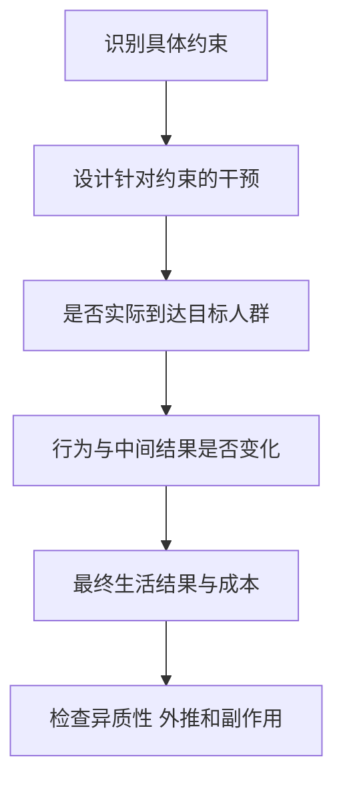

# 《贫穷的本质》：先理解约束，再判断什么真正有帮助

> 作者：Abhijit V. Banerjee、Esther Duflo，阿比吉特·班纳吉、埃斯特·迪弗洛。原作 *Poor Economics*，2011 年。存在后续更新版本，本篇以原作营养、健康、教育、家庭、风险、借贷、储蓄、创业和制度主线整理，不把新资料冒充初版内容。  
> 基于出版社资料、J-PAL、IPA、作者机构及原始研究的系统导读，未取得用户版本全文。28 个知识点；具体政策效果限定于研究范围。更新：2026-11-12。

## 这本书为什么属于财商书库

它不是教人只靠意志摆脱贫困，而是让读者理解：收入低与收入不稳定、缺乏保险、获得服务困难、信息不足和高交易成本，常常相互强化。站在外部看似不理性的选择，放回约束里可能有可理解的原因。

对个人财商，它提醒你先管理风险、现金时点和生活条件，再讨论收益最大化；对逻辑训练，它展示如何把宏大的争论拆成具体、可检验的问题。理解贫困处境，也能避免把自己的条件误当成人人可用的起点。

| 主题 | 需要回答的问题 | 本文位置 |
| --- | --- | --- |
| 方法与贫困陷阱 | 什么证据能识别效果 | 1—5 |
| 营养、健康、教育 | 服务存在为何仍未被使用 | 6—13 |
| 风险与金融 | 为什么借钱、储蓄和创业并存 | 14—22 |
| 制度与实施 | 小改变和结构改革如何连接 | 23—28 |

书目与作者主旨见[出版社书页](https://www.penguin.co.in/book/poor-economics/)。以下现实研究的后续结果注明为补充，不把所有 J-PAL 项目都归为两位作者亲自实施。

## 核心知识点

### 1. 先问一个可回答的小问题

“援助有没有用”包含许多完全不同的干预，无法用一个答案包办。把问题改成“在某地区，稳定提供某种服务是否提高使用率”，才能寻找合适比较。

投资学习也有类似收益：不要笼统问“技术分析有没有用”或“价值投资能否赚钱”，先明确市场、规则、期间、成本和评价指标。问题变清楚，证据才有可能改变判断。

### 2. 不能从贫困推断能力和品格

教育、健康、家庭责任、基础设施、政治制度和历史机会会影响资源；贫困者之间也有巨大差异。不同约束下的选择，不能按单一生活模板评判。

本书的观察态度是认真理解，而不是浪漫化贫困或否认错误选择。政策与个人建议都应先问可行选项是什么。要求一个收入高度波动的人坚持固定金额储蓄，和为稳定收入者设计划，难度不同。

### 3. 贫困陷阱是需要证据的机制，不是一张万能图

如果低收入导致无法获得必要投入，进一步压低生产能力，就可能形成自我强化的困境。要证明陷阱，需要说明阈值和动态关系，而不是看到贫困持续就直接命名。

同样，不能因为某项补助未带来明显增长，就断言不存在结构障碍。可能金额不够、时间不够、解决了错误约束，或当地还有其他瓶颈。不同机制需要不同干预。

### 4. 随机对照试验比较的是被分配的机会

随机分配在执行良好时，使处理组与对照组在平均意义上更可比，帮助识别一项干预的效果。它不是要求两个组每个个体完全一样，也不自动保证没有失访、溢出与执行偏差。

首先要区分被邀请参与与实际参与。若很多被邀请者未使用服务，按分组比较的效果与实际使用者的效果是不同估计对象。不能只挑真正参与的人与未参与者比较，然后仍声称具有随机化保证。

**数学演示：**假设随机分组各 100 人，干预组有 40 人最终使用服务，组内平均结果比对照组高 4 个单位。这个 4 首先描述的是“提供机会”的平均影响，不能直接说每个实际使用者只改善 4，也不能不加条件地除以 40% 得出使用者效果 10。后一个估计还需要对照组使用情况以及机会只通过实际使用影响结果等假设。数字是识别概念演示，不来自某项真实项目。

再看失访：如果结果最差的人更难被找到，留在样本中的平均值可能偏高；随机起点无法自动修复后续失访。读研究时应看各组失访比例、原因和敏感性检查，而不只看论文标题有没有“随机”二字。

### 5. 内部有效不等于处处有效

一项实验在特定地区能识别效果，仍需判断其他地区的人群、市场、服务质量和制度是否相似。规模扩大还可能改变价格、供给能力和参与者行为。

所以“经过 RCT”不是免除解释的标签。外推需要机制、重复证据与实施能力。个人财商应用也一样：别人采用某个提醒习惯有帮助，不保证它能解决你的收入不足或大额债务。

扩展尤其可能改变对照条件。一个小项目训练少数人经营同类生意，可能帮助他们取得市场份额；如果全地区同时接受训练，客户总需求未变，平均效果可能减弱。反过来，规模扩大也可能改善供应链、降低单位成本。局部试验观察的是特定覆盖率下的结果，不能把人数乘大就假设总收益线性增加。

### 6. 食物支出与营养不能简单画等号

增加食物支出可能购买更多热量、更好口味、便利或社交价值，不一定按比例改善营养。营养质量、疾病、卫生和劳动需求也会影响食物如何转化为健康。

这提醒读者，贫困者同样重视尊严、生活乐趣和多种需求，不能把他们当作只追求最低成本热量的机器。政策设计需要理解实际偏好与信息，而不是只用外部人的最优菜单。

### 7. 知道一种健康行为有益，不代表行动没有障碍

预防的好处在未来，成本却可能立即表现为路费、误工、排队和不确定服务。如果到达后发现人员不在，下一次再去的意愿会下降。

“免费”通常只指没有收取货币价格，并未消除全部成本。分析服务使用应分开供给可靠性、信息、可达性和需求，不把低使用率自动归为不重视健康。

### 8. 疫苗营地研究：可靠服务和小激励可以一起起作用

**真实研究。** 在印度农村的研究中，稳定、定期的免疫营地与给予家庭小额实物激励的安排被比较。J-PAL 的研究摘要指出，带有扁豆等奖励的营地提高完成接种的程度，而且更高使用量使固定服务成本被更多接种分摊。[研究摘要](https://www.povertyactionlab.org/sites/default/files/publication/incentives-for-immunization.pdf)

这里不能只记住“送扁豆”。机制还包括服务可靠、降低实际行动成本、提醒以及当下收益。若没有合格人员和供应链，单靠奖励不能提供安全有效的服务。

理解成本时，要区分营地总费用与每名完成接种者的费用。奖励增加了每次服务的直接支出，却可能让更多人使用原本已经配备的人员和场地，从而降低平均完成成本。这个逻辑需要真实完成量支持，不能推广成“奖励越多越省钱”；奖励过高、需求已接近饱和或服务能力不足时，结果可能不同。

财商应用是看一项计划失败时，先检查操作环境。储蓄或学习计划可能需要稳定入口与可执行时间，而不只是更强激励。本节是行为与服务设计教学，不构成个人医疗建议。

### 9. “付费才会珍惜”不是无需检验的定律

**真实研究。** Cohen 与 Dupas 在肯尼亚产前诊所随机改变经处理蚊帐的价格，研究购买与使用。收费明显影响取得率，研究没有支持用较高价格筛出更积极使用者的简单想法；考虑防病外部性后，免费分发在该情境中具有优势。[原始论文](https://poverty-action.org/sites/default/files/publications/dupascohen_ipa_0281.pdf)、[项目说明](https://www.povertyactionlab.org/evaluation/free-distribution-or-cost-sharing-evidence-malaria-prevention-experiment-kenya?lang=en)

结论限定于该产品、人群和制度，不能直接推广为所有产品都应免费。值得迁移的方法是把“支付价格”“实际使用”“健康收益”和“社会成本”分开测量。

对金融教育，课程贵不自动代表学习者更认真；免费也不自动代表没有价值。需要看内容质量、参与方式与真实结果，价格可以影响选择，却不能代替质量证据。

### 10. 学校入学与真正学会知识不是同一个结果

孩子在学校，未必获得与当前能力匹配的教学；统一进度可能把落后学生持续留在后面。评价教育不能只记录校舍、课本和入学率。

这种区别也适用于成人学习：读完笔记、收藏资料、参加课程，都属于投入或过程。能否解释问题、复算数据和纠正错误，才更接近学习结果。指标要接近真实目的。

### 11. 按实际学习水平教学，需要组织方式配套

**真实实践与研究。** Pratham 的 Teaching at the Right Level 按学习水平安排基础语言和数学教学，J-PAL 的评估与实施材料强调明确目标、持续测评、教师支持和适当组织安排的重要性。[J-PAL 案例](https://www.povertyactionlab.org/case-study/teaching-right-level-improve-learning)、[实施机构说明](https://pratham.org/teaching-at-the-right-level/)

这不等于简单给学生贴上永久能力标签，也不是只把班级分组就能复制效果。执行者的时间、支持和反馈会改变实际结果。

应用于自己的财商学习，应按当前薄弱环节补课：读不懂现金流就先练三表，不因其他人已经讨论期权就跳过基础。书目数量可以扩展，但学习顺序要服务于理解。

### 12. 对教育收益的认识会影响家庭选择

若家庭误以为只有最优秀的孩子才能从教育获益，可能把资源集中给少数人；若不知道某阶段教育与就业的关系，也可能低估继续学习。

信息能改变选择，但信息不能消除学费、交通、安全和家庭劳动需求。干预应区分错误认知与实际资源约束，不能把所有问题都叫作“认知不足”。

### 13. 家庭内部并不是一个完全统一的钱包

不同成员拥有不同收入控制权、责任与偏好。家庭总收入相同，不代表每个人可自主支配资源相同；谁获得补助、谁掌握账户，可能影响结果。

个人财务规划因此需要讨论共同责任、紧急安排和信息共享，而不是只做一张总资产表。制度和文化条件不同，不能把一个国家的家庭研究变成普遍的人性定律。

### 14. 收入不稳定会让低收入变得更困难

同样的年收入，若每月不确定，家庭需要更多缓冲与更灵活安排。固定房租、疾病和学费可能在收入低谷出现，使短期借贷成本很高。

理解财商时应同时记录金额和时间。高年化收益产品若无法及时赎回，可能不适合承担近期必要支出。流动性不是“闲钱不赚钱”的缺点，而是一种有价值的功能。

### 15. 风险管理有时比追求最高平均收益更合理

缺乏保险与储备的人，可能选择回报较低但更稳定的活动。这不必然说明不懂投资，而可能是在避免一次冲击破坏家庭基本生活。

评价策略要同时看平均结果、波动、相关性与最坏后果。对一个家庭合理的方案，不能只按一个风险中性模型排序。个人是否能承担损失，和某项资产长期期望收益是否较高，是不同问题。

### 16. 非正式互助能分担部分风险，却难以抵御共同冲击

亲友和社群可以在个别家庭受损时提供帮助，但同一地区遭遇灾害或就业下降时，所有人可能同时缺钱。互助网络与正式保险的覆盖范围不同。

家庭投资也应注意收入与资产是否共享风险。工作、房产、持仓都集中于同一行业或地区，表面上种类很多，实际可能同时承压。分散应看共同驱动，而不只是数账户。

### 17. 高借款利率可能包含交易成本与信息成本

小额贷款每笔都要筛选、发放、催收，固定成本占本金比例可能很高；违约风险、竞争不足和市场力量也可能影响价格。解释这些因素不等于为任意收费辩护。

借款人应核对全部费用、实际到账、还款时点、担保与违约责任。名义月利率很低，若频繁收费、提前扣息或还款结构复杂，总成本仍可能很高。

### 18. 微型金融不能被当作普遍的脱贫奇迹

**后续研究。** 2015 年发表的六项随机评估比较微型信贷扩展，发现部分经营活动与选择空间改善，但平均而言没有出现普遍、巨大的收入或减贫转变，效果因人群与项目而不同。[原始汇总论文](https://www.povertyactionlab.org/sites/default/files/research-paper/AEJ%20Banerjee%20Intro.pdf)

这不等于贷款完全无价值。借款可能帮助调整消费、处理现金时点或经营，但债务本身不会创造足够客户、技术和利润。愿意借款与有能力经营高回报项目，也不是同一个条件。

还要区分提供贷款与强制借款。实验通常研究获得渠道或产品条件改变后，人们如何选择；本来就不愿借的人也在政策影响范围内。若只拿主动借款者中成功的一部分作宣传，会同时忽略选择和失败；若只看总体平均值，又可能遗漏某些预先可识别人群的改善。合理细分应尽量有事前机制和充足样本，不能结果出来后不断切组直到找到亮点。

对个人财商，最直接的认识是：金融工具应匹配真实问题。缺乏储蓄安全、收入不稳或市场需求不足时，追加借款未必是正确答案；需要先识别瓶颈。

### 19. 平均效果会掩盖不同类型的人

有经验的经营者、刚创业者、为生活周转借款者，对相同贷款可能有不同反应。平均效果小，不证明没有人受益；个别人大幅成功，也不能证明普遍有效。

研究投资课程、理财产品和创业机会时，要问结果适用于谁。只展示受益最大的那一组，却不说明筛选方式和失败样本，会误导后来者。

还要区别“平均没有明显改善”与“已经证明没有任何有意义的改善”。样本太小、结果波动大或观察期太短，可能使估计范围很宽。较宽的不确定区间同时容纳受益与受损时，应说现有证据还不精确，而不是根据个人喜好选一个方向。

反过来，样本很大时，一个非常小的平均变化也可能达到统计显著。是否值得推广，仍要比较实际幅度、成本、持续性与执行负担。统计显著回答的是某种模型下证据与零效果的相容程度，不是项目重要性或性价比的自动评分。

### 20. 储蓄困难不仅是自律问题

缺乏安全存放、取用不便、手续费、家庭资金请求、收入波动和注意力限制，都可能影响储蓄。把这些摩擦移除，有时比一次动员更有帮助。

**真实研究。** Karlan 等人在多国金融机构开展储蓄提醒实验，发现一些提醒安排能够提高储蓄，支持有限注意力对行为有影响的解释。[原始研究](https://www.nber.org/papers/w16205)

提醒并不能替没有结余的人创造收入，也不能保证所有短信都有效。应用时应先确认有可储蓄空间，再选择低成本、可持续的操作方式。不要把研究结论变成责备没存到钱的人的理由。

### 21. 承诺工具帮助未来的自己，也可能限制应急

把钱放进较难取用的账户，可以减少冲动消费，但紧急时可能造成额外成本。承诺越强，并不总是越适合。

个人应用应区分日常周转、应急资金和长期目标。不能为了强迫自己储蓄，把所有现金锁进期限很长或退出代价高的安排。工具应服务于目标，而不是让“执行纪律”压倒真实生活需要。

### 22. 自雇不自动等于有高增长创业机会

缺少稳定工资工作时，家庭可能经营小生意维持生活。许多小企业同时面对市场有限、资本、技能、风险与家庭时间约束，规模不增长未必是懒惰。

投资者看创业故事时，要区分生计型经营、可复制业务和具有规模优势的企业。收入流水、毛利和经营者实际工资也不同。把创业当成人人适用的致富路径，会忽略选择和失败风险。

### 23. 多项约束同时存在时，单一工具可能不够

**后续真实研究：Graduation 项目。** 2015 年六国随机评估研究结合生产性资产、培训、辅导、消费支持和储蓄安排的综合干预，发现多项生活与经济指标在研究期内改善，但国家差异、成本和实施能力仍需注意。[Science 原始论文](https://economics.mit.edu/sites/default/files/2022-08/science.1260799.pdf)

它不能简单证明每一组成部分单独都有效，也不能保证任何地方复制一个礼包就能成功。综合方案的结果与“哪一项机制起了多少作用”是不同问题，后者需要进一步研究。

财商应用是不要把所有困难归结为一本书、一次培训或一种金融产品能解决。现金流、技能、保障、市场机会可能需要配合，改善也需要时间和反馈。

### 24. 制度会影响日常服务，微观研究仍需要宏观背景

学校、诊所、银行与公共服务的表现，受到管理、预算、激励与政治制度影响。小规模实验可以改善一个环节，但未必能回答国家级制度如何改革。

这不是微观研究无用，而是明确问题层次。能识别一项干预效果，与能解释全部经济发展之间相距很大；研究方法应与问题匹配，不能把所有宏观问题都硬改成局部试验。

好的研究组合会让方法互相补充：现场观察帮助发现约束，实验比较具体方案，行政数据观察长期覆盖，制度研究解释规则如何形成。没有哪一种方法可以单独免除其他层次的问题。

### 25. 实施质量是效果的一部分

同一个政策名称，实际可能由不同人员、频率、资源和监督方式执行。扩展后效果变化，可能来自执行条件，而不只是理论错误。

评价项目应记录谁执行、成本多少、覆盖谁、有没有持续性。公司管理也一样：一项战略写在年报里，不等于执行已经发生。证据要追到过程和结果，而不是停在正式宣布。

### 26. 成本效果比需要统一分母

每增加一名完成接种儿童的成本、每提高一定学习水平的成本、每增加一单位收入的成本，衡量的东西不同。不能拿最容易好看的指标跨项目排名。

还要明确时间、币种、行政费用、参与者付出的时间以及结果能持续多久。一次性较贵的干预如果长期有效，可能仍合理；便宜但几乎无效，也不自动值得扩展。

**数学演示：**甲方案花 100，新增 10 个达标结果，平均每个新增结果成本为 10；乙方案花 60，只新增 3 个，成本为 20。乙总价低，不代表更划算。不过这个比较仍未决定应采用甲：预算、覆盖最困难人群的责任、长期持续性和副作用可能不同。成本效果比帮助明确取舍，不能替价值判断作最终决定。

### 27. 把一项政策解释成可检验的因果链

如果最后结果没有改善，逐段检查，而不是立即归因于受助者不努力。中间环节帮助定位失败，也能防止把一个正向终点误归给并未发生的机制。

### 28. 个人应用：先整理约束，再选择工具

这张图是补充财商应用，不把发展研究当作私人投资处方。目标是减少不必要的脆弱性，并让实际约束进入安排。

## 三道练习

**免费服务没有人用，说明人们不需要吗？** 不足以说明。要检查距离、排队、可靠性、信息、机会成本与服务质量。

**贷款项目平均效果不大，说明所有借款人都没受益吗？** 不是。需看效果分布、统计精度、用途与人群，但不能只挑成功者宣传。

**给自己设置自动储蓄是不是越多越好？** 不是。先确认必要支出、应急与现金时点，自动化帮助执行合理计划，不能替代计划本身。

## 资料边界与联读

本文涵盖原作主要议题，未逐页核验作者所有现场叙述。现实研究具体定义、样本和估计见原始链接，不把旧贫困线当作当前统一标准，不从局部证据推出对任何群体的能力判断。

可以与《置身事内》比较微观干预与宏观制度，与《为什么》学习因果识别，与《金钱心理学》把风险、储蓄和生活目标连接起来。
