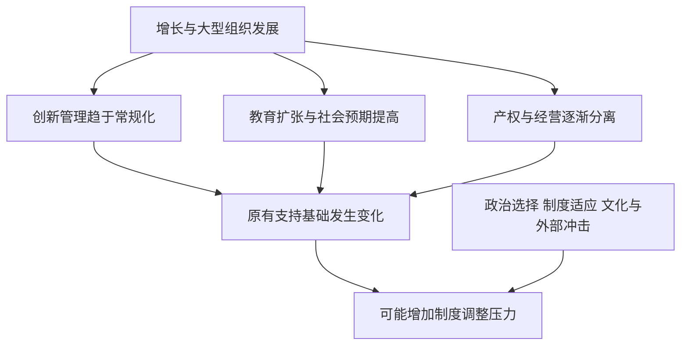

# 《资本主义、社会主义与民主》读书笔记

> 作者：约瑟夫·阿洛伊斯·熊彼特（Joseph A. Schumpeter）。原书 *Capitalism, Socialism and Democracy*，初版 1942 年，后续版本有增补。中文译本、译者和页码未确认。本文基于公开版本目录、可核对的核心论述与下列一手历史材料，整理五部分的主要问题和思想框架，**不是逐页精读，也不声称覆盖各版全部史料**。公开法文版目录主要列前四部分；第五部分另据英文馆藏目录确认，不能把不同版次的章节直接混为一体。现实企业与投资分析均为补充教学。

## 先明白这本书在问什么

为什么一种不断增加产出的经济制度，仍可能失去支持？为什么最有力量的竞争，未必表现为同一种商品降价？为什么民主既是一套理想，也是一套实际挑选执政者的程序？这三个问题组成全书的主线。

熊彼特一方面高度评价资本主义创造新产品和生产方式的能力，另一方面认为它的成功可能改变社会结构，削弱自身的制度基础。他讨论社会主义是否能够运行，也讨论民主能否与不同经济制度结合。这是一套有争议的历史与制度分析，不是“资本主义一定失败”的已验证定律。

对提高财商最直接的帮助，是学会把**行业变大、技术进步、企业利润、投资者收益、社会支持**拆开分析。它们有联系，却不会自动同向变化。

## 全书路线与阅读重点

| 原书部分 | 主要问题 | 阅读时要防止的误解 |
|---|---|---|
| 一：马克思的学说 | 怎样分别评价马克思的预言、社会学、经济学和思想影响 | 赞成某段分析等于接受全部理论 |
| 二：资本主义能否生存 | 创造性破坏怎样推动增长，又怎样改变制度基础 | 企业越大越好；衰退必然来自创新不足 |
| 三：社会主义能否运行 | 经济协调、管理、人和转型条件如何影响可行性 | 纸面均衡证明现实制度必然高效 |
| 四：社会主义与民主 | 民主如何定义，需要什么运行条件 | 有投票就已解决所有政治问题 |
| 五：社会主义政党简史 | 思想如何在组织、战争与国家环境中发生变化 | 所有国家都沿着同一条路线发展 |

版本与目录可对照 [英文馆藏目录](https://library.tcdc.or.th/record/view/b00001500) 与 [公开法文版目录及版本说明](https://classiques.uqam.ca/classiques/Schumpeter_joseph/capitalisme_socialisme_demo/capitalisme_tdm.html)。下文按问题组织，章节中文名采用意译，不提供未经核对的页码。

## 一、先建立判断制度的方法

### 1. 把价值判断、机制分析和历史预测分开

“我喜欢一种制度”“这种制度通过什么机制运行”“这种制度以后会怎样”，是三个问题。一个人可以欣赏市场的创新能力，同时认为支持市场的社会力量正在减弱；也可以承认计划协调在某些条件下逻辑可行，却不赞同以强制方式实行它。

读本书时，最好给段落标记“评价”“因果机制”“条件预测”。否则很容易从一句关于制度前景的判断，跳到作者对该制度的道德支持。财商分析也一样：承认一家公司产品优秀，不等于判断它的股票现在便宜。

### 2. 马克思作为预言者，与作为研究者的角色不同

第一部分把马克思分成多个角色讨论。思想体系不仅靠逻辑传播，也可能给人提供对苦难的解释、群体身份和未来希望。这能够解释某些观念的动员力，却不能证明其中的经济预测正确。

当一种投资叙事同时许诺财富、道德优越和历史必胜时，应拆开检查。情绪感染力越强，越需要明确可证伪的指标，不能因为一个故事给了自己方向，就把它当成已经经过检验的因果关系。

### 3. 社会结构会影响经济行为，但不是每件事都由阶级标签解释

熊彼特重视马克思把生产组织、利益结构和制度演变联系起来的眼光，同时批评过度简化。理解一种政策，确实需要问谁受益、谁承担成本、谁有组织能力；但同一群体内部也有不同产业、期限和风险偏好。

例如出口商与依赖进口设备的企业，对汇率变化可能有不同诉求。这里是一般机制说明，不是某次政策的已证实幕后原因。有效的利益分析必须配合具体资料，不能凭一句“资本推动”代替证据。

### 4. 不接受某套价值理论，不等于否认其提出的问题

熊彼特对马克思的劳动价值、剥削、利润与危机解释有批评，却没有因此把积累、集中和制度变化这些问题全部丢掉。学习经典，重要的是分辨“问题有价值”和“答案已经成立”。

对投资者来说，一篇报告即使估值公式有问题，也可能准确发现应收账款恶化；另一篇结论最终正确，也可能只是碰巧。把信息拆成可检验单元，比先给作者贴立场标签更有用。

## 二、创造性破坏：竞争怎样改变游戏本身

### 5. 衡量经济表现，要看长期的真实生活改善

第二部分不是从某一年利润率出发，而是考察长期产出增长及其对大众生活的影响。价格变化还不够：新产品、质量改善、可靠性提高和获得商品的便利，也属于经济进步。

这提醒读者，旧产品的高利润可能逐渐转化成消费者福利；社会变得更富裕，并不保证原有生产者继续赚钱。评价产业时应分别追踪价格、销量、质量和资本投入，避免把名义收入增加都解释为真实效率提高。

### 6. 创造性破坏不是“破坏本身值得赞美”

它指的是经济不断从内部发生结构变化：新产品、新工艺、新市场和新组织取代旧安排。创造的是新价值，破坏的是部分旧资产、技能和收入来源的经济用途。

关键在“替代机制”。一家企业倒闭，可能因为欺诈、债务过高或需求短期萎缩，并不自动构成创造性破坏。相反，新技术也不一定彻底消灭旧技术，二者可能长期服务不同需求。要判断是否发生结构替代，需要看客户为什么迁移、成本优势是否持续、原有业务能否调整。

财商应用中，不能用“行业会被颠覆”当作完整估值。必须进一步问：替代花多久？谁承担建设成本？旧资产还有多少可回收现金？新企业是否也会被竞争压低利润？

### 7. 真正危险的竞争者，可能不卖同一种产品

在静态价格竞争里，企业主要和同行争夺既定需求；动态竞争则改变用户完成任务的方式。竞争的对象是用户需求，未必是行业分类表中的同行。

**真实案例：2007 年 iPhone 发布。**苹果的原始公告把手机、音乐播放器和互联网通信功能放在同一设备中，并强调触控界面。这不是单纯把既有手机便宜卖一点，而是重新组合用户使用信息、娱乐与通信的方式。[苹果 2007 年发布公告](https://www.apple.com/newsroom/2007/01/09Apple-Reinvents-the-Phone-with-iPhone/)

这个事实适合说明“竞争维度改变”，不能单靠发布公告证明后来的所有商业成功，更不能证明在任何价格买入苹果股票都合理。公司自述中的“革命性”等措辞属于营销判断，本文不把它们当作独立证据。

检查一家公司的护城河时，应补上一问：有没有别的技术路线，使客户不再需要这条护城河所保护的产品？

### 8. 发明、创新与商业获利，是三个关口

发明解决技术上的“能不能”；创新把技术、资源和组织结合成可用方案；商业获利还要求客户支付足够价格，并让企业留下超过成本的现金。三者之间都可能失败。

**真实案例：柯达并不是因为完全没有数字技术才陷入困境。**其公司历史记载了 1975 年数码相机的开发；2012 年 1 月 19 日，柯达及其美国子公司申请 Chapter 11 重整，境外子公司未纳入这次申请。[柯达技术年表](https://www.kodak.com/en/company/page/milestones/)、[2011 年年报中的重整披露](https://www.sec.gov/Archives/edgar/data/31235/000003123512000036/ek2011_10k.htm)

两件事实并列，足以否定“只要先发明，就能长期占据利润”的简单推论；它们本身不足以证明公司失败只有一个原因。年报还涉及流动性、转型投入和历史负担，不能把复杂重整缩写成管理层一句傲慢对白。

研究技术型公司时，要依次核实技术指标、规模化交付、客户留存、毛利和现金回收。专利数量可以作为线索，不能替代整条证据链。

### 9. 企业家是推动新组合的职能，不是一个终身称号

在熊彼特的分析中，企业家作用在于打破惯常组合、实现新用途，不等于所有者、出资者或日常管理者。一个人可以先扮演创新者，后来主要维护成熟业务；一个组织也可以由团队承担创新职能。

因此“创始人仍在”“老板很有激情”不是创新的充分证据。应追问组织如何筛选项目、容忍失败、关闭失败项目，以及是否允许新业务侵蚀旧业务。个人魅力和组织能力需要分别评估。

### 10. 创新利润可能是暂时的，超额收益会吸引追赶

先行者通过新产品或成本优势取得收益，随后模仿、替代与扩产可能侵蚀收益。这个过程解释了为什么高利润既可能是市场力量，也可能是创新暂时领先的结果。

数学演示：每件售价 100、完整单位成本 70，差额为 30；后来竞争使售价降至 82，而成本只降至 65，差额就变为 17。销量增长并不保证总利润增长，尚需比较销量、固定成本和新增资本投入。

这不是原书具体数据，也不是任何公司预测。它帮助读者识别：把当前利润率永久外推，相当于假设竞争不会改变企业的分成。

### 11. 静态效率与动态效率，有时存在张力

静态效率关心现有技术下，商品是否按接近成本的价格供应；动态效率关心未来是否出现更好的技术和组织。如果完全拿不到创新收益，某些高投入项目可能无人愿意做；如果保护过强，企业又可能不必改进。

因此问题不是简单选择“零利润竞争”或“永远保护龙头”，而是比较进入条件、创新投资、消费者收益和保护持续时间。熊彼特对静态竞争理论的批评，不能变成所有垄断行为的豁免证书。

### 12. 大企业可以创新，规模也可能带来组织障碍

第二部分强调有组织的研究、资金和专业分工，不把创新完全归于孤独的创业者。大型组织有能力承担漫长研发，但也可能更难放弃现有产品，或在内部预算竞争中排斥异类方案。

**真实案例：贝尔实验室的晶体管研究。**1947 年，贝尔实验室团队实现点接触晶体管；相关科学家后来获得 1956 年诺贝尔物理学奖。研究围绕电话系统所用真空管和机电设备的替代需求展开，说明大型组织内部同样可以产生基础性技术突破。[贝尔实验室历史材料](https://www.nokia.com/bell-labs/about/awards/1956-nobel-prize-physics/)、[巴丁与布拉顿 1949 年原始论文](https://journals.aps.org/pr/abstract/10.1103/PhysRev.75.1208)

这个案例证明“存在这样的成功”，并没有识别“垄断必然比竞争更创新”的因果效应。要回答后一个问题，还需研究不同市场结构、失败项目、知识外溢和其他制度安排，不能只挑一个赢家。

### 13. 看见高利润，要区分来源和可持续性

同样的高利润，可能来自效率、品牌、网络效应、行政保护、排他行为或暂时的供需紧张。这些来源的持续性、社会评价与监管风险不同。

财商补充：把利润拆成“客户愿意多付多少”“企业比别人省多少”“竞争者为什么进不来”。若只能用“龙头”二字解释，就尚未完成分析。即使利润来源正当，也要继续判断买入价是否提前透支未来。

### 14. 创新风险会改变投资项目的回收要求

在持续变动的市场中，设备可能还没物理损坏就失去经济价值。企业要求较快回本，不一定都是短视；也可能是在应对替代风险。但如果所有研发都只按很短回收期审批，又会放弃长期机会。

图中是机制示意，不是所有行业都会按同样速度走完的周期。读者应同时观察创造出的消费者价值和被淘汰的资本，不能只看其中一侧。

## 三、为什么经济成功未必带来制度稳定

### 15. 资本主义的理性计算会改变社会习惯

第十一章讨论一种社会文化变化：商业活动强化核算、比较和质疑习惯，这些习惯不会永远局限在企业里，也会被用于审视传统权威、产权安排和制度正当性。

这是熊彼特的社会学解释，不是“所有文化都被利润决定”的定律。其启发在于：一个制度培养出来的能力，可能反过来用于批评制度本身。组织鼓励员工独立思考，也不能假定他们只在领导指定的范围内提出问题。

### 16. 创新常规化，会改变企业家的社会角色

当研究、设计、生产和销售由大型团队按流程完成，突破可能越来越像可管理的组织活动。熊彼特担心，企业家个人的象征地位因此减弱，资本主义的社会辩护也失去一个支点。

这里不能偷换成“团队研发没有创新”或“创始人退出就一定衰落”。恰好相反，作者担忧的是创新仍能继续，但推动创新的社会形象和产权认同发生了变化。经济功能与社会合法性需要分开观察。

### 17. 所有权越抽象，产权的情感基础可能越弱

经营家族工厂与持有一小笔上市公司股票，在法律权利、控制权和心理感受上不同。股份化扩展融资和分散风险，也让产权越来越表现为可交易凭证。

熊彼特把这种变化视作制度基础变化的一环；这不是否定股份公司，而是提醒：制度的持续存在，不只取决于生产效率，还依赖人们是否理解并认可相关权利。对投资者而言，则应核对自己实际拥有的表决权、现金流请求权和信息权。

### 18. 社会保护层变化，会影响改革阻力与支持

作者讨论传统精英、旧阶层与资本主义之间复杂的保护关系。市场扩张削弱旧秩序时，也可能削弱过去替产权和商业秩序提供支持的力量。

这是一种历史条件下的论证，不能直接套给所有国家。真正可借鉴的是“联盟分析”：制度变化会重组谁依赖谁、谁有能力阻止变化。单看一个行业盈利，而不看维持盈利的制度联盟，可能遗漏长期风险。

### 19. 知识分子的批评，不宜简化成个人善恶

第十三章把知识生产、教育扩张、职业机会和社会批评联系起来。熊彼特对知识分子角色的判断有鲜明立场，不能当成关于某个职业群体的普遍事实，更不能用它取消具体批评的真实性。

学习时应保留机制问题：批评者靠什么获得收入与影响力，哪些观点更容易被传播？同样也要对管理层、券商、投资者和政府部门提这个问题。激励分析必须对称，不能只检查与自己意见不同的人。

### 20. “成功可能侵蚀自身基础”是条件预测

作者对资本主义前景的担忧，主要不是它无法生产足够商品，而是成功引起的组织、阶层和文化变化。这比“危机一来制度就会消失”复杂得多。

图中“可能”不可删去。它展示作者提出的路径，而非一个已经测定参数、能预测制度终结年份的模型。制度自身也会调整，反向力量和路径依赖可能改变结果。

## 四、社会主义能否运行：不能跳过人和信息

### 21. 先定义经济制度，才能比较

第三部分讨论的社会主义，涉及对生产资料和生产决策的社会控制，不能与所有公共服务、社会保险或宏观调控画等号。市场经济有政府部门，也不能因此自动归为作者定义的另一端。

比较时应列明哪些资产归谁、谁作投资决定、价格如何形成、亏损由谁承担。使用“市场”“计划”“混合”这些词之前，先明确实际安排，才不会用含糊标签代替分析。

### 22. 配置方案逻辑可解，不等于现实管理容易

熊彼特讨论社会主义经济安排的逻辑可能性。这与现实中能否及时取得分散信息、修正错误和形成恰当激励，是不同层次的问题。

数学上可以写出“各产品边际收益与边际成本匹配”，并不代表管理者已经知道真实偏好、机会成本和未来技术。一个财务模型能算出最优方案，也不保证输入数字可信。模型结论的力量，取决于信息与执行条件。

### 23. 公私制度都存在管理问题，但约束不同

私人企业会出现经理人追求个人利益、内部信息失真和官僚主义；公共组织也会遭遇这些问题。不能把一方的理想设计，和另一方的现实缺陷放在一起比较。

公平比较应固定任务、资源和约束，再看错误能否被发现、谁承担后果、是否允许退出与替代。即使两边都有代理问题，产权、竞争、任命和预算规则不同，问题也未必一样严重。

### 24. 不能靠假定“人都变好”解决制度难题

第十八章强调人的因素、纪律和官僚管理。制度设计不能无限依赖自觉、无私或超常能力；需要解释一般人在正常激励下为什么会认真工作、报告坏消息并纠正资源错配。

对个人财务的对应启发是：不要把计划建立在未来的自己永远克制、永远及时判断上。自动储蓄、权限限制和明确的复盘规则，是把行为约束写进流程，而不是仅靠意志力。

### 25. 转型路径与成熟条件，可能比目标标签更重要

作者区分不同成熟程度和不同政治背景下的转型。把一套大型组织已经形成的社会，与缺乏管理能力、生产不足的社会，直接视为同一政策试验，会忽略出发条件。

这也适用于企业转型：成熟现金流业务内部孵化新部门，与高负债公司彻底更换商业模式，不是同一种风险。目标相似，融资能力、人才储备和可承受的试错时间却可能完全不同。

## 五、民主：理想之外，还要理解程序

### 26. “共同利益”通常不能自动导出唯一政策

第四部分批评一种过于整齐的政治图景：先存在清晰一致的公共利益，再由理性公民发现它并表达统一意志。现实中，人们对利益、时间和价值的理解不同，即使信息完全一致，也可能不同意同一政策。

逻辑训练的重点是区分事实争议与价值分歧。提高最低收入会有什么就业影响，是证据问题；不同群体之间应怎样分担成本，还包含价值判断。再多数据也不能独自替人完成后者。

### 27. 竞争性领导理论，强调谁能获得并失去执政权

熊彼特提出的替代理论，把民主理解为通过争取选票的竞争来取得政治决策权的制度安排。公众并非每天直接管理所有事务，而是在制度化竞争中选择与更换领导者。

**真实历史对照：1945 年英国大选后，艾德礼领导工党执政。**英国议会的长期选举统计记录了这次政党更替；此后政府推动煤炭、电力和交通等领域的国有化。[英国议会选举统计](https://researchbriefings.files.parliament.uk/documents/CBP-7529/CBP-7529.pdf)、[英国政府艾德礼历史介绍](https://www.gov.uk/government/history/past-prime-ministers/clement-attlee)

这个例子用于说明竞争性政治程序可以产生不同经济政策，不证明选民在每项政策上意见一致，也不证明国有化的所有效果。它属于原书初版之后的历史补充，不伪装成 1942 年作者已经观察到的事实。

### 28. 选举市场的类比有用，但选票不等于商品订单

政治竞争中会出现品牌、组织、议题选择和说服行为，因此可以研究供给者如何争取支持。但政治决定通常有强制性外部效果，落选一方仍要共同生活在结果之中，不像普通商品可以随时不购买。

所以不能把消费者主权简单搬成“政治结果必然反映所有人的偏好”。类比的作用是提出机制，而非抹去两类制度之间的区别。这是训练逻辑时很重要的迁移边界。

### 29. 民主运行需要竞争之外的条件

作者讨论政治人员质量、决策范围、行政能力以及民主自制等条件。败选者接受程序，胜选者不把暂时多数理解为无限权力，专业行政能够连续工作，都是程序长期有效的重要支撑。

这个框架不涵盖现代民主理论的全部规范诉求。政治参与、权利保障、信息平等与少数群体保护，不能因为作者采用较窄定义就消失。读者应区分“一个分析模型抓住了什么”和“它遗漏了什么”。

### 30. 经济制度与民主制度不是同一个维度

私人所有权较多，不自动保证政治竞争充分；国有部门较多，也不能仅凭这个事实断定一切政治程序的性质。需要分别检查经济决策结构与政治权力产生、约束、更替的机制。

这不是说两者互不影响。经济资源集中可能影响政治力量，政治约束也会改变财产权和投资激励。重要的是先分开概念，再研究连接，而不是把两套结论偷偷绑在一个词里。

## 六、历史、投资与学习边界

### 31. 社会主义政党史展示了理念与组织之间的距离

第五部分从早期思想与运动谈到马克思面对的环境、十九世纪后期至第一次世界大战、两次大战之间及其后果。它提示读者：政党进入选举、工会、战争和行政体系之后，行为会受到组织生存与国家处境影响。

本文只覆盖该部分的主题作用，没有逐国逐党复述。后续版本增补了战后判断，阅读时要检查版次。不能拿后加的历史段落证明初版作者提前预见了全部事件。

### 32. 反对英雄叙事，也不能抹掉个人作用

企业和制度变化确实离不开个人判断，但机会是否出现、团队是否能执行、融资是否持续，都超出个人品质。只讲英雄，会遗漏结构；只讲结构，则可能忽略面对同一环境的不同选择。

可用一个双栏笔记：左边记录当事人的决策，右边记录当时的技术、竞争、资金和法律约束。判断成功来源时，让两个栏位相互校验。故事越生动，越需要保留那些没有成功却采取相似行动的人。

### 33. 不能把创造性破坏当成无条件追逐热门行业的理由

这是财商应用，不是作者给出的股票策略。技术发展受益者可能是消费者、员工、供应商或后续进入者，而早期股东可能因为投入过大、融资稀释和价格过高而受损。

研究新产业至少要走过四道判断：需求是否真实；企业能否把需求变成正现金流；优势能维持多久；买入价格隐含了多乐观的前景。只完成第一道，不足以决定投资。

### 34. 对成熟企业，要查替代风险和转型负担

旧行业未必都没有价值，新行业也未必都值得高价。成熟业务若能稳定回收现金、避免无回报扩张，仍可能创造股东价值；盲目转型则可能同时失去旧利润和新投资。

可检查：旧业务的现金回收速度、专用资产剩余价值、新业务的实际付费客户、研发与资本开支、融资来源，以及失败时能否收缩。柯达的事实提醒我们技术存在并不足够；它并没有提供任何公司的固定倒闭模板。

### 35. 对宏大预测，要写下可能推翻它的证据

熊彼特的历史预测具有洞察力，也有显著争议。用它训练思考，应提出竞争解释：创新组织常规化是否一定削弱私人产权？社会保障能否缓和敌意？新创业浪潮是否重塑企业家形象？不同国家是否走出不同路径？

好的理论能引出具体问题。若任何历史结果都可以事后解释成“作者早已说过”，理论就失去了检验价值。经典的价值不要求每个结论都永远正确。

### 36. 你应带走的是一套分层判断能力

研究企业时，看技术与组织；研究利润时，看竞争与分成；研究制度时，看支持联盟与纠错能力；研究公共争议时，看定义、证据和价值分歧。不要用一个层次的成功，直接证明另一个层次的成功。

这套读法与《国富论》关于分工和制度的分析、与《通论》关于短期需求和投资不确定性的分析可以互补，但不能把三位作者拼成观点完全相同的体系。

## 练习与参考答案

**练习一：一家企业拥有很多专利，所以一定能在技术替代中获胜。这段推理缺少什么？**

参考答案：缺少规模化制造、客户支付、商业模式、资金承受力和组织调整证据。柯达的技术年表与重整披露说明“有发明”和“持续获利”可以分离；不能进一步把它简化为专利没价值。

**练习二：贝尔实验室产生晶体管，所以所有行业都应只保留一家大公司。哪里跳跃了？**

参考答案：从一个成功案例跳到了普遍因果结论，忽略替代组织、失败项目、创新扩散和垄断成本。案例支持“大组织可以创新”，不支持“只有垄断才能创新”。

**练习三：原来每件差额 30，现在降为 17，要维持原来的总差额，销量需要变为多少？**

参考答案：在忽略固定成本变化的数学演示中，需要变为原来的 30÷17，约 1.765 倍，即增加约 76.5%。这说明产业扩张与利润扩张不能画等号。

**练习四：有人说“某政策经过选举推出，所以它一定让所有人受益”。如何拆解？**

参考答案：选举程序说明取得决策权的方式，不自动保证政策效果或利益一致。要分别检查程序条件、事实后果、群体分配与价值标准。民主的程序性定义，不代替具体政策评估。

**练习五：把一个热门行业写成半页研究提纲。**

参考答案结构：列出它替代的旧任务；指出真实客户证据；解释成本与价值如何分配；估计优势被模仿的条件；列出否定判断的事实。没有数据的地方写“待核验”，不要把增长口号填成已知结论。

## 资料范围与继续阅读

本笔记重点覆盖竞争、创新、制度变迁、社会主义可行性和民主理论，较简略处理第五部分的政党史。版本目录、企业事件与机构历史链接已放在相关知识点原位；柯达、iPhone、晶体管与英国战后政权更替均为补充案例，不冒充原书初版材料。

继续读原书时，可先读第七至八章，再读第十二至十四章、第二十一至二十三章，最后回到第一与第三部分补足论证条件。对熊彼特关于阶层、知识分子与制度前景的判断，保留“作者解释”的标签，并与具体历史研究对照。
