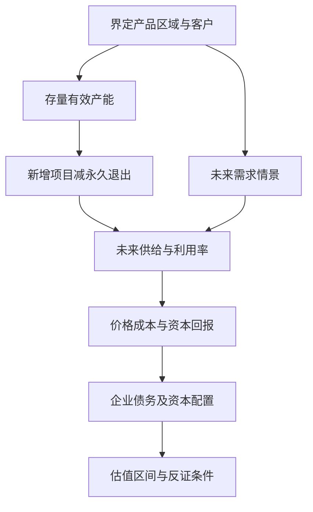

# 《资本回报》读书笔记

> **书目与范围**：原书 *Capital Returns: Investing Through the Capital Cycle: A Money Manager’s Reports 2002–15*，爱德华·钱塞勒（Edward Chancellor）编选并撰写导言，主体来自 Marathon Asset Management 的投资研究报告，不能把所有报告都算作钱塞勒个人原创。Palgrave 精装版出版于 2015 年，电子版及版权信息为 2016 年；中文具体版次未确认。实际使用出版社目录、机构公开投资理念，以及另行核验的行业资料，没有取得全书正文。本篇是主要框架的系统导读；编号是学习主题，不是原书章节。案例中的 2024 年资料是补充教学，不是原书案例，也不代表当前行业判断。

这本书解决一个常见困惑：明明行业越来越重要、需求不断增长，为什么投资者仍可能亏钱？因为利润不仅由需求决定，也取决于有多少竞争者为了同一批利润投入资本。理解需求之后，还要追踪供给、融资、管理层激励和退出过程。

读完应能把“行业前景很好”改写为更完整的判断：未来新增需求由谁满足，新增供给何时释放，谁能保住资本回报，以及现在的股价已经反映了多少好消息。

## 主题地图

出版社列出的主题包括资本周期、增长中的价值、管理层、繁荣与崩溃、危机后的企业、中国相关观察及华尔街激励。下面按“机制—证据—企业—估值—执行”重组；其中计算、检查表和较新案例为分析者补充。[出版社书目与目录](https://link.springer.com/book/10.1007/978-1-137-57165-6)

### 1. 资本周期：高利润为什么会制造自己的竞争者

当一个行业资本回报很高，企业愿意扩产，银行愿意贷款，投资者愿意提供股权资金。新产能落地后，商品或服务供给增长；如果需求没有同步增长，竞争会压低价格、开工率和利润。亏损又可能使扩产减少、企业退出，竞争环境才逐渐改善。

这里的资本是投入经营的资金和生产能力，不是股票市场里每天成交的金额。股价上涨可能帮助企业融资，但二级市场换手本身并不等于建成了一座工厂。Marathon 的公开框架把资本流动、管理层行为、长期回报联系起来，同时寻找有进入壁垒的高回报企业。[Marathon：资本周期理念](https://www.marathon.co.uk/the-home-of-capital-cycle-investing/)

图是机制示意，箭头不是固定时钟。需求、技术、政策、企业壁垒都可能改变循环，任何一个行业也可能长期衰退而没有回升。

### 2. 需求增长和股东赚钱是两个问题

需求描述客户愿意买多少，股东回报还要减去生产这些产品需要的成本、追加资本与融资代价。若所有竞争者都相信市场增长，集体投入的供给可能比需求增长更快。

**真实案例：光伏制造。** IEA 的《Renewables 2024》在发布时预计，2024 年末全球光伏制造产能将超过 1,100 GW，超过其当时预测需求的两倍；报告同时描述组件降价和制造商盈利压力。这是当年的预测及观察，不是本笔记对 2026 年的实时统计。全球采用太阳能的理由可以越来越强，制造端的盈利环境却同时变差。[IEA 2024 执行摘要](https://www.iea.org/reports/renewables-2024/executive-summary)

分析时先分清制造产能、实际产量、当年新增装机与累计装机四个口径。制造能力未必满负荷使用，装机还受并网、库存和交付周期影响。这个案例说明供给分析不可缺席；它不能直接证明所有光伏环节都会亏损，更不能据此断言某家上市公司的合理价格。

### 3. 回报率而非收入规模，才是资本是否有效的检验

投入资本回报率 ROIC 大致衡量经营活动产生的税后收益，相对于为经营投入的资本有多大。扩产带来收入增长，但如果新增回报低于资本成本，规模增加可能同时减少价值。

**数学演示**：追加投入 100，每年可持续增加税后经营利润 6，资本成本为 10%。在不考虑增长、残值等简化条件下，新增利润只能支持约 60 的经营价值，即 6÷10%。花 100 获得价值 60 的项目，收入再增长也没有解决这 40 的差额。

真实分析不能只拿一次性低利润除以期末资产。应使用可比的平均资本，处理并购商誉、研发费用化、租赁和现金，同时观察新增项目的回报，避免优质老资产遮掩差的新项目。

### 4. 为什么资本开支可能比明年需求预测更有用

需求预测容易受价格、宏观与消费者行为扰动。已经签订的设备订单、在建工程、土地与施工进度，往往能提供更具体的未来供给线索。

不过“宣布投资”与“已经投产”之间差很多。应把项目分为意向、审批、融资、施工、试生产和达产，分别判断兑现概率。公开规划可能是争取地方资源或融资的表达，不能把所有新闻中的规划简单相加。

资本开支也包含维持生产、安全环保和技术更新。只有弄清钱买到了什么，才能判断它在增加行业产能，还是防止原有能力衰退。

### 5. 建设时滞：为什么决策时正确，投产时却亏损

大型工厂、矿山、船舶往往无法在一夜之间建成。项目依据当时价格获批，投产时却面对不同的竞争环境。许多企业同时看到短缺，也会同时启动投资，几年后形成集中交付。

因此要同时画两条时间线：一条是当前利润，另一条是未来产能交付。若只关注当前利润与市盈率，容易在利润峰值把股票误判成特别便宜。相反，未来供给减少也不会立刻转化为今天的现金流，等待期可能很长。

### 6. 有效供给不等于设备总量

**真实案例：红海绕航。** UNCTAD 的 2024 年海运报告说明，船舶绕开航运要道使航程延长，同样一批货物占用船舶的时间增加；新增船舶运力又部分缓冲了这一压力。这里的变化不是世界突然多消费了同样比例的商品，而是每次运输需要更多船舶时间。[UNCTAD 2024 报告概览](https://unctad.org/system/files/official-document/rmt2024overview_en.pdf)

把“船多了，运价必跌”直接当结论，会漏掉航程、航速、港口拥堵、检修和闲置率。反过来，把受绕航支持的高运价永久化，也可能高估正常盈利。实务上需要分别列出物理运力和经过运行效率调整的有效运力。

这一机制还可迁移到电力、化工和零售：名义装机不等于可调度电力，设计产能不等于合格品产出，门店面积不等于有效销售能力。迁移的是问题结构，不是跨行业照抄参数。

### 7. 退出必须是真的退出

一家企业破产后，工厂可能被新股东以更低价格买走并继续生产。原股东损失了资本，行业实物供给却没有减少，甚至因为债务负担降低而更有竞争力。

所以不要把“多家公司亏损、退市或被兼并”自动视作供给出清。更强的证据包括永久拆除设备、许可退出、不可逆转的资源枯竭或转作其他用途。停产和检修可能随价格恢复迅速结束，性质不同。

### 8. 成本曲线决定谁先承压，但不是完整估值

成本曲线将生产者按单位成本从低到高排列。价格下降时，高成本产能通常先受到压力，低成本企业可能更能生存。

但低成本有多种口径：现金成本、全成本、含维持资本开支的成本，以及包含资本回报要求的长期成本。售价高于现金成本但低于全成本时，企业短期继续生产可能理性，行业过剩也因此延续。

研究时应询问成本优势是否来自暂时优惠、资源禀赋、设备代际、规模或管理效率；低成本企业也可能因买入价格过高、财务杠杆过大而给股东带来差回报。

### 9. 技术进步可能让消费者受益更多

**真实案例：伯克希尔纺织业务。** 巴菲特在 1985 年股东信中回顾，该业务面对的一个难题是：单个企业购买更高效设备可能有合理性，但竞争者同时改进后，成本节约经价格竞争流向客户，整个行业的回报未必改善。[伯克希尔 1985 年股东信](https://www.berkshirehathaway.com/letters/1985.html)

这是一种集体结果与个体选择的冲突。不投资可能立即丢市场，投资又未必获得持续超额回报。评估新设备时，不能只问“我们的成本能下降多少”，还要问“对手能否复制，以及降本后售价会下降多少”。

该信是管理者对特定业务的回顾，不能证明所有制造业升级都无价值。某些升级会形成独有工艺或客户认证壁垒，竞争结果可能完全不同。

### 10. 资本周期并不是只买衰退行业

本书框架也重视能够挡住新增资本的优质公司：行业利润虽高，外来资金却难以复制客户关系、工艺、牌照或网络。高回报并非必然马上被竞争抹平。

因此存在两类不同研究问题：一类是低回报行业的供给正在收缩，另一类是高回报企业的优势可以持续。前者更依赖拐点和生存能力，后者更依赖壁垒的真实性与价格。不能把两类企业都用同一个“行业平均利润”估值。

### 11. 护城河研究要回答“钱为什么进不来”

如果某公司利润率长期很高，不能只回答“品牌强”“技术先进”。还要描述有钱的竞争者为什么无法在合理时间里复制。

是客户迁移风险很高，还是认证周期长？是网络的价值来自现有参与者，还是当地市场小到容不下第二套有效规模？这些机制才能解释资本流入受阻。高市占率只是结果，不能单独证明原因。

即使资本无法复制老业务，也可能通过替代品绕开它。真正的研究对象是客户需求及满足方式，而不只是当前行业分类。

### 12. 增长可以创造价值：不要反过来崇拜不投资

**真实案例：Chipotle 2024 年扩张。** 公司报告全年开设 304 家新餐厅，可比餐厅销售增长 7.4%，并披露客流和客单变化。该信息允许把新店扩张与现有店改善分开观察，而不是只看总收入增长。[Chipotle 2024 年全年业绩](https://ir.chipotle.com/2025-02-04-CHIPOTLE-ANNOUNCES-FOURTH-QUARTER-AND-FULL-YEAR-2024-RESULTS)

资本周期思考不会仅因“开店很多”就判定错误。还需核对每家新店投入、成熟速度、租赁负担、回收期，以及是否侵蚀周边旧店的收入。若增量回报高于资本成本，扩张可以创造价值；若开店只是满足规模激励，就可能相反。

上述公告并未直接证明每家店的长期增量回报，也不构成对其股票价格的判断。案例的用途是说明怎样拆解增长，而非把一家增长公司当作永恒反例。

### 13. 管理层激励会改变资本流向

若奖金主要依据营收、资产规模或收购数量，管理层可能偏好扩大公司，即便每股价值下降。若奖励只看短期利润，又可能压缩必要研发与维护。

应把激励条款和实际资本配置并列：考核 ROIC 是否排除了真实成本？回购是否刚好抵消大量股权激励？并购后是否经常减值？管理者持股也要结合融资、质押、任期和控制权利益，不能只看持股比例。

### 14. 融资中介不一定承担长期经营后果

繁荣期发行股票、债券和并购交易会给中介带来费用，行业扩张越多，短期业务可能越好；但新工厂未来是否过剩，通常主要由企业、债权人与股东承担。

这并不意味着所有融资服务都有问题，而是提醒读者识别激励差异。看到“融资成功”应继续问资本用途、融资价格、股权稀释和预期回报，不能把获得资金本身视作商业模式被证实。

### 15. 低利率可能延缓退出，但不是单独原因

融资便宜会降低持有亏损资产的压力，使原本应缩减的产能继续运行；债权人也可能选择展期，以避免立即确认损失。

然而企业存续还受政府目标、就业、供应链安全和技术选择影响。把所有过剩都归于利率过低，会忽略行业特性。应用时应寻找具体融资渠道与到期结构，而不是从宏观利率直接推断个股利润。

### 16. 并购能改变竞争结构，也可能只是改变股东名单

并购后若重复产能退出、竞争行为变得理性，行业回报可能改善。但并购还可能付出过高价格、增加债务、形成整合成本，或者因监管要求出售资产而无法达到原设想。

因此需要分别评估行业效果和收购方股东效果。同行少了一家，不代表收购方一定创造价值；取得优势所付出的价格也是资本配置的一部分。

### 17. 回购、分红和出售资产要放进价格条件

把多余资本返还股东，可能比追逐低回报项目更合理。但高价回购会把财富从留下的股东转给卖出的股东；为了回购大量举债，还可能削弱穿越周期的能力。

出售非核心资产同样要问价格和用途。廉价出售优质资产补贴衰退业务，不一定是好资本配置。资本纪律的含义是根据机会决定投入和退出，而非永远扩张或永远收缩。

### 18. 研究竞争者的资产负债表

行业供给由所有重要参与者共同决定。自己的公司非常克制，却可能被债务充足、政策支持强或愿意长期亏损的对手影响。

把主要竞争者分成现金充裕扩张者、债务紧张者、新技术进入者和潜在整合者，再看其融资来源与成本。不能假设“大家已经很痛苦，所以一定会减产”；持续生产的现金激励可能仍然存在。

### 19. 中国与全球供给要同时分析

原书有针对当时中国投资环境的观察，但那些报告的年份与制度背景不能替代今天的数据。应用到 A 股时，应该核实本行业全球产能、国内在建项目、出口条件及海外本地化竞争，而非把“中国周期”当作一个统一故事。

同一商品在贸易壁垒、运输成本或规格认证下，可能不是一个完全统一的市场。全球总量过剩并不意味着每个区域、每种高端规格同样过剩；反之，国内竞争者名单也可能漏掉境外供给。

### 20. 正常化利润如何避免“高点低市盈率”陷阱

周期高峰的利润可能同时受到高售价、高开工率和低单位成本推动。直接用这个利润计算市盈率，会得到看似很低的倍数，但分母可能即将大幅收缩。

可先拆成“可持续销量 × 正常价差 − 固定费用”，分别做景气、正常和压力情景。正常价差不是过去几年的机械平均，应考虑新产能成本、技术变化与需求结构；行业已永久变化时，旧均值可能失效。

**数学演示**：价格从 100 降到 90，单位变动成本保持 70，则单位贡献由 30 降到 20，下降约三分之一。固定成本尚未减少时，利润跌幅还可能更大。收入只下降一成，并不能推断利润也只下降一成。

### 21. 资产价格与重置成本提供另一把尺

当企业市场价值远高于复制同样资产的成本，可能吸引新进入者；当售价长期低于合理的新建成本，新增投资可能减少。这是值得调查的线索，不是机械买卖公式。

旧设备可能技术落后，低于原始造价并不便宜；优秀品牌和认证也不是简单盖厂可以复制的。需要区分历史账面成本、当前重置成本和经济价值，不能互相替换。

### 22. 现金流要与资本开支阶段一起看

扩张期自由现金流偏低，可能反映高回报投资，也可能反映无止境的资本需求；成熟期现金流很高，可能来自资本纪律，也可能来自削减维护和库存，不能持续。

检查现金流时把维持、扩张、技术替换和收购分开，观察项目投产后能否转化成现金。资本周期研究与现金流分析应相互验证，不能一个只讲供给故事、另一个只看当年现金余额。

### 23. 正确方向与可承受等待期必须同时满足

一个行业未来会改善，不代表某家公司能活到改善发生。债务到期、融资限制、资产减值、担保和现金消耗，可能在行业转折前摧毁股权价值。

对个人研究而言，先做企业生存压力测试，再讨论便宜与反转。对组合而言，不能把多个“等待复苏”的企业当作天然分散，它们可能共同依赖信用宽松或同一种商品价格。

### 24. 周期判断不是预测最低点

供给数据通常滞后，企业也会在低迷时调整项目。即使看到资本开支下降，也不知道需求会不会下降得更快。最有用的输出是条件判断，例如“若已投产项目维持现有开工率而新增需求低于某范围，压力仍可能延续”。

把不确定条件写明，才能在新数据到来时修改判断。只给一个“拐点即将来临”的结论，既无法检验，也不利于复盘。

### 25. 怎样搭建一张行业资本地图

这个图强调先统一口径，再谈未来差额。表格最少包括项目名称、所有者、产能单位、建设阶段、预计投产时间、是否已计入统计及来源日期。需求也要注明是出货、终端使用还是装机，避免同一产品在产业链上重复累计。

### 26. 在财报中找什么：一份可操作的阅读顺序

先看管理层讨论中的产销和行业描述，再查在建工程、购建长期资产现金支出、固定资产变化和减值；之后看经营现金流、借款期限和承诺支出。最后回到董事会资本配置说明，判断计划和结果是否一致。

研发支出可能决定技术供给，租赁门店可能形成未体现在传统设备投资中的扩张，合营公司也可能承担重要项目。仅下载“资本开支”一个指标会漏掉商业模式差异。

### 27. 反证检查比讲完整故事更重要

如果认为供给将收缩，反证可能是价格稍微上涨就有大量停产设备重启；如果认为壁垒坚固，反证可能是新技术已经获得核心客户；如果认为管理层克制，反证可能是高峰期突然巨额收购。

每条投资判断配一条可以观察的反证，而不是将所有坏消息解释为“市场尚未理解”。资本周期是帮助提出问题的工具，不能成为拒绝修正的信念。

### 28. 复盘要分开事实、机制与买入价格

若股票下跌，可能是行业供给判断错、企业执行差、等待期超出承受范围，也可能只是买得太贵。若股票上涨，也可能来自短期资金情绪，与原来的资本周期判断无关。

复盘应保存当时可以知道的项目和产能数据，而不是用事后的完成情况替代。长周期并不自动免于错误，只是要求用合适的观察窗口检验。

## 练习与参考答案

**练习一：行业需求增长 20%，已建成的有效产能增长 35%，能否直接判断所有公司利润下降？**

参考答案：不能。要看原有利用率、库存、产品结构、退出、成本和价格弹性。但它已经构成需要解释的供给压力。优秀公司可能拿到份额，整个行业仍可能回报下降；还应核对需求与产能是否同一期间和同一产品口径。

**练习二：三家企业破产，两家工厂被收购后继续生产，为什么不能说三份产能退出？**

参考答案：法人和股东退出不等于设备退出。应记录实际拆除、停产、重启及产量；债务重组后的工厂还可能降低财务负担，继续参与价格竞争。

**练习三：从一份 A 股制造业年报中完成一页研究卡。**

列出产品单位、在产与在建规模、行业新增供给、可比竞争者、资本开支用途、三年融资到期、当前利润正常化的依据，以及一条会推翻判断的事实。参考标准不是预测精确到小数，而是每项数据有来源、每个推断可以被反证。没有足够行业信息时，正确成果是标出缺口，不是补造数字。

## 能学到什么与资料边界

最重要的能力是把需求故事升级为竞争与资本回报分析，并将管理层资本配置纳入估值。它与[《巴菲特的护城河》](<../巴菲特的护城河 - 帕特·多尔西/读书笔记.md>)共同回答超额回报如何延续，与[《投资估价》](<../投资估价 - 阿斯沃斯·达摩达兰/读书笔记.md>)连接正常化利润和估值。

本篇没有逐篇复述文集中所有历史报告，也未把机构自述的投资方法视为经过随机试验证明的优越策略。主要来源导航：上文的出版社目录与 Marathon 框架用于识别原书；IEA、UNCTAD、伯克希尔股东信和 Chipotle 公告分别用于供需、有效运力、竞争性降本和增量扩张案例。所有数学演示均为分析者自拟。
