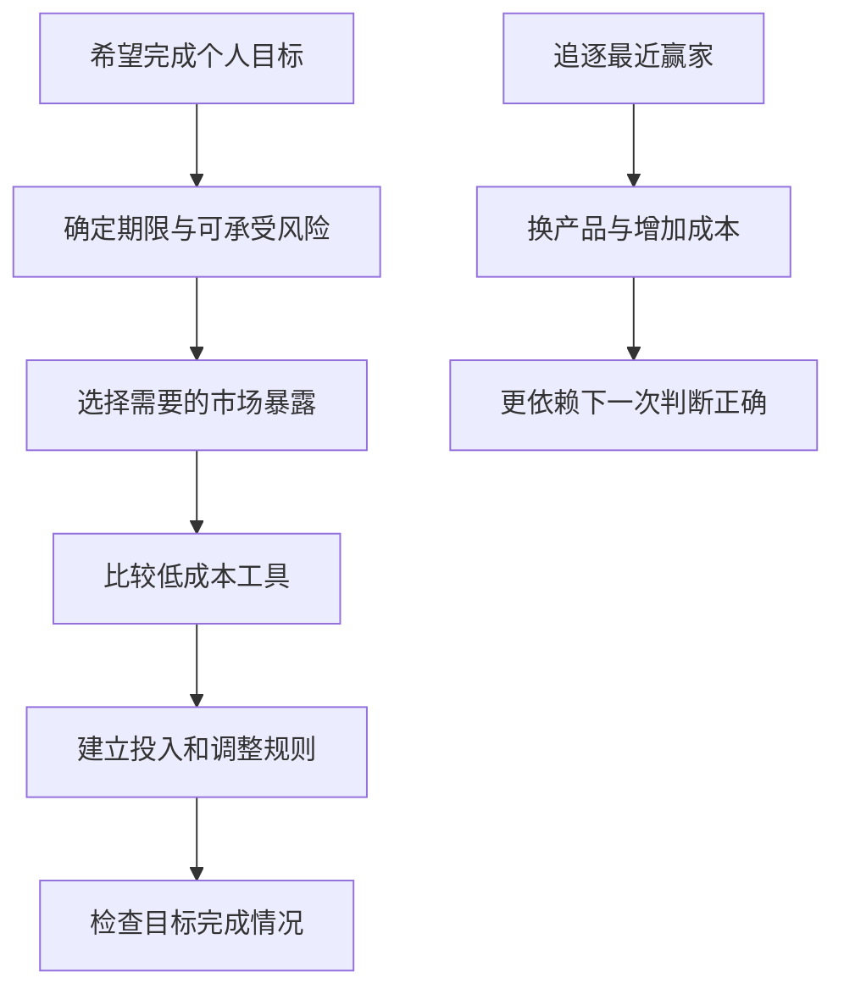
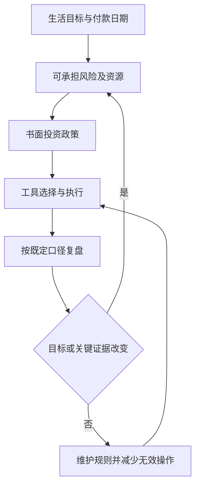

# 《赢得输家的游戏》：把投资成功建立在少犯大错上

> 作者：查尔斯·D. 埃利斯（Charles D. Ellis）。英文 *Winning the Loser's Game*。核心论述源于 1975 年发表于《Financial Analysts Journal》的文章；本文以可核验的 2021 年第八版公开资料为参照，伯顿·马尔基尔为该版撰写前言，不将其误列为正文共同作者。中文具体译本未确认。资料包括出版方介绍、作者原始文章与访谈、基金研究和公开数据，属于**基于公开资料的系统导读**，未取得全书。后文真实研究、计算与个人应用为补充，不能当作已逐章核对的原书内容。

本书最重要的转变，是把“我要打败所有专业投资者”改成“我要用可承担的风险完成自己的目标”。当市场竞争越来越专业，投入更多信息和交易未必产生更好的净结果。普通投资者可以把注意力放在资金期限、分散、成本、税务、政策和行为上：这些因素没有预测下一只牛股那么醒目，却往往更能被自己管理。

## 主题地图

本文按输家游戏的竞争逻辑、成本与绩效、个人风险、投资政策和执行重组为 30 点。新版章节编排与早版不同，不混用页码。[第八版出版社目录资料](https://learn.mheducation.com/rs/303-FKF-702/images/2021_Professional_Catalogue_Interactive.pdf)，[1975 年原始文章](https://doi.org/10.2469/faj.v31.n4.19)，[作者关于竞争与指数化的访谈](https://www.aaii.com/journal/article/competition-has-made-indexing-a-winners-game)。

## 一、为什么聪明人聚集的市场反而更难赢

### 1. 输家游戏描述胜负来源，不是说所有投资都会亏

作者用竞技活动作类比：高水平选手可能主要靠主动创造优势获胜，普通参与者则常因自己的失误输掉比赛。因此，不同能力和环境需要不同策略。这个类比是解释工具，不能把某场网球的统计直接视为股票市场证据。

在投资中，输家游戏强调追逐相对领先所付出的代价：过度交易、成本、错误时点和不合适风险会侵蚀原本可以取得的市场回报。市场整体可以因为企业创造价值而长期获得正回报，相对市场的超额收益却不可能人人同时拥有。

### 2. 专业能力提高，不意味着超额收益更容易获得

如果多数对手都拥有专业团队、数据和模型，你分析正确的事实可能早已被价格反映。竞争提高了价格发现能力，也提高了取得额外优势的门槛。

这不是认定研究无用，而是要求解释研究怎样不同。知道一家企业不错，不等于知道市场低估了它；准确理解公告，也不等于比其他参与者更早或更完整地理解。投资者需要的是相对优势，而非仅仅付出了努力。

### 3. 好消息与好投资之间隔着价格

买方实际押注的是未来结果相对当前价格所包含预期的差异。企业业绩增长，如果低于已被价格反映的预期，证券仍可能表现不佳。

研究记录至少分为已知事实、市场可能预期和自己的不同判断。第三项若没有证据，就不能把第一项直接转换成买入理由。做出与大众相反的选择也不够，反向判断仍可能错。

### 4. 主动投资者总体不能全部超过同一个市场

**理论基础。** Sharpe 的主动管理算术说明：在清楚定义同一市场和投资者集合后，被动资金按市场权重持有资产，剩余主动资金合计也对应剩余的市场；成本之前，双方整体平均回报存在算术约束。成本差异影响成本后结果。[Sharpe 原文](https://web.stanford.edu/~wfsharpe/art/active/active.htm)。

这里说的是总体与资产加权，不是每只基金都一样。少数管理人可能优秀，但筛选者要回答是否能事前识别、能否进入、费用后是否仍有优势。不能用一位成功者否定总体算术，也不能用总体算术证明任何主动研究都必然失败。

### 5. 技能悖论：对手更强时，结果中的运气可能更显眼

当参与者能力普遍提高、彼此差异缩小，短期结果可能更容易受到随机波动影响。排名第一的人未必拥有同等幅度的能力优势。

个人判断时应把过程、风险暴露和结果分开。一次高收益可能来自集中、杠杆或风格顺风；一段落后也可能发生在合理策略上。研究能力不能只由某年排名定义，尤其不能把短期领先外推成永久优势。

### 6. 指数化的优势来自降低不必要的竞争成本

指数化可以让投资者取得某个明确市场的暴露，减少逐个挑选赢家和频繁更换管理人的需要。它不是一种神奇资产，也不意味着所有指数都足够广泛。

先决定要承担哪种市场风险，再比较跟踪方法、费用、集中度、交易和税务。行业指数可能非常集中，复杂策略指数可能有较高成本。名称包含“指数”，不能自动证明适合你的资金期限。

图为两种决策路径的示意。它不证明主动选择一定失败，而是显示每增加一个预测环节，都需要相应证据和执行能力。

## 二、费用、排名和“专业帮助”怎样检验

### 7. 费用应当与获得的服务和预期回报一起比较

资产费率看似很小，却直接减少投资者所得。不能只问“占本金几个百分点”，还要问“占预期毛回报多大部分、提供什么额外价值”。

**数学演示。** 若假设毛回报为 5%、年度费率为 1%，简化相减后留下 4%，费用相当于该年毛回报的五分之一。现实费用计提方式、市场波动和税务可能更复杂；这个比例不是未来回报预测，只是帮助看清收费规模。

### 8. 长期费用不只是当期扣款，还减少未来参与增长的本金

持续费用通过多年累积影响终值。**数学演示：**初始 10 万，假设年回报稳定，30 年分别按净 6% 与净 5% 增长，终值约 57.43 万和 43.22 万。两者差额约 14.21 万，不是简单的“每年少一千，三十年少三万”。

原因是每次扣掉的资金不能再参与后续增长。计算仍不包含未来真实波动，也没有证明费用最低的产品总是最好。比较需要保持资产暴露、服务和税务尽量一致，避免拿不同风险工具的费率直接排名。

### 9. 巴菲特十年赌约：复杂与昂贵没有自动转换成净优势

**真实案例。** 伯克希尔 2017 年股东信披露，2008—2017 年赌约中的标普指数基金累计收益为 125.8%，五只对冲基金组合的披露结果均较低。其中一只组合于 2017 年清算，不能将其运营年数与其他对象混为一谈。[股东信原件](https://www.berkshirehathaway.com/letters/2017ltr.pdf)。

这个案例使多层收费、管理人选择和市场暴露的影响变得具体。但它不是随机抽样的所有对冲基金研究，指数基金与对冲策略风险目标也不同，不能单凭这场比赛证明每一种市场环境中指数都赢。

对普通投资者有用的问题是：付出的额外费用究竟购买了什么能力？这种能力在扣费、适当基准和完整周期后是否仍有证据？名望、复杂度和投资门槛都不能代替答案。

### 10. 过去排名与未来可选择的能力是两回事

**真实研究。** 标普道琼斯指数公司的美国持续性报告显示，2022 年位于前四分之一的大型股主动基金，没有一只在随后两年都继续保持前四分之一。它描述特定样本与排名规则，不等于没有任何管理能力。[2024 年末持续性报告](https://www.spglobal.com/spdji/en/spiva/article/us-persistence-scorecard-year-end-2024/)。

基金排名受风格、市场环境和样本存续影响。研究机构本身经营指数业务，因此仍应核对方法，而非仅接受宣传结论。这个结果支持对“追逐上一届冠军”保持审慎，不能推出所有基金未来必定互换名次。

筛选时至少应检查人员是否延续、策略容量是否变化、费用是否相同、有没有偏离承诺范围。先解释过程，再决定历史成绩能够提供多少支持。

### 11. 绩效基准要在结果出来前确定

集中小盘股的组合与大型股指数比较，可能把规模暴露误当作选股能力；含大量现金的组合与满仓股票比较，也承担不同任务。基准应与资产范围和风险相匹配。

事后选择最弱基准会夸大成绩，事后选择最强资产又会让所有分散组合显得失败。记录基准、币种、分红处理、费用和期间，能够减少这种解释随结果变化的问题。

### 12. 收益归因要区分市场、风格、集中和真正选择能力

收益高于存款，不等于取得超额收益；高于大盘，也可能因为承担了更多市场敏感度或特殊风格风险。统计模型可以帮助拆分，却不能把所有剩余值直接称为稳定技能。

模型遗漏、样本太短和估计误差都会影响结果。对自己不熟悉的归因报告，可以先要求管理人用白话解释主要风险来源，再核对数据。看不懂的专业术语不应成为降低证据要求的理由。

## 三、最大的对手可能是自己的执行方式

### 13. 频繁交易需要先证明增益足以支付成本

**真实研究。** Barber 与 Odean 研究一家美国折扣券商 1991—1996 年的 66,465 户账户，发现交易最频繁群体的净表现较差。研究使用真实账户，而非让参与者回答想象题；但它是特定年代样本，不是把交易频率随机分配的实验。[作者论文](https://faculty.haas.berkeley.edu/odean/papers/returns/individual_investor_performance_final.pdf)。

机制包括佣金、买卖价差和选择错误。今日显性佣金下降，并不自动消除价差、税费、市场冲击与注意力成本。另一方面，必要再平衡或资金使用也会产生合理交易，不能仅凭交易次数就判断一个人一定不理性。

每次交易前写下：新证据是什么、为什么原先安排不再合适、不交易的代价是什么。这会把行动从情绪反应转为可复核判断。

### 14. 投资者取得的回报不一定等于基金公布的回报

基金时间加权收益主要描述产品表现；个人资金在不同时间进入退出，实际金额体验会不同。基金先涨后跌，你在上涨后才大额买入，便不能取得从最初就持有的同样结果。

**真实研究补充。** Morningstar 的 *Mind the Gap 2025* 用美元加权与时间加权回报比较截至 2024 年的十年基金资金流体验，发现两种回报存在差距。[原报告](https://www.morningstar.com/content/cs-assets/v3/assets/blt9415ea4cc4157833/blt2c5c4d9171638c42/689b424311f3880edc4b4813/US_Mind_the_Gap_2025.pdf)。

差距不能全部解释成个人恐慌或贪婪：工资、退休、生活支出等合理资金流也会影响。研究提示执行重要，却没有逐户证明每一笔申赎都属于错误。

### 15. 信息增加只有在改变决策质量时才有价值

每天阅读大量行情，可能提高熟悉感，却没有改善现金流估计或风险判断。市场新闻持续更新，而你的长期目标未必每天改变。

为信息设入口：这条资料改变哪项事实、参数或约束？是否来自独立来源？是否已经包含在价格中？若答案不清楚，可以记录而暂不交易。减少无效信息并不意味着忽略重要公告。

### 16. 损失后的自然反应可能破坏原先计划

当账户下跌，立即采取行动会带来心理上的控制感，却不必然改善经济结果。相反，在大涨后提高风险，可能只是因为近期成功降低了警惕。

可以预先定义复查程序：先检查资金用途是否改变，再检查资产逻辑是否改变，最后看是否只是报价波动。真实需求变化应允许调整，单纯情绪则需要时间和证据，不能将二者混为一谈。

### 17. 能否坚持取决于组合是否符合生活条件

“长期持有”只有在资金可以长期不用时才有意义。若短期必要支出全压在高波动资产中，市场下跌时出售可能并非缺乏纪律，而是设计本来就有问题。

先列出工资、债务、照护、应急储备和未来付款。再讨论能够承担长期风险的部分。心理承受力、经济承受力与目标需要分别判断，不要用勇气替代现金预算。

## 四、把个人目标变成投资政策

### 18. 市场风险与投资者风险不完全相同

市场波动是资产属性；投资者风险还取决于何时要用钱、能否承受损失以及目标是否达成。相同股票组合，对两个人可能有不同意义。

低波动也不是唯一目标：长期完全持有名义金额固定的工具，可能受到购买力侵蚀。应把信用、流动性、通胀、集中和行为风险分别写出，避免只给每种资产贴“安全”或“危险”的标签。

### 19. 时间能帮助积累，却不能把坏资产变成好资产

时间增加储蓄与复利参与机会，也让经济波动有更长观察期。但历史长期正回报不等于未来没有永久损失，更不意味着任何市场、价格和工具都可以无限等待。

本金、投入和净回报都影响终值。把目标缺口全交给“多等几年”，可能掩盖储蓄不足、费用过高或不合理预期。长期主义需要可解释的资产和足够的付款能力。

### 20. 资产配置要覆盖家庭的完整风险

证券账户之外，工资、房产、养老金和私人企业可能依赖同一地区或行业。只把基金名称分散，不一定改变家庭整体的共同风险。

应记录主要现金来源和负债责任，再查看底层持仓。例如工作与投资都依赖同一行业时，市场下跌可能与收入下降同时发生。这是风险识别框架，不针对用户实际情况作假设。

### 21. 债券的任务由期限、信用和币种决定

短期付款工具、长期高信用债、信用债和债券基金，风险不同。高票息可能对应更高违约风险，长久期则对利率变化更敏感。

不能用“持有到期”笼统解释所有债券基金。还要问是否有确定到期、期间是否可能需要出售、未来付款用什么币种，以及通胀如何影响购买力。选择债券应先明确任务，再比较收益数字。

### 22. 再平衡是维护约定风险，不是每次都提高收益

相对上涨的资产权重增加后，组合可能偏离原目标。再平衡可将它拉回政策，但在趋势持续时可能落后于不调整的组合。

因此先确定为什么需要恢复风险，再考虑交易成本、税务、资金流和阈值。新增结余有时可减少卖出，但不能因为等新钱而无限容忍明显不合适的暴露。目标本身改变时应重新设计，而非机械恢复旧比例。

### 23. 政策应在平静时写，也应允许有根据地修改

投资政策至少包含目标、期限、现金需求、资产范围、费用、再平衡、禁止事项与复查条件。它把容易受情绪影响的决定提前讨论。

有效政策不是永久不变。婚育、照护、就业、支出时间和产品变化都可能要求更新；但修改需要说明原因，避免每次行情变化都把追涨杀跌重新命名为战略调整。

图中“否”不表示忽视风险，而是避免把普通波动当成重写全部计划的理由。

### 24. 税后与费后结果比展示的毛收益更接近实际任务

交易与产品结构可能影响税务时点和成本，但规则因地区、账户、资产及个人情况而异。本书的美国税务背景不能直接搬成中国读者的操作规则。

可迁移的方法是收集真实费表和适用制度，保持税前、税后口径一致。不要为了减少一项税费接受更大的产品风险，也不要因税务复杂就完全不计。具体事务需要核对现行规则。

## 五、如何评估顾问，如何真正“赢”

### 25. 顾问的价值可以来自规划与行为支持

如果顾问帮助明确责任、协调复杂安排、减少重大错误，他可能提供选股以外的价值。评价时要看具体交付，而不是只听“专业陪伴”。

问清收费主体、方式、利益冲突、服务范围和终止条件。顾问不能保证超额收益，但仍应能说明为什么建议适合任务；同样，高收费不能仅凭品牌和亲切感获得豁免。

### 26. 对经理和顾问，应避免只奖励短期漂亮结果

短期考核可能鼓励追逐热门风格、承担隐藏风险或避免有价值但暂时落后的选择。制度需要把过程、授权、成本、稳定性与结果一起看。

这不意味着永远容忍失败。信息不透明、偏离约定、重大团队变化和风险失控，可能在收益尚好时就值得审查。以过程为依据的问责，比看到一年亏损才临时寻找替罪者更有效。

### 27. 一个好目标不需要每天超过别人

若自己的教育、养老或生活安排按合理路径推进，别人某年更赚钱不必自动触发改变。比较应服务于检验方案，而非维护排名焦虑。

同时不能用“只跟自己比”掩盖高费用和长期明显不合适的策略。外部基准帮助检查机会成本，个人目标决定是否值得承担相应风险，两者承担不同职责。

### 28. 不犯大错，可以成为具体的检查制度

| 易犯的错误 | 先检查什么 |
|---|---|
| 用近期资金承担长期波动 | 付款日期与可变现时间 |
| 追逐最近冠军 | 过程、费用、风格与完整样本 |
| 名称分散而底层集中 | 主要持仓与经济驱动 |
| 把高回报当作低风险 | 杠杆、流动性与最坏路径 |
| 反复因新闻换计划 | 新证据是否改变目标或逻辑 |

表格是本文应用补充，不保证避免所有亏损。它把本书原则转成能够核查的行为，而非笼统要求“保持理性”。

### 29. 复盘要同时保留未行动和行动的记录

如果只记录成功交易，会高估预测能力；若忽略因恐慌卖出和追涨进入的时间，也无法解释实际资金回报。记录理由、当时信息、成本和结果，有助于分辨能力、执行和运气。

可以每次只选一个改进点：减少一种无用信息、核对一项费用或修正一个操作漏洞。频繁推翻整个系统，往往让复盘本身成为新一轮过度交易的理由。

### 30. 本书最终教的是把竞争对象选对

你无需先证明能战胜全部专业机构，才能开始合理安排资金。更现实的任务，是让可管理的成本、错误和不匹配减少，使市场参与服务于生活目标。

这不是放弃思考，而是把思考从每日猜涨跌转向目标、证据、结构与执行。若未来确有主动优势，也应在清楚边界、成本和可承受代价的基础上检验，而不是靠自信提前宣告拥有。

## 练习与参考答案

**一：大家都更专业，为什么我更努力仍未必更容易跑赢？** 因为价格反映的是竞争后的信息；需要相对优势，而非仅仅正确理解已知事实。

**二：指数基金赢了赌约，是否证明任何时候都应全部买股票指数？** 不能。样本、市场暴露、期限和个人责任不同，指数仍承担底层市场风险。

**三：基金近三年排名第一，缺什么证据？** 缺费用后持续性、风格与风险解释、人员过程、样本完整性及事前可识别优势。

**四：再平衡之后少赚，是否说明制度失败？** 未必。先判断它是否维护了原先风险目标，并核对交易成本与目标是否仍适合。

## 范围与关联阅读

本笔记覆盖公开资料能支持的主要框架，未冒充全书精读。真实研究保留样本和因果限制，数学演示不作为收益承诺。与[《共同基金常识》](<../共同基金常识 - 约翰·博格/读书笔记.md>)联读成本与工具，与[《机构投资的创新之路》](<../机构投资的创新之路 - 大卫·斯文森/读书笔记.md>)比较专业治理和个人条件。
