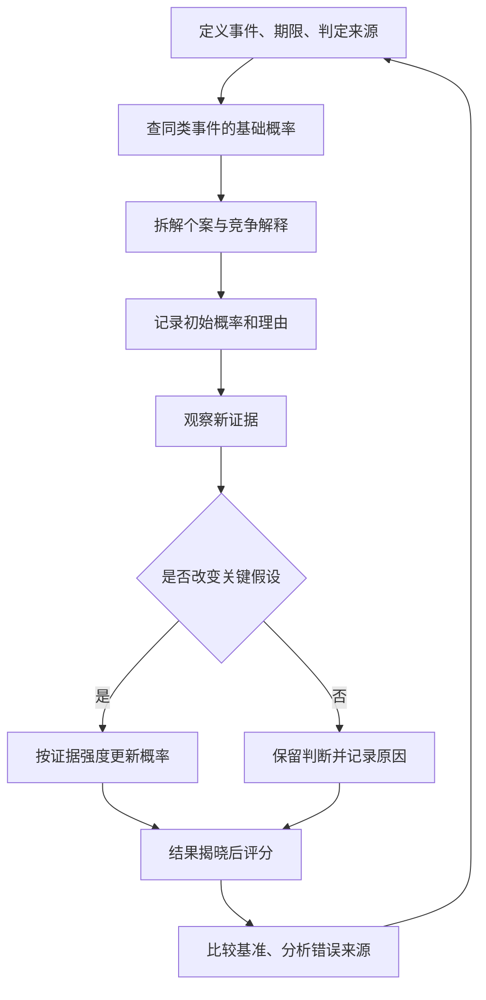
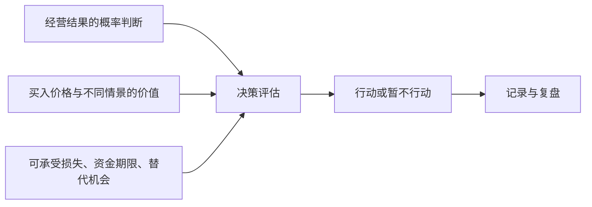

# 《超级预测》读书笔记

> 作者：Philip E. Tetlock、Dan Gardner（菲利普·泰特洛克、丹·加德纳；中文译名因版本而异）  
> 原作：*Superforecasting: The Art and Science of Prediction*，2015。简体版也以《超预测》为名；繁体版《超級預測》由日月文化出版。  
> 分析依据：出版社资料、公开目录、作者团队的方法说明、Good Judgment Open 评分说明和相关原始研究；未取得用户所持版本全文。  
> 覆盖范围：全书十二章的主要主题、34 个核心及延伸知识点；不复述全部人物案例，不声称逐页精读。章名用主题意译，不对应特定中译本页码。  
> 阅读目的：学会对不确定的事情作出有依据、可检验、可修改的判断，并用于投资决策。真实事件和研究结果在对应知识点附来源，数学演算与练习另外标注为教学补充。  
> 更新日期：2026-11-11

**详细阅读建议：**先通过概览了解全书，再重点读第 09、12、16—18、20、26、33 点。它们展开了“怎样找基础概率、怎样更新、怎样评分、怎样转成决策”的完整过程；其余知识点用于补充背景。需要案例的知识点直接结合真实事件、研究或业务实践讲解；纯公式演算另标假设，不把它们当作真实记录。

## 先看这里：这本书真正教你什么

预测能力不是“总能猜中结果”，而是长期把不同结果的可能性估得更合理。一个人说某事有 80% 概率发生，后来没发生，不能仅凭这一次就判定他不懂；但如果他反复说 80%，实际只发生约一半，他的自信就出了问题。

本书把判断从口才比赛变成可以记录、评分、改进的工作。核心顺序是：**问清问题 → 找基础概率 → 拆解原因 → 给出概率 → 接收新证据 → 更新 → 评分复盘。**

你最值得带走的五个变化：

- 从“我看好这家公司”，转成“我对哪一个经营结果、在什么期限内，有多大把握”。
- 从“我的故事很有说服力”，转成“同类事情通常怎样，这次有哪些可靠的不同”。
- 从“改观点等于认输”，转成“证据变了，合理的判断也应该变”。
- 从“这一次赚了，所以分析正确”，转成“判断质量要与运气、买入价格和承担的风险分开”。
- 从“寻找永远正确的专家”，转成“建立一套可重复检查的思考过程”。

书籍信息见 [Penguin Random House 官方书页](https://www.penguinrandomhouse.com/books/227815/superforecasting-by-philip-e-tetlock-and-dan-gardner/)；中文书名与版本可核对 [长荣大学 HyRead 书目](https://cjcu.ebook.hyread.com.tw/bookDetail.jsp?id=122604)。

## 全书主线与覆盖地图

| 章节主题 | 主要解决的问题 | 本笔记对应内容 |
| --- | --- | --- |
| 1 乐观的怀疑者 | 预测有边界，为什么仍值得改进 | 知识点 1—4 |
| 2 知识的错觉 | 为什么确信和解释能力会误导判断 | 5—7 |
| 3 给预测评分 | 怎样让预测接受检验 | 15—19 |
| 4 超级预测者 | 好成绩有多少来自能力和运气 | 20—21 |
| 5 思维能力 | 拆解、基础概率和不同视角 | 8—11 |
| 6 数字与概率 | 如何表达不确定性 | 12—18 |
| 7 信息与更新 | 多看新闻为什么不一定更准确 | 13、22—23 |
| 8 持续改进 | 如何通过反馈训练判断 | 24—25、34 |
| 9 团队 | 如何让讨论增加信息而非制造从众 | 26—28 |
| 10 领导者的难题 | 如何同时承认不确定性与作出行动 | 29 |
| 11 能力边界 | 遇到罕见事件和不可预测变化怎么办 | 30—31 |
| 12 下一步 | 如何把预测变成组织与个人习惯 | 32—34、练习 |

这张表是阅读导航，不表示一个概念只在某一章出现。公开目录可在上面的馆藏书目中核对。

## 一、先改变你对“预测”的理解

### 01．概率判断与结果断言是两回事

“会发生”把判断压成一个二元答案；“发生概率约 65%”保留了不确定程度。实际结果最终是发生或不发生，但在结果揭晓前，你拥有的只是有限信息。

### 02．好问题必须可结算

好预测题至少有对象、事件标准、截止时间和判定来源。“以后会更好”可以不断改解释，难以检验；清晰事件则允许第三方在结果出现后独立结算。

**真实历史事件：2014 年苏格兰独立公投。** 9 月 18 日举行的正式公投，最终支持独立者占 44.7%，反对者占 55.3%。[官方结果说明](https://www.gov.uk/government/news/scottish-independence-referendum-whats-next)

用这个真实事件说明题目定义，可以问“在这次正式公投的有效票中，支持独立的比例是否超过一半”。它比“苏格兰将来会不会独立”清楚：前者有指定投票、阈值与结果来源；后者可能混入下一次投票、谈判和无限期未来。这里是在复盘题目应怎样写，不是在宣称自己事前预测成功，也不冒充比赛的原始题目。

对相等、取消、推迟或无法取得结果的处理，应在预测开始时约定，不能揭晓后为保住成绩改规则。一次投票的结果也不能回答所有更长时期的政治问题。

**把同样方法用于当前的真实公司。** 以 2026-11-11 为提问时点，美的 2026 年三季报已经披露，不能再当作未揭晓成绩；可研究的问题是全年扣非归母净利润是否严格高于上一年可比值。练习可约定以截至 2027-05-31 公开的年度报告及正式更正为准，相等判“否”，缺乏同口径数据则记“无法结算”。截止日是练习约定，不是披露日预测。[已知的三季报输入](https://static.cninfo.com.cn/finalpage/2026-10-30/1225645132.PDF)

定义清楚之后才去调查历史基数、季节性和第四季度信息，并在结果公布前登记概率。为了表格完整随手填一个百分比，不会让题目更科学。

### 03．挑选努力能改善答案的问题

有的事情靠简单规则就能判断；有的事情在所需期限内几乎没有可靠信息。最值得投入的，是可以通过资料、比较与分析显著改善判断的问题。

对财商的意义是分配研究时间。用一小时核对公司现金流，可能比用一小时猜明天开盘的涨跌更有学习价值。并不是所有问题都必须给一个漂亮数字；资料不足也是有用结论。

### 04．预测距离越远，误差来源通常越多

复杂系统会出现反馈、政策变化、行为适应和偶发冲击。能对某个短期、定义明确的事件取得较好成绩，不代表能准确预测二十年后的市场格局。

因此应同时说明预测期限和适用范围。对遥远未来可以使用情景与宽区间；对即将公布的经营数据，可以分析更具体的变量。不要把短期预测比赛的结果无限推广。

### 05．专业头衔、口才与预测成绩要分别评估

领域知识有价值，但一个人懂得解释历史，不等于他对未来的概率判断一直准确。公开表达的激励也可能偏向鲜明、肯定、容易传播的观点。

检查专家时，不只找他说对的几次，而要找完整记录、失败案例、预测期限和比较基准。也不能反过来得出“专家都没用”；该书批评的是不受检验的权威，不是知识本身。

### 06．狐狸式思考与刺猬式思考

“刺猬”倾向用一个强大的解释框架理解各种现象；“狐狸”更愿意同时使用多个有限模型，承认例外，并在证据变化时调整。

### 07．直觉是起点，反思负责检查

鲜活故事容易让人忽视基础概率；刚看到的新闻容易被高估；已经表态后容易只搜支持证据。这些心理倾向会影响概率估计。

实践时可以分两步写：第一反应是什么；随后有什么证据支持、什么证据反对。目的不是消灭直觉，而是避免把熟悉感和确信感当成证据。对认知偏差的系统学习，可结合《思考，快与慢》。

## 二、如何把一个模糊判断拆成可分析的问题

### 08．费米式拆解：先求可解释的数量级

遇到不知道答案的问题，可以把它拆成较容易估计的部分。例如估算某地潜在订阅收入，可以依次考虑目标人数、触达比例、付费比例、客单价与续费情况。

拆解的价值在于暴露假设：到底是人数不确定，还是转化率不确定？乘出一串小数不等于精确，多个有偏的输入还可能放大误差。先给合理范围，再找最影响结论的变量。

### 09．基础概率：先看类似事情通常怎样

基础概率提供一个独立于个案故事的起点：类似的事情通常怎样？关键不只是找到很多历史记录，还要解释为什么这组记录与当前问题可比。

**真实业务实践：飓风路径锥使用历史预报误差。** 美国国家飓风中心的传统路径锥按过去五年官方路径误差设置各预报时效的范围，各预报时效采用约 67% 的历史误差覆盖口径。2026 年 NOAA 又说明将试验覆盖 90%、区分速度与方向误差的椭圆方案。[NHC 历史误差说明](https://www.nhc.noaa.gov/verification/verify4.shtml)、[NOAA 2026 年产品说明](https://www.noaa.gov/news-release/national-hurricane-center-to-issue-new-forecast-cone-graphics-for-2026-hurricane-season)

这个例子不是直接计算某一二元事件的基础发生率，而是相邻的“外部视角”：不只盯着本次中心预测线，还利用同类预测以前错过多远，形成不确定范围。用哪几年、哪种预报时效和哪种系统误差作为参照，都会影响范围的含义；传统与试验产品也不能混读。

迁移到企业增长判断，先确定行业、规模、所处阶段、增长口径和观察期，再看目标增长在完整样本里多常见。只挑今天仍然存续的公司，或只挑已经成功推出产品的公司，会改变原问题；更多同类成功故事不能弥补失败样本缺席。

参照组越窄，业务可能越接近，但样本也可能越少。较宽与较窄参照可以同时保留，比较结论对选择有多敏感。结构变化时要说明历史类比在哪里失效，并扩大不确定范围，而不是仅用“这次不同”跳过所有比较。

**自测：**路径锥外是否必然没有影响？不是。各时效的历史误差覆盖比例不等于整条未来路径必然以同一概率全部落在范围内，中心位置的误差范围也不等于风雨影响范围；同理，公司的利润增长参照率，也不是股票上涨概率。参考类别和目标变量必须同时对齐。

### 10．外部视角与内部视角要互相校正

外部视角看同类案例的分布；内部视角看当前个案的具体原因。只看外部会忽略真实变化，只看内部则容易被精心包装的故事带走。

参照组不是唯一正确答案。可以分别选较宽和较窄的同类组，观察结论变化。如果换一个合理参照组，估计就大幅改变，应承认模型不稳定，而不是掩盖分歧。

### 11．至少提出一个竞争解释

看到营收增长，不要立即认定护城河加深。也可能是涨价、并购、一次性大单、渠道压货或行业整体景气。找能区分这些解释的证据，比继续搜“营收增长”的新闻更有价值。

竞争解释不是为了机械唱反调，而是防止只验证第一种想法。每个解释都应有它更容易出现的可观察现象。

### 12．贝叶斯更新：新证据改变旧概率

贝叶斯更新的难点不在公式，而在区分两个问题：“如果项目会成功，我有多大机会看到这条消息？”与“既然看到了这条消息，项目成功概率是多少？”它们看起来相似，答案却通常不同。前一个问题描述消息产生的机制，后一个问题才是你想更新的判断。

**真实材料中的更新问题：美的 2026 年三季报。** 摘要中扣非归母净利润下降 22.49%，但同页说明提到汇兑损失与相关衍生工具收益的分类差异。[原报告第 2 页](https://static.cninfo.com.cn/finalpage/2026-10-30/1225645132.PDF)

看到后一条信息后，原先把扣非降幅直接等同主营恶化幅度的解释就需要重查：分类因素与经营因素可能同时存在。报告没有提供足以计算“主营恶化概率”的先验和似然比，所以这里不编一个精确后验。贝叶斯思路帮助提出问题：这条信息更支持哪些解释，它在相反解释下是否也可能出现，是否只是已知材料的重复。

**下面仅为公式演算，数字均为假设，不是公司或研究的实际记录。** 一条进度信号如何改变概率： 你判断一批复杂设备是否能按期交付，初始概率为 40%。随后看到消息：“关键部件已经通过验收。”为了把逻辑讲清楚，假设在确实按期交付的项目中，80% 会在这个时点出现此消息；在最终延期的项目中，也有 40% 会出现此消息，因为其他环节仍可能拖期。

先不要套公式，把情境放大成 1000 个虚构的类似项目：

| 实际结局 | 初始项目数 | 出现验收消息的比例 | 既属于该结局、又出现消息的数量 |
| --- | ---: | ---: | ---: |
| 按期交付 | 400 | 80% | 320 |
| 延期交付 | 600 | 40% | 240 |
| 合计 | 1000 | — | 560 |

你现在处在“已经看到消息”的 560 个项目中，其中 320 个按期交付。因此更新后的概率是 `320÷560≈57.1%`。好消息确实提高了概率，但没有把它提高到 80%。原因是延期项目本来更多，其中也会出现相同消息。

这个过程可以写成通行概率公式，作为理解本书的教学补充，并非要求每次预测都手算：

```text
后验赔率 = 先验赔率 × 似然比
赔率 = 概率 ÷ (1 − 概率)
似然比 = P(证据 | 事件发生) ÷ P(证据 | 事件不发生)
后验概率 = 后验赔率 ÷ (1 + 后验赔率)
```

本例先验赔率为 `0.4÷0.6=2/3`，似然比为 `0.8÷0.4=2`，所以后验赔率为 `4/3`，再换回概率就是 `4/7≈57.1%`。赔率在这里表示发生与不发生的相对可能性，不是投资产品的赔付倍数。

现在可以看清什么叫“有区分能力的证据”。如果一条口号在按期项目和延期项目中出现的比例都为 90%，似然比为 1，判断就不该因为它改变。消息听起来多积极并不关键，关键是它是否更支持一种结局。相反，如果另一项检测几乎只在成功项目中通过，它的更新力度就应更大。

还要防止重复计数。三家媒体转载同一份验收公告，只是同一证据有了三次曝光，不能把似然比 2 连乘三遍。即使两条消息文字不同，也可能都来自同一生产进展；第二条的作用要在“已经知道第一条”的条件下判断。只有适当的条件独立假设成立，才可以直接使用各自的似然比连续相乘。

在真实投资研究中，这些百分比通常不能精确取得。这时贝叶斯方法最有用的部分是提问习惯：原来的可能性是多少？这条证据在相反情境下也常见吗？我有没有重复计算同一个原因？可以用合理范围做敏感性分析，而不是编造精确数字来让模型显得专业。

**小练习：**其他条件不变，如果初始按期概率只有 10%，同一条消息会把概率提高到多少？先验赔率为 `1/9`，乘 2 得 `2/9`，转回概率为 `2/11≈18.2%`。同样的好消息，在不同起点上不会产生相同的最终把握。

### 13．证据的区分能力比新闻热度更重要

如果一条消息无论哪种结果发生都很常见，它对判断帮助有限。管理层说“我们有信心”通常不如可核验的订单履约与回款信息有区分能力。

反过来，一条不起眼但直接推翻关键假设的信息，可能需要大幅更新。问“这条证据在另一种结果下也会出现吗”，可以帮助你抵抗标题带来的情绪变化。

### 14．概率可以细分，但不要制造虚假的精确

只有“可能／不可能／五五开”三个档位，会损失有用的信息。60% 与 85% 应当意味着不同的把握和不同的防备。

但 62.371% 也不自动优于 60%。如果证据薄弱，给出中心估计并解释主要不确定因素，通常比多写几位小数诚实。精度要由信息支持。

### 15．小概率会发生，50% 也不等于一无所知

一个可信的 10% 判断，本来就允许少数事件发生。不能在事后把“低概率”改写成“不可能”。与此同时，50% 可能表示充分分析后的势均力敌，也可能表示没有研究，两者理由不同。

因此记录数字之外，还要记录依据。靠所有问题都答 50% 可以避免极端错误，却不一定有预测技能。

## 三、如何判断自己是不是进步了

### 16．校准：你的自信与实际频率是否匹配

校准关心概率语言是否可信：长期来看，被赋予相近概率的事件，实际发生频率是否相符。它不要求每一小组结果都恰好与概率一致。

**真实专业实践：ECMWF 检验季节预测的可靠性。** 欧洲中期天气预报中心的官方用户指南把可靠性图与 ROC 图用于季节预测评估，并持续监测预报系统表现。这里依据的是指南中 2023 年的存档版本，不把某一张历史评估图当成当前系统成绩。[官方检验指南](https://confluence.ecmwf.int/pages/viewpage.action?pageId=311146420)

可靠性检查的思路是：把历史预测按相近概率归组，计算这些预测对应的事件后来有多常发生。如果经常报很高概率的那组实际上发生得明显更少，就需要检查过度自信、模型偏差或样本是否可比。只展示某一次预报特别准，无法替代这项长期检查。

这里的分组是统计工具，并不要求报十次 70% 就必须有七次发生。有限样本会波动，相关事件也会减少独立信息：同一次天气系统影响多个地区，或同一种商品价格影响多家公司，不能简单看成很多互不相关的验证。

投资预测日志也应事先确定记录范围，不在结果出来后删掉尴尬题目；概率、日期、事件定义和最后结果都保留。若只挑重仓、成功或最容易解释的事件，得到的是筛选后的自信记录。

校准好还不等于信息丰富。始终报总体发生率的人可能不算失真，却无法指出哪次风险特别高。因此需要把校准、区分能力和综合评分放在一起看，不能用一个“命中率”包办。

### 17．区分能力：你能不能辨别不同风险的事件

如果一类事件总体发生率为一半，永远报 50% 可能整体校准尚可，但没有区分具体事件。更好的预测应该有依据地区分哪些更容易发生、哪些更不容易。

不过“敢报 95%”本身不等于区分能力；还要看高概率组是否确实更常发生、概率与实际频率是否吻合。研究中用于描述这些能力的指标并不完全相同，不能只凭一张看起来很陡的图判断好坏。

### 18．Brier 分数：给概率错误一个可计算的代价

如果只按“有没有猜中方向”评分，报 51% 与报 99% 会被当成一样。这会奖励含糊表达，也无法区分谨慎错误与非常自信的错误。Brier 分数把预测概率与最终结果之间的距离平方，使概率表达本身也承担责任。

**真实使用场景：** IARPA 的 ACE 项目要求把判断与后来发生的真实事件对照检验；预测比赛以概率评分组织反馈，避免仅保留猜中故事。[IARPA 项目说明](https://www.iarpa.gov/research-programs/ace) 第 26 点给出了实际研究表里的 Brier 分数，下面解释这类分数怎么算，演算数值不冒充比赛原始记录。

二元事件的一种常见写法为：

```text
单题分数 = (p − y)²
p：事前预测概率，0 到 1
y：结果发生记 1，没发生记 0
多题成绩：这些分数的平均值；越低越好
```

先看一题。报 80%，结果发生时分数为 `(0.8−1)²=0.04`；没发生时为 `(0.8−0)²=0.64`。分数越低越好，所以非常肯定地判断错误，会比稍微偏向一边的错误付出更大代价。这里的“代价”是评价指标，并不是实际账户盈亏。

**纯计算演示：为什么不能只追求方向命中率。** 假设甲把十件事全报 80%，实际八件发生。其平均分为：

```text
(8×0.04 + 2×0.64) ÷ 10 = 0.16
```

乙把同样十件事全报 100%。他也有八次方向正确，但平均分为 `(8×0+2×1)÷10=0.20`。两人命中率同为 80%，甲在这组结果上的概率评分更好。丙全报 50%，平均分为 0.25；他在这十题的已知结果上得分较差，但是否漏用了信息，还要回看事前证据，不能仅由事后八次发生倒推出当时就该报 80%。

这个评分还有一个值得理解的数学性质。假设真实发生概率为 q，你报告 p，预期分数可以化成：

```text
预期分数 = q×(1−p)² + (1−q)×p²
         = (p−q)² + q×(1−q)
```

第二项由事件本身的不确定性决定，第一项在 p=q 时最小。因此，在这个模型下，如实报告自己最合理的概率判断，优于为了显得勇敢而夸大把握，或为了避免背责而全部写成五五开。真实世界的 q 通常不知道，这个式子用于说明评分为什么鼓励诚实，不是告诉你能直接查出真实概率。

Good Judgment Open 对全部互斥结果的误差求和。二元事件中还会加上“不发生”的误差，因此分数是上式的两倍、范围为 0—2；上面的单事件口径范围为 0—1。**比较成绩前必须统一口径。**[GJ Open 官方评分说明](https://www.gjopen.com/faq)

还应把评分与决策后果分开。对一个日常小事件预测错，与漏掉严重风险，可能在 Brier 分数上相同，现实损失却不同。这个指标适合评价概率判断，不能独自决定资金应投多少、是否值得行动。比较不同预测者时，还需统一题目、期限和基准；否则专挑容易题的人可能显得更优秀。

**动手算：**你报 60%，结果没有发生，单事件分数为 0.36；若报 30%，则为 0.09。这个结果只能说明后一个判断在这一次得分较好，不能凭一题证明他的长期方法更强。

### 19．有分数，还要有公平的基准

预测容易的题与困难的题，分数不能直接横比；等到结果几乎确定再预测，也不能与提前几个月的人公平比较。应在相同问题、相近时间、相同评分规则下，与基础概率、简单模型或群体结果比较。

GJ Open 会按预测有效期间的每日分数汇总。这提醒我们：不要只挑最终最接近结果的一次判断。更早发现变化也是一种价值，但具体计算必须按平台规则，而非自行挑选有利的日期。[GJ Open 官方评分说明](https://www.gjopen.com/faq)

### 20．优秀成绩要排除运气与筛选效应

事后挑出表现最好的人，再解释他为什么成功，会混入运气和筛选效应。需要检查他在未用于选拔的新问题上是否仍有表现，以及环境是否同时改变。

**真实跟踪研究：超级预测者的第二年检验。** Mellers 等人的研究把第一年表现最好的约 2% 组成精英团队，再看第二年成绩；论文报告这组仍显著领先。[原研究的 Tracking 部分](https://faculty.wharton.upenn.edu/wp-content/uploads/2015/07/2014---psychological-strategies-for-winning-a-tournament.pdf)

重要之处在于观察进入了新的预测期，不只是反复展示被选中时那一份漂亮成绩。这比采访一位猜中的人、把他的生活习惯解释成成功原因，更接近对可重复能力的检验。

但还不能把全部优势解释成固定天赋。选拔后团队环境也改变，参与投入、协作和信息处理可能共同影响结果。合理结论是这组人在研究条件下展现了可持续的预测优势，而不是任何领域、任何期限都保证准确。

纯数学可以说明为什么选拔效应值得认真对待：1024 人各自独立猜十次公平硬币，十次全中的人数期望为 `1024×(1/2)^10=1`。这只是计算演示，不是实际比赛记录，也不表示每次必定恰好一人全中。现实市场有技能与风险暴露，不能把它直接等同硬币。

所以评价基金或预测者时，应先看选拔前如何界定样本，再看未参与选择的新时期，最后检查费用、共同风险和规则变化。单次冠军与稳定优势之间，需要跨越这三层证据。

### 21．能力、知识、训练、投入共同起作用

本书强调的是可培养的思考习惯，而不是宣称智力和专业知识毫无用处。愿意做功课、能理解基本数量关系、能纠正错误，都有帮助。

研究中的成绩来自特定任务和制度，不能推导成“普通人随便看新闻就能击败所有专业人士”。IARPA 的项目本身就同时研究如何收集、加权、组合概率判断，并用真实结果检验。[IARPA：ACE 项目](https://www.iarpa.gov/research-programs/ace)

## 四、如何更新、合作与长期练习

### 22．关注信息不等于不断消费新闻

有价值的是新信息对关键变量的影响，不是新闻数量。应该事先列出需要跟踪的事项，例如需求、客户付款、成本、债务到期与竞争格局。

如果一条新闻与这些变量无关，可以记录但不改概率。这样能防止判断随信息流剧烈摇摆。

### 23．通常小步更新，但关键证据可以要求大幅改变

反应不足是维护旧观点；反应过度是把每条新消息当成世界重写。合理更新幅度取决于证据强弱。

“频繁小幅更新”不是禁止大幅调整。如果核心客户合同已明确终止，原来建立在合同续签上的收入判断可能需要重做。保持一致指方法一致，不是数字永远不动。

### 24．让观点成为待检验的假设

当“我持有这只股票”变成“我是懂这家公司的聪明人”，反对证据就容易被当成人身攻击。减少这种身份绑定，可以让修改判断更轻松。

练习写一句话：“如果出现什么证据，我会显著降低原来的估计？”如果答案永远是“那只是暂时困难”，这个判断可能已无法证伪。

### 25．持续测试状态：把复盘用于修改方法

改进需要有明确问题、及时反馈、持续练习和对错误来源的分析。单纯回忆“这次没想到”很难形成技能。

可以把错误分成：问题定义不清、基础概率选错、遗漏重要因素、证据重复计算、更新太慢、信心过度。下一轮只选择一两个改进点，以便观察是否有用。

### 26．先独立思考，再交换理由

团队的价值来自信息被补充、理由被检查和错误被纠正。人数多不会自动增加独立证据，也不保证判断一定更好。

**真实比赛：比较有无训练与团队协作。** 2014 年预测研究的表 1 给出第一年下列平均 Brier 分数；数越低越好，这里采用论文的完整结果评分口径。[原论文表 1](https://faculty.wharton.upenn.edu/wp-content/uploads/2015/07/2014---psychological-strategies-for-winning-a-tournament.pdf)

| 第一年的条件 | 问题开放首周 | 中间两周 | 最后一周 |
| --- | ---: | ---: | ---: |
| 独立预测、无训练 | 0.44 | 0.40 | 0.31 |
| 独立预测、概率训练 | 0.40 | 0.36 | 0.29 |
| 团队预测、无训练 | 0.42 | 0.33 | 0.22 |
| 团队预测、概率训练 | 0.35 | 0.30 | 0.19 |

先比较相同时间窗口，不能拿临近揭晓时的团队成绩与很早的个人成绩竞争。表中的 0.35 也不是“35% 题目错误”，Brier 是概率误差分数；论文使用的是开放至少一个月的问题来做这部分时段比较。

再看组织方式：该研究中的团队能够交流信息和理由，并接受怎样帮助团队提高判断质量的指导。不能把结果简化为“开会人数越多，预测越准”，也不能从这张表直接推出股票收益。[研究方法](https://faculty.wharton.upenn.edu/wp-content/uploads/2015/07/2014---psychological-strategies-for-winning-a-tournament.pdf)

据此可以设计自己的讨论流程：先各自写下事件定义、概率、依据和反证，再同时公开；找出分歧究竟来自不同事实还是不同假设；核查最能改变分歧的资料，最后独立更新。这个流程是本笔记的应用设计，不是声称原实验逐项使用了完全相同的会议步骤。

保留分歧往往比强迫一致更有价值。若一方认为需求更强，另一方认为成本更高，应分别记录可核验条件，待新资料出现时更新。这样结果揭晓后才能知道哪项推理有效，而不是只留下一个妥协数字。

### 27．汇总可以减少个人噪声，但权重需要依据

均值、中位数或加权结果可以作为讨论起点。表现记录、专业信息、预测是否及时，都可能影响权重。

但不能因为某人地位高就给最高权重，也不能把同一来源的十个转述当成十份独立意见。汇总方法应靠后续成绩检验，不能只因听起来复杂就采用。

### 28．概率“极化”有条件，不能机械加码

概率极化是把汇总概率适当推离 50%，研究中用于处理平均值可能没有充分体现的信息整合。它需要信息结构和模型支持，不能当成提高自信的口令。

**真实研究：对信息重叠建模。** Satopää、Pemantle 与 Ungar 的论文把预测者掌握的部分重叠信息纳入模型，分析适当的极化幅度如何随重叠程度变化。[作者公开论文](https://arxiv.org/abs/1406.2148)

理解它可以从一条实际研究原则出发：多个概率背后若包含不同的有效信息，汇总可能得到任何单个人都没有的依据；若大家的信息大体相同，多人同意就没有同等分量。信息重复与信息补充，应该产生不同的更新力度。

因此，读多家机构报告时，先追到原始公告、数据或访谈来源。十份报告可能只是同一条材料的十种转述。模型论文给出的是特定假设下的理论说明，不能据此在股票群里看到多数看涨，就把 70% 机械调成 90%。参数与表现仍需独立验证。

### 29．承认不确定性仍然可以果断行动

领导与投资都不可能等到 100% 确定。可以同时说“当前证据偏向这个方案”“还有这些风险”“满足某个条件就调整”。

果断应落实为清楚的行动责任和触发条件；谦逊应落实为对证据保持开放。朝令夕改与拒绝修正，都不是理想状态。

### 30．大问题需要一组相互关联的小问题

“这家公司是不是优秀企业”太宽。可以分成需求是否稳定、客户是否续约、经营现金是否跟上利润、竞争是否压价、资本开支是否产生回报等。

这些小问题能够帮助形成整体判断，但不能把相关概率直接相乘。它们可能受同一个经济周期驱动。需要明确条件关系，才谈得上计算联合概率。

### 31．罕见冲击与可预测性边界

有的重大变化很难提前以明确问题和稳定概率描述。对此，预测技能应与承受冲击的能力结合：保留余地、减少单一假设依赖、研究失败情景。

本书对预测能力较乐观，也讨论能力的限制。不能因为会用概率语言，就宣称已掌握“黑天鹅预测公式”。在财商学习中，稳健的资产负债安排可以补偿一部分预测不足。

### 32．预测、因果解释与价值判断要分开

“某政策可能发生”是预测；“该政策将通过什么机制影响利润”是因果判断；“政策是否公平”是价值判断。它们可能互相关联，但一个问题答得好，不能代替另两个问题。

买股票时尤其容易把“我喜欢这家公司的产品”变成“它的股票应该上涨”。喜好不是关于价格与回报的证据。

### 33．预测不直接等于行动：还要考虑后果

这是把本书用于财商时最重要的一步转换，也是补充教学：预测回答“什么可能发生”，行动还要回答“如果发生或不发生，我分别会得到和失去什么”。后果不同，同一个概率可以对应完全不同的选择。

**真实事件：2020 年 WTI 近月合约出现负价。** 2020 年 4 月 20 日，WTI 2020 年 5 月期货合约在到期前出现负价格。EIA 当时解释，需求冲击、可用存储约束与临近到期时的交易流动性共同作用；其他期限和基准的原油并非全部变成负价。[EIA 当时的分析](https://www.eia.gov/todayinenergy/detail.php?id=43495)

这个事件使“我看好未来油价”与“我可以一直持有这张近月合约”等判断的差别非常具体。前者预测未来价格，后者还要求处理到期、实物交割、仓储、换月、现金和交易对手。方向后来即使符合预期，也不能补回此前因合约约束被迫退出的损失。这里没有替任何交易者编造事前概率或实际盈亏。

从概率走向行动，必须把预测对象与所持工具对上，再列出不同结果下实际承受的后果。下面的纯数学演算进一步说明概率与收益结构为何不能混同，金额均为教学假设。

**计算演示：同样 70% 把握，两种结果结构。** 机会甲成功赚 20 单位，失败亏 60 单位；机会乙成功赚 10 单位，失败亏 10 单位。为了聚焦计算，假设均只有这两种结果、收益在同一时点实现，暂不计费用与其他约束。

```text
甲的期望净结果 = 0.7×20 − 0.3×60 = −4
乙的期望净结果 = 0.7×10 − 0.3×10 = 4
```

如果只问“判断正确的把握是否超过一半”，两者看起来一样；考虑后果之后，差别就出来了。由一般形式 `p×盈利−(1−p)×亏损>0`，可以得到：

```text
需要的成功概率 > 亏损金额 ÷（盈利金额 + 亏损金额）
```

甲需要超过 `60÷80=75%` 才有正的金额期望，乙只需超过 50%。这里的门槛依赖固定二结果、相同时点等简化假设；真实股票收益有更复杂的连续分布，不能只选两个对自己有利的价位就认为算完了风险。

更进一步，即使乙的期望值为正，也没有告诉你应该投入多少。如果失败损失会影响房租、偿债或其他必要支出，或者许多机会其实会在同一冲击下同时失败，平均值仍然不足以支持行动。需要分别考虑一次损失、连续损失、资金期限以及概率估计本身可能错误。

股票里还多了一层价格。公司收入增长有 80% 概率，不等于这只股票上涨有 80% 概率。市场也许早已按更高增长定价，经营增长兑现时，估值反而下降。必须先定义你预测的是经营事实还是资产回报，再建立二者之间的模型，不能把前者的概率直接贴到后者上。

因此，一份完整记录至少有三个部分：对事件的预测；不同情景下的经济后果；个人或组合的约束。预测部分用合理评分检验，行动部分用成本、风险和结果复盘。把它们分开后，你才能识别“预测很好但买贵了”“判断一般但赔率有利”，以及“过程有问题却碰巧赚钱”等不同情况。

**小练习：**某机会有 80% 概率赚 1、20% 概率亏 4，是否可以因胜率高就积极参与？金额期望恰好是 0，计入费用后会更差；即使不计费用，也没有获得承担风险的平均补偿。先把概率与后果配在一起，再谈行动。

### 34．保留事前记录，防止事后记忆变形

结果揭晓后，人会觉得征兆早就明显，也容易忘记自己曾经有多肯定。记录日期、概率、证据、反证与更新条件，才能分辨真正的学习与事后编故事。

复盘时先遮住结果，重新检查当时信息是否支持判断，再看结果。你需要纠正的是可重复的思考错误，而不是强迫每个坏结果都有一个“早该知道”的解释。

## 难点图解一：一轮完整的预测



**怎么看：**这是一条带反馈的工作流程。“更新”不是随意改答案；每次修改都保留理由。最终评分是为了改进下一轮，不是为了寻找一次正确答案的荣耀。

## 难点图解二：概率不是投资建议



**怎么看：**预测只提供决策的一部分输入。一个经营结果即使很可能发生，也可能已被股价充分反映；好的预测不能自动生成好的投资回报。

## 难点图解三：用一组数据理解校准与评分

以下为原创构造的教学数据，不是真实研究结果：

| 四次预测 | 预测概率 p | 实际 y | 单事件 Brier 分数 |
| --- | ---: | ---: | ---: |
| A | 0.80 | 1 | 0.04 |
| B | 0.60 | 0 | 0.36 |
| C | 0.30 | 0 | 0.09 |
| D | 0.70 | 1 | 0.09 |
| 平均 | — | — | 0.145 |

同四题若每次都报 50%，平均分为 0.25；这个小样本中，上述预测更好。若按 GJ Open 的二元全结果求和口径，两者分别为 0.29 与 0.50。

**不能得出的结论：**四道题不足以证明稳定技能，也不足以测量“70% 档位”的长期校准。这里仅用于学会计算，不用于宣传某种准确率。

## 把方法用于财商：一个完整练习

选一家你能理解业务的公司，只使用公开资料，暂时不买卖。

1. **写清问题。**选择一个年度报告可以核验的经营指标，不用“有没有投资价值”这样无法直接结算的问题。
2. **找参照。**查看公司多年表现与合理同业，记录样本过少、业务变化或统计口径的限制。
3. **拆成因素。**例如收入可以分为销量与价格，利润还涉及成本、费用、税与非经常项目。
4. **给初始概率。**写出中心估计和最重要的三个依据，不使用没有来源的精确数字。
5. **写反证。**列出哪些信息会让你降低估计，哪些信息会提高估计。
6. **设置更新时间。**财报、经营公告或关键条件变化时更新；不是每次价格波动都改判断。
7. **结算后评分。**保留所有预测记录，避免只展示看对的案例。
8. **另做价格判断。**即使经营预测不错，也要另外研究价格、潜在回报与风险，不能跳过估值。

可复制的记录格式：

| 日期 | 可结算问题 | 概率 | 主要依据 | 最强反证 | 下次更新触发条件 | 结果与分数 |
| --- | --- | ---: | --- | --- | --- | --- |
| 自行填写 | 先约定截止日与数据口径 | 自行估计 | 列事实与来源 | 列可能推翻的假设 | 明确事件或日期 | 揭晓后补齐 |

## 作者方法的简明复习卡

选值得研究的问题；把问题拆小；结合基础概率和个案；随证据适度更新；考虑相反力量；使用有依据的概率精度；平衡自信与谨慎；复盘时防止后见之明；善用团队；持续练习这些平衡。这里是对附录方法的简写，执行时仍须按具体问题调整。[作者团队公开的十项方法](https://goodjudgment.com/philip-tetlocks-10-commandments-of-superforecasting/)

## 自测：真正理解了没有

1. **预测 80% 的事没发生，能否证明预测者很差？**不能单凭一次结论判断，要看长期记录、校准、评分与比较基准。
2. **为什么多读十篇新闻未必有帮助？**可能只是同一信息的重复，也可能没有改变任何关键假设。
3. **为什么要先找基础概率？**它提供独立于个案故事的参照，减少过度相信特殊性的倾向。
4. **10% 概率是否可以忽略？**不能，还要看发生后的代价与自己能否承受。
5. **如何识别真正的改进？**在新问题与公平比较条件下，方法和成绩持续改善，而不只是事后解释更顺。
6. **看对企业增长就能买股票吗？**不能，价格、利润质量、回报结构与个人约束仍需独立分析。

## 来源与边界

- [英文出版社书页](https://www.penguinrandomhouse.com/books/227815/superforecasting-by-philip-e-tetlock-and-dan-gardner/)：原作、作者与主题。
- [长荣大学 HyRead 馆藏书目](https://cjcu.ebook.hyread.com.tw/bookDetail.jsp?id=122604)：繁体版信息与目录。
- [IARPA ACE 项目](https://www.iarpa.gov/research-programs/ace)：研究目的与方法范围。
- [宾夕法尼亚大学作者主页](https://psychology.sas.upenn.edu/people/philip-tetlock)：作者及研究背景。
- [作者团队公开方法](https://goodjudgment.com/philip-tetlocks-10-commandments-of-superforecasting/)：附录方法的简明核对。
- [GJ Open FAQ](https://www.gjopen.com/faq)：评分口径、日度记录与比较。
- [预测者选拔说明](https://goodjudgment.com/how-to-become-a-superforecaster/)：训练、组队与选拔的区别。
- [概率图表说明](https://goodjudgment.com/faq_analytics_charts/)：问题定义与结果选项。
- [信息多样性与预测汇总原始研究](https://arxiv.org/abs/1406.2148)：概率极化及信息重叠的条件。

本笔记覆盖主要方法与实践逻辑，在相关知识点原位解释真实预测研究、专业实践和公司材料，不含全部历史案例。贝叶斯赔率算例、公司分析流程、决策期望算例和自测为补充教学；它们帮助理解原书思想，不冒充书中原例。预测研究中的优势不意味着对所有领域、所有期限都有效，也不能转化为股票获利保证。

---

[返回书籍索引](../README.md) · [财商学习与实践路线](../财商进阶合订本.md)
