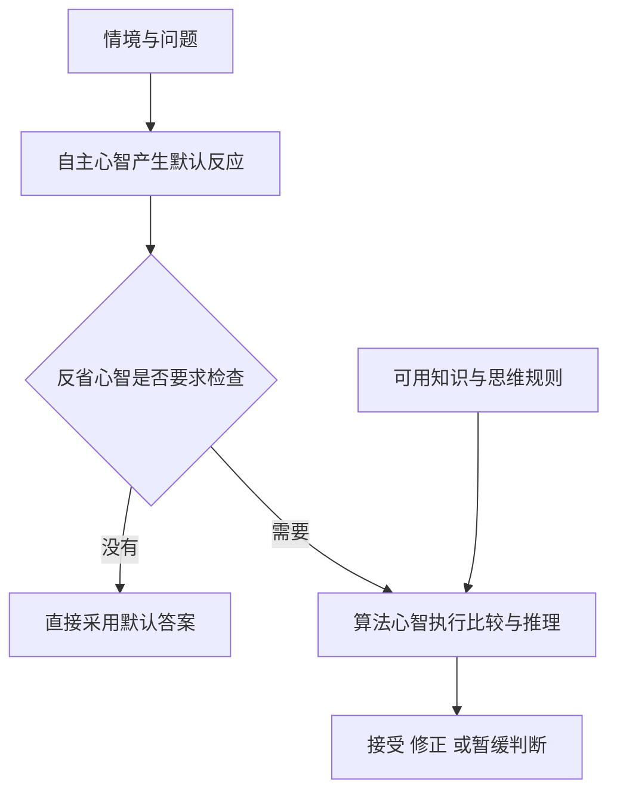
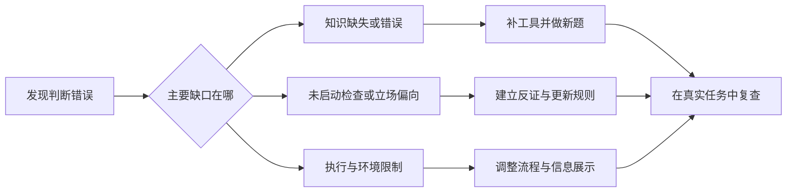

# 《超越智商》：聪明是一种能力，理性还需要目标、知识与习惯

> 作者：Keith E. Stanovich，基思·斯坦诺维奇。英文 *What Intelligence Tests Miss: The Psychology of Rational Thought*，耶鲁大学出版社，2009 年。中文核对机械工业出版社 2015 年版，张斌译、阳志平审校，ISBN 9787111509271。  
> 依据：出版社目录、审校者书目、作者论文及相关原始研究；未取得用户版本全文，属于公开资料系统导读。覆盖理性与智力的区别、三重心智、认知吝啬、我方偏差、心智程序缺陷与改善方法，共 28 点。后续研究和财商案例为补充。  
> 更新：2026-11-12。本文不根据职业、学历或一次失误给任何人评定智商。

## 本书解决的问题

有的人计算快、知识多、学历高，却会忽略明显风险、只寻找支持自己的证据，或为不值得的目标投入巨大精力。本书认为，这不是智力测试失去全部价值，而是它测到的能力没有覆盖理性思维的全部要素。

理性至少涉及两个方向：相信的事情是否与证据相称；采取的行动是否有效服务于自己的目标。仅仅“能算”还不够，还要愿意检查最初答案、拥有正确的思维工具，并且把这些工具用于真正的问题。

对财商最重要的收获是：不要把“我能理解复杂模型”当成“我的投资判断可靠”。你还需要合理目标、概率和统计知识、反证习惯以及能够实际执行的规则。

## 全书主要框架

| 主题 | 要解决的误区 | 本篇位置 |
| --- | --- | --- |
| 智力与理性 | 聪明人天然不会作坏决定 | 1—5 |
| 三重心智 | 只用快思考与慢思考解释全部问题 | 6—10 |
| 认知吝啬与偏差 | 多思考一会儿就一定正确 | 11—18 |
| 心智程序 | 只需提高计算能力，不必学习正确知识 | 19—24 |
| 改善与测量 | 做几道题就能证明自己永远理性 | 25—28 |

参考[耶鲁出版社原版目录](https://drupal.yalebooks.yale.edu/sites/default/files/files/TOC/stanovich_what.pdf)及[中文审校者书目](https://yangzhiping.com/books/9787111509271/)。中文版编排与英文原章的对应不在这里强行逐页绑定。

## 核心知识点

### 1. 智力测试有用，但不是所有认知能力的总和

智力测验通常涉及推理、工作记忆和加工能力等方面，这些能力对许多任务有预测价值。本书反对的是把它等同于全部良好判断，而不是主张智力完全无关。

能快速分析信息的人，在发现值得分析的问题时可能有优势；但如果从不检查信息、目标不合理，或只用能力维护既有立场，就可能仍然作出糟糕决定。不要把“不能保证”误读成“毫无关系”。

### 2. 认识理性：信念要与证据相称

认识理性关注相信什么、相信多强，以及如何更新。缺少可靠证据时保持有限信心，出现反证时调整，都是理性的表现。

金融研究中，不能把“公司可能成功”升级成“它必然成功”，也不能把一则不利新闻升级成“一切都已失败”。信念强度应跟随证据，而不是跟随自己的持仓或期待。承认概率与不确定性，并不会妨碍形成行动。

### 3. 工具理性：行动要服务于自己的目标

工具理性关注手段能否有效实现目标。为了提高长期可支配财富而进行高成本、没有证据优势的频繁交易，可能在目标与行动之间出现矛盾。

但目标不应由外部强行规定。有人重视流动性，有人重视长期积累，有人需要降低生活压力。理性分析应先确认目标与约束，再评价行动，不能用同一个收益数字对所有人作判决。

### 4. 好结果与理性过程并不一一对应

一次错误决定可能幸运获利，一次合理决定也可能遭遇坏结果。仅凭单次结果判断过程，会奖励运气并惩罚正常不确定性。

复盘应还原当时资料：信息是否足够可靠，备选是否完整，概率与后果是否考虑，行动是否符合约束。长期结果仍很重要，但需要足够样本与合适比较，不能与过程评估互相替代。

### 5. “理性障碍”是理论概念，不是给人贴医学标签

作者用 dysrationalia 讨论在具有足够智力的情况下仍未能理性思考或行动的现象。它强调理性能力有独立研究价值，不意味着看见一个错误就能诊断某种疾病。

对自己更有用的问题是：这次错在没有启动检查、缺少知识，还是检查方法本身有问题？找到具体失败环节，比宣布“我很不理性”更容易改进。

### 6. 自主心智：自动反应并非都不可靠

习惯、熟练技能、情绪和自动联想可以迅速产生答案。它们节约资源，在反馈稳定、反复训练的环境中可能非常有用。

问题是它们也会把熟悉感当成真实性，把生动故事当成高概率。不能一见直觉就否定，也不能因为某次直觉成功就无条件信赖。需要看形成经验的环境是否与当前任务匹配。

### 7. 算法心智：执行计算与推理的能力

算法心智负责维持信息、比较选项、执行复杂步骤等。计算现金流、检查概率、理解反事实，都可能需要这些资源。

但它像执行能力，不能独自保证问题选择正确。一个人可以把错误估值模型算得非常精确，也可以用大量知识替错误前提辩护。提高计算能力有帮助，但必须与对目标和假设的检查结合。

### 8. 反省心智：决定什么时候怀疑默认答案

反省心智涉及目标、信念和思考倾向，决定是否值得启动更费力的检查。它会问：我是否忽略了其他可能性，资料是否足够，当前目标是否值得追求？

三重模型的价值，在于把“能不能分析”与“会不会主动分析”分开。训练理性不能只增加题目难度，还要增加识别需要检查的场景与主动开放的习惯。

图是功能示意，不是在大脑里画出三个独立器官。不同理论对加工过程有不同解释，本书模型帮助定位问题，不应被当作完整神经科学地图。

### 9. 认知解耦：暂时把相信的事情与假设分开

推理经常需要在不立即相信某个前提的情况下，检查“假如它是真的，会怎样”。这使我们能够理解反方、做情景分析和检验模型。

研究自己喜欢的公司时，试着暂时接受需求下降或成本上升的情景，认真算后果。这个动作不是预测它一定发生，也不是背叛原观点，而是检验结论依赖多少有利条件。

### 10. 覆盖默认反应需要多个环节，不只是更用力

首先要发现冲突，其次愿意投入资源，再次拥有可用的方法，最后正确执行。任何一步缺失，都可能让错误答案留下。

所以“想得更久”不是万能建议。若缺少概率知识，长时间思考仍可能在错误模型里打转；若不知道自己的资料有选择偏差，更认真拟合也可能更精确地过拟合。改进应针对具体环节。

### 11. 认知吝啬：省力是常见默认，不是道德缺陷

人们倾向于采用较省力的加工方式。日常选择非常多，资源有限，省力有其合理性；问题是有些高影响决定也沿用了不合适的快捷方式。

应按重要性与可逆性分配思考成本。买一件低价日用品不必做复杂模型，长期合同、杠杆和重大资金安排则值得更强核验。理性也包含对思考成本的管理，而不是凡事分析到极致。

### 12. CRT：正确计算之外，还测到是否抵抗诱人答案

**真实研究。** Frederick 2005 年提出三题认知反思测验（CRT），题目容易引出一个看似直接、实际不正确的答案，研究考察测验成绩与时间、风险选择的关系。这里是真实实施的测验，题目本身是研究设计，不是现实人物故事。[原始论文](https://www.aeaweb.org/articles?id=10.1257/089533005775196732)

这种题为何有用？它把“第一反应是否被检查”变成可观察的行为。一个人可能具备算出正确答案的能力，却没有发现需要重新计算。

但 CRT 不能完整代表理性。题目熟悉程度、数学知识和测试情境都会影响成绩；背过答案再得满分，不等于在投资中更会面对反证。测量工具只能覆盖某些方面，不能用三道题给人定终身标签。

### 13. 测验与行为的相关，不等于训练题目就能改善一切

**后续原始研究。** Toplak、West 与 Stanovich 2011 年比较 CRT 与一组启发式及偏差任务，发现 CRT 对相关任务表现提供了预测信息。这支持“认知反思有独立测量价值”，但不能直接证明教会这几道题就能改善真实投资收益。[论文记录与摘要](https://pubmed.ncbi.nlm.nih.gov/21541821/)

测量关系、训练效果与现实迁移是不同研究问题。需要分别问：测试是否稳定；训练改变了什么；变化能否迁移到未见过的问题；实际行为是否改善。若只在熟悉题目上变好，可能学到了解题，而不是更广泛的判断习惯。

应用上，可以记录真实决定中的检查动作：是否主动找基准、是否核对费用、是否愿意改概率。这些记录比反复做同一套测验更接近用户想提高的财商能力。

### 14. 框架效应：等价表达不应轻易改变实质判断

同一组结果用损失或收益方式呈现，可能引起不同反应。理性检查可以把方案改写成共同基准，比较最终状态而不是只看表述。

但要先确认真的等价。名义上相同的比例，可能对应不同分母、期限、税费或流动性。不能见到选择变化就宣布是偏差；有些变化来自新信息或真实条件差异。

### 15. 备选方案搜寻不足，会让判断停在第一个解释

默认答案出现后，人们可能只检验它是否说得通，没有积极寻找其他也说得通的解释。这会让一个可能原因被误认为唯一原因。

财报异常至少可以考虑业务变化、一次性因素、会计分类、并购范围与现金时点。但替代解释不是越多越好，应按资料支持与影响大小排序。列出十个想象后不核查任何一个，也没有增加判断质量。

### 16. 我方偏差：只为自己的立场生成理由

**真实研究线索。** Stanovich、West 与 Toplak 在 2013 年论文中综述我方偏差与智力的关系，指出某些我方偏差任务的表现并不能由一般认知能力有效解释。重要结论是不能指望高智力自动消除立场偏向，而不是说智力与一切偏差都无关。[作者论文](https://journals.sagepub.com/doi/10.1177/0963721413480174)

投资者可能对利好要求很低，对利空要求极高；也可能把支持自己风格的历史时期称为规律，把其他时期称为例外。能力越强，有时只是更善于找理由，不能据此认定能力本身有害。

改进可从对称标准开始：在不知道结论方向前，约定什么样的资料可信；要求为反方写出其最强论点；把改变观点的条件事先记录。反证不是最后附上的礼貌段落，应能够真实影响结论。

### 17. 信念偏差：结论听起来可信，形式仍可能无效

一个三段论的结论若符合常识，人可能忽略前提是否足够。反过来，不喜欢结论，也可能使人否认有效推理。

可以先把具体内容替换成符号，检查形式，再回到事实检查前提。这样把“我希望它真”和“它是否被推出”分开。逻辑检查与事实核验互相补充，任何一项都不能替代另一项。

### 18. 析取推理：不知道具体是哪一种，也可能知道共同结论

有时存在若干可能状态，虽然不知道实际是哪一个，但若每个状态都导向同一行动，就不必等待全部不确定性消失。这要求真正列全相关情形并检验，而不是凭直觉说差不多。

例如某项费用在所有合理情景下都高于已经确定的预算上限，那么先放弃该方案，未必需要精确预测未来收益。这里是方法示意，不是让读者忽略复杂的合同义务。需要确认预算约束、可替代方案和比较范围确实成立。

### 19. 心智程序缺口：没学过正确工具，思考就缺少材料

作者借用“心智程序”描述可用于推理的知识、规则与方法。概率、逻辑、科学检验和成本概念，都可能成为这样的工具。

如果不知道复利、基础概率或机会成本，很多错误不是单纯不够努力。补知识因此具有实质价值。但会背术语与能识别使用场景不同，训练要把知识接到真实任务，而不是只增加定义记忆。

### 20. 基础概率：具体故事要放回总体频率中

某家公司有令人兴奋的特征，并不能让同类失败率自动消失。先看相关类别的历史分布，再用个案信息调整，通常比从一个故事直接开始更稳妥。

但类别选择本身也需要判断。太宽的类别没有解释力，太窄的类别可能样本不足。基础概率提供起点，不是宣布每个对象都必然等于平均数；新的、可靠的个案证据可以改变判断。

### 21. 自然频数：换一种表达能降低计算错误

概率题可以用“多少个对象中有多少个”来重建分母。以下是**纯数学演示**：一千个项目中十个最终成功；筛选方法保留九个成功项目，也误留九十九个失败项目，那么被保留的项目中成功者占 `9/(9+99)≈8.33%`，并非 90%。

90% 描述的是成功项目被识别的比例，8.33% 才是在这组假设下筛中以后成功的比例。差别来自基础概率与误报的数量。这不是某种实际选股工具的效果，更不能把演示数字用于市场预测。

分母写出来，很多直觉错误就变得可见。现实应用还需验证筛选性能是否稳定、样本是否可比、结果定义是否一致。

### 22. 期望与个人后果：平均收益不能独自决定行动

概率加权的平均结果有助于比较方案，但还要考虑损失是否可承受、是否重复参与、资金期限和极端后果。相同数学期望，对不同财务条件的人不一定具有相同价值。

理性不是一律追求最高预期金额，也不是一律规避风险。应使概率、结果分布和个人目标相连。若一种方案可能破坏基本生活，即使平均值看起来有吸引力，也需要不同层级的约束。

### 23. 污化的心智程序：学到的规则也可能使判断更差

有些信念会阻止自我检验：把任何反证都解释为阴谋，把失败都归于执行者不够坚定，把成功都归于理论正确。这样的体系很难从现实中学习。

检查一个方法是否值得学，可以问它允许什么证据证明自己有错，历史样本是否完整，解释是否在事后不断改变。不是所有难以证伪的价值观都毫无意义，但若声称能预测投资结果，就应承担相应的证据责任。

### 24. 知识、动机与执行必须一起考虑

**真实金融研究：个人交易账户。** Barber 与 Odean 分析 1991—1996 年一家美国折扣经纪商的 66,465 户普通股投资账户，发现交易最频繁组的成本后表现明显落后于相应市场比较。研究支持对过度交易成本的警惕，但没有测量所有人的智商，也不能把每个账户的行为都诊断成某一种偏差。[原始论文](https://faculty.haas.berkeley.edu/odean/papers%20current%20versions/individual_investor_performance_final.pdf)

它与本书的连接在于：能分析市场，不等于行动已合理地服务财富目标。交易频率、成本、信心与实际优势需要一起核对。论文来自特定市场、时期和经纪商，也不能据此推出任何交易在任何环境都无意义。

实践可以记录每次操作希望解决的问题、成本和预期优势，随后比较是否真的实现。若行动只是为了缓解无聊、追逐热度或证明自己，就应承认目标已经变化，而不是继续称为研究驱动。

### 25. 个人理性检查可以分成知识与倾向两条线

知识线问是否懂概率、逻辑、成本和相关业务；倾向线问是否愿意寻找反证、暂停默认反应和承认未知。两个维度都要训练。

这些类别可能重叠。分类的目的不是找到唯一责任，而是选择更有效的改进动作。

### 26. 环境可以替人承担一部分记忆与检查

把费用自动汇总、保留研究日志、在重大决定前使用检查表，都能减少对临场意志的依赖。个人教育与环境设计并不冲突。

但外部提示本身也可能错误或过时，需要定期复查。自动化不等于永远正确；如果规则不适用，执行越稳定也可能持续制造偏差。保持可解释与可修改，是流程设计的一部分。

### 27. “理性商”不应被误读成单一万能排名

作者主张扩大对理性能力的研究与测量，不意味着任何网上测试都能精确衡量一个人的全部理性。不同任务涉及不同知识、习惯和情境。

更合理的使用方式是观察能力结构：在哪些问题上频繁忽视基础概率，哪些时候过度自信，哪些知识需要补。分数可以提供反馈，但不应成为新的自我证明或贬低他人的工具。

### 28. 学习成果应是一次可展示的判断改进

选一个自己真实在意的财务判断，保存原先结论，列出基础概率、替代解释、关键条件与费用。再写一次修订后的结论，说明哪些证据改变了信心，哪些仍然没有解决。

如果结论没有改变，也应能解释为什么检查后仍保留，而不是说自己本来就聪明。理性的进步体现在可检查的过程，不在于永远承认错误或永远保持原观点。

## 练习与参考答案

**题一：**一个人理解复杂模型，因此他的推荐必然可靠。缺了什么？至少缺少真实前提、目标、证据选择、反省倾向、方法适用性与执行。计算能力只是其中一部分。

**题二：**筛选工具对成功项目的识别率很高，筛中的项目是否多数成功？不一定。还要看成功的基础频率和误报率；第 21 点的频数演示给出了明确反例。

**题三：**每次都花很久思考，是否能避免我方偏差？不能。时间可能用于搜集支持性理由。应检查是否采用对称标准、认真寻找反证并允许更新。

## 适用边界与后续阅读

本书提供认知理论和训练方向，不是医疗诊断、人格优劣榜或保证收益的方法。原版 2009 年之后的研究在本文中作为补充，不伪装成原版已包含的材料。

可与[《思考，快与慢》](<../思考，快与慢 - 丹尼尔·卡尼曼/读书笔记.md>)比较加工框架，与[《简单的逻辑学》](<../简单的逻辑学 - D.Q.麦克伦尼/读书笔记.md>)补充形式推理，再用[《对赌》](<../对赌 - 安妮·杜克/读书笔记.md>)练习事前记录与结果复盘。
