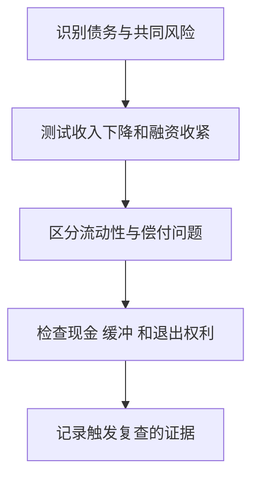

# 《这次不一样》：从金融危机史学习债务、信用与制度边界

> 作者：Carmen M. Reinhart、Kenneth S. Rogoff，卡门·莱因哈特、肯尼思·罗格夫。原作 *This Time Is Different: Eight Centuries of Financial Folly*，2009 年。用户中文译本未确认。  
> 基于出版社、作者相关研究、官方危机史与后续学术复核整理。未取得全书，是公开资料系统导读；覆盖危机分类、历史债务与危机后果等主要框架，共 28 点。更新：2026-11-12。

## 最值得理解的结论

金融创新、经济增长和制度进步可能是真实的，但不能因此取消资产负债表约束。危机前，人们常强调本次繁荣具有新的理由，却低估债务积累、期限错配和共同风险。

作者汇集长期、多国资料，提醒读者把当下放进更大的参照系。它不是证明所有国家都会按同一日历危机，也不是给出一个债务率达到多少就必然崩溃的交易公式。

| 主题 | 本文知识点 | 学习目标 |
| --- | --- | --- |
| 历史与分类 | 1—6 | 比较之前先统一定义 |
| 债务、货币与银行 | 7—16 | 识别责任、币种和期限 |
| 危机形成与传播 | 17—22 | 看存量、反馈与隐性承诺 |
| 危机后果与方法 | 23—28 | 形成有边界的风险判断 |

原书范围见[普林斯顿大学出版社](https://press.princeton.edu/books/paperback/9780691152646/this-time-is-different)，与全书相关的早期研究见[2008 年论文](https://www.nber.org/papers/w13882)。

## 核心知识点

### 1. “这次不一样”最危险之处，是把真实变化推到过头

新技术、新市场或更成熟的政策可以改善经济，但无法单独证明债务没有风险。真正需要检验的是，新条件怎样具体提高还款能力或减少脆弱性。

遇到“已经进入新时代”的投资论点，先承认可能存在真实变化，再问价格、融资与现金流的关系。否认所有创新与接受所有乐观叙事，都没有完成分析。

### 2. 历史是参照分布，不是重复播放的剧本

多国长期样本能够提醒你见过哪些失败路径，却不能保证今天的概率与过去相同。法律、货币制度、人口和资产结构都可能变化。

有效方法是比较机制：债务靠什么现金流偿还，融资何时重定价，风险集中在哪里。仅因某张价格图看起来像过去，就断言即将发生同样危机，是形状类比而非充分证据。

参照样本也应包括未发生危机的时期。如果只挑选已经崩溃的国家，容易把它们共有的现象当成足够条件，却看不到同样现象在其他地区长期存在。要研究预警能力，需要同时统计成功警报、误报和漏报，并承认少量极端事件给估计带来的不确定性。

### 3. 危机必须先分类，才能比较

主权违约、银行危机、汇率崩溃与高通胀不是同一个事件。它们可能同时发生，但时间、损失承担者和政策工具不同。

如果把股票下跌都叫金融危机，就会扩大样本；如果只统计正式违约，又会漏掉通过重组和通胀改变实际回收的情况。先确定研究对象，是任何风险频率分析的前提。

### 4. 外债与内债不能只凭币种判断

债务可以按债权人居住地、发行市场、适用法律或币种分类，不同资料使用不同口径。外币债务与外国人持有的债务不是完全相同的集合。

比较国家债务时，必须记录定义；比较企业也一样。以本币发行给境外投资者，与以外币借款给国内机构，面临不同汇率、再融资和法律风险。

### 5. 国内债务往往更容易在历史记录中缺失

长期数据库中的中央、地方、国企、银行和隐性义务资料并不总完整。只看容易取得的国际债券，可能低估政府整体压力。

“没有记录”不等于“没有债务”。研究历史时应说明覆盖范围；研究当下时应寻找预算、担保、养老金和相关公共部门资料，而不是把所有未知义务自动设为零。

还要防止另一种错误：把无法量化的义务全部按最坏情景相加，然后称为确定债务。法律上的已承担责任、附条件担保、市场预期支持与未来政策支出，在发生概率和支付时间上不同。清楚做法是分别列账，记录触发条件与证据强弱；不透明本身值得警惕，却不能成为随意增加数字的理由。

### 6. 高通胀会改变债权的实际价值

债务名义上按时偿还，不代表债权人购买力没有损失。但通胀不是对所有债务同样有效：浮动利率、短期限、外币或指数化债务可能很快重定价。

因此不能把“可以发行本币”理解成没有任何约束。货币融资可能改变价格、汇率、信任和未来融资成本，债务风险也可能从一种形式转成另一种。

### 7. 偿债能力看收入、成本与融资结构，不只看债务总额

债务规模需要与收入、资产、税基或出口等资源比较，但每个分母回答不同问题。利息低、期限长、币种匹配的债务，与短期外币债务不能仅按同一比率排名。

个人和企业也适用这种检查：总负债相同，收入稳定性、必要支出和到期分布不同，风险可能很不一样。比率适合筛查，不能包办结论。

**数学演示：**甲、乙债务都为 100，年收入都为 50，看起来债务收入比相同。若甲一年内只需支付利息 3、无本金到期，乙需要利息 8 和本金 40，近期再融资压力完全不同。仍不能仅据此认定甲安全：如果它的资产质量差或收入即将消失，长期偿付问题同样严重。数字是假设，说明存量比率必须接到支付时间表。

国家比较尤其要核对债务边界。只算中央政府与合并一般政府，纳入或不纳入某些公共机构，数字可能差很多；比较表中最好同时列原始来源与口径，而不是只保留一个看似精确的百分比。

### 8. 流动性危机与偿付能力危机需要区分

流动性问题是当下难以取得现金，偿付能力问题是资产与未来收入不足以覆盖义务。现实中两者可能互相转化：被迫贱卖资产会削弱偿付能力，资不抵债的疑虑又会切断融资。

救急贷款可能帮助有长期价值但暂时缺现金的主体；若底层损失很大，只延长贷款可能延迟确认问题。判断支持方案，应问它解决哪一种约束。

### 9. 本币借款、外币收入与汇率错配

借款币种和主要收入币种不同，会使汇率变化改变偿付负担。企业未必因为所在国货币贬值就受益；出口收入、进口投入、外币债务和对冲安排必须一起看。

国家层面还要观察外汇储备、资本流动和私营部门外币义务。储备是缓冲，不是对所有私人损失的无限保证。

### 10. 阿根廷案例：固定汇率不能消除基础约束

**真实历史。** IMF 独立评估记录，阿根廷在 2001 年末发生主权违约，2002 年初放弃自 1991 年维持的比索与美元平价可兑换安排；危机前经历长期衰退和信心恶化。[IMF 独立评估](https://www.imf.org/-/media/websites/imf/imported-full-text-pdf/external/np/ieo/2004/arg/eng/pdf/_report.pdf)

固定汇率在一段时间内可能提高稳定感，但若竞争力、财政、银行和外部融资压力积累，承诺本身不能创造所需资源。退出又会重新分配外币资产负债的损失。

案例不能简化成“固定汇率必败”或单一政策造成全部危机。对财商更有用的是检查承诺背后的资产、现金与退出代价。稳定报价与可持续结构不是同义词。

### 11. 债务展期、降息与减记改变的是不同权利

展期把回款推后，降息改变期间现金，减记减少本金或名义请求权，交换新债可能同时改变多个维度。只看本金减少比例，未必能描述投资者现值损失。

**数学演示：**同样 100 元，今天回收与五年后回收价值不同。若折现率为 5%，五年后的 100 元现值约 78.35 元。实际重组还有信用、条款与市场价格，不能直接用此数字代替某次真实回收率。

折现率的选择也有含义。若使用较高利率，说明对等待、风险或替代机会要求更高，远期回款的现值更低；若重组同时显著提高兑现概率，不能只看延期而忽略信用改善。所谓损失率必须写明相对于面值、危机前价格还是重组前市价；不同基准会给出不同数字，它们回答不同问题。

### 12. 希腊 2012 年重组：发达经济体也可能重新分配债权损失

欧洲稳定机制的资料记录，2012 年 3 月希腊私人部门参与债务重组，涉及私人投资者持有的主权债券。[ESM 历史说明](https://www.esm.europa.eu/content/what-was-private-sector-debt-restructuring-march-2012)

“主权”“欧元区”和“发达市场”没有让偿债约束消失，但它们影响政策工具、法律与支持结构。债权人种类不同，处理方式也可能不同。

研究此类资产，应先读权利、适用法律、期限和条款，不能只用发行者名气代替风险分析。此案例发生在原书出版后，属于对框架的后续检验，不是原书事前预测的证明。

欧元区成员国与拥有独立本币发行权的主权，政策工具并不完全相同；私人债权人、官方机构和不同债券条款的处理也可能不同。因此不能把一个平均减记比例直接套给每名持有人，更不能把主权获得援助理解成所有证券恢复原价。研究者应把救助资金流向、债务交换和经济恢复分别追踪。

### 13. 银行通过期限转换提供服务，也承担挤兑风险

银行用较短期、可取用的负债支持较长期资产，使储户获得便利、借款人获得融资。但资产无法同时全部变现而不损失，信任下降时可能出现集中提款。

资本缓冲处理损失吸收，流动性缓冲处理现金需求，两者不能完全互换。银行盈利为正，也可能因现金时点和存款稳定性出问题。

### 14. 大萧条银行恐慌说明金融收缩会放大实体问题

**真实历史。** 美联储历史资料描述，1930—1933 年多轮地区与全国银行恐慌扩大了金融压力，存款提现、银行倒闭与信贷收缩相互影响。[1930—1931 年资料](https://www.federalreservehistory.org/essays/banking-panics-1930-31)、[1931—1933 年资料](https://www.federalreservehistory.org/essays/banking-panics-1931-33)

这一事实说明危机不是股价曲线的一次跌落，而可能破坏支付、融资和企业经营。政策制度后来的改变也使今天与当时并不完全相同。

家庭的应用是留意流动性与资金用途，企业的应用是检查融资续作和客户回款。不能因为某资产长远有价值，就假设可以忽略到期现金需求。

### 15. 隐性担保会改变事前风险承担

如果参与者相信重大损失最终由别人承担，可能愿意使用更多杠杆。但是否真的得到支持、支持谁、保护哪类权利，危机时才会清晰。

分析时应区分法律担保、政策意愿、历史惯例和市场猜测。将它们写成同一个“兜底”，会隐藏重要风险。支持一家机构的持续经营，也未必保护原股东或所有债权人。

### 16. 私人损失可能转化为公共财政压力

银行支持、经济衰退、税收减少和社会支出增加，可能使危机后的政府债务上升。政府债务高有时是危机前条件，有时是危机后结果，也可能两者都有。

所以“高债务与低增长同时出现”不能直接证明唯一因果方向。需要研究时间顺序、冲击与政策反应，避免把后果误写成起因。

可以把路径画成一句话：私人信用繁荣扩大风险，危机使收入和税收下降，政府提供支持并增加借款，随后观察到公共债务高和增长低。这个路径中债务可能再反过来约束政策，但最初相关不能直接告诉我们每段作用的大小。为识别方向，需要更细的事件、制度和比较组资料，而非把同期国家排名当成实验。

### 17. 信贷繁荣会让风险看起来暂时变小

资产价格上涨提高抵押价值，违约减少又改善模型中的风险指标，融资更容易进一步支持价格。眼下低违约率可能正发生在脆弱性累积期。

这不是说信贷增长本身必然坏。新增贷款若支持有回报的投资，能够创造价值；问题是贷款增长是否脱离收入、风险识别与吸收损失能力。


图中是可能的增强机制，不是判断任何市场已经形成泡沫的充分证据。

### 18. 外部资金突然停止会改变调整速度

依赖持续流入的经济体，若无法续借，可能需要快速削减支出、出售资产或调整汇率。长期项目来不及转成现金，使变化更剧烈。

对企业，客户预付款、短期借款与供应商信用也可能出现类似时点问题。研究不能只看正常年份平均融资成本，还要测试失去某个渠道后能维持多久。

### 19. 传染有真实连接，也有共同冲击

同一危机影响多个国家，可能来自共同债权人、贸易、资产持仓、融资市场或风险偏好，不一定都是心理恐慌。相关性上升也可能因为大家面对同一个外部冲击。

组合分散要检查这些连接。不同国家、行业或基金名称，若依赖相同融资与风险因子，可能在压力中一起下跌。标签不同不等于机制独立。

辨认传染，可以依次看直接债权债务、共同资金提供者和共同资产出售。第一种是某方违约直接损伤另一方；第二种是同一贷款人受损后同时收缩对其他地区的融资；第三种是投资者为了补现金缺口卖出原本没有基本面问题的资产。它们对应不同证据，不能用一张同期下跌图证明哪条渠道占主导。

### 20. 金融自由化的效果依赖监督、信息和风险管理

更多融资渠道可以改善资源配置，也可能使风险积累更快。制度改变后，历史数据中的稳定关系未必还能直接使用。

评估改革应同时看竞争、资本约束、披露、破产处理与监管能力。简单说“自由化导致危机”或“自由化消除危机”，都漏掉了重要条件。

### 21. 危机预测不能只依赖一个阈值

债务率、信贷增长、经常账户和资产价格都可提供线索，但没有一个数字能稳定适用于所有国家与时期。较低债务也可能因币种和期限危机失稳，较高债务也可能维持很久。

风险识别应更像检查脆弱性：哪些条件变化会破坏偿付，缓冲是否可靠，谁会被迫行动。知道何时该更谨慎，不等于知道市场哪一天转向。

### 22. 实时数据与事后修订数据不同

历史图上拐点清楚，不代表当时能够立即看见。统计修订、披露滞后和未公开义务，会改变信息集。

若用最终修订数据验证交易策略，必须说明其当时是否可获得。否则容易把事后知识变成虚假的预测能力。复盘应保存当时的材料，而不是只看今天完善后的数据库。

实际操作可以为每份数据记录三列日期：经济活动所属期间、第一次公布日期、当前版本修订日期。预测在某日作出，就只能使用此前已公布的版本。事件定年也相同：后来认定危机从某月开始，不代表那个月市场已取得完整信息。时间记录看似繁琐，却决定一个历史模型能否转化为真实决策工具。

### 23. 危机后果可能比资产价格反弹持续更久

就业、投资、公共债务和银行资产质量的修复，通常有不同速度。股价恢复不代表家庭和企业都已恢复，经济衰退结束也不等于产出已回到原趋势。

投资研究应把水平、增长率和趋势缺口分开。收入从低谷增长很快，可能仍低于危机前；用低基数高增速证明已完全康复，会误读修复阶段。

**数学演示：**产出从 100 跌到 80，随后增长 10%，只恢复到 88；若原先趋势本会把产出推到 105，与趋势的差距又比与危机前水平的差距更大。真实趋势无法直接观察，需要模型估计，因此研究报告应把原始水平与估计趋势明确分开。就业、工资和资产价格也可能各有恢复速度，单一图表不足以代表所有人的处境。

### 24. 去杠杆的分配问题不可避免

债务调整往往意味着债务人、债权人、纳税人、储蓄者或未来使用者承担部分成本。不存在仅通过会计改名就让所有经济损失消失的通用办法。

分析政策时应明确保护什么、谁支付、风险是否转移、是否改善未来生产能力。缓冲冲击与保留长期激励之间可能有取舍，不能只看宣布支持的总金额。

### 25. 2010 年债务论文争议，不应与本书全部内容混淆

作者在本书之后发表的债务与增长论文，以及围绕高债务分组的结论，引发了重要复核。Herndon、Ash 与 Pollin 2013 年指出编码、样本处理和加权等问题，修正后不支持简单的机械“90% 债务悬崖”说法。[复核论文机构页面](https://peri.umass.edu/publication/does-high-public-debt-consistently-stifle-economic-growth-a-critique-of-reinhart-and-rogoff/)

这应促使读者认真检查数据与因果，而不是把争议隐藏起来；同时，2010 年论文与 2009 年这部长期危机史不是同一个文件，不能由一篇论文的问题推导书中所有历史数据都错误。

对财商最有用的教训是：名家与畅销不免除复核，精确阈值尤其要看识别与稳健性。债务风险确实重要，也不需要靠一个普遍适用的断点来证明。

读复核时，编码错误、样本选择与加权规则要分开。编码错误是实现没有按预定逻辑运行；样本选择决定哪些国家年份进入；加权决定一个国家与一个年份各占多少影响。即使修复代码，不同但合理的研究对象仍可能得到不同均值；即使描述均值稳定，因果方向依然需要额外识别。这样分层，才能知道某次修正究竟推翻了什么、没有回答什么。

### 26. 做一张债务结构表，比猜下一次危机日期更有用

```text
谁借款，谁最终承担责任：
币种、利率、期限与适用法律：
本金和利息的实际支付时间：
现金与收入来源，是否同币种：
抵押物、担保与其他优先请求权：
再融资中断时可用的替代：
资产出售的折价与对经营的影响：
尚未确认的表外或隐性义务：
```

这张表可以用于国家研究、企业与家庭，但具体指标不可机械混用。国家拥有税收与货币政策能力，家庭没有相同工具。

### 27. 风险准备要能应对不同路径



准备不等于永久看空，更不等于把所有资产换成某种单一避险品。不同危机下，币种、通胀、市场流动性和法律权利都会改变结果，方案应符合实际需求。

一份有用的压力情景应写成可检查的条件：收入下降到什么程度、某笔到期借款无法续作、可变现资产需要折价多少，分别怎样改变支付能力。随后核对缓冲是否真的可用，以及使用缓冲会不会损害未来经营。情景不是预测一定发生，而是寻找承诺与资源之间最薄弱的位置。

### 28. 保持历史意识，也承认机制会变

作者最大的提醒是谦逊：长期没有遇到危机，不证明危机已经不可能。但历史类比也会犯错，制度改进与技术变化需要认真纳入分析。

合理态度是把过去当作问题库，把现在的资料当作检验基础。每次判断都说明相似处、不同处和最重要的未知，避免用一个历史故事替代全部研究。

## 练习与参考答案

**高政府债务一定导致低增长吗？** 不能仅凭相关认定。需看反向因果、危机冲击、期限币种与制度；不存在本文认可的普遍机械阈值。

**债务换成更长期债券就没有风险了吗？** 期限调整缓解当下压力，但仍需足够未来收入与可持续成本，损失也可能转给债权人。

**主权救助银行是否保证原股东不亏？** 不保证。支持支付与信用功能，可以同时伴随股权稀释、重组和损失承担。

## 阅读边界

本篇覆盖主要研究框架和典型机制，没有复刻全书八世纪数据库及逐国附表。历史数据本身有定义和缺失问题，具体频率需要回到作者数据与研究。可与《债务危机》《周期》《系统之美》比较历史归纳、信用机制和反馈结构。
