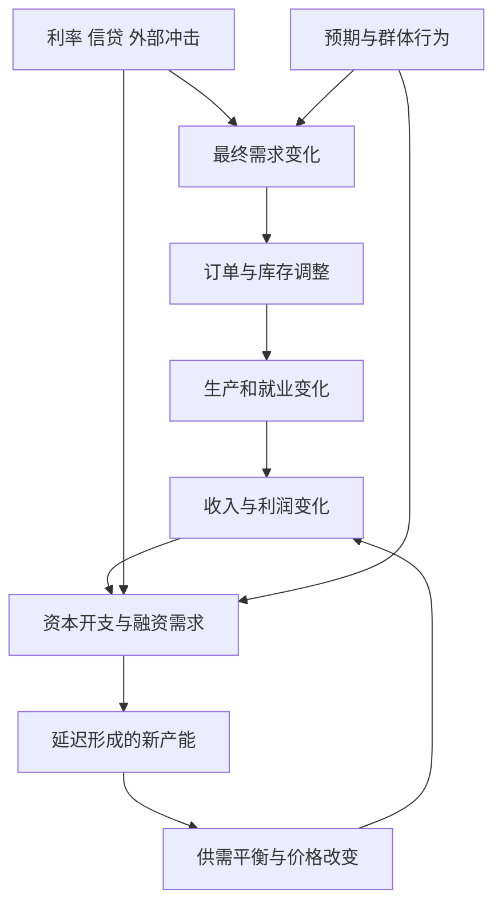
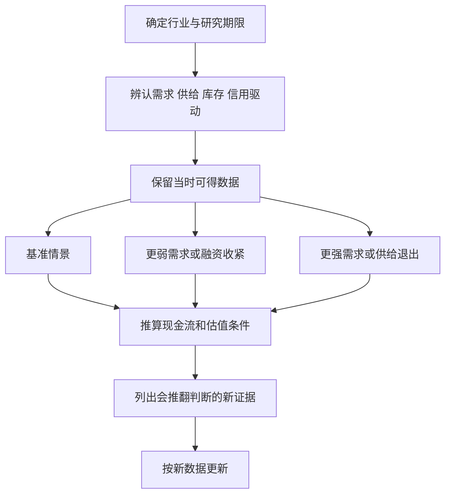

# 《逃不开的经济周期》读书笔记

> 作者：拉斯·特维德（Lars Tvede）。对应英文 *Business Cycles: History, Theory and Investment Reality*，本笔记核对 Wiley 2006 年第 3 版，ISBN 9780470018064；用户持有的中文译本、印次未确认。不要把后来的电子发行日期当作原版写作年份。
>
> 资料范围：基于作者官网、出版社公开目录和简介，配合央行、NBER、EIA 等一手资料整理的系统导读。未取得并逐页核读全书；覆盖主要理论线索与资产应用，不声称复现所有历史人物、实证表格和章节论证。以下 30 点是主题重组，不是原书章节逐条翻译。整理日期：2026-11-12。

这本书把经济思想史、经济波动和资产价格联系起来：为什么生产、信贷、投资与情绪会反复扩张和收缩？为什么知道经济在变好，也可能买到回报很差的股票？它最适合纠正“上一年的增长可以一直延伸”和“只要找到一个周期长度就能准确择时”两种直觉。

你可以从中学到：识别周期由什么驱动，理解供给反应和信息滞后，区分实体经济与金融市场的位置，并把经济判断转化为有条件、可修正的研究情景。它不能提供一张可靠的未来牛熊日历。

## 全书地图

出版社目录分为五部分：早期经济思想家；早期周期理论；模型、复杂性和群体行为；周期驱动因素与央行难题；房地产、商品、股票债券、外汇及其他资产。最后部分确实讨论艺术品、收藏品等，但这些市场资料稀疏，本笔记不据此生成可投资回报假设。[Wiley 目录](https://www.wiley-vch.de/en/areas-interest/finance-economics-law/finance-investments-13fi/general-finance-investments-13fi0/business-cycles-978-0-470-01806-4)、[作者介绍](https://www.larstvede.com/book/business-cycles/)

## 核心知识点

### 1. 周期是反复出现的波动，不是固定周期函数

经济活动有扩张和收缩，但持续时间、深度、触发条件各不相同。库存变化可以很快，建设厂房和住房需要更长时间，技术扩散又可能跨越多个商业周期。

最危险的误读，是先选一个固定年数，再把所有历史事件放进同一正弦波。这样几乎总能事后画出漂亮图形，却没有说明下一次转折为何发生、什么事实会让预测失效。有效的周期解释必须带机制，而不只是带日期。

### 2. 趋势、周期和一次性冲击要分开

长期生产率、劳动人口和制度变化构成趋势；围绕趋势的需求、投资与库存变化构成波动；战争、疫情和自然灾害可能造成突发冲击。三者常常交织。

增长放缓可能是短期去库存，也可能是长期需求下降。若把长期变化误认成短期周期，就会一直等待不存在的“恢复到旧常态”；若把临时停摆误认成永久衰落，又可能高估长期损失。

### 3. 经济思想史让人看到每种理论在解决什么问题

作者从金融与思想史人物切入，不是为了让读者背人物名。理论往往回应其时代最显眼的困难：货币不稳定、恐慌、失业、资本形成或创新。

理解一个理论，应先写出它认为最重要的约束，再问它忽略了什么。比如强调需求不足的框架，适合解释闲置资源为何不被使用；强调资源错配的框架，帮助解释哪些投资难以持续。两者提出的问题有交集，却不必用一个口号消灭另一个。

### 4. 货币信用可以支持生产，也可以放大投机

信用让尚未形成收入的项目获得资源，扩大跨期合作；如果放贷主要依赖抵押品价格上涨，信用也可能不断资助彼此推高价格的交易。

观察一轮信贷扩张，先分辨资金流向新生产能力、营运资金、资产购买还是旧债滚续。即便分类相同，也要检查项目回报、币种和期限。债务数量与债务质量不能互相替代。

### 5. 供给有时滞，企业可能集体在高点扩产

价格和利润上涨时，许多企业同时决定增加产能。但从立项、建设到投产需要时间；新产能集中到来时，原先供不应求的局面可能已经结束。

个体决策看起来理性，合在一起却可能形成过剩。每家公司估计“只要获得一小部分市场就可以”，没有充分考虑竞争对手也做了同样的计算。行业研究必须汇总全行业在建产能，而不能只听一家企业讲自身订单。

资本开支具有不可逆部分，停工或拆设备也要成本。因此企业未必在价格稍跌时立即退出，过剩可能持续。这解释了周期行业利润下滑为何常比需求下滑更剧烈。

### 6. 库存是缓冲器，也是放大器

库存帮助企业应对需求波动。但企业观察到销量放缓后，不仅减少生产以匹配新销量，还可能主动减少库存，导致对上游订单的削减比终端销售变化更大。

**数学演示：**终端每月销售从 100 降至 95，原库存 100，管理层希望当月把库存降到 80。若不考虑损耗，本月采购应为 `95 + 80 - 100 = 75`。终端销售只少 5%，采购却少 25%。这是假设算例，不是某公司的公告数据。

判断“订单暴跌”，因此要追问：消费者真的少买这么多，还是渠道在去库存？也要防止反向误判：补库存导致订单反弹，不一定说明最终需求持续复苏。

### 7. 库存不能脱离价格、存放地点和交割规则

**真实案例：2020 年 4 月 20 日 WTI 近月期货出现负价格。**EIA 说明，疫情导致需求急降，储存能力和可用库容受限，临近到期的合约持有人若缺乏实物接收安排，会急于退出。当时其他基准、较远月 WTI 等价格仍可能为正。[EIA 事件说明](https://www.eia.gov/TODAYinENERGY/detail.php?id=43495)

这不是“所有石油都失去价值”，也不是加油站给车主倒贴钱。它说明同一种商品在不同地点、不同交付时间及不同合约义务下，可以具有不同价格。

把这件事用于周期研究，要同时检查需求、供给调整速度、储存约束和合约条件。单看“油价很低，所以只能上涨”，忽略了投资工具本身可能在反弹前遭受无法承担的损失。该例发生在所核版本之后，是本文补充。

### 8. 资本开支周期比订单变化更难逆转

购买一套设备、建设一座工厂，对未来多年产能产生影响。企业在高利润时期增加资本开支，可能在低利润时期承担折旧、利息与维护成本。

研究上市公司，要把维持现有能力的资本开支与扩张性开支分开；高资本开支不是自动利好，也不是自动利空。关键是投入回报是否超过资金成本，以及项目投产时市场是否仍需要新增产能。

### 9. 房地产把长期建设和信用抵押连在一起

住房既是居住服务来源，也是抵押品和投资资产。需求变化可以很快，规划、供地与建设调整则较慢。价格上涨还能提高抵押价值，鼓励借款，形成反馈。

房地产不是一个全国完全同质的市场。人口流入、住房存量、土地制度、房贷条件和出租回报不同，都会影响城市间差异。把某国历史上升周期直接换算成另一个国家的买入年份，没有足够依据。

### 10. 创新带来真实进步，仍可能伴随投资过度

新技术可以提高生产率，也会引发企业与投资者同时追逐机会。技术最终改变社会，不代表每个参与者都赚钱，也不代表所有进入价格都合理。

要把三个问题拆开：技术是否有效，商业模式是否能取得利润，这份利润是否足以支持当前估值。第一题回答“是”，后两题仍可能是“否”。这也是阅读书中互联网热潮讨论时最值得保留的区别。

### 11. 经济波动有多个驱动因素，不能归结为一个按钮

需求、生产能力、融资条件、库存、情绪和外部冲击能够互相影响。原书有专章组织周期驱动因素；本文没有逐页核对该章术语，因此不把以下图形冒称作者原图或精确分类。

图的重点是回路和时滞。同一条消息对未来几周订单和未来几年产能，影响可能不同；研究时间尺度必须先说清楚。

### 12. 实际经济冲击和金融加速器可以同时存在

原材料短缺可以直接减少生产；资产价格下降和抵押约束又会使融资更难，进一步减少投资。一个起初来自供给的冲击，可能通过金融系统放大。

反过来，信用突然收缩也能造成工厂和劳动力闲置，不必等生产技术退步才发生衰退。解释事件时不应强求“唯一主因”，而要区分初始冲击、放大机制和政策反应。

### 13. 债务通缩让下跌产生自我强化

固定名义债务遇上收入和资产价格下降，实际负担上升；借款人卖资产偿债又压低价格。这个反馈是理解费雪债务通缩思路的重要入口。

**真实历史：美国大萧条中的银行恐慌。**美联储历史资料记载，1930 年代初银行恐慌与货币、信用收缩相互作用；金本位及政策反应也限制了处置。它说明金融渠道可以放大实体经济下滑，但不能由此说大萧条只有一个原因。[美联储历史](https://www.federalreservehistory.org/essays/banking-panics-1930-31)

用于公司研究时，应比较名义债务固定程度和收入敏感性。现金流随商品价格剧烈波动、利息本金又刚性较强的企业，与融资期限长、需求稳定的企业，不能只凭相同负债率判断风险。

### 14. 群体行为会让不同人的错误同向

基金经理可能因为同业排名而不愿过早退出热门资产；企业可能因为担心失去市场而跟随扩产；银行可能因为过去违约少而放松标准。每个人都有自身理由，却可能共同扩大系统风险。

“大家都这么做”可以说明协调结果，也可能是拥挤的迹象。识别拥挤要看持仓与融资渠道、现金流依赖和退出条件，不能仅以社交媒体讨论热度作为证据。

### 15. 非线性意味着小变化有时触发大反应

当系统远离融资上限时，价格小跌可以被吸收；一旦触发保证金、抵押率或违约条款，同样幅度的下跌可能导致强制操作。风险因此不一定与价格变化成比例。

**真实案例：英国 2022 年国债市场与 LDI。**快速的收益率变化触发追加抵押需求，相关机构出售资产又损害市场流动性。英格兰银行将其描述为需要临时干预的市场功能问题。[2022 年金融稳定报告](https://www.bankofengland.co.uk/financial-stability-report/2022/december-2022)

这一例子不是原书历史案例。它补充说明：平时收益波动小，不代表极端情况下现金需求小。投资者应找出“超过什么条件就必须行动”，而不仅计算平均波动率。

### 16. 厚尾风险提醒我们，极端事件比简单模型暗示的复杂

把收益变化近似为某种概率分布有助于计算，但样本中的平静时期可能低估融资断裂、跳空和制度改变。所谓厚尾，白话说就是极端结果可能比某些常用模型预计得更常见。

不能把“模型不完美”理解为不需要量化。更好的做法是保留基准模型，同时使用压力情景、历史极端样本和机制分析，明确模型在哪些条件下可能失效。

### 17. 模型是简化，预测误差也需要进入决策

模型省略变量才能运算。加入更多参数可以提高历史拟合，却可能让预测依赖偶然样本；模拟图形再复杂，也不自动带来因果识别。

评估周期预测，至少比较当时可见数据、事先给出的范围和简单基准。只展示成功预测、删去错误年份，会产生幸存者偏差。预测值之外，还应记录最重要的不确定来源。

### 18. 领先指标的“领先”来自时间顺序，不是预言能力

新订单、某些金融条件和建筑许可可能早于实际生产变化，但这种关系会随行业结构和政策改变。领先几个月的历史平均不代表每次都提前相同时间。

比较指标时先统一频率、季节调整和发布日期。有些所谓领先指标实际上在事后修订后才显得漂亮；如果当时没有那份数据，就不能算作可实施的预测能力。

### 19. 衰退的确认可能晚于市场的反应

**真实案例：美国 2020 年衰退定年。**NBER 在 2020 年 6 月宣布 2 月是经济活动峰值；之后确定 4 月为谷底。这次收缩异常短但极深。委员会依据广泛经济活动、深度和扩散等信息，并非只机械使用“连续两个季度 GDP 下降”。[NBER 2020 年 6 月公告](https://www.nber.org/news/business-cycle-dating-committee-announcement-june-8-2020)、[定年方法](https://www.nber.org/research/business-cycle-dating/business-cycle-dating-procedure-frequently-asked-questions)

这表明官方定年与实时交易是两种工作。前者重视稳定、可信的历史划分；后者在不完整信息下行动。不能把事后公布的峰谷当成当时已经公开的买卖信号。

研究报告应保存“数据截止日”。如果使用后来修订的数据回测，就要说明它可能高估实时表现。

### 20. 政策有滞后，也会改变私人行为

央行调整利率后，贷款重新定价、企业投资和就业反应通常需要时间，且并非所有部门同时发生。政策制定者面对的是带噪声、会修订的数据，因此可能过晚或过度反应。

私人部门也会预期政策：提前借款、推迟支出、调整价格。于是相同政策在不同预期下效果不同。读经济新闻时，必须区分政策变化、市场原先预期和政策实际传导。

### 21. 抗通胀与稳增长可能出现真实取舍

**真实历史：美国大通胀与沃尔克时期。**美联储历史材料讨论了 1960 年代中期至 1980 年代初的通胀、政策框架和后来的紧缩；降低高通胀伴随明显的经济代价。[美联储大通胀历史](https://www.federalreservehistory.org/essays/great-inflation)

它说明央行不能永远同时保证低通胀、高就业和低融资成本。但也不能把所有通胀都解释为同一种货币错误，能源冲击、供给限制和预期变化会共同作用。

用于资产研究，应问：本轮利率上升来自增长较强，还是通胀压力与风险溢价？同样的名义利率变化，可以对企业收入和估值产生不同组合的影响。

### 22. 债券价格的方向，要同时看利率和信用

固定现金流债券的折现率上升，价格通常下降；剩余期限越长、现金流越靠后，对利率变化通常越敏感。公司债还包含信用风险，经济衰退时即使无风险利率下降，信用利差也可能上升。

因此，“衰退买债”不是足够完整的判断。要说明买的是何种币种、期限、发行人和条款，是否承受得住价格波动与流动性约束。国债、信用债、可转债和债券基金不能只因名字含“债”就视为相同资产。

### 23. 股票先看未来，盈利高点不一定是股价高点

股票价值取决于未来可归股东的现金流和折现条件，价格还取决于市场已反映多少预期。当利润公布时，股价可能已经交易下一年的减速或复苏。

研究周期股票时，把当前利润、正常化利润和估值分开。用高峰利润算出的低市盈率，可能来自市场预期利润将下跌；用低谷利润算出的高市盈率，也不必然意味着永久昂贵。需要解释盈利恢复的机制，而不是只把分母换成自己喜欢的年份。

### 24. 商品价格不等于商品企业股东回报

商品企业还受到开采成本、品位、税费、资本开支、债务和管理层资本配置影响。商品涨价时，成本可能跟涨；赚来的现金也可能在高位扩产中消耗。

2020 年 WTI 事件还提示，商品现货、期货、基金和生产企业是不同载体。期货滚动有期限结构影响，股票有企业风险。选择研究对象之前，先确定想获得哪一种风险暴露。

### 25. 外汇是相对价格，不能只分析一个国家

汇率至少涉及两种货币，受相对利率、通胀、增长、资金流和政策制度影响。一国经济改善，但另一国改善更多，汇率未必按直觉变化。

高利率货币也不自动提供更高的本币投资回报，汇率贬值可能抵消利息。企业有跨币种收入和成本时，需要看净敞口和对冲期限，不能只看出口占比。

### 26. 黄金、艺术品等资产的定价约束不同

黄金没有企业式经营现金流，其价格受到实际利率、货币信任、需求和持仓结构影响；艺术品与收藏品还存在品质差异、鉴定、交易费用和样本选择问题。

这不是说它们一定不值得研究，而是不能简单沿用股票市盈率或租金收益率。历史成交纪录常只显示成功出售的物件，未售出、损坏和交易成本可能不完整，不能把少数纪录当成全市场可复制收益。

### 27. 行业轮动图是一组假设，不是自动执行表

某些行业在扩张、通胀或衰退环境下具有不同敏感性，但行业构成、估值和政策会改变这种关系。成长、价值、周期、防御等标签也可能掩盖同一风险来源。

更有用的做法，是写出企业利润如何随销量、价格、原材料和融资成本变化。只有当宏观情景能传到具体现金流，行业判断才有可检验含义。单凭“现在在复苏象限”，还不能得出买入任何一只股票的结论。

### 28. 情景研究应包含相反路径

这是本文补充的应用流程。情景不是随意给悲观、中性、乐观贴标签，而应指向明确变量及因果链。若三个情景只有目标价格不同，没有解释经营假设，就还没有真正做完分析。

### 29. 周期判断与交易风险管理是两项能力

即便方向判断正确，杠杆、期限和退出条件不合适，也可能在兑现前遭受无法承受的损失。反之，一次交易赚钱，也不说明周期模型准确，可能只是市场暂时偏离。

记录研究和交易时，把预测是否正确、定价是否合理、执行是否符合规则分别评价。没有用户资金和风险背景，本笔记不提供具体仓位或杠杆参数。

### 30. 最成熟的周期意识，是知道自己处在什么约束中

周期书容易让人产生“终于找到规律”的兴奋。真正有用的结果，是少把高峰利润永久化，少在低谷恐慌中忽略长期能力，也少相信没有条件的复苏口号。

需要时承认无法判断峰谷，仍可以分析公司能否穿越低谷、资产负债是否匹配、价格是否包含过于单一的未来。这种判断比精确猜下一次拐点更适合长期积累财商。

## 练习与参考答案

**练习一：终端销售只下降少量，上游订单大跌，是否必定存在数据造假？**

参考答案：不是。先检查库存调整、渠道层级和订单取消；库存算例说明采购变化可能大于终端变化。但不能自动认定只是去库存，要核对终端销售和库存周转数据。

**练习二：某行业当前市盈率很低，利润创纪录，能否据此称它便宜？**

参考答案：不能。要检查利润是否处于周期高点、供给扩张情况、正常化现金流和净债务。低倍数可能反映利润下滑预期，也可能有低估，需要进一步证据。

**练习三：回测显示在官方衰退谷底买入效果很好，为什么未必可执行？**

参考答案：谷底往往事后确认；还需看当时信息、成交价格、成本、信号规则及失败样本。使用后来修订数据而不说明，会引入前视偏差。

**练习四：写一份行业观察卡。**

参考答案示范结构：研究期限；需求指标；在建产能；渠道库存；融资到期；基准与反向情景；公开数据来源和发布日期；三项会改变结论的证据。先完成这张卡，再讨论阶段标签。

## 阅读边界与衔接

本笔记较完整覆盖公开目录涉及的核心主题，但未核读所有历史人物叙述，也未复制作者资产轮动表。历史机制、后来的真实案例和本文应用已区分。2006 年版本中的预测框架不能直接当作 2026 年市场判断。

先用《经济学原理》理解供需与政策，再结合《债务危机》看融资反馈，用财报书把行业情景落到公司现金流，并用《超级预测》检验判断更新过程，会比单独背诵周期名称更有效。
