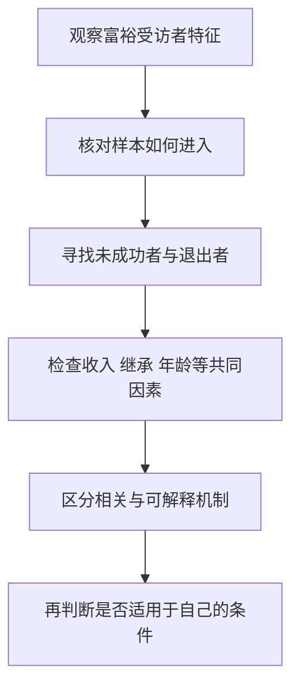
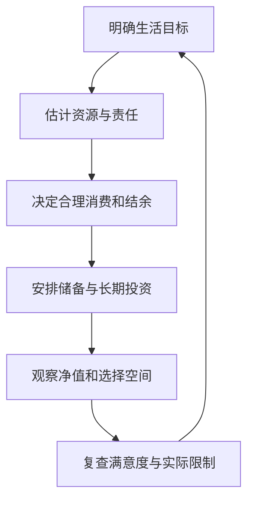

# 《邻家的百万富翁》：收入、消费形象与真实财富之间的距离

> 作者：Thomas J. Stanley、William D. Danko，托马斯·斯坦利、威廉·丹科。英文原名 *The Millionaire Next Door*，1996 年初版；本文参考公开发行书页与作者研究框架，不混同后续《下一个百万富翁》等作品。  
> 范围：基于公开资料的系统导读，未取得用户版本全文。围绕七类共同特征整理 28 个知识点；原书美国富裕家庭调查属于历史观察，现实研究与个人练习另标为补充，不把它当作普遍致富定律。  
> 更新：2026-11-12。书目见[发行方页面](https://www.simonandschuster.com/books/The-Millionaire-Next-Door/Thomas-J-Stanley/9781589795471)。

## 这本书最值得学什么

你能看见一个人的房子、汽车和消费，却很难看见他的贷款、储蓄与资产。**财富积累发生在收入没有被全部花掉的部分，并取决于这些结余后来经历了什么。** 外在富裕与经济安全可以一致，也可能完全分离。

本书通过美国富裕家庭的调查，挑战把富人想象成持续奢侈消费群体的刻板印象。最有用的是改进自己的计量和习惯，不是模仿受访者的每一种职业、住房或家庭安排。样本选择、时代和幸存者问题会限制推论。

## 七类特征的主题地图

| 原书主题 | 可以转成的问题 |
| --- | --- |
| 生活低于收入能力 | 收入增长有没有转成可保留结余 |
| 有效分配时间、精力和金钱 | 财务研究是否有具体成果 |
| 财务独立优先于身份展示 | 支出服务于自身目标还是他人评价 |
| 少依赖父母持续补贴 | 支持是否增强还是替代自主能力 |
| 成年子女能够自立 | 家庭帮助如何形成激励与边界 |
| 善于发现市场机会 | 是否理解客户真实愿意付费的需求 |
| 选择适合的职业与经营活动 | 收入、能力、风险和控制权如何匹配 |

这些是作者从样本提炼的观察，不是随机实验识别出的七个独立因果效应。

## 核心知识点

### 1. 百万富翁通常指净资产，不是年收入

净资产是资产减去负债。拥有一套标价很高、同时背负大量贷款的房产，和拥有同额无负担资产，财务位置不同。高薪也只是一段期间内的收入，不自动说明已积累多少财富。

讨论财富时必须先确认计量范围：个人还是家庭，是否包含住房、养老金、企业权益，按什么价格和币种估值。不同调查的“富裕家庭”不能随意拼在一起比较。

### 2. 看得见的消费，只是财富信息的一小部分

一个人不展示奢侈品，不证明他很富；一个人买奢侈品，也不证明他负债累累。真正的教训是外观信息不足，不应把旧偏见换成相反的偏见。

对自己更有价值的是记录消费之后留下什么：使用价值、关系体验、技能、可转售资产，还是持续费用。没有必要把每笔享受都道德化，但需要认识代价与选择。

### 3. 中位数与平均数可以讲出完全不同的“普通家庭”

**真实统计补充：**美联储 2022 年家庭金融调查原报告列示，家庭净资产中位数为 19.29 万美元，均值约 106.37 万美元，使用该报告的 2022 年美元口径。这是美国历史家庭样本，不是个人税后收入，更不是当前中国标准。[原报告表 2](https://www.federalreserve.gov/publications/files/scf23.pdf)

为什么差异如此大？少数高净资产家庭会显著拉高均值，而中位数描述排序中央的位置。看到“平均财富超过百万”不能断言大多数家庭都拥有百万净值。

本书关心富裕群体，学习时尤其要防止从特定样本回推全社会。先问谁被调查、谁未响应、财富怎样估计，再讨论某种行为有多普遍。统计口径清楚，才能避免用错误参照制造虚假的失败感。

### 4. 积累财富的人与积累不足的人，是相对收入的比较

作者区分善于积累财富和积累不足的家庭，意在说明相同收入并不保证相同财富。它是一种观察框架，不是评价人格的等级体系。

年龄、健康、职业起步、继承、家庭负担和地区成本都会改变结果。短期净值偏低可能是刚完成教育投入或承担照护责任，不能仅凭一个比率认定浪费。比较应解释条件，而不是只给人贴标签。

### 5. 原书财富经验公式不能当作人生及格线

书中常被引用的经验估算，把年龄与年家庭税前收入相乘再除以十，用来粗略比较预期财富。它不是资产定价公式，也不是经过所有国家与人生阶段验证的标准。

刚毕业的高收入者，年龄已累积多年但高薪刚开始；退休者收入可能骤降而财富仍高。公式对这些情况明显不稳。若使用，应只把它当作提醒自己追踪长期结余的入口，并写清适用局限，不把结果当作必须赶上的目标。

这个经验公式尤其容易误导处于收入快速变化阶段的人。刚毕业收入低但背负教育支出，与职业稳定多年、已经获得遗产的人，不能只按年龄和当年收入公平比较。它也没有充分处理住房地区差异、照护责任和收入波动。因此它更像提出疑问的粗筛工具，而不是用于决定消费、辞职或冒险投资的标准。

更合适的替代是建立自己的时间序列：今年有哪些可持续的净结余，哪些净值增长来自价格上涨，哪些来自赠与，哪些责任尚未进入账本。连续记录能说明路径，单次与他人比较只能描述位置。即使暂时落后，也应先找来源和约束，不能靠抬高预期回报来“补交财富作业”。

### 6. 节俭是把资源投向重要目标，不是所有东西都买最便宜

便宜物品如果很快损坏、耗费大量维护时间，生命周期成本可能更高；昂贵物品如果提供必要的可靠性，也可能合理。预算应比较总成本与实际用途。

原书挑战的是身份驱动的过度消费，不是要求忽略健康、安全与体验。能解释“为什么花这笔钱”比单纯把开支压低更有意义。避免让节俭变成另一种需要向别人展示的身份。

### 7. 收入增长最容易被生活标准同步吸收

加薪后增加住房、汽车与固定订阅，可能使结余没有提高；这些支出一旦形成习惯，未来削减又更困难。这里要关注的是持续承诺，而不只是一笔偶尔消费。

可在收入增加时先决定一部分如何支持长期目标，再讨论新增消费。比例应结合必要支出和家庭责任，不因某位受访者储蓄很多，就要求所有人照做。

### 8. 社会比较能影响真实支出，而不只是心理感受

**真实研究：荷兰邮编彩票。** Kuhn、Kooreman、Soetevent 与 Kapteyn 利用彩票带来的收入变化研究中奖家庭及邻居，发现邻居消费反应集中在汽车和房屋外观修缮等可见项目。这种研究设计比普通消费相关性更接近识别社会影响，但具体机制和适用环境仍有边界。[NBER 原研究](https://www.nber.org/papers/w14035)

它帮助解释为什么搬到更昂贵的社交环境，潜在成本不止房租。可见标准改变以后，原本满意的消费安排可能被重新评价。

应用不必是远离富裕朋友，而是把比较依据转回自身目标。决定新增支出前，问：如果没有人知道，我仍需要它吗？它带来多少可持续价值？这类提问不能证明某笔消费错误，却能暴露动机。

### 9. 住房选择会同时影响现金、资产集中和比较环境

居住地点决定通勤、学校、生活成本与社交参照，不只是房产价格。以最大可借额度购买，并不意味着每月支付和未来变动都适合家庭。

应分别列出居住服务、融资、维护、流动性和职业机会。较便宜住处如果大幅增加通勤时间或削弱收入机会，也未必更优。原书的节制思想应落实为完整比较，而非单独追求低房价。

### 10. 汽车要看使用成本，不只看付款方式

月供较小可能只是贷款期限更长或尾款更大，不能据此判断车更便宜。购买、折旧、维护、保险、停车与资金成本共同决定经济负担。

旧车与新车的合理选择取决于可靠性、里程、工作需要和保养信息；不能把“买二手”当作自动财富密码。本书的重点是避免以交通工具证明地位，而不是给所有家庭指定车辆类型。

使用成本还要区分现金支出与经济损耗：一次性付款会立刻减少现金，但车辆随后还能提供服务；折旧反映价值逐渐减少，却不一定每个月单独扣款。将购买价、融资、维护、使用期限与预计出售价值放在同一期间比较，才不会把低首付误当作低成本。

若车主要用于节省通勤和完成工作，也要记录带来的实际便利。成本最低的安排不一定最适合，关键是为这些便利支付的代价是否透明、是否与其他目标相容。书中受访者的消费方式提供参照，不能直接替代这种完整比较。

### 11. 预算使价值判断可见，但预算本身不会创造收入

记录能揭示重复开支与被忽略费用，也能证明某些家庭已经没有多少可削减空间。预算最好分为必要、承诺、可调整和偶发四类，而不是把所有支出混成一个总额。

当总资源不足时，问题可能需要增加收入、调整债务或获得支持，不能一再提高自律要求。财务管理的第一步是诚实认识限制，随后才是优化。

### 12. 时间投入要区分研究与热闹

作者观察到富裕家庭往往认真处理资金安排，但花时间并不自动提高收益。不断刷行情、重复听观点，可能只增加自信和交易冲动。

高价值的财务时间应产生作品：完整费用清单、一份年报理解、一个可执行预算、对旧判断的复核。看过多少信息是过程指标，能否提出更好的问题才是成果。

### 13. 规划应同时安排积累与使用

财富不是永远不花的钱。储蓄是把今天的选择转移到未来，未来也需要按目标使用，否则可能只剩无止境增加账户数字。

把目标区分为近期确定支出、长期积累与可选愿望，给不同资金设适合期限。这样既能避免短期需要被迫卖出风险资产，也能避免用长期未来为理由拒绝所有当前生活。

### 14. 财务独立比社会地位更难直接观察

独立可能表现为有能力换工作、承担照护、抵御收入中断或拒绝不合适的要求。这些能力不会像昂贵消费那样容易被人看见，却可能更接近家庭真正需要。

**现实框架：**CFPB 的财务福祉工具把日常控制、承受冲击、实现目标与选择自由放在一起，而不仅询问收入或资产规模。[官方工具说明](https://www.consumerfinance.gov/consumer-tools/educator-tool/financial-well-being-resources/)

这个框架支持把书中的财务独立转成多维检查。它不是临床诊断或统一财富评分，也不能取代真实账目；但能提醒我们，净值与生活控制感需要同时观察。

### 15. 家庭成员的消费标准会共同决定积累路径

一人努力储蓄、另一人持续扩大固定支出，通常很难仅靠投资收益解决冲突。需要先谈目标、责任、可接受的生活方式和个人自主空间。

共同预算不应变成控制伴侣。可以区分共同责任与各自可决定的金额，并定期复查。家庭分工中的无偿劳动也具有价值，不能只按工资衡量贡献。

### 16. 经济帮助可能提供机会，也可能固定依赖

原书讨论父母对子女的持续经济支持，提醒补贴可能被消费吸收，使独立能力迟迟不建立。但这类观察很容易受到选择因素影响：需要帮助的子女本来就可能面临更多困难。

因此不能从“受援助者积累较少”直接推断所有帮助都有害。支持教育、健康、住房过渡或基本安全，与无条件维持昂贵生活方式，作用可能完全不同。要看帮助的目的、设计和后续行为。

这里有一个因果识别难点：获得较多帮助的子女储蓄较少，可能是帮助削弱了主动积累，也可能是他们本来面临收入、健康或照护困难，所以父母给了更多帮助。仅观察二者同时出现，不能决定方向。若直接宣布所有援助都损害独立，便把研究不足的地方写成了家庭规则。

可以先把目的写清楚：是应急救助、长期照护、一次性能力建设，还是持续承担可选消费？再讨论金额、持续时间和双方可承受的责任。有些责任本来就无法靠短期提高收入解决，设置条件时应尊重事实。个人应用的重点是透明和可持续，而不是机械取消帮助。

### 17. 帮助应尽量增强能力，同时尊重真实困难

可把家庭支持分为紧急救助、能力建设和长期转移，并说明是否返还、何时复查、哪些责任由谁承担。清楚的约定有时比反复争论“懂不懂感恩”更有效。

对疾病、残障或照护责任不能机械要求短期自立；不同人的能力约束不同。原书的独立原则需要与具体处境结合，不能用作拒绝必要帮助的简单理由。

### 18. 成年子女需要学习选择后果，而不是只接收财务结论

财商教育可以从共同检查账单、比较总价、理解储蓄与贷款开始。单纯说“别乱花钱”未提供判断工具，单纯替其承担所有后果也可能减少学习机会。

让学习发生在代价可承受的情境，说明理由和边界。家庭传承不仅是转移资产，还包括沟通、记录和处理冲突的方法。具体遗产、信托或税务安排另需依当地制度核对。

### 19. 创业在富裕样本中常见，不代表创业平均回报一定高

**真实研究补充：**Moskowitz 与 Vissing-Jørgensen 研究美国私人企业投资，指出家庭往往高度集中持有自己的企业，但其观察到的回报未体现出足以轻易解释这种集中风险的溢价。估值、劳动收入和非金钱收益都使测量复杂。[NBER 原论文](https://www.nber.org/papers/w8876)

这与“很多富人是企业主”并不矛盾。成功企业主容易进入富裕样本，失败者则可能不在其中；创业还有自主权等非财务收益，不能只用上市股票回报类比。

所以应分别回答：你是否有适合的客户需求与能力；资本损失是否承受得起；工资与资本回报有没有混算。把全部经营利润都当成投资收益，会忽略老板自己的劳动成本。

### 20. 职业适配比追逐富人职业名单更重要

一个行业曾产生很多富人，可能因为特定时期供需、准入或制度条件。机会被广泛追逐后，竞争与价格也会改变。

选择职业应看能力、进入成本、需求持续性和可迁移经验。高收入职业也可能伴随教育债务、长时间投入和更强消费参照；低调职业也不天然稳定。需要具体比较，而不是职业标签排名。

### 21. 服务富裕群体，仍须创造真实价值

作者讨论专业服务与细分市场机会。核心不是靠近有钱人就能赚钱，而是理解他们愿意为哪些问题付费，以及自己能否可靠交付。

律师、会计、维修、健康、教育等领域各有资质与伦理要求，不能仅因客户支付能力强就假设利润高。市场机会还要扣除获客、责任、竞争与持续学习成本。

### 22. 收入、职业和金融资产可能同时暴露于同一个风险

**历史案例：安然员工退休资产。** 美国劳工部在 2004 年宣布与部分相关方达成和解，向安然退休计划恢复至少 6650 万美元，涉及对退休计划资产的管理责任。这是当次和解金额，不是全部损失或最终全案金额。[劳工部公告](https://www.dol.gov/newsroom/releases/ebsa/ebsa20040512)

这个案例提醒：在一家企业工作，已经把劳动收入与其经营相连；再让退休资产高度集中于同一家企业，会把两个本应独立的安全来源捆在一起。

熟悉雇主可能降低理解成本，却不能消除欺诈、破产或行业风险。个人资产配置应把工作、住房、企业权益和证券投资一起看，而不只数证券账户里有几只基金。

### 23. 税后结果重要，但减少税费不能成为唯一目标

原书美国家庭的财富安排受当地制度影响。不同国家、账户类型和资产的税费差异很大，旧版经验不应当作当前操作说明。

即使一种安排减少税负，也可能增加费用、集中、锁定期或法律复杂性。比较的是税费后、风险调整且适合自身目标的结果，不能只看节税金额。实际事务应核对当期正式规则。

### 24. 财富研究必须防止把相关特征写成原因

某些富裕家庭节俭，可能因为节俭有助积累，也可能因为稳定收入、家庭文化或其他条件同时影响两者。横截面观察通常不能区分全部机制。

本书可用于提出假设，再用长期记录和更多研究检验。不要因为作者展示若干成功家庭，就断言照做者都会成功；也不要因为一个反例，就否定所有关于储蓄与成本的基本关系。



图是研究结论的核查顺序。作者的调查可以启发问题，但进入个人行动之前，还需要跨过样本、因果和适用条件三道检查。

一个可靠的自问方式是：“如果完全照做这种习惯，我仍然可能因哪些原因没有得到同样结果？”回答可能包括收入水平、资产起点、疾病、市场时期和运气。明确这些因素，不会削弱节约与规划的价值，反而使可控行为和不可控条件各归其位。

### 25. 年代和制度会改变“百万”的实际含义

名义金额受通胀影响，不同地区的住房、公共服务和家庭责任也不同。1990 年代的百万美元门槛，不能直接当作今天相同生活质量的证明。

比较自己的进步时，可以同时记录实际购买力、资金用途和净值。财富目标若只随着社会排名变化，就很难知道何时已经达到足够。

### 26. 写一张家庭财富形成表，比只看账户余额更有用

```text
期初净资产：
期间储蓄与债务本金变化：
资产价格变化：
继承、赠与或其他转移：
税费与重大支出：
期末净资产：
其中可动用现金及近期责任：
```

需要避免重复计算：用现金偿还本金，同时减少现金和债务，本身不凭空创造净值；工资结余、资产升值与外部赠与的来源也不同。分解以后，才能知道进步来自可持续行为还是暂时行情。

### 27. 用目标替代炫耀，又不要把目标变成自我惩罚



这条循环允许目标变化。照护、教育或休息可能暂时减少积累，却服务于真实的人生需要；财商提高不等于每年净值都必须增长。

### 28. 最终要练成三种分辨能力

分辨收入与财富，能避免只追逐工资或销量；分辨消费展示与自主能力，能避免用他人外观决定预算；分辨成功者特征与成功原因，能避免把书中故事直接变成行动公式。

如果能把这三种区分用到自己的账目、职业与研究记录，本书就已经提供了实用价值。不需要模仿受访者所有生活细节，更不需要用财富给自己或别人作人格评判。

## 练习与参考答案

**题一：某人年薪很高，为什么仍可能没有安全感？** 可能有高固定支出、债务、收入中断风险或集中资产；先核对事实，不能只归因于心态。

**题二：富裕家庭样本中企业主很多，是否应该立刻创业？** 不应。还缺总体创业结果、失败样本、个人能力、客户需求和损失承受力。

**题三：父母给成年子女钱一定有害吗？** 不是。需要区分紧急救助、能力建设和持续消费补贴，并考虑困难本身会影响是否获得帮助。

## 来源与后续

书籍身份和七类特征以[发行方资料](https://www.simonandschuster.com/books/The-Millionaire-Next-Door/Thomas-J-Stanley/9781589795471)为入口；统计与案例均在原节给出一手来源，未把本书样本视为全社会随机样本。接着可读[《金钱心理学》](<../金钱心理学 - 摩根·豪泽尔/读书笔记.md>)讨论满足感，读[《统计陷阱》](<../统计陷阱 - 达莱尔·哈夫/读书笔记.md>)训练样本与因果判断。
