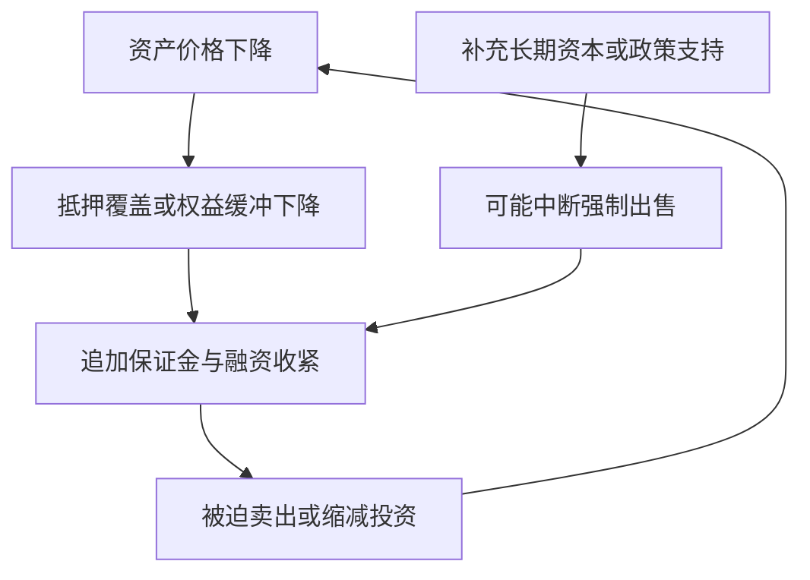

# 《金融炼金术》读书笔记

> **书目与范围**：乔治·索罗斯（George Soros），*The Alchemy of Finance*，初版 1987 年；Wiley 2003 年版 ISBN 9780471445494，具体中文版本未确认。实际使用出版社与图书馆书目、作者后来的公开理论阐述，以及政策记录和公司公告。本篇为公开资料系统导读，未取得全书正文，没有把后来的文章冒称为原版章节。重点覆盖可错性、反身性、股票与信用、汇率与政策、实时判断及其限制；不复刻全书交易日记或作者持仓。以下 30 个编号为学习主题，现代案例、计算和研究清单均为补充教学。

这本书提出的核心问题是：市场价格只是在反映现实，还是也会参与改变现实？例如，股价上涨可以帮助公司发行新股，新增现金又改变公司的生存条件。观察者既在解释市场，也在通过交易、借贷、融资和政策影响它。

最值得学习的是一种动态研究方法：同时写出参与者相信什么、他们因此做什么、行为改变了什么事实，以及哪些条件会使这个循环终止。它不是一套能精确预测拐点的公式。

## 一、理论起点：认识与行动互相影响

### 1. 可错性：模型不等于现实

人在信息不完整、注意力有限和未来尚未发生的情况下作决定，对现实的理解必然可能出错。索罗斯把这种可错性作为自己的方法起点，而非只把错误归给不够聪明的投资者。

可错不等于所有观点同样好。公司现金余额、债务到期日、交易条款仍可以核查；不同解释也有不同的证据强弱。承认可错性的实际结果，应是保留修改判断的条件，而不是放弃证据。作者 2010 年的公开演讲重申了这一出发点。[索罗斯：哥伦比亚大学演讲](https://www.georgesoros.com/2010/10/05/the_sovereign_debt_problem/)

### 2. 认知功能与参与功能

认知功能指我们尝试理解正在发生什么，参与功能指我们依据理解采取行动、改变外部条件。索罗斯后来的文章也使用 manipulative 一词强调行动意图；这里不应简单翻成违法操纵市场。

两种功能方向相反：事实影响看法，看法经行动影响事实。交易者、企业管理者、银行与监管者都可能处于这个关系中。作者的公开文章是理论说明，本篇后续例子是独立用于教学的应用。[索罗斯：可错性、反身性与人的不确定性](https://www.georgesoros.com/2014/01/13/fallibility-reflexivity-and-the-human-uncertainty-principle-2/)

### 3. 反身性比“情绪影响股价”多一步

说乐观情绪导致买入、买入导致涨价，只描述价格形成。若要说明反身性更有特色的部分，需要追踪价格如何改变融资能力、抵押品、客户行为、经营投资或政策，再反馈到投资者判断。

图示并不意味着每次涨跌都会显著改变企业。现金充足、无再融资需要的公司，对短期股价可能没那么敏感；高度依赖外部融资的公司则可能更敏感。识别具体传导渠道，比直接给事件贴“反身性”标签重要。

### 4. 基本面可以受价格影响，但不会被想法任意创造

基本面通常指盈利、资产、负债、现金流与竞争条件。反身性提醒我们，其中一些变量不是固定的外部背景。例如，融资价格影响资本成本，抵押品价格影响借款额度。

但工艺约束、客户真实需求、现金支付和债务合同仍然存在。价格上涨能延长融资时间，不会自动生产出客户需要的产品。理解“价格改变现实”与误以为“只要有人相信就永远成立”之间的区别，是全书最重要的边界之一。

### 5. 正反馈与负反馈：方向不是褒贬

正反馈指某种变化会强化原变化，负反馈指会抑制原变化。上涨吸引更多买入、融资又支持扩张，可能是正反馈；价格过高导致客户减少需求、竞争者增加供给，则可能形成负反馈。

正反馈也可能发生在下跌中：价格下降导致追加担保、被迫出售又进一步压低价格。它并不等于“正收益”。同样，负反馈不是坏事，而可能让系统稳定。市场里往往同时存在多条反馈，不能只画出一条顺眼的循环就认为解释完成。

### 6. 趋势和对趋势的理解必须分开记录

真实经营改善可能是价格上涨的起点，但市场可能把有限改善理解成无限延伸。为了避免混淆，可把记录分成两列：已经观察到的事实，以及投资者对事实含义的解释。

例如，融资完成属于事实，“有了现金就能成功转型”属于假说；销售增长属于事实，“竞争永远无法进入”属于判断。将两者分开，才能知道新公告究竟证实了哪个环节，而不是让每一个好消息都支持整个故事。

## 二、股票、融资与信用的真实反馈

### 7. GameStop：价格如何变成公司账上的现金

**真实案例，发生于原书出版后。** GameStop 2021 年 6 月 22 日公告，公司完成出售 500 万股普通股，佣金和发行费用扣除前的总募集款约 11.26 亿美元。这是当时、拆股调整前的发行股份口径，不是经营收入或净利润。[GameStop 公告](https://investor.gamestop.com/news-releases/news-details/2021/GameStop-Completes-At-The-Market-Equity-Offering-Program-06-22-2021/default.aspx)、[向 SEC 提交的 8-K](https://www.sec.gov/Archives/edgar/data/1326380/000132638021000076/gme-20210622.htm)

这给“股价影响基本面”提供了直接渠道：市场愿意购买新股，公司就能换得现金，现金增加改变资金约束。与纯粹的二级市场换手不同，发行资金确实进入公司；股东人数和权利比例也随之变化。

但融资成功不等于后续投资成功，也不能倒推全部市场价格都合理。本案例只确认发行事实和可解释机制，没有把某个单一因素视作此前股价变化的完整原因，也没有把募集总额误写为净到账额。

### 8. 股权融资的两种效应：增加现金与稀释权利

发行新股同时改变公司资产和每股权利，不能只看其中一边。若较高发行价格换来较多现金、且资金被有效使用，原股东的每股经济价值可能改善；若低价融资只是填补持续亏损，则可能相反。

**数学演示**：原有经济价值 100、10 股，每股 10。若按 20 的价格发行 5 股、忽略费用并假定新现金按面值增加价值，则发行后价值 200、15 股，每股约 13.33。若按 5 发行同样 5 股，则价值 125、每股约 8.33。前提是原先价值估计和现金价值成立，这不是实际股票发行后的价格预测。

这一算例解释融资价格为什么重要，也说明“增发一定坏”“融资越多越好”都过于粗糙。

### 9. 股票作为并购支付工具

若企业股价被赋予很高倍数，它可能用相对少的自身股份购买资产或盈利。并购后总盈利上升，又可能被市场理解为原来高估值的证明。

研究时必须拆出被收购的盈利、支付的股份、整合成本和真实增量现金流。EPS 增厚可能只是估值倍数差异，不等于创造了同等经济价值。当市场不再给收购方高倍数，继续交易的融资优势也可能消失。

这是一种可能的反身性渠道，不是本篇对某家公司的欺诈指控；具体交易需要原始公告与会计口径支持。

### 10. 抵押品循环：价格上涨如何扩大贷款

**真实背景案例：美国住房与信贷扩张。** 美国金融危机调查委员会报告讨论了住房价格、按揭发放、证券化和宽松承贷标准在危机前的相互作用，也记录了后来融资市场受损的过程。报告包含不同委员的异议，不能把所有争论简化为单一原因。[FCIC 最终调查报告，尤其第 6—8 章](https://fcic-static.law.stanford.edu/cdn_media/fcic-reports/fcic_final_report_full.pdf)

用反身性视角看，房价上升提高抵押品估值，借款人更易获得贷款或再融资；更多信用又可能支持购房需求和价格。若风险判断过度依赖不断上涨的抵押品，贷款看起来会越来越安全，但这个“安全”部分依赖同一个价格过程。

必须同时核查借款人的收入与现金偿付能力。抵押物价格不是每个月支付利息的现金来源，除非能够持续出售或再融资；而这些渠道在压力时也会变化。

### 11. 下跌时为什么可能比上涨时更快

信用扩张时可以分散在许多交易与项目中；收缩时却可能由共同的合同阈值触发。抵押品价格跌到某水平，贷款人要求补担保，借款人卖资产，新的低价又触发其他人的限制。

图中的政策支持不保证成功，也不是所有下跌的唯一终点。图意是：在融资约束下，市场参与者可能不能等到自己认为合理的价格，而必须立即行动。

### 12. 杠杆改变的不是观点，而是生存条件

**数学演示**：用自有资金 10、借款 90 持有资产 100。忽略利息等因素，资产下跌 5% 后价值 95，权益剩 5，权益损失为 50%。资产没有归零，股东缓冲已经减半。

如果贷款合同要求维持一定权益比例，借款人可能被迫补钱或出售。即使长期判断后来正确，也不代表账户能够坚持到那时。这里的关键不只是波动大小，还包括借款期限、担保品折扣、是否可追加要求和退出流动性。

### 13. LTCM：分散的资产可能共享同一种融资脆弱性

**真实案例。** 美联储历史资料记载，长期资本管理公司 LTCM 在 1998 年面临严重损失与流动性压力，拥挤头寸和高杠杆加重了其困境，并引发对金融系统连锁影响的担忧。[美联储：LTCM 接近倒闭](https://www.federalreservehistory.org/essays/ltcm-near-failure)

从反馈角度看，许多头寸平时相关性不高，压力时却可能因为相同融资方、相同风险限额和同时平仓而联动。观察资产类别的数量，不足以判断组合真正有多分散。

本案例不是说模型或套利一概无效，而是提醒模型需要包含资金约束与市场冲击。认为最终会收敛的价差，在被迫退出之前可能继续扩大。

### 14. 银行的信心问题不能与偿付能力混为一谈

银行可能拥有长期资产，却承担短期提款需求。担忧导致提款、提款迫使出售资产，损失又加重担忧，这构成值得研究的反馈渠道。

但不能因此把所有银行问题都叫心理恐慌。如果资产本来已有重大信用损失，恢复信心也不会自动补足资本；如果只是期限错配，流动性支持与资本补充的作用又不同。应把资产质量、流动性、资本充足和存款结构分开核对。

## 三、汇率、政策与制度

### 15. 汇率不是只由贸易数字决定

汇率同时受资本流动、利率、风险偏好、债务结构和政策预期影响。资金流入推动升值，升值又可能使某些投资看起来更有吸引力，形成趋势延续；但也会改变出口竞争力与资产价格。

这并不意味着经常账户没有意义，而是不同期限有不同力量。在用宏观变量解释短期价格时，要写出传导机制与时间范围，避免任何涨跌都能被一条新闻解释。

### 16. 广场协议：政策也是反馈系统的一部分

**真实历史事件。** 1985 年 9 月 22 日，五国财政与货币当局在广场协议中就汇率协调等事项达成共识。日本内阁府历史说明记录了该协调背景与后续汇率变化。[日本内阁府：日本经济与全球化](https://www5.cao.go.jp/zenbun/wp-e/wp-je04/04-00301.html)

该事件说明，政策当局观察失衡后会改变行动，市场又会重新评价未来政策与汇率。不能把政策当作永远不变的外部参数，也不能以协议发生在汇率变化之前，就把随后所有变化都归因于单一会议。

它与原书讨论的 1980 年代金融环境相关，但本篇没有依据未经取得的交易日记断言索罗斯在每一天的具体判断或交易数量。

### 17. 1992 年英镑事件：制度承诺与经济约束

**原书出版后的补充案例。** 英格兰银行 1992 年第四季度公报记载，英国在 9 月 16 日经历剧烈市场压力和大量官方购买英镑后，暂停英镑参与欧洲汇率机制 ERM。公报同时讨论了英国国内经济需要与汇率承诺之间的冲突。[英格兰银行：1992 年货币政策运行](https://www.bankofengland.co.uk/quarterly-bulletin/1992/q4/operation-of-monetary-policy)

研究这个事件，应区分固定或受约束汇率的承诺、维持承诺需要的利率与储备、国内经济代价，以及市场对承诺可信度的判断。压力本身会提高防守成本，进而改变政策选择。

它不能被简化为“某个人凭想法击败一国”，也不能证明任何受管制汇率都会崩溃。本篇不填报未经本次核验的个人盈利数字，也不把当日宣布但未最终实施的利率变化写成已持续执行的利率。

### 18. 政策会改变市场，也会被市场改变

如果政策目标是稳定融资和经济活动，市场压力会影响政策反应；政策反应又改变投资者激励。投资研究因而需要考虑反应函数：什么变化可能让当局转向，以及转向需要哪些法律、财政与政治条件。

“市场跌就一定救”和“政策从不影响长期结果”都是过度简化。政策可能暂时改善流动性，却未解决盈利与债务；也可能从根本上改变风险分配。要区分短期机制和长期代价。

### 19. 监管者同样可能犯错

监管者不拥有关于未来的完美信息，也会受到模型、数据滞后、制度职责和政治环境影响。参与者如果根据监管规则调整行为，原本用于限制风险的指标还可能被规避。

这不意味着监管没有价值。合理的结论是，分析不能只看指标是否达标，还要看指标覆盖了哪些风险、遗漏了什么，以及参与者如何响应。作者对监管与市场失灵的立场有争议，本篇把它视为分析视角，不当作已经消除争论的定论。

## 四、如何阅读实时实验与交易判断

### 20. 实时记录的价值在于保留当时的不确定性

原书包含作者的实时投资记录，这一点可由其版本书目与内容介绍确认。与事后总结相比，实时记录让读者更容易看到观点如何修正，而非只看到一条通往成功的直线。[Wiley 2003 年版书目](https://www.wiley.com/en-fr/Edition-p-9780471445494)、[图书馆版本记录](https://openlibrary.org/books/OL3317479M/The_alchemy_of_finance)

本篇没有取得全部日记，因此不虚构逐日仓位。可迁移的方法是：在结果出现前写下证据、假说、预计机制、反证与需要观察的数据；新信息到来后保留原记录并补充，不把旧判断偷偷改成新判断。

### 21. 一个成功交易不能单独证明一种理论

交易盈利可能来自正确机制，也可能来自共同市场上涨、偶然事件或承担未被观察到的风险。理论若能在任何结果后找到解释，就难以被检验。

更严格的复盘应问：原先预期的中间环节有没有发生？若没有，是否仍因其他原因获利？有没有同样逻辑但失败的案例？本书的实践价值可以很大，同时其宏大理论是否足够精确、能否稳定预测仍然值得讨论。

### 22. 用概率和条件表达，而不是写预言

反身性过程会被竞争行为、政策和新信息改变，适合用情景研究。例如，融资持续、融资收紧和业务现金改善三种情景，可能形成不同路径。

概率不是装饰。若无法给出可信频率，也可以先写相对信心与关键不确定项，说明哪些观察会提高或降低判断。把猜测写成精确到个位数的概率，却不说明依据，并不会使它更科学。

### 23. 看对终局与选对交易工具是两件事

即使判断一种资产最终会下跌，也不意味着任何做空工具都有合理风险。借券成本、召回、价格跳跃、期权期限和保证金都会影响实际结果。

本篇讨论机制，不提供具体杠杆或仓位方案。更一般的财商启示是：投资工具的合同条件可能比宏观观点更早决定你是否能够继续持有。把观点写成研究报告之后，还需要单独验证工具和资金期限。

### 24. 退出条件应同时包含事实变化和资金限制

如果研究理由是融资改善将支持转型，退出或重审信号可能包括关键融资失败、现金消耗超预期、产品没有得到客户接受。若采用趋势交易，价格和执行规则可能又承担不同角色。

不要把基本面投资、事件交易与趋势交易混在一起：原先买入靠价格趋势，亏损后忽然改称长期价值；原先研究多年现金流，却每天凭情绪修改结论，都会破坏判断的一致性。

### 25. 身体直觉不能替代证据

关于著名投资者的身体反应或盘感常被传播为成功秘诀，即使出自当事人回忆，也不构成他人可复制的验证方法。直觉可能压缩了经验，也可能只是焦虑或近期结果造成的反应。

一个更可操作的做法是把不安当作检查信号：重新核对事实、风险敞口与反证，而不是把感觉本身当作新增事实。是否调整判断，要回到可以说明的理由。

## 五、理论的限制与个人应用

### 26. 反身性与行为偏差有关，但研究重点不同

行为偏差帮助解释人如何误判概率、损失或证据；反身性进一步关心判断产生的行动如何改变外部条件。两者可以结合，不能把所有行为金融研究都说成只研究心理而完全忽略市场结果。

例如，过度乐观是可能的认知偏差，宽松融资与扩产是行动，产能过剩与债务压力是后果。把它们接成完整链条，比单独指出“大家贪婪了”更能生成可验证问题。

### 27. 对均衡理论的批评不能变成对整个经济学的误写

索罗斯对均衡、理性预期和有效市场提出批评，这是作者的重要立场。但经济学和金融研究包含多种模型，也研究信息差、信用约束、协调失败和非线性过程。

因此，读者应检验具体模型的假设，而不是把对手概括成“所有价格永远正确”。反过来，观察到泡沫或市场失灵，也不自动证明某个广泛理论的每个命题。保持这种区分本身就是逻辑训练。

### 28. 什么时候反身性分析最有信息量

当价格能明显改变融资、抵押、客户信任或政策选择时，分析往往更有用。可依次检查：外部融资依赖是否高，是否存在共同强制出售阈值，市场行为是否会改变公司经营，政策是否对市场压力敏感。

如果这些渠道都很弱，硬把每次波动解释为反身性，可能只是在增加术语。简单的盈利、成本和估值分析有时已经足够。工具的价值取决于能否提出额外且可核查的问题。

### 29. 写一张反馈研究卡

| 栏目 | 应记录的内容 | 常见错误 |
|---|---|---|
| 已知事实 | 日期、口径、原始公告 | 把传闻当事实 |
| 主流理解 | 谁相信什么，依据是什么 | 用自己的观点代替全市场 |
| 行为渠道 | 融资、交易、投资或政策 | 只说情绪，不写行动 |
| 现实变化 | 现金、债务、需求、供给如何变 | 只看价格，不看经营 |
| 约束和反证 | 合同、现金、竞争及政策条件 | 认为循环无限持续 |
| 时间与结果 | 预计观察窗口、实际发生什么 | 事后修改原先解释 |

这张表是分析者补充方法，不是原书逐字模板。完成后应能让另一个人检查每条箭头是否有证据，而非只感觉故事很完整。

### 30. 学会修正，而不是追求永远正确的自我形象

本书对财商的最大启发，是把投资看成持续纠错。一个观点不必与个人身份绑定；新事实出现后，修改观点比维护面子更重要。

但频繁改变也未必是纠错，可能只是追随价格。好的修改说明哪条证据变化、哪项假设失效以及新解释解决了什么问题。每次改变保留理由，长期才能分清学习与摇摆。

## 练习与参考答案

**练习一：股价上涨，公司经营没有变化，能否仅凭上涨判定反身性改变了基本面？** 参考：不能。还需找到融资、客户、抵押或政策等传导渠道。GameStop 的新股发行直接改变现金与股权数量，属于可以核查的渠道；普通二级市场换手不能直接写成公司获得融资。

**练习二：资产 100、负债 90，资产跌至 92，权益损失多少？** 参考：权益从 10 降到 2，损失 80%，假设负债金额不变且无利息等影响。是否已被要求平仓取决于合同，不能由这一个数字直接推断。

**练习三：怎样证明“政策放松让某股票上涨”不是事后故事？** 参考：先记录政策影响现金流或融资成本的渠道，检查政策时间与价格反应，考虑其他同时发生事件，并观察中间机制是否兑现。没有适当对照与识别设计时，应写“与这一机制一致”，而非宣称已经证明唯一因果。

## 来源导航与边界

书目使用 Wiley 与图书馆记录；理论说明使用索罗斯本人 2010、2014 年公开文章；事实案例使用 GameStop 公告、FCIC 调查、英格兰银行、日本内阁府与美联储历史资料。后来的事件与文章均已标明，未混入 1987 年初版的时序。原书全部实时交易记录与各版序言仍属未取得资料范围。

可与[《资本回报》](<../资本回报 - 爱德华·钱塞勒/读书笔记.md>)比较融资如何变成供给，与[《投资者的未来》](<../投资者的未来 - 杰里米·西格尔/读书笔记.md>)比较增长和价格预期，与[《证券分析》](<../证券分析 - 本杰明·格雷厄姆、戴维·多德/读书笔记.md>)结合检查权利和财务底线。反身性补充的是动态机制，不替代合同、会计和估值。
