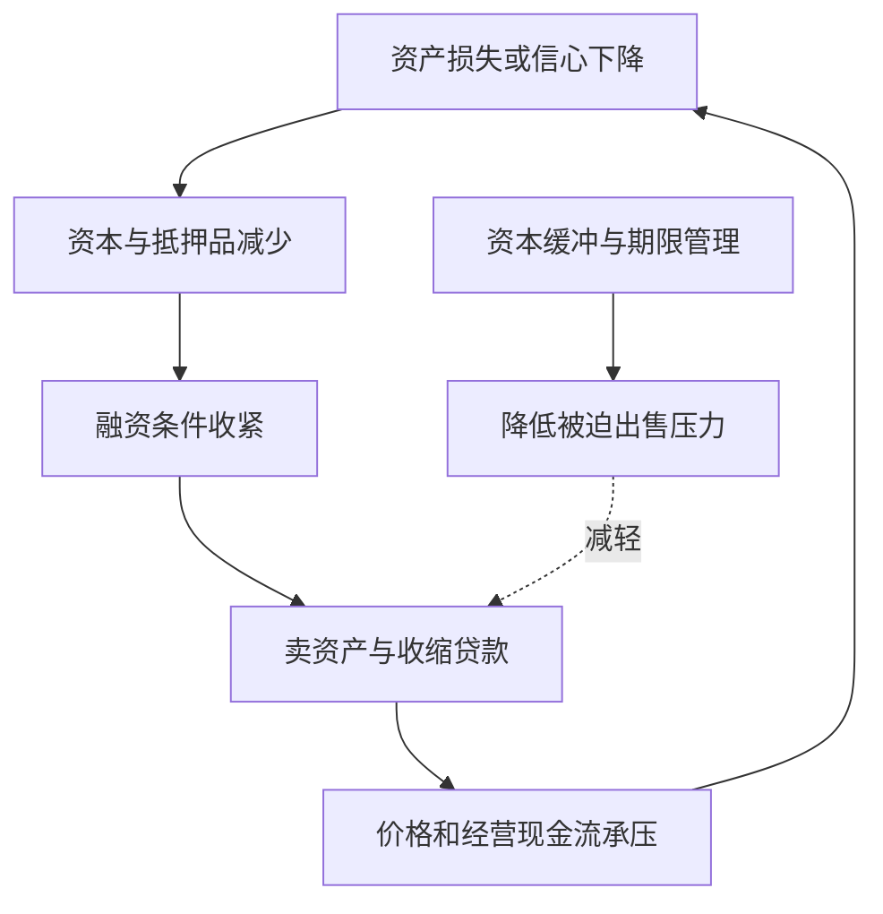

# 《金融的逻辑》：理解钱怎样跨时间、跨人群配置

> 作者：陈志武。2009 年《金融的逻辑》由国际文化出版公司出版，后来有分册与重编版本。本文以可核验的 **2020 年上下册《金融的逻辑》**公开目录为主题参照：上册“金融何以富民强国”，下册“通往自由之路”；早期分册不能当作全部在 2020 年首次写作。实际资料为出版方介绍、正版电子书目录与简介、中央银行说明及原始研究，未取得整套全文，属于**基于公开资料的系统导读**。无法确认的逐章细节不作原书断言；下文现代银行机制、研究案例及家庭应用均为教学补充。

这本书把金融从“炒股赚钱”扩展为一种社会协作方式：让今天的资源与未来的收入交换，让风险由不同的人共同承担，让陌生人之间也能形成可信的长期合作。其核心价值是帮助读者看见制度、合同和金融工具如何影响家庭生活。但作者对市场、自由和金融发展的部分判断带有规范立场，应与历史证据和可检验的因果结论区分。

## 主题与资料范围

上册公开结构包含资本化、金融、金融危机、股市、文化与金融等主题，下册包含自由、民富、创新的金融逻辑。以下 32 点按理解顺序重组，不对应 32 个原书章节。书中汇集不同年代文章，不能把旧文的预测和政策讨论直接称为今日现状。[正版电子书目录](https://www.dedao.cn/ebook/detail?id=V5R16yPmaYOMqGRAv82jkX4KDe175w7nzN3rbx6pNgznl9VZPLJQyEBodb89mqoO)，[出版方上册介绍](https://ilixiangguo.com/book/book/view/id/962)。

## 一、从财富、货币和资本化开始

### 1. 金融的核心不是钱多，而是资源怎样交换

拥有储蓄的人未必有好的经营项目，有能力经营的人未必已经积累资本。金融合同尝试把这两种条件连接起来，并规定谁承担风险、谁获得收益、何时交付。

因此，评价金融发展不能只看交易额、借款额或金融从业人数。应看是否使资源更容易到达有价值的用途，以及识别和承担风险的能力是否同步改善。

### 2. 钱、收入和财富是不同量

货币是支付和计价工具；收入是一个期间获得的流量；财富是某一时点拥有的资产扣除负债。把存款增加、工资增加和社会财富增加混为一谈，会误判经济变化。

买卖一项旧资产可能增加成交额，却不直接创造同等数量的新住房或机器。资产升值可以提高账面财富，但能否持续兑现，取决于未来服务和现金流以及交易条件。

### 3. 货币数量增加不自动让所有人更富有

若货币增长没有对应更多可消费的商品和服务，购买力可能通过价格变化重新分配。即使经济真实产出增长，新增收益也未必平均落到每个人身上。

所以，阅读宏观消息应追问：增加的是货币、信用、产出，还是资产价格？由谁持有资产、承担债务、获得收入？这些问题帮助解释为什么“钱很多”和“家庭觉得宽裕”可以同时不成立。

### 4. 资本化是把未来收益转成今天可交易的权利

一项稳定经营的资产不仅有今天的账面价值，还有未来提供服务、产生现金流的能力。资本化意味着通过产权和合同，将这种未来能力转化为可以持有、融资或交易的权利。

它不能凭空增加物理资源。作用在于让未来现金流更容易被估值和融资，帮助今天的投资安排。若未来收入被夸大、权利无法执行，资本化也会放大错误判断。

### 5. 折现率连接未来现金流与今日价值

现金流越远、越不确定，今天通常愿意支付的价格越低。简化公式是 **现值 PV＝未来现金流 CF÷(1+r)^n**，r 为与时间、风险和币种口径相匹配的折现率，n 为期数。

**数学演示。** 一年后确定收到 110，若适用年折现率 10%，现值为 100；折现率升到 20%，现值约 91.67。未来收入没变，价格也可以改变。这解释利率与风险要求为何重要，但“确定收到”和折现率取值都是演示假设，不是任何产品承诺。

### 6. 产权和可执行合同是资本化的条件

投资者需要知道买到什么权利、是否可转让、怎样分配现金、发生争议时怎样处理。如果权利不清，项目即使有潜在收益，也可能难以融资。

因此，市场价格不只是对经营前景的评价，也包含执行成本、信息可信度和制度风险。制度改善可以改变融资条件，但不能保证每项资产价格上涨。

图为资本化关系示意。关键不是把未来说得好听，而是现金流、权利和执行能否形成可信的连接。

## 二、金融怎样跨越时间并分配风险

### 7. 储蓄与借款都是跨期安排

储蓄把今天的一部分消费能力留给未来；借款把预期未来收入的一部分提前使用。两者本身都不能简单贴上美德或恶习标签。

问题是用途、成本、期限和收入不确定性。提前支付教育、设备或基本住房需求，可能有价值；用高成本债务持续维持超过收入能力的消费，则可能侵蚀未来选择。

### 8. 消费平滑不是尽可能多借钱

人的收入与需求并不总同步：求学、工作、养育、退休有不同现金流。金融工具可以缓解错位，但未来收入是预测，不是已经到账的事实。

评估一项负债，应同时写出正常、收入下降和利率变化情景。只算正常月份还款比例，会遗漏失业、照护和医疗等压力。借款使今天更容易，同时建立了未来必须履行的合同。

### 9. 利率是多个补偿和成本的合成

利息可能包含时间补偿、预期通胀、违约损失、运营成本、资本约束和利润。高利率有时反映服务成本高或风险大，也可能包含信息不透明与市场力量。

因此，“利率高就一定是暴利”与“利率高就必然合理”都过于简单。需比较实际资金到账、还款时间、所有费用以及违约规则。书中的历史民间借贷讨论不等于现行法律意见。

### 10. 看借款成本必须按实际现金流计算

**数学演示。** 名义借款 10,000，预先扣费 500，一年后偿还 11,000，实际拿到 9,500，一期成本是 11,000÷9,500−1≈15.79%，不是只看“利息 1,000÷本金 10,000＝10%”。

若分期还款，余额逐步下降，更不能把总费用简单除以原本金当作可比年利率；应按各期实际日期和现金流求内部收益率，再确认年化口径。这个方法是教学补充，具体借贷监管要求需另查交易所在地现行规定。

### 11. 风险共担使单个人不必独自承担全部冲击

保险把许多人的小额支付集中起来，应对部分人的大额损失；股权把经营风险分散给多位投资者；其他合同也能重新分配风险。

但分散依赖风险不完全同步。如果所有人都暴露于同一地区灾害或同一种资产下跌，简单增加人数未必足够。还需资本、再保险、合同边界和可靠运营。

### 12. 保险、储蓄和投资完成不同任务

储蓄主要保存与安排资金，保险主要针对约定风险转移损失，投资承担不确定性以获取可能回报。产品可能混合这些功能，但评价时仍应拆开。

买保障时只比较“能不能返钱”，可能忽略真正需要转移的重大风险；把高波动投资当应急储蓄，则可能在最需要用钱时被迫亏损退出。工具应由任务决定，而非由销售名称决定。

### 13. 信息不对称使好想法也可能融不到钱

借款者比出借者更了解项目，投保者更了解自身风险，管理层比外部股东更了解经营。双方信息不同，会引出逆向选择和道德风险。

逆向选择发生在交易前：较差风险可能更愿意接受某种合同；道德风险发生在交易后：受保障或管理他人资金的人，可能改变行动。审计、抵押、契约约束、共同出资等设计尝试缓解这些问题，但都有成本和局限。

## 三、银行、支付与金融可得性

### 14. 商业银行不是简单把同一笔存款搬给借款人

**真实制度说明。** 英格兰银行 2014 年说明，现代商业银行发放贷款时，通常同时在借款人账户创造存款；银行仍受盈利、资本、流动性、监管和货币政策等约束。这是对银行机制的教学补充，不是对原书每句表述的核定。[英格兰银行原文](https://www.bankofengland.co.uk/quarterly-bulletin/2014/q1/money-creation-in-the-modern-economy)。

资产负债表上，银行增加贷款资产和存款负债；借款人增加存款资产和贷款负债。借款人净财富并未因拿到贷款立即增加。之后支付给其他银行客户，银行还需要清算与流动性安排。“贷款创造存款”不意味着可以无限放款或不需偿还。

### 15. 期限转换提供便利，也带来流动性风险

储户希望方便取款，借款项目可能需要多年才能回款。银行在一定条件下协调这种期限差异，为经济提供便利，但不能让全部长期资产即时变成现金。

若大量短期资金同时撤出，即使某些长期资产最终能偿付，也可能出现付款压力。流动性问题与资不抵债不同，却可能互相转化：折价出售资产可能把付款困难变成资本损失。

### 16. 支付服务的价值往往来自降低摩擦

便捷转账减少汇款时间、路途成本和现金保管风险，也让分散在不同地区的人更容易互相支持。这些价值可能不表现为投资收益率，却能改善家庭安排。

评价支付创新时，应同时看费用、失败交易、资金保护、身份核验、隐私和网络中断。方便是金融功能之一，不等于平台上所有附带产品都安全或适合。

### 17. 肯尼亚移动支付研究：降低摩擦可以改变家庭选择

**真实研究案例。** Suri 与 Jack 的 2016 年《Science》研究利用肯尼亚移动货币服务的扩展和家庭数据，估计服务可得性与消费、贫困及职业选择改善有关，并报告女性家庭的明显变化。[原始研究](https://doi.org/10.1126/science.aah5309)。

这里的机制不是“手机产生财富”，而是收付款、储存价值、异地支持和风险应对更容易。研究并非把全国每户随机分配使用同一产品，因果解释依赖识别设计和假设；不能直接推广为任何支付应用都会同幅减贫，更不能当作购买某家公司股票的理由。

### 18. 拥有账户是入口，使用质量才决定实际帮助

**真实统计案例。** 世界银行 2021 年 Global Findex 数据显示，全球成年人的金融机构或移动货币账户持有率约为 76%，2011 年约为 51%。这是 2021 年历史统计，本文不称其为当前最新值。[世界银行 2022 年发布说明](https://www.worldbank.org/en/news/press-release/2022/06/29/covid-19-drives-global-surge-in-use-of-digital-payments)。

覆盖增加说明金融入口扩大，但并不能单独证明财富提高。账户可能少用、收费较高、缺乏保护，用户也可能不理解产品。应继续研究服务是否适配、实际费用、故障处理和家庭抗冲击能力。

### 19. 小额信贷的证据提醒我们别把工具写成救世主

**真实研究案例。** Banerjee、Karlan、Zinman 在 2015 年汇总六项小额信贷随机评估，认为整体效果偏温和积极，未发现普遍的生活跃迁式改善。不同人群、产品和地区仍有差异。[原始研究综述](https://www.aeaweb.org/articles?id=10.1257/app.20140287)。

这并不证明信贷没有价值，也不证明所有借款都有益。融资只是创业和改善生活的一个条件，还需要需求、能力、健康和制度。对“只要给穷人贷款就会致富”的主张，应要求与其强度匹配的证据。

## 四、家庭、文化与制度如何共同承担保障

### 20. 家庭可以提供隐性的互助合同

赡养、亲友借款和照顾，常包含跨时间的互助安排。作者从金融视角解释这些关系，是为了看见它们承担的保障功能，不等于宣称亲情只有经济计算。

隐性合同有信任、灵活和照护优势，也可能存在责任不清、协商压力、能力有限及风险同源等问题。分析应保留关系中的情感与道德意义，不把家庭成员简化为资产。

### 21. 正式金融可以扩大选择，但不能完全替代关系

保险、养老金、可执行合同和多元收入，可能减少一个人因经济保障而必须依附某种关系的程度。这是作者讨论金融与自由的重要思路。

但制度效果取决于覆盖、成本与可获得性。一个负担不起保险、不能取得公平信贷的人，不会仅因市场产品丰富就自动拥有更多选择。正式制度与家庭支持可以互补，不能机械理解为二者必须互相消灭。

### 22. 自由既是价值判断，也需要具体指标

作者重视个人选择空间，这是规范立场。要进一步检验政策效果，需要定义可观察的指标，例如能否更换工作、迁移、获得教育、拒绝不利合同，或者承担意外支出。

如果只以金融规模增加代表自由增加，便跳过了费用、债务约束和分配差异。相同工具可能扩大一部分人的选择，同时使另一部分人面临更强约束。

### 23. 国家、企业与家庭的资产负债表不能混用

政府拥有更多资产或收入，不等于每个居民拥有同等可支配财富；企业市值增长，也不自动转化为所有员工工资增加。需考察权利归属、税费、转移支付和公共服务。

讨论“国富”与“民富”时，应明确统计对象、资产可变现程度、负债和受益渠道。国家层面的总量不是家庭预算可以直接支取的一笔钱。

### 24. 勤劳、生产率与资本配置是不同层面的解释

劳动时间长不必然带来高收入。工具、技能、组织、市场需求和制度环境会影响单位劳动创造多少价值，以及价值怎样分配。

从个人角度，努力很重要，但应研究努力投向何处、是否积累可迁移能力和改善议价条件。不能把低收入一概归因于不努力，也不能用制度因素否认具体能力和行动的作用。

## 五、创新、资本市场与金融危机

### 25. 股票市场连接融资、风险承担与治理

新股发行可为企业取得资金；二级市场主要让已有权利转让，流动性又会影响初次融资的吸引力。两者相关，但二级市场每笔成交并不都把钱直接交给企业。

股东不只关心价格，还需要可靠披露、分红权、投票权及对管理层的约束。没有治理保障，“参与企业增长”可能停留在叙事，利润未必公平回到小股东。

### 26. 创新应按改善的金融功能评价

好的创新可能降低支付成本、扩大保障、改善风险分担或提高信息质量。复杂度、杠杆和产品数量本身不是成功指标。

面对新产品，应要求它回答：解决了谁的什么问题？成本比旧办法低在哪里？风险转移给谁？极端情景下合同怎样运行？若只能解释销售增长，不能解释用户受益，就还缺关键证据。

还需区分创新的私人收益与社会收益。一个产品可能让发行者获得更多费用，却没有相应改善用户的支付、保障或配置能力；也可能对用户有用，却把部分风险转给未充分知情的第三方。因此评价不能只看销售额或企业利润，也不能只看少数用户的成功故事。

把这些问题落实到材料上，就是追踪谁支付费用、谁提供资本、谁最终承担损失，以及合同是否让各方理解这些安排。金融工具的经济意义往往藏在这条权利与义务链中，而不是在技术名称或宣传口号中。

### 27. 风险被重新包装，不等于被消灭

证券化可以把贷款现金流分配给不同投资者，并改变融资方式。但如果基础借款人仍依赖同一经济条件，切成许多层也不会凭空消除共同违约风险。

评级、担保和保险各自依赖模型、资本和对手方。分析复杂产品应追到最终付款人，不能在评级标签处停止。作者讨论金融危机的历史背景，也不能被简化为“所有创新有害”或“监管毫无必要”。

### 28. 杠杆、期限错配和关联暴露会放大冲击

**数学演示。** 资产 100、债务 90、权益 10；资产损失 5，权益降到 5，相当于股东损失 50%。若同时要求还债，出售资产还可能进一步压低价格。

危机分析必须看资产负债表和合同链，而非只看某种商品跌了多少。单个机构的合理自保，比如同时收回贷款或出售资产，可能使整个系统更紧张。这是个体与系统结果不同的典型情形。

图展示可能的危机反馈，最后一条表示缓冲措施旨在减轻出售压力，并非增加出售。实际效果取决于措施规模、时机和可信度。

### 29. 金融越多是否越好，要看质量、速度和制度

**真实研究补充。** IMF 2015 年研究将金融发展拆成深度、可得性和效率，并讨论过快扩张、监管能力及增长收益递减。它提供了对“金融规模越大越好”的限制条件。[IMF 研究说明](https://www.imf.org/en/Blogs/Articles/2015/05/04/how-much-finance-is-too-much-stability-growth-emerging-markets)。

跨国统计关系依赖样本、指标和模型，不能把某个估计阈值变成所有国家共同的机械上限。阅读本书时，可同时接受金融有价值与金融发展需要制度配套，这两个判断并不冲突。

## 六、提高财商时，具体怎样用

### 30. 用合同地图审查自己的金融工具

| 工具 | 先看完成的任务 | 必须问的问题 |
|---|---|---|
| 储蓄与支付账户 | 保管和支付 | 谁负债、费用多少、何时可用 |
| 借款 | 跨期安排 | 实际到账、全部还款、压力情景 |
| 保险 | 转移特定风险 | 保障触发、免责、额度与持续费用 |
| 股票或基金 | 参与收益并承担风险 | 底层现金流、费用、权利与退出 |
| 家庭互助 | 照护与风险共担 | 责任是否清楚、风险是否同源 |

这份表属于应用补充，不是具体产品推荐。读书的成果应体现为问清合同，而不只是记住“资本化”“金融自由”等词语。

### 31. 研究经济论断时，分清四种句子

**事实句**说明发生了什么，需要资料；**机制句**解释怎样发生，需要逻辑与证据；**预测句**涉及未来，需要概率和条件；**价值句**表达什么更值得追求，需要明确价值标准。

书中不同年代的文章可能同时包含四者。阅读时用不同标记分开，就不容易把当年的预测当成已经证实的事实，或把赞同某种价值等同于接受全部因果解释。

### 32. 最终目标是扩大可持续选择，而不是金融交易越多越好

一个工具是否提高财商，可以看它是否让你更清楚自己的权利、未来义务、现金流和风险，以及是否能解释为何适合某个真实目标。不能解释的复杂交易，不会因为使用了专业术语就更先进。

本书适合作为理解金融社会功能的入口。个人还需要结合财报、估值、概率和自身情况，把宏观制度认识转化为具体决策，不能从宏观立场直接跳到买卖某只证券。

## 练习与参考答案

**一：银行发放贷款创造存款，所以借款人立刻变富，对吗？** 不对。借款人同时增加资产和负债；财富能否增加，取决于资金用途、成本和后续结果。

**二：账户覆盖率提高，是否直接证明贫困下降由金融导致？** 不能。覆盖是统计事实，因果影响需要进一步识别，还需看使用与产品质量。

**三：某金融工具能转移风险，是否说明社会总风险一定下降？** 不一定。风险可能集中到承受能力较弱的主体，或通过杠杆和关联扩大；要看最终承担者与系统关系。

**四：为什么支持金融发展仍可以反对某种金融产品？** 因为总体功能与具体合同不同。产品的成本、透明度、适配性与风险需要独立评价。

## 资料边界与关联阅读

本文覆盖两册公开主题的主要概念，不声称完整重现全部文章和历史论据。作者关于文化、制度和自由的解释保留为作者论述方向；未核实的古代细节和旧预测不作事实转述。案例均在原节给出来源，历史统计不冒充最新数据。可与[《贫穷的本质》](<../贫穷的本质 - 阿比吉特·班纳吉、埃斯特·迪弗洛/读书笔记.md>)、[《学会提问》](<../学会提问 - 尼尔·布朗、斯图尔特·基利/读书笔记.md>)联读，练习把宏大解释拆成可检验问题。
