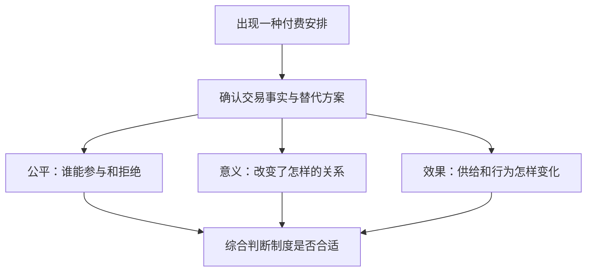
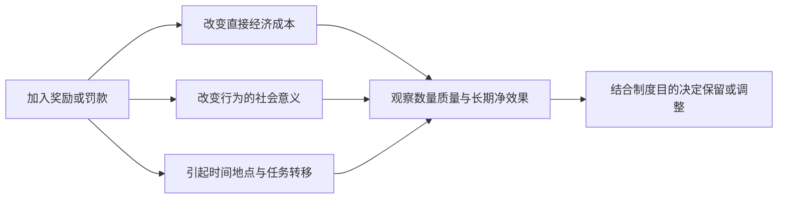

# 《金钱不能买什么》读书笔记

> 作者：迈克尔·桑德尔（Michael J. Sandel）。原作 *What Money Can't Buy: The Moral Limits of Markets*，2012 年由 Farrar, Straus and Giroux 出版；本笔记未绑定某一中文版译本，不使用未经核实的中文页码。
>
> **资料范围：基于公开资料的系统导读。** 使用作者哈佛书目与访谈、出版社授权首章、作者关于市场与道德的学术讨论，并核查书中相关研究及后续证据；未取得全书原文。以下按五个主要议题——插队、激励、市场与道德、生死交易、冠名及商业化——组织 30 个知识点，分析方法和财商应用属于补充教学。案例年份为历史研究年份，不代表现行政策或价格。

这本书帮助你回答一个容易被投资收益遮住的问题：**某件事能赚钱、交易双方也同意，是否就足以证明这种交易值得支持？** 桑德尔承认市场的配置作用，同时要求讨论市场进入某个领域后，会怎样改变公平、行为动机和共同生活。它不教选股，却能帮助你判断企业靠什么赚钱，以及赚钱究竟服务于什么生活。

## 一、先分清问题：有效率和值得做是两种判断

### 1. 市场经济与市场社会，差别在金钱被允许决定什么

市场经济用价格和交换组织生产；市场社会则把越来越多关系也按买卖来理解。付费购买更好的电脑，和付费取得公共议事的优先发言权，虽然都包含交易，面对的制度目的却不同。

作者的关键问题并非钱是否肮脏，而是价格机制应当在哪里止步。学习时先确定讨论的对象：私人消费服务、公共资源、基本权利，还是需要信任的专业关系。把这些对象全部归为“自愿交易”，会在论证开始之前丢掉重要差异。[作者对本书的访谈](https://www.pbs.org/newshour/show/what-money-can-t-buy-and-what-it-shouldn-t-buy)

### 2. 第一种反对理由：交易可能不公平

形式上允许拒绝，不等于现实中有充分选择。欠债、急需治疗或缺乏其他生计的人，可能接受在条件改善后不会接受的安排。这里关注的是谈判背景、资源分布及退出能力。

但“有人处境困难”也不能直接证明禁止交易一定改善其生活。严谨分析还要比较替代方案：禁止以后是否提供其他收入、保障和救助？公平问题要求扩大可行选择，不能只删除眼前那一个选项。这是对作者问题的进一步分析。

### 3. 第二种反对理由：交易可能改变事物的性质

桑德尔使用的“腐蚀”或“败坏”，不只指违法贿赂，而是某种实践原有的意义被另一套标准替换。表彰贡献的荣誉若直接出售，就从承认贡献变成购买身份；问题不只是贫困者买不起。

因此，即使把财富分配得更平均，仍然可能有人反对出售这种荣誉。这说明公平与意义是两条独立理由。反过来，看到差别待遇，也不能自动断言某种事物的内在价值已经消失；必须说清究竟改变了什么。

### 4. 自愿交易的收益，不等于社会总收益

交易双方得到好处，是值得重视的证据，但还要检查第三方成本、规则变化和长期影响。例如出售优先资格，可能改善购买者体验，却增加普通参与者等待，甚至诱使机构压低基础服务。

这里至少有三个层次：交易者是否受益；系统是否增加真实供给；制度是否符合应有目的。只证明第一层，不能直接宣布另外两层也成立。这种拆分同样适合分析上市公司：收入增长可能来自产品更有用，也可能来自用户难以退出，二者对可持续性和伦理评价都不同。

### 5. 愿付价格不能直接代表需求强度

愿意付多少钱同时受到偏好与支付能力影响。一个人无法出高价，可能因为需求小，也可能因为预算太少。因此，竞价能显示有预算约束的需求，不能直接排列每个人所受影响的严重程度。

讨论稀缺救助、教育机会或公共服务时，应另外说明需要、紧迫性、资格与平等权利。价格是信息的一种形式，不是所有价值的完整测量仪器。

### 6. 做判断之前，先把事实、因果和价值摆开

| 判断类型 | 需要回答的问题 | 不能拿什么替代 |
|---|---|---|
| 事实判断 | 是否实施了某种付费制度？ | 印象或传闻 |
| 因果判断 | 付费造成了什么行为变化？ | 简单同时发生 |
| 价值判断 | 这种变化是否可接受？ | 单一利润数字 |
| 制度判断 | 与什么替代方案比较？ | 只批评现状 |

即使实验发现付钱可以提高某项指标，也没有自动回答“是否应该如此”。反过来，认为某种目的值得保护，也不能随意声称任何奖励都必然破坏它。证据约束经验主张，公开理由支撑价值主张。

图示强调并行审查：有效果、公平、保有原本意义，不能互相自动代替。最终选择还要说明冲突时为什么优先保护某个目标。

## 二、插队与资格：先确定分配规则服务什么

### 7. 排队是一种规则，不天然是唯一公平规则

先到先得削弱了支付能力的直接作用，但会让时间充裕、距离近、能雇人排队者占优势。急诊更适合按病情紧迫程度，而非简单排队；某些同等资格机会可能适合抽签。

所以，对收费插队的批评不应停在“排队永远正确”。更有力的问题是：既定资源为什么采用这种分配标准，改变后哪些正当利益受到影响？公平可以要求不同规则，取决于资源性质。

### 8. 真实案例：娱乐快通与公共安全排队为何需要分别讨论

出版社授权首章记载了写作时期机场优先通道、主题乐园付费快通等实践。这里使用的是作者当年的记录，**不把其中历史票价当作今天报价**。两者都出售时间便利，但机场安检同时承担公共安全职能，乐园项目主要提供私人娱乐。[授权首章](https://us.macmillan.com/books/9780374533656/whatmoneycantbuy/)

分析这种安排，可以依次问：基本安全标准是否一致；付费服务是否增加额外容量；普通队列是否因此变慢；获得收入的主体是否承担公共职责。不能只凭存在两条通道就宣布安全降低，也不能只凭安检标准一致就认定所有公平疑虑消失。

这个例子的作用是训练比较制度目的。它不是证明所有快通必须取消，也不是证明只要有人愿意买就没有公共问题。

### 9. 买到服务，和买到决定他人命运的权力不同

聘请专业人员准备材料，可以提高表达能力；直接购买公共决策的特殊地位，则涉及平等参与。二者在现实中可能相互渗透，需要公开透明、利益冲突约束和程序保障。

财商应用：分析一家公司的渠道优势，要区分产品与服务能力、合法合同关系，以及依赖不透明特权的收益。它们都可能表现为利润，却对应不同的治理风险和可持续性。

### 10. 增加供给与重新排序，不能混为一谈

如果收费使资源供给扩大，受益者可能不止付费者；如果总容量不变，只是把原有名额换给高价者，那么核心变化是分配。两种情况需要不同证据。

进一步还要考虑反馈：机构有动力改善所有人的基础服务，还是有动力维持基础服务的不便，以便出售升级？这不是预先断定企业会作恶，而是提醒研究激励结构，不能只看管理层对服务宗旨的表述。

## 三、激励：钱不仅改变成本，也可能改变解释方式

### 11. 罚款与价格，表面相同，传递的规范不同

价格通常表示“支付后可以使用”；罚款通常表达“这是不应做的行为，违反会承担代价”。如果人们把罚款理解为购买许可，就可能增加而非减少相关行为。

因此，制度设计不仅是确定金额，还包括规则说明、执行一致性、监督、其他后果与社会评价。所谓“其他条件不变”在行为政策里很难成立：新规则本身就是一条新信息。

### 12. 真实案例：托儿所迟接罚款为什么适得其反

Gneezy 与 Rustichini 在 2000 年发表的现场研究中，对部分托儿所迟接孩子的家长引入罚款，观察到迟接增加；撤销罚款后，研究观察期内没有恢复原状。研究实际实施了收费，不是询问人们“你会不会迟到”。[原始论文](https://www.ius.uzh.ch/dam/jcr:ed3f9a0b-ab68-4cf6-a18c-a480b33c9456/Gneezy%20et%20al%20A%20Fine%20is%20a%20Price.pdf)

一种解释是，原来迟接带来对教师的歉意，引入金额后变成可以买的延时服务。另一相关解释是，罚款提供了违约后果的信息，让家长觉得成本有限。观察结果本身不能把各种心理机制完全分开。

应用时，先检查被惩罚行为能否通过付费“买断”。但不能推出罚款普遍无效：金额、行为性质、执行方式和退出条件都会影响结果。这项小范围研究不能直接代替对交通、环保等制度的独立评估。

### 13. 动机挤出是有条件的机制，不是金钱的固定属性

内在动机来自兴趣、认同、责任或关系；外在激励来自报酬、考核和惩罚。二者可能相互强化，也可能替代。例如报酬若被理解为对专业能力的尊重，与被理解为逐步操控行为，效果可能不同。

由此可得的稳健方法是：设计激励时同时记录数量、质量、行为是否持续、未奖励任务是否被忽略。只追踪被付钱的那一项，容易把任务转移误当整体改善。[作者关于市场与道德的讨论入口](https://sandel.scholars.harvard.edu/markets-morals)

### 14. 真实案例：核废料补偿研究究竟测到了什么

Frey 与 Oberholzer-Gee 的 1997 年研究，访问瑞士拟议核废料设施地区居民。论文报告，在相关问卷情境中，加入货币补偿后，支持设立设施的比例下降。这是**针对真实议题的调查回答**，不能写成政府实际发钱后居民投票发生了相同变化。[作者公开论文](https://www.bsfrey.ch/wp-content/uploads/2021/08/the-cost-of-price-incentives-an-empirical-analysis-of-motivation-crowding-out.pdf)

作者用公民责任受到挤出来解释。但我们仍应注意问法、顺序、对危险程度的推断，以及口头表态和真实行动的差别。这个案例支持“补偿可能改变人们对安排的理解”，不支持“承担环境成本的人不该得到赔偿”。公平补偿与尊重参与程序完全可以同时存在。

### 15. 教育激励要区分学习过程、考试成绩和学习目的

奖励读书数量、奖励测验分数、奖励长期学习兴趣，是三个不同目标。学生可能知道怎样完成阅读，却不知道怎样把努力转换成考试成绩；数量指标也可能鼓励选择简单材料。

因此，评估至少应包含被奖励指标、其他学习成果，以及奖励结束后的表现。即使短期成绩改善，也不能单凭这一点认定独立学习能力已经形成；即使效果不显著，也不能直接证明奖励摧毁了兴趣。

### 16. 真实案例：学生奖励研究的正式结论比流行转述谨慎

Fryer 2011 年发表于《经济学季刊》的研究报告了美国多个城市的学校随机试验，包括达拉斯阅读奖励。**正式论文的摘要称，各城市总体效果在统计上不显著；显著结果集中在达拉斯英语学生子群，并说明统计功效不足以排除某些具有成本效益的正面效果。** 这不同于简单讲成“付钱读书有效，付钱考高分无效”。[正式论文](https://doi.org/10.1093/qje/qjr045)

2010 年工作论文和正式版的概括存在变化。核查时应保留版本意识，不能只挑最符合自己观点的一句旧摘要。研究没有回答全部教育伦理问题，也不能把“统计上不显著”改写成“确定没有任何作用”。

这给股票研究一个直接启发：公司某一子群、地区或产品表现良好，不能不加说明地替代总体表现；试验还要检查分析版本、样本和结果指标。

### 17. 真实案例：献血奖励提醒我们同时寻找反面证据

Lacetera、Macis 与 Slonim 2012 年发表于《美国经济学杂志：经济政策》的研究，结合美国红十字会近 14,000 场献血活动资料与现场实验，发现经济激励可以提高献血量；但一部分增长来自献血者从附近无奖励活动转移过来。忽略这种地点转移，会高估净增量。[原始研究](https://www.aeaweb.org/articles?id=10.1257/pol.4.1.186)

这个结果限制了“奖励必然挤出公益动机”的笼统断言。与此同时，它并不意味着任何现金买血安排都安全有效：具体奖励、筛查制度、样本和长期结果仍然重要。

财商补充：企业促销提高某门店销量，可能只是从同品牌其他门店搬来订单。分析激励效果时，必须确定是局部数量还是系统净收益，避免把份额迁移当新增价值。

图中三条路径可以同时发生。某一处数量上升，只说明局部结果，不能独自识别动机，也不能证明整体收益增加。

## 四、生死、关系和公共空间：不能省略制度目的

### 18. 礼物与交易的差别，不只在有没有花钱

购买礼物本身是市场行为，但赠送可以表达关注；同样金额若被当作购买友谊的价款，可能改变对方理解。物品价格与关系意义不是一回事。

从这里不能推出现金礼物总不好：关系、文化、对方需要和表达方式都会改变意义。真正需要保留的是接受者的主体性，避免用花费多少衡量亲密程度，或者把帮助变成默认对方必须偿还的人情债。

### 19. 购买表现，未必购买得到真诚

某些事物的价值部分依赖产生它的方式。买到一篇赞扬文章，不等于获得独立赞誉；雇人表现热情，也不等于建立互相信任的友情。

这不是说专业服务的关心一定虚假，而是提醒我们区分服务合同能承诺的行为，与无法单靠合同保证的心理状态。评价财务顾问也是如此：态度亲切不代替利益一致、收费透明和能力证据。

### 20. 人寿保险与押注他人死亡，经济形式相近，关系可能不同

书中“生与死的市场”讨论保险与死亡利益相连时的道德问题。导读时可以问：合同是在补偿依赖者的经济损失，还是让原本无关的主体从死亡获利？被保险人是否知情？是否产生新的利益冲突？

保险把不确定损失转换成可承担的费用，是重要金融功能；评价某种安排不能只看它涉及死亡就否定，也不能只看有合同就忽略利益结构。具体保险利益、税务与合同合法性需按当时当地规则核实，本笔记不把美国历史做法作为现行操作指南。

### 21. 风险定价不等于给人的尊严定价

工程和公共政策需要比较减少风险的成本，否则很难配置有限资源。但是，针对小概率风险变化的统计估值，不等于某个具体生命只有某个售价。

讨论时应写清对象：是降低风险的边际投入，还是决定谁可以被伤害；是辅助资源安排，还是取代基本权利。只要把不同问题合在一个金额里，结论就可能看似精确却失去意义。

### 22. 预测市场的知识功能与道德争议应分别评估

交易某事件的结果，可能汇集分散信息；若有人能够影响事件，也可能产生利益冲突。因而需要区分“从坏消息中获利”和“有能力且有动机制造坏消息”，二者不是同一证据要求。

对投资者而言，做空一家企业不自动等于破坏企业；同样，声称自己只是提供价格发现，也不能免除对操纵、欺骗或信息不对称的审查。这里是依据本书问题意识展开的金融应用，不是原书给出的交易策略。

### 23. 环境交易必须先回答允许多少伤害和由谁承担

可交易排放额度可以让减排成本较低者多减排，但效果依赖总量约束、监测和执行。效率工具本身不会决定总量上限是否足够，也不会自动处理污染在不同地区集中造成的负担。

因此，“允许交易”与“放任污染”并非同义；“有市场”与“环境目标已经实现”也非同义。需要把目标设定、权利安排、执行机制和交易工具分开讨论。

### 24. 冠名权不仅产生收入，也影响公共空间的表达

体育场馆、教育场所或公共设施接受商业冠名，可以获得资金，但也改变哪些名字与价值被持续展示。应比较资金使用、广告边界、公众参与和退出条件。

不能仅凭有商业标识就证明公共目的消失，也不能把新增收入看成没有代价。成本可能体现为注意力占用、教育角色混淆，或对赞助方形成依赖；这些通常难以完整进入会计利润表。

### 25. 共同生活的价值，是让不同处境的人仍有交集

桑德尔担忧，越来越多生活空间按支付能力分层，会减少人们对不同处境的接触。他的论点是一种关于公民生活的规范判断，不是仅靠豪华包厢数量就能完成证明的因果定律。[作者相关公开演讲与文章](https://sandel.scholars.harvard.edu/markets-morals)

理解它时，可以区分“每个人消费完全一样”和“社会仍保有共享空间”。作者关注的主要是后者：收入差异不应无限扩展为对公共生活的完全隔离。至于哪些空间最需要共享，仍须通过公共讨论决定。

## 五、把它用到财商与逻辑判断

### 26. 评价商业模式：利润来自创造价值，还是利用规则缺口

补充分析可以分三步：先说明客户得到的具体改善；再追问企业收入与客户利益如何相连；最后检查第三方代价以及长期信任。不要直接把高利润等同剥削，也不要把合规等同一切价值问题已解决。

研究记录最好分开写“商业上可能赚钱”和“我是否愿意支持”。个人价值偏好不能代替估值，估值结论也不能代替个人原则。分开记录，才看得见自己的真正取舍。

### 27. 对奖励制度做完整检验，而不是只问有没有用

先规定目标，再选指标，之后监测副作用。如果目标是长期服务质量，就不能只奖励当月成交；如果目标是学习能力，就不能只记录完成页数。

进一步要决定奖励撤销后是否需要持续，是否让原本自愿者退出，是否排挤未被考核的工作，以及谁承担统计上的成本。行为改变既可能有益，也可能把问题移到报表之外。

### 28. 对作者也要追问：非市场方式是否真的更好

传统、礼俗、排队、行政分配，也可能存在裙带关系、浪费和排斥。不能把市场缺点与一个没有缺点的理想替代方案比较。公平分析应比较现实可行的制度，并说明如何防止各自最可能发生的失败。

同样，“这种交易令我不舒服”只是讨论起点。要解释不适背后保护的是什么价值，以及为何这种保护值得其代价。否则道德语言也可能成为掩盖个人偏好的权威表达。

### 29. 不要把伦理立场包装成投资必胜规律

有社会价值的企业不保证估值合理；伦理争议较大的企业也可能在一段时期获得高利润。书中问题能够补充治理、激励和声誉研究，但不能推导出稳定的超额收益策略。

更实用的做法是：在研究企业时同时维护财务证据、制度风险和个人价值边界。没有证据的盈利预测仍然没有证据，不能用“公司有情怀”补上现金流缺口。

### 30. 财商的目标之一，是决定哪些东西不必由财富排名决定

如果收入每增加一点，就把更高等级的消费和身份当作新的必须，金钱很难转化成自由。可以给自己的目标设置多种尺度：财务安全、关系质量、可支配时间、持续学习和有意义的参与。

这不是要求忽视实际开支，而是防止把容易计量的净资产当作全部人生价值。钱能扩大选择，判断力决定怎样使用这些选择。本书最值得保留的能力，是在谈“价格多少”之前先说明“我们正在评价什么”。

## 练习：答案要展示理由

**练习一：** 某项奖励使领取奖励的服务点业务量上升，就能证明整个系统受益吗？

参考答案：不能。还要排除其他服务点和时间段的业务转移，观察质量、成本和未奖励活动。献血激励研究正说明局部增加与系统净增之间可能存在差异。

**练习二：** 如果每个人财富完全相同，桑德尔对出售荣誉的反对是否必然消失？

参考答案：不会必然消失。财富平等缓解参与不公平，却没有回答购买是否破坏荣誉对贡献的承认功能。这是公平理由与意义理由的区别，不要求所有读者最终作同一价值选择。

**练习三：** “学生奖励试验统计上不显著，所以奖励肯定毫无作用。”错误在哪里？

参考答案：不显著不等于效果严格为零，还要看估计区间和统计功效；不能忽略子群与总体的区别。即使有效，也还需评估长期学习目的和副作用。

**练习四：** 为一个你关注的商业模式写四句话。

参考答案结构：它为客户解决什么问题；收益由谁支付及谁承担代价；有哪些经过核验的效果证据；仍需作出怎样的价值取舍。不要用一句“市场会选择”省略后三项。

## 阅读边界与衔接

这是一份覆盖主要问题的公开资料导读，没有复原全书所有案例，也没有把作者的伦理结论当作实验定律。对于动机挤出，保留了支持和限制该机制的不同证据；对于教育奖励，采用正式发表版本的谨慎表述。法律、保险和公共政策仅用于概念解释，没有核查所有国家截至阅读日的具体制度。

可对照阅读[《学会提问》](../学会提问%20-%20尼尔·布朗、斯图尔特·基利/读书笔记.md)，练习区分事实与价值假设；再接[《金钱与生活》](../金钱与生活%20-%20维姬·鲁宾、乔·多明格斯/读书笔记.md)，把财务目标与生活目的联系起来。原作版本信息见[作者书目](https://sandel.scholars.harvard.edu/books)，更多讨论见[作者市场与道德专题](https://sandel.scholars.harvard.edu/markets-morals)。
