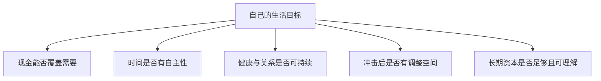

# 《金钱与生活》：把钱、时间和满足感放进同一本账

> 作者：Vicki Robin、Joe Dominguez，维姬·鲁宾、乔·多明格斯。英文原名 *Your Money or Your Life*，1992 年初版；2018 年修订由鲁宾更新，不能说已于 1997 年去世的多明格斯参与了后来的修改。中文具体译本未确认。  
> 范围：基于作者公开九步法、出版社资料、时间使用与幸福研究整理的系统导读，未取得用户版本全文。28 个知识点包含明确标注的财商应用，不把原版投资环境或作者生活选择当成通用方案。  
> 更新：2026-11-12。[作者书籍页面与版本说明](https://vickirobin.com/)、[作者公开方法导览](https://vickirobin.com/your-money-or-your-life-summary/)。

## 本书最重要的问题

你用多少时间换取收入，又用多少收入购买真正需要的生活？如果收入提高的同时，通勤、应酬、恢复精力和消费压力都增加，账户数字可能改善，生活自主权却未必改善。

本书要求把钱看成与有限生命时间相联系的资源。最实用的不是“尽早不工作”，而是用记录检验支出、收入与价值观是否一致，逐渐增加选择。真实生活的健康、家庭和制度约束仍然存在，不能把所有困难都归结为消费观。

## 九步主线

历史收支与净值 → 真实时薪和逐笔记录 → 按类别汇总 → 检查满足感与价值观 → 画长期变化图 → 降低低价值支出 → 改善收入 → 观察资金与支出关系 → 管理长期资本。下面将这些步骤拆为机制、实际边界和练习，避免把流程当成保证财务自由的公式。

## 核心知识点

### 1. 钱与生命时间相关，但并不是所有时间都应标价

收入通常需要劳动、准备、通勤与恢复。把消费换算为所需工作时间，可以让代价更具体。

这不意味着照护、友情、休息和学习只能按工资评价。真实时薪是一种帮助作选择的视角，不是衡量人的价值，也不是要求每分钟都创造现金。能否自主使用时间，本身就是本书希望保护的东西。

### 2. 回顾一生收入，是认识路径，不是追究过去

书中先要求回顾累计收入。目的在于把模糊的“总觉得没钱”转成可以理解的经历：收入何时提高、哪些责任消耗资源、哪些选择留下长期成果。

历史材料不全时应标估算与缺失，不必为了漂亮数字制造精确。教育、医疗与家庭支持可能没有变成金融资产，却不能因此被当作浪费。过去支出已经发生，回顾应帮助未来选择。

### 3. 个人资产负债表要使用可解释的价值

列出现金、投资、房产、养老金等资源与债务，说明变现条件。自住房、受限账户和非上市企业股权，不能因为存在估值就当作同样可用的现金。

同样，不应把未来全部工资直接计入可支配资产。未来收入有不确定性，且需要劳动投入。可以另行分析收入能力，但保持正式余额与未来预期分开。

### 4. 真实时薪需要同时修正收入与时间

```text
真实时薪 =（税后收入 − 因工作额外发生的支出）
           ÷（工作时间 + 因工作额外占用的时间）
```

关键在“额外”。即使不工作也会发生的全部餐饮费用，不能全部扣作工作成本；只有由工作安排带来的增量才适合纳入。通勤、特殊衣物和恢复时间的归因也存在判断，应该透明记录。

**数学演示：**月税后收入 12000 元，工作新增支出 2000 元；工作 160 小时，通勤和其他额外占用 40 小时，则真实时薪为 `10000÷200=50` 元，而简单用税后收入除工作时间是 75 元。两者回答不同问题，前者也不是法定工资口径。

这个计算适合比较具体安排。例如换到收入略低但通勤少的岗位，可能提高每小时可支配收入；但还要考虑发展机会、保障、稳定性和个人偏好，不能只凭一个比率决定职业。

实践中最容易出错的是把“总成本”和“因方案改变而增加的成本”混为一谈。比较两个岗位时，原本无论如何都要发生的基本饮食，不应只算到其中一个岗位；搬家造成的一次性费用，也不应未经处理就永久按月重复。可以把计算拆成日常增量、一次性转换成本和长期机会三栏。

对弹性工作，还要记录日程被切碎的程度。若等待消息占用了整晚，却不是持续劳动，不能简单宣称它与专注工作完全相同，也不能完全忽略它对自主安排的影响。数字算不清的部分可以用文字记录，避免为了得到一个精确时薪而假装所有时间都可无争议地归类。

### 5. 真实时间应记录，不能只靠感觉估计

**真实统计补充：**美国劳工统计局 2024 年时间使用调查报告指出，全职就业者在实际工作的工作日平均工作 8.4 小时。这个分母是“工作的工作日”，不能误读成所有人每天都工作这么久，也不等于把通勤等全部成本算入。[BLS 2024 年资料](https://www.bls.gov/news.release/archives/atus_06262025.htm)

它说明时间统计的定义会改变结论。个人记录也应区分工作、通勤、家务、照护、恢复和自主休息，避免双重计算同时发生的活动。

可以先记录一周，再用另一周复查。若某段时间同时带来收入和满足感，不必强行把它全部视为损失；本书的工具是帮助认识自己的生活，而不是预设工作都令人痛苦。

### 6. 把消费换算成工作时间，会改变比较尺度

真实时薪确定后，一项商品价格除以该时薪，可得到需要投入的时间。它能帮助你发现某项消费是否值得，但不能代替质量、健康和便利判断。

如果一项服务能省下大量低价值劳动，购买反而可能增加自主时间。问题不是永远自己做最省钱，而是比较被占用和被释放的时间，并考虑服务可靠性。

### 7. 每笔记录的目标，是获得反馈

记录时用能够持续的分类和工具，不必追求复杂账本。餐饮、住房、交通、照护等类别是否有用，取决于它们能否帮助下一步决策。

漏记一次可以补充，不需要因不完美而放弃。过度记账如果占用大量时间却不改变任何判断，也违背了本书珍惜生命时间的初衷。

### 8. 汇总类别比盯着单笔更容易发现结构

单杯咖啡可能不是问题，多个订阅、交通安排和临时购物加起来才形成压力。反过来，所有小额支出都削减，也可能远不及一次住房或债务安排的影响。

先找总额大、重复多或价值低的类别，再分析具体条目。别让“容易记录”决定你最关注什么，难处理的大项目可能才是关键。

### 9. 三个价值问题，把支出接回生活

一笔支出带来多少满足？它是否符合自己的价值和目标？如果不再需要靠当前工作挣钱，自己是否仍会保留这笔支出？这些问题帮助区分习惯、身份和真实需要。

答案不必立刻变成削减。对某些人，交通便利或餐饮服务能保护健康与家庭时间；对另一些人，同类支出只是惯性。记录自己的体验，比照抄别人的极简清单更可靠。

### 10. 满足感不是收入达到一个统一数字后永远停止增长

**研究边界补充：**关于收入与幸福的研究在样本、测量和人群上存在差异。2023 年 Killingsworth、Kahneman 与 Mellers 的合作研究显示，不能简单把所有人都放进一个统一收入上限：不同幸福水平群体的关系不同。[原论文](https://doi.org/10.1073/pnas.2208661120)

它并不证明收入越多每个人都必然更快乐，也不是说明达到某收入就应辞职。因果方向、其他生活条件与测量方式仍需注意。

应用于本书，应把“足够”理解成个人目标与资源之间的判断，而不是从某篇研究抄一个金额。可以检验最近几次支出是否真的改善生活，不必先决定一个适用于所有人的答案。

这项研究还提醒一个常见读法错误：人群平均关系不能直接回答“我多赚一万元会怎样”。工资增加可能来自更轻松的议价，也可能来自更长工时和更高压力；同样的金额变化，伴随条件完全不同。研究中的收入关系没有替你把这些个人方案逐一比较。

因此，判断“够不够”可以先从生活缺口开始：哪些必要支出仍不稳定，哪些资源能够显著缓解时间压力，哪些消费只是短暂新鲜感。对重要类别连续记录购买前的期待和使用后的体验，会比把幸福研究转换成统一金额更符合本书的方法。

### 11. 充足感允许你停止无休止升级

如果目标永远随着他人消费变化，收入增长就很难转化成自由。充足感要求明确哪些生活内容已经满足，哪些缺口仍然真实存在。

它不是要求接受不公或放弃改善。更好的医疗、住房和安全可能具有真实价值；关键是区分改善需要与不断追逐排名。你的“足够”可以随着责任和人生阶段更新。

### 12. 图表应该展示收支与资本，而非只展示理想轨迹


图示是反馈过程。实际月度结果可能有噪声，年费和季节性支出也会改变曲线；不要把某个月的异常当成永久趋势。

### 13. 降低支出可以同时降低未来资金目标

持续减少没有价值的开支，一方面增加当下结余，另一方面减少未来需要覆盖的现金。这是本书把消费与财务独立联系起来的重要机制。

但不能把可变开支无限压缩，也不能假设所有减少都可持续。健康、住房和照护需求可能上升。模型应区分固定责任、可调整项目与不可预测项目，而不是只用最节省的一年作基准。

### 14. 节俭应计算完整成本，包括时间

为了省一点钱绕远路、囤积用不完的物品或反复处理质量问题，可能得不偿失。完整成本包括现金、时间、空间、精力和风险。

**真实研究：购买时间与幸福。** 2017 年研究结合多国调查和一项消费实验，发现将钱用于节省时间与较好的幸福体验相关，实验也提供了特定条件下的支持。这不代表所有外包都划算，也不能把短期体验直接推成长期健康结果。[PNAS 原论文](https://doi.org/10.1073/pnas.1706541114)

对本书最有用的延伸是：有些花钱行为是在购买生活空间，而不是破坏财务纪律。比较时看节省的时间是否真正用于有价值的活动，以及费用是否与预算相容。

在自己的小试验中，可以先选择一次原本确实需要完成、又明显挤占时间的任务，记录购买服务的费用、节省时间及实际用途。若省下时间只是被更多工作消息吞掉，现金已经支出，预期的生活改善却可能没有出现。需要同时调整日程，而非只增加消费。

研究中的短期体验不能直接回答服务长期依赖、质量波动和家庭协作问题；这些要靠持续观察。这里的关键不是证明外包总是好，而是把钱的用途从“买东西”扩展为“改善时间分配”，并让实际结果检验预期。

### 15. 提高收入应重视净收益与生活后果

加薪、技能提升、议价与改善工作安排可以提高资源，但额外收入可能伴随额外支出和时间。先估计净变化，而不是只看工资单。

收入能力还影响抗风险能力：某项技能是否只适用于一个岗位，工作是否依赖同一行业周期？为了暂时提高收入而耗尽健康和可迁移能力，可能损害长期选择。

### 16. 工作可以同时提供收入、意义与社会联系

财务独立不必等于永远停止工作。你可能希望减少工时、改变任务、创业、照护家人或继续从事喜欢的职业。

把这些功能拆开，有助于更准确设计目标。如果只计算不工作所需资产，却不考虑日常结构、关系和意义，账户目标实现后仍可能面临新的问题。

### 17. 储蓄、资本和保障的用途不相同

近期储备用于已知或突发支付，长期资本承担较长时间的风险，保险等工具处理某些重大损失。这些角色可以互补，不能全部放进同一个高收益目标。

把应急资金锁进难赎回产品，即使预期收益较高，也可能降低整体安全。判断应从用途开始，再选工具，而不是先喜欢某个工具，再为它寻找用途。

### 18. 收入覆盖支出的交叉点，是模型观察点

书中讨论投资收入与支出相交的时刻，用来表现资本逐渐支持生活。但一次相交不等于终身安全，收入可能变化，支出可能增加，资本也可能被逐步消耗。

真正需要的是长期现金预算和压力测试。区分合同收入、可变分配、资产出售与返还本金，并扣除费用和税。不能把某年高收益直接年化为永久生活来源。

尤其要区分投资分配与投资回报。基金或项目支付一笔钱，可能来自经营收益，也可能包含出售资产或返还本金；分配率很高，不等于资本能永久保持。反过来，没有分配的资产也可能产生经济价值，只是需要适当方式变现。因此，生活预算与投资评价需要两张相互连接的表。

一张按月份记录实际可用现金，另一张记录资本价值、成本和未来义务。若现金表平衡却靠不断消耗本金，应说明计划打算消耗多久；若资本表好看却缺少近期现金，应研究付款路径。交叉点只有放进这两张表，才从鼓舞人心的图变成可检查的安排。

### 19. 名义本金不减少，也可能失去购买力

若物价上涨，固定金额能够购买的商品和服务会减少。比较资本和支出时，应保持名义与实际口径一致。

**数学演示：**名义回报 5%、通胀 3%，实际回报是 `1.05÷1.03−1≈1.94%`，不是严格的 2%。这个公式说明需要扣除购买力变化，不是未来通胀或收益预测。

### 20. 提款顺序会改变资本能撑多久

如果持续取钱，先亏后赚与先赚后亏可能产生不同结果，因为早期损失后再提款，会减少参与后续恢复的本金。

即使长期平均收益相同，也不能保证生活资金同样安全。应研究支出弹性、收入来源和可用储备，不只比较一条长期年化数字。具体提款安排需要个人资料，本文不提供统一安全比例。

**数学演示：**两年回报分别为上涨 20% 和下跌 20%，每年年末固定取出 10，初始资本为 100。先涨后跌时，第一年剩 110，第二年剩 `110×0.8−10=78`；先跌后涨时，第一年剩 70，第二年剩 `70×1.2−10=74`。不提款，两条路径最后都是 96；提款之后，相同两次回报产生不同余额。

这个差异不是后一年收益率改变，而是参与后一年回报的本金不同。越依赖资产持续支付必要生活，早期不利回报越值得关注。补救研究可以讨论支出是否有弹性、其他收入是否可靠、是否保留能够覆盖近期义务的资源，但任何一种办法都有成本，不能只把平均回报调高后忽略路径。

### 21. 早版投资安排不能直接照搬

本书早期与作者实践涉及当时美国利率和债券环境，后续修订扩展了投资讨论。今天的利率、税务、寿命、市场与账户制度均可能不同。

应保留“理解工具、保护生活所需、控制费用”的原则，重新核对可用产品和风险。历史成功经验不能证明在另一币种和制度下仍有同样结果。

### 22. 金融独立不是完全不依赖他人

个人仍依赖公共服务、市场、家庭与合作网络。把独立理解为没有任何社会关系，既不现实，也容易忽略照护与互助的价值。

更可操作的定义是：对财务决定有较多控制权，能够承受一定冲击，并能按重要目标选择。这个定义允许接受合理帮助，同时承担清楚的责任。

### 23. 消费还会产生个人账本之外的影响

作者关注资源、环境与社区。可以把耐用、修理、共享和减少浪费纳入比较，但不能仅凭“绿色”标签判断产品更优。

需要看全生命周期、实际使用和替代方案。买一个并不需要的新环保商品，也可能增加资源消耗。个人行动与政策、生产技术等系统因素共同作用，不应把全部责任推给消费者。

个人还可以区分已经拥有物品的继续使用，与为了“优化生活”而购入新物品。前者的决策重点是未来维护和替代成本，过去购买价已发生；后者则需要证明新增投入的价值。避免把整理账目变成不断购买管理工具或生活装备的理由。

### 24. 与家人讨论钱，要先讨论生活目标

如果双方真正关心的是安全、自由、关爱或认可，争论可能表面上只围绕某笔消费。先解释目的，再讨论安排，通常比单纯比较谁更节省有效。

应尊重共同责任与个人空间，避免用账本监控或羞辱对方。收入较少的一方可能承担更多无偿劳动，不能用工资表决定所有话语权。

### 25. 记录工具需要保护隐私和执行成本

财务资料包含账户、身份、收入与家庭关系，不宜为了方便就随意公开。共享时只提供完成任务所需的信息。

工具选择看导出、备份、费用、权限与可持续使用，不必追求复杂。一个简单但每月更新的表，可能比无人维护的自动系统更有价值。

### 26. 用可逆试验改善生活，而非一次推翻全部安排

可以试行一个月减少某类低价值消费、改变通勤或购买节省时间的服务，观察现金、满意度和时间变化。不要同时改十件事，否则难以判断效果。

选择可逆、代价可承担的实验，保留原始记录。试验失败也能提供信息，前提是没有为了证明某种生活哲学而承担不可恢复的代价。

### 27. 财务自由的检查应同时包含五个维度



这些维度会相互影响，但不能简单相加成一个分数。需要权衡，而不是寻找对所有人相同的完美状态。

检查这五个维度时，可以先找冲突，而不是强迫所有指标同时改善。多工作可能增加资本却减少家庭时间，降低住房支出可能增加通勤，购买服务可能减少储蓄却保护健康。把冲突明确写出，才有可能讨论哪项是当前阶段的优先事项。

每项改变同时设置一个“停止或调整条件”：现金缓冲降到无法覆盖已知责任、睡眠和照护受到明显影响、执行成本超过收益，或原本目标已经改变。这样财务方案就不会因曾经承诺过而永久僵化。选择权不仅包括开始，也包括在证据变化时修改安排。

### 28. 最终产出是一份自己的金钱使用说明

写清收入怎样取得、时间怎样占用、什么消费值得、哪些资金必须保持可用、投资如何复查。把“想过更好的生活”转为可以观察的选择。

目标可以随着照护、健康和职业改变。一本书提供起点，持续记录与反馈让方法真正属于自己。没有必要为了符合作者的人生路线而否定自己的价值。

## 练习与参考答案

**题一：工资增加 20%，真实时薪一定提高吗？** 不一定，额外时间和支出可能增加更多；还要观察职业发展等未被比率覆盖的价值。

**题二：请人处理家务违背节俭吗？** 不一定。需要比较费用、释放的时间、实际用途与预算，不能只以是否自己动手评判。

**题三：今年投资分配覆盖生活费，能立即认定永久财务独立吗？** 不能。要检查是否消耗本金、未来波动、通胀、税费、支出变化和资金可得性。

## 来源和下一步

九步框架与版本以作者公开资料为主，研究和统计在对应知识点附原始链接。原网站的个人经验与参与者自述不被本文当作代表总体的因果证据。接[《金钱心理学》](<../金钱心理学 - 摩根·豪泽尔/读书笔记.md>)理解满足与不确定性，接[《共同基金常识》](<../共同基金常识 - 约翰·博格/读书笔记.md>)学习资本管理和成本。
