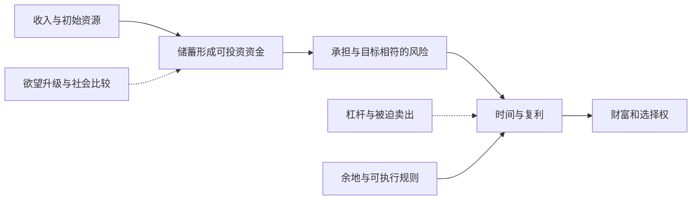
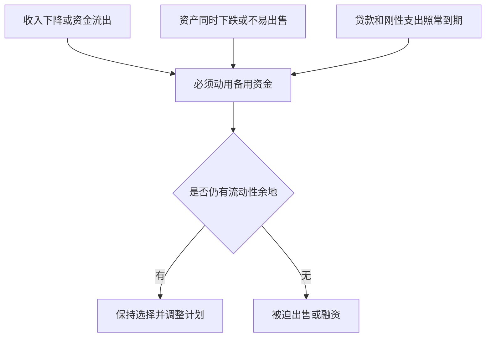

# 《金钱心理学》读书笔记

> 作者：摩根·豪泽尔（Morgan Housel）；英文书名：The Psychology of Money: Timeless Lessons on Wealth, Greed, and Happiness。  
> 版本：英文原版由 Harriman House 于 2020 年出版；用户所持中文译本、译者及印次未确认。  
> 资料范围：基于出版社目录、作者公开文章及原始研究整理的系统导读，未取得用户版本全文，不是逐页精读。覆盖正文二十章的主要主题，重组为 26 个知识点；历史消费观后记仅作主题说明。研究案例与应用推导标为书外补充，不冒充书中原例。  
> 更新日期：2026-11-12。

书名、作者及章目据[出版社书页](https://harriman.house/books/the-psychology-of-money/)核对，出版日期见[出版社目录](https://harriman.house/wp-content/uploads/2025/03/HH-Rights-Catalogue-LBF-Jan-June-25_sm.pdf)。作者 2018 年的同名文章是思想来源之一，内容与后来的书并不完全相同。

## 先理解这本书在解决什么

**它讨论的不是怎样找到下一只暴涨股票，而是为什么知道不少金融知识的人，仍可能把自己的钱管理得很糟。** 财务决定同时受经历、欲望、恐惧、社会比较和资金期限影响。公式告诉你某种方案在给定假设下有什么结果，行为决定你是否真的能执行这些假设。

本书的价值在于把“挣钱能力”与“留下财富的能力”分开，把收益率与自主权一起看。你可以不成为预测专家，却逐渐学会保留余地、停止无休止的比较、减少中断长期计划的错误。

但它不是完整的会计、资产定价或理财产品手册。个人责任也不是贫富结果的唯一解释：收入条件、制度、健康、家庭义务与运气都存在。把书读成“穷是因为心态不好”，恰好丢掉了它对经历和偶然性的强调。

## 主要框架与覆盖

| 原书主题群 | 要解决的问题 | 本笔记 |
| --- | --- | --- |
| 第 1—3 章：经历、运气、足够 | 为什么同一笔钱，不同人看法不同 | 1—5 |
| 第 4—6 章：复利、生存、尾部结果 | 怎样让长期积累不被打断 | 6—9 |
| 第 7—10 章：自由、外在消费、储蓄 | 财富到底用来换取什么 | 10—14 |
| 第 11—16 章：可执行、意外、余地、改变、代价、不同游戏 | 怎样让方案适合真实生活 | 15—21 |
| 第 17—20 章：悲观、故事、综合、个人选择 | 怎样处理信息与形成自己的规则 | 22—25 |
| 消费观后记与补充应用 | 历史背景怎样进入个人习惯 | 26及练习 |

图意：行为不是投资之外的装饰。它决定资金能留下多少、能经历多久，以及是否在不利时刻退出。

## 知识点与原位置讲解

### 1. 人们用自己的经历理解钱，经验却不等于完整世界

经历会给同一个词不同的含义。亲历失业的人看“安全”，与在资产上涨中成长的人看“机会”，起点可能完全不同。理解这种差异，能减少争吵，也能防止把自己的有限样本当普遍定律。

**书外真实研究：Malmendier 与 Nagel 的“萧条一代”。** 研究利用美国 1964—2004 年消费者财务调查数据，发现经历过较低股票回报的人，往往较少参与股票市场，也较少把流动资产配置到股票。研究控制了年龄等因素，近期经历影响更强，早期经历的关联也能持续很久。[NBER 原始研究及正式发表信息](https://www.nber.org/papers/w14813)

这提供了一个具体解释：人不是只读取同一份历史收益表，再进行完全相同的优化。真实承受过损失的人，可能赋予类似风险更高权重。反过来，长期顺利也可能使人低估坏结果。

不过，这是基于调查的统计证据，不等于能给任何个人贴上心理诊断，更不能从出生年份精确推导资产比例。对自己更有用的做法是写下：我关于钱最牢固的三条信念来自什么经历？哪一条是可核验事实，哪一条只是避免再次受伤的保护反应？

### 2. 解释一种行为，不等于赞同它

本书开篇的宽容并不是说每一种财务决策都合理。你可以理解某人为什么借钱追涨，同时指出其资金安排可能无法承受下跌。把原因解释与结果评价分开，讨论才不会停在“他太傻”或“每个人都有道理”。

实际沟通时先问资金用途、经历和担忧，再讨论证据。家庭预算尤其如此：一个人追求增长，另一个人追求稳定，两人可能都在维护家庭，只是优先解决的问题不同。

### 3. 运气与风险，是控制范围之外的两面

某个结果可能同时包含能力、努力、时代条件与偶然事件。看到赢家后再寻找一个整齐的成功公式，容易把幸存者的共同特征当成成功原因。

判断一项经验是否值得学，可以做三个检查：类似选择失败的人有多少；当事人在决策时知道什么；如果重要外部条件反过来，方法还是否站得住。不要因无法量化运气，就把它设为零；也不要用“都是运气”取消分析责任。

本书重视这一点，是因为它同时影响自信和同情：成功后知道自己并未控制一切，失败后才不会只用道德评价别人。

### 4. 从单个传奇学习方法，不能照抄人生

**作者的真实叙述：** 豪泽尔在 2018 年文章中对照了长期生活节俭、身后留下大笔慈善资产的 Grace Groner，与拥有金融职业经历却因借贷和流动性问题陷入个人破产的 Richard Fuscone。这是作者公开讲述的真实人物，本文未独立重建二人的完整资产和法律记录。[作者原文](https://collabfund.com/blog/the-psychology-of-money/)

这个对照说明学历、收入和理财结果之间没有自动等号，但不能推出“知识没用”，也不能把某人长期集中持股的幸运结果推广成人人适用的策略。应提炼的是储蓄、期限和融资约束，而不是把传奇人物的一切选择都当标准答案。

### 5. “足够”是一条停止加码的规则

如果目标会随别人财富不断上移，再多收益也可能不能带来满足。更危险的是，为赢得本来并不必要的增量，拿已经足够重要的生活基础冒险。

“足够”不是强迫低收入家庭放弃改善生活，也不是一个统一金额。它应由住房、照护、健康、工作选择和风险承受来定义。可以把目标分成必须保障、希望改善和纯粹比较三类，再问：为了第三类，是否正在牺牲第一类？

写下不愿失去的东西，比只写想赚多少钱更能约束极端决定。声誉、健康、家庭信任和避免负债失控，有时比继续提高账户数字更稀缺。

### 6. 复利最难的部分，是给它足够长且不中断的时间

复利意味着收益进入下一期的本金，后面的增长建立在前面增长之上。它不要求每年惊艳，却要求本金、时间和持续参与同时存在。

数学演示：假定 1 万元每年净增长 7%，20 年后约 3.87 万元，40 年后约 14.97 万元。后 20 年增加的金额远大于前 20 年。公式为 `终值＝本金×(1＋年净回报率)^年数`；这里固定 7% 只为展示数学，不是任何资产的收益承诺。

作者对 Groner 的叙述强调长期积累，但真实人生还包含证券选择、消费约束和运气。不要把“某个长期赢家存在”误读为“任何资产坚持持有都会成功”。价值永久毁损、费用过高或欺诈，不会因时间自动被修复。

复利思维真正改变的，是评价计划的方式：不只问最理想情景下能赚多少，还问这套安排能坚持多少年。过度借贷或把短期支出全部放进波动资产，即使平均回报看起来更高，也可能使计划在最需要持续时中断。

### 7. 获得财富与保住财富，需要不同的习惯

获得财富可能需要探索、承担风险和集中精力；保住财富还需要承认未知、保留流动性和防止一次损失摧毁基础。两者不是互相否定，而是要在同一计划中并存。

可以把长期增长资金与近期必需资金分开，并让借款期限与资产兑现时间相符。保留余地可能降低某一年看起来最漂亮的收益，却提高跨过多个不利年份的机会。这里追求的是持续参与，不是账户永远没有波动。

### 8. 少数极端赢家，可能决定整体结果

**书外真实研究：** Bessembinder 的全球股票研究覆盖 1991—2020 年超过 6.4 万只普通股；表现最好的约 2.4% 公司贡献了样本全部净财富创造，比较基准是美国一个月国库券。多数单只股票的全样本持有回报低于该基准。[研究者所在学院的原始研究入口](https://wpcarey.asu.edu/department-finance/faculty-research/do-stocks-outperform-treasury-bills)

这并不意味着只有 2.4% 股票上涨，其余全部亏损。“全部净财富创造”是把赢家、输家和基准机会成本合计后的结果，既不是上涨股票比例，也不是交易胜率。

为什么会这样？单只不使用杠杆的股票最多损失投入本金，但成功企业的上涨幅度没有同样的百分比上限。少量巨大赢家能弥补大量平庸结果，于是“典型一只股票”的体验与“整个市场组合”的表现不同。

由此可以得到两条不同层次的启发：评价一组投资时，不必要求每项都成功；事前不知道赢家是谁时，广泛分散能降低遗漏关键赢家的风险。它不能支持“多买很多垃圾总有一只翻百倍”，也不能证明任何市场指数都适合任何期限。

**练习：** 既然赢家很少，为什么不只买未来赢家？参考答案：结论是事后识别，真正困难是事前可靠选择；把结果名单当预测能力，正是需要避免的错误。

### 9. 生存优先，不代表拒绝所有风险

风险有两类后果：一种让你不舒服但仍能继续，另一种让你永久失去继续的条件。把所有波动消灭并不现实，但可以努力减少破产、强平、刚性支出断供等后果。

因此不能仅用“亏损概率”比较方案。还要看亏损幅度、是否借钱、损失发生时有没有收入、坏情况能否叠加。能够承受的风险才有机会转成长期回报。

### 10. 财富最实用的价值之一，是控制自己的时间

自由不一定表现为不工作，也可以是有余地拒绝不合适的工作、陪伴家人或学习新技能。这个目标与炫耀性消费不同，因为它通常来自尚未花掉的资源。

可以把财务目标改写成具体选择：“需要多长的缓冲，才允许我换工作？”比“我要比同事更有钱”更容易转成预算与储蓄安排。衡量财富时，除了总额，还要看它减少了多少被迫接受的条件。

### 11. 看到昂贵消费，只能证明发生了消费

豪车、住房和旅行是可见的；债务、支出压力、资产及稳定收入通常不可见。外在生活方式无法直接证明净财富，更无法证明对方的幸福程度。

如果为了获得赞赏而消费，应先问自己真正需要的是使用体验，还是想借物品得到别人的评价。这个区分不是禁止享受，而是防止把短暂的比较误当长期目标。

### 12. 收入、资产与净财富是三个不同的量

收入是期间流入，资产是拥有的资源，净财富要扣负债。高收入若伴随高固定支出，仍可能缺少选择余地；低负债和稳定储蓄则能积累缓冲。

这是补充财务解释。记录时应把月度现金收支与时点资产负债表分开，避免把贷款到账当收入，把房产总价当可自由使用的财富。尚未变现的资产还要考虑出售时间、成本和税费。

### 13. 储蓄不必全部绑定一个已知目标

已知目标可以列预算，但未来还会有无法提前命名的机会与冲击。没有明确用途的储蓄，不一定是闲置；它可能购买应对未知的能力。

这里要区分应急流动性和长期投资。把所有未使用资金都当现金永久持有，可能承受通胀机会成本；把所有资金都追求高收益，又可能失去应急功能。分层的依据是何时可能需要，而不是某种资产最近是否涨得快。

### 14. 提高储蓄率，既涉及支出，也涉及收入条件

储蓄等于收入减去支出，但两边的可调整空间因人而异。削减不重要的消费有用，提高技能和收入、降低高成本负债，也可能更关键。

不要把所有开支都称为浪费。医疗、照护和必要住房不是单靠意志就能消除；对基础开支已经很紧的家庭，“再省一点”未必是最有效方案。该书的行为视角应与现实资源约束一起使用。

### 15. 能坚持的合理方案，可能优于执行不了的理论最优

理论模型常假设人能持续承担预定波动，现实中的睡眠、家庭压力和工作收入却会改变执行。一次极端恐慌退出，可能使纸面优势消失。

**书外真实研究的提醒：** 前述经历研究表明，人们对风险的态度会受实际体验影响。知道一个组合在长期统计上有优势，并不等于已经体验过它的最坏阶段。因此不能只问“愿不愿意承担风险”，还应把不利结果换成金额、持续时间和生活影响。

更合理的做法，是在不使用借款的条件下设定自己能承受的范围，事先写下何时调整，减少每天临时重新决定。降低复杂度的价值还包括：能向家人解释，能在忙碌时执行，能看出哪里出了问题。

不过，“让我舒服”不是免除证据要求的理由。因为熟悉而集中持有雇主股票，可能同时把工资和资产暴露于一家企业。可执行性要与分散、费用和真实风险一起评估。

### 16. 历史告诉你会出现意外，不提供完整的意外清单

历史有助于识别反复出现的行为模式，却不能保证未来冲击只重复旧形式。模型若只包含自己经历过的情景，往往对没有见过的风险准备不足。

实用做法不是猜中下一件大事，而是询问系统会怎样失效：收入减少时支出能否下降；资产价格下跌时贷款是否仍到期；关键账户暂时无法使用时是否还有支付渠道。预测事件与增强应对能力是不同任务。

### 17. 容错空间，要覆盖多个坏事同时发生

**书外真实事件：2023 年硅谷银行。** 美联储当年的复盘记录，3 月 9 日存款流出超过 400 亿美元，管理层预计次日还可能有更大流出；报告同时指出利率、流动性和治理问题。这里引用的是该次历史复盘，不把它当作对所有银行的结论。[美联储关键结论](https://www.federalreserve.gov/publications/2023-April-SVB-Key-Takeaways.htm)

这个事件能说明“有资产”与“现在付得出钱”之间的区别。资产可能需要时间兑现，出售可能确认损失；资金提供者却可以很快要求偿付。若只能在一切顺利时滚动融资，原本看似长期可行的安排也可能被短期现金需求打断。

个人与银行的资产负债、监管要求不同，不能直接照搬银行指标。但可以迁移一个检查方法：把坏情况放在同一时间轴，而不是逐项孤立测试。失业、市场下跌和意外支出如果同时出现，单项看起来充足的缓冲可能不够。

图意：余地不是一个漂亮的静态比例，而是抵挡坏事叠加的能力。不能从这个案例推导统一的应急月数；应按收入稳定性、家庭责任和保险范围计算。

### 18. 给未来的自己保留改变主意的空间

职业、家庭和价值观会变化。为了今天的单一目标把所有资源锁死，未来可能付出很高的退出代价。长期规划应有方向，也应有检查节点。

可将决定分成可逆与难逆两类：可逆的小试验可以帮助学习，难逆的负债或职业安排则要更多余地。改变计划并不天然等于没有纪律；关键是原因来自新事实与真实目标，还是仅仅来自最近的市场情绪。

### 19. 波动可能是参与风险资产的代价，但并非所有下跌都值得忍

把正常波动视为需要承受的代价，能减少每次下跌都寻找完美逃离时点的冲动。但不能用这个比喻掩盖欺诈、估值过高、永久衰退或资金期限错配。

每次不适都要区分三件事：资产本身的正常波动，原判断的实质改变，自己的资金安排发生改变。只有先分类，才知道应该继续执行、重估还是降低风险。

### 20. 你和别人可能在进行不同的财务活动

交易者、退休家庭、机构做市商和长期储蓄者的目标、期限、约束不同。同一价格对不同参与者意味着不同条件。跟随别人的动作，却不知道他的退出规则，容易买下自己不理解的风险。

看到公开持仓或交易建议，先问资金何时需要、是否存在对冲、是否可以承受追加保证金、是否有税务与制度约束。仅仅知道“某个聪明人买了”，不足以构成你的购买理由。

### 21. 不把财务方案建立在每次预测都正确上

计划可以有基本情景，也必须允许预测失误。较低的预期回报、较晚的目标实现时间和备用支出方案，可能比精确到小数的收益预测更实用。

数学演示：资金损失 50% 后，需要上涨 100% 才回到原点，因为分母已经缩小。回本所需涨幅为 `损失比例÷(1－损失比例)`。这不是证明所有下跌应止损，而是说明控制不可承受损失的意义。

### 22. 悲观信息容易显得聪明，乐观需要说明修复机制

坏消息常在短时间发生，改善却由很多细小步骤积累。因此人们容易高估即时灾难的解释力，低估企业和个人的调整能力。

但“长期乐观”也不能替代分析。应具体说明谁会改变行为、用什么资源修复、成本由谁承担、多久见效。没有机制的乐观与没有边界的悲观，同样可能只是情绪。

### 23. 当你特别需要某个结论时，最容易相信漂亮故事

债务压力大、急于退休或想追回亏损时，人对高收益叙述会更脆弱。故事往往先给你希望，再让你忽略概率、费用和兑现条件。

一个有用的程序是先写下最希望得到的结论，再主动寻找与它冲突的材料。对高收益承诺分别核对资金流向、托管、退出、损失承担和独立记录。想相信的程度越高，核查越不应省略。

### 24. 钱与幸福的关系，不能简化成统一收入上限

**书外研究更新：** Killingsworth、Kahneman 和 Mellers 在 2023 年联合复核收入与情绪幸福的研究，发现此前常被概括为“收入达到某数值后幸福不再增加”的模式，并不适用于所有人群。研究涉及美国样本、测量方式和不同幸福水平群体。[原始论文](https://pmc.ncbi.nlm.nih.gov/articles/PMC10013834/)

这不是证明收入越高人人必然越幸福，也不是一个因果实验，更不能把某个美元门槛换汇后用到中国家庭。它提醒我们把“解决基本困难”“获得自主权”“社会比较”和“心理状态”分开。

实际判断一次支出，可以问它持续改善了什么：节约时间、减少压力、改善关系，还是只短暂提升比较中的位置。这个问题允许享受生活，也帮助发现花钱并未解决原来问题的情形。

### 25. 综合规则应该很清楚，但个人安排不必完全相同

本书最后的综合与个人坦白，提醒读者原则与实际选择之间还有个人偏好。低费用、余地和长期思维可以普遍讨论，具体住房、现金和证券安排却需要自己的背景。

可以形成一页规则：资金用途、预计使用时间、不能承受的结果、允许购买的资产、调整触发条件。规则的价值在于减少情绪时重新发明标准，而不是让人永不修正。

### 26. 消费观也有时代背景；不要把社会问题全归个人心态

后记讨论美国消费观形成的历史环境。本笔记未逐段核对该后记，因此不复述其具体历史数字。可以确认的阅读方向是：收入增长、信贷可得性、住房、代际经验和社会比较，会影响人们认为“正常生活”应当是什么。

补充理解：一份有效的个人计划，要同时承认能控制与不能控制的事。控制开支、费用和借贷行为有价值，但不能假装工资、医疗、照护和宏观环境全由个人决定。成熟的财商既包含责任，也包含对约束的现实认识。

## 读完能学到什么

你应能把财务问题拆成四层：钱从哪里来，能留下多少，承担什么风险，以及它最终服务什么生活。相较于预测下一次涨跌，这些问题更直接影响长期结果。

| 常见误读 | 应改成的判断 |
| --- | --- |
| 只要心态好就会富 | 行为重要，同时受收入、制度、健康和运气约束 |
| 复利就是永远不卖 | 需要持续有效的资产与可承受的资金安排 |
| 留现金一定拖累投资 | 现金可能承担应急和避免被迫退出的功能 |
| 尾部决定结果，所以集中赌博 | 事后赢家难以事前识别，分散有现实意义 |
| 波动只是手续费，所以不能认错 | 正常波动、永久损失和期限错配需要区分 |

## 一次可完成的练习

拿自己的真实记录，不需要向任何人公开，写下最近三笔较大支出各自购买了什么：使用价值、时间、保障还是比较。再列出未来一年已知必须支付的项目，以及收入减少时最难削减的支出。

**参考答案的判断标准：** 不是“少花的才对”，而是你能否解释支出与目标的关系，能否辨认资金缺口，能否为不可预测事件保留余地。如果发现方案只有在工资不断上涨、市场不断上涨时才成立，就需要调整假设。

## 资料与尚未覆盖的部分

主要书籍依据是出版社的完整章目及作者公开文章；宏观经历、全球股票尾部、银行流动性和幸福研究均为单独核验的书外材料，链接已放在相应知识点旁。全文图解、问题设计和数学演示为补充教学。

未核对用户中文版本的逐章措辞、全部人物细节及后记数字；未把作者故事当随机实验，也未把历史市场回报、美国制度或研究样本推广为个人收益承诺。取得原书后，可进一步逐章核对原例与译文差异。

---

[返回书籍索引](../README.md) · [财商学习与实践路线](../财商进阶合订本.md)
