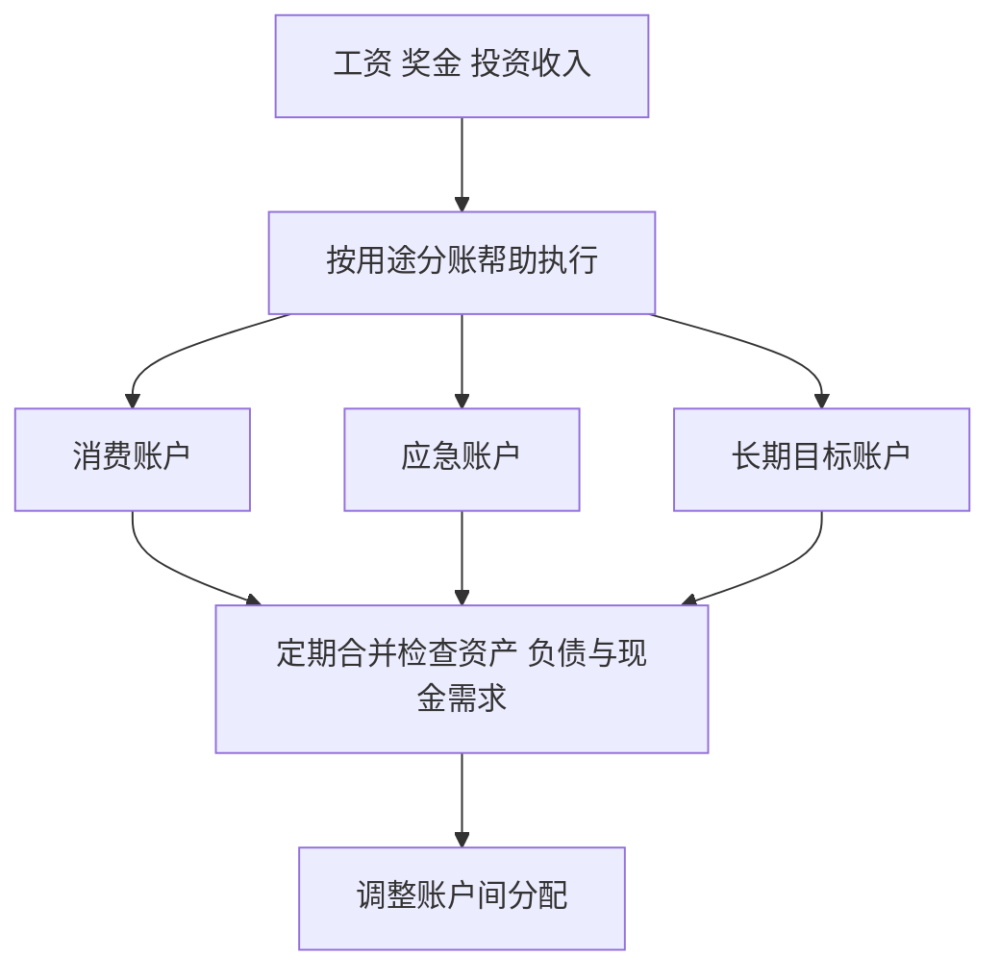
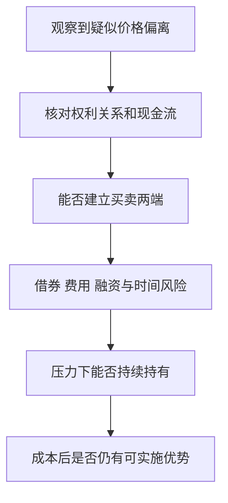

# 《错误的行为》读书笔记

> 作者：理查德·塞勒。英文原作 *Misbehaving: The Making of Behavioral Economics*，2015 年初版；中文译本印次未指定。
> 资料范围：依据公开书目与目录、作者论文及相关原始研究整理，未取得完整原书逐页核对。覆盖八部分中的心理账户、自控、公平、金融市场、专业决策与行为政策等主线；部分研究争议为书外补充。更新：2026-11-12。

“错误的行为”不是说现实中的人都应该被责备，而是说：当人的实际选择与模型预测长期不符时，也应检查模型是否遗漏了重要因素。塞勒讲述行为经济学怎样从反常现象出发，将心理和制度带回经济分析。

这本书对财商的价值，既包括识别自己的消费和投资偏差，也包括更严格地审查“市场一定正确”“专业人士不会犯这种错”和“我发现错误就一定能套利”等说法。

## 全书主线

公开目录按研究经历分成起步、心理账户、自控、与卡尼曼合作、学术争论、金融、芝加哥时期和帮助人们改善选择八部分。它是带有作者回忆的学科发展叙事，不能把每个故事都当成独立实验证明。[书目与目录](https://catalog.chplnj.org/bib/98682)；[出版社介绍](https://wwnorton.com/books/Misbehaving/)；[作者论文目录](https://faculty.chicagobooth.edu/richard-thaler/papers)。

读时可以抓住一条线：**发现预测偏离→提出心理机制→设计可区分的研究→检查竞争环境是否消除偏离→尝试改造制度。** 财务应用在下文明确作为补充解释，不冒充原书逐字内容。

## 核心知识点

### 1. 理性模型是基准，不是对每个人心理活动的录像

经济模型可以假定人会稳定比较成本收益，并据此推导选择。这样的简化有助于分析，但“模型易于求解”与“模型在这个场景预测准确”是两回事。

判断一个简化是否可接受，要看遗漏因素是否系统性改变结果。若信息呈现方式持续影响参与、储蓄或买卖，就不能永远把它当成无关噪声。

### 2. 看似无关的因素可能改变实际选择

已付的钱、物品是否已经属于自己、付款被放在哪个账户、比较对象是谁，从标准的最终财富角度看，某些因素本不应改变选择；现实中却可能有影响。

这给财务分析增加一个问题：我是在比较未来现金流，还是被历史标签和界面暗示牵着走？识别影响因素后，还要判断它是否真的不相关，不能见到情感或习惯就一律判错。

### 3. 描述、解释与建议需要分开

“人常这么做”是描述；“因为参照点或自控冲突而这么做”是机制解释；“应该改用某个流程”是干预建议。三者需要不同证据。

观察到一个偏差，不等于知道唯一原因；知道可能原因，也不等于某种训练能有效消除它。这一区分能避免把行为经济学读成一份万能纠偏清单。

### 4. 参照点决定人把什么看成得失

人可能以买入价、过去工资、预期奖金或上次成交价格为参照，而非只看最终财富。相同结果放在不同参照下，感受会改变。

投资时应写出自己正在用哪个参照点。买入价可以用于核算税费和历史绩效，但企业未来现金流不会因为你买贵了而自动提高。

### 5. 损失厌恶与风险厌恶不是一回事

损失厌恶描述相对参照点的损失可能产生较强影响；风险厌恶描述对不确定性与确定结果的偏好。一个人可能在盈利区间保守，在亏损后反而愿意赌更大风险。

不要把“损失的痛苦是收益的两倍”当作适用于每个人、每种金额的生理常数。具体强度与任务、参照点及测量方式有关。

### 6. 禀赋效应：拥有可能改变愿意接受的价格

Kahneman、Knetsch 与 Thaler 在 1990 年研究中随机把杯子等物品分给部分受试者，再观察交易。某些安排下，拥有者愿意出售的价格高于未拥有者愿意支付的价格，实际交换也少于相应基准预测。[原论文](https://web.mit.edu/curhan/www/docs/Articles/15341_Readings/Behavioral_Decision_Theory/Kahneman_et_al_1990_Experimental_tests.pdf)。

理解这个实验应抓住随机分配：杯子并非事先由最喜爱它的人买下，因而“卖家原本就更喜欢杯子”不能轻易解释全部差异。研究还使用实验设计检查交易障碍。

但愿买与愿卖的差价不自动等于纯粹的拥有心理。Plott 与 Zeiler 在 2005 年采用培训、激励和流程控制后没有观察到同样差距，对实验解释提出挑战。[相关原研究](https://www.aeaweb.org/articles?id=10.1257/0002828054201387)。这不是一句“已经推翻所有禀赋效应”，而是提醒测量程序及理解程度会影响证据。

**财商应用：**评价持仓时，可以问“如果我今天持有现金，还会以这个价格买它吗？”然后加入交易成本、税务与组合约束。这个问题用于揭示参照偏差，不意味着每次答案为否就必须立即卖出。

### 7. 心理账户把同样的钱分成不同用途

工资、奖金、投资盈利和退税，法律上可能同样能用于支付，但人在心理上会赋予不同标签。分类降低管理难度，却也可能阻断整体比较。

例如“这是赚来的利润，亏掉也没关系”的说法，把已属于自己的资产当作没有成本。亏损减少的仍是今后可使用的资源，不因来源不同而消失。

### 8. 预算账户既可能制造偏差，也可能帮助自控

把日常开支、应急资金和长期目标分开，能减少随意挪用；因此“钱可替代”不意味着应取消全部分账。关键是保留整体复核。

**补充数学演示：**忽略税费、流动性和其他约束，1 万元放在年收益 2% 的账户，同时借入同额、年成本 10% 的借款，一年净利息差为负 800 元。若只检查“储蓄账户一直增长”，就会漏掉另一侧成本。

真实决策还应考虑提前还款条款、应急需求和借贷期限。例子的作用是解释整体核算，不是声称所有人都应立即用掉现金偿还所有债务。

分账用于执行，合并用于判断。只保留任何一边，都可能错过另一边的价值。

### 9. 获得效用与交易效用：实用之外还有“买得划算”的感觉

获得效用关注物品本身带来的价值与付出；交易效用关注成交价相对心中参考价格是否像一笔好买卖。

促销可以让一个本来不需要的商品显得值得买。比较时先把划线价和折扣标签遮住，单独问最终售价是否配得上实际用途，再检查折扣信息是否真实。

### 10. 沉没成本：已经无法收回的支出不应支配新增投入

已发生且不能改变的成本，无法通过再投入自动变回收益。继续项目的依据应是未来增量收益相对未来增量成本，而非过去花了多少。

不过“停止”本身也可能有违约、拆除、关系或转换成本，这些是未来可避免或不可避免的现实后果，需要计算。沉没成本原则要求重新划分现金流，不是让人不负责任地退出任何承诺。

### 11. 心理账户的关闭时间会改变体验

把一项投资按日、按月或多年评价，看到的盈亏频率不同。频繁关闭心理账户可能让短期波动占据判断；无限期不结账又可能掩盖持续失败。

合理复盘应区分价格观察、风险监控和策略评价。需要及时发现现金危机，不代表每一分钟的涨跌都应该重写长期判断。

### 12. “庄家的钱”和“回本”会改变风险承担

Thaler 与 Johnson 的 1990 年真实金钱实验研究了先前得失怎样影响后续选择：先前盈利和有机会回本的选项，在部分条件下会改变受试者风险偏好。[原论文](https://pubsonline.informs.org/doi/10.1287/mnsc.36.6.643)。

这给“赚来的钱随便赌”和“只要回本就走”提供了可研究的机制，但不是所有人都会有同方向反应。把心理现象用于自检，比用它预测某个具体交易者下一步更稳妥。

判断下一笔交易应回到当前财富、可承受损失与未来机会。历史盈亏影响情绪，不会改变同一新增风险的客观损益结构。

### 13. 自控冲突可以理解为计划者与行动者的不同目标

长期计划希望维持预算，眼前行动希望获得即时满足。“计划者—行动者”模型把这种冲突明确化，而不是简单归因为不知道道理。

模型是功能性描述，不是说大脑里真的住着两个完整的人。它提示我们：制度设计可能比反复劝自己更有作用，但制度也应留出合理变化的空间。

### 14. 偏好会随奖励临近发生变化

人可能愿意承诺下个月开始节约，到了下个月却再次推迟。这里的问题不是所有折现都不合理，而是计划与执行之间出现可预期的反转。

如果这种模式反复发生，记录具体触发环境更有用：消费发生在哪类情绪、支付是否过于顺手、预算信息是否迟到。泛泛承诺“以后更自律”通常没有指定应改变的条件。

### 15. 承诺工具的价值要减去失去弹性的代价

预设支出上限、自动转账和冷静期，可以减少临时诱惑；但过强约束也可能让人在收入变化时无法调整。

一个完整方案应有目标、执行触发、可接受例外和复查日期。不能只问约束是否足够强，还要问它限制了哪些本来合理的行动。

### 16. 公平观念会影响市场参与

Kahneman、Knetsch 与 Thaler 在 1986 年通过电话调查研究人们对价格和工资变化的公平判断。受访者对成本压力导致的调整，与利用需求突增提价，可能有不同反应。[原论文](https://eml.berkeley.edu/~saez/course131/Kahneman-FairnessConstraintProfit-1986.pdf)。

这是对真实受访者进行的情境调查，题设中的商店、工资变动等并不都是实际发生的公司事件。公平态度也不等于受访者在真实预算约束下必然采取的购买行为。

对企业分析的启发是：法律允许、短期利润增加，与客户长期接受是不同层次。定价能力不仅取决于眼前供需，也可能受信任、关系和替代选择影响。

### 17. 参照交易会影响什么被看作合理

顾客可能以原价和习惯服务为参照，员工可能以原有工资与工作条件为参照。企业若只按当期供需计算，可能低估破坏这些预期的成本。

但公平标准也不是固定不变的自然常数。不同文化、行业、信息和解释会影响判断，不能拿单个调查比例直接估算一家企业的客户流失。

### 18. 社会偏好不能都塞进“自私”或“非理性”

有人愿意付出成本惩罚不公平行为，也有人重视他人福利。如果模型本来只允许个人金钱收益，这些选择显得反常；加入社会偏好后，分析会更完整。

财商不只关乎财富最大化。目标可以包含家庭责任、信任与社会关系，但应明确选择的代价，避免用模糊的道德语言隐藏实际利益分配。

### 19. 高金额与专业经验不会自动消除错误

高风险会提高认真程度，却不保证正确模型、有效反馈和合适激励。专业环境还可能奖励自信表达、追随共识或推迟承认错误。

所以评估专家时，不仅看经验年限，也看其问题类型是否稳定、反馈是否及时、是否记录失败和概率判断。经验可能改善技能，也可能加固未经检验的习惯。

### 20. NFL 选秀：好球员与划算的选择是两个问题

Massey 与 Thaler 使用 NFL 选秀交易、球员表现和薪酬资料，比较选秀权市场价格与给球队带来的剩余价值。研究发现，在所研究制度和时期，早期选秀权可能被高估。[2013 年正式论文](https://pubsonline.informs.org/doi/10.1287/mnsc.1120.1657)。

理解时不要跳到“第一名球员通常比后面的差”。早期球员可以更优秀，但如果为取得选择权和支付薪酬付出更多，净价值仍可能不划算。这与优秀企业被过高价格买入的区别相通。

研究的剩余价值指标、薪酬制度、球队目标和阵容约束都重要。它不证明所有顶尖人才都不值得高价，也不自动适用于后来改变的劳动合同。真正可迁移的是把“质量排序”与“扣除成本后的收益排序”分开。

### 21. 美人竞赛：你可能在预测别人会怎样预测

当价格取决于未来买家的估值，投资者就可能关注其他人的预期，而非只关注资产本身。相互猜测会让市场判断形成更高层次的预期。

短期交易中的这一机制，与企业长期创造现金的能力可以同时存在。若原计划是长期估值，却因猜测下周谁来买而交易，应明确自己已经换了问题。

### 22. 过度反应研究需要同时检查风险和检验方式

作者的金融部分讨论过去极端赢家、输家与后续表现之间的关系。即使观察到反转，也要检查样本选择、风险暴露、交易成本、小市值影响和统计设计。

“价格曾跌很多”不构成充分买入理由。有些下跌反映现金流永久恶化；有些历史规律在公开后会减弱。行为解释应与风险补偿等替代解释进行可区分的检验。

### 23. 难以持续战胜市场，与价格永远正确不是同一句话

前者讨论可实施策略能否在成本后持续获利；后者讨论价格相对基本面是否准确。由于信息、交易与融资约束，两者可以同时出现“难套利”和“有偏离”。

这一点能防止两个极端：看见价格变化就认为市场完全理性；看到错价案例就认为普通人可以稳定赚到无风险利润。

### 24. 3Com 与 Palm：看见价格矛盾还不等于能套利

Lamont 与 Thaler 研究 1998—2000 年美国科技企业分拆，其中包括 3Com 与 Palm。按当时预期的股份分派关系，母公司股票隐含持有的子公司部分，曾比母公司整体市场价格还贵；但卖空约束和成本妨碍投资者锁定价差。[原研究及 2003 年发表信息](https://www.nber.org/papers/w8302)。

用符号理解：若一股母公司预期对应 `x` 股子公司，观察到 `母公司价格 < x × 子公司价格`，就会产生需要解释的定价关系。但预期分派尚未等同于今天手中可立即交割的资产，还要检查时间、执行和借券条件。

纸面上“买便宜、卖贵”的组合，需要实际借到子公司股票、负担借券费用、承受价格进一步偏离，以及在整个持有期维持融资。只买母公司并非完全对冲，仍可能随着整体市场下跌。

图中的每一步都可能让表面机会消失。金融市场的竞争很强，不代表消除偏离完全没有摩擦。

### 25. 封闭式基金折价不是现成的免费午餐

Lee、Shleifer 与 Thaler 的 1991 年研究考察封闭式基金价格相对资产净值的折价，提出投资者情绪对其共同变化的解释，并以数据检验若干预测。[原论文](https://onlinelibrary.wiley.com/doi/10.1111/j.1540-6261.1991.tb03746.x)。

理解折价先要看权利：基金份额持有人通常不能随意要求按净值赎回，否则套利结构不同。管理费、税务、底层资产估值和治理也会影响应有价格，因此“净值 100、市场价 80”并不自动意味着可兑现的 20 元利润。

情绪解释是一套有条件的研究主张，不是把所有折价都称为市场愚蠢。实际产品还必须按所在市场的现行条款分析。

### 26. 短视损失厌恶：反馈频率可能改变风险感受

Benartzi 与 Thaler 将损失厌恶和频繁评估组合结合，提出解释股票溢价的一种机制：即使目标长期，频繁看见短期损失也可能提高人要求的补偿。[1993 年工作论文、1995 年发表](https://www.nber.org/papers/w4369)。

这属于模型及相应研究问题，不是“每年只看一次账户就会获得更高收益”的操作保证。减少无意义盯盘与忽略企业恶化、融资期限和现金需求不能混为一谈。

可做的补充安排是分别规定监控频率：重大经营或偿债变化及时检查；价格波动不自动触发操作；投资逻辑按事先约定的周期复核。

### 27. 组织中的错误可能由评价机制维持

如果个人因偏离共识而失败会被严厉处罚，跟随众人失败却容易被接受，那么“都知道不理想却继续做”就有制度基础。问题不只是个人认知能力。

改善需要记录预测、允许合理的不确定性、区分过程与运气，并减少只按短期结果奖惩。否则一本心理学书很难抵消组织每天给出的相反激励。

### 28. 从发现偏差到帮助选择，中间需要实测

行为经济学的政策部分尝试让储蓄、表格和提醒更符合人的实际行为。这里与[《助推》](<../助推 - 理查德·塞勒、卡斯·桑斯坦/读书笔记.md>)相接，但不能把任何带有心理学名词的界面改动视为有效。

要预先设定目标和评价期限，比较净结果与成本，并保留失败记录。只展示一次成功转化，无法证明长期福利改善。

### 29. 研究者也会受到自己研究的偏差影响

偏爱新奇、挑选成功案例、对自家理论投入感情，并不是某类人的专利。行为解释若可以事后说明任何结果，就失去可检验性。

应问：在什么条件下预期出现该效应？什么结果会使理论受损？其他实验程序能否得到同样方向？对研究结论保持这种要求，比记住几十个偏差名称更有用。

### 30. 建立一份“可能被遗漏的因素”记录

以下为财商补充教学。面对重要支出或投资，记录当前参照点、钱的心理标签、沉没投入、利益相关者、观察周期与执行约束。不要为了凑偏差而给每项决定贴标签，只追踪与结果确实相关的项目。

最有价值的结论通常是一项可检查的改变：统一全部账户看负债；让估值与持仓身份暂时分开；在套利前算全成本；把短期价格反馈与长期经营评价分开。

## 练习与参考答案

**题一：一家企业很好，是否就像顶尖选秀球员一样值得任何价格？**

不是。企业质量对应未来经营能力，投资结果还受买入成本影响。要把取得资产的价格与之后得到的现金流同时放进比较。

**题二：已经为一个项目投入很多钱，继续投入是否一定犯沉没成本错误？**

不一定。若未来增量收益超过增量成本，继续可能合理。错误在于只凭过去投入决定继续；退出费用等未来后果也不能遗漏。

**题三：学会禀赋效应，是否就应当经常换仓以防恋旧？**

不是。频繁交易会产生新成本。可以用从现金重新评价的方式检查理由，再把税费、组合约束、信息与机会成本加回来，而非把一个偏差转化为另一个机械规则。

## 阅读后的具体收获

你应能区分资产质量与交易价格、心理账户与整体资产负债、错价与可实施套利，也能在面对一个“违反常识”的研究时，追问实验程序和替代解释。

本篇没有将全书回忆故事逐一核验，也不声称行为金融能提供持续超额收益。可结合[《金钱心理学》](<../金钱心理学 - 摩根·豪泽尔/读书笔记.md>)改善个人习惯，再用[《非理性繁荣》](<../非理性繁荣 - 罗伯特·希勒/读书笔记.md>)比较市场层面的解释。
