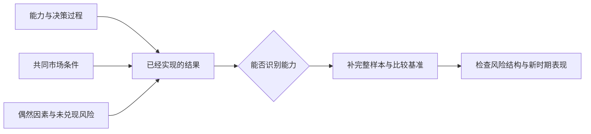
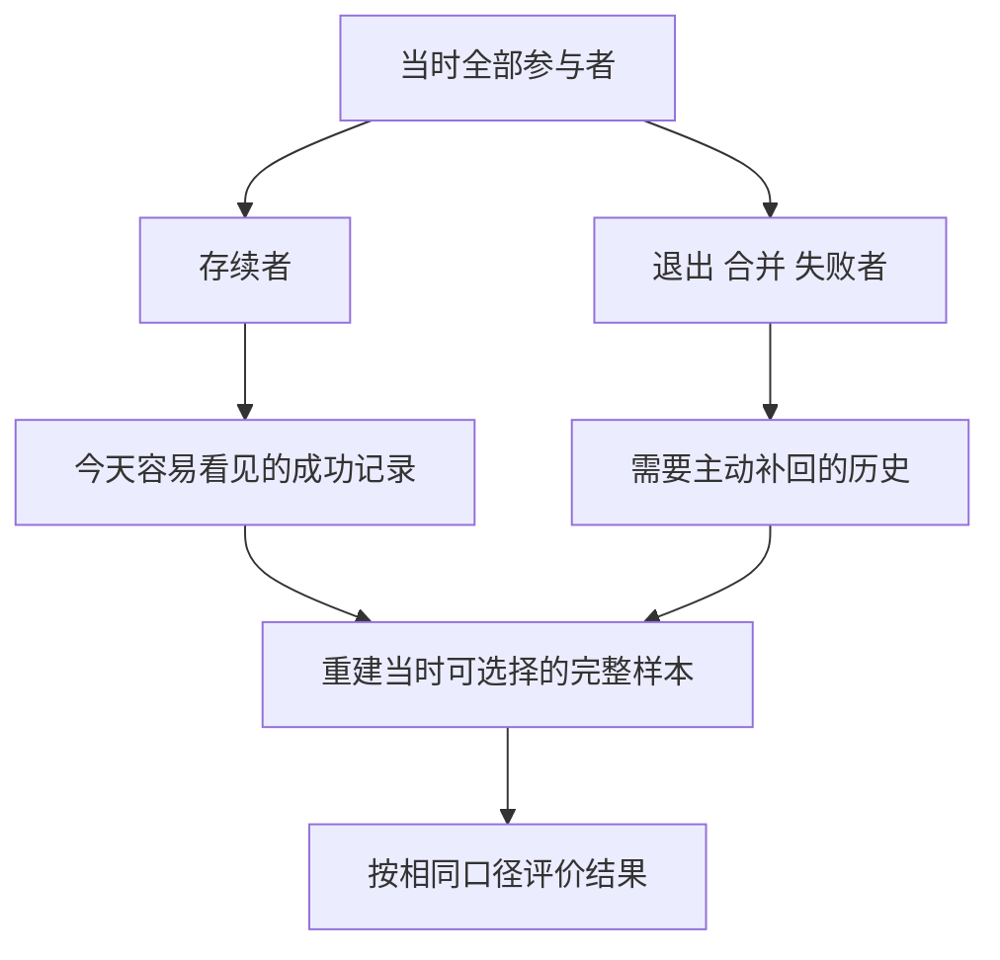

# 《随机漫步的傻瓜》读书笔记

> 作者：纳西姆·尼古拉斯·塔勒布（Nassim Nicholas Taleb）  
> 原作：*Fooled by Randomness: The Hidden Role of Chance in Life and in the Markets*。本次核对到 Random House 2008 年版，ISBN 9781400067930；这是版本信息，不把该年当作原作首版年。用户持有的中文译本未确认。  
> 分析依据：出版社说明、公开目录、原始金融研究与机构历史资料，属于**公开资料系统导读**，未取得用户原书，不声称逐页精读。  
> 覆盖范围：26 个核心及应用知识点，重点展开能力与运气、替代历史、尾部损失、幸存者偏差、过拟合与信息噪声。真实材料为本笔记补充，作者虚构人物与寓言不作历史证据。  
> 更新日期：2026-11-12

## 先明白这本书在问什么

**一个人赚了钱，究竟说明他做对了什么？** 这是全书最值得反复追问的问题。盈利是已经发生的结果，而能力、风险与运气是可能产生这个结果的因素。只观察最后的财富，很难把三者分开。

本书不是教你预测明天涨跌，也不是证明成功者都没有本领。它要求把注意力从赢家的故事，移向完整样本、未发生但原本可能发生的结果，以及一种做法在不同环境里会怎样。出版社也明确把运气与能力的混淆列为主题，并说明书中的 Nero 是虚构人物。[官方书页](https://www.penguinrandomhouse.com/books/176225/fooled-by-randomness-by-nassim-nicholas-taleb/)

最有价值的四个结论：

- 一次好结果不能单独证明好决策，一次坏结果也不能单独证明坏决策。
- 经常获小利、偶尔受重创的做法，可以在很长时间内看起来优秀。
- 只观察还在场的人，会漏掉同样做法曾经淘汰的参与者。
- 承认不知道，应落实为更好的样本检查、较少的过度交易和可承受的风险结构。

与另外两本塔勒布著作的分工是：本书主要检查**如何把运气错认成能力**；《黑天鹅》侧重知识边界与极端事件；《反脆弱》侧重怎样改变系统对波动的反应。三者相连，但不是同一套摘要。

## 主要内容怎样串起来

下面是主题重组，不是特定中文版本的逐章译名。公开目录可核对[出版社提供的 Google Books 书目信息](https://books.google.com/books/about/Fooled_by_Randomness.html?id=DCqFYOrGyegC)。

| 主线 | 需要解决的问题 | 对应知识点 |
| --- | --- | --- |
| 看不见的随机性 | 为什么结果不能直接代表能力 | 1—6 |
| 被筛选过的成功 | 为什么赢家故事容易误导 | 7—11 |
| 怎样认识不确定性 | 怎样用证据而非自信更新判断 | 12—16 |
| 与自己的心理合作 | 为什么懂概率仍会追涨杀跌 | 17—22 |
| 保留可持续的判断 | 怎样研究、行动与复盘 | 23—26 |

## 一、把结果拆回过程、风险与运气

### 1. 能力与运气共同影响结果，单次观察很难分离

能力是较可重复的判断或执行优势；运气是不能由当事人完全控制、却影响结果的条件。两者不是互斥选项。经验丰富的人仍会遇到不利变化，准备不足的人也可能碰上顺风。

**真实事件：LTCM 的早期盈利与后来的危机。** 美联储历史资料记载，长期资本管理公司成立后连续数年取得较高收益，1998 年遭遇严重损失；最终由 14 家金融机构提供约 36 亿美元资本重组，美联储参与协调，但没有投入自身资金。[美联储历史记录](https://www.federalreservehistory.org/essays/ltcm-near-failure)

这段历史不能简化成“数学家不懂投资”，也不能用后来危机倒推早期每一笔盈利全是运气。它说明的是：一串已实现收益，尚不足以回答在什么条件下赚钱、会在什么条件下亏损，以及亏损发生时能否继续持有。专家声誉和复杂模型也不能替代这些问题。

评价能力至少要加上三个维度。第一，赚取的回报是否只是某种共同市场暴露的结果；第二，是否承担了未在样本期兑现的巨大风险；第三，扣除费用后，优势能否在未用于挑选策略的新时期继续出现。把这些条件补齐，才能逐步提高对能力的确信。

还有一项重要边界：事后发现风险，并不意味着事前任何人都能准确预测危机时点。更可行的要求，是事前识别自己依赖哪些条件，不因最近没有出事就放松全部约束。本书的怀疑精神针对证据不足，不要求对所有专业能力一概否定。

### 2. 替代历史：评价决策时，还要看本来可能发生什么

我们只活过一条实现的路径，却常按这条路径评价全部选择。替代历史是把视野扩展到：按当时的信息和约束，还可能走向哪些结果。它不是任意编故事，而是检查当初所面对的结果集合。

这里要分清两类反事实。无约束地说“当时换一种做法一定更好”，只是事后想象；列出当时已知的风险、可行动方案和后果，则可以帮助判断过程。真正有用的比较，必须让方案面对相同的信息时点，而不能给其中一个方案偷偷配上事后知识。

**数学演示：** 一项选择有 99% 概率获利 1 单位、1% 概率损失 200 单位，金额期望为 `0.99×1−0.01×200=−1.01`。即使这次刚好赚了 1，也没有把它变成正期望选择。数字只用于说明逻辑，不代表某个真实产品，更不意味着现实中能准确知道这两个概率。

连接上一节的 LTCM 材料，重点不是替它编出精确危机概率，而是提出当时就值得问的问题：如果价差没有及时收敛，抵押品要求和现金需求会怎样？如果需要退出，市场能否容纳这些头寸？这些路径没有天天出现，却一直属于决策的风险空间。

替代历史能降低结果偏差，但也不能无限扩张。不是任何能想象的灾难都应获得同样权重。需要根据机制、历史、合约和资源约束判断哪些路径值得防备；概率难估时，可以先分析后果和承受能力，而不是用一个看似精确的数字掩盖未知。

### 3. 概率不是保证，期望值不是单次结果

概率表达一类结果的可能程度，不保证某次实现；期望值是各结果按概率加权后的平均，也不保证真实账户会达到这个平均。把期望收益当成已经拥有的钱，会忽略波动、路径和资金期限。

长期重复也有前提：机会确实能够重复、条件足够稳定、自己没有先破产。把不能承受的一次风险反复称作“长期有利”，不会使它变得可承受。

### 4. 分布不对称：常常对，仍可能总体亏损

胜率只回答盈利出现多频繁，不回答盈利和亏损各有多大。频繁的小收益与少见的大损失组合，可以制造非常稳定的表象。样本越短，巨大损失尚未出现的机会也越大。

这里的关键不是“罕见所以一定危险”，而是**发生频率与后果大小共同决定暴露**。对称的小波动，与把许多小利润交换成一次可能毁灭的损失，不是同一种结构。只画月度收益曲线，还可能遮住合约中的担保、追加抵押品和极端赔付。

**真实监管总结：LTCM 的杠杆与对手方风控。** 1999 年美联储向国会的证词将过度杠杆列为事件的核心问题，并指出部分对手方没有充分理解其不流动头寸，也没有有效限制暴露。[当时的官方证词](https://www.federalreserve.gov/boarddocs/testimony/1999/19990506.htm)

这提供了一个具体检查顺序：先看正常时每单位资金能赚多少，再看不利价格变化需要补多少现金，最后看现金不足时被迫平仓会损失多少。小价差业务与高杠杆结合后，普通情况下不显眼的变化，也可能对权益资本产生很大影响。这里只分析公开记录所揭示的机制，不重建基金每笔交易。

用到自己的研究，不能仅询问“过去最多亏过多少”，还应询问“合约允许怎样亏、哪些约束可能同时收紧”。历史最大亏损是一个观察值，不是未来损失的上限；反过来，尾部风险存在也不自动证明某项交易价格不合理，还需考虑补偿和整体承担能力。

### 5. 胜率、平均盈亏与最大后果要分别记录

对二类结果的简化计算，可以写成 `胜率×平均盈利−败率×平均亏损−平均成本`。每个量都需要明确样本和单位；如果把不同仓位、不同杠杆的交易直接混平均，得到的结果可能无法解释真实财富变化。

期望值之外，还应看损失集中度、连续损失、相关性和变现约束。一个平均数不能代替全部风险描述，也不能直接推出合适仓位。

### 6. 先避免退出游戏，再讨论长期优势

破产、无法履约或被迫卖出，会改变未来可选择的集合。只要一次事件足以剥夺继续参与的条件，后面再多理论上的好机会也无济于事。这使生存约束与普通收益波动具有不同地位。

它不要求所有人完全不冒险，而是区分可以恢复的小失败与不可逆的失败。个人必要支出、到期债务和共同财务责任，应进入约束清单；它们不能只靠平均收益覆盖。

## 二、为什么眼前的成功样本不完整

### 7. 幸存者偏差：失败者消失后，留下的平均成绩会变样

如果只查看今天仍存在的基金，就可能漏掉过去关闭、合并或退市的产品。留下来的集合不是原来的完整起跑队伍。偏差来自选择机制，不只是来自样本小。

**真实数据实践：CRSP 保留已经退出的基金。** CRSP 的共同基金数据库明确保留活跃与不再存续的基金记录，以便研究历史表现。[数据库提供者说明](https://indexes.morningstar.com/research-data-products/crsp-survivor-bias-free-us-mutual-fund-database)

这个设计本身就指出应该怎样问问题。研究某个历史时点能够买到的基金时，应先冻结当时的可投资名单，再沿时间追踪后果；不能从今天的名单往回看，并默认那些后来消失的选择从未存在。合并也需要处理，因为表现记录可能被接到另一条历史上。

**真实观察：退出并非与成绩无关。** S&P 2024 年末美国持续性报告指出，以 2014—2019 年表现分组，最末四分位基金在随后五年合并或清算的比例为 25%，最前四分位为 7%。[原报告](https://www.spglobal.com/spdji/en/spiva/article/us-persistence-scorecard-year-end-2024/)

两组退出比例不同，意味着删除退出者会改变观察到的样本组成。不过，仅凭这两个比例不能计算幸存者偏差究竟让平均收益抬高多少；还需知道各基金完整收益、规模、退出方式和统计权重。清算也不必然等于全部本金归零。

因此，检查报告时应寻找样本起点、退出处理、合并处理和费用口径。没有这些信息，排名再整齐也可能回答了另一个问题：今天留下来的产品过去表现如何，而不是当时投入某一类产品会怎样。

### 8. 从很多参与者里挑冠军，出现惊人成绩并不惊人

冠军的成绩需要连着参赛人数阅读。参与者很多时，即使能力完全相同，也可能有人连续碰上有利结果。只展示冠军而不说明起跑人数，会把选择后的罕见纪录误认成事前就罕见的证据。

**数学演示：** 1024 人各自独立猜十次公平硬币，十次全中的人数期望为 `1024×(1/2)^10=1`。这是期望人数，不是保证恰有一人。现实投资也不是硬币；演算只说明，事后挑出的纪录必须考虑筛选机会有多少。

### 9. 少数成功不能代替可重复性

样本少时，极端结果对平均值影响很大。扩大样本有帮助，但还要看这些观察是否提供独立信息。同一种市场趋势下的许多盈利交易，未必等于在许多独立环境中验证过能力。

应记录有效的环境变化，而不是只累计交易笔数。长历史也可能只包含一种利率或行业条件；更多年份不自动意味着覆盖了全部风险。

### 10. 过拟合：找到最贴合过去的规则，不等于找到未来规律

不断更换参数、样本区间和筛选条件，直到历史曲线好看，容易把偶然性写进规则。最后展示的往往只有胜出的模型，其他试过的版本被隐藏，于是模型的真实试错次数消失了。

**真实材料：领先排名的持续性。** S&P 的上述持续性报告追踪后续表现，而非只停留在选出赢家的时点。这一设计值得学习：选择样本与验证样本要分开，才有机会发现过去的冠军是否只是阶段性领先。[研究口径](https://www.spglobal.com/spdji/en/spiva/article/us-persistence-scorecard-year-end-2024/)

实际操作时，先写出规则和评价标准，再保留未参与选择的时期；不能看完验证结果后继续调整，却仍把它叫作独立检验。发生调整意味着有新版本，需要新的检验机会。多个合理模型得到相似结论，通常比一个精调模型独占高分更值得继续研究，但也不是成功保证。

过拟合不只存在于计算机回测。事后挑选企业故事、不断修改“我喜欢的优秀公司”定义，也会发生同样的问题。需要追踪的是决策规则在信息出现之前怎样被定义，而不只是事后的解释是否漂亮。

### 11. 偷看未来，会把研究伪装成预测

用后来修订的数据、今天的指数成员或后来才公布的财报去模拟当时选择，会引入未来信息。所得结果可能是数据整理能力，而不是当时可获得的判断能力。

应保存资料公布时间、当时可用版本和规则生效时间。一次回测的日期标签正确，不代表输入信息在那个日期已经公开。

## 三、怎样与知识边界相处

### 12. 可证伪：主动寻找会让自己改变观点的证据

有用的主张应能说明什么观察与它不相容。若盈利就证明策略正确、亏损也被解释为更长远的正确，观点就失去检验入口。保留能被推翻的条件，比只罗列支持材料更有学习价值。

这不意味着一个反例总能推翻概率命题。声称事件有 80% 概率，本来允许失败；应检查的是长期校准、概率依据和评价方式，而不是用单次例外否定所有统计判断。

### 13. 归纳有用，但过去平静不能证明未来绝无变化

从历史总结规律是学习的重要方式，问题在于把有限观察升级为无条件保证。未见过某个事件，与该事件不可能发生，是两种不同命题。

因此，历史频率需要与产生它的机制一起理解：样本期间有哪些制度、竞争或融资条件，未来哪些条件可能改变？不能因归纳有局限就放弃全部历史数据，也不能只凭历史最长一段平静就宣布风险已经消失。

### 14. 根据证据调整确信，而不是非黑即白地改信仰

新材料可以提高或降低判断的把握，不必只在“完全正确”和“完全错误”之间跳动。证据的价值取决于它能否区分竞争解释，而非被重复多少次。

若在成功与失败情况下都容易出现同一宣传，它的区分能力就弱。现实中先验和条件概率常难以精确得到，此时使用范围、解释来源，通常比编出小数点后的后验更诚实。

### 15. 模型是经过选择的简化，精确运算不能补齐错误前提

模型必须省略一些现实。需要检查省掉的是无关细节，还是恰好决定极端后果的机制。把流动性、融资限制或结构变化省掉，可能使计算在普通时期表现良好，却在最需要它时失效。

所以不应把复杂等同可靠，也不应把简单等同真实。最重要的是模型适合回答哪个问题、在哪些条件下用过，以及误差会给使用者带来什么后果。

### 16. 非线性与门槛：小变化有时带来大后果

后果不一定按输入同比例变化。距离保证金或偿债门槛很远时，价格变化主要表现为账面波动；接近门槛后，相同变化可能触发出售和后续压力。

这解释了为什么只研究平均变化不足以描述风险。应寻找约束触发点及相互反馈，而不是假定过去每跌一点所产生的影响可以一直等比例外推。

## 四、懂得随机性之后，行为仍需重新设计

### 17. 更频繁地看价格，可能增加噪声和行动诱惑

信息有用与否，取决于它是否改变关键判断。更高频的观察增加短期波动的曝光，却未必增加关于长期价值的独立证据。持续看见变化，也会让“我应该做点什么”的感觉变强。

**真实账户研究：交易频繁与成本后表现。** Barber 与 Odean 研究了 1991—1996 年一家折扣券商的 66,465 个家庭账户。论文报告，交易最频繁的一组年收益约为 11.4%，同期市场为 17.9%；这是特定样本和时期的观察。[研究者原论文](https://faculty.haas.berkeley.edu/odean/papers%20current%20versions/individual_investor_performance_final.pdf)

这个结果不是“任何交易都错误”，也不是该研究直接测量了阅读新闻次数。它提醒我们把信息收集、交易活动和最终效果分开：看得多不等于多出优势，动得多还会增加成本。研究中的投资者特征和环境也限制了推广范围。

改进方法不是强迫自己闭眼持有，而是把检查频率与决策对象对齐。财报公布、关键经营条件变化和事先约定的风险触发条件，通常比每一次小幅价格波动更容易说明为何需要重查。若任务本来是短期交易，则应按经过检验的系统监控，而不能借用长期投资理由忽略信号。

可以把信息分成三类：改变事实的材料、改变估值或风险假设的材料、只改变情绪却没有增加证据的材料。这个分类不是永久标签，而是要求每次行动说明具体依据。没有这种解释，减少阅读时长也未必真正减少了冲动交易。

### 18. 叙事使事实连贯，也容易抹掉偶然性

事件发生以后，选择少数显眼因素就能讲出一条顺畅因果链。但同样因素可能在失败者那里也存在，另一些未被讲到的条件可能更关键。故事的可理解性与因果识别能力不是同一回事。

阅读成功访谈时，应把可核实事实、当事人的事后解释和分析者的推断分别记录。叙事可以提出研究问题，不能单独回答原因究竟占多少。

### 19. 成功可能让人从反馈里学错

**真实理论研究，而非行为实验：** Gervais 与 Odean 的模型研究，讨论交易者若把成功过多归于自身能力，会怎样逐步形成过度自信。作者网页明确说明它是多期市场模型。[研究者说明](https://faculty.haas.berkeley.edu/odean/papers/learning/learning.html)

模型提供的是一种可能机制，不证明所有盈利者都如此。实际复盘可以检验自己是否使用不对称标准：赢时只谈能力，输时只谈市场。更一致的做法是对两种结果都分析信息、执行、共同环境与偶然因素。

### 20. 意志力有限，环境安排比持续自责更具体

知道一个偏差名称，不意味着在压力下自动免疫。记录、延迟非紧急决定、预设核查顺序和减少无意义刺激，都是把认识转成环境安排的方式。

这些方法需要与真实任务相容。延迟可能有成本，检查也需要时间；它们不是对所有决定一概适用的禁令，而是降低反复出现、可以预见的行为错误。

### 21. 怀疑运气的作用，不等于否定所有技能

稳定任务、有效反馈、明确评价标准，有助于识别和训练技能。问题在于把一个领域的成绩迁移到另一个领域，或把长期结果噪声很大的任务当成即时技能测试。

判断一位专家时，应限定其具体任务，再查看完整记录、比较基准和失败条件。反精英的情绪与盲目崇拜一样，都不能代替证据。

### 22. 相对财富会改变感受，却不自动改善决策

把自己的价值绑在他人近期盈利上，会让目标随排名移动。市场中总能找到某个阶段赚得更多的人，而对方承担的风险、资金条件和样本选择未必可见。

可以承认比较带来的情绪，同时把评价重新放回自己的目标、约束和长期过程。没有跟随某个赢家，不等于错失了自己原本能够安全获得的收益。

## 五、形成能长期检验的做法

### 23. 留下事前记录，才能抵抗事后改写

记录应包括当时知道什么、尚不知道什么、选择依据、竞争解释与修改条件。结果揭晓后，先按当时信息检查过程，再用新事实更新模型。

目的不是给过去的自己判刑。记录使变化有迹可循，也能区分一项能力尚未验证、规则执行偏离和环境真的改变。

### 24. 对预测保持谨慎，对责任保持清楚

无法保证结果，不等于无法承担责任。可以对资料真实性、推理过程、承诺、费用与风险披露负责，而不假装能控制市场。

反过来，也不能用“市场随机”替失职开脱。哪些结果不可控，哪些过程本来可改善，必须分别讨论。

### 25. 不确定结果之外，仍可以选择行为标准

本书后段还讨论与运气相处的态度：外界结果未必按自己的努力分配，但是否诚实、是否尊重事实、是否遵守合理承诺，仍能成为行动标准。

这属于生活与伦理主张，不是收益模型。它的实用意义在于减少用一次财富排名定义整个人，也不让短暂成功成为伤害他人或掩盖风险的理由。

### 26. 财商应用：先问优势的证据，再问如何投入

面对基金、策略或个人业绩，先查完整起跑样本及退出者，再查收益分布、成本、杠杆和基准；之后才讨论是否存在可重复优势。即便优势可能存在，还要检查资金期限、流动性和失败后能否继续参与。

这份顺序是本笔记的应用整理。它不能自动识别下一位赢家，也不替代具体市场规则、合同及个人背景核查。

## 两张图把难点连起来

**读图说明：** 结果由多条路径共同产生，不能沿一个箭头倒推唯一原因。增加样本和比较有助于学习，但并不消除全部不可观察因素。

**读图说明：** 偏差不只来自说谎，也可能来自资料自然消失。补回退出者是研究设计的一部分，不是先认定所有赢家都只是走运。

## 三个练习与参考答案

1. **LTCM 早期盈利能否证明它长期安全？** 不能。盈利记录与尾部后果、融资约束是不同维度；后来的危机也不能证明每笔早期盈利没有技能成分。
2. **CRSP 为什么要保留退出基金？** 为了让历史选择集合不被今天的存续状态重新筛选。退出的原因与收益需要继续核查，不能把所有退出都算成归零。
3. **发现一条回测很好看的规则，下一步是什么？** 先问试过多少版本、信息当时是否可得、费用与退出者如何处理，再保留新时期检验；不能继续调参后仍把旧验证集称作独立证据。

可以立即建立一页业绩检查表：对象、观察期、原始样本、退出处理、费用、共同暴露、杠杆、最坏约束、选择规则、独立验证。空白处是待查事项，不要自动补成有利答案。

## 来源、争议与范围

本书强调随机性，容易被误读成一切结果都无法学习。更合理的读法是提高举证标准，而不是否定经验。作者的交易叙述、哲学论辩与数学直觉也不属于同一种证据；本笔记没有独立核验全部人物细节。

主要使用：[出版社书页](https://www.penguinrandomhouse.com/books/176225/fooled-by-randomness-by-nassim-nicholas-taleb/)、[公开书目及目录](https://books.google.com/books/about/Fooled_by_Randomness.html?id=DCqFYOrGyegC)、正文对应的美联储历史与证词、CRSP 数据说明、S&P 持续性报告、Barber—Odean 账户研究及 Gervais—Odean 理论模型。各来源只支持所标注的事实或研究性质，概念联系与练习为原创教学分析。

尚未核对用户中文版本的完整章节、译文和全部案例；这是一份覆盖主要框架的导读，不是原书全文替代品。所举历史样本也不是对当前证券收益的预测。

---

[返回书籍索引](../README.md) · [财商学习与实践路线](../财商进阶合订本.md)
