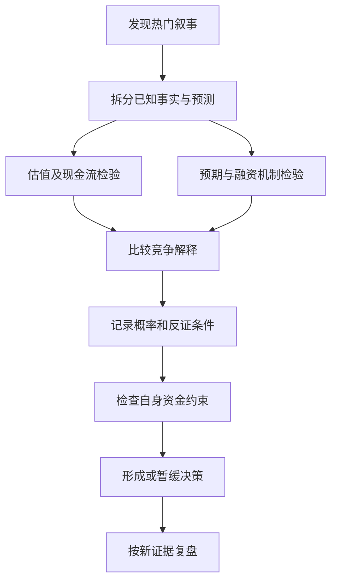

# 《非理性繁荣》：当上涨本身成为继续上涨的理由

> 作者：罗伯特·J. 希勒（Robert J. Shiller）。英文 *Irrational Exuberance*，2000 年初版主要讨论股票，2005 年第二版扩展住房，2015 年第三版进一步讨论债券等市场；2016 年平装本属于第三版，不能误当成新一版。中文具体译本未确认。本文依据出版社第三版介绍、授权第一章、作者研究与数据说明整理，属于**公开资料系统导读及部分章节分析**，没有取得全书。2021 年 GameStop 等案例是补充解释，不是原书案例。

这本书讨论的不是“散户为什么笨”，而是聪明人、机构、媒体和制度怎样共同产生过度乐观。价格上涨吸引关注，关注带来买入，买入又推动上涨；过程中，参与者容易把价格变化当作基本面改善的证据。希勒的重要贡献是把估值、历史、调查和心理机制放在一起，但这些证据不能提供精确的见顶日期。

## 主题地图与读法

全书主要线索包括历史估值、结构性催化因素、反馈与放大机制、媒体和新时代叙事、心理锚与从众、有效市场争论及应对。以下 32 点按“识别现象—解释机制—评估证据—建立行动边界”组织。需要区分作者的行为金融解释、可观察的数据和本文的教学补充。[出版社版本](https://press.princeton.edu/books/paperback/9780691173122/irrational-exuberance)，[授权第一章](https://assets.press.princeton.edu/chapters/s10421.pdf)。

## 一、先弄清泡沫到底是什么问题

### 1. 价格高、估值高、泡沫不是同一个概念

股票价格从 10 元变成 100 元，可能同时经历盈利增长、拆并股和资本结构改变。只看绝对股价无法判断便宜或昂贵。估值高表示价格相对某种盈利、现金流或资产指标较高，仍需判断增长和风险是否支持。

泡沫讨论更进一步：价格是否越来越依赖未来有人愿意以更高价接手，以及共同预期是否在自我强化。它不要求企业完全没有业务，也不能仅凭后来下跌倒推之前所有上涨都不合理。

### 2. 新技术可以真实改变世界，相关股票仍可能买得太贵

技术价值、企业盈利、股东回报是三个层次。技术被广泛使用，可能主要让消费者得利；企业收入增长，可能被竞争、资本开支或新股稀释消耗；即使企业最终成功，过高买价仍可能带来很低回报。

判断“新时代”叙事时，应把它翻译成可检查的问题：谁付费、利润由谁保留、需要投入多少资本、现有价格已经隐含多少成功。故事越宏大，越需要落到这几项具体约束。

### 3. 1996 年格林斯潘讲话不是一张立即清仓指令

**真实历史案例。** 1996 年 12 月 5 日，格林斯潘在关于民主社会中央银行的讲话中提出，如何判断非理性乐观是否使资产价格过度上升。他以疑问讨论政策识别难题，并没有提供一个精确的顶点模型。[美联储讲话原文](https://www.federalreserve.gov/boarddocs/speeches/1996/19961205.htm)。

这提醒读者区分“风险值得重视”和“下一交易日一定下跌”。宏观警示的作用可以是检查风险暴露、融资和预期，而不是直接转化为无期限做空。把一句著名表述当作交易信号，会省略持有期限和判断错误的成本。

### 4. 高估可能持续，错误价格也能影响真实经济

高股价可以降低企业发行股票的融资成本，推动扩产和并购；上涨的房价可以改变借款和消费。因而，价格并非只是一块被动显示基本面的屏幕，也可能反过来改变企业与居民行为。

但这种影响不必永久持续。若新增投资回报不达预期、融资收紧或需求减弱，先前的反馈可能逆转。因此要同时分析金融市场与真实现金流，不能只在“全是基本面”和“全是情绪”之间二选一。

## 二、怎样看估值数据，而不迷信一个数字

### 5. 价格必须相对可持续收益解释

市盈率用价格除以每股盈利。困难不在除法，而在盈利是否可持续：一次性收益、周期高点、会计调整都可能使分母失真。

周期企业在利润最高时市盈率可能最低，不能因此自动认定便宜。先研究盈利来源和正常化程度，再决定用何种估值。指数层面也有行业结构和成分变动问题。

### 6. CAPE 用长周期实际盈利减少短期噪声

CAPE 是周期调整市盈率：用当前价格除以过去十年经通胀调整后的平均盈利。简化写作：**CAPE＝当前实际价格÷过去十年平均实际每股盈利**。实际表示统一到可比购买力口径，不是把十个名义盈利直接平均。

**数学演示。** 当前价格为 300，十年实际平均盈利为 10，CAPE 为 30；最近一年盈利为 5，普通市盈率则为 60。差异可能来自暂时衰退，不代表两个指标必有一个错误。平滑分母是为了换一个观察周期，而非得到无需判断的“真实价值”。[希勒数据与方法说明](https://www.econ.yale.edu/~shiller/data.htm)。

### 7. CAPE 更适合讨论长期回报条件，不能当短期计时器

买价较高意味着同样的未来现金流对应更低的起始收益基础，但未来增长、利率和风险补偿都会改变结果。从历史关系到下一年的确定预测，中间缺少充分依据。

实用方法是调整情景假设：高估值时，对未来回报保持更保守的预期，检查计划是否依赖持续估值扩张；不要仅靠一个阈值决定无限等待或加杠杆做空。估值提示可能昂贵，不告诉你价格必须何时纠正。

### 8. CAPE 自身也有会计与市场结构局限

十年窗口可能包含异常危机，盈利核算、回购与分红政策、行业结构也会变化。不同国家的会计制度和指数构成不同，同样的 CAPE 未必有完全相同的经济含义。

希勒的数据说明专门讨论了公司回购政策变化对指标的影响，并提供相关调整研究。正确使用方法是承认口径问题并交叉检查，而非因为存在缺点就宣布所有估值无意义。[作者数据说明](https://www.econ.yale.edu/~shiller/data.htm)。

### 9. 名义价格上涨不等于购买力提高

长历史图若不扣通胀，容易把一般物价上涨误当成资产变得更有价值。股票回报还要包括分红，住房比较要区分房价指数、租金服务、维护、税费和融资。

比较两种投资时必须统一：是否含现金分配、是否扣费、是否含杠杆、是否同一币种和期间。一个只画价格的曲线，不能直接用于证明哪种完整投资策略更优。

### 10. 长期历史是参照，不是物理常数

历史极值有助于发现异常，却不规定未来必须停在旧范围内。制度、产业和人口会变化，数据早期质量也不一致。

因此，应同时问“过去类似情况下发生过什么”与“今天有哪些差异足以改变机制”。只强调相似，会陷入机械均值回归；只强调独特，会轻易接受“这次永远不同”。

## 三、泡沫如何被结构与故事放大

### 11. 催化因素需要形成机制，不能只堆新闻

新技术、投资渠道、人口、税制、退休储蓄和交易便利性，都可能改变需求。但列出十条利好并没有证明合理价值增加多少。

逐项检验：它改变现金流、折现率、市场参与，还是仅仅提高关注？作用是一次性还是持续？是否已被价格反映？不同版本讨论的具体时期不同，不应将原书的历史因素直接宣布为今天全部市场的成因。

### 12. 正反馈让上涨暂时像是证明自己正确

先有涨价，随后媒体报道和邻里讨论增加，更多人关注并买入，价格再上涨。参与者观察到的“证据”包含了自己和他人行动造成的结果，容易形成循环论证。

这并不要求所有买家都相信长期价值。有人相信故事，有人跟随趋势，有人打算更早退出；短期行动可能相同。区分动机很重要，否则容易把一个复杂市场解释成单一群体的愚蠢。

图是反馈机制示意，不是证明每轮上涨都是泡沫。需要另查盈利、融资、持仓与预期证据，判断反馈在其中占多大作用。

### 13. 财富效应与自信增长会扩大投入

账面财富提高后，人可能感觉未来更安全，从而减少储蓄、增加消费或承担更多投资风险。成功经历又可能使人高估自身能力。

检查时把本金投入、市场涨价与自己创造的超额收益分开；同时把纸面财富和可用于支付的现金分开。不能因为账户上涨，就自动假定收入能力和损失承受能力同幅提高。

### 14. 媒体需要解释每日变化，但每日变化未必有单一原因

市场总有波动，新闻叙事倾向于找一个醒目的原因。当天出现的消息与涨跌同时发生，不足以证明该消息是唯一驱动因素。

阅读市场新闻时，把“事实”与“记者或受访者的解释”分开记录。若相同消息既能解释上涨，又能解释下跌，解释的可检验性就很弱。需要追问什么观察结果会使该解释失效。

### 15. 新时代叙事通过集体记忆选择性传播

人更容易记住改变生活的成功企业，忽略同时消失的企业和未兑现的预测。叙事由此可能真实但不完整。

研究热门行业，应同时寻找失败者、资本损耗、竞争和历史融资成本。行业前景与股东回报之间的差距，往往藏在这些被故事省略的部分。

### 16. GameStop 案例说明“只有一个原因”的解释很危险

**真实补充案例。** SEC 工作人员对 2021 年初市场事件的报告讨论了 GameStop 的关注、交易、空头回补和市场结构。报告认为回补参与了部分价格上升，但不足以单独解释持续数周的涨势；这是工作人员分析，不是委员会法规或司法裁决。[SEC 工作人员原始报告](https://www.sec.gov/files/staff-report-equity-options-market-struction-conditions-early-2021.pdf)。

概念上的启发是：社交传播、买入需求和交易机制可以共同作用。不能从“有空头回补”推导“所有上涨都是被迫回补”，也不能从“情绪重要”推导“经营事实毫无作用”。研究时先拆分机制，再看每种机制有什么直接证据。

### 17. 投机性反馈不等于法律意义上的庞氏骗局

作者用相似的自我强化逻辑帮助理解资产热潮，但公开市场的价格反馈与有人隐瞒资产、用新钱支付旧投资者的欺诈并不相同。

措辞必须准确：资产高估是估值判断，操纵和诈骗是需要具体行为及法律证据的指控。不能因为价格上涨依赖新买家，就把所有股票、基金或房地产都称为骗局。

## 四、心理机制怎样影响有知识的人

### 18. 数字锚把过去价格伪装成价值标准

买入价、历史最高价和整数关口容易成为参照点，但它们不自动决定未来现金流。跌回买入价不表示风险恢复为零，离历史高点很远也不表示一定便宜。

检查方法是暂时遮住成本价，重新估计未来回报条件。如果论证只剩“以前更贵”，便需要补充真正的价值依据。

### 19. 道德锚与合理化使人愿意继续持有

人可能用家庭责任、时代机会、支持创新等理由，为原先主要出于赚钱冲动的决定赋予稳定意义。价值目标可以真诚存在，但仍不能替代价格和风险分析。

将“我支持这件事”与“此价格是否适合这笔钱”分开，有助于避免用身份认同阻止更新判断。支持产业也有消费、工作、创业等多种途径，不必等同于任何价格买入证券。

### 20. 从众可能是信息推断，也可能是声誉压力

别人买入，可能使你推断他们掌握信息；机构跟随同业，可能是因为独自落后更容易受到责备。二者都不要求参与者缺乏智力。

问题在于，每个人都把其他人的行动当信息，最终可能没有多少独立研究。检验意见时，要看论据是否来自同一个原始消息，而非把十次转述当作十份证据。

### 21. 过度自信来自反馈不清，而不只是性格强势

市场上涨时，很多不同方法同时赚钱，投资者难以知道自己究竟判断对了什么。单次结果包含大量噪声，容易奖励错误的方法。

因此要保存决策时的预期、概率、反对证据和检验日期。复盘时区分结果好坏与决策质量，不能只用盈利截图评价能力。这个记录方法属于本文补充应用。

### 22. 注意力有限，使显眼的风险挤掉缓慢的风险

人会关注今天跌了多少，却可能忽略估值、成本、负债和流动性在多年间慢慢累积。短期没有事故，会强化“安排一直有效”的感觉。

定期检查应同时包含即时风险与慢变量：融资是否变短，现金流是否恶化，盈利是否越来越依赖一次性项目，投资目标是否改变。平静并不等于这些问题已经消失。

## 五、证据：如何避免把行为解释也变成万能故事

### 23. 住房预期调查提供了价格之外的观察窗口

**真实研究案例。** Case、Quigley、Shiller 在澳大利亚央行 2003 年会议论文中分析美国购房者调查，记录了部分市场购房者较高的长期涨价预期，并讨论向后看的价格外推。调查对象是购房者，不是全体居民随机代表。[作者原始会议论文](https://www.rba.gov.au/publications/confs/2003/case-quigley-shiller.html)。

它的价值在于，不能只从后来房价下跌推测之前每个人怎么想；调查直接询问当时预期。但是，回答可能受到样本选择、表达误差和买房后的合理化影响。调查与价格共同变化支持研究反馈，不自动识别每个因果环节。

### 24. 预期增长率应转成长期倍数检查

人说“每年涨一点”时，可能没有意识到长期累积的规模。把年增长率转成十年后的收入、房价或市值，可以发现叙事需要多强的条件。

**数学演示。** 年增长 10%，十年变成约 2.59 倍；年增长 15%，十年约 4.05 倍。若资产价格增长显著快于支持付款的收入，必须解释租金、利润率、融资或财富来源如何跟上。倍数看似大并不单独证明不可能，但能迫使论证更具体。

### 25. 价格波动与基本面波动的比较依赖模型

希勒的相关研究比较资产价格变化与未来分红等基本面所能解释的波动，推动了行为金融讨论。但把未来现金流折现，需要对折现率、风险和信息作假设。

因此，发现简单模型解释不了波动，不等于已经精确测量出“非理性占比”；改变风险补偿等设定也可能影响结论。争论应围绕可检验的模型和证据，而不是把所有不同意见归因于立场。[希勒诺奖讲座入口](https://www.nobelprize.org/prizes/economic-sciences/2013/shiller/lecture/)。

### 26. 市场并非完全有效，不代表普通人轻易获利

即使存在误定价，纠正时间、融资、卖空限制、交易成本和研究错误都可能阻止套利。知道某资产可能贵，与设计能承受路径风险的交易，是两个任务。

尤其要避免“市场不理性，所以我的直觉必然更正确”。行为金融同时适用于自己。发现群体偏差只能成为审查起点，不能豁免个人判断。

### 27. 判断泡沫要允许多个竞争解释

高价格可能涉及增长改善、风险补偿降低、供给限制、利率变化、投机反馈等。一次分析应该列出至少两个能够解释现象的机制，并说明各自需要看到什么证据。

若所有结果都能被解释为“泡沫更大”或“泡沫破裂”，这个判断很难被反驳。好的分析应给出具体观察，例如现金流是否跟上、融资条件是否改变、预期是否继续外推。

## 六、把阅读转成更可靠的投资判断

一种有用的写法是给每个解释配一条可能反驳它的观察。如果认为高价来自持续盈利改善，就应跟踪利润与现金是否兑现；如果认为主要来自融资扩张，就应关注资金来源和融资条件；如果强调群体预期，就应寻找调查和独立行为资料。不能只收集与自己立场相同的评论。

证据不足时，结论可以只是“价格对乐观假设依赖较强”，而不是“已经证明即将崩盘”。较弱但准确的判断，通常比强烈却无法检验的断言更有助于资金安排。判断的措辞应随证据强度变化，而不是随市场情绪变化。

### 28. 用五类证据审查热门资产

| 观察问题 | 应找的资料 | 常见跳跃 |
|---|---|---|
| 现金流能否支持价格 | 报表、经营数据、投入需求 | 用户增长直接等于利润 |
| 价格隐含什么 | 可比估值与情景计算 | 历史更贵所以现在便宜 |
| 需求为何增加 | 持仓、成交、资金来源 | 成交大所以价值高 |
| 融资是否脆弱 | 杠杆、期限、保证金条款 | 过去没出事所以安全 |
| 预期怎样形成 | 调查、公开预测、独立研究 | 多人转述等于多份证据 |

这些是补充研究框架，不是一套机械泡沫评分模型。证据可能缺失，结论应允许“不足以判断”。

### 29. 应对不确定性，先减少被迫行动的可能

资产看起来昂贵时，最直接的检查是自己是否依赖短期融资、是否把近期支出放在高波动资产、是否只持有同一种风险。处理这些约束，不需要先猜中顶点。

具体证券与仓位仍需要个人目标和背景。本文不给统一清仓或做空方案，因为高估判断无法消除资金期限与交易路径的不确定性。

### 30. 将投资论文和交易计划分开记录

投资论文解释价值来自哪里、什么价格与情景有吸引力、哪些事实推翻判断；交易计划则涉及进入退出、风险限制、执行成本和持有期限。

一份宏观泡沫分析不自动包含可盈利交易。先写清自己是在研究长期价值，还是利用短期价格行为，能减少亏损后临时切换解释。

图说明从故事到决策需要经过多个检验。最后一步可以是暂缓判断，而不是每读到一个故事都必须交易。

### 31. 复盘时保留当时可知的信息

不要拿后来的破产、政策或盈利结果，假装当初所有人已经知道。复盘应恢复当时资料，检查哪些信号可见、哪些被忽略、哪些本来不可预知。

同样，也不能因为最终赚钱就认可所有过程。若结果主要来自无法合理预见的利好，应该记录幸运的成分，避免下一次把同样风险扩大。

还可以保留没有发生的预测。只存成功预警，会使自己看起来总能识别危机，却无法估计误报率、等待成本和错过上涨的代价。评价预测需要完整记录，包括判断、期限、置信度和结果，不能由几个著名片段代替全部表现。

### 32. 本书最终提高的是判断标准，而非预测姿态

读完应能解释价格反馈、CAPE 的用途与限制、调查证据的价值、叙事和现金流的区别，并能对自己的判断提出反证要求。

如果只是从“永远看涨”变为“永远喊泡沫”，思维方式并没有改善。真正的收获是面对不确定性时，能把事实、模型、价值判断与行动条件分别写清楚。

## 练习与参考答案

**一：某行业未来必然增长，因此任何价格买入龙头都有高回报，对吗？** 不对。还需判断竞争、资本投入、股东稀释和买价已经隐含的预期。

**二：CAPE 较历史均值高，能否推出未来三个月下跌？** 不能。长期估值关系不足以给出短期时点预测，应保留其他解释及估计误差。

**三：十篇文章都引用同一位分析师，算十份独立证据吗？** 不算。应追到原始资料，并检查各自是否提供新增事实。

**四：价格下跌后能否宣布之前是泡沫？** 不能仅凭下跌判断。新信息、现金流变化和风险补偿变化也能影响价格，需要恢复当时信息并分析机制。

## 资料与继续阅读

本文只对实际取得的出版社资料、授权章节、原始研究和监管报告作概括，未声称核验全书每章。作者数据网站偶有访问不稳定，本文未填入未经下载复核的“最新 CAPE”。可衔接[《思考，快与慢》](<../思考，快与慢 - 丹尼尔·卡尼曼/读书笔记.md>)、[《投资最重要的事》](<../投资最重要的事 - 霍华德·马克斯/读书笔记.md>)，分别补充心理机制和风险决策。
