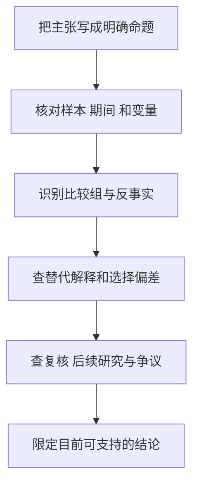

# 《魔鬼经济学》：从激励出发，用证据检验意外解释

> 作者：Steven D. Levitt、Stephen J. Dubner，史蒂文·列维特与史蒂芬·都伯纳。原作 *Freakonomics*，2005 年；另有修订版及续作，本篇围绕第一部六章主题。具体中文译本未确认。  
> 依据：作者书页、公开目录及相关原始论文；未取得完整原书，属于公开资料系统导读。28 个知识点按机制重组，后续研究与财商联系明确属于补充，不声称原书已包含全部后续证据。更新：2026-11-12。

## 这本书真正值得带走的东西

它把经济学用在教师、运动员、经纪人、犯罪和育儿等问题上。共同线索是：人面对哪些激励，掌握哪些信息，我们看到的数据是怎样产生的？

最有用的不是记住几个惊人结论，而是学会寻找隐藏的比较组、利益冲突和替代原因。最需要防范的则是“反常识崇拜”：一个说法越出人意料，越需要核对识别方法，不能因为新鲜就降低标准。

| 原书主题 | 要理解的机制 | 本文位置 |
| --- | --- | --- |
| 教师与相扑运动员 | 激励、异常数据、作弊识别 | 1—8 |
| 专家与信息控制 | 信息不对称、代理与竞争 | 9—12 |
| 街头帮派 | 收益分布、晋升激励与选择 | 13—15 |
| 犯罪下降 | 因果、滞后、争议与复核 | 16—20 |
| 育儿与姓名 | 相关、背景、实验与外推 | 21—25 |
| 方法整合 | 怎样把故事变成研究 | 26—28 |

原书与续作区别见[作者书籍页面](https://freakonomics.com/books/)，章节框架见[公共图书馆目录](https://catalog.freelibrary.org/Record/1550015/TOC)。

## 核心知识点

### 1. 激励包括经济、社会与道德层面

钱、声誉、晋升、惩罚和内在责任都可能影响选择。只问“他能赚多少钱”，会漏掉身份与规范；只判断一个人品德如何，也会漏掉制度给予的压力。

这不是把所有行为都合理化。解释某种行为在什么条件下容易出现，与赞同这种行为是两回事。投资研究应同时看管理层的公开表态和实际奖励结构，避免只凭言辞判断长期行动。

### 2. 指标一旦与奖惩连接，就会改变数据生成过程

考试分数、营业收入、增长用户数原本用于观察表现；当它们决定报酬时，参与者可能真实改善，也可能挑选样本、改变分类或操纵指标。

因此看见指标大幅改善，既不应立刻宣布作弊，也不应忽略核验。先问真实目标是否同步变化，其他独立数据能否解释改善。经营利润、现金回款与客户留存之间的对照，常比单项增长更有信息。

### 3. 教师作弊研究：不是所有高分都值得怀疑

**真实研究。** Jacob 与 Levitt 分析芝加哥学校的考试资料，结合异常答案模式、分数突然上升及随后变化识别可能作弊，并利用重新测试等信息验证部分预测。[原始论文](https://pricetheory.uchicago.edu/levitt/Papers/JacobLevitt2003.pdf)

其方法重点是联合证据：一班学生都进步，并不足以证明问题；大量不寻常的相同答案、与过去成绩不协调的跳跃，以及监督变化后的表现，共同提供更强线索。

迁移到财务分析，单个高利润率不是造假证据。需要结合应收款、现金流、客户、库存、会计政策及后续兑现情况。异常筛查的角色是安排调查优先级，不能绕过对具体事实的确认。

### 4. 检测规则要检查误报和漏报

把异常企业全部判为有问题，会伤害真正优秀者；阈值太宽又会漏掉风险。任何筛查都需要研究它在什么样本上验证、对新环境是否有效，以及错误的代价。

财商应用中，可以把“调查信号”和“投资结论”分成两层。没有后续材料，结论应停在需要核查；不能把一个模型分数写成确定事实，也不能因没被模型发现就宣布完全可靠。

**数学演示：**假设一万个对象中实际有问题的占 1%，筛查能识别其中 90%，同时把没有问题者中的 5% 错报。有问题者被报出 90 个，没问题者被错报 495 个，全部 585 个警报中真正有问题者只占约 15.4%。数字是假设，不是教师研究的准确率。

为什么“识别九成问题”还不够？因为正常对象的基数很大，较小误报比例也会产生很多警报。这叫基础概率影响：在罕见事件筛查中，必须同时问真实发生率、敏感度和误报率。筛查可以很有价值，但用途通常是安排进一步核查，不是直接判罪。

### 5. 相扑案例说明临界奖励可能改变行为

**真实研究。** Duggan 与 Levitt 研究相扑比赛中接近胜负门槛的比赛结果，发现某些胜率与后续交手模式不符合简单的能力解释，并把它们解释为与互惠和比赛操纵相符的证据。[原始研究](https://www.nber.org/papers/w7798)

关键是门槛改变边际收益：对一方极其重要的一场胜利，对另一方的意义可能不同。研究通过多种模式检验竞争解释，而不是看到一次意外胜负就给运动员定罪。

企业中，年终业绩门槛也可能改变收入确认、促销或费用安排。正常的冲刺与不当操纵需要区分；投资者可以检查门槛附近行为、后续逆转和真实现金，而不能仅凭“刚好达标”推断违法。

### 6. 重复互动会改变一次交易的激励

如果今天让步可能换来未来回报，参与者会把关系持续性放入决策。重复博弈可以支持合作，也可能维持对外部人不利的安排。

分析供应链、关联交易与行业竞争时，要问双方是否反复互动、是否能观察对方行为、是否有惩罚或退出机制。关系长期存在不自动证明利益一致，稳定也可能来自缺乏替代。

### 7. 罚款可能改变行为框架，而不只是增加成本

**真实研究。** Gneezy 与 Rustichini 对日托中心的研究发现，加入迟到罚款后，迟到行为增加；取消罚款后也没有立即逆转。作者讨论了罚款把社会义务转化为价格的可能解释。[论文](https://www.journals.uchicago.edu/doi/pdf/10.1086/468061)

不能把结论简化为罚款没用。样本、额度、监控和原有规范都影响结果。它真正训练的是：政策实施后参与者如何重新理解规则，也属于成本收益分析的一部分。

对个人财务，信用费用、服务费或罚息不能被自动理解为“付钱就完全没后果”。合同责任、信用记录和长期关系可能仍有独立影响，需要看完整制度。

### 8. 不能只解释成功逃过检查的行为

被发现的样本与未被发现的样本不同，公布的数据也可能只包含进入某个程序的人。研究作弊、犯罪或基金失败时，都需要理解哪些对象没有进入数据库。

这会影响发生率的估计，也影响外推。观察到某类违规案件很多，可能来自真实发生更多，也可能来自检查更密集。仅从处罚数量不能分离两种机制。

### 9. 专家的价值与专家的利益冲突可以同时存在

专家掌握知识，帮助客户节省搜索成本；但知识优势也可能让客户难以判断建议是否符合自身利益。正确回应不是拒绝所有专家，而是弄清楚谁付钱、如何奖励、怎样核验。

对证券研究报告、保险、房地产与培训服务，都可使用相同检查：服务者的收入与什么行为相连？客户能否取得原始数据？有没有独立比较与可执行的责任？

### 10. 房产经纪人研究：佣金比例会改变耐心

**真实研究。** Levitt 与 Syverson 比较经纪人出售自己住房与替客户卖房，记录到价格和上市时间差异，符合信息优势与代理激励不完全一致的解释。[研究原文入口](https://www.nber.org/papers/w11053)

机制在于，卖家获得议价改善的大部分，而经纪人仅分享部分佣金；多等待的收益与劳动成本在两方之间不同。观察性研究仍可能受到房屋和交易者差异影响，作者的控制并不意味着现实每一笔交易都具有同一效果。

**应用步骤：**先检查佣金与服务范围，再问建议是否有可复核的市场数据，最后决定是否需要另一个独立意见。不能仅因为收费有冲突就断言建议必错，也不能因为专业就不看激励。

### 11. 信息公开可以削弱旧优势，也会创造新中介

当报价、质量与记录更容易比较，某些依靠信息不透明的利润可能下降。但信息多并不等于理解容易，筛选、认证、搜索排序与可信度又可能成为稀缺资源。

研究互联网平台时，要分清它降低了什么成本，又掌握了什么入口。平台展示“大家的选择”可能帮助比较，也可能受到广告与排序目标影响。透明度应该在具体环节上评价。

### 12. 公开数据与可用数据之间还有整理成本

文件可以下载，不意味着普通人能正确匹配主体、时期、单位和修订。资料清洗、定义与验证需要投入，这也是专业研究可能产生价值的地方。

财商训练不必追求最大数据库。先把一项结论需要的几份公告整理准确，记录来源和计算，就能降低许多错误。大量未经核对的数据，往往只是把不确定性放进更大的表格。

### 13. 平均收益会掩盖组织内的巨大差异

**真实研究。** Levitt 与 Venkatesh 利用一支街头贩毒组织的账目研究内部收入、成本和层级，揭示高层与基层收入及风险很不相同。材料来自特定组织和时期，不能视作所有非法市场的总体调查。[原始研究](https://www.nber.org/papers/w6592)

本节关注收益分布，不提供任何犯罪操作方法。可迁移的认识是：看到少数顶层收入，无法推断典型参与者的净回报。职业、创业、娱乐和投资培训广告都容易选择最显眼的赢家。

比较机会时，应寻找中位结果、失败比例、时间投入、进入成本和尾部风险。若只给出冠军收益而没有总体分母，就还没有获得可用于个人决策的证据。

### 14. 晋升机会可能使人接受很差的当前条件

参与者可能为了少数高收益职位，接受低报酬或高风险。锦标赛结构解释这种动机，但不能证明参与在期望意义上划算；概率可能被高估，退出与替代机会也可能有限。

个人财商应用是把“未来可能成为顶层”拆成可观察路径：多少人进入、多少人晋升、要等多久、失败后技能是否可转移。不要把一次公开成功当成所有参与者的合理预期。

### 15. 账面收入必须与成本、风险和时间一起看

收入流水不是净利润，净利润不是每小时收益，某一年赚很多也不保证长期生存。研究组织账目时，暴力、罚没、违约、停业和其他损失不能因难测量就从分析中消失。

合法投资也有类似方法问题：收益展示若漏掉融资成本、税、失败仓位和投入时间，会夸大能力。看得到的现金收益与看不到的风险，需要分别记录，不能简单相抵。

### 16. 因果问题需要一个可信的“如果没有发生”

看到政策后犯罪下降，不能直接把下降全归政策。经济、人口、执法、测量和社会环境可能同时改变。反事实是对未发生路径的有依据比较，不是随便编一个故事。

本书最值得学习的研究姿态，是寻找能够区分解释的数据，而不是不断增加对同一结论的修辞。对股票而言，股价在公告后上涨，也不能单独说明公告创造了全部涨幅。

### 17. 时间先后是因果条件之一，却远远不够

原因必须以合理机制影响后果，时间间隔也应与机制一致。人口结构变化可能多年后影响社会结果，价格促销则可能更快影响销售；两者不能用同一观察窗口。

如果一个解释可以同时容纳任何滞后时间，识别就很弱。应该先说明何时应看见什么中间变化，再查数据，避免看到结果以后不断调整窗口。

### 18. 犯罪下降与堕胎合法化：作者主张必须与争议一起读

Donohue 与 Levitt 提出，1970 年代美国堕胎合法化可能通过出生群体变化，对约二十年后的犯罪下降产生重要影响。这是一个需要识别的经验主张，不是价值判断，也不能据此给任何个体或群体贴犯罪标签。[最初研究](https://www.nber.org/papers/w8004)

Foote 与 Goetz 后来指出原分析在程序与模型设定、计数和比率等方面存在问题，认为相应修正削弱了证据。[批评论文](https://www.bostonfed.org/publications/research-department-working-paper/2005/the-impact-of-legalized-abortion-on-crime-comment.aspx) 原作者作了回应并继续更新数据与检验，2020 年论文仍支持其主要解释。[回应](https://www.nber.org/papers/w11987)、[后续研究](https://www.nber.org/papers/w25863)

因此不能把畅销书中的结论写成已经没有争议的定律，也不能从发现一项错误直接推出所有相关研究都失去价值。真正的学习点是复核变量、代码、样本、竞争解释和稳健性，以及结论应有多强。

读这组争论时，可先把研究问题缩成四行：研究的是犯罪数量还是犯罪率，出生群体如何对应成年后的结果，不同地区原有趋势是否相似，哪些同时发生的政策被处理。如果使用总数量而忽略人口规模，某些变化可能只是分母变化；如果地区本就朝不同方向变化，政策前后的差异也未必来自所研究因素。

这些检查不会自动选出正确答案，却会阻止“一个相关系数说明一切”。还应区分后续样本继续符合预测，与原识别假设获得独立验证；前者增加信息，但仍可能保留共同的测量或模型问题。是否支持某项公共政策又是额外问题，需要伦理、权利及其他后果的判断，不能从书中的社会统计直接跨越。

### 19. 描述性关系、识别假设与政策主张要分三层

第一层问变量怎样共同变化，第二层问变化能否归因于特定因素，第三层才讨论应当采取什么行动。第三层还涉及价值、权利、成本和其他后果，不能由一个估计系数包办。

这对财商同样重要：历史数据显示低估值组合回报较高，是研究线索；是否来自风险、样本或市场机制需要分析；个人是否应该采用，还取决于资金、成本和执行约束。

### 20. 复现与反驳是研究的一部分

一个结论能接受数据和代码检查，才更容易发现错误与适用范围。后续结果不同，可能来自原错误、定义差异、样本变化或真实机制变化，不能只根据立场选择支持自己的论文。

读争论时先列双方在哪个步骤不同：样本、变量、模型、反事实还是价值判断。争论被拆开以后，往往比两个作者互相评价更容易理解。

还可以做一个较小但实用的复核：选取研究中最关键的一个结论，找出它的原始变量、单位和比较组，再用另一种直观表达复述。如果原论文说“在控制若干条件后存在平均差异”，笔记却写成“某因素决定人生”，问题首先出在传播过程。无需先重跑全部代码，也能纠正这种强度失真。

当证据相互冲突时，暂时列出两种可能机制，并注明下一份什么资料能帮助判断，比强行给出唯一答案更有用。逻辑训练的目标是提高判断可修正性，而不是让每个话题都迅速结束争论。

### 21. 育儿相关性不能简化为“父母做什么都没用”

家庭背景、父母教育、收入和孩子表现相关，不代表每项日常行为都没有作用。控制变量的选择、行为测量误差和家庭差异会影响估计。

本书的育儿章节适合提醒人们：买书、参加活动与孩子成绩之间的相关，可能部分反映父母原有条件。它不足以证明教育干预普遍无效，更不能用于责备处境困难的家庭。

### 22. “家里书多”可能是原因、结果或共同特征的信号

孩子喜欢阅读，可能让家庭买更多书；父母重视教育，也可能同时影响书籍数量和学习机会。这些路径可以并存，横截面相关无法自动区分。

财经数据也有相同问题。现金多的公司表现好，可能因为现金支持经营，也可能因为经营好积累现金；应根据时间顺序、制度变化和更细的数据检验机制。

### 23. 姓名研究说明背景与标签需要区分

Fryer 与 Levitt 利用出生等记录研究具有族群特征的姓名及其与后续结果的关系，发现控制出生背景后，原先相关关系明显变化。数据连接与结果指标有限，不能把它扩大成“姓名在任何情境都不影响待遇”。[原始论文](https://www.nber.org/papers/w9938)

研究告诉我们，观察到某种姓名与经济结果相关，并不意味着名字本身造成全部差异。更应避免把群体统计用于判断具体人的能力或品格。

### 24. 真实简历实验与长期观察研究，可以回答不同问题

Bertrand 与 Mullainathan 在简历现场实验中随机分配让招聘者感知到不同族群背景的姓名，研究回访差异。这与姓名和人生结果的观察研究，在对象、时间与结果变量上不同。[原始研究](https://www.nber.org/papers/w9873)

即使两类研究的表面结论不同，也不必强迫选一个“全部正确”。回访机会与长期结果不是同一变量，随机化改变的信号与现实姓名形成过程也不同。此处是补充对照，不把它误归为两位作者亲自实施的实验。

随机分配姓名的实验，较直接回答相同简历在给定招聘场景下受到怎样的不同对待；它不能独立解释一个人一生的收入轨迹。观察记录连接较长人生结果，能回答更广的问题，但更难排除家庭背景和环境差异。研究的广度与识别强度不总同时提高，选择资料应服从具体问题。

财商应用是比较投资研究时先看任务是否相同：预测盈利、预测短期价格、降低风险和提高长期回报，都不是同一测试。

### 25. 概率是群体信息，不是个人命运

某种背景与结果相关，只能在定义清楚的范围内提供统计信息；它不决定每个个体，也不能替代对个人资料与权利的尊重。

投资中同理：某类企业历史失败率较高，提醒你检查相关风险，却不能独立判定眼前公司必败。还需要基础概率、个案证据和后果管理，既不忽略统计，也不把统计绝对化。

### 26. 给一个惊人结论做六步检查

这不是要求每位读者重做整篇论文，而是判断自己有多大把握。材料只能支持相关时，就把文字停在相关；原始资料尚未取得时，明确保留未知。

### 27. 把激励分析接到财报，不停留在人性故事

记录谁决定、谁受益、谁承担损失，再查公司数据是否出现对应行为。高销售目标可能使促销增加，但还需看价格、毛利、回款和退货；不能凭一个激励猜出整张报表。

这张图把故事变成可核验预测。若没有独立数据，激励分析应保留为假设，而不是指控。

### 28. 学会怀疑，也要愿意被证据说服

反常识不自动优于常识，专业权威也不自动胜过清楚证据。研究需要对喜欢与不喜欢的结论采用同样标准，并容许暂时无法判断。

最实用的行动，是每读一个案例就写一句“这个研究没有证明什么”。它能防止从一个有趣故事跨越到过度宽泛的人生、投资或政策判断。

## 练习与参考答案

**题一：某公司业绩刚好达标，是否证明操纵？** 不证明。它是调查线索，需要收入确认、现金、客户、后续逆转与制度证据；合法经营调整也可能造成达标。

**题二：一篇论文发现统计错误，是否该把整本书丢掉？** 应按论点分别复核。错误影响哪些估计、后续是否修正、其他案例是否独立，要逐项判断。

**题三：专家的自有投资与推荐不同，是否一定欺骗？** 先查目标、期限、约束、交易成本和利益关系。差异值得解释，但不能跳过具体条件直接作道德结论。

## 资料范围与后续学习

六章主线已覆盖，具体轶事及原书叙述未逐页核验。实证案例均提供原始研究入口，历史争议按时间说明。可结合《为什么》学习因果识别，结合《学会提问》《统计陷阱》检查论证，结合《穷查理宝典》理解激励的实际后果。
