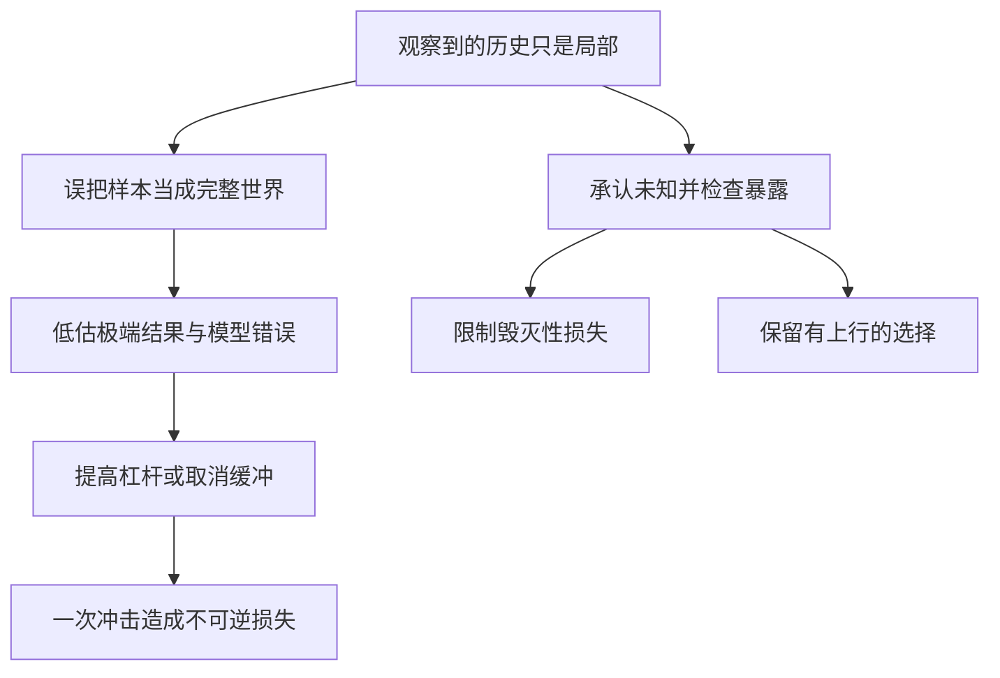

# 《黑天鹅》读书笔记

> 书名：*The Black Swan: The Impact of the Highly Improbable*。作者：纳西姆·尼古拉斯·塔勒布。资料核对日期：2026-11-12。
>
> 版本与范围：核对英文 2010 年第二版，含新增的 “On Robustness and Fragility”；具体中文译本、译者及对应页码未确认。本笔记是**基于公开资料的系统导读**，使用出版社书介与作者访谈、公开目录、研究作者资料及官方历史记录，没有取得完整原书，不声称逐页精读。以下 26 个知识点按理解顺序重组；现实案例及财商应用是补充教学，不全部来自原书。

## 先用五分钟理解这本书

这本书问的不是“下一次危机会在何时发生”，而是：**当决定结果的事件恰好不在我们的历史经验里，为什么我们仍然那么相信自己的预测？**

塔勒布用“黑天鹅”指在观察者原有认识之外、产生巨大影响、事后又被解释得仿佛早可预见的事件。他反对把平稳时期积累的自信，直接当成面对极端事件时的知识。对于投资者，本书最有价值的转变是：从“证明我的预测正确”，转向“即使预测错了，我是否还能继续行动”。[出版社书页与作者访谈](https://www.penguinrandomhouse.com/books/176226/the-black-swan-second-edition-by-nassim-nicholas-taleb/)

读完应该获得四种能力：区分可估计的日常波动与模型之外的不确定性；识别极少数结果主导整体的领域；发现历史记录和成功故事缺失了什么；把风险审查落实到负债、流动性、承诺和生存条件。

它并不证明一切预测都无用，也没有提供能稳定捕捉暴涨暴跌的交易秘诀。读者应保留作者的警觉，同时检验其强烈措辞的适用范围。

## 全书主题地图

| 原书主要部分或主题 | 要回答的问题 | 本笔记对应 |
|---|---|---|
| 第一部分：对已知信息的迷恋、归纳、叙事、沉默证据 | 我们如何把有限经验误认成整个世界？ | 01—05、10—14 |
| 第二部分：预测的困难与知识边界 | 为什么解释过去比预见未来容易？ | 15—19 |
| 第三部分：极端世界、钟形曲线、分形随机性 | 少数大事件会怎样改变统计方法的可靠程度？ | 06—09、17—18 |
| 第四部分与第二版增补：应对黑天鹅、稳健与脆弱 | 不知道未来时，如何组织行动？ | 20—26 |

此表是主题对应，不是逐章译名或原目录逐条转录。[公开目录与版本记录](https://books.google.com/books/about/The_Black_Swan_Second_Edition.html?id=GSBcQVd3MqYC)

读图：危险往往不只是“没有猜中”，而是根据不可靠的猜测，把自己放进了无法承受错误的位置。这是概念示意，不是测量出的因果模型。

## 26 个核心知识点

### 01｜黑天鹅的三个特征要一起看

仅仅罕见，并不自动成为书中意义的黑天鹅。已知概率极低的抽奖头奖，仍然位于规则描述之内。塔勒布强调的是：事前超出通常预期、影响重大，以及事后解释把惊讶抹平。

第三点很重要。一旦结果发生，人们会从海量旧信息里挑出一条通往结果的道路，忘记当时还有很多没有实现的可能。一个解释可以符合事实，却仍然没有预测能力。因此，检验“早就知道”应查看当时留下的记录、概率和期限，而不是听事后故事。

### 02｜“谁不知道”比“是否意外”更重要

黑天鹅具有观察者视角。对普通公众意外的事情，可能早已是某个专业领域的已知风险；知道一类风险存在，也不等于知道它的具体日期、地点和演化路径。

**真实案例：疫情风险并非在 2020 年才被想象出来。**全球防范监测委员会在 2019 年 9 月的《A World at Risk》中，专门要求为快速传播的致命呼吸道病原体大流行作准备。这个时间点和报告内容足以否定“此前没有人考虑过全球大流行”这种笼统说法。报告没有因此精确预测后来某次疫情的所有特征。[GPMB 2019 年报告](https://gpmb.org/reports/m/item/2019-a-world-at-risk)

把这件事拆开，至少有三种不同的“未知”：不知道风险类别，不知道发生时间，不知道具体损失规模。三者对应的决策不同。第一种需要扩大搜索；第二种需要可长期维持的准备；第三种需要压力情景和缓冲。把它们全部叫作无法预见，会掩盖原本可以准备的部分。

对财商的启发也应这样具体：无法预测失业、客户违约或市场中断的日期，不等于无法检查自己是否依赖单一收入、短期续借或随时卖出资产。**未知时间不构成取消准备的理由。**反过来，事后找到一份一般性警告，也不能据此夸大某个人准确预测了全部过程。

### 03｜黑天鹅也可能带来正向结果

重大发明、传播爆发和新市场可能带来难以提前估计的上行。因此，本书不是单纯的灾难清单。关键是区分两种暴露：一次坏结果能把多年积累清零，还是许多小尝试中的一次成功能补偿失败。

正向结果存在，不等于所有高风险活动都有正的期望收益。获得机会的成本、失败频率和收益分配规则仍然必须核对。高赔率与好机会并不是同义词。

### 04｜知识的不透明：看见结果，不等于看见生成过程

同一个价格走势可能由资金流、业绩变化、制度规则和偶然交易共同产生。仅凭最终曲线，往往无法唯一倒推出背后的机制。这种“从结果逆推原因有多解”的困难，是知识不透明的一部分。

实务上，应区分三个句子：“发生了什么”“一种可能解释是什么”“已经排除了其他解释”。很多分析只完成前两步，却使用第三步的确定语气。

### 05｜反向图书馆：知道自己还不知道什么

书中借图书馆讨论知识态度：未掌握的领域不是装饰，它提醒人不要把已经读过的内容当成世界的边界。真正有用的学习成果，不只是答案数量增加，还包括知道哪些问题暂时回答不了。

做公司研究时，可以保留一栏“无法确认”：重大客户依赖、表外承诺、管理层估计、政策敏感度。空白不是必须立即用猜测填满的缺陷；它本身会改变你愿意承担多少不可逆承诺。

### 06｜平均世界：个体很难改变总体

作者用“平均世界”描述许多个体影响相对受限的情境。随着样本积累，单个观察值通常不容易彻底推翻整体判断，均值与波动区间可以相对稳定。

这里的关键不是所有数据都严格服从正态分布，而是个体影响有没有自然上限、尾部是否足够温和、观察值是否近似独立。即使讨论身高这类常见示例，抽样方式和人群差异仍会影响结论，不能见到“平均”二字就停止审查。

### 07｜极端世界：少数结果可能贡献大部分总量

在财富、企业规模、作品传播等领域，结果可能高度不对称。一个极大值对总体的影响，远超大量普通值。这时“典型个体”与“总体回报”不是同一问题。

**真实研究：股票创造财富的高度集中。**Bessembinder 对美国股票历史数据的研究显示，在其早期研究样本中，约 4% 的股票解释了相对于一个月国库券的全部净财富创造，其余约 96% 的股票合起来与这一基准相当。这里讲的是**集合的财富创造贡献**，不是“96% 的股票分别都没有跑赢”，也不是 2026 年的实时市场比例。[研究作者所在院校的研究与数据说明](https://www.wpcarey.asu.edu/department-finance/faculty-research/do-stocks-outperform-treasury-bills)

这个结果为什么难懂？因为人们习惯从市场长期总体上涨，推导出“随便挑一只并长期持有大概差不多”。但当贡献高度集中时，组合有没有包含少数大赢家，会显著影响结果。对个股收益做简单的“典型公司”想象，可能漏掉真正决定总体的右尾。

这并不推出“应该集中押注未来赢家”。恰恰相反，**事后知道赢家稀少，不等于事前知道赢家是谁**。它提示要同时讨论覆盖范围、退市样本、持有过程和价格，而不是仅研究今天还很成功的企业。

该研究也没有证明所有金融变量都服从某个固定幂律。财富集中是具体事实；把它概括为极端世界的直觉，是本笔记的解释；由此直接推导某只股票的预期回报，则缺少证据。

### 08｜可扩展性：同一成果可以服务更多人

“可扩展”指成果扩大时，不必按同等比例增加个人工时。可复制的软件、版权和平台容易出现巨大规模差异；直接按工时提供的服务往往受到时间限制。

可扩展性使少数成功的上限更高，同时也可能加剧竞争和失败者数量。它不是一种道德评价，更不保证可扩展行业的每家公司都赚钱。投资时还要问竞争者能否复制、利润归谁以及购买价格是否已经包含极乐观预期。

### 09｜平均收益和典型经历可能分离

高度偏斜的分布中，算术均值可能被少数巨大结果拉高，大多数参与者的实际经历却远低于这个均值。因此要同时看中位数、分位数、失败率和极端结果贡献。

复利又增加了路径问题：资产先损失 50% 再上涨 50%，最终是原来的 75%，不是回到起点。这个纯数学演示说明，同样的百分比正负变化不能简单相消；它不意味着所有波动必然降低所有形式的收益。

### 10｜沉默证据：留下来的记录不是全部记录

成功者愿意出书，存续公司持续公告，消失的基金却可能从方便使用的样本中退出。只研究留下来的对象，会把筛选机制误当成成功机制。

**真实制度实践：CRSP 的基金数据库同时保留活跃与不再活跃的基金。**这样设计，是为了让研究者能够处理基金退出带来的幸存者偏差。保留失败记录并不自动消除所有偏差，但删除失败者会直接改变我们所看到的成功率。[CRSP 基金数据库说明](https://indexes.morningstar.com/research-data-products/crsp-survivor-bias-free-us-mutual-fund-database)

读投资方法时，除了问“谁用了以后成功”，还要问“有多少人用过、失败者在哪里、采用该方法的完整起点样本是什么”。

### 11｜火鸡问题：更多重复数据也可能增强错误自信

书中“长期被喂养的火鸡”是用于讨论归纳的寓言，不是真实研究。寓意是：在一个一直未暴露关键机制的样本里，连续好结果可能让观察者越来越相信安全，直到制度或目的发生决定性变化。

这个寓言不证明经验学习无效。它要求先问经验为什么有代表性：训练数据是否包含危险状态，规则是否可能改变，谁掌握你看不到的信息。数据量与数据的适用范围是两个问题。

### 12｜验证与反证并不对称

许多支持例子可以增强一个判断，却未必足以证明它在所有条件下成立；一个可靠反例则可能直接否定绝对命题。实际研究中，反例也要排除测量错误和定义变化，不能机械“一次失败就全盘否定”。

有用的做法是把投资逻辑写成可被推翻的形式：不是“公司长期优秀”，而是哪些事实如果持续出现，就说明原判断的关键机制已经改变。这样，资料搜集才不只是寻找赞同。

### 13｜叙事谬误：故事把复杂性压缩得过头

故事能组织信息，却容易把时间顺序改写成因果链，把偶然结果改写成命中注定。对重大事件，尤其要防止用单一英雄、单一错误或单一新闻解释全部变化。

改进不是拒绝解释，而是同时保留替代解释和未解释部分。一个有用的解释应产生可检验的预期：如果机制真是如此，还应该看到什么？若任何结果都能被同一故事解释，它的决策价值就有限。

### 14｜事后合理化与真实预测要分账

对已经发生的事件，人们可以无限挑选起点、指标和预言。真正的预测则要事前确定对象、时间、结果定义和置信程度，并保留所有预测记录。

检查预测者时，不只数命中的次数，还要看误报、含糊表述、不断延期，以及建议给使用者造成的成本。长期喊危机后终于碰到一次危机，不足以说明长期跟随该建议是好决策。

### 15｜地图不是世界：模型总有遗漏

模型必须省略细节，否则无法使用。问题出在我们忘了哪些细节被省略，或者把方便计算的假设当成客观规律。

把模型当工具时，应写清适用条件和失效信号。只在平稳时期有效的模型，并非毫无价值；危险在于用它推算从未出现的流动性枯竭，再把计算输出称为精确的最大损失。

### 16｜游戏谬误：现实没有赌场那么完整的规则

赌场中的概率题通常预先给定结果空间和规则。现实决策还可能出现规则改变、合同执行失败、信息造假以及没有列入表格的新路径。计算得很精确，可能只是精确计算了一个不完整的问题。

因此，概率之外还要问：“有哪些结果根本没有放进模型？”这不是反数学，而是先确保数学描述的对象足够贴近问题。规则清楚的计算与规则本身不确定的推断，不能使用同一种确定语气。

### 17｜肥尾：极端变化比温和模型设想得更重要

“尾部”指分布两端的罕见结果；“肥尾”强调极端值衰减得没有某些常见模型那么快。这里不要求读者先掌握复杂分布，而要理解：如果大冲击贡献了大量风险，靠普通日子的波动估计，可能严重低估真正的损失。

**真实事件：1987 年 10 月 19 日，道琼斯工业平均指数单日下跌 22.6%。**美联储历史资料同时记录了组合保险相关卖出、市场结构与清算安排等因素。这个数字不能直接套进任意日常波动率，宣布它是某个“亿年一遇”的概率；那样的结论高度依赖分布和参数假设。[美联储：1987 年股灾](https://www.federalreservehistory.org/essays/stock-market-crash-of-1987)

这个案例更值得学习的是反馈：价格下跌会触发进一步卖出，卖出又影响价格和可成交性。市场参与者会响应变化，因而历史回报并不一定是一袋互不影响、始终来自同一机制的随机数。

从这里得到的检查步骤是：先看风险是否可能相互强化，再检查模型有没有处理这种状态，最后问即便概率估错，损失会不会超出承受范围。**不能因为无法估准极端概率，就假装极端损失不存在。**

边界也同样重要：一次暴跌不能单独证明某个特定分布永远成立，肥尾也不表示明天必然暴跌。它改变的是对模型精度和安全余量的要求，不是提供择时信号。

### 18｜参数不确定性：风险数字本身也有风险

报告中的波动率、违约率、相关系数通常是估计值，而非自然常数。如果这些估计也会变化，那么只使用一个最佳估计，会隐藏第二层不确定性。

应至少比较不同窗口、不同情景和不同方法下的结果。模型输出变化极大时，结论应更保守，不能只挑最顺眼的一组。某些尾部情境下，精确概率难以识别；这时结构性的损失上限，可能比多写几位小数更有用。

### 19｜预测期限越长，机制变化越值得关注

长期预测不仅是把短期误差相加。技术、竞争、政策与参与者反应可能改变原来的关系，导致模型越走越偏。

合理做法是区分短期可校验的预测、长期情景和用于决策的假设。长期情景不需要伪装成一条确定路径；它的价值在于暴露不同未来下的约束，让今天的决定不必押中唯一答案。

### 20｜毁灭性风险：先判断是否会失去继续参与的资格

如果失败只是可承受的损失，可以反复学习；如果失败造成破产或不可逆义务，未来的好结果就没有机会兑现。风险评价因此不能只比较平均收益。

对个人财务，这意味着把生活必需资金、短期必须支付的款项与高不确定性尝试区别开来。这里没有统一的比例建议：真正要核对的是负债到期、家庭支出、收入稳定性和资金可用性，不能凭一本书推断读者适合多少风险。

### 21｜杠铃思路：把生存底线与探索机会分开设计

塔勒布提出的杠铃思路，是在一端尽量减少不可承受风险，在另一端保留有限损失的高不确定性机会，避免把全部资金放进自以为“中等风险”、实际隐藏尾部暴露的结构。

它的逻辑不是“保守资产加最刺激资产一定最优”。先要确认安全端真的能满足所需期限与币种的支付；机会端的亏损是否有上限；双方是否共享同一风险源。若所谓安全端依赖同一家脆弱机构，或机会端含追加保证金义务，组合看上去分成两头，实际上仍可能一起失败。

这也说明为什么不能抄一个固定仓位比例。不同人的现金流、合同、税费和风险承受能力不同，名义相同的资产可能承担不同角色。**可迁移的是分清功能与损失边界的方法，不是某组数字。**

另一个误读是忽略等待成本。保守资金可能有通胀成本，探索机会可能长期没有收益，持续购买保护也可能很贵。因此杠铃需要比较净成本、执行条件和可持续性，不能因为概念优美就跳过估值。

### 22｜选择权：未来知道更多时再决定

选择权的价值在于保留行动自由：坏情况出现时可以放弃，好情况出现时能够继续。但必须真的可以放弃，且不必承担无限追加义务。

在财商应用中，现金、分阶段承诺和可撤回的小试验都可能保留选择空间；它们与金融期权不是同一产品。任何选择权都有显性或隐性成本，未来可能性很大，并不代表购买它的价格合理。

### 23｜不要用连续成功取代安全机制证据

**真实案例：挑战者号事故调查中的可靠性分歧。**费曼在罗杰斯委员会报告附录中记录，工程人员与管理层对重大失败概率的判断差距很大，并批评用“此前这样飞过而没有失败”来证明再次接受异常是安全的。他特别指出，密封圈侵蚀是偏离设计预期的警告，不能因为之前没有造成灾难就将其改写成安全证据。[NASA 保存的费曼调查附录](https://www.nasa.gov/history/rogersrep/v2appf.htm)

把这件事仅称作“不可预测的黑天鹅”反而会丢掉教训。这里存在事前异常和组织判断问题，并非完全没有信息。值得学习的是区分：结果没有出事，与机制已经证明可靠。

为什么一串成功会误导？如果灾难发生概率不高，多次通过完全可能与重大隐患同时存在；如果异常被逐次接受，组织还可能在没有充分证据的情况下扩大容忍范围。只统计成功次数，既忽略近失事件，也忽略暴露条件的变化。

用于投资研究时，可检查利润是否依赖越来越激进的估计、续借是否被当作永远可用、合规例外是否反复被解释为小事。这些是分析者的类比，不是在说企业经营与航天工程可以使用同一概率模型。

较好的处理是寻找机制证据，记录警告并设置触发复核的条件。无法精确计算失败概率，依然可以识别“原安全假设已经不再成立”。

### 24｜冗余：平时闲置的资源可能在异常时决定生存

备用资金、替代供应来源和未用完的借款能力，平时看起来降低效率，但在压力状态下可能避免被迫卖出或停摆。冗余的价值来自状态差异，不能只用平常年份的成本评价。

冗余也不是无限越多越好。需要比较成本、可动用性和共同失效风险。两份依赖同一基础设施的备份，可能并没有看起来那么独立。

### 25｜个人最优与系统安全可能冲突

每个参与者都试图在价格下跌时卖出，个体看起来在减少风险，总体却可能形成拥挤出口。只看单家机构的模型，可能漏掉它的行动对别人、以及别人反过来对它的影响。

因此，“能够随时退出”不只是个人意愿，还取决于是否有对手方、市场能否成交、合同是否允许。风险分析应检查共同暴露与反馈，而不是机械地数账户或产品的个数。

### 26｜承认未知之后，仍然要做有纪律的判断

本书容易被读成“既然什么都不知道，就凭感觉”。更有价值的读法恰好相反：把确定程度说准确，把推翻条件写清，把不可逆代价限制在承受范围内。

知识边界不等于所有观点一样可靠。可以比较证据质量、数据完整性、机制合理性和历史校准。目标是让行动所需要的精确度，不超过证据真正能够提供的精确度。

## 把书中的思想变成检查流程

读图：顺序从问题结构出发，再检查证据，最后决定承诺。它不会产出自动买卖指令，而是防止把不确定的判断转成过度确定的行动。

| 读书后可以获得的能力 | 一个可交付的成果 |
|---|---|
| 区分预测失败与结构脆弱 | 写出三个即使无法预测日期也应准备的风险类别 |
| 发现被筛选过的历史 | 在数据说明中查找退市、清盘、缺失和样本起点 |
| 审查尾部暴露 | 列明追加资金义务、最大可能损失与强制退出条件 |
| 控制叙事诱惑 | 对一个结论同时写下替代解释与反证 |
| 避免精度错觉 | 把点预测改成情景、区间和需要更新的条件 |

## 练习与参考答案

**练习一：**2019 年已经有全球大流行警告，是否说明后来每次疫情冲击都完全可预测？

**参考答案：**不能。它说明这一风险类别已被明确识别，不能把缺乏准备一概解释为无人可知；但发生时间、具体病原体、政策反应及损失路径仍有不确定性。已知类别与精确事件预测应分开。

**练习二：**研究表明少数股票贡献大部分净财富创造，能否据此集中买入今天规模最大的公司？

**参考答案：**不能。研究描述历史贡献分布，没有给出未来赢家识别规则，也没有评价今天的价格。把事后筛出的赢家当成事前可选择的对象，重新引入了选择偏差。

**练习三：**用 1987 年股灾证明“所有风险模型都没用”，问题在哪里？

**参考答案：**模型有范围。事件可以暴露某些平稳性、分布或流动性假设的不足，但不足以否定所有模型。应问模型在哪些状态下可靠、遗漏了什么，以及错误会造成何种后果。

**练习四：**从费曼附录选出一句推理，解释“没有失败”与“证明安全”的区别，不需要摘抄原文。

**参考答案：**过去接受过密封圈异常而未出现灾难，不能证明异常无害。需要解释异常机制及边界，并检查下一次条件是否改变。顺利结果只提供有限证据，不能代替对设计偏离的调查。

## 来源、争议与资料缺口

- [英文第二版出版社书页及作者访谈](https://www.penguinrandomhouse.com/books/176226/the-black-swan-second-edition-by-nassim-nicholas-taleb/)：核对版本、核心问题；其中叶甫盖尼娅是作者明确说明的虚构人物，本笔记未当作现实案例。
- [公开目录与版本](https://books.google.com/books/about/The_Black_Swan_Second_Edition.html?id=GSBcQVd3MqYC)：用于主题定位，不用于编造正文或中文页码。
- [GPMB 2019 年报告](https://gpmb.org/reports/m/item/2019-a-world-at-risk)：事前风险识别案例。
- [Bessembinder 研究与数据入口](https://www.wpcarey.asu.edu/department-finance/faculty-research/do-stocks-outperform-treasury-bills)：财富创造集中度。本文采用早期研究口径，未与页面中的后续年份更新混算。
- [CRSP 数据库说明](https://indexes.morningstar.com/research-data-products/crsp-survivor-bias-free-us-mutual-fund-database)：失败与退出样本的保留。
- [美联储 1987 年股灾历史](https://www.federalreservehistory.org/essays/stock-market-crash-of-1987)：单日变化及市场机制背景。
- [NASA 事故调查附录 F](https://www.nasa.gov/history/rogersrep/v2appf.htm)：可靠性判断与异常警告。

主要边界：平均世界与极端世界是帮助思考的分类，不应抹平不同数据生成过程的差异；黑天鹅的认定依赖观察者和事前知识；作者对预测与模型的广泛批评，不等于经过逐领域验证的“所有预测都无效”。上述真实案例说明具体机制，没有逐一检验塔勒布整套哲学。未覆盖完整原书的全部文学叙述、技术附注及不同译本措辞，后续取得原文可进一步逐章校对。

---

[返回书籍索引](../README.md) · [财商学习与实践路线](../财商进阶合订本.md)
